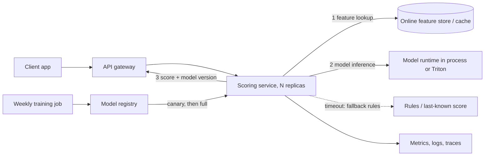

# Book 4 — Part 6: Model serving: FastAPI, batch vs real-time, Triton, BentoML

**Topic:** model serving for ML: FastAPI model APIs (pydantic validation, lifespan model loading, async versus sync, workers, health and readiness), batch versus real-time versus streaming inference, REST versus gRPC, latency, throughput and p99, batching and dynamic batching, concurrency and capacity, model formats (pickle, joblib, ONNX, TorchScript), ONNX Runtime, Triton Inference Server (model repository, config.pbtxt, dynamic batching, ensembles), BentoML, TorchServe, KServe and Seldon at concept level, canary, shadow and A/B rollout, caching, autoscaling, GPU serving, versioned APIs, error handling, load testing, and the boundary with LLM serving
**Target:** 45  |  **Actual:** 45 (⭐⭐⭐ 17, ⭐⭐ 18, ⭐ 10)  |  **Date:** 2026-10-26  |  **Status:** Questions frozen (Wave A); answers pending (Wave B)

Scope note: Part 1 owns Git and testing basics; Part 2 owns Docker (images, GPU containers); Part 3 owns Kubernetes, Helm and cluster autoscaling; Part 4 owns DVC, MLflow and the model registry; Part 5 owns pipelines and orchestration; Part 7 owns CI/CD and promotion gates; Part 8 owns model monitoring, drift and data-quality monitoring; Part 9 owns feature stores, Kafka and Spark; Parts 10 and 11 own AWS, Azure and GCP services; Part 12 owns cost and system design in depth; Book 2 owns LLM internals (vLLM, KV cache, RAG); Book 3 owns SQL; Book 6 owns product and business.

Evidence limits: the pages found could not be opened (WebFetch failed with getaddrinfo ENOTFOUND for fastapi.tiangolo.com), so every source is a search snippet only (see research_notes/Book4_Part06_sources.md). No page was found that reports exact serving questions asked by a named company at an India or global ML role; 'Asked at' tags therefore name source types (editorial guides, docs, job postings), not verified company reports. Execution limit: pip install worked through the proxy in a fresh venv, so Wave B can really run FastAPI 0.162.0 (TestClient and a real uvicorn 0.54.0 on localhost with curl and httpx 0.28.1), pytest 9.1.1, scikit-learn 1.9.1, skl2onnx 1.20.0, onnx 1.23.2, onnxruntime 1.31.0 (CPU), BentoML 1.4.40 (bentoml serve and bentoml build ran locally), tritonclient 2.73.0 (client library only) and PyTorch 2.14.1 (CPU use; TorchScript and torch.onnx export) on Python 3.13. Everything needing a Triton server, GPU, Docker daemon, Kubernetes or KServe cluster, Redis, Kafka, a cloud service or a multi-machine load test must be labelled 'not executed'. Latency and throughput figures from this sandbox are machine-specific demos, not benchmarks.

---

### Q1 ⭐⭐⭐ 🟢 Build a model prediction API with FastAPI. Explain the request and response models with pydantic (types, Field constraints, why a typo or a wrong-length feature list returns 422 before your model sees it), loading the model once at startup with the lifespan function instead of per request, a predict endpoint, a health endpoint, and keeping the model in app state. Use a small scikit-learn model exported to ONNX and served with onnxruntime. Test it with pytest and TestClient, and show the real 200 and 422 responses. Also run it once under a real uvicorn on localhost and call it with curl.
**Asked at:** FastAPI docs and tutorials (fastapi.tiangolo.com advanced events/lifespan page, reintech.io 'FastAPI ML model serving production REST APIs', docs.truefoundry.com deploy-model-fastapi; search snippets only, not opened); docs and tutorials, not interview reports; ML engineer and MLOps roles that ship model APIs, including IT-services firms, product companies and GCCs
**Say this first (1 line):** I load the ONNX model once in the lifespan function, keep it in `app.state`, and let pydantic reject bad input with a 422 before my model code runs.

**Then explain:**
- Pydantic models are the contract. `features: list[float]` with `min_length=4, max_length=4` means a wrong-length list, a string in the list, or a missing key never reaches the model. `extra="forbid"` turns a typo like `feature` into a 422 instead of a silent ignore.
- Lifespan runs once before the first request. Loading per request would cost milliseconds to seconds on every call and would make memory spike under load. The session lives in `app.state.session` and is shared by all requests.
- Failure modes: the model file is missing, so startup fails and the pod never becomes ready (good, loud). The model is loaded but the input is float64, which ONNX Runtime rejects (cast to float32 yourself). Do not use a module-level global that is loaded at import time, because tests and tooling then load the model just by importing the file.
- `def` endpoint on purpose: ONNX Runtime releases the GIL, so FastAPI's threadpool handles concurrency (Q2 explains why).
- A health route is separate from predict. Here `/readyz` returns 503 until the session exists (Q4 goes deep).

**Example:** the iris row `[6.7, 3.0, 5.2, 2.3]` is class 2 (virginica). Send 3 numbers instead of 4 and you get 422 `too_short` at `body.features`. Hand check: a 4-feature request must have exactly 4 numbers, so 3 fails.

**Code:** (one python block with the app and its test; one bash block for the real uvicorn run)
```python
# ===== q01/app.py =====
import os
from contextlib import asynccontextmanager
import numpy as np
import onnxruntime as ort
from fastapi import FastAPI, Request, Response
from pydantic import BaseModel, Field, ConfigDict

MODEL_PATH = os.environ.get("MODEL_PATH", "iris_v1.onnx")
LABELS = ["setosa", "versicolor", "virginica"]


class PredictRequest(BaseModel):
    model_config = ConfigDict(extra="forbid")          # a typo'd key -> 422
    features: list[float] = Field(min_length=4, max_length=4,
                                  description="sepal_len, sepal_wid, petal_len, petal_wid (cm)")


class PredictResponse(BaseModel):
    label: int
    name: str
    probabilities: list[float]


@asynccontextmanager
async def lifespan(app: FastAPI):
    # runs ONCE at startup, before the first request
    app.state.session = ort.InferenceSession(MODEL_PATH, providers=["CPUExecutionProvider"])
    app.state.input_name = app.state.session.get_inputs()[0].name
    yield
    app.state.session = None                           # shutdown: release


app = FastAPI(lifespan=lifespan)


@app.get("/readyz")
def readyz(request: Request, response: Response):
    if getattr(request.app.state, "session", None) is None:
        response.status_code = 503
        return {"status": "loading"}
    return {"status": "ready"}


@app.post("/v1/predict", response_model=PredictResponse)
def predict(req: PredictRequest, request: Request):
    x = np.asarray([req.features], dtype=np.float32)
    label, probs = request.app.state.session.run(None, {request.app.state.input_name: x})
    return PredictResponse(label=int(label[0]), name=LABELS[int(label[0])],
                           probabilities=[round(float(p), 4) for p in probs[0]])

# ===== q01/test_app.py =====
import os
os.environ.setdefault("MODEL_PATH", "/tmp/claude-0/b6_q1_12/models/iris_v1.onnx")
from fastapi.testclient import TestClient
from app import app


def test_ok():
    with TestClient(app) as c:                       # `with` runs the lifespan
        r = c.post("/v1/predict", json={"features": [6.7, 3.0, 5.2, 2.3]})
        print(r.status_code, r.json())
        assert r.status_code == 200 and r.json()["name"] == "virginica"


def test_wrong_length_422():
    with TestClient(app) as c:
        r = c.post("/v1/predict", json={"features": [1.0, 2.0, 3.0]})
        print(r.status_code, r.json()["detail"][0]["type"], r.json()["detail"][0]["loc"])
        assert r.status_code == 422


def test_typo_key_and_bad_type_422():
    with TestClient(app) as c:
        r1 = c.post("/v1/predict", json={"feature": [1, 2, 3, 4]})
        r2 = c.post("/v1/predict", json={"features": [1, 2, "abc", 4]})
        print(r1.status_code, [e["type"] for e in r1.json()["detail"]])
        print(r2.status_code, [e["type"] for e in r2.json()["detail"]])
        assert r1.status_code == r2.status_code == 422
```
```bash
# make the model once (see code/mkmodel.py), then:
cd code && python -m pytest q01 -q -s
cd q01 && MODEL_PATH=/tmp/claude-0/b6_q1_12/models/iris_v1.onnx python -m uvicorn app:app --port 8101 --log-level warning &
curl -s -i localhost:8101/readyz | sed -n '1p;$p'
curl -s -X POST localhost:8101/v1/predict -H 'content-type: application/json' -d '{"features":[6.7,3.0,5.2,2.3]}'
curl -s -w ' [HTTP %{http_code}]\n' -X POST localhost:8101/v1/predict -H 'content-type: application/json' -d '{"features":[1,2,3]}'
kill %1
```

**Output (my run):** fastapi 0.162.0, pydantic 2.14.1, onnxruntime 1.31.0, uvicorn 0.54.0, Python 3.13 (one sandbox, check current docs for your versions). Pytest with `-s`:
```
200 {'label': 2, 'name': 'virginica', 'probabilities': [0.0001, 0.0807, 0.9193]}
422 too_short ['body', 'features']
422 ['missing', 'extra_forbidden']
422 ['float_parsing']
3 passed, 1 warning in 0.46s
```
Real uvicorn on localhost:8101 plus curl:
```
HTTP/1.1 200 OK
{"status":"ready"}
{"label":2,"name":"virginica","probabilities":[0.0001,0.0807,0.9193]}
{"detail":[{"type":"too_short","loc":["body","features"],"msg":"List should have at least 4 items after validation, not 3","input":[1,2,3],"ctx":{"field_type":"List","min_length":4,"actual_length":3}}]} [HTTP 422]
```
The server was stopped afterwards. The one warning is a Starlette notice about the TestClient and httpx; it still works.

**Follow-ups:**
- *Why not load the model at import time?* Tests and tools that import the module would pay the load cost, and failures hit before the app can report them. Lifespan gives one clear place.
- *What does `with TestClient(app)` do?* It runs lifespan. Without `with`, the model is not loaded (Q4 proves this).
- *How do I return 400 instead of 422?* You can register a handler, but 422 is the FastAPI default and clients usually cope; pick one and keep it consistent (Q8).

**Common mistakes:**
- Loading the model inside the endpoint.
- Using `list` with no length limit, so a 3-feature request crashes inside the model as a 500.
- Forgetting `extra="forbid"` and silently ignoring a misspelled field.
- Testing without `with TestClient(app)` and wondering why `app.state.session` is missing.

---

### Q2 ⭐⭐⭐ 🟡 async def versus def for a FastAPI model endpoint. Explain the event loop, why a CPU-bound or blocking model call inside async def freezes every other request (including the health check), how plain def endpoints run in a threadpool, when async def is right (awaiting an HTTP call, a database or a queue), and the fixes for heavy inference (def endpoint, run_in_threadpool, a process pool, or a separate model server). Include the GIL point: threads help only when the model call releases the GIL, as ONNX Runtime and NumPy mostly do. Show a small experiment where a 0.3 s blocking call in async def delays a concurrent /health call and the def version does not. Run it with httpx on localhost and show the timings as labelled machine-specific.
**Asked at:** FastAPI docs and tutorials (fastapi.tiangolo.com advanced events/lifespan page, reintech.io 'FastAPI ML model serving production REST APIs', docs.truefoundry.com deploy-model-fastapi; search snippets only, not opened); docs and tutorials, not interview reports; ML engineer and MLOps roles that ship model APIs, including IT-services firms, product companies and GCCs
**Say this first (1 line):** `async def` runs on the single event loop thread, so a blocking model call inside it freezes everything, including `/health`; a plain `def` endpoint runs in a threadpool and does not.

**Then explain:**
- One event loop thread handles all `async def` code. It only switches tasks at an `await`. A `time.sleep(0.3)` or a 300 ms `session.run()` has no await, so nothing else runs for 300 ms. Health probes time out and the orchestrator may kill a healthy pod.
- FastAPI runs a plain `def` endpoint in a worker thread (anyio threadpool, 40 threads by default; check current docs). The loop stays free.
- Use `async def` only when the body awaits something: an HTTP call, a database driver with async support, a queue. Use `def` for CPU-bound or blocking work like model inference.
- GIL point: threads only help if the call releases the GIL. ONNX Runtime and NumPy mostly do, so threads give real parallelism. Pure Python loops and many Python pre-processing steps do not, so threads will not speed them up.
- Fixes for heavy inference: `def` endpoint, `await run_in_threadpool(fn)` from an async endpoint, a process pool for pure-Python CPU work, or a separate model server (Triton, BentoML) when you need batching or GPUs.
- Failure mode: the threadpool is finite. Too many slow `def` requests queue up behind it; limit concurrency and set timeouts.

**Example:** four requests of 0.3 s each. On the event loop they run one after another, about 4 x 0.3 = 1.2 s total. In threads (and a work call that really does sleep and not compute) they overlap, about 0.3 s total. A `/health` call that arrives 50 ms into a 300 ms blocking call waits about 300 - 50 = 250 ms.

**Code:**
```python
# ===== q02/app.py =====
import time
from fastapi import FastAPI
from fastapi.concurrency import run_in_threadpool

app = FastAPI()

def heavy():                      # stands in for a blocking model call (0.3 s)
    time.sleep(0.3)
    return {"ok": True}

@app.get("/health")
async def health():
    return {"status": "ok"}

@app.get("/slow_async")           # BAD: blocking call on the event loop
async def slow_async():
    return heavy()

@app.get("/slow_def")             # OK: FastAPI runs plain def in a threadpool
def slow_def():
    return heavy()

@app.get("/slow_async_pool")      # OK: async def, but blocking work pushed to a thread
async def slow_async_pool():
    return await run_in_threadpool(heavy)

# ===== q02/experiment.py =====
import asyncio, time, httpx

BASE = "http://127.0.0.1:8102"

async def trial(client, path):
    slow = asyncio.create_task(client.get(path))
    await asyncio.sleep(0.05)                      # slow request is now running
    t = time.perf_counter()
    h = await client.get("/health")
    health_ms = (time.perf_counter() - t) * 1000
    await slow
    return health_ms

async def main():
    async with httpx.AsyncClient(base_url=BASE, timeout=10) as c:
        await c.get("/health")                     # warm up
        t = time.perf_counter(); await c.get("/health")
        print(f"idle /health            : {(time.perf_counter()-t)*1000:7.1f} ms")
        for path in ["/slow_async", "/slow_def", "/slow_async_pool"]:
            ms = await trial(c, path)
            print(f"/health during {path:17s}: {ms:7.1f} ms")
        # 4 concurrent slow requests, total wall time
        for path in ["/slow_async", "/slow_def"]:
            t = time.perf_counter()
            await asyncio.gather(*[c.get(path) for _ in range(4)])
            print(f"4 concurrent {path:12s} wall: {(time.perf_counter()-t)*1000:7.1f} ms")

asyncio.run(main())
```
```bash
cd code/q02
python -m uvicorn app:app --port 8102 --log-level warning &
python -I experiment.py
kill %1
```

**Output (my run):** machine-specific, a 4-core sandbox, not a benchmark. `time.sleep` stands in for a model call that releases the GIL.
```
idle /health            :     2.6 ms
/health during /slow_async      :   253.3 ms
/health during /slow_def        :     3.1 ms
/health during /slow_async_pool :     2.7 ms
4 concurrent /slow_async  wall:  1208.2 ms
4 concurrent /slow_def    wall:   308.1 ms
```
The 253 ms matches the hand estimate (300 minus the 50 ms head start). The server was stopped afterwards.

**Follow-ups:**
- *Is `async def` faster?* Not for CPU work. It only helps when you wait on I/O.
- *Can I call a sync library from async def?* Only through `run_in_threadpool` or `asyncio.to_thread`.
- *What about a heavy pure-Python model?* The GIL blocks thread parallelism, so use processes (Q3) or a model server.

**Common mistakes:**
- Marking everything `async def` out of habit.
- Calling `requests` or `session.run` inside `async def`.
- Putting the health check behind the same blocked loop and not noticing until pods restart.
- Assuming the 40-thread default is infinite.

---

### Q3 ⭐⭐⭐ 🟡 Workers and process model for a model API: uvicorn --workers, gunicorn with uvicorn workers, one process per CPU core, why each worker loads its own copy of the model (memory multiplies), preloading and copy-on-write, threads inside a worker, the number of intra-op threads in the inference library versus the number of workers (oversubscription), and when to scale with more replicas instead of more workers. Give a sizing rule of thumb with arithmetic for a 500 MB model on a 4-core, 8 GB pod, and show how you would check which worker answered a request (a pid in the response). Run a two-worker uvicorn on localhost and show the pids; load tests are not claims about production.
**Asked at:** FastAPI docs and tutorials (fastapi.tiangolo.com advanced events/lifespan page, reintech.io 'FastAPI ML model serving production REST APIs', docs.truefoundry.com deploy-model-fastapi; search snippets only, not opened); docs and tutorials, not interview reports; ML engineer and MLOps roles that ship model APIs, including IT-services firms, product companies and GCCs
**Say this first (1 line):** One worker is one process with its own copy of the model, so I size workers by cores and by memory (copies multiply), keep intra-op threads times workers at or below cores, and add replicas when one pod is full.

**Then explain:**
- `uvicorn --workers N` starts N processes. Each runs the lifespan and loads the model: 500 MB model times 4 workers is about 2 GB, not 500 MB. `gunicorn -k uvicorn.workers.UvicornWorker` (a worker class from the uvicorn project; check current docs, it has moved packages over time) adds a mature process manager that restarts crashed workers.
- Preloading (`--preload` in gunicorn) loads the model once in the parent, and forked children share pages copy-on-write. It saves memory only if the weights are not touched or rewritten; Python reference counting can still dirty pages for Python objects, but large NumPy or ONNX buffers usually stay shared. Measure RSS, do not assume.
- Oversubscription: ONNX Runtime uses `intra_op_num_threads` threads per call. 4 workers x 4 threads on 4 cores means 16 busy threads fighting for 4 cores, so latency gets worse. Rule: workers x intra_op_threads <= cores.
- Threads inside a worker (the `def` threadpool) share one model copy, which is memory-cheap; processes give isolation and GIL-free parallelism for Python code.
- Replicas vs workers: when one pod is out of cores or memory, add replicas. Replicas also give failure isolation and rolling updates. Workers inside one pod cannot exceed the pod's limits.
- Failure modes: OOM kill from forgetting that memory multiplies; a worker crash during a request; uneven distribution, because the kernel hands new connections to workers, so one long-lived connection pins one worker.

**Example (500 MB model, 4-core, 8 GB pod):** reserve about 1.5 GB for OS and runtime, leaving 6.5 GB (6,656 MB). Assume about 1.3 x 500 = 650 MB per worker (weights plus buffers; measure yours). Memory allows 6,656 / 650 = 10 copies, cores allow 4, so start with 4 workers and 1 intra-op thread each. If the model is bigger, say 3 GB, memory allows only 2 copies; then use 2 workers with 2 threads each, or use threads inside one worker.

**Code:**
```python
# ===== q03/app.py =====
import os
from contextlib import asynccontextmanager
import numpy as np, onnxruntime as ort
from fastapi import FastAPI, Request

@asynccontextmanager
async def lifespan(app):
    so = ort.SessionOptions()
    # threads INSIDE one inference call. workers x intra_op threads should be <= cores
    so.intra_op_num_threads = int(os.environ.get("INTRA_OP", "1"))
    app.state.s = ort.InferenceSession(os.environ["MODEL_PATH"], so, providers=["CPUExecutionProvider"])
    app.state.pid = os.getpid()
    yield

app = FastAPI(lifespan=lifespan)

@app.post("/predict")
def predict(request: Request, features: list[float]):
    x = np.asarray([features], dtype=np.float32)
    label, _ = request.app.state.s.run(None, {"X": x})
    return {"label": int(label[0]), "pid": request.app.state.pid}

# ===== q03/who.py =====
import collections, httpx
c = collections.Counter()
for _ in range(40):
    with httpx.Client() as cl:                       # new connection each time
        c[cl.post("http://127.0.0.1:8103/predict", json=[6.7, 3.0, 5.2, 2.3]).json()["pid"]] += 1
print("distinct worker pids:", len(c), "| answers per pid:", sorted(c.values(), reverse=True))

# ===== q03/sizing.py =====
model_mb, cores, pod_gb, reserve_gb = 500, 4, 8, 1.5      # reserve: OS + runtime + headroom
usable_mb = (pod_gb - reserve_gb) * 1024
by_mem = int(usable_mb // (model_mb * 1.3))               # 1.3 = weights + activations/buffers per copy
workers = min(cores, by_mem)
print(f"usable {usable_mb:.0f} MB; each worker ~{model_mb*1.3:.0f} MB -> memory allows {by_mem}")
print(f"cores allow {cores} -> start with {workers} workers, intra_op_threads = {max(1, cores // workers)}")
```
```bash
cd code/q03
MODEL_PATH=/tmp/claude-0/b6_q1_12/models/iris_v1.onnx python -m uvicorn app:app --port 8103 --workers 2 --log-level warning &
python -I who.py      # 40 requests, a new connection each time
python -I sizing.py
kill %1               # stops the parent, which stops its workers
```

**Output (my run):** two workers on localhost:8103, machine-specific:
```
distinct worker pids: 2 | answers per pid: [21, 19]
usable 6656 MB; each worker ~650 MB -> memory allows 10
cores allow 4 -> start with 4 workers, intra_op_threads = 1
```
Two different pids answered, roughly evenly. This is a distribution demo, not a load test. I stopped the server afterwards and checked no process of mine was left.

**Follow-ups:**
- *Why not just 16 workers on 4 cores?* Context switching and memory, with no extra throughput.
- *In Kubernetes, workers or replicas?* Often 1 to a few workers per pod and scale with replicas, so the autoscaler and failures work at pod level (Part 3 owns this).
- *How do you check memory?* Look at RSS per worker, and compare with and without preload.

**Common mistakes:**
- Setting workers = cores x 2 by web-server habit, then OOM.
- Ignoring `intra_op_num_threads`.
- Assuming preload always saves memory.
- Reading a pid demo as proof of scaling.

---

### Q4 ⭐⭐⭐ 🟡 Health, liveness, readiness and startup checks for a model service. Explain what each probe answers, why the model-loaded flag belongs in readiness and not liveness (a restart loop while a big model downloads), a startup probe for slow loads, why a health route that always returns 200 hides a dead worker, a deep check that runs one tiny prediction (and its cost), and what the load balancer does on 503. Show FastAPI /livez, /readyz and /startupz routes and a pytest that proves /readyz is 503 before lifespan runs and 200 after. Kubernetes probe YAML is shown and validated with pyyaml only; Part 3 owns Kubernetes itself.
**Asked at:** FastAPI docs and tutorials (fastapi.tiangolo.com advanced events/lifespan page, reintech.io 'FastAPI ML model serving production REST APIs', docs.truefoundry.com deploy-model-fastapi; search snippets only, not opened); docs and tutorials, not interview reports; ML engineer and MLOps roles that ship model APIs, including IT-services firms, product companies and GCCs
**Say this first (1 line):** Liveness asks "is the process stuck, restart it?", readiness asks "send me traffic now?", startup asks "has the slow boot finished?", and "model loaded" belongs in readiness, never liveness.

**Then explain:**
- Liveness (`/livez`): cheap, no model, no dependencies. If it fails, the orchestrator restarts the container. Putting "model loaded" here causes a restart loop: the model takes 3 minutes to download, liveness fails, pod restarts, download starts again, forever.
- Readiness (`/readyz`): 503 until the model is loaded; the load balancer takes the pod out of rotation on 503 and puts it back on 200. Nothing is restarted.
- Startup (`/startupz`): gives slow loads a long window (period x failureThreshold) before liveness starts to count. Without it you set a huge liveness delay for everyone.
- A route that always returns 200 hides a dead worker or a half-loaded model, and the pod gets traffic it cannot serve.
- Deep check: run one tiny prediction (`/readyz?deep=true`). It proves the graph runs, but it costs CPU every probe and can fail on a transient glitch; use a slow period or run it only at startup, never on a tight loop.
- Catch from my run: if you load the model inside `lifespan` and it blocks, uvicorn does not accept connections until it finishes. The probe then sees connection refused, not 503. That is also "not ready", but if you want a visible 503 and a live `/livez` during loading, start the load in a background task.

**Example:** a 300 MB model that takes 3 s to load. Blocking load: at t = 1.5 s every probe is refused (no listener). Background load: `/livez` 200 and `/readyz` 503 at 1.5 s, then `/readyz` 200 at 4.5 s. YAML window: 5 s x 60 = 300 s startup budget.

**Code:**
```python
# ===== q04/app.py =====
import os, asyncio
from contextlib import asynccontextmanager
import numpy as np, onnxruntime as ort
from fastapi import FastAPI, Request, Response

def _load(app):
    app.state.session = ort.InferenceSession(os.environ["MODEL_PATH"], providers=["CPUExecutionProvider"])
    app.state.loaded = True

@asynccontextmanager
async def lifespan(app):
    app.state.session = None
    app.state.loaded = False
    delay = float(os.environ.get("LOAD_DELAY", "0"))
    if os.environ.get("LOAD_MODE") == "bg":
        # port opens at once; /readyz says 503 until the background load finishes
        async def bg():
            await asyncio.sleep(delay)          # pretend: slow download
            await asyncio.to_thread(_load, app)
        app.state.task = asyncio.create_task(bg())
    else:
        # blocking load: uvicorn does not accept connections until this returns
        await asyncio.sleep(delay)
        _load(app)
    yield

app = FastAPI(lifespan=lifespan)

@app.get("/livez")                       # "is the process alive and the loop responsive?" Nothing about the model.
def livez():
    return {"status": "alive"}

@app.get("/startupz")                    # "has the slow start finished?" Used only while booting.
def startupz(request: Request, response: Response):
    if not getattr(request.app.state, "loaded", False):
        response.status_code = 503
        return {"status": "starting"}
    return {"status": "started"}

@app.get("/readyz")                      # "should I get traffic?" Model loaded (+ optional deep check).
def readyz(request: Request, response: Response, deep: bool = False):
    s = getattr(request.app.state, "session", None)
    if s is None:
        response.status_code = 503
        return {"status": "loading"}
    if deep:                             # costs one tiny inference: keep it off the hot probe path
        try:
            s.run(None, {"X": np.zeros((1, 4), dtype=np.float32)})
        except Exception:
            response.status_code = 503
            return {"status": "model_error"}
    return {"status": "ready"}

# ===== q04/test_probes.py =====
import os
os.environ.setdefault("MODEL_PATH", "/tmp/claude-0/b6_q1_12/models/iris_v1.onnx")
from fastapi.testclient import TestClient
from app import app

def test_not_ready_before_lifespan():
    c = TestClient(app)                              # NO `with`: lifespan has not run
    assert c.get("/livez").status_code == 200        # alive...
    r = c.get("/readyz")
    print("before lifespan:", r.status_code, r.json())
    assert r.status_code == 503                      # ...but not ready

def test_ready_after_lifespan():
    with TestClient(app) as c:                       # lifespan ran
        r = c.get("/readyz"); d = c.get("/readyz?deep=true"); s = c.get("/startupz")
        print("after lifespan :", r.status_code, r.json(), "| deep:", d.status_code, "| startup:", s.status_code)
        assert r.status_code == d.status_code == s.status_code == 200

# ===== q04/check_yaml.py =====
import yaml
d = yaml.safe_load(open("probes.yaml"))
for k, v in d.items():
    print(k, v["httpGet"]["path"], "period", v["periodSeconds"], "fail", v["failureThreshold"])
assert d["livenessProbe"]["httpGet"]["path"] != d["readinessProbe"]["httpGet"]["path"]
print("max startup window:", d["startupProbe"]["periodSeconds"] * d["startupProbe"]["failureThreshold"], "s")
```
```yaml
# ===== q04/probes.yaml =====
# Container probe block (Kubernetes pod spec fragment). Not applied to a cluster here.
startupProbe:
  httpGet: {path: /startupz, port: 8000}
  periodSeconds: 5
  failureThreshold: 60        # up to 5 min to download and load the model
livenessProbe:
  httpGet: {path: /livez, port: 8000}
  periodSeconds: 10
  failureThreshold: 3
readinessProbe:
  httpGet: {path: /readyz, port: 8000}
  periodSeconds: 5
  failureThreshold: 2
```
```bash
cd code
python -m pytest q04 -q -s
cd q04 && python -I check_yaml.py
for mode in blocking bg; do
  MODEL_PATH=/tmp/claude-0/b6_q1_12/models/iris_v1.onnx LOAD_DELAY=3 LOAD_MODE=$mode python -m uvicorn app:app --port 8104 --log-level warning &
  sleep 1.5; for p in livez readyz; do curl -s -o /dev/null -w "t=1.5s /$p %{http_code}\n" localhost:8104/$p; done
  sleep 3; curl -s -o /dev/null -w "t=4.5s /readyz %{http_code}\n" localhost:8104/readyz
  kill %1; wait
done
```

**Output (my run):** pytest and pyyaml, TestClient plus real uvicorn on localhost:8104 (timings are demo values, 3 s was an artificial delay).
```
before lifespan: 503 {'status': 'loading'}
after lifespan : 200 {'status': 'ready'} | deep: 200 | startup: 200
2 passed, 1 warning in 0.50s
startupProbe /startupz period 5 fail 60
livenessProbe /livez period 10 fail 3
readinessProbe /readyz period 5 fail 2
max startup window: 300 s
== LOAD_MODE=blocking
t=1.5s /livez 000
t=1.5s /readyz 000
t=4.5s /readyz 200
== LOAD_MODE=bg
t=1.5s /livez 200
t=1.5s /readyz 503
t=4.5s /readyz 200
```
(`000` is curl's code for connection refused.) The YAML is not applied to a cluster: Kubernetes was not executed, and only pyyaml parsed the file and asserted that liveness and readiness use different paths. Check current Kubernetes docs for probe fields.

**Follow-ups:**
- *What does the load balancer do on 503?* Stops routing to that instance until the probe passes again; in-flight requests finish.
- *Should readiness check downstream dependencies like a feature store?* Carefully. If a shared dependency is down, every pod goes unready at once and you serve nothing; often better to degrade or fail per request.
- *Why a startup probe and not a long initial delay?* The delay is paid on every restart even when boot is fast; the startup probe ends as soon as it passes.

**Common mistakes:**
- Same endpoint for liveness and readiness.
- Liveness that calls the model or the database.
- Deep check on a one-second probe loop.
- Testing without `with TestClient(app)` and forgetting that lifespan did not run (which, deliberately, is the 503 proof here).

---

### Q5 ⭐⭐⭐ 🟢 Batch versus real-time (online) versus streaming inference. Define each, give the deciding factors (who waits, freshness of features, volume, cost per prediction, failure impact, whether predictions can be precomputed), and one example each (nightly churn scores, fraud check at checkout, per-event anomaly scoring). Explain the hybrid pattern of precomputing scores in batch and serving them from a key-value store, and when near-real-time micro-batching is the compromise. Give a decision table and a small function that picks a mode from stated requirements, with tests. Runs locally; nothing is deployed.
**Asked at:** Serving interview-prep and glossary pages (nerdleveltech.com MLOps engineer interviews 'model serving infrastructure', techinterview.org MLOps interview and model-serving design posts, wecreateproblems.com MLOps interview questions, insertchat.com model-serving glossary; search snippets only, not opened); editorial guides, not verified candidate reports; MLOps, ML platform and ML engineer roles
**Say this first (1 line):** Batch scores many rows on a schedule, online scores one request while someone waits, streaming scores each event as it arrives, and I pick by who is waiting, how fresh the inputs must be, and whether I can precompute.

**Then explain:**
- Batch: nightly job, high throughput, cheap per prediction, results stored. Failure impact is low and retryable. Example: nightly churn scores.
- Online (real-time): request in, answer in tens to hundreds of milliseconds, a human or a blocking system waits. Needs always-on capacity and p99 care. Example: fraud check at checkout.
- Streaming: a consumer scores each event from a log as it arrives; nobody blocks on it, but freshness is seconds. Example: per-event anomaly scoring. Kafka itself is Part 9.
- Hybrid: precompute scores in batch, write to a key-value store, serve a lookup online. Fast and cheap, but stale up to the batch interval and only works when the input space is known (all customers, all products).
- Micro-batch: collect events for seconds to minutes and score together. The compromise when 5-minute freshness is fine but per-event infrastructure is not worth it.
- Failure modes: online with heavy features hits the p99 budget; batch with a missed run serves stale or no scores (monitor job freshness); hybrid serves a score for a user who changed behaviour an hour ago.

**Example:**
| Need | Who waits | Freshness | Precompute? | Mode |
|---|---|---|---|---|
| Churn score per customer | nobody | 1 day | yes | batch |
| Card fraud check | cashier | live inputs | no | online |
| Sensor anomaly per event | nobody | seconds | no | streaming |
| "Recommended for you" page | user | 1 day ok | yes | batch + key-value |
| Dashboard refreshed every 5 min | nobody | minutes | no | micro-batch |

**Code:**
```python
# ===== q05/pick_mode.py =====
from dataclasses import dataclass

@dataclass
class Req:
    human_waiting: bool            # is a person or a blocking system waiting for the answer?
    max_staleness_s: float         # how old may the score be? (0 = must use fresh inputs)
    can_precompute: bool           # is the input space small/known (e.g. all customers)?
    events_per_s: float = 0.0      # continuous event stream volume (0 = none)
    latency_budget_ms: float = 0.0 # only meaningful for human_waiting

def pick_mode(r: Req) -> str:
    if r.max_staleness_s < 0 or r.events_per_s < 0:
        raise ValueError("negative input")
    if r.human_waiting:
        if r.max_staleness_s >= 3600 and r.can_precompute:
            return "batch+kv"                     # precompute, serve lookup (hybrid)
        return "online"
    if r.events_per_s > 0:
        return "streaming" if r.max_staleness_s < 60 else "micro-batch"
    return "batch"

# ===== q05/test_pick_mode.py =====
import pytest
from pick_mode import Req, pick_mode

@pytest.mark.parametrize("req,expected", [
    (Req(False, 86400, True),                 "batch"),        # nightly churn scores
    (Req(True, 0, False, latency_budget_ms=100), "online"),    # fraud check at checkout
    (Req(False, 5, False, events_per_s=2000), "streaming"),    # per-event anomaly scoring
    (Req(False, 300, False, events_per_s=2000), "micro-batch"),# 5-minute freshness is enough
    (Req(True, 86400, True),                  "batch+kv"),     # "recommended for you" page
    (Req(True, 86400, False),                 "online"),       # cannot precompute -> must compute live
])
def test_modes(req, expected):
    assert pick_mode(req) == expected

def test_bad_input():
    with pytest.raises(ValueError):
        pick_mode(Req(True, -1, False))
```
```bash
cd code/q05 && python -m pytest -q -p no:cacheprovider
```

**Output (my run):** local only; nothing was deployed, no queue or key-value store was run.
```
7 passed in 0.02s
```
The tests encode the table above, including the error case for negative input.

**Follow-ups:**
- *When is batch a better answer than online even when the user waits?* When the answer can be precomputed and a lookup is enough.
- *What breaks the hybrid?* New entities (a new user has no precomputed score), so keep an online fallback or a default.
- *Streaming vs micro-batch?* If staleness under a minute matters, stream; otherwise micro-batch is simpler.

**Common mistakes:**
- Building online serving for a report nobody reads before morning.
- Calling something real-time when the features are a day old.
- Forgetting the cold-start entity in the hybrid pattern.
- Treating the function in this answer as a rule: it is a talking aid, the real choice includes cost and team skills.

---

### Q6 ⭐⭐⭐ 🟡 Latency, throughput and percentiles for a model API. Define p50, p95, p99, throughput (QPS) and utilisation; explain why averages hide tail latency, why p99 matters when one page makes many calls (tail amplification), Little's law (concurrency = throughput x latency), the knee of the latency-versus-load curve, and how queueing makes p99 explode near saturation. Show a script that computes percentiles from a list of timings with numpy and checks them by hand on a tiny list, then measures a real local FastAPI endpoint for 200 sequential calls. Label every number as this sandbox only, not a benchmark.
**Asked at:** Serving interview-prep and glossary pages (nerdleveltech.com MLOps engineer interviews 'model serving infrastructure', techinterview.org MLOps interview and model-serving design posts, wecreateproblems.com MLOps interview questions, insertchat.com model-serving glossary; search snippets only, not opened); editorial guides, not verified candidate reports; MLOps, ML platform and ML engineer roles
**Say this first (1 line):** I report p50, p95 and p99 plus throughput, never the average, because the tail is what users and downstream callers feel, and the tail explodes as utilisation nears 100 percent.

**Then explain:**
- Percentile p99 = 99 percent of requests were at least this fast. Throughput (QPS) = completed requests per second. Utilisation = busy time over capacity.
- Averages hide tails: ten timings `1..9, 100 ms` have mean 14.5 ms but p99 near 92 ms.
- Tail amplification: if a page makes k calls and each is slower than its p99 once per 100, then the chance at least one is slow is 1 - 0.99^k. For k = 50 that is 39.5 percent of pages.
- Little's law: concurrency in flight = throughput x latency. 200 req/s at 50 ms means 10 requests in flight, which sizes thread pools and connection limits.
- The knee: latency is flat at low load, then curves up. Queueing makes waiting time grow roughly like 1 / (1 - utilisation). Plan capacity at 50 to 70 percent, not 95.
- Failure modes: measuring with a coordinated client (waits for each response, so it hides the queue it caused); measuring warm-up calls; one-machine client being the bottleneck; fixed inputs that hit a cache.

**Example (hand check):** timings `[1,2,3,4,5,6,7,8,9,100]`. NumPy's linear rule: p50 rank = 0.5 x 9 = 4.5, between 5 and 6, so 5.5. p99 rank = 0.99 x 9 = 8.91, so 9 + 0.91 x (100 - 9) = 91.81. The script asserts these.

**Code:**
```python
# ===== q06/pct.py =====
import numpy as np
# hand check: 10 timings in ms, sorted: 1..9 and 100
t = [1, 2, 3, 4, 5, 6, 7, 8, 9, 100]
print("mean", np.mean(t), "p50", np.percentile(t, 50), "p90", np.percentile(t, 90), "p99", np.percentile(t, 99))
# numpy's default 'linear' rule: rank = p/100*(n-1) = 0.5*9 = 4.5 -> between 5 and 6 -> 5.5
# p90: rank 8.1 -> 9 + 0.1*(100-9) = 18.1 ; p99: rank 8.91 -> 9 + 0.91*91 = 91.81
assert np.percentile(t, 50) == 5.5 and abs(np.percentile(t, 90) - 18.1) < 1e-9 and abs(np.percentile(t, 99) - 91.81) < 1e-9
# tail amplification: a page makes k calls; P(at least one call is slower than its own p99) = 1 - 0.99**k
for k in (1, 10, 50, 100):
    print(f"page with {k:3d} calls: {100*(1-0.99**k):5.1f}% of pages see at least one call beyond p99")
# Little's law: concurrency = throughput x latency
print("Little: 200 req/s x 0.050 s =", 200 * 0.050, "requests in flight")

# ===== q06/queue_sim.py =====
"""Single server, Poisson arrivals, exponential service (mean 10 ms). Shows p99 vs utilisation."""
import numpy as np
rng = np.random.default_rng(0)
n, service_mean = 200_000, 0.010
S = rng.exponential(service_mean, n)
for rho in (0.3, 0.5, 0.7, 0.8, 0.9, 0.95):
    A = rng.exponential(service_mean / rho, n)          # inter-arrival gaps
    w = np.zeros(n)                                      # waiting time (Lindley recursion)
    for i in range(1, n):
        w[i] = max(0.0, w[i-1] + S[i-1] - A[i])
    lat = (w + S) * 1000
    print(f"utilisation {rho:4.2f}: p50 {np.percentile(lat,50):6.1f} ms  p99 {np.percentile(lat,99):7.1f} ms")

# ===== q06/measure.py =====
import time, sys, httpx, numpy as np
url = sys.argv[1]; body = {"features": [6.7, 3.0, 5.2, 2.3]}
with httpx.Client() as c:
    for _ in range(20): c.post(url, json=body)            # warm-up, not measured
    t = []
    for _ in range(200):
        s = time.perf_counter(); r = c.post(url, json=body); t.append((time.perf_counter() - s) * 1000)
        assert r.status_code == 200
p = np.percentile(t, [50, 95, 99])
print(f"200 sequential calls: mean {np.mean(t):.2f} ms  p50 {p[0]:.2f}  p95 {p[1]:.2f}  p99 {p[2]:.2f}  max {max(t):.2f} (this sandbox only)")
```
```bash
cd code/q06
python -I pct.py
python -I queue_sim.py
# serve the Q1 app, then measure 200 sequential calls (twice)
cd ../q01 && MODEL_PATH=/tmp/claude-0/b6_q1_12/models/iris_v1.onnx python -m uvicorn app:app --port 8106 --log-level warning &
sleep 3; python -I ../q06/measure.py http://127.0.0.1:8106/v1/predict; python -I ../q06/measure.py http://127.0.0.1:8106/v1/predict; kill %1
```

**Output (my run):** every latency number below is this sandbox only (4 cores, localhost, one client), a demo, not a benchmark.
```
mean 14.5 p50 5.5 p90 18.099999999999966 p99 91.81000000000002
page with   1 calls:   1.0% of pages see at least one call beyond p99
page with  10 calls:   9.6% of pages see at least one call beyond p99
page with  50 calls:  39.5% of pages see at least one call beyond p99
page with 100 calls:  63.4% of pages see at least one call beyond p99
Little: 200 req/s x 0.050 s = 10.0 requests in flight
utilisation 0.30: p50    9.9 ms  p99   66.2 ms
utilisation 0.50: p50   13.9 ms  p99   92.6 ms
utilisation 0.70: p50   23.1 ms  p99  158.6 ms
utilisation 0.80: p50   34.0 ms  p99  233.3 ms
utilisation 0.90: p50   67.3 ms  p99  448.5 ms
utilisation 0.95: p50  139.3 ms  p99  758.3 ms
200 sequential calls: mean 2.20 ms  p50 1.97  p95 3.56  p99 5.37  max 7.19 (this sandbox only)
200 sequential calls: mean 2.33 ms  p50 2.15  p95 3.33  p99 6.21  max 8.48 (this sandbox only)
```
The queue table is a simulation (single server, random arrivals, mean service 10 ms), not a real service. The two live runs differ, which is the point: report ranges and repeat. The server was stopped afterwards.

**Follow-ups:**
- *Why do percentiles not add up across services?* You cannot sum p99s; measure end to end or combine distributions.
- *What is a good p99 target?* Whatever the product's SLA says; derive the target from the user flow, not from a number you read somewhere.
- *Sequential vs concurrent test?* Sequential shows service time; concurrent shows queueing. You need both.

**Common mistakes:**
- Quoting the average.
- Load testing the load generator.
- Including warm-up and cold-start calls in the percentiles.
- Setting capacity for 95 percent utilisation.

---

### Q7 ⭐⭐⭐ 🟡 Dynamic (micro) batching for model serving. Explain why batching raises throughput (one matrix multiply for many rows, GPU utilisation), the trade-off (a request waits up to max_wait_ms to fill a batch, so p50 rises while throughput rises), the two knobs (max_batch_size and max_wait), and where it lives (Triton dynamic batcher, BentoML adaptive batching, your own code). Write a small asyncio micro-batcher for a FastAPI endpoint: requests put a future in a queue, a background task flushes on size or timeout, and results are returned per request in order. Run it with ONNX Runtime on localhost with concurrent httpx calls and show batch sizes seen and the effect on latency, labelled machine-specific. Cover the failure modes: one bad row failing the batch, cancelled requests, and shutdown.
**Asked at:** Expert extension (no source found for this exact question); typical of senior ML engineer and MLOps loops at product companies and GCCs
**Say this first (1 line):** Dynamic batching holds each request for a few milliseconds so many can share one model call; throughput goes up, but p50 goes up by up to the wait time, so I tune `max_batch_size` and `max_wait` against my latency target.

**Then explain:**
- Why it works: a model call has fixed cost (weight reads, kernel launch, Python overhead). 32 rows in one matrix multiply cost far less than 32 separate calls. On a GPU the effect is bigger.
- The trade-off: a request may wait up to `max_wait_ms` for company. Light traffic means batches of 1 and you only pay the wait; heavy traffic fills batches fast and the wait shrinks.
- The knobs: `max_batch_size` (cap per call) and `max_wait` (deadline for the first request in a batch). Triton calls them `max_batch_size` and `max_queue_delay_microseconds` in its dynamic batcher; BentoML has adaptive batching (`batchable=True`); check each tool's current docs. Or write your own, as below.
- Design: each request puts `(row, future)` in an `asyncio.Queue` and awaits the future. One background task collects until size or timeout, runs the model in a thread, and sets each future by position, so order is preserved.
- Failure modes covered in the code: one bad row fails the whole batch (fix: retry rows one by one and fail only the bad one; better still, validate input before it enters the queue); a cancelled client (skip futures that are already done); shutdown (cancel the loop and fail queued futures with 503). Not covered: the batch loop crashing (supervise it), unbounded queue growth (bound it and return 429), and input shapes that differ between rows.

**Example:** `max_batch=32`, `max_wait=5 ms`. 3 requests arrive within 5 ms, so the batch is 3 and runs after at most 5 ms. 40 arrive at once, so a batch of 32 runs immediately and the other 8 start the next batch.

**Code:**
```python
# ===== q07/make_mlp.py =====
import sys, torch
torch.manual_seed(0)
m = torch.nn.Sequential(torch.nn.Linear(512, 2048), torch.nn.ReLU(), torch.nn.Linear(2048, 2048),
                        torch.nn.ReLU(), torch.nn.Linear(2048, 10)).eval()
torch.onnx.export(m, torch.zeros(1, 512), sys.argv[1], input_names=["x"], output_names=["y"],
                  dynamic_axes={"x": {0: "b"}, "y": {0: "b"}}, dynamo=False)
print("wrote", sys.argv[1])

# ===== q07/app.py =====
import asyncio, os
from contextlib import asynccontextmanager
import numpy as np, onnxruntime as ort
from fastapi import FastAPI, HTTPException, Request
from pydantic import BaseModel, Field

MAX_BATCH = int(os.environ.get("MAX_BATCH", "32"))
MAX_WAIT = float(os.environ.get("MAX_WAIT_MS", "5")) / 1000

class Req(BaseModel):
    x: list[float] = Field(min_length=512, max_length=512)

class MicroBatcher:
    def __init__(self, session, max_batch, max_wait):
        self.s, self.max_batch, self.max_wait = session, max_batch, max_wait
        self.q: asyncio.Queue = asyncio.Queue()
        self.sizes: list[int] = []
        self.task = None

    def start(self):
        self.task = asyncio.create_task(self._loop())

    async def submit(self, row: np.ndarray):
        fut = asyncio.get_running_loop().create_future()
        await self.q.put((row, fut))
        return await fut                              # cancelled client -> fut is cancelled

    def _run(self, rows):                             # blocking; runs in a worker thread
        if any(r[0] == -999.0 for r in rows):         # demo "poison" row that makes the model raise
            raise ValueError("bad row")
        return self.s.run(None, {"x": np.stack(rows)})[0]

    async def _loop(self):
        loop = asyncio.get_running_loop()
        while True:
            row, fut = await self.q.get()
            items = [(row, fut)]
            deadline = loop.time() + self.max_wait
            while len(items) < self.max_batch:
                left = deadline - loop.time()
                if left <= 0:
                    break
                try:
                    items.append(await asyncio.wait_for(self.q.get(), left))
                except asyncio.TimeoutError:
                    break
            items = [(r, f) for r, f in items if not f.done()]     # drop cancelled requests
            if not items:
                continue
            self.sizes.append(len(items))
            try:
                out = await asyncio.to_thread(self._run, [r for r, _ in items])
                for (_, f), o in zip(items, out):                  # same order in, same order out
                    if not f.done(): f.set_result(o)
            except Exception:
                for r, f in items:                                  # isolate the bad row: retry one by one
                    try:
                        o = (await asyncio.to_thread(self._run, [r]))[0]
                        if not f.done(): f.set_result(o)
                    except Exception as e:
                        if not f.done(): f.set_exception(e)

    async def stop(self):
        self.task.cancel()
        while not self.q.empty():                                   # fail whatever is still queued
            _, f = self.q.get_nowait()
            if not f.done(): f.set_exception(RuntimeError("shutting down"))

@asynccontextmanager
async def lifespan(app):
    so = ort.SessionOptions(); so.intra_op_num_threads = 1
    app.state.b = MicroBatcher(ort.InferenceSession(os.environ["MLP_PATH"], so, providers=["CPUExecutionProvider"]),
                               MAX_BATCH, MAX_WAIT)
    app.state.b.start()
    yield
    await app.state.b.stop()

app = FastAPI(lifespan=lifespan)

@app.post("/predict")
async def predict(req: Req, request: Request):
    try:
        y = await request.app.state.b.submit(np.asarray(req.x, dtype=np.float32))
    except ValueError:
        raise HTTPException(422, "model rejected this row")
    except RuntimeError:
        raise HTTPException(503, "shutting down")
    return {"argmax": int(np.argmax(y))}

@app.get("/stats")
def stats(request: Request):
    s = request.app.state.b.sizes
    return {"batches": len(s), "mean_batch": round(sum(s) / max(1, len(s)), 2), "max_batch": max(s, default=0)}

# ===== q07/load.py =====
import asyncio, time, sys, httpx, numpy as np
BASE = "http://127.0.0.1:8107"; CONC, EACH = 32, 25
rng = np.random.default_rng(1)
async def worker(c, lat):
    for _ in range(EACH):
        body = {"x": rng.standard_normal(512).tolist()}
        t = time.perf_counter(); r = await c.post("/predict", json=body); lat.append((time.perf_counter() - t) * 1000)
        assert r.status_code == 200
async def main():
    async with httpx.AsyncClient(base_url=BASE, timeout=30, limits=httpx.Limits(max_connections=CONC)) as c:
        for _ in range(10): await c.post("/predict", json={"x": [0.0] * 512})
        await c.get("/stats"); lat = []; t0 = time.perf_counter()
        await asyncio.gather(*[worker(c, lat) for _ in range(CONC)])
        wall = time.perf_counter() - t0; st = (await c.get("/stats")).json()
        p = np.percentile(lat, [50, 99])
        print(f"{CONC*EACH} reqs, {CONC} concurrent: {CONC*EACH/wall:6.0f} req/s  p50 {p[0]:6.1f} ms  p99 {p[1]:6.1f} ms | server stats incl. warm-up: {st}")
asyncio.run(main())

# ===== q07/failures.py =====
import asyncio, httpx
async def main():
    async with httpx.AsyncClient(base_url="http://127.0.0.1:8107", timeout=10) as c:
        good = {"x": [0.1] * 512}; bad = {"x": [-999.0] + [0.1] * 511}
        rs = await asyncio.gather(c.post("/predict", json=good), c.post("/predict", json=bad), c.post("/predict", json=good))
        print("good/bad/good in one batch ->", [r.status_code for r in rs])
        # cancelled request: client gives up after 1 ms; server keeps working
        try: await c.post("/predict", json=good, timeout=0.0001)
        except httpx.TimeoutException: print("client timed out (cancelled) ok")
        print("still serving ->", (await c.post("/predict", json=good)).status_code)
asyncio.run(main())

# ===== q07/bench_direct.py =====
import sys, time, numpy as np, onnxruntime as ort
so = ort.SessionOptions(); so.intra_op_num_threads = 1
s = ort.InferenceSession(sys.argv[1], so, providers=["CPUExecutionProvider"])
x = np.random.default_rng(0).standard_normal((32, 512)).astype(np.float32)
def best(f, n=20):
    f(); ts = []
    for _ in range(n):
        t = time.perf_counter(); f(); ts.append(time.perf_counter() - t)
    return min(ts) * 1000
one = best(lambda: [s.run(None, {"x": x[i:i+1]}) for i in range(32)])
bat = best(lambda: s.run(None, {"x": x}))
print(f"32 rows as 32 calls of batch 1: {one:6.1f} ms | one call of batch 32: {bat:6.1f} ms | ratio {one/bat:.1f}x (this sandbox only)")
```
```bash
cd code/q07
python -I make_mlp.py /tmp/claude-0/b6_q1_12/models/mlp.onnx      # 512-2048-2048-10 MLP, random weights, dynamic batch axis
python -I bench_direct.py /tmp/claude-0/b6_q1_12/models/mlp.onnx
for cfg in "1 0" "32 5" "32 20"; do set -- $cfg
  MLP_PATH=/tmp/claude-0/b6_q1_12/models/mlp.onnx MAX_BATCH=$1 MAX_WAIT_MS=$2 python -m uvicorn app:app --port 8107 --log-level warning &
  sleep 3; python -I load.py; python -I load.py; kill %1; wait
done
MLP_PATH=/tmp/claude-0/b6_q1_12/models/mlp.onnx MAX_BATCH=32 MAX_WAIT_MS=20 python -m uvicorn app:app --port 8107 --log-level warning &
sleep 3; python -I failures.py; kill %1
```

**Output (my run):** onnxruntime 1.31.0, CPU, 1 intra-op thread, a 4-core sandbox; everything is machine-specific and not a benchmark. Direct model calls (no HTTP):
```
32 rows as 32 calls of batch 1:   28.2 ms | one call of batch 32:    3.0 ms | ratio 9.6x (this sandbox only)
```
Through the micro-batcher, 32 concurrent clients, 800 requests per run, each config run twice (the "server stats" are cumulative and include warm-up):
```
== MAX_BATCH=1 MAX_WAIT_MS=0
800 reqs, 32 concurrent:    244 req/s  p50   64.2 ms  p99  648.5 ms | server stats incl. warm-up: {'batches': 810, 'mean_batch': 1.0, 'max_batch': 1}
800 reqs, 32 concurrent:    226 req/s  p50   86.8 ms  p99  619.4 ms | server stats incl. warm-up: {'batches': 1620, 'mean_batch': 1.0, 'max_batch': 1}
== MAX_BATCH=32 MAX_WAIT_MS=5
800 reqs, 32 concurrent:    281 req/s  p50   48.8 ms  p99  522.4 ms | server stats incl. warm-up: {'batches': 275, 'mean_batch': 2.95, 'max_batch': 19}
800 reqs, 32 concurrent:    272 req/s  p50   52.0 ms  p99  504.6 ms | server stats incl. warm-up: {'batches': 561, 'mean_batch': 2.89, 'max_batch': 19}
== MAX_BATCH=32 MAX_WAIT_MS=20
800 reqs, 32 concurrent:    235 req/s  p50   68.3 ms  p99  500.9 ms | server stats incl. warm-up: {'batches': 133, 'mean_batch': 6.09, 'max_batch': 18}
800 reqs, 32 concurrent:    239 req/s  p50   67.7 ms  p99  579.7 ms | server stats incl. warm-up: {'batches': 267, 'mean_batch': 6.07, 'max_batch': 28}
== failures
good/bad/good in one batch -> [200, 422, 200]
client timed out (cancelled) ok
still serving -> 200
```
How to read it honestly: the model itself gains about 9.6x from batching, but end to end the gain is small (about 240 to 280 req/s), most likely because JSON parsing of 512 floats in one Python process and the single-process load client dominate (I did not profile it). Waiting 20 ms made batches bigger (mean about 6) and p50 worse here than waiting 5 ms. The runs are noisy; I would not draw a conclusion about the best setting from them. The servers were stopped afterwards. Triton and BentoML adaptive batching were not run.

**Follow-ups:**
- *How do I choose max_wait?* Start from the latency budget: wait should be a small slice of it (a fraction of p99 target), then measure with realistic traffic.
- *Does batching help on CPU?* Yes for dense models, as the direct benchmark shows, but check that your bottleneck is the model and not serialization.
- *Variable-length inputs (text)?* Pad to the longest in the batch, or bucket by length; padding wastes compute.

**Common mistakes:**
- Setting a large wait on a low-traffic service and adding latency for nothing.
- Running the model on the event loop inside the batcher.
- Not bounding the queue.
- Letting one bad row take down the batch.
- Forgetting that results must go back to the right caller.

---

### Q8 ⭐⭐⭐ 🟡 Input validation and error handling in a model API. Explain what pydantic can enforce (types, ranges, lengths, enums, custom validators for impossible values such as age -5 or NaN), 422 versus 400 versus 404 versus 429 versus 500 versus 503, why NaN and infinity must be rejected explicitly, consistent error bodies with an error code and a request id, custom exception handlers, never returning stack traces, a fallback prediction versus failing loudly, and request size limits. Show a FastAPI app with a validator that rejects NaN and out-of-range values, a handler for a model exception that returns 503 with a request id, and pytest cases for each. Run them for real with TestClient.
**Asked at:** FastAPI docs and tutorials (fastapi.tiangolo.com advanced events/lifespan page, reintech.io 'FastAPI ML model serving production REST APIs', docs.truefoundry.com deploy-model-fastapi; search snippets only, not opened); docs and tutorials, not interview reports; ML engineer and MLOps roles that ship model APIs, including IT-services firms, product companies and GCCs
**Say this first (1 line):** I make the schema strict with pydantic (types, ranges, enums, finite numbers), return one consistent error body with a request id, map model failures to 503, and never leak a stack trace.

**Then explain:**
- What pydantic can enforce: types, `gt/ge/le`, lengths, regex or enums, `extra="forbid"`, and custom validators for business rules (here: petal width cannot exceed petal length, age cannot be negative).
- NaN and infinity: JSON from Python can carry the tokens `NaN` and `Infinity`, and a float field accepts them by default. A model will happily score NaN and return garbage, so set `allow_inf_nan=False` (pydantic reports `finite_number`).
- Status codes: 422 schema or value invalid (FastAPI default); 400 for a request the server cannot parse or a semantic rule you want to call 400; 404 unknown route or model; 413 payload too large; 429 rate limited; 500 your bug; 503 model or dependency temporarily unavailable, retry. Pick one convention and document it.
- One error shape: `{"error": {"code", "message", "request_id", "details"}}`. The request id also goes in a response header and your logs, so support can find the trace. The real exception is logged server side only.
- Fallback vs fail loudly: a fallback (default score, cached score) is fine for low-risk ranking if you label it in the response and count it in metrics; for credit or safety decisions fail loudly with 503.
- Size limit: reject by `Content-Length` early (done here) and also set the limit at the proxy or server, because a chunked body has no length header.

**Example:** age_days = -5 gives 422 with `field: age_days, problem: greater_than_equal`. A body with `"sepal_len": NaN` gives 422 `finite_number`. A model that raises "secret internal path ... corrupted" gives 503 with the caller's `x-request-id` echoed and none of the internal text.

**Code:**
```python
# ===== q08/app.py =====
import os, uuid
from contextlib import asynccontextmanager
from typing import Annotated
import numpy as np, onnxruntime as ort
from fastapi import FastAPI, Request
from fastapi.exceptions import RequestValidationError
from fastapi.responses import JSONResponse
from pydantic import BaseModel, ConfigDict, Field, field_validator

MAX_BODY = 2_000          # bytes; a 4-number request is far below this
Cm = Annotated[float, Field(allow_inf_nan=False, gt=0, le=20)]     # petal/sepal sizes in cm

class Flower(BaseModel):
    model_config = ConfigDict(extra="forbid")
    sepal_len: Cm
    sepal_wid: Cm
    petal_len: Cm
    petal_wid: Cm
    region: str = Field(pattern="^(north|south|east|west)$")
    age_days: int = Field(ge=0, le=3650)                            # age -5 -> 422

    @field_validator("petal_wid")
    @classmethod
    def petal_not_wider_than_long(cls, v, info):
        if "petal_len" in info.data and v > info.data["petal_len"]:
            raise ValueError("petal_wid cannot exceed petal_len")
        return v

class ModelUnavailable(Exception):
    pass

def err(status, code, message, rid, extra=None):
    body = {"error": {"code": code, "message": message, "request_id": rid}}
    if extra: body["error"]["details"] = extra
    return JSONResponse(body, status_code=status, headers={"x-request-id": rid})

@asynccontextmanager
async def lifespan(app):
    app.state.session = ort.InferenceSession(os.environ["MODEL_PATH"], providers=["CPUExecutionProvider"])
    yield

app = FastAPI(lifespan=lifespan)

@app.middleware("http")
async def request_id_and_size(request: Request, call_next):
    rid = request.headers.get("x-request-id") or uuid.uuid4().hex[:12]
    request.state.rid = rid
    if int(request.headers.get("content-length", 0)) > MAX_BODY:
        return err(413, "payload_too_large", f"body over {MAX_BODY} bytes", rid)
    try:
        resp = await call_next(request)
    except Exception:                                  # last resort: no stack trace to the client
        return err(500, "internal_error", "unexpected error", rid)
    resp.headers["x-request-id"] = rid
    return resp

@app.exception_handler(RequestValidationError)
async def on_422(request: Request, exc: RequestValidationError):
    details = [{"field": ".".join(str(p) for p in e["loc"][1:]), "problem": e["type"]} for e in exc.errors()]
    return err(422, "invalid_input", "request failed validation", request.state.rid, details)

@app.exception_handler(ModelUnavailable)
async def on_model(request: Request, exc: ModelUnavailable):
    return err(503, "model_unavailable", "model could not score this request, retry later", request.state.rid)

@app.post("/v1/predict")
def predict(f: Flower, request: Request):
    x = np.asarray([[f.sepal_len, f.sepal_wid, f.petal_len, f.petal_wid]], dtype=np.float32)
    try:
        label, _ = request.app.state.session.run(None, {"X": x})
    except Exception as e:
        raise ModelUnavailable() from e                # real cause goes to logs, not to the client
    return {"label": int(label[0]), "request_id": request.state.rid}

# ===== q08/test_errors.py =====
import os
os.environ.setdefault("MODEL_PATH", "/tmp/claude-0/b6_q1_12/models/iris_v1.onnx")
import pytest
from fastapi.testclient import TestClient
from app import app

GOOD = {"sepal_len": 6.7, "sepal_wid": 3.0, "petal_len": 5.2, "petal_wid": 2.3, "region": "north", "age_days": 10}

@pytest.fixture(scope="module")
def c():
    with TestClient(app, raise_server_exceptions=False) as client:
        yield client

def test_ok(c):
    r = c.post("/v1/predict", json=GOOD)
    print(r.status_code, r.json()); assert r.status_code == 200 and r.json()["label"] == 2

def test_negative_age(c):
    r = c.post("/v1/predict", json={**GOOD, "age_days": -5})
    print(r.status_code, r.json()); assert r.status_code == 422 and r.json()["error"]["details"][0]["field"] == "age_days"

def test_nan_literal_rejected(c):
    r = c.post("/v1/predict", content=b'{"sepal_len": NaN, "sepal_wid": 3, "petal_len": 5, "petal_wid": 2, "region": "north", "age_days": 1}',
               headers={"content-type": "application/json"})
    print(r.status_code, r.json()["error"]["details"]); assert r.status_code == 422

def test_infinity_rejected(c):
    r = c.post("/v1/predict", content=b'{"sepal_len": 1, "sepal_wid": 3, "petal_len": Infinity, "petal_wid": 2, "region": "north", "age_days": 1}',
               headers={"content-type": "application/json"})
    assert r.status_code == 422

def test_business_rule_validator(c):
    r = c.post("/v1/predict", json={**GOOD, "petal_wid": 9.0})
    print(r.status_code, r.json()["error"]["details"]); assert r.status_code == 422

def test_bad_enum_and_extra_field(c):
    assert c.post("/v1/predict", json={**GOOD, "region": "mars"}).status_code == 422
    assert c.post("/v1/predict", json={**GOOD, "colour": "red"}).status_code == 422

def test_too_large_413(c):
    r = c.post("/v1/predict", content=b"x" * 5000, headers={"content-type": "application/json"})
    print(r.status_code, r.json()); assert r.status_code == 413

def test_model_failure_503_with_request_id(c):
    class Boom:
        def run(self, *a, **k): raise RuntimeError("secret internal path /models/x.onnx corrupted")
    real = app.state.session; app.state.session = Boom()
    try:
        r = c.post("/v1/predict", json=GOOD, headers={"x-request-id": "req-abc-123"})
    finally:
        app.state.session = real
    print(r.status_code, r.json(), r.headers["x-request-id"])
    assert r.status_code == 503 and r.json()["error"]["request_id"] == "req-abc-123"
    assert "secret" not in r.text and "Traceback" not in r.text

def test_unknown_route_404(c):
    assert c.get("/v1/nope").status_code == 404
```
```bash
cd code && python -m pytest q08 -q -s
```

**Output (my run):** TestClient, fastapi 0.162.0, pydantic 2.14.1, nine tests (the 200 and 422 lines come from `-s` prints):
```
200 {'label': 2, 'request_id': '26b0907db5f4'}
422 {'error': {'code': 'invalid_input', 'message': 'request failed validation', 'request_id': 'e7c3d90ae9fb', 'details': [{'field': 'age_days', 'problem': 'greater_than_equal'}]}}
422 [{'field': 'sepal_len', 'problem': 'finite_number'}]
422 [{'field': 'petal_wid', 'problem': 'value_error'}]
413 {'error': {'code': 'payload_too_large', 'message': 'body over 2000 bytes', 'request_id': '9567b9be5ddf'}}
503 {'error': {'code': 'model_unavailable', 'message': 'model could not score this request, retry later', 'request_id': 'req-abc-123'}} req-abc-123
9 passed, 1 warning in 0.63s
```
Request ids that were generated differ on every run. No real server or rate limiter was run here (429 is only described).

**Follow-ups:**
- *Should I clip out-of-range values instead of rejecting?* Only if the business agrees, and log it; silent clipping hides upstream bugs.
- *Where does 429 come from?* Usually a gateway or middleware rate limiter; the API should return `Retry-After`.
- *Is the 413 check enough?* No, it is a first filter; enforce the real limit at the proxy as well.

**Common mistakes:**
- Letting NaN through.
- Returning `str(exception)` to the client.
- Using 200 with an error field.
- Using 500 for a bad input and paging someone at night.
- A silent fallback with no metric.

---

### Q9 ⭐⭐⭐ 🟡 Model formats for serving: pickle, joblib, ONNX, TorchScript, SavedModel and safetensors (weights only). For each give what is stored (Python object graph, a computation graph, weights only), portability across Python and library versions, speed, language support, and the security point that loading pickle or joblib (and torch.load of a pickled checkpoint) can run arbitrary code, so never load one from an untrusted source; compare skops, ONNX and safetensors as safer routes (check current docs for the exact scikit-learn and PyTorch guidance). Show a harmless demo where unpickling an object with a __reduce__ method runs a function (prints a line only), a joblib save and load round trip, and the ONNX alternative. Run it for real and show the output.
**Asked at:** Model format and safety sources (scikit-learn model persistence docs, arxiv.org 2410.04490 on Hugging Face model exploits, labs.snyk.io deep-learning file format vulnerabilities, union.ai secure-AI post, ProtectAI ModelScan docs; search snippets only, not opened); docs and security write-ups, not interview reports; ML engineer and MLOps roles, security-aware teams
**Say this first (1 line):** Pickle and joblib store Python objects and run code on load, so I never load them from an untrusted source; for serving I prefer ONNX (a graph), safetensors (weights only) or skops (checked loading), and I verify parity.

**Then explain:**
| Format | What is stored | Portable? | Safe to load untrusted? |
|---|---|---|---|
| pickle / joblib | Python object graph (class paths plus state) | Fragile: same Python and library versions | No, can run code |
| ONNX | Computation graph plus weights, operator set | Yes: many languages and runtimes | Mostly yes (a model file, not code), but custom ops and parser bugs exist; validate and scan |
| TorchScript | Serialized PyTorch graph/code | PyTorch runtime needed | Treat like pickle-family, check current docs |
| TF SavedModel | Graph, weights, signatures | TF ecosystem | Can contain ops with side effects; check current docs |
| safetensors | Tensors only (weights), no code | Yes, fast load | Yes, by design; but you still need the architecture code |
| skops | Scikit-learn objects with a type allow-list | Python only | Safer: unknown types need explicit trust |
- The attack: `pickle.loads` calls whatever `__reduce__` returns. A file from a model hub can run a shell command at load time. `torch.load` on a pickled checkpoint is the same risk; `weights_only=True` blocks arbitrary objects (check current PyTorch docs for defaults in your version).
- Speed and size: ONNX Runtime is usually fast to start and has no Python class dependency; joblib is quick for NumPy-heavy sklearn models but breaks across scikit-learn versions. Do not trust a number from me for your model; measure.
- Failure modes: pickle files that load on your laptop and fail in the container (version skew); trusting a "safe" format and skipping a hash check; ONNX models with custom operators that the serving runtime lacks.
- Defences: verify the source and a hash, load in a sandbox, scan (for example ModelScan), prefer weights-only formats, pin library versions.

**Example:** the demo's "attack" calls `print`, so it is harmless. A real payload would put `os.system` there. The tell: you can see the effect (a line printed) before you get a model object back.

**Code:**
```python
# ===== q09/formats_demo.py =====
import os, pickle, tempfile, pathlib, io
import numpy as np, joblib, torch
from sklearn.datasets import load_iris
from sklearn.linear_model import LogisticRegression
from skl2onnx import to_onnx
import onnxruntime as ort
import skops.io as sio
from safetensors.torch import save_file, load_file

_td = tempfile.TemporaryDirectory(prefix="q09_", dir="/tmp/claude-0/b6_q1_12"); tmp = pathlib.Path(_td.name)

# 1. Harmless "attack": unpickling runs a function chosen by whoever made the file.
class Evil:
    def __reduce__(self):
        return (print, ("!! code ran during pickle.loads (a real attacker would run os.system here)",))
blob = pickle.dumps(Evil())
print("1. before loads: nothing printed yet")
pickle.loads(blob)

# 2. joblib round trip of a real model (same pickle machinery underneath)
X, y = load_iris(return_X_y=True); X = X.astype(np.float32)
m = LogisticRegression(max_iter=500).fit(X, y)
joblib.dump(m, tmp / "m.joblib")
m2 = joblib.load(tmp / "m.joblib")
print("2. joblib round trip same predictions:", bool((m.predict(X) == m2.predict(X)).all()), "| bytes:", (tmp / "m.joblib").stat().st_size)

# 3. skops: loading checks which types are in the file; unknown types need explicit trust
sio.dump(m, tmp / "m.skops")
print("3. skops untrusted types for our model:", sio.get_untrusted_types(file=tmp / "m.skops"))
m3 = sio.load(tmp / "m.skops", trusted=sio.get_untrusted_types(file=tmp / "m.skops"))   # only after YOU reviewed that list
print("   skops load ok:", bool((m.predict(X) == m3.predict(X)).all()))
sio.dump(Evil(), tmp / "evil.skops")
try:
    sio.load(tmp / "evil.skops")
except Exception as e:
    print("   skops refuses unknown/untrusted object:", type(e).__name__)

# 4. ONNX: graph + weights, no Python objects
onx = to_onnx(m, X[:1], target_opset=17, options={id(m): {"zipmap": False}})
(tmp / "m.onnx").write_bytes(onx.SerializeToString())
s = ort.InferenceSession(str(tmp / "m.onnx"), providers=["CPUExecutionProvider"])
lab = s.run(None, {"X": X})[0]
print("4. ONNX labels equal sklearn:", bool((lab == m.predict(X)).all()), "| bytes:", (tmp / "m.onnx").stat().st_size)

# 5. torch: pickled checkpoint vs weights_only vs safetensors
torch.save({"w": Evil()}, tmp / "evil.pt")
try:
    torch.load(tmp / "evil.pt", weights_only=True)
except Exception as e:
    print("5. torch.load(weights_only=True) blocked the pickle:", type(e).__name__)
sd = {"w": torch.arange(6, dtype=torch.float32).reshape(2, 3)}
save_file(sd, str(tmp / "w.safetensors"))
print("   safetensors round trip:", bool(torch.equal(load_file(str(tmp / "w.safetensors"))["w"], sd["w"])))
```
```bash
cd code/q09 && python -I formats_demo.py
```

**Output (my run):** scikit-learn 1.9.1, skops 0.16.0, safetensors 0.8.0, torch 2.14.1, onnxruntime 1.31.0 (I installed skops and safetensors into the shared test venv for this). Warnings omitted.
```
1. before loads: nothing printed yet
!! code ran during pickle.loads (a real attacker would run os.system here)
2. joblib round trip same predictions: True | bytes: 931
3. skops untrusted types for our model: []
   skops load ok: True
   skops refuses unknown/untrusted object: UntrustedTypesFoundException
4. ONNX labels equal sklearn: True | bytes: 518
5. torch.load(weights_only=True) blocked the pickle: UnpicklingError
   safetensors round trip: True
```
Byte sizes are for this tiny iris model only. Temporary files were deleted by the script.

**Follow-ups:**
- *Is ONNX 100 percent safe?* No. It carries no Python, so the code-execution-on-load class is gone, but parsers have bugs and custom operator libraries can be native code; treat unknown models with care.
- *How do I ship an sklearn model safely inside my own pipeline?* Same-team, pinned versions, hash checked, loaded from your registry; that is a trusted source. For third parties use skops or ONNX.
- *What do Hugging Face models use?* Many use safetensors now, but pickled `.bin` files still exist; check the file type before loading.

**Common mistakes:**
- `pickle.load` on a file from a download link.
- Assuming "it is just a model, not code".
- Skipping version pins, then getting silent behaviour change across scikit-learn versions.
- Skipping the parity check after converting.

---

### Q10 ⭐⭐⭐ 🟡 Export a model to ONNX and run it with ONNX Runtime. Explain what ONNX is (a graph format plus operator sets, opset version), converting a scikit-learn pipeline with skl2onnx and a PyTorch module with torch.onnx.export (dynamic axes for the batch dimension), ONNX Runtime sessions and execution providers (CPU, CUDA, TensorRT at concept), and why you always check parity between the original and ONNX outputs on real rows. Include what breaks: unsupported operators, opset mismatches, custom Python preprocessing that is not in the graph, and float32 versus float64. Run a scikit-learn export with a parity check and a small PyTorch module export with a dynamic batch axis, and show the real results.
**Asked at:** Model format and safety sources (scikit-learn model persistence docs, arxiv.org 2410.04490 on Hugging Face model exploits, labs.snyk.io deep-learning file format vulnerabilities, union.ai secure-AI post, ProtectAI ModelScan docs; search snippets only, not opened); docs and security write-ups, not interview reports; ML engineer and MLOps roles, security-aware teams
**Say this first (1 line):** I export to ONNX so serving does not need the training stack, then I always compare ONNX Runtime outputs against the original on real rows before I ship.

**Then explain:**
- ONNX is a graph of operators plus weights. The opset version (here 17) decides which operator definitions you get; the runtime must support the opset you export.
- scikit-learn: `skl2onnx.to_onnx(model, X[:1], target_opset=17, options={id(model): {"zipmap": False}})`. `zipmap=False` returns probabilities as an array, not a list of dicts. Pipelines convert as a unit (the scaler is inside the graph).
- PyTorch: `torch.onnx.export` with `dynamic_axes` (legacy exporter) or `dynamic_shapes` (the newer default exporter, which needs the `onnxscript` package in my test) so the batch size is not frozen to the example input.
- ONNX Runtime session: pick execution providers in order, for example `["CUDAExecutionProvider", "CPUExecutionProvider"]` on a GPU box, or TensorRT at concept level. Here only CPU (and an Azure provider entry) was available. Check current docs for the provider names and builds.
- What breaks: an unsupported operator or custom Python in preprocessing (a `FunctionTransformer(lambda ...)` does not convert); opset mismatch between exporter and runtime; float64 data fed to a float32 graph; dynamic control flow baked in by tracing; tokenisation or feature code that lives outside the graph and drifts from training.
- Parity: compare labels exactly and probabilities within a tolerance (1e-5 is typical for float32; choose yours), on real rows plus edge cases, and also test batch sizes 1 and more than 1.

**Example:** a StandardScaler + LogisticRegression pipeline on the 150 iris rows: all 150 labels equal sklearn, and the biggest probability difference is about 1.5e-07. A float64 array fed to the graph fails with a clear data type error.

**Code:**
```python
# ===== q10/export_demo.py =====
import tempfile, pathlib, warnings
import numpy as np, onnx, onnxruntime as ort, torch
from sklearn.datasets import load_iris
from sklearn.pipeline import make_pipeline
from sklearn.preprocessing import StandardScaler, FunctionTransformer
from sklearn.linear_model import LogisticRegression
from skl2onnx import to_onnx

_td = tempfile.TemporaryDirectory(prefix="q10_", dir="/tmp/claude-0/b6_q1_12"); tmp = pathlib.Path(_td.name)
print("onnx", onnx.__version__, "| onnxruntime", ort.__version__, "| providers:", ort.get_available_providers())

# ---- A. scikit-learn pipeline -> ONNX, parity on all 150 real rows
X, y = load_iris(return_X_y=True)
X32 = X.astype(np.float32)
pipe = make_pipeline(StandardScaler(), LogisticRegression(max_iter=500)).fit(X32, y)
onx = to_onnx(pipe, X32[:1], target_opset=17, options={id(pipe): {"zipmap": False}})
onnx.checker.check_model(onx)
print("A. opset:", [(o.domain or "ai.onnx", o.version) for o in onx.opset_import])
s = ort.InferenceSession(onx.SerializeToString(), providers=["CPUExecutionProvider"])
lab, prob = s.run(None, {"X": X32})
print("A. labels equal:", bool((lab == pipe.predict(X32)).all()),
      "| max |proba diff|:", float(np.abs(prob - pipe.predict_proba(X32)).max()))

# ---- B. float64 input to a float32 graph
try:
    s.run(None, {"X": X})                       # X is float64
except Exception as e:
    print("B. float64 into float32 graph:", type(e).__name__, "-", str(e).replace("\n"," ")[-110:])

# ---- C. preprocessing that is arbitrary Python does not convert
bad = make_pipeline(FunctionTransformer(lambda a: np.log1p(a)), LogisticRegression(max_iter=500)).fit(X32, y)
try:
    to_onnx(bad, X32[:1], target_opset=17)
except Exception as e:
    print("C. FunctionTransformer(lambda):", type(e).__name__, "-", str(e).splitlines()[0][:100])

# ---- D. PyTorch module, dynamic batch axis (legacy exporter) and default exporter
torch.manual_seed(0)
net = torch.nn.Sequential(torch.nn.Linear(4, 8), torch.nn.ReLU(), torch.nn.Linear(8, 3)).eval()
def check(path, tag):
    sess = ort.InferenceSession(str(path), providers=["CPUExecutionProvider"])
    name = sess.get_inputs()[0].name
    for n in (1, 7):
        xb = torch.randn(n, 4)
        out = sess.run(None, {name: xb.numpy()})[0]
        d = float(np.abs(out - net(xb).detach().numpy()).max())
        print(f"D. {tag}: batch {n} -> out shape {out.shape}, max diff vs torch {d:.1e}")
    print(f"D. {tag}: declared input shape {sess.get_inputs()[0].shape}")

p1 = tmp / "legacy.onnx"
torch.onnx.export(net, torch.zeros(1, 4), str(p1), input_names=["x"], output_names=["y"],
                  dynamic_axes={"x": {0: "batch"}, "y": {0: "batch"}}, dynamo=False)
check(p1, "legacy exporter (dynamo=False)")
try:
    p2 = tmp / "default.onnx"
    torch.onnx.export(net, (torch.zeros(2, 4),), str(p2), input_names=["x"], output_names=["y"],
                      dynamic_shapes=({0: torch.export.Dim("batch")},))
    check(p2, "default exporter")
except Exception as e:
    print("D. default exporter failed here:", type(e).__name__, str(e).splitlines()[0][:120])
```
```bash
cd code/q10 && python -I export_demo.py
```

**Output (my run):** warnings removed; the tracebacks are shortened to their message.
```
onnx 1.23.2 | onnxruntime 1.31.0 | providers: ['AzureExecutionProvider', 'CPUExecutionProvider']
A. opset: [('ai.onnx.ml', 1), ('ai.onnx', 17), ('ai.onnx', 17)]
A. labels equal: True | max |proba diff|: 1.4901161193847656e-07
B. float64 into float32 graph: InvalidArgument - ror] : 2 : INVALID_ARGUMENT : Unexpected input data type. Actual: (tensor(double)) , expected: (tensor(float))
C. FunctionTransformer(lambda): RuntimeError - FunctionTransformer is not supported unless the transform function is None (= identity). You may rai
D. legacy exporter (dynamo=False): batch 1 -> out shape (1, 3), max diff vs torch 7.5e-09
D. legacy exporter (dynamo=False): batch 7 -> out shape (7, 3), max diff vs torch 1.5e-08
D. legacy exporter (dynamo=False): declared input shape ['batch', 4]
D. default exporter: batch 1 -> out shape (1, 3), max diff vs torch 3.0e-08
D. default exporter: batch 7 -> out shape (7, 3), max diff vs torch 3.0e-08
D. default exporter: declared input shape ['batch', 4]
```
Torch 2.14.1, onnxscript 0.7.2, scikit-learn 1.9.1, skl2onnx 1.20.0 (the legacy exporter prints a deprecation warning, which I removed). CUDA and TensorRT providers were not executed (no GPU). The first attempt with the default exporter failed because I used the wrong argument name in `dynamic_shapes`; the code shown is the fixed version.

**Follow-ups:**
- *Why not just ship pickle?* Version skew and the security risk (Q9), plus ONNX can run without Python.
- *Does ONNX make it faster?* Often, but not always; measure on your model and hardware.
- *What about quantisation?* `onnxruntime.quantization` can shrink and speed up some models, but you must re-check accuracy; not run here.

**Common mistakes:**
- Exporting with a fixed batch size of 1.
- Checking parity on one row.
- Leaving preprocessing in Python and forgetting to ship it.
- Mixing float32 and float64.

---

### Q11 ⭐⭐⭐ 🟡 REST versus gRPC for model inference. Compare payload encoding (JSON text versus protobuf binary), HTTP/1.1 versus HTTP/2 multiplexing and streaming, schema and code generation, browser and curl friendliness, load balancer and gateway support, debugging, and how much the protocol matters next to model time and payload size (a 2 ms model behind a 20 ms network hop). Explain that Triton, TorchServe and TensorFlow Serving expose both, the KServe v2 / Open Inference Protocol shape at concept level, and the common pattern of REST at the edge and gRPC between internal services. Show a JSON request and the equivalent proto message definition, measure JSON size versus a packed float32 buffer for a 224x224x3 image tensor with Python, and say what was not run (no gRPC server). Do not quote vendor benchmark numbers.
**Asked at:** Protocol and framework comparisons (aws.amazon.com ML blog on gRPC with TensorFlow Serving on SageMaker, itea4.org inference scaling summary, aiwiki.ai serving page, smartdev.com REST versus gRPC page whose numbers are placeholders; search snippets only, not opened); weak-to-medium sources, treat numbers as unverified; serving and platform roles
**Say this first (1 line):** REST with JSON is easy to debug and works everywhere; gRPC with protobuf is compact, typed and streams over HTTP/2; the protocol matters mainly for big tensors and chatty internal calls, and I measure before I switch.

**Then explain:**
| Point | REST + JSON | gRPC + protobuf |
|---|---|---|
| Encoding | Text; floats become decimal strings | Binary; packed float32 is 4 bytes per value |
| Transport | HTTP/1.1 or 2 | HTTP/2 only: multiplexing, streaming |
| Schema | Optional (OpenAPI) | Mandatory `.proto`, generated clients |
| Debugging | curl, browser, easy logs | Needs grpcurl or tooling |
| Gateways / browsers | Universal | Needs gRPC-aware proxy; browsers need gRPC-web |
- Triton, TorchServe and TensorFlow Serving expose both REST and gRPC (check each tool's current docs for ports and details). KServe v2 / Open Inference Protocol defines the same inference shape over both: a request with named `inputs`, each with `name`, `shape`, `datatype` and `data`, and matching `outputs`.
- Common pattern: REST at the edge (clients, partners, browsers), gRPC between internal services, or REST everywhere until a measurement says otherwise.
- Perspective: a 2 ms model behind a 20 ms network hop is dominated by the network; switching protocol will not fix that, but cutting a 3 MB JSON body might. Payload size and serialization CPU matter most for images and large embeddings.
- Failure modes: long-lived gRPC connections pin to one pod behind an L4 load balancer (balance per request with an L7 proxy or client-side balancing); proxies that drop HTTP/2; schema changes that reuse field numbers.

**Example:** a 224x224x3 float image has 150,528 values. As packed float32 that is 150,528 x 4 = 602,112 bytes. As a JSON list of Python floats it is about 3 MB (about 20 bytes per value). So JSON is about 5 times bigger. A cheaper REST option is base64 of the raw buffer, about 1.33 times the packed size.

**Code:**
```python
# ===== q11/sizes.py =====
import base64, json
import numpy as np
rng = np.random.default_rng(0)
img = rng.random((1, 3, 224, 224), dtype=np.float32)            # normalised pixels in [0, 1)
n = img.size
raw = img.tobytes()
json_nested = json.dumps({"inputs": [{"name": "x", "shape": list(img.shape), "datatype": "FP32",
                                       "data": img.reshape(-1).tolist()}]})   # KServe v2 REST style (shape of the idea)
json_b64 = json.dumps({"shape": list(img.shape), "datatype": "FP32", "b64": base64.b64encode(raw).decode()})
print(f"elements: {n}")
print(f"packed float32 buffer (what a protobuf bytes field carries): {len(raw):>9,} bytes  ({len(raw)/n:.1f} B/element)")
print(f"JSON list of floats (python repr, float64 text)           : {len(json_nested):>9,} bytes  ({len(json_nested)/n:.1f} B/element)")
print(f"JSON with base64 of the float32 buffer                    : {len(json_b64):>9,} bytes  ({len(json_b64)/n:.1f} B/element)")
print(f"ratio JSON-list / packed: {len(json_nested)/len(raw):.2f}x ; base64 / packed: {len(json_b64)/len(raw):.2f}x")
small = np.float32([0.5, 0.25]).tobytes(); print("2 floats packed:", len(small), "bytes -> JSON '[0.5, 0.25]':", len(json.dumps([0.5, 0.25])), "bytes")
print("sample of the JSON body:", json_nested[:110], "...")

# ===== q11/check_proto.py =====
# usage: python -m grpc_tools.protoc -I. --python_out=OUT infer.proto ; python -I check_proto.py OUT
import sys; sys.path.insert(0, sys.argv[1])
import numpy as np, infer_pb2
x = np.zeros((1, 3, 224, 224), np.float32)
m = infer_pb2.InferRequest(model_name="resnet", model_version="3", shape=list(x.shape), datatype="FP32", raw_data=x.tobytes())
b = m.SerializeToString()
print("serialized InferRequest bytes:", len(b), "= raw", len(x.tobytes()), "+ overhead", len(b) - len(x.tobytes()))
print("round trip shape:", list(infer_pb2.InferRequest.FromString(b).shape))
```
```protobuf
// ===== q11/infer.proto =====
syntax = "proto3";
package demo.v1;

message InferRequest {
  string model_name = 1;
  string model_version = 2;
  repeated int64 shape = 3;          // [1, 3, 224, 224]
  string datatype = 4;               // "FP32"
  bytes raw_data = 5;                // packed little-endian float32, no text
}
message InferResponse {
  string model_name = 1;
  string model_version = 2;
  repeated float scores = 3 [packed = true];
}
service Inference {
  rpc Infer (InferRequest) returns (InferResponse);
}
```
```json
{"inputs": [{"name": "x", "shape": [1, 3, 224, 224], "datatype": "FP32", "data": [0.85, 0.63, "..."]}]}
```
```bash
cd code/q11
python -I sizes.py
OUT=/tmp/claude-0/b6_q1_12/proto && mkdir -p $OUT
python -m grpc_tools.protoc -I. --python_out=$OUT infer.proto     # pip install grpcio-tools
python -I check_proto.py $OUT
```

**Output (my run):** the size numbers are exact byte counts for this random float32 tensor (no timing involved).
```
elements: 150528
packed float32 buffer (what a protobuf bytes field carries):   602,112 bytes  (4.0 B/element)
JSON list of floats (python repr, float64 text)           :  3,050,958 bytes  (20.3 B/element)
JSON with base64 of the float32 buffer                    :   802,874 bytes  (5.3 B/element)
ratio JSON-list / packed: 5.07x ; base64 / packed: 1.33x
2 floats packed: 8 bytes -> JSON '[0.5, 0.25]': 11 bytes
sample of the JSON body: {"inputs": [{"name": "x", "shape": [1, 3, 224, 224], "datatype": "FP32", "data": [0.8506242036819458, 0.636961 ...
serialized InferRequest bytes: 602141 = raw 602112 + overhead 29
round trip shape: [1, 3, 224, 224]
```
`protoc` compiled the `.proto` (compile check passed), and the protobuf message round trip ran. NOT executed: any gRPC server or client, so no gRPC-versus-REST timing is claimed.

**Follow-ups:**
- *Is gRPC always lower latency?* Often yes for large payloads and many calls, but it depends on payload and network; I would measure with my own model rather than quote a vendor number.
- *Can I stream?* gRPC supports server and bidirectional streaming; REST can use server-sent events or chunked responses.
- *Which for a public API?* REST, for tooling and browser support.

**Common mistakes:**
- Switching protocol before profiling.
- Sending images as JSON float lists.
- Ignoring load balancing behaviour of long-lived gRPC connections.
- Reusing or renumbering protobuf field numbers.

---

### Q12 ⭐⭐⭐ 🟡 Model versioning and versioned APIs. Explain URL versions (/v1/predict) versus a header, the difference between the API contract version and the model version, returning model_version and a request id in every response, serving two model versions side by side, backward-compatible changes (add optional fields) versus breaking ones, deprecation with a sunset period, and tying the served version to the registry entry and the git SHA (Part 4 owns the registry; Part 7 owns promotion). Show a FastAPI app with /v1 and /v2 routers that load different ONNX models, a response that carries model_version, and a pytest that checks the v1 schema did not change. Run it with TestClient.
**Asked at:** FastAPI docs and tutorials (fastapi.tiangolo.com advanced events/lifespan page, reintech.io 'FastAPI ML model serving production REST APIs', docs.truefoundry.com deploy-model-fastapi; search snippets only, not opened); docs and tutorials, not interview reports; ML engineer and MLOps roles that ship model APIs, including IT-services firms, product companies and GCCs
**Say this first (1 line):** I version the API contract in the URL (`/v1`, `/v2`) and report the model version separately in every response, so I can swap models without breaking clients and break the contract only on purpose.

**Then explain:**
- Two versions, two meanings: the API contract version (fields, types, status codes) changes rarely; the model version (weights, features) changes often. A new model behind `/v1` is fine as long as the response shape and meaning hold.
- URL vs header: a path version is visible, cacheable, easy to route and log. A header version keeps URLs clean but hides the version from logs and curl. Either works; be consistent.
- Every response carries `model_version` and `request_id`. The model version string should tie to the registry entry (name and version, Part 4) and the git SHA of the serving build; promotion rules are Part 7.
- Two versions side by side: separate routers, separate sessions in `app.state`, or separate deployments behind a gateway. Side by side doubles memory, so watch the pod size.
- Backward compatible: add optional response fields, add optional request fields with defaults. Breaking: remove or rename a field, change a type or unit, tighten validation, change what a label means.
- Deprecation: announce, add `Deprecation` and `Sunset` response headers (the Sunset date is a policy decision; the date here is an example), watch traffic on the old version, remove after the sunset.
- Failure modes: a "small" model upgrade that changes the score range under the same `/v1`; clients that parse by position; losing the mapping from a prediction in a log to the model that made it.

**Example:** `/v1/predict` returns `{label, model_version, request_id}`. `/v2/predict` returns the same three plus `name` and `probabilities`, so a v1 client could read v2 responses too. The test fails the build if anyone removes or renames a v1 field.

**Code:**
```python
# ===== q12/app.py =====
import os, uuid
from contextlib import asynccontextmanager
import numpy as np, onnxruntime as ort
from fastapi import APIRouter, FastAPI, Request, Response
from pydantic import BaseModel, ConfigDict, Field

LABELS = ["setosa", "versicolor", "virginica"]
GIT_SHA = os.environ.get("GIT_SHA", "dev")

class PredictRequest(BaseModel):
    model_config = ConfigDict(extra="forbid")
    features: list[float] = Field(min_length=4, max_length=4)

# ---- v1 contract: FROZEN. Never remove or rename these fields.
class PredictResponseV1(BaseModel):
    label: int
    model_version: str
    request_id: str

# ---- v2 contract: v1 fields + a new field (additive), and the v2 model behind it
class PredictResponseV2(PredictResponseV1):
    name: str
    probabilities: list[float]

def run(session, features):
    x = np.asarray([features], dtype=np.float32)
    label, probs = session.run(None, {"X": x})
    return int(label[0]), [round(float(p), 4) for p in probs[0]]

v1, v2 = APIRouter(prefix="/v1"), APIRouter(prefix="/v2")

@v1.post("/predict", response_model=PredictResponseV1)
def predict_v1(req: PredictRequest, request: Request, response: Response):
    response.headers["Deprecation"] = "true"                       # tell clients early
    response.headers["Sunset"] = "Wed, 31 Dec 2026 23:59:59 GMT"   # example date, set by your policy
    label, _ = run(request.app.state.models["v1"], req.features)
    return PredictResponseV1(label=label, model_version=request.app.state.versions["v1"], request_id=uuid.uuid4().hex[:12])

@v2.post("/predict", response_model=PredictResponseV2)
def predict_v2(req: PredictRequest, request: Request):
    label, probs = run(request.app.state.models["v2"], req.features)
    return PredictResponseV2(label=label, name=LABELS[label], probabilities=probs,
                             model_version=request.app.state.versions["v2"], request_id=uuid.uuid4().hex[:12])

@asynccontextmanager
async def lifespan(app):
    cpu = ["CPUExecutionProvider"]
    app.state.models = {"v1": ort.InferenceSession(os.environ["MODEL_V1"], providers=cpu),
                        "v2": ort.InferenceSession(os.environ["MODEL_V2"], providers=cpu)}
    # in real life these come from the registry entry (name + version) and the build's git SHA
    app.state.versions = {"v1": f"iris-logreg:1+{GIT_SHA}", "v2": f"iris-rf:3+{GIT_SHA}"}
    yield

app = FastAPI(lifespan=lifespan)
app.include_router(v1)
app.include_router(v2)

@app.get("/versions")
def versions(request: Request):
    return request.app.state.versions

# ===== q12/test_versions.py =====
import os
M = "/tmp/claude-0/b6_q1_12/models/"
os.environ.setdefault("MODEL_V1", M + "iris_v1.onnx"); os.environ.setdefault("MODEL_V2", M + "iris_v2.onnx")
os.environ.setdefault("GIT_SHA", "abc1234")
import pytest
from fastapi.testclient import TestClient
from app import app

X = {"features": [6.7, 3.0, 5.2, 2.3]}

@pytest.fixture(scope="module")
def c():
    with TestClient(app) as client:
        yield client

def test_v1_schema_frozen(c):
    r = c.post("/v1/predict", json=X)
    print("v1:", r.status_code, r.json(), {k: v for k, v in r.headers.items() if k in ("deprecation", "sunset")})
    assert set(r.json()) == {"label", "model_version", "request_id"}        # the contract: exactly these keys
    assert r.headers["deprecation"] == "true" and "sunset" in r.headers

def test_v1_openapi_fields_frozen(c):
    props = c.get("/openapi.json").json()["components"]["schemas"]["PredictResponseV1"]["properties"]
    assert sorted(props) == ["label", "model_version", "request_id"]

def test_v2_is_additive_superset_of_v1(c):
    r1, r2 = c.post("/v1/predict", json=X).json(), c.post("/v2/predict", json=X).json()
    print("v2:", r2)
    assert set(r1) <= set(r2) and {"name", "probabilities"} <= set(r2)
    assert r1["model_version"] != r2["model_version"] and r2["model_version"].endswith("abc1234")

def test_request_schema_same_on_both(c):
    assert c.post("/v1/predict", json={"features": [1, 2, 3]}).status_code == 422
    assert c.post("/v2/predict", json={"features": [1, 2, 3]}).status_code == 422

def test_versions_endpoint(c):
    print("/versions:", c.get("/versions").json())
    assert set(c.get("/versions").json()) == {"v1", "v2"}
```
```bash
cd code && python -m pytest q12 -q -s
```

**Output (my run):** TestClient with two ONNX models (logistic regression as v1, random forest as v2) and `GIT_SHA=abc1234` set by the test; request ids vary per run.
```
v1: 200 {'label': 2, 'model_version': 'iris-logreg:1+abc1234', 'request_id': '53740c0f527e'} {'deprecation': 'true', 'sunset': 'Wed, 31 Dec 2026 23:59:59 GMT'}
v2: {'label': 2, 'model_version': 'iris-rf:3+abc1234', 'request_id': '72b0c153e6c8', 'name': 'virginica', 'probabilities': [0.0, 0.05, 0.95]}
/versions: {'v1': 'iris-logreg:1+abc1234', 'v2': 'iris-rf:3+abc1234'}
5 passed, 1 warning in 0.46s
```
The registry names `iris-logreg:1` and `iris-rf:3` are made up for the demo; no registry was used.

**Follow-ups:**
- *How do I roll out a new model without a new URL version?* Keep the contract, change `model_version`, and use shadow or canary routing (Part 7 and later parts).
- *When must I bump to v2?* When the contract breaks, not when the model changes.
- *How long to support v1?* As long as your policy and the traffic say; measure remaining callers per version.

**Common mistakes:**
- Putting the model version in the URL and forcing every client to migrate on each retrain.
- No `model_version` in responses, so incidents cannot be traced.
- "Improving" a v1 response in place.
- Having no test that locks the v1 schema.

---

### Q13 ⭐⭐⭐ 🟡 Safe rollout of a new model: shadow, canary, A/B test and blue-green. Define each, what it protects against (shadow: no user risk, compares outputs and latency; canary: small traffic share with automatic rollback; A/B: measures business impact with a proper experiment; blue-green: instant switch and instant rollback), the metrics to watch (error rate, p99, prediction distribution, business KPI), sticky assignment by user id, and why a canary cannot detect a slow quality regression that needs labels. Give a decision table and a runnable simulation: a router that sends 5 percent of requests to model B by hashing the user id, logs both predictions in shadow mode, and reports agreement rate and latency difference. Real infrastructure (Istio, KServe, a service mesh) is not executed; Part 3 owns Kubernetes and Part 7 owns CI/CD promotion.
**Asked at:** Deployment-strategy guides (techinterview.org 'ML model serving system low-level design: versioned deployment, A/B testing, shadow mode', seldon.io 'Essential guide to ML model serving strategies', qwak.com A/B testing ML models; search snippets only, not opened); vendor and editorial pages, thresholds are examples; MLOps and ML platform roles
**Say this first (1 line):** Shadow shows a new model's answers to nobody, canary gives it a small slice of real users with a rollback, A/B is a proper experiment on a business metric, and blue-green keeps the old stack warm so I can flip back instantly.

**Then explain:**
- **Shadow:** every request is answered by the old model. A copy also goes to the new model and only its output and latency are logged. No user risk. It tells me about crashes, latency and how often the two models disagree. It cannot tell me which one is right.
- **Canary:** a small share of live traffic (for example 5 percent) gets the new model's answer. I watch error rate, p99, and the shape of the predictions. If a guard metric breaks, traffic goes back to the old model automatically. The 5 percent is an example, not a standard.
- **A/B test:** users are split on purpose, stay in their group, and I measure a business KPI long enough to reach a decision (sample size, one primary metric). It answers "is B better for the business".
- **Blue-green:** two full environments. Switching is one routing change, and so is rollback. It costs double capacity while both are up. It is a switch, not a gradual test.
- **Sticky assignment:** hash the user id (not a random number per request), so one user always sees one model. Without it a user flips between models and my A/B groups are polluted.
- **Failure mode:** a canary sees errors and latency fast, but a slow quality regression needs labels (the true outcome), and labels arrive days or weeks later. A canary that looks green for an hour says "it does not crash", not "it is more accurate". Use shadow agreement, prediction-distribution checks and a delayed-label review for that.

| Strategy | User risk | What it answers | Rollback | Cost |
|---|---|---|---|---|
| Shadow | none | does B run, how fast, how often does it differ | nothing to roll back | extra compute for B |
| Canary | small share | is B safe on real traffic | route share back to A | small |
| A/B test | the B group | does B move the business KPI | stop the experiment | needs traffic and time |
| Blue-green | all users after the flip | can I switch instantly | flip back | double environment |

**Example:** `bucket = sha256(user_id) mod 100`. If bucket < 5, user goes to B. The bucket of `user-1` is 79, so it is always on A, on every pod, on every day. That is why 20,000 users routed twice give identical answers, and why the share lands near 5 percent but not exactly (5.110 percent in my run). Real infrastructure (Istio, KServe canary, service mesh weights) is not executed; Part 3 owns Kubernetes and Part 7 owns CI/CD promotion.

**Code:** (run with `python3 -I`, venv has sklearn)
```python
# Q13: sticky 5% canary by hashing user id + shadow mode. Model A = logistic regression, model B = decision tree (iris).
import hashlib, statistics, time
import numpy as np
from sklearn.datasets import load_iris
from sklearn.linear_model import LogisticRegression
from sklearn.tree import DecisionTreeClassifier

X, y = load_iris(return_X_y=True)
A = LogisticRegression(max_iter=500).fit(X, y)
B = DecisionTreeClassifier(max_depth=3, random_state=0).fit(X, y)

def bucket(user_id: str) -> int:           # stable 0..99, same user -> same bucket, on every pod
    return int(hashlib.sha256(user_id.encode()).hexdigest(), 16) % 100

def route(user_id: str, canary_pct: int = 5) -> str:
    return "B" if bucket(user_id) < canary_pct else "A"

# 1) stickiness and share
users = [f"user-{i}" for i in range(20000)]
first = {u: route(u) for u in users}
assert all(route(u) == first[u] for u in users), "assignment must be sticky"
share = sum(v == "B" for v in first.values()) / len(users)
print(f"sticky: yes (20000 users, routed twice, identical)")
print(f"share routed to B: {share:.3%} (target 5%; hash gives about 5%, not exactly 5%)")
print("bucket('user-1') =", bucket("user-1"), "-> route:", route("user-1"))

# 2) shadow: every request is answered by A; B also scores a copy, nothing from B reaches the user
rng = np.random.default_rng(0)
rows = X[rng.integers(0, len(X), 3000)] + rng.normal(0, 0.15, (3000, 4))   # noisy traffic
agree, lat_a, lat_b = 0, [], []
for r in rows:
    r = r.reshape(1, -1)
    t = time.perf_counter(); pa = A.predict(r)[0]; lat_a.append(time.perf_counter() - t)
    t = time.perf_counter(); pb = B.predict(r)[0]; lat_b.append(time.perf_counter() - t)
    agree += int(pa == pb)                  # logged only; the user got pa
print(f"shadow agreement A vs B: {agree/len(rows):.3%} over {len(rows)} requests")
d = (statistics.median(lat_b) - statistics.median(lat_a)) * 1000
print(f"median latency B minus A: {d:+.3f} ms (this sandbox only, in-process sklearn, not a benchmark)")
```

**Output (my run):**
```
sticky: yes (20000 users, routed twice, identical)
share routed to B: 5.110% (target 5%; hash gives about 5%, not exactly 5%)
bucket('user-1') = 79 -> route: A
shadow agreement A vs B: 96.233% over 3000 requests
median latency B minus A: -0.019 ms (this sandbox only, in-process sklearn, not a benchmark)
```
The latency difference is this-sandbox-only, in-process sklearn and not a benchmark; it will change on every run. The agreement figure comes from my own noisy sample of iris rows, so it only shows the mechanics.

**Follow-ups:**
- *Why hash the user id and not pick randomly per request?* A user must keep seeing the same model, and any pod must make the same choice without shared state.
- *How do I know a canary is safe to widen?* Guard metrics held for a set time: error rate, p99, prediction distribution, plus a business KPI if available. The thresholds are my choice and I write them down before starting.
- *When shadow, when canary?* Shadow first when a wrong answer is costly (credit, fraud). Then a canary. Then maybe an A/B test for the KPI.

**Common mistakes:**
- Calling a canary "validation of accuracy" when no labels have arrived yet.
- Random per-request routing, so one user sees both models.
- Shadow mode that doubles the load on a shared feature store, or shadow calls made in the user's request path so they add latency (make them async and drop them on overload).
- Changing the model and the feature code in one rollout, so a regression has two suspects.

---

### Q14 ⭐⭐⭐ 🟡 What is NVIDIA Triton Inference Server and how is a model repository laid out? Explain the repository directory (model name, numeric version folders, model file, config.pbtxt), the config fields (name, platform or backend such as onnxruntime, max_batch_size, input and output tensors with data_type and dims, instance_group), supported backends at concept level (ONNX Runtime, TensorRT, PyTorch, Python), HTTP and gRPC ports and the health and metrics endpoints, and when Triton is worth its complexity over FastAPI (many models, GPU, batching, multi-framework). Build a real repository directory for the ONNX iris model with a valid config.pbtxt, check it with a Python script (file layout, text parses, dims match the ONNX model), and state clearly that the Triton server itself was not executed because no container or GPU is available here.
**Asked at:** Triton write-ups (apxml.com serving models with Triton, reintech.io Triton deep dive, oneuptime.com Triton posts 2026, softwaremill.com Triton tips and tricks, a 2025 academia.edu FastAPI-versus-Triton benchmark note; search snippets only, not opened); tutorials and one small benchmark note, not interview reports, check NVIDIA docs; GPU serving and ML platform roles
**Say this first (1 line):** Triton is NVIDIA's open-source inference server: you point it at a model repository (a folder per model, numeric version folders, a model file and a `config.pbtxt`) and it serves every model over HTTP and gRPC with batching, multiple frameworks and metrics.

**Then explain:**
- **Layout:** `repo/<model_name>/config.pbtxt` and `repo/<model_name>/<version>/model.<ext>` (for ONNX the default file name is `model.onnx`). Version folders must be numbers. By default Triton serves the latest version; a version policy can change that (check current docs).
- **Config fields:** `name` (matches the folder), `backend` (or the older `platform`) such as `onnxruntime`, `max_batch_size` (0 means the model does no batching and shapes include the batch dim), `input` and `output` with `name`, `data_type` and `dims` (dims leave out the batch dimension when `max_batch_size` > 0), and `instance_group` (how many copies and on CPU or GPU).
- **Backends, concept level:** ONNX Runtime, TensorRT, PyTorch (LibTorch), TensorFlow, Python backend for custom code, and others. Check the current docs for the list in your version.
- **Ports and endpoints (defaults, check docs):** HTTP 8000, gRPC 8001, Prometheus metrics 8002 at `/metrics`; health at `/v2/health/live` and `/v2/health/ready`.
- **When it is worth it:** many models, GPUs, need for dynamic batching, several frameworks, one protocol for all. For one small sklearn model, FastAPI is simpler. Triton adds a repo format, a container, and a config language to learn.
- **Failure modes:** dims that do not match the ONNX file make the model fail to load; a config `name` that differs from the folder; a version folder that is not a number is ignored; a per-item scalar output needs `dims: [1]` with a `reshape` (check docs) because empty dims are not allowed with batching.

**Example:** My ONNX model has input `X` with shape `[-1, 4]` (batch, 4 features), so with `max_batch_size: 8` the config says `dims: [4]`. Output `label` is `[-1]`, one number per item, so `dims: [1]` plus `reshape: { shape: [ ] }`. Output `probabilities` is `[-1, 3]`, so `dims: [3]`.

**Code:** the repository file, then the checker.
```protobuf
# model_repository/iris_onnx/config.pbtxt
name: "iris_onnx"
backend: "onnxruntime"
max_batch_size: 8
input [
  { name: "X", data_type: TYPE_FP32, dims: [ 4 ] }
]
output [
  { name: "label", data_type: TYPE_INT64, dims: [ 1 ], reshape: { shape: [ ] } },
  { name: "probabilities", data_type: TYPE_FP32, dims: [ 3 ] }
]
instance_group [
  { count: 1, kind: KIND_CPU }
]
```
```python
# ===== make_model.py =====
# make_model.py OUTDIR : train iris LogisticRegression, export ONNX (zipmap off), check it, save to OUTDIR/iris.onnx
import sys, pathlib, numpy as np, onnx, onnxruntime as ort
from sklearn.datasets import load_iris
from sklearn.linear_model import LogisticRegression
from skl2onnx import to_onnx
out = pathlib.Path(sys.argv[1]); out.mkdir(parents=True, exist_ok=True)
X, y = load_iris(return_X_y=True); X = X.astype(np.float32)
m = LogisticRegression(max_iter=500).fit(X, y)
onx = to_onnx(m, X[:1], target_opset=17, options={id(m): {"zipmap": False}})
onnx.checker.check_model(onx)
(out / "iris.onnx").write_bytes(onx.SerializeToString())
s = ort.InferenceSession(str(out / "iris.onnx"), providers=["CPUExecutionProvider"])
print("inputs ", [(i.name, i.shape, i.type) for i in s.get_inputs()])
print("outputs", [(o.name, o.shape, o.type) for o in s.get_outputs()])
print("agree with sklearn on 150 rows:", bool((s.run(None, {"X": X})[0] == m.predict(X)).all()))

# ===== pbtxt.py =====
# pbtxt.py: tiny parser for the protobuf TEXT format subset used in Triton config.pbtxt.
# It is NOT Triton's schema check. It only proves the file is well-formed text and lets us assert on fields.
import re
TOK = re.compile(r'\s*(#[^\n]*|"(?:[^"\\]|\\.)*"|[A-Za-z_][A-Za-z_0-9]*|-?\d+\.?\d*|[{}\[\]:,])')
def tokens(s):
    pos, out = 0, []
    while pos < len(s):
        m = TOK.match(s, pos)
        if not m:
            if s[pos:].strip() == "": break
            raise ValueError(f"bad text near: {s[pos:pos+20]!r}")
        pos = m.end()
        if not m.group(1).startswith("#"): out.append(m.group(1))
    return out
def val(t):
    if t.startswith('"'): return t[1:-1]
    if re.fullmatch(r"-?\d+", t): return int(t)
    if re.fullmatch(r"-?\d+\.\d*", t): return float(t)
    return t                                   # enum such as TYPE_FP32 or KIND_CPU
def parse_msg(t, i, closer=None):
    d = {}
    def add(k, v): d.setdefault(k, []).append(v)
    while i < len(t) and t[i] != closer:
        if t[i] == ",": i += 1; continue          # commas between fields are allowed
        k = t[i]; i += 1
        if t[i] == ":": i += 1
        if t[i] == "{":
            v, i = parse_msg(t, i + 1, "}"); i += 1; add(k, v)
        elif t[i] == "[":
            i += 1
            while t[i] != "]":
                if t[i] == ",": i += 1; continue
                if t[i] == "{":
                    v, i = parse_msg(t, i + 1, "}"); i += 1; add(k, v)
                else: add(k, val(t[i])); i += 1
            i += 1
        else: add(k, val(t[i])); i += 1
    return d, i
def parse(s):
    d, i = parse_msg(tokens(s), 0)
    return d

# ===== q14/check_repo.py =====
# check_repo.py REPO : layout + config text parses + dims match the ONNX file. Triton itself is NOT run.
import sys, pathlib, onnx
sys.path.insert(0, str(pathlib.Path(__file__).parent.parent))
from pbtxt import parse
repo = pathlib.Path(sys.argv[1]); ok = True
def check(cond, msg):
    global ok; ok &= bool(cond); print(("PASS " if cond else "FAIL ") + msg)
for mdir in sorted(p for p in repo.iterdir() if p.is_dir()):
    cfg = parse((mdir / "config.pbtxt").read_text())
    check(cfg["name"][0] == mdir.name, f"config name equals folder name ({mdir.name})")
    versions = [p.name for p in mdir.iterdir() if p.is_dir()]
    check(versions and all(v.isdigit() for v in versions), f"version folders are numeric: {versions}")
    mf = mdir / versions[0] / "model.onnx"
    check(mf.exists(), "default ONNX file name is <version>/model.onnx")
    check(cfg["backend"][0] == "onnxruntime", "backend onnxruntime")
    mb = cfg["max_batch_size"][0]
    g = onnx.load(str(mf)).graph
    shapes = lambda vs: {v.name: [d.dim_value if d.dim_value else -1 for d in v.type.tensor_type.shape.dim] for v in vs}
    onx_in, onx_out = shapes(g.input), shapes(g.output)
    for t in cfg["input"]:
        want = onx_in[t["name"][0]]
        check(mb > 0 and want[1:] == t["dims"], f"input {t['name'][0]}: ONNX {want} = batch dim + config dims {t['dims']}")
    for t in cfg["output"]:
        want = onx_out[t["name"][0]]
        dims = t["dims"]; rs = "reshape" in t   # empty shape [] parses to an empty message
        # a per-item scalar is declared dims [1] with reshape [] (check current Triton docs)
        check(want[1:] == dims or (want[1:] == [] and dims == [1] and rs),
              f"output {t['name'][0]}: ONNX {want}, config dims {dims}")
    check(cfg["instance_group"][0]["kind"][0] == "KIND_CPU", "instance_group kind KIND_CPU")
print("ALL OK" if ok else "PROBLEMS"); sys.exit(0 if ok else 1)
```
```bash
# how it was run: make_model.py writes iris.onnx, then the folders are built and checked
python3 -I make_model.py ./out
mkdir -p model_repository/iris_onnx/1 && cp out/iris.onnx model_repository/iris_onnx/1/model.onnx
python3 -I check_repo.py model_repository
```

**Output (my run):**
```
model_repository
model_repository/iris_onnx
model_repository/iris_onnx/1
model_repository/iris_onnx/1/model.onnx
model_repository/iris_onnx/config.pbtxt
PASS config name equals folder name (iris_onnx)
PASS version folders are numeric: ['1']
PASS default ONNX file name is <version>/model.onnx
PASS backend onnxruntime
PASS input X: ONNX [-1, 4] = batch dim + config dims [4]
PASS output label: ONNX [-1], config dims [1]
PASS output probabilities: ONNX [-1, 3], config dims [3]
PASS instance_group kind KIND_CPU
ALL OK
--- broken copy (config dims 5 instead of 4):
FAIL input X: ONNX [-1, 4] = batch dim + config dims [5]
PROBLEMS
```
**The Triton server itself was not executed.** No container runtime and no GPU here. What did run: the layout check, a hand-written parser for the text format, and a dims check against the real ONNX file. My parser is not Triton's schema check, so a pass here does not prove Triton will load the model (for example, it does not know every field name). Check NVIDIA's current docs.

**Follow-ups:**
- *`max_batch_size: 0` or 8?* With 8, Triton can batch up to 8 items and dims exclude the batch dim. With 0, I own the batch dim inside the shapes.
- *Can Triton serve two versions?* Yes, through the version policy (latest N, all, or specific). Check the docs for the exact syntax.
- *What do I scrape for monitoring?* Port 8002 `/metrics` (Prometheus format) for request counts, queue time and compute time.

**Common mistakes:**
- Putting the batch dimension in `dims` while `max_batch_size` > 0.
- Folder name and `name:` that differ.
- Reaching for Triton for a single small model with no batching or GPU need.
- Trusting a hand-made check as a substitute for starting the server in a test environment (staging with a container) before release.

---

### Q15 ⭐⭐⭐ 🟡 Capacity planning for a model service: how many replicas do you need for 800 requests per second at p99 under 100 ms? Explain measuring single-replica throughput at the target latency (not at saturation), headroom (target 50 to 70 percent utilisation), N+1 or zone failure margin, the effect of batching and of CPU versus GPU, warm-up time, and why you plan from measured numbers, not from the model's FLOPs. Work the arithmetic with sample numbers (state they are invented inputs) in a small Python function with tests, and add a tiny measured demo against a local FastAPI endpoint with a labelled-machine-specific throughput figure. No cluster is used.
**Asked at:** Load-testing and latency sources (docs.databricks.com 'what is a load test' for model serving, tianpan.co 'Load testing LLM applications', loadforge.com guides, mintlify ml-in-production-practice module 6; search snippets only, not opened); docs and blogs, some promotional; serving and SRE-leaning ML roles
**Say this first (1 line):** Measure how many requests per second ONE replica sustains while still meeting the p99 target, divide the goal by that number times a utilisation I choose (50 to 70 percent), round up, and add a spare replica or a zone's worth for failures.

**Then explain:**
- **Measure at the latency target, not at saturation.** A replica that does 1,000 requests per second with p99 of 2 seconds is useless for a 100 ms target. Ramp the load and read the highest throughput where p99 is still inside the budget.
- **Headroom:** plan to use only 50 to 70 percent of that number, so a traffic bump, a slow neighbour or a GC pause does not push p99 over.
- **Failure margin:** N+1 (one extra replica) or, if I must survive losing a zone, enough replicas that the remaining zones still carry the load.
- **CPU vs GPU, batching:** batching raises throughput per replica but adds queue wait and changes the latency curve, so I re-measure after turning it on. GPU replicas are fewer and costlier and warm up slower.
- **Warm-up:** a new replica needs time to pull the image and load the model, so capacity is not instant. Plan minimum replicas for the daily peak ramp.
- **Plan from measured numbers, not FLOPs.** FLOPs ignore serialisation, Python overhead, feature fetching and the network. Measure the real service.
- **Failure mode:** measuring on a laptop that also runs the load generator. The two compete for the same CPU, so the number is wrong (and the real number is probably higher with a separate client).

**Example (invented inputs, state them out loud):** target 800 rps, one replica holds 100 rps at p99 under 100 ms, plan 60 percent. Usable per replica = 60 rps. 800 / 60 = 13.33, round up to 14, plus 1 spare = 15. Zone check: 15 replicas over 3 zones, lose one zone (5), 10 left, 10 x 100 = 1,000 rps at full load, still above 800. With 9 replicas, losing a zone leaves 6 x 100 = 600, which is not enough.

**Code:**
```python
# ===== serve_app.py =====
# serve_app.py : small FastAPI service around the iris ONNX model (used by Q15 and Q16). MODEL_PATH env var.
import os
from contextlib import asynccontextmanager
import numpy as np, onnxruntime as ort
from fastapi import FastAPI, Response
from pydantic import BaseModel, Field

state = {}
@asynccontextmanager
async def lifespan(app):
    state["s"] = ort.InferenceSession(os.environ["MODEL_PATH"], providers=["CPUExecutionProvider"])
    yield
    state.clear()
app = FastAPI(lifespan=lifespan)

class Req(BaseModel):
    features: list[float] = Field(min_length=4, max_length=4)

@app.get("/readyz")
def readyz(r: Response):
    if "s" not in state:
        r.status_code = 503; return {"status": "loading"}
    return {"status": "ready"}

@app.post("/v1/predict")
def predict(req: Req):
    x = np.array([req.features], dtype=np.float32)
    return {"label": int(state["s"].run(["label"], {"X": x})[0][0])}

# ===== q15/capacity.py =====
import math
def replicas(target_rps, per_replica_rps, utilisation=0.6, spare=1):
    """per_replica_rps = throughput ONE replica sustains while meeting the p99 target (measured, not at saturation).
    utilisation = fraction of that we plan to use (headroom). spare = extra replicas for a failure (N+1)."""
    if target_rps <= 0 or per_replica_rps <= 0 or not 0 < utilisation <= 1 or spare < 0:
        raise ValueError("bad input")
    return math.ceil(target_rps / (per_replica_rps * utilisation)) + spare

def survives_zone_loss(n, zones, target_rps, per_replica_rps, utilisation=1.0):
    """spread evenly over zones; lose the biggest zone; do the rest still carry target_rps at 'utilisation'?"""
    biggest = math.ceil(n / zones)
    return (n - biggest) * per_replica_rps * utilisation >= target_rps

# ===== q15/test_capacity.py =====
import pytest
from capacity import replicas, survives_zone_loss
def test_hand_example():
    # invented inputs: 800 rps target, one replica sustains 100 rps at p99 target, plan 60%, +1 spare
    assert replicas(800, 100, 0.6, 1) == 15            # 800 / 60 = 13.33 -> 14, +1 = 15
def test_no_headroom_is_smaller():
    assert replicas(800, 100, 1.0, 0) == 8
def test_batching_changes_the_input_not_the_formula():
    assert replicas(800, 250, 0.6, 1) == 7             # 800 / 150 = 5.33 -> 6, +1
def test_zone_loss():
    assert survives_zone_loss(15, 3, 800, 100, 1.0)    # lose 5, 10 left = 1000 rps >= 800
    assert not survives_zone_loss(9, 3, 800, 100, 1.0) # lose 3, 6 left = 600 < 800
@pytest.mark.parametrize("bad", [(0, 100), (800, 0)])
def test_bad_input(bad):
    with pytest.raises(ValueError): replicas(*bad)

# ===== q15/measure.py =====
# measure.py URL : closed-loop, a few concurrency levels, 3 s each, one local uvicorn process (sandbox only, not a benchmark)
import asyncio, sys, time, statistics, httpx
URL = sys.argv[1]; BODY = {"features": [6.7, 3.0, 5.2, 2.3]}
async def run(conc, secs=3.0):
    lat, errs, stop = [], 0, time.perf_counter() + secs
    async with httpx.AsyncClient(base_url=URL, limits=httpx.Limits(max_connections=conc)) as c:
        async def worker():
            nonlocal errs
            while time.perf_counter() < stop:
                t = time.perf_counter()
                r = await c.post("/v1/predict", json=BODY)
                lat.append(time.perf_counter() - t); errs += r.status_code != 200
        await asyncio.gather(*[worker() for _ in range(conc)])
    lat.sort(); p99 = lat[int(0.99 * len(lat)) - 1] * 1000
    return len(lat) / secs, p99, errs
async def main():
    async with httpx.AsyncClient(base_url=URL) as c:
        for _ in range(50): await c.post("/v1/predict", json=BODY)       # warm-up, not measured
    for conc in (1, 4, 16, 64):
        rps, p99, e = await run(conc)
        print(f"concurrency {conc:>2}: {rps:7.0f} req/s, p99 {p99:7.1f} ms, errors {e}")
asyncio.run(main())
```
```bash
. "$(dirname "$0")/../env.sh"; D=$(cd "$(dirname "$0")" && pwd)
cd $D && $PY -I -m pytest -q -p no:cacheprovider --rootdir=$D test_capacity.py 2>&1 | tail -4
export MODEL_PATH=$W/model/iris.onnx
cd $D/..; PYTHONPATH=$D/.. $PY -m uvicorn serve_app:app --port 8213 --log-level warning > $W/q15_uvicorn.log 2>&1 &
SRV=$!
for i in $(seq 30); do curl -sf localhost:8213/readyz >/dev/null && break; sleep 0.3; done
curl -s localhost:8213/readyz; echo
$PY -I $D/measure.py http://localhost:8213
kill $SRV; wait $SRV 2>/dev/null; sleep 0.5; echo "server stopped"
```

**Output (my run):**
```
......                                                                   [100%]
6 passed in 0.01s
{"status":"ready"}
concurrency  1:     352 req/s, p99     6.2 ms, errors 0
concurrency  4:     555 req/s, p99    17.0 ms, errors 0
concurrency 16:     333 req/s, p99   226.6 ms, errors 0
concurrency 64:     143 req/s, p99  2000.3 ms, errors 0
server stopped
```
These throughput figures are specific to this sandbox (4 cores, the load client and the server on the same machine, one uvicorn process) and are not a benchmark. Notice what the shape teaches: throughput rises from concurrency 1 to 4, then falls and p99 explodes by concurrency 64. So the "sustainable" number for a p99 target is the point just before the p99 breaks, not the peak. No cluster is used.

**Follow-ups:**
- *Why not scale at 90 percent CPU?* No room for bursts, and the p99 curve bends well before 100 percent.
- *How does batching change the plan?* Per-replica rps goes up, but I add the batching delay to latency, so I re-measure the curve with batching on.
- *Is the answer a fixed number?* No. It is a minimum count plus autoscaling between a floor and a ceiling (Part 3 owns the Kubernetes side).

**Common mistakes:**
- Using peak throughput (at saturation) as the capacity.
- Forgetting the failure margin and warm-up time.
- Testing with one repeated request, which hits caches and flatters the number.
- Quoting the measured throughput from one machine as if it applied to production hardware.

---

### Q16 ⭐⭐⭐ 🟡 Load testing an inference API. Explain what to measure (p50, p95, p99, throughput, error rate, saturation of CPU, memory and GPU), ramp, steady-state, spike and soak patterns, closed-loop versus open-loop load (and coordinated omission, which makes tail latency look better than it is), realistic payloads and input sizes instead of one repeated request, warm-up before measuring, and tools (Locust, k6, hey, vegeta, Triton perf_analyzer, wrk) at concept level. Write a small asyncio plus httpx load generator with a fixed concurrency and a fixed request rate, run it against a local uvicorn FastAPI/ONNX app, and report percentiles with a clear note that the numbers are specific to this sandbox. Other load tools are not executed.
**Asked at:** Load-testing and latency sources (docs.databricks.com 'what is a load test' for model serving, tianpan.co 'Load testing LLM applications', loadforge.com guides, mintlify ml-in-production-practice module 6; search snippets only, not opened); docs and blogs, some promotional; serving and SRE-leaning ML roles
**Say this first (1 line):** Drive the API with realistic payloads at a controlled load, measure percentiles (p50, p95, p99), throughput and errors after a warm-up, and use an open-loop generator (fixed arrival rate) so slow responses cannot hide by slowing the test down.

**Then explain:**
- **What to measure:** latency percentiles (never only the average), throughput, error rate, and saturation of CPU, memory and GPU on the server. Percentiles matter because a p50 of 200 ms can hide a p99 of several seconds.
- **Patterns:** ramp (find the knee), steady state (the number I report), spike (does it recover), soak (leaks, slow memory growth).
- **Closed loop vs open loop:** closed loop = a fixed number of workers, each sends the next request only after the last answer. When the server stalls, the workers stall too and send fewer requests, so only a few requests look slow. This is **coordinated omission**. Open loop = requests are sent at a fixed rate whatever the server does, like real users. A stall then shows up in every request that arrives during it.
- **Latency from the intended time:** in an open loop I measure from when a request should have been sent, so a late generator does not make latency look better.
- **Realistic payloads:** real input sizes and a spread of values. One repeated request hits caches and hides batching and parsing costs.
- **Warm up first:** discard the first requests (model load, JIT, connection setup).
- **Tools at concept level (not executed here):** Locust, k6, hey, vegeta, wrk, Triton `perf_analyzer`. Check each tool's current docs. Generic HTTP tools can mislead for streaming LLM responses.
- **Failure modes:** load client on the same box as the server steals CPU; a client that cannot generate the rate itself becomes the bottleneck; averaging percentiles across runs.

**Example:** I send 80 requests per second for 4 seconds. At t = 1 s I inject a 0.3 s stall on the server. A closed loop with one worker issues about 1,300 requests, and exactly one is slow. The open loop sends all 320 on schedule, and every request that arrived in the 0.3 s window, about 24 of them (80 x 0.3), waits behind the stall. So the p99 of the open loop is close to the stall length, while the closed loop p99 stays at a few ms.

**Code:**
```python
# ===== serve_app.py =====
# serve_app.py : small FastAPI service around the iris ONNX model (used by Q15 and Q16). MODEL_PATH env var.
import os
from contextlib import asynccontextmanager
import numpy as np, onnxruntime as ort
from fastapi import FastAPI, Response
from pydantic import BaseModel, Field

state = {}
@asynccontextmanager
async def lifespan(app):
    state["s"] = ort.InferenceSession(os.environ["MODEL_PATH"], providers=["CPUExecutionProvider"])
    yield
    state.clear()
app = FastAPI(lifespan=lifespan)

class Req(BaseModel):
    features: list[float] = Field(min_length=4, max_length=4)

@app.get("/readyz")
def readyz(r: Response):
    if "s" not in state:
        r.status_code = 503; return {"status": "loading"}
    return {"status": "ready"}

@app.post("/v1/predict")
def predict(req: Req):
    x = np.array([req.features], dtype=np.float32)
    return {"label": int(state["s"].run(["label"], {"X": x})[0][0])}

# ===== q16/app_stall.py =====
# the Q15 app plus a /stall route that blocks the event loop (simulates a GC pause or a slow batch). Demo only.
import time
from serve_app import app
@app.get("/stall")
async def stall(secs: float = 0.5):
    time.sleep(secs)             # blocking on purpose
    return {"stalled": secs}

# ===== q16/loadgen.py =====
# loadgen.py URL : closed-loop (fixed concurrency) and open-loop (fixed rate) generators, one 0.3 s stall injected at t=1 s.
import asyncio, sys, time, httpx
STALL = len(sys.argv) < 3; URL = sys.argv[1]; BODY = {"features": [6.7, 3.0, 5.2, 2.3]}; SECS = 4.0
def pct(xs, p):
    xs = sorted(xs); return xs[min(len(xs) - 1, int(p / 100 * len(xs)))] * 1000
def show(name, lat, extra=""):
    print(f"{name:<34} n={len(lat):>4}  p50 {pct(lat,50):7.1f}  p95 {pct(lat,95):7.1f}  p99 {pct(lat,99):7.1f}  max {max(lat)*1000:7.1f} ms {extra}")
async def stall_once(c):
    await asyncio.sleep(1.0); await c.get("/stall", params={"secs": 0.3}, timeout=10)

async def closed_loop(conc):
    lat = []; end = time.perf_counter() + SECS
    async with httpx.AsyncClient(base_url=URL) as c:
        async def w():
            while time.perf_counter() < end:
                t = time.perf_counter(); await c.post("/v1/predict", json=BODY); lat.append(time.perf_counter() - t)
        await asyncio.gather(stall_once(c), *[w() for _ in range(conc)])
    return lat

async def open_loop(rate):
    sent_lat, true_lat = [], []; n = int(rate * SECS); t0 = time.perf_counter() + 0.1
    async with httpx.AsyncClient(base_url=URL, limits=httpx.Limits(max_connections=1000)) as c:
        async def one(i):
            intended = t0 + i / rate                               # when the request SHOULD have been sent
            await asyncio.sleep(max(0, intended - time.perf_counter()))
            s = time.perf_counter(); await c.post("/v1/predict", json=BODY); e = time.perf_counter()
            sent_lat.append(e - s); true_lat.append(e - intended)
        await asyncio.gather(*( [stall_once(c)] if STALL else [] ), *[one(i) for i in range(n)])
    return sent_lat, true_lat

async def main():
    async with httpx.AsyncClient(base_url=URL) as c:
        for _ in range(100): await c.post("/v1/predict", json=BODY)      # warm-up, discarded
    show("closed loop, concurrency 1", await closed_loop(1))
    s, t = await open_loop(80)
    show("open loop 80 rps, from send time", s)
    show("open loop 80 rps, from intended time", t, "<- the honest one")
asyncio.run(main())
```
```bash
. "$(dirname "$0")/../env.sh"; D=$(cd "$(dirname "$0")" && pwd)
export MODEL_PATH=$W/model/iris.onnx
cd $D; PYTHONPATH=$D/..:$D $PY -m uvicorn app_stall:app --port 8216 --log-level warning > $W/q16_uvicorn.log 2>&1 &
SRV=$!
for i in $(seq 30); do curl -sf localhost:8216/readyz >/dev/null && break; sleep 0.3; done
$PY -I $D/loadgen.py http://localhost:8216
kill $SRV; wait $SRV 2>/dev/null; echo "server stopped"
```

**Output (my run):**
```
closed loop, concurrency 1         n=1301  p50     2.5  p95     4.8  p99     6.9  max   304.8 ms 
open loop 80 rps, from send time   n= 320  p50     3.9  p95   149.3  p99   278.4  max   311.8 ms 
open loop 80 rps, from intended time n= 320  p50     5.2  p95   150.7  p99   279.7  max   313.5 ms <- the honest one
server stopped
```
Numbers are specific to this sandbox: one 4-core machine, client and server together, one uvicorn process, ONNX iris model. They are a demo of the method and not a benchmark. The point is the gap between the closed-loop p99 and the open-loop p99. In the open loop, "from send time" and "from intended time" are almost the same here because my generator was never late; they diverge when the generator itself falls behind. Locust, k6, hey, vegeta, wrk and perf_analyzer were not executed.

**Follow-ups:**
- *How long should a test run?* Long enough for percentiles to stabilise and to include a few GC cycles; soak tests run for hours. I do not give a magic number.
- *Why not just use the average?* One slow request in a thousand disappears in the average but a user feels it.
- *Where do I run the load generator?* On a separate machine from the server, close to it on the network.

**Common mistakes:**
- Reporting only mean latency.
- Closed-loop tests only, and then saying p99 is fine.
- Not warming up, or testing with one repeated payload.
- Comparing numbers measured on different machines.

---

### Q17 ⭐⭐⭐ 🔴 Design question: a real-time fraud or recommendation scoring service with a 50 ms p99 budget, 2,000 requests per second at peak, and a model that is retrained weekly. Cover the request path (gateway, feature lookup, model, response), where each millisecond of the budget goes, FastAPI versus Triton, online feature fetch and caching (Part 9 owns feature stores), model loading and versioning, autoscaling, canary, fallbacks when the model or feature store is slow, observability, and what you would test first. Draw the architecture in Mermaid, give a latency budget table, and write a small script that checks the budget sums to under the target. Nothing is deployed; numbers are planning inputs, not measurements.
**Asked at:** Serving interview-prep and glossary pages (nerdleveltech.com MLOps engineer interviews 'model serving infrastructure', techinterview.org MLOps interview and model-serving design posts, wecreateproblems.com MLOps interview questions, insertchat.com model-serving glossary; search snippets only, not opened); editorial guides, not verified candidate reports; MLOps, ML platform and ML engineer roles
**Say this first (1 line):** I split the 50 ms p99 into a budget per hop, keep the model call and the feature lookup in one process or very close, protect the tail with timeouts and fallbacks, and test the slowest hop (the feature fetch) first.

**Then explain:**
- **Request path:** client, gateway (auth, rate limit), scoring service, feature lookup (cache first, then the online store), model inference, response. The model is often not the slow part; the feature fetch and the network are.
- **Budget (planning numbers, not measurements):** every hop gets a p99 slice and the slices plus a reserve must add up below 50 ms. Adding p99s is conservative (the real p99 of a sum is lower), which is what I want in a plan.
- **FastAPI vs Triton:** FastAPI plus ONNX Runtime in process is enough for a small tabular model and is easiest to run and debug. Triton earns its place with GPUs, many models, dynamic batching or several frameworks. For a 50 ms budget, dynamic batching adds queue delay, so I keep the delay tiny or skip batching for CPU models. I choose after measuring.
- **Features:** (Part 9 owns feature stores.) Precompute what I can, cache hot keys in memory, keep the online store in the same region and zone, set a timeout per lookup, and use a default value or a cheaper model when a feature is missing.
- **Model loading and versioning:** load at startup and gate readiness on it, swap versions by routing (Q18, Q13), keep the previous version loaded for instant rollback. Weekly retraining means weekly promotion through a canary.
- **Autoscaling:** scale on requests in flight or latency, not CPU alone. Minimum replicas for the peak because a new replica needs time to start (Q15).
- **Fallbacks:** timeout on the feature store gives the last known score or a rule; timeout on the model gives a rule or a "review" decision. Define in advance what a fraud service does when it cannot score: fail open or fail closed is a business decision.
- **Observability:** p50/p95/p99 per hop, error rate, fallback rate, feature-missing rate, prediction distribution, model version on every response and every log line.
- **Test first:** the feature lookup under load, with realistic keys and a cold cache, because it holds the largest slice and the largest variance.
- **Failure modes:** retry storms (retries multiply load when a hop is slow), cold cache after deploy, a slow feature store dragging the whole service, one slow replica, GC pauses.

**Example:** budget below: 39 ms of hops plus 5 ms reserve gives 44 ms against a 50 ms target, so 6 ms of headroom. If the feature store grows from 12 ms to 25 ms, the script fails by 7 ms, which is exactly the signal I want in a design review. For 2,000 rps with an invented 150 rps per replica at 60 percent utilisation: 2,000 / 90 = 22.2, so 23, plus 2 spare = 25 replicas. Those are planning inputs until measured.

**Code:**

```python
# budget.py : planning inputs (invented, NOT measurements). Checks the p99 budget adds up and prints the capacity sketch.
import math, sys
TARGET_MS = 50
BUDGET = {                       # ms at p99, per hop. Hops add up in the worst case here (conservative on purpose)
    "network client->gateway":     5,
    "gateway + auth":              3,
    "request parse + validation":  2,
    "feature lookup (cache/store)": 12,
    "model inference":             10,
    "response + serialisation":    2,
    "network back":                5,
}
SLACK_MS = 5                     # kept in reserve for GC, noisy neighbours, retries
total = sum(BUDGET.values())
for k, v in BUDGET.items(): print(f"{k:<32}{v:>4} ms")
print(f"{'sum of hops':<32}{total:>4} ms\n{'reserve':<32}{SLACK_MS:>4} ms\n{'target':<32}{TARGET_MS:>4} ms")
assert total + SLACK_MS <= TARGET_MS, f"over budget by {total + SLACK_MS - TARGET_MS} ms"
print("budget OK: hops + reserve <= target, headroom", TARGET_MS - total - SLACK_MS, "ms")
# capacity sketch for 2000 rps peak. per_replica_rps is an invented planning input until you measure it.
per_replica_rps, util, spare = 150, 0.6, 2
print("replicas:", math.ceil(2000 / (per_replica_rps * util)) + spare, "(2000 / (150*0.6) = 22.2 -> 23, +2 spare)")
# the check really fails when a hop grows
BUDGET["feature lookup (cache/store)"] = 25
try:
    assert sum(BUDGET.values()) + SLACK_MS <= TARGET_MS, f"over budget by {sum(BUDGET.values()) + SLACK_MS - TARGET_MS} ms"
except AssertionError as e: print("feature store at 25 ms ->", e)
```

**Output (my run):**
```
network client->gateway            5 ms
gateway + auth                     3 ms
request parse + validation         2 ms
feature lookup (cache/store)      12 ms
model inference                   10 ms
response + serialisation           2 ms
network back                       5 ms
sum of hops                       39 ms
reserve                            5 ms
target                            50 ms
budget OK: hops + reserve <= target, headroom 6 ms
replicas: 25 (2000 / (150*0.6) = 22.2 -> 23, +2 spare)
feature store at 25 ms -> over budget by 7 ms
```
The Mermaid diagram was **not rendered or syntax-checked** here (no mermaid-cli in the sandbox); only the Python budget script ran. Nothing is deployed and all numbers are planning inputs, not measurements.

**Follow-ups:**
- *What if the model is a deep net needing GPU?* Then Triton or a GPU runtime with a small dynamic-batching delay, and I re-do the budget with a measured inference time.
- *How do I handle a feature store outage?* Timeout, default or cached features, a flag in the response, and an alert on the fallback rate.
- *How do I roll out the weekly model?* Shadow, then canary with guard metrics, then promote (Q13; Part 7 owns CI/CD promotion).

**Common mistakes:**
- Optimising the model while the feature fetch takes most of the budget.
- Budgeting with averages instead of p99.
- No timeouts and unlimited retries.
- No decision on fail open vs fail closed.

---

### Q18 ⭐⭐ 🟡 Loading models in a service: at startup, lazily on first request, or per request. Explain why per-request loading is a bug (seconds of latency, memory churn), eager loading at startup with readiness gating, lazy loading with a lock (avoid two requests loading at once), memory-mapped weights, cold-start cost, and reloading a new model without downtime (load the new one beside the old and swap a reference atomically). Show a small FastAPI model holder class with a thread-safe swap and an admin reload endpoint, and a pytest that proves requests during a reload never see a half-loaded model. Run it with TestClient.
**Asked at:** FastAPI docs and tutorials (fastapi.tiangolo.com advanced events/lifespan page, reintech.io 'FastAPI ML model serving production REST APIs', docs.truefoundry.com deploy-model-fastapi; search snippets only, not opened); docs and tutorials, not interview reports; ML engineer and MLOps roles that ship model APIs, including IT-services firms, product companies and GCCs
**Say this first (1 line):** Load the model once at startup (before the service reports ready), never per request, and to change versions load the new one beside the old and swap one reference.

**Then explain:**
- **Per request loading is a bug:** it costs seconds of latency and churns memory on every call. A test with one request hides it.
- **Eager at startup:** use the FastAPI lifespan, return 503 on `/readyz` until the model is in memory, so the load balancer sends nothing early. Cost: slower start, but the first user is not the one who pays.
- **Lazy on first request:** fine for rarely used models, but the first caller waits for the load and, without a lock, two requests can load twice. Use a lock and re-check inside it.
- **Memory-mapped weights:** some formats can be mapped from disk so the OS shares pages between workers and the load is faster. Concept level; the saving depends on format and workers.
- **Cold start:** image pull plus model load plus warm-up call. Keep a minimum replica count if this hurts.
- **Zero downtime reload:** build the new model object completely, then assign it to the holder in one step. Each request takes one reference at its start and uses only that, so it sees either the old or the new model, never a mix. Do not mutate the live object step by step.
- **Failure modes:** a failed load must not replace a good model (build first, swap only on success); reloads should not overlap (a lock); old model memory is freed only after in-flight requests finish (they hold the reference).

**Example:** v1 is serving. `/admin/reload?version=v2` builds v2 for 0.3 s while four reader threads keep calling `/predict`. During those 0.3 s they get v1 answers. After the swap they get v2 answers. No response is an error, and none mixes v1's version with v2's weights. A control test mutates the live object in two steps and proves the same check catches a half-loaded read.

**Code:**
```python
# ===== q18/holder.py =====
import threading, time
from contextlib import asynccontextmanager
from fastapi import FastAPI, HTTPException

class Model:
    """Loading is slow and happens in steps. A reader must never see it half done."""
    def __init__(self, version: str, load_secs: float = 0.0):
        self.version = None; self.weights = None
        self.version = version
        time.sleep(load_secs)                     # a window where the object is half built
        self.weights = f"weights-of-{version}"
    def predict(self, x: float):
        assert self.version is not None and self.weights == f"weights-of-{self.version}", "half-loaded model seen!"
        return {"version": self.version, "y": x * (2 if self.version == "v1" else 3)}

class Holder:
    def __init__(self): self._m = None; self._reload_lock = threading.Lock()
    def get(self): return self._m                 # a plain attribute read: atomic in CPython
    def reload(self, version, load_secs=0.0):
        with self._reload_lock:                   # one reload at a time
            new = Model(version, load_secs)       # build fully BESIDE the old one
            self._m = new                         # then swap one reference

holder = Holder()
@asynccontextmanager
async def lifespan(app):
    holder.reload("v1"); yield
app = FastAPI(lifespan=lifespan)

@app.get("/readyz")
def readyz():
    if holder.get() is None: raise HTTPException(503, "loading")
    return {"ready": True, "version": holder.get().version}
@app.post("/predict")
def predict(x: float):
    m = holder.get()                              # take ONE reference, use it for the whole request
    if m is None: raise HTTPException(503, "loading")
    return m.predict(x)
@app.post("/admin/reload")
def admin_reload(version: str, load_secs: float = 0.0):
    holder.reload(version, load_secs); return {"now": version}

# ===== q18/test_holder.py =====
import threading, time
from fastapi.testclient import TestClient
from holder import app, holder

def test_not_ready_before_lifespan():
    holder._m = None
    c = TestClient(app)                           # no "with": lifespan not run
    assert c.get("/readyz").status_code == 503

def test_reload_never_shows_half_loaded_model():
    with TestClient(app) as c:
        assert c.get("/readyz").json() == {"ready": True, "version": "v1"}
        seen, errors, stop = set(), [], threading.Event()
        def reader():
            while not stop.is_set():
                r = c.post("/predict", params={"x": 1.0})
                if r.status_code != 200: errors.append(r.text); continue
                seen.add(r.json()["version"])
        ts = [threading.Thread(target=reader) for _ in range(4)]
        [t.start() for t in ts]
        time.sleep(0.1)
        assert c.post("/admin/reload", params={"version": "v2", "load_secs": 0.3}).status_code == 200   # slow load beside v1
        time.sleep(0.1); stop.set(); [t.join() for t in ts]
        assert errors == [], errors               # no 500 from the half-loaded assertion, no 503
        assert seen == {"v1", "v2"}, seen         # old served during the load, new after the swap
        assert c.post("/predict", params={"x": 2.0}).json() == {"version": "v2", "y": 6.0}

def test_naive_in_place_reload_is_caught():
    """control: mutate the LIVE object in steps. The same reader check must catch it."""
    import holder as h
    m = h.Model("v1"); stop = threading.Event(); bad = []
    def reader():
        while not stop.is_set():
            try: m.predict(1.0)
            except AssertionError as e: bad.append(str(e))
    t = threading.Thread(target=reader); t.start()
    m.version = "v2"; time.sleep(0.2); m.weights = "weights-of-v2"       # half-loaded window
    stop.set(); t.join()
    assert bad and "half-loaded" in bad[0]
```
```bash
cd q18 && PYTHONPATH=. python -m pytest -v -p no:cacheprovider -W ignore test_holder.py
```

**Output (my run):**
```
test_holder.py::test_not_ready_before_lifespan PASSED                    [ 33%]
test_holder.py::test_reload_never_shows_half_loaded_model PASSED         [ 66%]
test_holder.py::test_naive_in_place_reload_is_caught PASSED              [100%]
============================== 3 passed in 1.11s ===============================
```
`pytest` with FastAPI `TestClient` (inside `with`, so the lifespan runs). `/admin/reload` has no authentication here; in production it must be protected or internal only. Reading the holder is relied on to be atomic (a plain attribute read in CPython); say that you are relying on it.

**Follow-ups:**
- *Several uvicorn workers?* Each process has its own holder, so a reload endpoint reaches only one. Use a rollout of the whole deployment, or have every worker watch the model file or registry.
- *How do I know a reload is safe?* Run a smoke prediction on the new object before the swap.
- *Why not load in the first request?* The first user waits and `/readyz` lies.

**Common mistakes:**
- `joblib.load` inside the endpoint function.
- Reloading by mutating the live object.
- A reload that swaps first and validates later.
- Not gating readiness, so a pod gets traffic while loading.

---

### Q19 ⭐⭐ 🟡 Triton dynamic batching and instance groups. Explain the dynamic_batching block (preferred_batch_size, max_queue_delay_microseconds), what the server does with client batch size 1 requests, instance_group (count and kind GPU or CPU, several instances of one model to overlap work), sequence batching at concept level, and how you would tune with perf_analyzer or Model Analyzer (check current docs). Write the config.pbtxt for the iris ONNX model with dynamic batching and two CPU instances, validate it with a Python parser script (required keys present, values sane, preferred sizes not above max_batch_size), and compute by hand the queue delay added to p50. The Triton server and perf_analyzer are not executed.
**Asked at:** Triton write-ups (apxml.com serving models with Triton, reintech.io Triton deep dive, oneuptime.com Triton posts 2026, softwaremill.com Triton tips and tricks, a 2025 academia.edu FastAPI-versus-Triton benchmark note; search snippets only, not opened); tutorials and one small benchmark note, not interview reports, check NVIDIA docs; GPU serving and ML platform roles
**Say this first (1 line):** Dynamic batching lets Triton hold single-item requests for a very short time and glue them into one batch, and instance groups run several copies of the model so work overlaps; the price is a small queue delay added to latency.

**Then explain:**
- **`dynamic_batching` block:** `preferred_batch_size` lists batch sizes the server tries to form; `max_queue_delay_microseconds` is how long it may wait for more requests before sending what it has. It needs `max_batch_size` > 0, and preferred sizes cannot exceed it.
- **Client batch size 1:** clients keep sending one item each. The server combines requests from different clients into one model call. The client code does not change.
- **`instance_group`:** `count` copies of the model on `kind` CPU or GPU. Two instances let one batch run while the next one is being prepared. More instances use more memory and can fight over cores, so I measure.
- **Sequence batching** (concept): for stateful models (a sequence of requests that belong together) the scheduler keeps a sequence on one instance. Not needed for iris.
- **Tuning:** use `perf_analyzer` for the load curve and Model Analyzer to search configs (check current docs). Start with a small delay and look at throughput versus p99.
- **Added latency:** at low traffic a request waits the full delay (it never finds a partner). At high traffic batches fill quickly and the wait shrinks. So the delay hurts p50 most when the system is quiet.
- **Failure modes:** delay set larger than the latency budget; preferred size above max (rejected or ignored); batching a model whose per-item cost is already tiny, so batching only adds delay.

**Example (hand check):** `max_queue_delay_microseconds: 100` is 0.1 ms. A lone request waits at most 0.1 ms, so p50 grows by at most about 0.1 ms. If the request p50 without batching is 3.0 ms, the worst case with batching is about 3.1 ms. My toy simulation agrees: at 500 and 5,000 req/s the median wait is the full 0.1 ms, and at 50,000 req/s it falls to about 0.05 ms because batches fill before the timer expires.

**Code:**
```protobuf
name: "iris_onnx"
backend: "onnxruntime"
max_batch_size: 8
input [
  { name: "X", data_type: TYPE_FP32, dims: [ 4 ] }
]
output [
  { name: "label", data_type: TYPE_INT64, dims: [ 1 ], reshape: { shape: [ ] } },
  { name: "probabilities", data_type: TYPE_FP32, dims: [ 3 ] }
]
dynamic_batching {
  preferred_batch_size: [ 4, 8 ]
  max_queue_delay_microseconds: 100
}
instance_group [
  { count: 2, kind: KIND_CPU }
]
```
```python
# ===== pbtxt.py =====
# pbtxt.py: tiny parser for the protobuf TEXT format subset used in Triton config.pbtxt.
# It is NOT Triton's schema check. It only proves the file is well-formed text and lets us assert on fields.
import re
TOK = re.compile(r'\s*(#[^\n]*|"(?:[^"\\]|\\.)*"|[A-Za-z_][A-Za-z_0-9]*|-?\d+\.?\d*|[{}\[\]:,])')
def tokens(s):
    pos, out = 0, []
    while pos < len(s):
        m = TOK.match(s, pos)
        if not m:
            if s[pos:].strip() == "": break
            raise ValueError(f"bad text near: {s[pos:pos+20]!r}")
        pos = m.end()
        if not m.group(1).startswith("#"): out.append(m.group(1))
    return out
def val(t):
    if t.startswith('"'): return t[1:-1]
    if re.fullmatch(r"-?\d+", t): return int(t)
    if re.fullmatch(r"-?\d+\.\d*", t): return float(t)
    return t                                   # enum such as TYPE_FP32 or KIND_CPU
def parse_msg(t, i, closer=None):
    d = {}
    def add(k, v): d.setdefault(k, []).append(v)
    while i < len(t) and t[i] != closer:
        if t[i] == ",": i += 1; continue          # commas between fields are allowed
        k = t[i]; i += 1
        if t[i] == ":": i += 1
        if t[i] == "{":
            v, i = parse_msg(t, i + 1, "}"); i += 1; add(k, v)
        elif t[i] == "[":
            i += 1
            while t[i] != "]":
                if t[i] == ",": i += 1; continue
                if t[i] == "{":
                    v, i = parse_msg(t, i + 1, "}"); i += 1; add(k, v)
                else: add(k, val(t[i])); i += 1
            i += 1
        else: add(k, val(t[i])); i += 1
    return d, i
def parse(s):
    d, i = parse_msg(tokens(s), 0)
    return d

# ===== q19/validate.py =====
# validate.py CONFIG : parse config.pbtxt, check dynamic-batching rules, then a small queue-delay model. Triton is NOT run.
import sys, pathlib, random, statistics
sys.path.insert(0, str(pathlib.Path(__file__).parent.parent))
from pbtxt import parse
def validate(text):
    c, errs = parse(text), []
    for k in ("name", "backend", "max_batch_size", "input", "output", "dynamic_batching", "instance_group"):
        if k not in c: errs.append(f"missing key: {k}")
    if errs: return errs
    mb = c["max_batch_size"][0]
    if mb < 1: errs.append("dynamic batching needs max_batch_size > 0")
    db = c["dynamic_batching"][0]
    pref = db.get("preferred_batch_size", [])
    if any(p > mb for p in pref): errs.append(f"preferred_batch_size {pref} above max_batch_size {mb}")
    if pref != sorted(pref): errs.append("preferred_batch_size should be ascending")
    d = db.get("max_queue_delay_microseconds", [0])[0]
    if not 0 <= d <= 10_000: errs.append(f"queue delay {d} us outside the sane 0..10000 range for an online model")
    for g in c["instance_group"]:
        if g.get("count", [1])[0] < 1: errs.append("instance count < 1")
        if g["kind"][0] not in ("KIND_CPU", "KIND_GPU"): errs.append("bad kind")
    return errs
text = pathlib.Path(sys.argv[1]).read_text()
print("config problems:", validate(text) or "none")
print("bad config (preferred 16 > max 8, delay 50000):", validate(text.replace("[ 4, 8 ]", "[ 4, 16 ]").replace("100\n", "50000\n")))

# Queue-delay model (a toy of the idea, not Triton's scheduler): a batch starts when the first request arrives and is
# sent when preferred size is reached or max_queue_delay has passed. Single worker model is ignored; only waiting is measured.
def waits(rate_per_ms, delay_ms, pref, n=20000, seed=1):
    rnd, t, arr = random.Random(seed), 0.0, []
    for _ in range(n): t += rnd.expovariate(rate_per_ms); arr.append(t)
    w, i = [], 0
    while i < n:
        start, j = arr[i], i
        while j + 1 < n and arr[j + 1] - start <= delay_ms and (j - i + 1) < pref: j += 1
        close = arr[j] if (j - i + 1) >= pref else start + delay_ms   # full batch leaves at once, else wait for the delay
        w += [close - a for a in arr[i:j + 1]]; i = j + 1
    return w
print("delay = 0.1 ms (100 us), preferred 8:")
for rate in (0.5, 5, 50):       # requests per millisecond: 500, 5000, 50000 req/s
    w = waits(rate, 0.1, 8)
    print(f"  arrival {rate*1000:>7.0f} req/s: p50 queue wait {statistics.median(w):.3f} ms, max {max(w):.3f} ms")
print("hand check: one lone request waits the full 0.100 ms, so p50 added is at most about 0.1 ms")
```

**Output (my run):**
```
config problems: none
bad config (preferred 16 > max 8, delay 50000): ['preferred_batch_size [4, 16] above max_batch_size 8', 'queue delay 50000 us outside the sane 0..10000 range for an online model']
delay = 0.1 ms (100 us), preferred 8:
  arrival     500 req/s: p50 queue wait 0.100 ms, max 0.100 ms
  arrival    5000 req/s: p50 queue wait 0.100 ms, max 0.100 ms
  arrival   50000 req/s: p50 queue wait 0.053 ms, max 0.100 ms
hand check: one lone request waits the full 0.100 ms, so p50 added is at most about 0.1 ms
```
**The Triton server and `perf_analyzer` were not executed.** The queue-delay model is my own toy (Poisson arrivals, a batch closes when full or when the timer ends) to show the shape of the effect; it is not Triton's scheduler. The parser check is mine and not NVIDIA's schema validation.

**Follow-ups:**
- *Why is preferred_batch_size optional?* Triton can batch up to `max_batch_size` anyway; preferred sizes matter when some sizes are faster (GPU kernels). Check the current docs.
- *When do two instances help?* When one instance leaves the device idle between batches. Measure.
- *Does batching help a tiny CPU model?* Often not much; start without it.

**Common mistakes:**
- A delay in milliseconds when the field is microseconds.
- Preferred sizes above `max_batch_size`.
- Turning batching on and judging only throughput, not p99.

---

### Q20 ⭐⭐ 🔴 Triton ensembles, the Python backend and pre- and post-processing. Explain an ensemble model (an ensemble_scheduling graph that wires the output of a preprocessing model into a classifier and then a postprocessor, with input_map and output_map), why it moves glue logic out of the client, the Python backend (model.py with initialize, execute and finalize) for tokenisers and business rules, business logic scripting at concept level, and the trade-offs (Python backend speed, debugging, one failing step fails the whole request). Write an ensemble config.pbtxt for preprocess -> classify -> postprocess and a Python-backend model.py skeleton, and validate the ensemble wiring (every tensor consumed is produced) with a Python script. Triton itself is not executed.
**Asked at:** Triton write-ups (apxml.com serving models with Triton, reintech.io Triton deep dive, oneuptime.com Triton posts 2026, softwaremill.com Triton tips and tricks, a 2025 academia.edu FastAPI-versus-Triton benchmark note; search snippets only, not opened); tutorials and one small benchmark note, not interview reports, check NVIDIA docs; GPU serving and ML platform roles
**Say this first (1 line):** A Triton ensemble is a graph in config that feeds one model's output into the next (preprocess, classify, postprocess), so the client sends raw input and gets the final answer in one call.

**Then explain:**
- **Ensemble:** a model with `platform: "ensemble"` and an `ensemble_scheduling` block of steps. Each step names a model and uses `input_map` and `output_map` to connect that model's tensor names to names inside the ensemble. The ensemble's own inputs and outputs are what the client sees.
- **Why:** glue logic (tokenising, scaling, label names) moves out of every client, runs next to the model, and stays versioned with it. Tensors pass between steps inside the server.
- **Python backend:** a `model.py` with a `TritonPythonModel` class: `initialize` (once: load vocab or rules), `execute` (gets a list of requests, returns one response per request), `finalize` (clean up). Good for tokenisers and business rules.
- **Business logic scripting** (concept): newer Triton versions have a way to call other models from Python code with control flow. Check current docs for the exact API.
- **Trade-offs:** Python backend code is slower than C++ backends and has the Python GIL; debugging is harder (logs only, no breakpoint in the server); one failing step fails the whole request; ensemble steps with different batch sizes need care.
- **Failure modes:** a tensor name typo in a map (the model fails to load or the request fails), shape or dtype mismatch between steps, `output_map` naming an output the model does not have.

**Example:** `RAW_TEXT` goes into `preprocess` as `RAW`, which makes `features_tensor`; `classifier` consumes it as `X` and makes `label_tensor`; `postprocess` takes it as `LABEL` and produces `LABEL_NAME`, which is the ensemble output. If step 2 asks for `features_typo`, nothing produced it, and my script says so.

**Code:**
```protobuf
# repo/pipeline/config.pbtxt (the other three configs: see the files in the scratch folder, each a few lines)
name: "pipeline"
platform: "ensemble"
max_batch_size: 8
input [
  { name: "RAW_TEXT", data_type: TYPE_STRING, dims: [ 1 ] }
]
output [
  { name: "LABEL_NAME", data_type: TYPE_STRING, dims: [ 1 ] }
]
ensemble_scheduling {
  step [
    {
      model_name: "preprocess"
      model_version: -1
      input_map { key: "RAW" value: "RAW_TEXT" }
      output_map { key: "FEATURES" value: "features_tensor" }
    },
    {
      model_name: "classifier"
      model_version: -1
      input_map { key: "X" value: "features_tensor" }
      output_map { key: "label" value: "label_tensor" }
    },
    {
      model_name: "postprocess"
      model_version: -1
      input_map { key: "LABEL" value: "label_tensor" }
      output_map { key: "NAME" value: "LABEL_NAME" }
    }
  ]
}
```
```python
# ===== q20/repo/preprocess/1/model.py =====
# Triton Python backend skeleton. Runs inside Triton only (triton_python_backend_utils is provided by the server).
import json
import numpy as np
import triton_python_backend_utils as pb_utils

class TritonPythonModel:
    def initialize(self, args):                       # once per model instance: load vocab, rules, tokenizer
        self.config = json.loads(args["model_config"])

    def execute(self, requests):                      # a LIST of requests (the server may batch them)
        responses = []
        for request in requests:
            raw = pb_utils.get_input_tensor_by_name(request, "RAW").as_numpy()   # shape [batch, 1], bytes
            feats = np.array([[float(v) for v in row[0].decode().split(",")] for row in raw], dtype=np.float32)
            out = pb_utils.Tensor("FEATURES", feats)
            responses.append(pb_utils.InferenceResponse(output_tensors=[out]))
        return responses                              # one response per request, same order

    def finalize(self):                               # on unload: release files, sockets
        pass

# ===== pbtxt.py =====
# pbtxt.py: tiny parser for the protobuf TEXT format subset used in Triton config.pbtxt.
# It is NOT Triton's schema check. It only proves the file is well-formed text and lets us assert on fields.
import re
TOK = re.compile(r'\s*(#[^\n]*|"(?:[^"\\]|\\.)*"|[A-Za-z_][A-Za-z_0-9]*|-?\d+\.?\d*|[{}\[\]:,])')
def tokens(s):
    pos, out = 0, []
    while pos < len(s):
        m = TOK.match(s, pos)
        if not m:
            if s[pos:].strip() == "": break
            raise ValueError(f"bad text near: {s[pos:pos+20]!r}")
        pos = m.end()
        if not m.group(1).startswith("#"): out.append(m.group(1))
    return out
def val(t):
    if t.startswith('"'): return t[1:-1]
    if re.fullmatch(r"-?\d+", t): return int(t)
    if re.fullmatch(r"-?\d+\.\d*", t): return float(t)
    return t                                   # enum such as TYPE_FP32 or KIND_CPU
def parse_msg(t, i, closer=None):
    d = {}
    def add(k, v): d.setdefault(k, []).append(v)
    while i < len(t) and t[i] != closer:
        if t[i] == ",": i += 1; continue          # commas between fields are allowed
        k = t[i]; i += 1
        if t[i] == ":": i += 1
        if t[i] == "{":
            v, i = parse_msg(t, i + 1, "}"); i += 1; add(k, v)
        elif t[i] == "[":
            i += 1
            while t[i] != "]":
                if t[i] == ",": i += 1; continue
                if t[i] == "{":
                    v, i = parse_msg(t, i + 1, "}"); i += 1; add(k, v)
                else: add(k, val(t[i])); i += 1
            i += 1
        else: add(k, val(t[i])); i += 1
    return d, i
def parse(s):
    d, i = parse_msg(tokens(s), 0)
    return d

# ===== q20/validate_ensemble.py =====
# validate_ensemble.py REPO : every tensor a step consumes is produced earlier; every model exists; python files compile.
import sys, pathlib, ast
sys.path.insert(0, str(pathlib.Path(__file__).parent.parent))
from pbtxt import parse
def load(repo):
    return {p.name: parse((p / "config.pbtxt").read_text()) for p in pathlib.Path(repo).iterdir() if (p / "config.pbtxt").exists()}
def check(cfgs, name="pipeline"):
    errs, ens = [], cfgs[name]
    known = {t["name"][0] for t in ens["input"]}                 # tensors available: ensemble inputs
    for n, s in enumerate(ens["ensemble_scheduling"][0]["step"], 1):
        m = s["model_name"][0]
        if m not in cfgs: errs.append(f"step {n}: model {m} not in repository"); continue
        inner_in = {t["name"][0] for t in cfgs[m]["input"]}; inner_out = {t["name"][0] for t in cfgs[m]["output"]}
        for kv in s.get("input_map", []):
            k, v = kv["key"][0], kv["value"][0]
            if k not in inner_in: errs.append(f"step {n}: {m} has no input {k}")
            if v not in known: errs.append(f"step {n}: tensor {v} is consumed before anything produces it")
        for kv in s.get("output_map", []):
            k, v = kv["key"][0], kv["value"][0]
            if k not in inner_out: errs.append(f"step {n}: {m} has no output {k}")
            known.add(v)
    for t in ens["output"]:
        if t["name"][0] not in known: errs.append(f"ensemble output {t['name'][0]} is never produced")
    return errs
repo = sys.argv[1]; cfgs = load(repo)
print("models found:", sorted(cfgs))
print("wiring problems:", check(cfgs) or "none")
for f in pathlib.Path(repo).rglob("model.py"):
    tree = ast.parse(f.read_text()); cls = [n for n in tree.body if isinstance(n, ast.ClassDef)][0]
    print(f"{f.relative_to(repo)}: class {cls.name}, methods {[n.name for n in cls.body if isinstance(n, ast.FunctionDef)]}")
# broken copy: classifier reads a tensor nobody produces
cfgs["pipeline"]["ensemble_scheduling"][0]["step"][1]["input_map"][0]["value"] = ["features_typo"]
print("after introducing a typo:", check(cfgs))
```

**Output (my run):**
```
models found: ['classifier', 'pipeline', 'postprocess', 'preprocess']
wiring problems: none
preprocess/1/model.py: class TritonPythonModel, methods ['initialize', 'execute', 'finalize']
after introducing a typo: ['step 2: tensor features_typo is consumed before anything produces it']
```
**Triton was not executed**, and `model.py` imports `triton_python_backend_utils`, which exists only inside Triton, so it was only parsed (class and method names) and never run. The wiring checker is my own script, not Triton's validator. `postprocess` has a config but no `model.py` in my scratch repo; its shape matches `preprocess`.

**Follow-ups:**
- *Ensemble or client-side glue?* Ensemble when many clients need the same preprocessing; client-side if only one client exists and the logic changes often.
- *Does an ensemble batch?* Each step's model can batch on its own (check the docs for details).
- *Python backend or a C++ custom backend?* Python first for speed of development; C++ only if profiling says so.

**Common mistakes:**
- Tensor names that differ in case or spelling between maps.
- Heavy model code in the Python backend.
- No tests for the preprocessing, so training-serving skew goes unnoticed.

---

### Q21 ⭐⭐ 🟡 Calling an inference server with the KServe v2 / Open Inference Protocol and the tritonclient library. Show the JSON request body (inputs with name, shape, datatype, data), the response shape, the health endpoints (v2/health/live, v2/health/ready), model metadata, and the same call with tritonclient.http. Explain why binary tensor data and gRPC are used for big payloads, shape and dtype mismatches (the usual 400), and batch dimension handling. Install tritonclient, build the request in Python, and show that the client raises a connection error when no server is running; also write a tiny FastAPI mock that speaks the v2 infer route for the iris model and call it with the real client body shape. A real Triton server is not executed.
**Asked at:** Triton write-ups (apxml.com serving models with Triton, reintech.io Triton deep dive, oneuptime.com Triton posts 2026, softwaremill.com Triton tips and tricks, a 2025 academia.edu FastAPI-versus-Triton benchmark note; search snippets only, not opened); tutorials and one small benchmark note, not interview reports, check NVIDIA docs; GPU serving and ML platform roles
**Say this first (1 line):** The KServe v2 / Open Inference Protocol is a standard REST and gRPC shape for inference: `POST /v2/models/<name>/infer` with a list of named inputs (each with shape, datatype and data), health at `/v2/health/live` and `/v2/health/ready`, and the `tritonclient` library speaks it for Triton and other servers.

**Then explain:**
- **Request body:** `{"inputs":[{"name","shape","datatype","data"}], "outputs":[...optional...]}`. `data` is a flat row-major list. `shape` includes the batch dim, for example `[2, 4]` for two rows of four features.
- **Response:** `model_name`, `model_version`, `id`, and `outputs` with the same fields (`name`, `shape`, `datatype`, `data`).
- **Health and metadata:** `GET /v2/health/live`, `/v2/health/ready`, `GET /v2/models/<name>` (inputs and outputs with datatype and shape, `-1` for dynamic dims), `GET /v2/models/<name>/ready`.
- **Binary data and gRPC:** JSON for a big tensor is slow (numbers as text, floats printed with many digits, see below). The HTTP protocol has a binary-tensor extension (the client sets `binary_data=True`), and gRPC sends tensors as raw bytes. Use them for images and big batches.
- **The usual 400:** wrong datatype (FP64 sent to an FP32 model), wrong shape (3 features instead of 4), or a missing batch dimension.
- **Batch dim:** if the model config has `max_batch_size` > 0 the request shape must start with the batch size; with 0 the shape is whatever the model declares.
- **Failure mode:** float32 values sent as JSON arrive as float64 text (you see `6.699999809265137`), a hint that the JSON path costs bytes and precision noise.

**Example:** Two rows `[6.7, 3.0, 5.2, 2.3]` and `[5.1, 3.5, 1.4, 0.2]` go in as shape `[2, 4]` with 8 numbers. The reply has `label` `[2, 0]` (virginica, setosa) and `probabilities` of shape `[2, 3]`.

**Code:** a **mock** server (not Triton) that speaks the v2 routes, and the real client.
```python
# ===== q21/mock_v2.py =====
# A tiny FastAPI MOCK of the KServe v2 / Open Inference Protocol HTTP routes for the iris ONNX model. Not Triton.
import os, numpy as np, onnxruntime as ort
from contextlib import asynccontextmanager
import json
from fastapi import FastAPI, Request, Response
from fastapi.responses import JSONResponse
S = {}
@asynccontextmanager
async def lifespan(app):
    S["s"] = ort.InferenceSession(os.environ["MODEL_PATH"], providers=["CPUExecutionProvider"]); yield
app = FastAPI(lifespan=lifespan)
@app.get("/v2/health/live")
def live(): return Response(status_code=200)
@app.get("/v2/health/ready")
def ready(): return Response(status_code=200 if "s" in S else 503)
@app.get("/v2/models/iris_onnx/ready")
def mready(): return Response(status_code=200)
@app.get("/v2/models/iris_onnx")
def meta():
    return {"name": "iris_onnx", "versions": ["1"], "platform": "mock",
            "inputs": [{"name": "X", "datatype": "FP32", "shape": [-1, 4]}],
            "outputs": [{"name": "label", "datatype": "INT64", "shape": [-1]},
                        {"name": "probabilities", "datatype": "FP32", "shape": [-1, 3]}]}
@app.post("/v2/models/iris_onnx/infer")
async def infer(request: Request):
    body = json.loads(await request.body())          # the client sends no JSON content-type, so parse the raw body
    t = body["inputs"][0]
    if t["datatype"] != "FP32" or len(t["shape"]) != 2 or t["shape"][1] != 4:
        return JSONResponse({"error": f"unexpected input: datatype {t['datatype']} shape {t['shape']}, want FP32 [N,4]"}, 400)
    x = np.array(t["data"], dtype=np.float32).reshape(t["shape"])      # JSON data is a flat row-major list
    label, prob = S["s"].run(None, {"X": x})
    return {"model_name": "iris_onnx", "model_version": "1", "id": body.get("id", ""),
            "outputs": [{"name": "label", "datatype": "INT64", "shape": [len(label)], "data": label.tolist()},
                        {"name": "probabilities", "datatype": "FP32", "shape": list(prob.shape), "data": prob.astype(float).flatten().round(4).tolist()}]}

# ===== q21/client.py =====
import json, numpy as np, tritonclient.http as httpclient
from tritonclient.utils import InferenceServerException
URL = "localhost:8221"
c = httpclient.InferenceServerClient(url=URL)
x = np.array([[6.7, 3.0, 5.2, 2.3], [5.1, 3.5, 1.4, 0.2]], dtype=np.float32)
inp = httpclient.InferInput("X", list(x.shape), "FP32")
inp.set_data_from_numpy(x, binary_data=False)                 # JSON data; binary_data=True is the fast path on real Triton
print("input tensor JSON the client builds:", json.dumps(inp._get_tensor()))   # _get_tensor is a private helper, for display only
print("live:", c.is_server_live(), " ready:", c.is_server_ready(), " model ready:", c.is_model_ready("iris_onnx"))
print("metadata inputs:", c.get_model_metadata("iris_onnx")["inputs"])
r = c.infer("iris_onnx", [inp], outputs=[httpclient.InferRequestedOutput("label", binary_data=False),
                                          httpclient.InferRequestedOutput("probabilities", binary_data=False)])
print("label:", r.as_numpy("label"), " probabilities shape:", r.as_numpy("probabilities").shape)
bad = httpclient.InferInput("X", [1, 3], "FP32"); bad.set_data_from_numpy(np.zeros((1, 3), np.float32), binary_data=False)
try: c.infer("iris_onnx", [bad])
except InferenceServerException as e: print("wrong shape ->", e)

# ===== q21/nosrv.py =====
import tritonclient.http as h
try: h.InferenceServerClient(url="localhost:8999").is_server_live()
except Exception as e: print("no server running ->", type(e).__name__)
```
```bash
. "$(dirname "$0")/../env.sh"; D=$(cd "$(dirname "$0")" && pwd)
$PY -I $D/nosrv.py
export MODEL_PATH=$W/model/iris.onnx
cd $D; $PY -m uvicorn mock_v2:app --port 8221 --log-level warning > $W/q21.log 2>&1 &
SRV=$!
for i in $(seq 30); do curl -sf localhost:8221/v2/health/ready >/dev/null && break; sleep 0.3; done
echo '--- curl, raw v2 JSON:'
curl -s -XPOST localhost:8221/v2/models/iris_onnx/infer -H 'content-type: application/json' \
 -d '{"inputs":[{"name":"X","shape":[2,4],"datatype":"FP32","data":[6.7,3.0,5.2,2.3,5.1,3.5,1.4,0.2]}]}'; echo
echo '--- tritonclient.http:'
$PY -I $D/client.py
kill $SRV; wait $SRV 2>/dev/null; echo "server stopped"
```

**Output (my run):**
```
no server running -> ConnectionRefusedError
--- curl, raw v2 JSON:
{"model_name":"iris_onnx","model_version":"1","id":"","outputs":[{"name":"label","datatype":"INT64","shape":[2],"data":[2,0]},{"name":"probabilities","datatype":"FP32","shape":[2,3],"data":[0.0001,0.0807,0.9193,0.9816,0.0184,0.0]}]}
--- tritonclient.http:
input tensor JSON the client builds: {"name": "X", "shape": [2, 4], "datatype": "FP32", "data": [6.699999809265137, 3.0, 5.199999809265137, 2.299999952316284, 5.099999904632568, 3.5, 1.399999976158142, 0.20000000298023224]}
live: True  ready: True  model ready: True
metadata inputs: [{'name': 'X', 'datatype': 'FP32', 'shape': [-1, 4]}]
label: [2 0]  probabilities shape: (2, 3)
wrong shape -> [400] unexpected input: datatype FP32 shape [1, 3], want FP32 [N,4]
server stopped
```
The `tritonclient` calls were real (version 2.73.0 from pip) but they talked to **my mock, not a real Triton server**. A real Triton server was not executed (no container, no GPU). The mock needed to parse the raw body itself because the client does not send a JSON content-type header; a first try with a normal FastAPI body model got a 422, which is a good example of protocol detail that a mock hides or exposes. The mock does not implement binary tensors, gRPC, or any of the many optional fields.

**Follow-ups:**
- *HTTP or gRPC?* gRPC for service-to-service with big payloads or streaming; HTTP/JSON at the edge and for debugging.
- *What does `-1` in the metadata mean?* A dynamic dimension, usually the batch.
- *Is v2 only Triton?* No, several servers (KServe runtimes among them) implement it; check each one's docs for which parts they support.

**Common mistakes:**
- Sending float64 (NumPy's default) to an FP32 model.
- Forgetting the batch dimension.
- Sending very large JSON when binary or gRPC is available.

---

### Q22 ⭐⭐ 🟡 BentoML for packaging and serving models. Explain a BentoML service (the @bentoml.service class, @bentoml.api methods, input and output typing), running it with bentoml serve, health endpoints (/livez, /readyz), adaptive batching with batchable=True at concept level, building a Bento (bentofile or pyproject, bentoml build), containerising it (bentoml containerize; Part 2 owns Docker), the model store versus a plain file, and how it compares with hand-written FastAPI. Write a service that wraps the iris ONNX model, serve it on localhost with the real bentoml CLI, call it with curl, run bentoml build, and show the output. Docker containerisation and BentoCloud are not executed.
**Asked at:** Serving interview-prep and glossary pages (nerdleveltech.com MLOps engineer interviews 'model serving infrastructure', techinterview.org MLOps interview and model-serving design posts, wecreateproblems.com MLOps interview questions, insertchat.com model-serving glossary; search snippets only, not opened); editorial guides, not verified candidate reports; MLOps, ML platform and ML engineer roles
**Say this first (1 line):** BentoML turns a Python class into a served, versioned, containerisable service: you write `@bentoml.service` and `@bentoml.api`, run it with `bentoml serve`, package it with `bentoml build`, and ship the result with `bentoml containerize`.

**Then explain:**
- **Service and API:** a class decorated with `@bentoml.service`; its `__init__` runs once per worker (load the model there); methods decorated with `@bentoml.api` become HTTP endpoints. Python type hints (`list[float]`, `int`) drive the input validation and the OpenAPI schema; bad input returns a 4xx (400 in my run).
- **Health:** `/livez` and `/readyz` are served for you (both returned 200 in my run). It also serves a Swagger page at `/` (check current docs).
- **Adaptive batching** (concept, **not tested here**): `@bentoml.api(batchable=True)` with a batch dimension lets the server merge concurrent requests into one call, similar to Triton's dynamic batching, with limits you set. I did not run it.
- **Build and containerise:** a `bentofile.yaml` (or `pyproject.toml`) lists the service, files and packages; `bentoml build` makes a Bento (a versioned bundle with code, dependencies and metadata); `bentoml containerize` makes a Docker image (Part 2 owns Docker). I did not run containerize.
- **Model store vs plain file:** BentoML has a local model store (`bentoml.models`) that versions models by tag. A plain file path (what I used) is simpler, and the file travels in the Bento through `include`. A registry such as MLflow (Part 4) can also be the source of truth.
- **Versus hand-written FastAPI:** BentoML gives the packaging, the batching, the CLI and the Bento artifact for free, at the price of a framework to learn and its release cadence; FastAPI gives full control and a very small surface. Choose with the team's needs, not with a speed claim.
- **Failure modes:** model path wrong at startup (the service never becomes ready); dependencies missing from `bentofile.yaml` so the container fails later; `bentoml serve` run from a different directory than the service file.

**Example:** POST `{"features": [6.7, 3.0, 5.2, 2.3]}` to `/predict` and the answer is `2` (the same label as sklearn and the plain ONNX model). A string instead of a list gives HTTP 400.

**Code:**
```python
import os
import numpy as np, onnxruntime as ort, bentoml

@bentoml.service(traffic={"timeout": 30})
class Iris:
    def __init__(self) -> None:                    # runs once per worker at startup
        self.sess = ort.InferenceSession(os.environ.get("MODEL_PATH", "iris.onnx"), providers=["CPUExecutionProvider"])

    @bentoml.api
    def predict(self, features: list[float]) -> int:
        x = np.array([features], dtype=np.float32)
        return int(self.sess.run(["label"], {"X": x})[0][0])
```
```yaml
service: "service:Iris"
include:
  - "service.py"
  - "iris.onnx"
python:
  packages:
    - onnxruntime
    - numpy
```
```bash
. "$(dirname "$0")/../env.sh"; D=$(cd "$(dirname "$0")" && pwd)
export BENTOML_HOME=$W/q22_home; rm -rf $BENTOML_HOME $W/q22_proj; mkdir -p $W/q22_proj
cp $D/service.py $D/bentofile.yaml $W/model/iris.onnx $W/q22_proj/
cd $W/q22_proj; export MODEL_PATH=$W/q22_proj/iris.onnx; BIN=$(dirname $PY)
$BIN/bentoml serve service:Iris --port 8222 > $W/q22_serve.log 2>&1 &
SRV=$!
for i in $(seq 60); do curl -sf localhost:8222/readyz >/dev/null && break; sleep 0.5; done
echo "livez: $(curl -s -o /dev/null -w '%{http_code}' localhost:8222/livez)  readyz: $(curl -s -o /dev/null -w '%{http_code}' localhost:8222/readyz)"
echo -n "predict [6.7,3.0,5.2,2.3] -> "; curl -s -XPOST localhost:8222/predict -H 'content-type: application/json' -d '{"features":[6.7,3.0,5.2,2.3]}'; echo
echo -n "bad input (a string instead of a list), HTTP status -> "; curl -s -o /dev/null -w '%{http_code}' -XPOST localhost:8222/predict -H 'content-type: application/json' -d '{"features":"oops"}'; echo
kill $SRV; wait $SRV 2>/dev/null; echo "server stopped"
echo '--- bentoml build'; $BIN/bentoml build -f bentofile.yaml 2>&1 | grep -E "Successfully|containerize"
echo '--- bentoml list'; $BIN/bentoml list 2>&1 | tail -4
```

**Output (my run):** BentoML 1.4.40 in the venv, `BENTOML_DO_NOT_TRACK=True`, `BENTOML_HOME` in a temp dir, port 8222, server stopped afterwards.
```
livez: 200  readyz: 200
predict [6.7,3.0,5.2,2.3] -> 2
bad input (a string instead of a list), HTTP status -> 400
server stopped
--- bentoml build
Successfully built Bento(tag="iris:zczkhlgrlow3wax4").
* Containerize your Bento with `bentoml containerize`:
    $ bentoml containerize iris:zczkhlgrlow3wax4 
--- bentoml list
 Tag                    Size       Model Size  Creation Time       
 iris:zczkhlgrlow3wax4  19.49 KiB  0.00 B      2026-10-26 16:39:16 
```
`bentoml containerize` (needs Docker) and BentoCloud were **not executed**. The Bento tag changes on every build. Behaviour, flags and output change between BentoML versions; check the current docs.

**Follow-ups:**
- *What goes in a Bento?* Code, the files in `include`, a lockable dependency list and metadata; it is the unit you containerise or deploy.
- *When would I pick BentoML over FastAPI?* When I want batching, a standard packaging path and several services behind one CLI without writing the glue.
- *Where does the model file come from in CI?* From the registry (Part 4/7), pulled before `bentoml build`.

**Common mistakes:**
- Loading the model inside the API method.
- Forgetting to list the model file and the packages in `bentofile.yaml`.
- Assuming `bentoml serve` locally means the container will start (test the container too).

---

### Q23 ⭐⭐ 🟡 TorchServe, KServe and Seldon at concept level. For each say what it is (TorchServe: PyTorch model server with .mar archives and handlers; KServe: Kubernetes InferenceService with a standard protocol, transformers, autoscaling and canary; Seldon Core: Kubernetes serving with inference graphs and routers), what problem each solves, how they relate to Triton and BentoML, and the maintenance and licensing situation you should check before adopting (project status and licences change; check current repos and release notes). Give a comparison table with hedged claims, an InferenceService YAML example validated for structure with pyyaml, and say what is not executed (no cluster, no CRDs installed). Part 3 owns Kubernetes and Part 11 owns managed cloud serving.
**Asked at:** KServe, Seldon and TorchServe concept pages (ubuntu.com 'what is KFServing', oneuptime.com model-serving tag, slideshare KFServing deck, equinor MLOps pre-production testing page; search snippets only, not opened); vendor-adjacent and tutorial pages, not interview reports; Kubernetes-heavy ML platform roles
**Say this first (1 line):** TorchServe is a model server for PyTorch, KServe is a Kubernetes layer that runs model servers behind a standard `InferenceService` resource, and Seldon Core is another Kubernetes serving framework built around inference graphs; check the project status of each before adopting.

**Then explain:**
- **TorchServe:** a PyTorch model server. You package a model and a handler into a `.mar` archive with `torch-model-archiver`, then serve it with REST and gRPC, with management and metrics APIs. Handlers hold the pre- and post-processing. Its maintenance state has been reported as limited; **check the repo and release notes** before starting new work on it.
- **KServe:** Kubernetes custom resource `InferenceService` with a predictor (the model server), optional transformer (pre/post-processing), a standard v2 protocol (Q21), autoscaling (including scale to zero in the serverless mode through Knative, if installed), and canary rollout with a traffic percentage. It runs servers such as Triton, sklearn, XGBoost or a custom container as runtimes. Needs a cluster with its controllers installed.
- **Seldon Core:** Kubernetes serving with `SeldonDeployment`, routers and **inference graphs** (several models and combiners in a graph), and A/B routing. Its licence and the split between version lines (Core 1 vs Core 2) changed over time; **check the current licence and support status**.
- **How they relate:** Triton and BentoML are model servers / packaging frameworks that run on one box or in a container. KServe and Seldon are the platform that deploys servers on Kubernetes and handles rollout and scaling. KServe can run Triton as its runtime. TorchServe is one more runtime.
- **Decision:** one team, a few models, existing Kubernetes skills gives a plain Deployment with FastAPI or BentoML; many models and teams with a platform group gives KServe; graphs and routing gives look at Seldon. Part 3 owns Kubernetes; Part 11 owns managed cloud serving.
- **Failure modes:** adopting a project with no maintenance, a CRD version mismatch with the cluster, cluster-level dependencies (Istio or Knative, cert-manager) that the platform team must own, scale-to-zero cold starts that break a latency budget.

| | TorchServe | KServe | Seldon Core |
|---|---|---|---|
| What it is | PyTorch model server | Kubernetes serving platform | Kubernetes serving platform |
| Unit | `.mar` archive plus handler | `InferenceService` | `SeldonDeployment` |
| Strength | PyTorch-specific handlers | standard protocol, canary, autoscaling | inference graphs, routing |
| Needs a cluster | no | yes | yes |
| Check before adopting | maintenance status | which runtimes, Knative or not | licence, version line, support |

(Hedged: the table says what each is for, not a ranking, and statuses change.)

**Example:** the YAML below asks KServe for an ONNX model with 1 to 5 replicas and 10 percent of traffic to the newest revision. Note `s3://example-bucket/...` is a placeholder.

**Code:**
```yaml
# Example only. Field names follow the KServe v1beta1 InferenceService as I know it; check the current KServe docs.
apiVersion: serving.kserve.io/v1beta1
kind: InferenceService
metadata:
  name: iris
  namespace: ml-serving
spec:
  predictor:
    minReplicas: 1
    maxReplicas: 5
    canaryTrafficPercent: 10          # send 10% to the newest revision, the rest to the previous good one
    model:
      modelFormat:
        name: onnx
      storageUri: s3://example-bucket/models/iris/   # placeholder, not a real bucket
      resources:
        requests: {cpu: "1", memory: 1Gi}
        limits: {cpu: "2", memory: 2Gi}
```
```python
# Structure check with pyyaml only. No cluster, no CRD, so this does NOT prove KServe would accept the file.
import sys, yaml
d = yaml.safe_load(open(sys.argv[1])); errs = []
def need(cond, msg):
    if not cond: errs.append(msg)
need(d.get("apiVersion", "").startswith("serving.kserve.io/"), "apiVersion should be serving.kserve.io/...")
need(d.get("kind") == "InferenceService", "kind must be InferenceService")
need(d.get("metadata", {}).get("name"), "metadata.name missing")
p = d.get("spec", {}).get("predictor", {})
need(p, "spec.predictor missing")
m = p.get("model", {})
need(m.get("modelFormat", {}).get("name"), "predictor.model.modelFormat.name missing")
need(str(m.get("storageUri", "")).split("://")[0] in ("s3", "gs", "pvc", "https", "hf", "oci"), "storageUri scheme unexpected")
need(0 <= p.get("canaryTrafficPercent", 0) <= 100, "canaryTrafficPercent must be 0..100")
need(p.get("minReplicas", 0) <= p.get("maxReplicas", 10**9), "minReplicas > maxReplicas")
print("structure problems:", errs or "none")
d["spec"]["predictor"]["canaryTrafficPercent"] = 150; d["kind"] = "InferenceServce"
errs.clear()
need(d["kind"] == "InferenceService", "kind must be InferenceService"); need(0 <= d["spec"]["predictor"]["canaryTrafficPercent"] <= 100, "canaryTrafficPercent must be 0..100")
print("after two deliberate typos:", errs)
```
```bash
python3 -I validate.py inferenceservice.yaml
```

**Output (my run):**
```
structure problems: none
after two deliberate typos: ['kind must be InferenceService', 'canaryTrafficPercent must be 0..100']
```
**Not executed:** no cluster, no KServe CRDs, no Seldon, no TorchServe install, so the YAML was never applied. The only validation that ran is a pyyaml structure check I wrote; it does **not** prove that KServe accepts the file (field names are from my knowledge of the v1beta1 API; check the current KServe docs).

**Follow-ups:**
- *KServe or a Deployment with FastAPI?* A Deployment is simpler for few models. KServe pays off when many teams want the same rollout, protocol and autoscaling.
- *Where does Triton fit?* As a runtime inside KServe or by itself in a Deployment.
- *Scale to zero?* Saves cost for idle models and costs a cold start on the first request.

**Common mistakes:**
- Choosing a platform before knowing the number of models and teams.
- Not checking whether a project is still maintained or whether its licence fits.
- Believing a YAML is valid because it parses.

---

### Q24 ⭐⭐ 🟡 Caching predictions. When is it safe (deterministic model, repeated inputs, tolerable staleness), cache key design (a hash of the canonicalised features plus the model version, so a new model never serves old answers), in-process LRU versus Redis, TTLs, caching negative results, cache stampede protection, and the risk of caching features that change. Show a FastAPI endpoint with a functools-style LRU or a dict cache keyed by a stable hash of the request and the model version, a test that proves a model version bump misses the cache, and a tiny measurement of hit rate and latency on repeated requests (labelled machine-specific). Redis is not executed.
**Asked at:** Serving interview-prep and glossary pages (nerdleveltech.com MLOps engineer interviews 'model serving infrastructure', techinterview.org MLOps interview and model-serving design posts, wecreateproblems.com MLOps interview questions, insertchat.com model-serving glossary; search snippets only, not opened); editorial guides, not verified candidate reports; MLOps, ML platform and ML engineer roles
**Say this first (1 line):** Cache only when the model is deterministic and a slightly old answer is fine, key the cache on the model version plus a canonical hash of the features, and never let a new model read an old model's answers.

**Then explain:**
- **Safe when:** same input always gives the same output (no sampling, no clock, no random), inputs repeat (popular items, retries, dashboards), and you can live with staleness up to the TTL.
- **Key design:** `sha256(model_version | canonical features)`. Canonical means fixed order, fixed rounding, fixed JSON format. A version bump changes every key, so the old entries simply never match and age out.
- **In-process LRU vs Redis:** in-process is fastest and has no network hop, but every replica has its own copy, so hit rate drops as you add replicas and a restart empties it. Redis is shared and survives restarts, but adds a network call and a new thing to run (not executed here).
- **TTL and negatives:** TTL bounds staleness. Cache only successes. Cache a "no result" only briefly, and never cache a 5xx or a timeout.
- **Stampede:** a hot key expires and 500 requests all compute it at once. Fix with a per-key lock or single-flight, jittered TTLs, or serving the stale value while one request refreshes.
- **Danger:** caching on request features is fine; caching on an ID whose features change behind the scenes (a user's last-hour spend) serves stale scores. Key on the feature values, or put the feature freshness in the TTL.

**Example:** Request `[6.7, 3.0, 5.2, 2.3]` on model `v1`: first call computes (miss), second call returns the stored label (hit). Bump to `v2`: same features, new key, miss again. Also `6.7000001` rounds to `6.7` at 6 decimals, so it hits the same entry. 20 distinct inputs sent 10 times each should give 20 misses and 180 hits, a 90 percent hit rate. You can check that by hand.

**Code:** an in-process LRU (`OrderedDict`) inside a FastAPI app with an ONNX iris model, a pytest file that proves the version bump misses, and a runner that measures hit rate. `make_model.py` (shared by several answers) builds the ONNX file; it is in `code/`. Redis is not run; the swap is `GET key` / `SETEX key ttl value` with the same key function.
```python
# ===== make_model.py =====
# Builds iris ONNX model (LogisticRegression) into the dir given as argv[1]
import sys, os
import numpy as np
from sklearn.datasets import load_iris
from sklearn.linear_model import LogisticRegression
from skl2onnx import to_onnx
out = sys.argv[1]
X, y = load_iris(return_X_y=True)
X = X.astype(np.float32)
m = LogisticRegression(max_iter=500).fit(X, y)
onx = to_onnx(m, X[:1], target_opset=17, options={id(m): {"zipmap": False}})
os.makedirs(out, exist_ok=True)
with open(os.path.join(out, "iris.onnx"), "wb") as f:
    f.write(onx.SerializeToString())
print("wrote", os.path.join(out, "iris.onnx"), "bytes", len(onx.SerializeToString()))

# ===== q24_cache_app.py =====
# Q24: prediction cache in FastAPI. Key = sha256(model_version + canonical features).
import hashlib, json, os, time
from collections import OrderedDict
from contextlib import asynccontextmanager
import numpy as np, onnxruntime as ort
from fastapi import FastAPI
from pydantic import BaseModel, Field

class LRU:
    def __init__(self, size): self.size, self.d, self.hits, self.misses = size, OrderedDict(), 0, 0
    def get(self, k):
        if k in self.d:
            self.d.move_to_end(k); self.hits += 1; return self.d[k]
        self.misses += 1; return None
    def put(self, k, v):
        self.d[k] = v; self.d.move_to_end(k)
        if len(self.d) > self.size: self.d.popitem(last=False)

def cache_key(model_version, features):
    canon = json.dumps([round(float(x), 6) for x in features], separators=(",", ":"))
    return hashlib.sha256(f"{model_version}|{canon}".encode()).hexdigest()

class Req(BaseModel):
    features: list[float] = Field(min_length=4, max_length=4)

def make_app(model_path, model_version="v1", cache_size=1000):
    state = {"version": model_version, "cache": LRU(cache_size)}
    @asynccontextmanager
    async def lifespan(app):
        state["sess"] = ort.InferenceSession(model_path, providers=["CPUExecutionProvider"])
        yield
    app = FastAPI(lifespan=lifespan)
    app.state.s = state
    @app.post("/predict")
    def predict(r: Req):
        k = cache_key(state["version"], r.features)
        hit = state["cache"].get(k)
        if hit is not None:
            return {"label": hit, "cached": True, "model_version": state["version"]}
        x = np.array([r.features], dtype=np.float32)
        label = int(state["sess"].run(["label"], {"X": x})[0][0])
        state["cache"].put(k, label)      # we only cache successes, never errors
        return {"label": label, "cached": False, "model_version": state["version"]}
    @app.post("/admin/model_version/{v}")
    def bump(v: str):
        state["version"] = v; return {"version": v}
    @app.get("/cache/stats")
    def stats():
        c = state["cache"]; return {"hits": c.hits, "misses": c.misses, "size": len(c.d)}
    return app

# ===== q24_run.py =====
import sys, time, statistics
from fastapi.testclient import TestClient
from q24_cache_app import make_app, cache_key
model = sys.argv[1]
app = make_app(model)
with TestClient(app) as c:
    f = [6.7, 3.0, 5.2, 2.3]
    r1 = c.post("/predict", json={"features": f}).json()
    r2 = c.post("/predict", json={"features": f}).json()
    r3 = c.post("/predict", json={"features": [6.7000001, 3.0, 5.2, 2.3]}).json()
    print("1st:", r1); print("2nd:", r2); print("same after rounding to 6dp:", r3["cached"])
    c.post("/admin/model_version/v2")
    r4 = c.post("/predict", json={"features": f}).json()
    print("after bump to v2:", r4)
    assert r1["cached"] is False and r2["cached"] is True and r4["cached"] is False
    print("keys differ across versions:", cache_key("v1", f) != cache_key("v2", f))
    print("bad input:", c.post("/predict", json={"features": [1, 2]}).status_code)
    print("stats after test:", c.get("/cache/stats").json())
    # tiny measurement: 20 distinct inputs, each sent 10 times (200 requests)
    c.post("/admin/model_version/v3")
    import random; random.seed(0)
    inputs = [[round(random.uniform(4,8),1), round(random.uniform(2,4),1), round(random.uniform(1,7),1), round(random.uniform(0.1,2.5),1)] for _ in range(20)]
    miss_t, hit_t = [], []
    for rep in range(10):
        for x in inputs:
            t = time.perf_counter(); j = c.post("/predict", json={"features": x}).json(); dt = (time.perf_counter()-t)*1000
            (hit_t if j["cached"] else miss_t).append(dt)
    s = c.get("/cache/stats").json()
    print("requests 200, misses", len(miss_t), "hits", len(hit_t), "hit rate", len(hit_t)/200)
    print(f"median ms miss {statistics.median(miss_t):.2f}, hit {statistics.median(hit_t):.2f} (this sandbox, TestClient, not a benchmark)")

# ===== test_q24.py =====
import os
from fastapi.testclient import TestClient
from q24_cache_app import make_app
MODEL = os.environ["IRIS_ONNX"]
def test_version_bump_misses_cache():
    with TestClient(make_app(MODEL)) as c:
        f = {"features": [5.1, 3.5, 1.4, 0.2]}
        assert c.post("/predict", json=f).json()["cached"] is False
        assert c.post("/predict", json=f).json()["cached"] is True
        c.post("/admin/model_version/v2")
        assert c.post("/predict", json=f).json()["cached"] is False
def test_lru_evicts_oldest():
    with TestClient(make_app(MODEL, cache_size=2)) as c:
        for v in ([1,1,1,1],[2,2,2,2],[3,3,3,3]):
            c.post("/predict", json={"features": v})
        assert c.post("/predict", json={"features": [1,1,1,1]}).json()["cached"] is False
```
```bash
python make_model.py /tmp/work            # writes /tmp/work/iris.onnx
python q24_run.py /tmp/work/iris.onnx
IRIS_ONNX=/tmp/work/iris.onnx python -m pytest -q test_q24.py
```

**Output (my run):** real run, Python 3.13, fastapi 0.162, onnxruntime 1.31, TestClient. Redis not executed (no Redis here); the cache logic and key function did run. Timings are this sandbox only, not a benchmark.
```text
1st: {'label': 2, 'cached': False, 'model_version': 'v1'}
2nd: {'label': 2, 'cached': True, 'model_version': 'v1'}
same after rounding to 6dp: True
after bump to v2: {'label': 2, 'cached': False, 'model_version': 'v2'}
keys differ across versions: True
bad input: 422
stats after test: {'hits': 2, 'misses': 2, 'size': 2}
requests 200, misses 20 hits 180 hit rate 0.9
median ms miss 3.79, hit 3.32 (this sandbox, TestClient, not a benchmark)

-- Docs: https://docs.pytest.org/en/stable/how-to/capture-warnings.html
2 passed, 1 warning in 0.93s
```
Reading the timing: the model is tiny and TestClient overhead dominates, so a hit saves almost nothing here. A cache pays when the model call is slow, not when it is a 20-microsecond logistic regression.

**Follow-ups:**
- *How do you stop a stampede?* One lock per key (single-flight), jittered TTLs, or serve stale while one worker refreshes.
- *Why not key on a user id?* The features behind that id change. You would serve a score computed from old data, with no sign it is old.
- *Cache in the model server or the gateway?* Gateway or app cache is simpler and shared across model versions; keep the version in the key either way.

**Common mistakes:**
- Leaving the model version out of the key, so a rollout keeps serving the old model's answers for a TTL.
- Hashing the raw JSON string: `{"a":1,"b":2}` and `{"b":2,"a":1}` become two keys. Canonicalise first.
- Caching non-deterministic models (sampling, dropout left on) or error responses.
- Unbounded dict as a cache: memory grows until the pod is killed. Always set a size.

### Q25 ⭐⭐ 🟡 Autoscaling a model service. Explain scaling signals (CPU, requests in flight per replica, queue depth, GPU utilisation, custom metrics), why CPU alone misleads for batching or GPU services, HPA, KEDA and Knative at concept level (Part 3 owns Kubernetes autoscaling), scale-up lag from image pull and model load, minimum replicas to avoid cold start, scale-down grace and draining, and flapping. Give a worked calculation of the replica count from requests in flight and a target concurrency per replica, as a tested Python function, and a simple simulation of a traffic spike with a 90-second start-up delay that shows how many requests would exceed the latency budget. All numbers are inputs, no cluster is used.
**Asked at:** Autoscaling and cold-start sources (feedly.com engineering 'fast autoscaling on GPUs', designgurus.io 'what to expect in the Baseten system design interview' (not an official Baseten source), uwaterloo.ca GPU cold-start paper listing; search snippets only, not opened); engineering blog and secondary prep page; GPU serving and inference platform roles
**Say this first (1 line):** I scale on requests in flight per replica (or queue depth), not CPU, and I size for start-up time, because a replica that takes 90 seconds to become ready does not help the spike that already happened.

**Then explain:**
- **Signals:** CPU is fine for simple CPU-bound APIs. For batching or GPU services CPU stays low while the queue grows, so it misleads. Better: in-flight requests per replica, queue depth, p95 latency, GPU utilisation or GPU memory (check what your platform can read).
- **Tools at concept level:** HPA scales on CPU, memory or custom metrics; KEDA adds event sources such as queue length; Knative scales on request concurrency and can scale to zero. Details are Part 3. Check current docs for exact behaviour.
- **Maths (Little's law):** in flight = requests per second x seconds per request. Replicas = ceil(in flight / target per replica). Set the target below real capacity to leave headroom.
- **Scale-up lag:** pod scheduling, image pull, model download and load. If that is 90 seconds, the spike is over before the new pods help. Fixes: minimum replicas, smaller images, model baked in or cached on a volume, scale earlier on a leading signal.
- **Scale-down:** use a stabilisation window and drain in-flight requests (terminationGracePeriod, readiness off first). Flapping (up, down, up) wastes start-ups; slow scale-down prevents it.
- **Failure mode:** with no headroom, backlog never drains even after scaling (shown below).

**Example:** 200 req/s at 0.1 s each is 20 in flight. A replica handles 4 at once (capacity), target 3 for headroom: ceil(20/3) = 7 replicas, capacity 7 x 4 / 0.1 = 280 req/s. At target 4 you would get 5 replicas, capacity exactly 200, and the queue built during the lag would never drain.

**Code:** the function and a per-second spike simulation. Traffic is 20 rps for 60 s, then 200 rps. Latency budget 500 ms. A request is late if queue wait plus service time exceeds it. Everything is an input; no cluster.
```python
# ===== q25_autoscale.py =====
# Q25: replica maths and a spike simulation. All numbers are inputs; no cluster.
import math

def replicas_needed(in_flight, target_per_replica, min_r=1, max_r=50):
    """Desired replicas from requests in flight (Little's law: in_flight = rps * latency)."""
    return max(min_r, min(max_r, math.ceil(in_flight / target_per_replica)))

def simulate(rps_at, secs, service_ms, conc_per_replica, start_delay, min_r, budget_ms, target, tick=1):
    """Per-second fluid simulation. Each replica serves conc/service_s req/s.
    Backlog grows when arrivals exceed capacity. A request arriving in a second waits
    backlog/capacity seconds; counts as late if wait + service > budget."""
    replicas, pending, backlog, late, total = min_r, [], 0.0, 0.0, 0.0
    log = []
    for t in range(secs):
        pending_ready = [p for p in pending if p <= t]
        replicas += len(pending_ready); pending = [p for p in pending if p > t]
        arrivals = rps_at(t)
        cap = replicas * conc_per_replica / (service_ms / 1000)
        wait_ms = (backlog / cap) * 1000 if cap else 1e9
        total += arrivals
        if wait_ms + service_ms > budget_ms: late += arrivals
        backlog = max(0.0, backlog + arrivals - cap)
        in_flight = arrivals * service_ms / 1000   # Little: rps x seconds; queued work is not counted here
        want = replicas_needed(in_flight, target, min_r)
        have = replicas + len(pending)
        for _ in range(max(0, want - have)): pending.append(t + start_delay)
        if t % 30 == 0: log.append((t, arrivals, replicas, len(pending), round(wait_ms)))
    return late, total, log

if __name__ == "__main__":
    assert replicas_needed(0, 4) == 1
    assert replicas_needed(40, 4) == 10
    assert replicas_needed(41, 4) == 11
    assert replicas_needed(1000, 4, max_r=20) == 20
    print("replica function tests passed")
    print("worked: 200 rps * 0.100 s = 20 in flight; target 3 per replica (capacity 4, so headroom) ->", replicas_needed(200*0.1, 3), "replicas")
    spike = lambda t: 20 if t < 60 else 200
    for delay in (90, 10):
        late, total, log = simulate(spike, 300, 100, 4, delay, min_r=1, budget_ms=500, target=3)
        print(f"start-up delay {delay}s, min replicas 1: late {late:.0f} of {total:.0f} requests ({100*late/total:.1f}%)")
        if delay == 90:
            for row in log[:6]: print("  t=%3d rps=%3d ready=%2d starting=%2d wait_ms=%d" % row)
    late, total, _ = simulate(spike, 300, 100, 4, 90, min_r=7, budget_ms=500, target=3)
    print(f"start-up delay 90s, min replicas 7 (pre-warmed): late {late:.0f} of {total:.0f} ({100*late/total:.1f}%)")
```

**Output (my run):** real run with `python -I`. The spike result is a model of the inputs above, not a measurement of any system. Kubernetes, HPA, KEDA and Knative are not executed.
```text
replica function tests passed
worked: 200 rps * 0.100 s = 20 in flight; target 3 per replica (capacity 4, so headroom) -> 7 replicas
start-up delay 90s, min replicas 1: late 47800 of 49200 requests (97.2%)
  t=  0 rps= 20 ready= 1 starting= 0 wait_ms=0
  t= 30 rps= 20 ready= 1 starting= 0 wait_ms=0
  t= 60 rps=200 ready= 1 starting= 6 wait_ms=0
  t= 90 rps=200 ready= 1 starting= 6 wait_ms=120000
  t=120 rps=200 ready= 1 starting= 6 wait_ms=240000
  t=150 rps=200 ready= 7 starting= 0 wait_ms=51429
start-up delay 10s, min replicas 1: late 5600 of 49200 requests (11.4%)
start-up delay 90s, min replicas 7 (pre-warmed): late 0 of 49200 (0.0%)
```
Read it: with 90 s start-up and one warm replica, almost every request in the window is late, because the backlog built during the lag drains slowly. With a 10 s start-up it is 11 percent. With 7 warm replicas it is zero, at the price of paying for idle pods.

**Follow-ups:**
- *Why not scale to zero?* Cold start of image plus model hits the first user. Fine for batch or rare internal tools, bad for latency-sensitive APIs.
- *What stops flapping?* Stabilisation window on scale-down, a rate limit on scale-down steps, and a metric that is not noisy.
- *CPU 30 percent but latency high?* Queueing or GPU bound; look at in-flight and queue depth.

**Common mistakes:**
- Autoscaling GPU services on CPU.
- Setting target equal to max capacity, so there is no headroom.
- Ignoring start-up time in the plan.
- Scaling down while requests are in flight, which drops them.

### Q26 ⭐⭐ 🟡 GPU serving for a model API. When a GPU pays off (large models, big batches, heavy convolution or transformer maths) versus CPU (small tree models, tiny inputs, low traffic), why a GPU idles without batching, multiple model instances per GPU, GPU memory limits and out-of-memory failures, mixed precision, MIG and time slicing at concept level, the image and driver compatibility boundary (Part 2 owns GPU Docker), and cost per prediction. Show how you would pick the provider in ONNX Runtime (CUDAExecutionProvider with a CPU fallback) and print the available providers on this machine. No GPU is available here; GPU execution is not executed.
**Asked at:** Autoscaling and cold-start sources (feedly.com engineering 'fast autoscaling on GPUs', designgurus.io 'what to expect in the Baseten system design interview' (not an official Baseten source), uwaterloo.ca GPU cold-start paper listing; search snippets only, not opened); engineering blog and secondary prep page; GPU serving and inference platform roles
**Say this first (1 line):** A GPU pays off when the model is big and I can batch enough work to keep it busy; for small tree models or low traffic a CPU is cheaper and simpler, and I always verify which provider the session really got.

**Then explain:**
- **GPU wins:** large transformers or CNNs, big batches, heavy matrix maths. **CPU wins:** small tree or linear models, tiny inputs, low or bursty traffic.
- **Idle without batching:** one request at a time uses a sliver of the GPU. Dynamic batching and several model instances per GPU raise utilisation.
- **Memory:** weights plus activations plus batch must fit. Too big a batch or too many instances gives out-of-memory errors, so set a batch cap and test with the largest input.
- **Concept only:** mixed precision (FP16 or BF16) cuts memory and time with a small accuracy check needed; MIG splits a supported GPU into isolated slices, time slicing shares it without memory isolation. Check vendor docs for supported cards.
- **Boundary:** the container image, CUDA version and driver must be compatible (Part 2 owns GPU Docker).
- **Cost per prediction:** hourly price divided by predictions per hour at your real utilisation. An idle GPU is the expensive failure.
- **Silent fallback trap:** ONNX Runtime may fall back to CPU if CUDA is not usable. Print `session.get_providers()` and alert if it is not what you expected.

**Example:** Asking for `["CUDAExecutionProvider", "CPUExecutionProvider"]` on a machine with no GPU should end up on CPU. The helper below filters the wish list by what is available, so the list order is the priority and CPU is always last.

**Code:**
```python
# ===== q26_providers.py =====
# Q26: pick an ONNX Runtime provider with a CPU fallback.
import sys, onnxruntime as ort
def pick_providers():
    avail = ort.get_available_providers()
    wanted = ["CUDAExecutionProvider", "CPUExecutionProvider"]   # order = priority
    return [p for p in wanted if p in avail]
print("onnxruntime", ort.__version__)
print("available:", ort.get_available_providers())
print("device:", ort.get_device())
chosen = pick_providers()
print("chosen:", chosen)
sess = ort.InferenceSession(sys.argv[1], providers=chosen)
print("session is using:", sess.get_providers())
try:
    s2 = ort.InferenceSession(sys.argv[1], providers=["CUDAExecutionProvider"])
    print("asked for CUDA only, session loaded anyway; it is really using:", s2.get_providers())
except Exception as e:
    print("CUDA only ->", type(e).__name__, str(e)[:160].replace("\n"," "))
```

**Output (my run):** real run on a CPU-only sandbox, onnxruntime 1.31. GPU execution is not executed (no GPU here); only provider selection ran.
```text
/tmp/claude-0/b6p06/v/lib/python3.13/site-packages/onnxruntime/capi/onnxruntime_inference_collection.py:197: UserWarning: Specified provider 'CUDAExecutionProvider' is not in available provider names.Available providers: 'AzureExecutionProvider, CPUExecutionProvider'
onnxruntime 1.31.0
available: ['AzureExecutionProvider', 'CPUExecutionProvider']
device: CPU
chosen: ['CPUExecutionProvider']
session is using: ['CPUExecutionProvider']
asked for CUDA only, session loaded anyway; it is really using: ['CPUExecutionProvider']
```
Notice the last line: asking for CUDA only did not fail, it warned and ran on CPU. In production that is a latency incident waiting to happen, so check `get_providers()` at startup.

**Follow-ups:**
- *How do you know the GPU is worth it?* Measure cost per 1000 predictions at realistic batch and traffic on both. Not done here.
- *Several instances per GPU?* Good when one instance cannot fill the GPU; bad when memory is tight.
- *OOM at runtime?* Cap batch size and input length, restart the instance, and alert.

**Common mistakes:**
- Assuming a GPU is faster for a small model.
- Not checking the active provider.
- Mismatched CUDA, driver and runtime versions.
- Benchmarking with batch 1 and concluding the GPU is useless, or with huge batches and ignoring latency.

### Q27 ⭐⭐ 🟡 Batch inference job design. Score 50 million rows nightly. Cover reading in chunks or partitions, loading the model once per worker, vectorised prediction, writing partitioned output (a date partition) idempotently with a temp-then-rename step, checkpointing so a failed job resumes, parallelism with multiprocessing or Spark at concept level (Part 9 owns Spark), joining scores back to keys, and validating row counts. Write a Python batch scorer with chunked reading of a CSV, ONNX Runtime prediction, atomic output, and a resume test. Run it on 100,000 generated rows and show real counts; Spark and cloud batch services are not executed.
**Asked at:** Serving interview-prep and glossary pages (nerdleveltech.com MLOps engineer interviews 'model serving infrastructure', techinterview.org MLOps interview and model-serving design posts, wecreateproblems.com MLOps interview questions, insertchat.com model-serving glossary; search snippets only, not opened); editorial guides, not verified candidate reports; MLOps, ML platform and ML engineer roles
**Say this first (1 line):** I read the input in chunks, load the model once, predict in vectorised batches, write each output part to a temp file then rename it, and skip finished parts on restart, so a crash at part 6 costs me parts 6 onward, not the whole night.

**Then explain:**
- **Chunking:** never load 50 million rows into memory. Read fixed-size chunks or partition files.
- **Load once:** one model session per worker, not per chunk or per row.
- **Vectorise:** one `run` call per chunk, not a Python loop over rows.
- **Idempotent output:** write `part-00003.csv.tmp`, then `os.replace` to the final name (atomic on the same filesystem). Output goes in a date partition (`dt=2026-10-26`) so a re-run replaces that day only.
- **Checkpoint:** a part that exists is done. No fancy state file is needed when part names are deterministic. Chunk boundaries must be deterministic too.
- **Parallelism (concept):** multiprocessing per partition file, or Spark/Ray at scale (Part 9 owns Spark). Each worker loads its own model copy.
- **Validate:** output rows equal input rows, ids are unique, no stray `.tmp` files, then publish (flip a pointer or write a `_SUCCESS` marker).
- **Failure modes:** crash between write and rename leaves only a `.tmp`, ignored on resume; a changed chunk size between runs breaks part numbering, so fix it in config.

**Example:** 100,000 rows, chunk 10,000: 10 parts. Crash after 4 parts. Resume scores 60,000 rows and skips 40,000. Run again: skips all 100,000. Output rows must equal 100,000 with 100,000 unique ids.

**Code:** the scorer (input CSV is generated on first run) and the shell steps.
```python
# ===== q27_batch.py =====
# Q27: chunked, resumable, atomic batch scorer (CSV -> parts -> ONNX). Run: q27_batch.py MODEL WORKDIR [--crash-after N]
import csv, os, sys, json, time, argparse
import numpy as np, onnxruntime as ort
ap = argparse.ArgumentParser(); ap.add_argument("model"); ap.add_argument("work")
ap.add_argument("--rows", type=int, default=100_000); ap.add_argument("--chunk", type=int, default=10_000)
ap.add_argument("--crash-after", type=int, default=None); a = ap.parse_args()
inp = os.path.join(a.work, "input.csv"); out_dir = os.path.join(a.work, "scores", "dt=2026-10-26")
os.makedirs(out_dir, exist_ok=True)
if not os.path.exists(inp):                       # generate input once
    rng = np.random.default_rng(7)
    X = np.round(rng.uniform([4,2,1,0.1],[8,4.5,7,2.5], size=(a.rows,4)), 2)
    with open(inp, "w", newline="") as f:
        w = csv.writer(f); w.writerow(["id","f1","f2","f3","f4"])
        for i, r in enumerate(X): w.writerow([i, *r])
sess = ort.InferenceSession(a.model, providers=["CPUExecutionProvider"])   # load ONCE
def read_chunks(path, n):
    with open(path, newline="") as f:
        rd = csv.reader(f); next(rd); buf = []
        for row in rd:
            buf.append(row)
            if len(buf) == n: yield buf; buf = []
        if buf: yield buf
done = skipped = 0; t0 = time.perf_counter()
for k, rows in enumerate(read_chunks(inp, a.chunk)):
    final = os.path.join(out_dir, f"part-{k:05d}.csv")
    if os.path.exists(final): skipped += len(rows); continue          # resume: finished parts are skipped
    ids = [r[0] for r in rows]; x = np.array([r[1:] for r in rows], dtype=np.float32)
    labels = sess.run(["label"], {"X": x})[0]                         # vectorised
    tmp = final + ".tmp"
    with open(tmp, "w", newline="") as f:
        w = csv.writer(f); w.writerow(["id","label"]); w.writerows(zip(ids, labels.tolist()))
    os.replace(tmp, final)                                            # atomic rename
    done += len(rows)
    if a.crash_after is not None and k + 1 == a.crash_after: print("simulated crash after part", k); sys.exit(3)
# validate: counts + unique ids
total = 0; seen = set()
for fn in sorted(os.listdir(out_dir)):
    if fn.endswith(".tmp"): print("stray tmp file", fn); continue
    with open(os.path.join(out_dir, fn)) as f:
        rd = csv.reader(f); next(rd)
        for r in rd: total += 1; seen.add(r[0])
with open(inp) as f: n_in = sum(1 for _ in f) - 1
print(f"scored now {done}, skipped (already done) {skipped}, output rows {total}, unique ids {len(seen)}, input rows {n_in}, match {total==n_in==len(seen)}")
print("parts:", len([f for f in os.listdir(out_dir) if f.endswith('.csv')]), f"elapsed {time.perf_counter()-t0:.1f}s (this sandbox)")
```
```bash
python make_model.py /tmp/work
python q27_batch.py /tmp/work/iris.onnx /tmp/work/q27 --crash-after 4   # exits 3
python q27_batch.py /tmp/work/iris.onnx /tmp/work/q27                   # resumes
python q27_batch.py /tmp/work/iris.onnx /tmp/work/q27                   # nothing to do
```

**Output (my run):** real run on 100,000 generated rows with the iris ONNX model. Elapsed times are this sandbox only. Spark and cloud batch services are not executed.
```text
$ run 1 (crash after 4 parts)
simulated crash after part 3
exit code 3
$ run 2 (resume)
scored now 60000, skipped (already done) 40000, output rows 100000, unique ids 100000, input rows 100000, match True
parts: 10 elapsed 0.2s (this sandbox)
$ run 3 (re-run, nothing to do)
scored now 0, skipped (already done) 100000, output rows 100000, unique ids 100000, input rows 100000, match True
parts: 10 elapsed 0.1s (this sandbox)
```

**Follow-ups:**
- *Why rename instead of writing the final file directly?* A crash mid-write would leave a half file that looks finished.
- *Join scores to keys how?* Write the id with each score (done here), then join on id downstream.
- *Duplicates if two jobs run at once?* Use a lock or a run id; same part names mean the last rename wins with identical content.

**Common mistakes:**
- Loading the model inside the loop.
- Appending to one big output file, so re-runs duplicate rows.
- Not validating counts before publishing.
- Treating `.tmp` files as output.

### Q28 ⭐⭐ 🟡 Streaming and event-driven inference at the serving boundary. A consumer reads events from a queue, scores each, and writes results. Explain at-least-once delivery and duplicate scoring (idempotent writes by event id), ordering and partitioning, micro-batching consumer polls to use the model efficiently, backpressure and lag as the key signal, dead-letter handling for poison events, and when a request-response API is simpler. Part 9 owns Kafka and Flink in depth. Write a runnable simulation with an in-memory queue, a scorer with a deduplication set, and a poison message that goes to a dead-letter list; show the real counts. Kafka itself is not executed.
**Asked at:** Serving interview-prep and glossary pages (nerdleveltech.com MLOps engineer interviews 'model serving infrastructure', techinterview.org MLOps interview and model-serving design posts, wecreateproblems.com MLOps interview questions, insertchat.com model-serving glossary; search snippets only, not opened); editorial guides, not verified candidate reports; MLOps, ML platform and ML engineer roles
**Say this first (1 line):** Streaming inference is at-least-once, so I make the write idempotent by event id, score in micro-batches, watch consumer lag, and send events that keep failing to a dead-letter queue instead of blocking the partition.

**Then explain:**
- **At-least-once:** the broker may redeliver after a crash or rebalance. Duplicates are normal. Dedupe by event id, or make the write an upsert keyed by id.
- **Order and partitions:** order is kept only within a partition. Key by entity id (user, device) if scores depend on order.
- **Micro-batching:** poll up to N events or wait T ms, then one model call. Better throughput than one by one, bounded added latency.
- **Backpressure and lag:** if the consumer is slower than the producer, lag grows. Lag (messages or seconds behind) is the key signal; scale consumers up to the partition count.
- **Poison events:** a bad payload throws on every retry. Retry a limited number of times, then dead-letter it with the error, and carry on.
- **Simpler alternative:** if the caller waits for the answer, a request-response API is simpler than a queue.
- **Failure mode:** marking an id as seen before the result is written loses the event if the write fails. In real code, record "seen" in the same transaction as the output (the simulation keeps it in memory, so it ignores this).

**Example:** 40 events, one poison (id 10), and 5 redeliveries (ids 3, 3, 17, 25, 25). Queue has 45 messages. Expected: 39 scored, 5 duplicates skipped, 1 dead-lettered, 39 + 1 = 40 unique ids.

**Code:**
```python
# ===== q28_stream_sim.py =====
# Q28: queue consumer simulation: at-least-once duplicates, dedupe by event id, micro-batches, poison -> DLQ, lag.
import random
from collections import deque
random.seed(1)
def score_batch(events):                      # stand-in model; raises on a poison event
    for e in events:
        if e["x"] is None: raise ValueError(f"bad payload in event {e['id']}")
    return [int(e["x"] > 0.5) for e in events]

queue = deque()
for i in range(40): queue.append({"id": i, "x": random.random()})
queue[10]["x"] = None                          # poison event
for i in (3, 3, 17, 25, 25):                   # broker redelivers: at-least-once duplicates
    queue.append(dict(queue[i]) if i != 10 else None)
produced = len(queue)
seen, results, dlq, polls, max_lag, scored_calls = set(), {}, [], 0, 0, 0
BATCH = 8
while queue:
    max_lag = max(max_lag, len(queue))
    batch = [queue.popleft() for _ in range(min(BATCH, len(queue)))]; polls += 1
    fresh = []
    for e in batch:
        if e["id"] in seen: continue           # duplicate: skip (idempotent)
        seen.add(e["id"]); fresh.append(e)
    try:
        for e, s in zip(fresh, score_batch(fresh)): results[e["id"]] = s
        scored_calls += 1
    except ValueError:
        for e in fresh:                        # isolate the poison: retry one by one
            try: results[e["id"]] = score_batch([e])[0]
            except ValueError as err: dlq.append((e["id"], str(err)))
print(f"messages on queue {produced}, polls {polls}, max lag {max_lag}")
print(f"scored {len(results)}, duplicates skipped {produced - len(seen)}, dead-lettered {len(dlq)}: {dlq}")
assert len(results) + len(dlq) == len(seen) == 40
print("check: scored + dead-lettered == unique ids (40):", len(results) + len(dlq))
```

**Output (my run):** real run with `python -I`. Kafka is not executed (no broker here); the logic (dedupe, micro-batch, dead letter) ran in memory.
```text
messages on queue 45, polls 6, max lag 45
scored 39, duplicates skipped 5, dead-lettered 1: [(10, 'bad payload in event 10')]
check: scored + dead-lettered == unique ids (40): 40
```

**Follow-ups:**
- *Exactly-once?* Mostly means at-least-once plus idempotent writes; check your platform's transaction support.
- *What do you alert on?* Consumer lag trend, dead-letter rate, and scoring error rate.
- *Why retry one by one after a batch fails?* To isolate the poison event so the other seven still get scored.

**Common mistakes:**
- Dead-lettering a whole batch for one bad event.
- Unbounded retries that block the partition.
- Dedupe set in memory only, lost on restart (use the output store as the source of truth).
- Ignoring lag until users complain.

### Q29 ⭐⭐ 🟡 Optimising a model for serving: ONNX Runtime graph optimisation levels, dynamic quantisation to int8, smaller models and distillation at concept level, operator fusion, batching, and thread settings. Explain the accuracy trade-off and how you check it (compare metrics on a validation set, not just a few rows), plus size, latency and memory measurements. Quantise a small ONNX model (onnxruntime.quantization.quantize_dynamic) and compare file size, accuracy on held-out data and CPU latency for an original and quantised model, showing real output labelled machine-specific. If the quantiser rejects the model, show that error. GPU and TensorRT are not executed.
**Asked at:** Model format and safety sources (scikit-learn model persistence docs, arxiv.org 2410.04490 on Hugging Face model exploits, labs.snyk.io deep-learning file format vulnerabilities, union.ai secure-AI post, ProtectAI ModelScan docs; search snippets only, not opened); docs and security write-ups, not interview reports; ML engineer and MLOps roles, security-aware teams
**Say this first (1 line):** I quantise with ONNX Runtime dynamic int8 to cut size and often CPU time, then I decide by accuracy on a held-out set and by latency at my real batch size, not by a few sample rows.

**Then explain:**
- **Graph optimisation:** ONNX Runtime has optimisation levels (basic, extended, all) that fold constants and fuse operators; they are on by default at a high level, and you can save the optimised model. Check current docs for names.
- **Dynamic int8:** weights are stored as int8, activations are quantised on the fly. Good for matmul-heavy models (MLPs, transformers on CPU). Little help for tiny linear or tree models.
- **Other levers:** smaller or distilled model (concept: a small student learns from a big teacher), batching, thread settings (intra-op threads match the cores you were given).
- **Check the trade-off:** accuracy on a validation set (thousands of rows), how many predictions flip versus fp32, file size, latency at batch 1 and at the real batch, and memory.
- **Failure modes:** accuracy drop on rare classes hidden by overall accuracy; speed-up that disappears at batch 1; quantiser errors on unsupported operators (the tool then raises, so read the message).

**Example:** A 64-feature, two hidden layer (256, 256) MLP, 3 classes, 6,000 synthetic rows. Compare fp32 and int8 on 1,800 held-out rows: size, accuracy, flipped labels, latency.

**Code:**
```python
# ===== q29_quantize.py =====
# Q29: dynamic int8 quantisation: size, accuracy on held-out data, CPU latency.
import os, sys, time, tempfile, statistics
import numpy as np, onnxruntime as ort
from onnxruntime.quantization import quantize_dynamic, QuantType
from sklearn.datasets import make_classification
from sklearn.model_selection import train_test_split
from sklearn.neural_network import MLPClassifier
from skl2onnx import to_onnx
d = sys.argv[1]
X, y = make_classification(n_samples=6000, n_features=64, n_informative=30, n_classes=3, random_state=0)
X = X.astype(np.float32)
Xtr, Xte, ytr, yte = train_test_split(X, y, test_size=0.3, random_state=0)
m = MLPClassifier(hidden_layer_sizes=(256, 256), max_iter=60, random_state=0).fit(Xtr, ytr)
onx = to_onnx(m, Xtr[:1], target_opset=17, options={id(m): {"zipmap": False}})
fp = os.path.join(d, "mlp_fp32.onnx"); q = os.path.join(d, "mlp_int8.onnx")
open(fp, "wb").write(onx.SerializeToString())
try:
    quantize_dynamic(fp, q, weight_type=QuantType.QInt8)
except Exception as e:
    print("quantiser rejected model:", type(e).__name__, e); raise SystemExit
print("size KB fp32 %.0f  int8 %.0f" % (os.path.getsize(fp)/1024, os.path.getsize(q)/1024))
def acc(path):
    s = ort.InferenceSession(path, providers=["CPUExecutionProvider"])
    return (s.run(["label"], {s.get_inputs()[0].name: Xte})[0] == yte).mean(), s
a32, s32 = acc(fp); a8, s8 = acc(q)
print("sklearn acc %.4f | onnx fp32 acc %.4f | onnx int8 acc %.4f (held-out %d rows)" % (m.score(Xte, yte), a32, a8, len(yte)))
l32 = s32.run(["label"], {"X": Xte})[0]; l8 = s8.run(["label"], {"X": Xte})[0]
print("rows where int8 label differs from fp32: %d of %d" % ((l32 != l8).sum(), len(yte)))
def lat(s, batch):
    x = Xte[:batch]; ts = []
    for _ in range(5): s.run(["label"], {"X": x})
    for _ in range(60):
        t = time.perf_counter(); s.run(["label"], {"X": x}); ts.append((time.perf_counter()-t)*1000)
    return statistics.median(ts)
for b in (1, 256):
    print("median ms batch %3d: fp32 %.3f  int8 %.3f  (this sandbox, not a benchmark)" % (b, lat(s32, b), lat(s8, b)))
```
```bash
python q29_quantize.py /tmp/work/q29
```

**Output (my run):** real run, onnxruntime 1.31 CPU, a quantiser warning about pre-processing was printed and is harmless here. The quantiser did not reject the model. Latency is machine-specific, not a benchmark. GPU and TensorRT are not executed.
```text
WARNING:root:Please consider to run pre-processing before quantization. Refer to example: https://github.com/microsoft/onnxruntime-inference-examples/blob/main/quantization/image_classification/cpu/ReadMe.md 
size KB fp32 326  int8 87
sklearn acc 0.9444 | onnx fp32 acc 0.9444 | onnx int8 acc 0.9439 (held-out 1800 rows)
rows where int8 label differs from fp32: 10 of 1800
median ms batch   1: fp32 0.019  int8 0.020  (this sandbox, not a benchmark)
median ms batch 256: fp32 0.448  int8 0.234  (this sandbox, not a benchmark)
```
Read it: the file is about a quarter of the size; accuracy moved from 0.9444 to 0.9439 (10 of 1800 labels flipped); at batch 1 there is no speed-up (the call overhead dominates), at batch 256 it was about twice as fast on this machine. Your model and CPU will differ.

**Follow-ups:**
- *Dynamic vs static quantisation?* Static uses a calibration set to fix activation scales ahead of time; usually faster, more work.
- *Why not trust 5 sample rows?* Rare flips would not show.
- *When not to quantise?* When accuracy is tight, or the model is already tiny.

**Common mistakes:**
- Judging by file size only.
- Measuring latency at batch 1 and claiming a general speed-up.
- Skipping the accuracy check per class or slice.
- Forgetting to re-run the golden and parity tests (Q33) on the quantised artifact.

### Q30 ⭐⭐ 🟡 Long-running or slow models behind an API: the asynchronous job pattern. Explain why you do not hold an HTTP connection for 40 seconds, POST returns 202 with a job id, GET /jobs/{id} polls (or a webhook or a message when done), a queue plus workers (Celery, RQ, a cloud queue at concept level), job states, result expiry, idempotency keys for retries, and timeouts at each hop. Write a FastAPI version using an in-process queue and a worker thread (stand-in for a real queue) with job states and a test that follows submit, poll and result. Run it with TestClient. Celery and Redis are not executed.
**Asked at:** Serving interview-prep and glossary pages (nerdleveltech.com MLOps engineer interviews 'model serving infrastructure', techinterview.org MLOps interview and model-serving design posts, wecreateproblems.com MLOps interview questions, insertchat.com model-serving glossary; search snippets only, not opened); editorial guides, not verified candidate reports; MLOps, ML platform and ML engineer roles
**Say this first (1 line):** For a 40-second model I do not hold the connection: POST returns 202 with a job id, a worker does the job from a queue, and the client polls GET /jobs/id or gets a callback.

**Then explain:**
- **Why not wait:** proxies, gateways and browsers time out (often 30 to 60 seconds, check yours), and a held connection pins a worker and breaks on any retry.
- **Flow:** `POST /jobs` returns 202, a `Location` header and a job id; `GET /jobs/{id}` returns `queued`, `running`, `done` or `failed` with the result or error.
- **Queue plus workers:** in production Celery, RQ or a cloud queue with Redis or a broker; here an in-process queue and a thread stand in. A real queue survives an API restart; this does not.
- **Idempotency key:** the client sends `Idempotency-Key`; a retried POST returns the same job instead of running the model twice.
- **Result expiry:** keep results for a TTL, then return 404 or 410. Store big results in object storage and return a link.
- **Timeouts at each hop:** client, gateway, API, queue visibility timeout and worker timeout, with the inner ones shorter than the outer.
- **Alternatives:** webhook or a message when done, to avoid polling.

**Example:** `POST /jobs {"n": 7}` returns 202 `{"job_id": "...", "state": "queued"}`. Polling shows `queued` or `running`, then `{"state": "done", "result": 49}`. The same POST with the same `Idempotency-Key` returns the same job id.

**Code:** app and tests (TestClient).
```python
# ===== q30_async_jobs.py =====
# Q30: async job pattern: 202 + job id + polling. In-process queue and worker thread stand in for Celery/Redis.
import queue, threading, time, uuid
from contextlib import asynccontextmanager
from fastapi import FastAPI, Header, HTTPException, Response
from pydantic import BaseModel

class Job(BaseModel):
    n: int

def make_app(work_seconds=0.3, ttl=3600):
    jobs, idem, q = {}, {}, queue.Queue()
    def worker():
        while True:
            jid = q.get()
            if jid is None: break
            jobs[jid]["state"] = "running"
            try:
                time.sleep(work_seconds)                      # the slow model
                if jobs[jid]["n"] < 0: raise ValueError("negative n")
                jobs[jid].update(state="done", result=jobs[jid]["n"] ** 2)
            except Exception as e:
                jobs[jid].update(state="failed", error=str(e))
            jobs[jid]["finished"] = time.time()
    @asynccontextmanager
    async def lifespan(app):
        t = threading.Thread(target=worker, daemon=True); t.start()
        yield
        q.put(None); t.join(timeout=2)
    app = FastAPI(lifespan=lifespan)
    @app.post("/jobs", status_code=202)
    def submit(j: Job, response: Response, idempotency_key: str | None = Header(default=None)):
        if idempotency_key and idempotency_key in idem:      # retry of the same request: same job
            response.headers["Location"] = f"/jobs/{idem[idempotency_key]}"
            return {"job_id": idem[idempotency_key], "state": jobs[idem[idempotency_key]]["state"], "deduplicated": True}
        jid = uuid.uuid4().hex[:8]
        jobs[jid] = {"state": "queued", "n": j.n, "created": time.time()}
        if idempotency_key: idem[idempotency_key] = jid
        q.put(jid); response.headers["Location"] = f"/jobs/{jid}"
        return {"job_id": jid, "state": "queued", "deduplicated": False}
    @app.get("/jobs/{jid}")
    def status(jid: str):
        j = jobs.get(jid)
        if j is None: raise HTTPException(404, "unknown or expired job")
        if "finished" in j and time.time() - j["finished"] > ttl:
            del jobs[jid]; raise HTTPException(404, "unknown or expired job")
        return {k: v for k, v in j.items() if k in ("state", "result", "error")}
    return app

# ===== test_q30.py =====
import time
from fastapi.testclient import TestClient
from q30_async_jobs import make_app
def wait(c, jid, timeout=3):
    end = time.time() + timeout
    while time.time() < end:
        s = c.get(f"/jobs/{jid}").json()
        if s["state"] in ("done", "failed"): return s
        time.sleep(0.05)
    raise TimeoutError
def test_submit_poll_result():
    with TestClient(make_app(0.2)) as c:
        r = c.post("/jobs", json={"n": 7}); assert r.status_code == 202
        jid = r.json()["job_id"]; assert r.headers["location"] == f"/jobs/{jid}"
        first = c.get(f"/jobs/{jid}").json(); assert first["state"] in ("queued", "running")
        final = wait(c, jid); assert final == {"state": "done", "result": 49}
def test_idempotency_key_reuses_job():
    with TestClient(make_app(0.1)) as c:
        a = c.post("/jobs", json={"n": 2}, headers={"Idempotency-Key": "k1"}).json()
        b = c.post("/jobs", json={"n": 2}, headers={"Idempotency-Key": "k1"}).json()
        assert a["job_id"] == b["job_id"] and b["deduplicated"] is True
def test_failure_and_unknown():
    with TestClient(make_app(0.05)) as c:
        jid = c.post("/jobs", json={"n": -1}).json()["job_id"]
        assert wait(c, jid)["state"] == "failed"
        assert c.get("/jobs/nope").status_code == 404
def test_expiry():
    with TestClient(make_app(0.05, ttl=0)) as c:
        jid = c.post("/jobs", json={"n": 3}).json()["job_id"]
        time.sleep(0.4); assert c.get(f"/jobs/{jid}").status_code == 404
```

**Output (my run):** real pytest run with TestClient. Celery and Redis are not executed.
```text
test_q30.py::test_submit_poll_result PASSED
test_q30.py::test_idempotency_key_reuses_job PASSED
test_q30.py::test_failure_and_unknown PASSED
test_q30.py::test_expiry PASSED
============================== 4 passed in 1.22s ===============================
```

**Follow-ups:**
- *Poll or push?* Polling is simple and works through any proxy; webhooks cut load but need a reachable receiver and retries.
- *Worker dies mid-job?* A real queue redelivers after a visibility timeout, so jobs must be idempotent.
- *Why 202 not 200?* The work is accepted, not finished.

**Common mistakes:**
- In-memory job state with multiple API replicas (replica A cannot see replica B's jobs): use a shared store.
- No expiry, so results pile up.
- Retrying POST without an idempotency key, running the model twice.
- Polling in a tight loop with no backoff.

### Q31 ⭐⭐ 🟡 Timeouts, retries, backpressure and load shedding for a model service. Explain client timeouts shorter than the server's, retries with exponential backoff and jitter (and only for idempotent calls), retry storms, a concurrency limit per replica with a 429 or 503 when full (shed load early instead of queueing forever), circuit breakers, bulkheads, and degraded modes (a cheaper model or a default score). Write a FastAPI middleware or semaphore-based limiter that returns 503 with Retry-After when more than N requests are in flight, and a test with concurrent httpx calls showing shed and served counts. Run it locally.
**Asked at:** Serving interview-prep and glossary pages (nerdleveltech.com MLOps engineer interviews 'model serving infrastructure', techinterview.org MLOps interview and model-serving design posts, wecreateproblems.com MLOps interview questions, insertchat.com model-serving glossary; search snippets only, not opened); editorial guides, not verified candidate reports; MLOps, ML platform and ML engineer roles
**Say this first (1 line):** I put a hard cap on requests in flight per replica and answer 503 with Retry-After when it is full, because failing fast early is better than a queue that grows until everything times out.

**Then explain:**
- **Timeouts:** the client's timeout is shorter than the server's, so the client gives up first and the server does not keep working for nobody. Set a timeout at every hop.
- **Retries:** only for idempotent calls (a prediction is, a "charge the card" is not). Exponential backoff with jitter, a retry budget, and honour Retry-After.
- **Retry storm:** when a service slows, every client retries, load multiplies, the service dies. Backoff, jitter and a retry budget stop it.
- **Load shedding:** limit concurrency (here N in flight). Over the limit return 503 (or 429 for per-client limits) at once.
- **Circuit breaker:** after many failures, stop calling for a while, then probe. **Bulkhead:** separate pools per dependency or route so one slow part cannot eat all capacity.
- **Degraded modes:** a cheaper model, cached answer or default score, labelled as such.
- **Failure mode:** shedding on liveness probes or counting shed requests as healthy latency hides the problem; export the shed count (Q32).

**Example:** limit 4, a 0.3 s handler, 10 simultaneous requests: 4 are served, 6 are rejected with 503 and `Retry-After: 1`, peak in flight is 4. After the burst, a new request gets 200.

**Code:** middleware, plus a full-jitter backoff helper, plus tests.
```python
# ===== q31_limiter.py =====
# Q31: concurrency limiter that sheds load with 503 + Retry-After instead of queueing forever.
import asyncio
from fastapi import FastAPI, Request
from fastapi.responses import JSONResponse

def make_app(max_in_flight=4, work_s=0.2):
    app = FastAPI(); st = {"in_flight": 0, "peak": 0, "shed": 0, "served": 0}
    @app.middleware("http")
    async def limiter(request: Request, call_next):
        if request.url.path != "/predict": return await call_next(request)
        if st["in_flight"] >= max_in_flight:          # no await between check and increment: no race
            st["shed"] += 1
            return JSONResponse({"detail": "overloaded"}, status_code=503, headers={"Retry-After": "1"})
        st["in_flight"] += 1; st["peak"] = max(st["peak"], st["in_flight"])
        try: return await call_next(request)
        finally: st["in_flight"] -= 1
    @app.post("/predict")
    async def predict():
        await asyncio.sleep(work_s); st["served"] += 1       # stand-in for model time
        return {"label": 1}
    @app.get("/stats")
    async def stats(): return st
    return app

def backoff_delays(base=0.1, cap=2.0, tries=5, seed=0):
    """Full-jitter exponential backoff schedule for a client (idempotent calls only)."""
    import random; r = random.Random(seed)
    return [round(r.uniform(0, min(cap, base * 2 ** i)), 3) for i in range(tries)]

# ===== test_q31.py =====
import asyncio, httpx
from q31_limiter import make_app, backoff_delays
def test_sheds_when_full():
    async def go():
        app = make_app(max_in_flight=4, work_s=0.3)
        async with httpx.AsyncClient(transport=httpx.ASGITransport(app=app), base_url="http://t") as c:
            rs = await asyncio.gather(*[c.post("/predict") for _ in range(10)])
            codes = [r.status_code for r in rs]
            stats = (await c.get("/stats")).json()
            late = await c.post("/predict")            # after the burst, capacity is free again
        return codes, rs, stats, late.status_code
    codes, rs, stats, late = asyncio.run(go())
    print("codes:", sorted(codes)); print("stats:", stats)
    assert codes.count(200) == 4 and codes.count(503) == 6
    assert stats["peak"] == 4 and stats["shed"] == 6
    assert all(r.headers["retry-after"] == "1" for r in rs if r.status_code == 503)
    assert late == 200
def test_backoff_bounded_and_jittered():
    d = backoff_delays(); print("backoff:", d)
    assert len(d) == 5
    assert all(0 <= x <= min(2.0, 0.1 * 2 ** i) for i, x in enumerate(d))
```

**Output (my run):** real pytest run with httpx and an in-process ASGI transport. Printed lines are from `-s`.
```text
test_q31.py::test_sheds_when_full codes: [200, 200, 200, 200, 503, 503, 503, 503, 503, 503]
stats: {'in_flight': 0, 'peak': 4, 'shed': 6, 'served': 4}
PASSED
test_q31.py::test_backoff_bounded_and_jittered backoff: [0.084, 0.152, 0.168, 0.207, 0.818]
PASSED
============================== 2 passed in 0.91s ===============================
```

**Follow-ups:**
- *503 or 429?* 429 says "you sent too many"; 503 says "I am overloaded". Per-client limits use 429.
- *Why not a bigger queue?* A long queue only converts overload into latency, then timeouts.
- *Where do you set the limit?* From measured capacity per replica (load test), a bit below the knee.

**Common mistakes:**
- Retrying without jitter (all clients retry together).
- Retrying non-idempotent calls.
- Limit counted per process while running several workers (each has its own count).
- Client timeout longer than the server's.

### Q32 ⭐⭐ 🟡 Observability inside the serving layer (Part 8 owns model drift and data-quality monitoring). Cover structured logs with a request id and model version, request count, latency histogram and error counters exposed on a /metrics endpoint in Prometheus text format, what to alert on (error rate, p99, saturation, readiness flapping), logging inputs and predictions safely (sampling, hashing, no PII) for later drift analysis, and trace ids across services. Add a small middleware to a FastAPI app that records latency into a histogram and exposes /metrics; use prometheus_client if it installs (otherwise hand-write the text format), and show the real output. Prometheus and Grafana servers are not executed.
**Asked at:** Serving interview-prep and glossary pages (nerdleveltech.com MLOps engineer interviews 'model serving infrastructure', techinterview.org MLOps interview and model-serving design posts, wecreateproblems.com MLOps interview questions, insertchat.com model-serving glossary; search snippets only, not opened); editorial guides, not verified candidate reports; MLOps, ML platform and ML engineer roles
**Say this first (1 line):** Inside the serving layer I want structured logs with a request id and model version, request, error and latency metrics on /metrics, and alerts on error rate, p99 and saturation; drift and data quality belong to Part 8.

**Then explain:**
- **Logs:** one JSON line per request: request id, route, status, model version, duration. Pass the id back in a header and forward it to downstream calls (trace id).
- **Metrics:** a counter for requests by route and status, a histogram for latency, a gauge for in-flight. Histograms let Prometheus compute p99 across replicas; averages hide tails.
- **Labels:** keep values bounded (route template, not the raw URL with ids). Unbounded labels blow up memory in Prometheus.
- **Alert on:** error rate, p99 versus the budget, saturation (in-flight at the limit, shed count), and readiness flapping. Alert on symptoms users feel.
- **Logging inputs and predictions for later drift analysis:** sample (for example 1 percent), hash or drop identifiers, never log PII, keep a retention limit. Store features and predictions with the model version.
- **Failure mode:** a metric registered twice (two app instances in tests) raises an error; use your own registry per app or create once.

**Example:** Two POST /predict and one unknown URL: the counter shows `/predict` 200 = 2 and `unmatched` 404 = 1; the histogram count for `/predict` is 2; the log line for the first request has the id `abc123` we sent.

**Code:**
```python
# ===== q32_metrics_app.py =====
# Q32: serving-layer observability: request id + structured log, Prometheus histogram, /metrics.
import json, logging, sys, time, uuid
from fastapi import FastAPI, Request, Response
from prometheus_client import CollectorRegistry, Counter, Histogram, Gauge, generate_latest, CONTENT_TYPE_LATEST

MODEL_VERSION = "v1"
def make_app():
    reg = CollectorRegistry()          # own registry: no clashes when tests build the app twice
    REQS = Counter("predict_requests_total", "Requests", ["route", "status"], registry=reg)
    LAT = Histogram("predict_latency_seconds", "Latency", ["route"], buckets=(0.005, 0.01, 0.05, 0.1, 0.5), registry=reg)
    INF = Gauge("predict_in_flight", "In flight", registry=reg)
    log = logging.getLogger("serve"); log.handlers[:] = [logging.StreamHandler(sys.stdout)]
    log.setLevel(logging.INFO); log.propagate = False
    app = FastAPI()
    @app.middleware("http")
    async def observe(request: Request, call_next):
        rid = request.headers.get("x-request-id") or uuid.uuid4().hex[:8]
        t = time.perf_counter(); INF.inc(); status = 500
        try:
            resp = await call_next(request); status = resp.status_code
            resp.headers["x-request-id"] = rid; return resp
        finally:
            INF.dec(); dt = time.perf_counter() - t
            route = request.scope.get("route").path if request.scope.get("route") else "unmatched"   # bounded label values
            REQS.labels(route, str(status)).inc(); LAT.labels(route).observe(dt)
            log.info(json.dumps({"request_id": rid, "route": route, "status": status, "model_version": MODEL_VERSION, "ms": round(dt*1000, 2)}))
    @app.post("/predict")
    async def predict(): return {"label": 1}
    @app.get("/metrics")
    def metrics(): return Response(generate_latest(reg), media_type=CONTENT_TYPE_LATEST)
    return app

# ===== q32_run.py =====
from fastapi.testclient import TestClient
from q32_metrics_app import make_app
with TestClient(make_app()) as c:
    c.post("/predict", headers={"x-request-id": "abc123"}); c.post("/predict"); c.get("/nope")
    print("--- /metrics (selected lines) ---")
    for line in c.get("/metrics").text.splitlines():
        if line.startswith(("predict_requests_total", "predict_latency_seconds_count", "predict_latency_seconds_bucket", "predict_in_flight", "# TYPE predict")) : print(line)
```

**Output (my run):** real run with prometheus_client 0.26 and TestClient. Log lines and /metrics text are the actual output (trimmed to the key lines). Prometheus and Grafana servers are not executed. The in-flight gauge reads 1 because the /metrics request itself was in flight.
```text
{"request_id": "abc123", "route": "/predict", "status": 200, "model_version": "v1", "ms": 0.72}
{"request_id": "d175d904", "route": "/predict", "status": 200, "model_version": "v1", "ms": 0.6}
{"request_id": "4faa3caa", "route": "unmatched", "status": 404, "model_version": "v1", "ms": 0.25}
--- /metrics (selected lines) ---
{"request_id": "21552a31", "route": "/metrics", "status": 200, "model_version": "v1", "ms": 1.91}
# TYPE predict_requests_total counter
predict_requests_total{route="/predict",status="200"} 2.0
predict_requests_total{route="unmatched",status="404"} 1.0
# TYPE predict_requests_created gauge
# TYPE predict_latency_seconds histogram
predict_latency_seconds_bucket{le="0.005",route="/predict"} 2.0
predict_latency_seconds_bucket{le="0.01",route="/predict"} 2.0
predict_latency_seconds_bucket{le="0.05",route="/predict"} 2.0
predict_latency_seconds_bucket{le="0.1",route="/predict"} 2.0
predict_latency_seconds_bucket{le="0.5",route="/predict"} 2.0
predict_latency_seconds_bucket{le="+Inf",route="/predict"} 2.0
predict_latency_seconds_count{route="/predict"} 2.0
predict_latency_seconds_bucket{le="0.005",route="unmatched"} 1.0
predict_latency_seconds_bucket{le="0.01",route="unmatched"} 1.0
predict_latency_seconds_bucket{le="0.05",route="unmatched"} 1.0
predict_latency_seconds_bucket{le="0.1",route="unmatched"} 1.0
predict_latency_seconds_bucket{le="0.5",route="unmatched"} 1.0
predict_latency_seconds_bucket{le="+Inf",route="unmatched"} 1.0
predict_latency_seconds_count{route="unmatched"} 1.0
# TYPE predict_latency_seconds_created gauge
# TYPE predict_in_flight gauge
predict_in_flight 1.0
```

**Follow-ups:**
- *Histogram buckets?* Pick them around your latency budget; check current prometheus_client defaults.
- *Multiple uvicorn workers?* Each process has its own metrics; use prometheus_client's multiprocess mode or scrape per pod (check docs).
- *Health endpoints in metrics?* Count them separately or exclude them, so probes do not hide real error rates.

**Common mistakes:**
- Raw path as a label (`/items/123`).
- Averages instead of percentiles.
- Logging full request bodies with personal data.
- No model version in logs, so you cannot tell which model made a bad call.

### Q33 ⭐⭐ 🟡 Testing a model API beyond unit tests. Cover pytest with TestClient, contract tests on the schema, golden-file prediction tests (fixed inputs, expected outputs with tolerance), parity between the training pipeline and the served artifact (the ONNX output must match the original), a startup test (service becomes ready), a load smoke test in CI, and property tests (batch of N equals N singles). Part 7 owns CI wiring. Write a pytest suite for the iris ONNX FastAPI app with a golden test, a parity test and a batch-equals-singles test, run it, and show the real result.
**Asked at:** FastAPI docs and tutorials (fastapi.tiangolo.com advanced events/lifespan page, reintech.io 'FastAPI ML model serving production REST APIs', docs.truefoundry.com deploy-model-fastapi; search snippets only, not opened); docs and tutorials, not interview reports; ML engineer and MLOps roles that ship model APIs, including IT-services firms, product companies and GCCs
**Say this first (1 line):** I test the API in layers: schema contract, golden predictions, parity with the training pipeline, a startup test, and a batch-equals-singles property, all in pytest with TestClient so CI runs them in seconds.

**Then explain:**
- **TestClient:** use `with TestClient(app)` so the lifespan runs and the model loads; without `with` the model is not loaded (shown: /readyz gives 503).
- **Contract test:** response keys and types, and 422 for bad input. This catches an accidental rename.
- **Golden file:** fixed inputs with expected outputs and a tolerance (`atol`). Generate it once from a reviewed artifact, commit it, and a model change that moves outputs fails the test and forces a human look. Do not regenerate it blindly.
- **Parity:** the served artifact (ONNX) must match the original (sklearn) on labels and, within tolerance, on probabilities. This catches export bugs and dtype mistakes (float64 vs float32).
- **Property:** a batch of N rows gives the same labels as N single calls.
- **Smoke load test:** a few hundred requests in CI checking no errors and a loose latency ceiling (CI wiring is Part 7; not run here).
- **Failure modes:** exact float equality (flaky), goldens regenerated on every change (test proves nothing), testing only the happy path.

**Example:** Iris, three golden rows (setosa, versicolor, virginica), parity on all 150 rows, and 15 rows sent as one batch and as 15 single calls.

**Code:** the app under test, the pytest suite, and the golden file (made once from the reviewed artifact, then committed). A mutation check (editing one golden number) should make the golden test fail, and it did.
```python
# ===== iris_app.py =====
# The iris ONNX FastAPI app under test (Q33).
import os
from contextlib import asynccontextmanager
import numpy as np, onnxruntime as ort
from fastapi import FastAPI, HTTPException
from pydantic import BaseModel, Field

class One(BaseModel):
    features: list[float] = Field(min_length=4, max_length=4)
class Many(BaseModel):
    rows: list[list[float]] = Field(min_length=1, max_length=256)

def make_app(path=None):
    path = path or os.environ["IRIS_ONNX"]; st = {}
    @asynccontextmanager
    async def lifespan(app):
        st["s"] = ort.InferenceSession(path, providers=["CPUExecutionProvider"]); yield
    app = FastAPI(lifespan=lifespan)
    @app.get("/readyz")
    def readyz():
        if "s" not in st: raise HTTPException(503, "not ready")
        return {"status": "ready"}
    @app.post("/v1/predict")
    def predict(r: One):
        o = st["s"].run(None, {"X": np.array([r.features], dtype=np.float32)})
        return {"label": int(o[0][0]), "probabilities": [round(float(p), 6) for p in o[1][0]]}
    @app.post("/v1/predict_batch")
    def predict_batch(r: Many):
        if any(len(x) != 4 for x in r.rows): raise HTTPException(422, "each row needs 4 features")
        o = st["s"].run(None, {"X": np.array(r.rows, dtype=np.float32)})
        return {"labels": o[0].tolist()}
    return app

# ===== test_q33.py =====
import json, os, pathlib
import numpy as np, pytest, onnxruntime as ort
from fastapi.testclient import TestClient
from sklearn.datasets import load_iris
from sklearn.linear_model import LogisticRegression
from iris_app import make_app

MODEL = os.environ["IRIS_ONNX"]
GOLDEN = pathlib.Path(__file__).with_name("golden_iris.json")

@pytest.fixture(scope="module")
def client():
    with TestClient(make_app(MODEL)) as c: yield c        # `with` runs lifespan

def test_startup_ready_and_not_ready_without_lifespan():
    assert TestClient(make_app(MODEL)).get("/readyz").status_code == 503   # no `with`: lifespan did not run
    with TestClient(make_app(MODEL)) as c: assert c.get("/readyz").json() == {"status": "ready"}

def test_contract_schema(client):
    r = client.post("/v1/predict", json={"features": [5.1, 3.5, 1.4, 0.2]})
    assert r.status_code == 200 and set(r.json()) == {"label", "probabilities"}
    assert isinstance(r.json()["label"], int) and len(r.json()["probabilities"]) == 3
    assert client.post("/v1/predict", json={"features": [1, 2]}).status_code == 422
    assert client.post("/v1/predict", json={"features": ["a", 2, 3, 4]}).status_code == 422

def test_golden_file(client):
    golden = json.loads(GOLDEN.read_text())
    for g in golden:
        out = client.post("/v1/predict", json={"features": g["x"]}).json()
        assert out["label"] == g["label"]
        np.testing.assert_allclose(out["probabilities"], g["p"], atol=1e-4)

def test_parity_with_training_pipeline(client):
    X, y = load_iris(return_X_y=True); X = X.astype(np.float32)
    sk = LogisticRegression(max_iter=500).fit(X, y)                   # the original model
    r = client.post("/v1/predict_batch", json={"rows": X.tolist()[:150]}).json()
    assert r["labels"] == sk.predict(X).tolist()
    s = ort.InferenceSession(MODEL, providers=["CPUExecutionProvider"])
    np.testing.assert_allclose(s.run(None, {"X": X})[1], sk.predict_proba(X), atol=1e-4)

def test_batch_equals_singles(client):
    X, _ = load_iris(return_X_y=True)
    rows = X[::10].tolist()
    batch = client.post("/v1/predict_batch", json={"rows": rows}).json()["labels"]
    singles = [client.post("/v1/predict", json={"features": r}).json()["label"] for r in rows]
    assert batch == singles and len(batch) == 15
```
```bash
python make_model.py /tmp/work
IRIS_ONNX=/tmp/work/iris.onnx python -m pytest -v test_q33.py
```
```json
[
 {
  "x": [
   5.1,
   3.5,
   1.4,
   0.2
  ],
  "label": 0,
  "p": [
   0.9816,
   0.0184,
   0.0
  ]
 },
 {
  "x": [
   6.0,
   2.9,
   4.5,
   1.5
  ],
  "label": 1,
  "p": [
   0.0055,
   0.8126,
   0.1819
  ]
 },
 {
  "x": [
   6.7,
   3.0,
   5.2,
   2.3
  ],
  "label": 2,
  "p": [
   0.0001,
   0.0807,
   0.9193
  ]
 }
]
```

**Output (my run):** real run, pytest 9.1, fastapi 0.162. The second part is the mutation check (one golden probability changed to 0.5, then restored).
```text
test_q33.py::test_startup_ready_and_not_ready_without_lifespan PASSED
test_q33.py::test_contract_schema PASSED
test_q33.py::test_golden_file PASSED
test_q33.py::test_parity_with_training_pipeline PASSED
test_q33.py::test_batch_equals_singles PASSED
============================== 5 passed in 2.17s ===============================
E           Mismatched elements: 1 / 3 (33.3%)
E           Mismatch at index:
FAILED test_q33.py::test_golden_file - AssertionError: 
1 failed, 4 passed in 2.61s
```

**Follow-ups:**
- *Why tolerance?* Different libraries and CPUs give tiny float differences.
- *When do you update the golden file?* On an intended model change, in the same pull request, with a reviewer comparing old and new.
- *Where does the load test run?* A small smoke in CI, the real one on a staging environment (locust or k6 not executed here).

**Common mistakes:**
- Forgetting `with TestClient(...)`, so the lifespan never runs.
- Comparing floats with `==`.
- Golden file made from the model it tests, never reviewed.
- Testing the Python model but not the exported artifact that really ships.

### Q34 ⭐⭐ 🟡 Serving LLMs at the boundary with Book 2. Do not repeat vLLM, KV cache or RAG internals (Book 2 owns them). Cover what changes for the serving layer: streaming tokens with Server-Sent Events from FastAPI, time to first token versus tokens per second as the latency metrics, request timeouts and cancellation when the client disconnects, an OpenAI-compatible interface as the common contract, putting an API gateway in front of a model server, and why classic fixed-size batching is replaced by continuous batching inside the engine. Write a FastAPI streaming endpoint that streams tokens from a fake generator and a httpx client that measures time to first chunk and total time, run it for real, and say that no real LLM or GPU server is executed.
**Asked at:** Serving interview-prep and glossary pages (nerdleveltech.com MLOps engineer interviews 'model serving infrastructure', techinterview.org MLOps interview and model-serving design posts, wecreateproblems.com MLOps interview questions, insertchat.com model-serving glossary; search snippets only, not opened); editorial guides, not verified candidate reports; MLOps, ML platform and ML engineer roles
**Say this first (1 line):** For LLMs the serving layer streams tokens over Server-Sent Events, I measure time to first token and tokens per second separately, and I cancel generation when the client disconnects, while the engine does the continuous batching.

**Then explain:**
- **Streaming (SSE):** the response is `text/event-stream`, each chunk is `data: ...` and a blank line, ending with a `[DONE]` marker. Turn off proxy buffering, or users see nothing until the end.
- **Metrics:** time to first token (TTFT) is prefill plus queueing, which users feel as "did it start". Tokens per second is decode speed, which sets how fast it reads. Track both, plus total time.
- **Cancellation:** if the client closes the tab, stop generating. Otherwise you pay for tokens nobody reads. Check `request.is_disconnected()` or handle `CancelledError`.
- **Timeouts:** a total request timeout and an idle timeout between chunks, at gateway and server.
- **OpenAI-compatible interface:** many servers and clients speak `/v1/chat/completions`, so clients can swap backends. Check current docs for the exact fields.
- **Gateway in front:** auth, rate limits, quotas, routing between models, logging, retries. Streaming must pass through it unbuffered.
- **Continuous batching:** requests finish at different lengths, so fixed-size batches waste slots waiting for the longest one. The engine adds and removes sequences every step. Internals belong to Book 2.

**Example:** 20 tokens, a fake 0.30 s prefill and 0.05 s per token: first token near 0.3 s, total near 1.3 s, about 20 tokens per second after the first. Disconnect after 3 tokens: the server should record a cancel.

**Code:** a FastAPI endpoint with a fake generator, and an httpx client. Run with `python -m uvicorn q34_stream_app:app --port 8341`, then the client.
```python
# ===== q34_stream_app.py =====
# Q34: SSE token streaming from a fake generator (no real LLM).
import asyncio, json, time
from fastapi import FastAPI, Request
from fastapi.responses import StreamingResponse
from pydantic import BaseModel, Field

app = FastAPI(); stats = {"started": 0, "completed": 0, "cancelled": 0}
class Chat(BaseModel):
    prompt: str
    max_tokens: int = Field(default=20, ge=1, le=200)

async def fake_llm(prompt, n, first_delay=0.30, per_token=0.05):
    await asyncio.sleep(first_delay)                 # "prefill": time to first token
    for i in range(n):
        yield f"tok{i} "; await asyncio.sleep(per_token)   # "decode": one token per step

@app.post("/v1/chat/stream")
async def chat(body: Chat, request: Request):
    async def sse():
        stats["started"] += 1
        try:
            async for tok in fake_llm(body.prompt, body.max_tokens):
                if await request.is_disconnected(): stats["cancelled"] += 1; return   # stop paying for tokens nobody reads
                yield f"data: {json.dumps({'token': tok})}\n\n"
            yield "data: [DONE]\n\n"; stats["completed"] += 1
        except asyncio.CancelledError:
            stats["cancelled"] += 1; raise
    return StreamingResponse(sse(), media_type="text/event-stream", headers={"Cache-Control": "no-cache", "X-Accel-Buffering": "no"})

@app.get("/stats")
async def get_stats(): return stats

# ===== q34_client.py =====
import sys, time, httpx
base = sys.argv[1]
with httpx.Client(timeout=10) as c:
    t0 = time.perf_counter(); first = None; n = 0
    with c.stream("POST", base + "/v1/chat/stream", json={"prompt": "hi", "max_tokens": 20}) as r:
        print("status", r.status_code, r.headers["content-type"])
        for line in r.iter_lines():
            if line.startswith("data: ") and line != "data: [DONE]":
                n += 1
                if first is None: first = time.perf_counter() - t0
    total = time.perf_counter() - t0
    print(f"tokens {n}; time to first token {first*1000:.0f} ms; total {total*1000:.0f} ms; tokens/s after first {(n-1)/(total-first):.1f} (this sandbox, fake generator)")
    # client disconnects after 3 tokens
    with c.stream("POST", base + "/v1/chat/stream", json={"prompt": "hi", "max_tokens": 100}) as r:
        k = 0
        for line in r.iter_lines():
            if line.startswith("data: "):
                k += 1
                if k == 3: break
    time.sleep(0.6)
    print("stats after one full stream and one early disconnect:", c.get(base + "/stats").json())
```

**Output (my run):** real local uvicorn server on port 8341, stopped afterwards. No real LLM or GPU server is executed; the generator is fake. Timings are this sandbox only.
```text
status 200 text/event-stream; charset=utf-8
tokens 20; time to first token 329 ms; total 1349 ms; tokens/s after first 18.6 (this sandbox, fake generator)
stats after one full stream and one early disconnect: {'started': 2, 'completed': 1, 'cancelled': 1}
```

**Follow-ups:**
- *SSE or WebSocket?* SSE is simpler for one-way token streams and works over normal HTTP; WebSocket for two-way.
- *What breaks streaming?* Proxy or CDN buffering and gzip on the stream.
- *Rate limit by what?* Tokens, not just requests; one request can be 10 or 10,000 tokens.

**Common mistakes:**
- Measuring only total latency.
- Not cancelling on disconnect.
- Buffering proxies.
- Setting a total timeout shorter than a long answer needs.

### Q35 ⭐⭐ 🟡 Training-serving skew and preprocessing in the serving path. Explain how skew appears (different tokenisers, different scaling, a missing category, a feature computed in SQL for training and in Python for serving, float precision), why the preprocessing should live inside the model artifact (a scikit-learn Pipeline exported to ONNX, a shared package imported by both training and serving) and not be re-implemented, and tests that catch it (parity on a held-out sample, a schema contract). Show a bug where serving forgets to scale features, the parity test that catches it, and the fix by exporting the whole Pipeline with skl2onnx. Run it for real and show the output. Part 8 owns drift monitoring and Part 9 feature stores.
**Asked at:** Model format and safety sources (scikit-learn model persistence docs, arxiv.org 2410.04490 on Hugging Face model exploits, labs.snyk.io deep-learning file format vulnerabilities, union.ai secure-AI post, ProtectAI ModelScan docs; search snippets only, not opened); docs and security write-ups, not interview reports; ML engineer and MLOps roles, security-aware teams
**Say this first (1 line):** Skew means training and serving compute the features differently, so the fix is one artifact: export the whole preprocessing plus model Pipeline as one ONNX file, and keep a parity test on held-out rows that fails the build if serving and training disagree.

**Then explain:**
- How skew shows up: a different tokeniser version, scaling done in training but forgotten in serving, a category that never appeared in training, a feature built in SQL for training and in Python for serving (different null handling or time zone), float64 in training and float32 in serving.
- It is silent. The API returns 200 and a plausible number. Accuracy dashboards (Part 8) only notice weeks later.
- Fix 1: preprocessing lives inside the artifact (a scikit-learn Pipeline exported with skl2onnx, or a shared package that both training and serving import). Nobody re-implements it.
- Fix 2: tests. A parity test (same held-out rows through the training object and the served artifact, compare labels exactly and probabilities with a tolerance) and a schema contract (column count, dtype, no NaN) checked at the edge.
- Failure modes of the fix: a custom transformer that skl2onnx cannot convert (then use the shared package route), a parity tolerance set so loose it hides a bug, and a held-out sample that never contains the rare category.
- Not here: drift monitoring is Part 8, feature stores are Part 9.

**Example:** Four features on very different scales (about 0.01 to 1000). Training pipeline = StandardScaler then LogisticRegression. Serving exports only the LogisticRegression and feeds raw values. A value like 5000 hits weights learned for values near 0, so the score saturates and about half the labels are wrong (the run shows 52 percent agreement, close to a coin flip on this balanced data). Exporting the whole pipeline gives 100 percent agreement.

**Code:** one Python file (run with `python3 -I`). Run with Python 3.13.17 in a venv: fastapi 0.162.0, uvicorn 0.54.0, httpx 0.28.1, pytest 9.1.1, scikit-learn 1.9.1, skl2onnx 1.20.0, onnxruntime 1.31.0, torch 2.14.1 (CPU only). Sandbox timings are machine-specific demos, not benchmarks.
```python
# Q35: serving forgets to scale; parity test catches it; fix = export the whole Pipeline.
import numpy as np, onnxruntime as ort
from sklearn.datasets import make_classification
from sklearn.linear_model import LogisticRegression
from sklearn.pipeline import Pipeline
from sklearn.preprocessing import StandardScaler
from skl2onnx import to_onnx

X, y = make_classification(n_samples=600, n_features=4, n_informative=3, n_redundant=0, random_state=0)
X = (X * np.array([1, 50, 1000, 0.01]) + np.array([0, 300, 5000, 2])).astype(np.float32)  # very different scales
Xtr, ytr, Xho = X[:500], y[:500], X[500:]                                                  # held-out parity sample

pipe = Pipeline([("scale", StandardScaler()), ("clf", LogisticRegression(max_iter=1000))]).fit(Xtr, ytr)
opt = lambda m: {id(m): {"zipmap": False}}

# BUG: only the classifier is exported; the scaler stays in the training notebook
bad = to_onnx(pipe.named_steps["clf"], Xtr[:1], target_opset=17, options=opt(pipe.named_steps["clf"]))
# FIX: the whole Pipeline is exported, scaler included
good = to_onnx(pipe, Xtr[:1], target_opset=17, options=opt(pipe.steps[-1][1]))

def serve_labels(onnx_model, X):
    s = ort.InferenceSession(onnx_model.SerializeToString(), providers=["CPUExecutionProvider"])
    return s.run(["label"], {"X": X})[0]

def parity(name, onnx_model):
    ref = pipe.predict(Xho)
    got = serve_labels(onnx_model, Xho)
    agree = float((ref == got).mean())
    print(f"{name}: agreement with training pipeline on {len(Xho)} held-out rows = {agree:.3f}")
    return agree

a_bad = parity("buggy serving (no scaler)", bad)
a_good = parity("fixed serving (whole Pipeline)", good)
assert a_bad < 1.0 and a_good == 1.0

# probability parity with a tolerance (float32 vs float64 maths)
s = ort.InferenceSession(good.SerializeToString(), providers=["CPUExecutionProvider"])
p_onnx = s.run(["probabilities"], {"X": Xho})[0]
print("max |proba diff| fixed vs sklearn < 1e-4:", float(np.abs(p_onnx - pipe.predict_proba(Xho)).max()) < 1e-4)

# schema contract: refuse inputs the model was not trained on
CONTRACT = {"n_features": 4, "dtype": "float32"}
def check_contract(arr):
    if arr.ndim != 2 or arr.shape[1] != CONTRACT["n_features"]: raise ValueError(f"expected (n,4), got {arr.shape}")
    if str(arr.dtype) != CONTRACT["dtype"]: raise ValueError(f"expected float32, got {arr.dtype}")
    if not np.isfinite(arr).all(): raise ValueError("NaN or inf in input")
nan_arr = Xho[:2].copy(); nan_arr[0, 0] = np.nan
for name, arr in [("ok", Xho[:2]), ("3 columns", Xho[:2, :3]), ("float64", Xho[:2].astype(np.float64)), ("NaN", nan_arr)]:
    try: check_contract(arr); print("contract", name, "-> pass")
    except ValueError as e: print("contract", name, "-> reject:", e)
```
```bash
cd /tmp/claude-0/b6_q35_45 && /tmp/claude-0/b6p06/v/bin/python -I q35_skew.py
```

**Output (my run):** real run.
```text
buggy serving (no scaler): agreement with training pipeline on 100 held-out rows = 0.520
fixed serving (whole Pipeline): agreement with training pipeline on 100 held-out rows = 1.000
max |proba diff| fixed vs sklearn < 1e-4: True
contract ok -> pass
contract 3 columns -> reject: expected (n,4), got (2, 3)
contract float64 -> reject: expected float32, got float64
contract NaN -> reject: NaN or inf in input
```

**Follow-ups:**
- Why a tolerance for probabilities but exact match for labels? ONNX runs float32 and sklearn runs float64, so probabilities differ in the last digits. Labels should match exactly except for rows right at the 0.5 boundary; pick the tolerance on purpose and write it down.
- What if the transformer cannot be exported? Put the preprocessing in a small package, pin its version, import it in both the training job and the service, and run the same parity test.
- Where does the schema contract live? At the API edge (pydantic or the check above) and in the model signature in the registry (Part 4).

**Common mistakes:**
- Exporting only the final estimator and "doing the scaling in the service".
- A parity test on training rows only (the scaler saw them, so it hides bugs). Use held-out rows plus a few edge rows (unknown category, missing values).
- Comparing float probabilities with `==`.
- Forgetting that a retrained model needs a retrained scaler: they ship together or not at all.

---

### Q36 ⭐ 🔴 Multi-model serving: hosting dozens or thousands of models (one per customer or region) behind one service. Cover the model registry lookup, a bounded LRU cache of loaded models with eviction, lazy loading with per-model locks, memory accounting, cold-start latency for a rarely used model, routing by tenant id, Triton model control and KServe ModelMesh at concept level (check current docs), and noisy-neighbour isolation. Write a Python model manager with an LRU of ONNX sessions limited by count, thread-safe loading, and tests that show eviction and no double load under concurrency. Run it for real. Triton and ModelMesh are not executed.
**Asked at:** Triton write-ups (apxml.com serving models with Triton, reintech.io Triton deep dive, oneuptime.com Triton posts 2026, softwaremill.com Triton tips and tricks, a 2025 academia.edu FastAPI-versus-Triton benchmark note; search snippets only, not opened); tutorials and one small benchmark note, not interview reports, check NVIDIA docs; GPU serving and ML platform roles
**Say this first (1 line):** Keep a bounded LRU of loaded sessions, load lazily on first request under a per-model lock so two callers never load the same model twice, and look the file up in the registry by tenant id.

**Then explain:**
- Flow: tenant id from the request, registry lookup (tenant to model version to artifact path), cache hit returns the session, cache miss loads under that tenant's lock, then the LRU evicts the oldest if over the limit.
- Two locks: one short global lock for the dict, one lock per model for the slow load. A single global lock would make one slow download block every tenant. The code re-checks the cache after getting the per-model lock (double-checked locking), which is what stops the double load.
- Memory: a count limit is the simple version. Real services also track bytes per model (file size is a rough guide, measure resident memory) and evict until under budget. Count limits fail when one model is 100 times bigger than the rest.
- Cold start: the first request for a rarely used tenant pays download plus session creation. Mitigate with a warm list for top tenants, a pre-fetch to local disk, and a timeout so the caller gets a clear 503 or a fallback instead of hanging.
- Noisy neighbour: one tenant with a huge request rate can evict everyone else (cache thrash) and eat CPU. Use per-tenant rate limits and a concurrency cap, or give big tenants dedicated replicas. Route by tenant id with consistent hashing so the same tenant lands on the same replica and the cache stays warm.
- Concept only, not executed: Triton has model control (explicit load and unload through its repository API, check current docs) and KServe ModelMesh packs many models into shared pods and loads/evicts them on demand (check current docs for status and setup).

**Example:** Capacity 3. Calls: t0, t1, t2 (cache = t0 t1 t2), t0 again (t0 becomes newest, t1 is now oldest), t3. Cache would hold 4, so t1 is evicted: cache = t2 t0 t3. Asking for t1 again is a fresh, slow load and evicts t2. The test asserts exactly this order.

**Code:** the manager, five pytest tests (eviction order, 16 threads and one load, a slow load for one tenant not blocking another, unknown tenant, per-tenant predictions) and a small cold-versus-warm timing. Run with Python 3.13.17 in a venv: fastapi 0.162.0, uvicorn 0.54.0, httpx 0.28.1, pytest 9.1.1, scikit-learn 1.9.1, skl2onnx 1.20.0, onnxruntime 1.31.0, torch 2.14.1 (CPU only). Sandbox timings are machine-specific demos, not benchmarks.
```python
# ===== q36_manager.py =====
# Q36: bounded LRU of ONNX sessions, lazy load, per-model locks, no double load.
import threading, time
from collections import OrderedDict
import onnxruntime as ort

class ModelManager:
    def __init__(self, registry_lookup, max_models=3):
        self.lookup = registry_lookup            # tenant -> path of .onnx (the "registry")
        self.max_models = max_models
        self._cache = OrderedDict()              # tenant -> session, oldest first
        self._lock = threading.Lock()            # protects _cache and _locks only (short holds)
        self._locks = {}                         # tenant -> lock held during that tenant's load
        self.loads = {}                          # tenant -> times loaded (for tests)
        self.evictions = []

    def get(self, tenant):
        with self._lock:
            if tenant in self._cache:
                self._cache.move_to_end(tenant)  # mark most recently used
                return self._cache[tenant]
            tlock = self._locks.setdefault(tenant, threading.Lock())
        with tlock:                              # only callers for THIS tenant wait here
            with self._lock:                     # someone may have loaded it while we waited
                if tenant in self._cache:
                    self._cache.move_to_end(tenant)
                    return self._cache[tenant]
            path = self.lookup(tenant)           # KeyError -> unknown tenant, nothing cached
            sess = ort.InferenceSession(path, providers=["CPUExecutionProvider"])  # slow part, outside the global lock
            with self._lock:
                self.loads[tenant] = self.loads.get(tenant, 0) + 1
                self._cache[tenant] = sess
                while len(self._cache) > self.max_models:
                    old, _ = self._cache.popitem(last=False)   # evict least recently used
                    self.evictions.append(old)
            return sess

    def cached(self):
        with self._lock:
            return list(self._cache)

# ===== test_q36_manager.py =====
import sys, threading, time, pathlib, tempfile
import numpy as np, pytest
sys.path.insert(0, str(pathlib.Path(__file__).parent))
from sklearn.linear_model import LogisticRegression
from skl2onnx import to_onnx
from q36_manager import ModelManager

@pytest.fixture(scope="module")
def registry(tmp_path_factory):
    d = tmp_path_factory.mktemp("reg")
    rng = np.random.default_rng(1)
    X = rng.normal(size=(60, 4)).astype(np.float32)
    paths = {}
    for i in range(6):
        y = (X[:, 0] * (1 if i % 2 == 0 else -1) > 0).astype(int)     # even tenants and odd tenants disagree
        m = LogisticRegression().fit(X, y)
        p = d / f"t{i}.onnx"
        p.write_bytes(to_onnx(m, X[:1], target_opset=17, options={id(m): {"zipmap": False}}).SerializeToString())
        paths[f"t{i}"] = str(p)
    return paths

def test_lru_eviction(registry):
    mm = ModelManager(registry.__getitem__, max_models=3)
    for t in ["t0", "t1", "t2"]: mm.get(t)
    mm.get("t0")                       # t0 is now most recent, t1 is the oldest
    mm.get("t3")                       # forces one eviction
    assert mm.evictions == ["t1"]
    assert mm.cached() == ["t2", "t0", "t3"]
    mm.get("t1")                       # t1 comes back: a second (cold) load
    assert mm.loads["t1"] == 2 and len(mm.cached()) == 3

def test_no_double_load_under_concurrency(registry):
    mm = ModelManager(registry.__getitem__, max_models=3)
    barrier = threading.Barrier(16)
    got = []
    def worker():
        barrier.wait()
        got.append(mm.get("t4"))
    ts = [threading.Thread(target=worker) for _ in range(16)]
    [t.start() for t in ts]; [t.join() for t in ts]
    assert mm.loads["t4"] == 1                    # 16 threads, one load
    assert len({id(s) for s in got}) == 1         # everybody got the same session

def test_slow_load_does_not_block_other_tenants(registry):
    slow_started, release = threading.Event(), threading.Event()
    def lookup(t):
        if t == "t5": slow_started.set(); release.wait(5)   # simulate a slow download for t5 only
        return registry[t]
    mm = ModelManager(lookup, max_models=3)
    th = threading.Thread(target=lambda: mm.get("t5")); th.start()
    slow_started.wait(5)
    t0 = time.perf_counter(); mm.get("t0"); fast = time.perf_counter() - t0
    release.set(); th.join()
    assert fast < 1.0 and mm.loads["t5"] == 1 and mm.loads["t0"] == 1

def test_unknown_tenant_not_cached(registry):
    mm = ModelManager(registry.__getitem__, max_models=2)
    with pytest.raises(KeyError): mm.get("nope")
    assert mm.cached() == []

def test_predictions_are_per_tenant(registry):
    mm = ModelManager(registry.__getitem__, max_models=2)
    x = np.array([[2.0, 0, 0, 0]], dtype=np.float32)
    a = mm.get("t0").run(["label"], {"X": x})[0][0]; b = mm.get("t1").run(["label"], {"X": x})[0][0]
    assert a != b

# ===== q36_cold.py =====
import sys,time,tempfile,pathlib; sys.path.insert(0,"/home/user/case_studies/interviews/scratch/B4P06_Q35-45/code")
import numpy as np
from sklearn.linear_model import LogisticRegression
from skl2onnx import to_onnx
from q36_manager import ModelManager
X=np.random.default_rng(0).normal(size=(50,4)).astype(np.float32); m=LogisticRegression().fit(X,(X[:,0]>0).astype(int))
d=pathlib.Path(tempfile.mkdtemp()); p=d/"m.onnx"; p.write_bytes(to_onnx(m,X[:1],target_opset=17,options={id(m):{"zipmap":False}}).SerializeToString())
mm=ModelManager(lambda t:str(p),2)
t=time.perf_counter(); s=mm.get("a"); cold=time.perf_counter()-t
t=time.perf_counter(); mm.get("a"); warm=time.perf_counter()-t
t=time.perf_counter(); s.run(None,{"X":X[:1]}); inf=time.perf_counter()-t
print(f"cold get {cold*1000:.2f} ms, cached get {warm*1000:.4f} ms, one inference {inf*1000:.3f} ms (this sandbox only)")
```
```bash
cd /tmp/claude-0/b6_q35_45 && /tmp/claude-0/b6p06/v/bin/python -m pytest -q -p no:cacheprovider test_q36_manager.py
/tmp/claude-0/b6p06/v/bin/python -I q36_cold.py
```

**Output (my run):** real run for the manager and tests. Triton model control and ModelMesh are not executed (no Triton server, no Kubernetes here).
```text
.....                                                                    [100%]
5 passed in 1.85s
cold get 4.05 ms, cached get 0.0066 ms, one inference 0.502 ms (this sandbox only)
```

**Follow-ups:**
- How do you stop a thundering herd after a restart? Warm the top tenants at startup before readiness turns green, and keep the per-model lock so a burst still loads once.
- Evict a model that is serving a request right now? The session object stays alive while a request holds a reference, so eviction only removes it from the dict. Memory frees when the last request finishes.
- Thousands of models: is ONNX Runtime per model still fine? Each session costs memory, so load on demand, keep the cache small, and consider tools built for this (Triton, ModelMesh) after checking current docs.

**Common mistakes:**
- One global lock held during the load (all tenants wait on one slow download).
- No re-check after getting the per-model lock (16 threads, 16 loads).
- Caching a failed load, or letting an unknown tenant fill the cache.
- Unbounded dict "because models are small" (it works until the 500th tenant).
- Evicting by age only, not by use.

---

### Q37 ⭐ 🔴 Implement weighted traffic splitting and a mirror (shadow) path in your own gateway. Explain deterministic assignment by hashing a user id so a user does not flip between versions, sticky ramp-ups (5 to 25 to 100 percent) that only move users in one direction, sending a copy of the request to the shadow model without waiting for it (fire and forget with a timeout, so shadow latency never touches the caller), comparing outputs, and automatic rollback on error or p99 breach. Write the router in FastAPI with httpx.AsyncClient calling two local model apps, run the three apps on localhost, and show the observed split, shadow agreement and caller latency. Service meshes and KServe canary are not executed.
**Asked at:** Deployment-strategy guides (techinterview.org 'ML model serving system low-level design: versioned deployment, A/B testing, shadow mode', seldon.io 'Essential guide to ML model serving strategies', qwak.com A/B testing ML models; search snippets only, not opened); vendor and editorial pages, thresholds are examples; MLOps and ML platform roles
**Say this first (1 line):** Hash the user id into a stable bucket 0 to 99, send buckets below the canary percent to the new version, copy each request to the shadow model as a background task with a timeout, and roll back automatically on error rate or p99.

**Then explain:**
- Deterministic assignment: `sha256(user_id) % 100` gives each user a fixed bucket. Python's built-in `hash()` is randomised per process, so never use it. Same user, same bucket, same version.
- Sticky ramp: the rule is `bucket < percent`. Going 5 to 25 to 100 only adds users to the canary, nobody moves back. The gateway ignores a lower percent unless a rollback sets the flag (the run shows 0 users moved).
- Shadow (mirror): after the main answer is ready, start `asyncio.create_task` for the shadow call with its own short timeout. The caller never awaits it, so shadow latency cannot touch the caller. Keep task references so they are not garbage collected, and count timeouts. Shadow output is only compared and logged, never returned.
- Rollback: keep a sliding window of recent canary calls. If the error rate or p99 passes a limit (after a minimum sample count), set `rolled_back` and everyone goes to stable. Callers also get a fallback to stable for the failed call.
- Failure modes: the shadow model has side effects (writes, emails) so it must be side-effect free; mirror load doubles traffic to the shadow; a hash on a field with few values gives uneven splits (observed share is 3.9 percent for a 5 percent target on 1,000 users, which is normal sampling noise); the p99 limit on a tiny window is noisy.
- Not executed: Istio or Envoy traffic splitting and KServe canary (check current docs).

**Example:** User `user17` has bucket 42, say. At 5 percent: stable. At 25 percent: stable (42 is not below 25). At 100 percent: canary. Once on canary, the user stays on canary for every later step. A user with bucket 3 is on canary at 5, 25 and 100 percent.

**Code:** three files: a stand-in model app (v1, v2, shadow), the gateway, and a driver that starts everything on ports 8401 to 8404, runs the demo and stops all servers. Run with Python 3.13.17 in a venv: fastapi 0.162.0, uvicorn 0.54.0, httpx 0.28.1, pytest 9.1.1, scikit-learn 1.9.1, skl2onnx 1.20.0, onnxruntime 1.31.0, torch 2.14.1 (CPU only). Sandbox timings are machine-specific demos, not benchmarks.
```python
# ===== q37_model_app.py =====
# Tiny stand-in model server. VERSION, DELAY_MS and the /admin/break toggle come from the environment/requests.
import os, asyncio
from fastapi import FastAPI, HTTPException
from pydantic import BaseModel
VERSION = os.environ.get("VERSION", "v1"); DELAY = float(os.environ.get("DELAY_MS", "2")) / 1000
state = {"broken": False}
app = FastAPI()
class Req(BaseModel): x: float
@app.post("/predict")
async def predict(r: Req):
    await asyncio.sleep(DELAY)
    if os.environ.get("SLOW_TAIL") and r.x >= 0.95: await asyncio.sleep(0.4)   # about 5 percent of calls are very slow
    if state["broken"]: raise HTTPException(500, "model crashed")
    # v2 differs from v1 for inputs in [0.9, 1.0): about 10 percent of uniform inputs
    label = int(r.x > 0.5) if not (VERSION == "v2" and r.x >= 0.9) else 0
    return {"version": VERSION, "label": label}
@app.post("/admin/break")
async def brk(): state["broken"] = True; return {"broken": True}

# ===== q37_gateway.py =====
# Gateway: deterministic hash split, sticky ramp, fire-and-forget shadow, automatic rollback.
import asyncio, hashlib, os, time
from collections import deque
import httpx
from fastapi import FastAPI

STABLE, CANARY, SHADOW = os.environ["STABLE_URL"], os.environ["CANARY_URL"], os.environ["SHADOW_URL"]
SHADOW_TIMEOUT = 0.15
state = {"percent": 5, "rolled_back": False, "mirror_sent": 0, "mirror_done": 0, "mirror_agree": 0, "mirror_timeout": 0, "mirror_err": 0}
canary_lat, canary_err = deque(maxlen=50), deque(maxlen=50)     # recent canary calls
P99_LIMIT, ERR_LIMIT, MIN_SAMPLES = 0.200, 0.2, 20
tasks = set()                                                    # keep refs so tasks are not garbage collected

def bucket(user_id: str) -> int:                                  # stable 0..99 per user; does not depend on PYTHONHASHSEED
    return int.from_bytes(hashlib.sha256(user_id.encode()).digest()[:8], "big") % 100

def use_canary(user_id: str) -> bool:
    return (not state["rolled_back"]) and bucket(user_id) < state["percent"]   # same bucket, bigger percent: users only move stable -> canary

async def mirror(client, body, primary_label):
    state["mirror_sent"] += 1
    try:
        r = await client.post(SHADOW + "/predict", json=body, timeout=SHADOW_TIMEOUT)
        state["mirror_done"] += 1
        state["mirror_agree"] += int(r.json()["label"] == primary_label)
    except httpx.TimeoutException: state["mirror_timeout"] += 1
    except Exception: state["mirror_err"] += 1

def check_rollback():
    if len(canary_err) < MIN_SAMPLES: return
    err_rate = sum(canary_err) / len(canary_err)
    p99 = sorted(canary_lat)[int(0.99 * (len(canary_lat) - 1))]
    if err_rate > ERR_LIMIT or p99 > P99_LIMIT: state["rolled_back"] = True

app = FastAPI()
@app.on_event("startup")
async def _s(): app.state.client = httpx.AsyncClient()
@app.post("/predict")
async def predict(body: dict):
    c = app.state.client; uid = str(body["user_id"])
    to_canary = use_canary(uid); url = CANARY if to_canary else STABLE
    t = time.perf_counter()
    try:
        r = await c.post(url + "/predict", json={"x": body["x"]}, timeout=2.0); ok = r.status_code == 200
    except Exception: ok = False
    dt = time.perf_counter() - t
    if to_canary:
        canary_lat.append(dt); canary_err.append(0 if ok else 1); check_rollback()
        if not ok:                                               # caller still gets an answer: fall back to stable
            r = await c.post(STABLE + "/predict", json={"x": body["x"]}, timeout=2.0)
    if not ok and not to_canary: return {"error": "stable failed"}
    out = r.json()
    if SHADOW:                                                   # fire and forget: caller never awaits this
        t_ = asyncio.create_task(mirror(c, {"x": body["x"]}, out["label"])); tasks.add(t_); t_.add_done_callback(tasks.discard)
    return {**out, "routed": "canary" if to_canary else "stable"}
@app.post("/admin/percent/{p}")
async def set_percent(p: int): state["percent"] = max(state["percent"], p) if p >= state["percent"] else state["percent"]; return state   # ramp only goes up
@app.get("/admin/state")
async def get_state(): return {**state, "canary_p99_recent": (sorted(canary_lat)[int(0.99*(len(canary_lat)-1))] if canary_lat else None)}

# ===== q37_run.py =====
# Starts 3 apps (stable 8401, canary 8402, shadow 8403) + gateway 8404, runs the demo, stops everything.
import os, subprocess, sys, time, random, statistics, pathlib
import httpx
HERE = str(pathlib.Path(__file__).parent); PY = sys.executable; procs = []
def start(mod, port, **env):
    p = subprocess.Popen([PY, "-m", "uvicorn", f"{mod}:app", "--port", str(port), "--log-level", "warning", "--app-dir", HERE],
                         env={**os.environ, **env}); procs.append(p)
def wait(port):
    for _ in range(100):
        try: httpx.get(f"http://127.0.0.1:{port}/openapi.json", timeout=1); return
        except Exception: time.sleep(0.1)
    raise RuntimeError(port)
try:
    start("q37_model_app", 8401, VERSION="v1", DELAY_MS="2")
    start("q37_model_app", 8402, VERSION="v2", DELAY_MS="2")
    start("q37_model_app", 8403, VERSION="v2", DELAY_MS="20", SLOW_TAIL="1")   # shadow: 20 ms, but 5% of calls take 400 ms+
    start("q37_gateway", 8404, STABLE_URL="http://127.0.0.1:8401", CANARY_URL="http://127.0.0.1:8402", SHADOW_URL="http://127.0.0.1:8403")
    for p in (8401, 8402, 8403, 8404): wait(p)
    G = "http://127.0.0.1:8404"; c = httpx.Client(timeout=10); rng = random.Random(7)
    users = [f"user{i}" for i in range(1000)]
    def sweep(label):
        routed = {}; lat = []
        for u in users:
            t = time.perf_counter(); r = c.post(G + "/predict", json={"user_id": u, "x": rng.random()}).json(); lat.append(time.perf_counter() - t)
            routed[u] = r["routed"]
        n = sum(v == "canary" for v in routed.values()); print(f"{label}: canary share = {n/len(users):.1%} of 1000 users, caller p50 {statistics.median(lat)*1000:.1f} ms, p99 {sorted(lat)[989]*1000:.1f} ms")
        return routed
    r5 = sweep("5% step"); r5b = sweep("5% again (same users)")
    print("users who flipped between two sweeps at 5%:", sum(r5[u] != r5b[u] for u in users))
    c.post(G + "/admin/percent/25"); r25 = sweep("25% step")
    print("users on canary at 5% who left canary at 25%:", sum(r5[u] == "canary" and r25[u] != "canary" for u in users))
    c.post(G + "/admin/percent/100"); r100 = sweep("100% step")
    print("users on canary at 25% who left canary at 100%:", sum(r25[u] == "canary" and r100[u] != "canary" for u in users))
    c.post(G + "/admin/percent/10"); print("ramp-down request ignored, percent still:", c.get(G + "/admin/state").json()["percent"])
    time.sleep(1.0)
    s = c.get(G + "/admin/state").json()
    print(f"shadow: sent {s['mirror_sent']}, completed {s['mirror_done']}, timed out (150 ms cap) {s['mirror_timeout']}, agree {s['mirror_agree']}")
    # rollback: break the canary, then keep sending traffic
    httpx.post("http://127.0.0.1:8402/admin/break")
    codes = []
    for i in range(60):
        r = c.post(G + "/predict", json={"user_id": f"user{i}", "x": 0.3}); codes.append((r.status_code, r.json().get("routed")))
    s = c.get(G + "/admin/state").json()
    print("after breaking canary: rolled_back =", s["rolled_back"], "| HTTP statuses seen by callers:", sorted({c_[0] for c_ in codes}),
          "| last 10 routed to:", sorted({c_[1] for c_ in codes[-10:]}))
finally:
    for p in procs: p.terminate()
    for p in procs: p.wait(timeout=10)
    print("servers stopped:", all(p.poll() is not None for p in procs))
```
```bash
cd /tmp/claude-0/b6_q35_45 && /tmp/claude-0/b6p06/v/bin/python -I q37_run.py
```

**Output (my run):** real run (stable 8401, canary 8402, shadow 8403, gateway 8404; all stopped at the end). The p99 branch of the rollback rule is in the code but this run only exercised the error-rate branch. Latencies are machine-specific.
```text
5% step: canary share = 3.9% of 1000 users, caller p50 6.4 ms, p99 13.7 ms
5% again (same users): canary share = 3.9% of 1000 users, caller p50 6.7 ms, p99 13.5 ms
users who flipped between two sweeps at 5%: 0
25% step: canary share = 23.8% of 1000 users, caller p50 7.0 ms, p99 15.0 ms
users on canary at 5% who left canary at 25%: 0
100% step: canary share = 100.0% of 1000 users, caller p50 7.3 ms, p99 16.2 ms
users on canary at 25% who left canary at 100%: 0
ramp-down request ignored, percent still: 100
shadow: sent 4000, completed 3808, timed out (150 ms cap) 192, agree 3677
after breaking canary: rolled_back = True | HTTP statuses seen by callers: [200] | last 10 routed to: ['stable']
servers stopped: True
```

**Follow-ups:**
- A/B test versus canary? A/B measures a business metric over time with a fixed split. Canary guards against breakage with a ramp and rollback. The mechanism (hash buckets) is the same.
- How would you compare shadow outputs for a regression model? Log both values and compare with a tolerance and a rank or error metric, not equality.
- Why not split in the load balancer? You can (service mesh), but per-user stickiness and shadow comparison are easier to control in the gateway. Check current docs for what your platform supports.

**Common mistakes:**
- Random per-request routing (a user flips between versions).
- `hash()` for bucketing (changes on restart).
- Awaiting the shadow call (shadow slowness becomes caller slowness).
- Shadow model with side effects.
- Rolling back on 3 failures out of 3 requests (no minimum sample).
- Ramp-down by lowering the percent, which moves users back and forth.

---

### Q38 ⭐ 🔴 Zero-downtime deploys and graceful shutdown of a model service. Explain rolling updates, readiness gating so traffic only reaches pods that have loaded the model, SIGTERM handling (stop accepting, finish in-flight requests, then exit), uvicorn's graceful shutdown timeout, a preStop sleep and terminationGracePeriodSeconds at concept level (Part 3 owns Kubernetes), connection draining at the load balancer, and in-flight batches during shutdown. Run a real uvicorn on localhost, start a slow request, send SIGTERM, and show that the in-flight request still completes and the process then exits. Kubernetes rolling updates are not executed.
**Asked at:** FastAPI docs and tutorials (fastapi.tiangolo.com advanced events/lifespan page, reintech.io 'FastAPI ML model serving production REST APIs', docs.truefoundry.com deploy-model-fastapi; search snippets only, not opened); docs and tutorials, not interview reports; ML engineer and MLOps roles that ship model APIs, including IT-services firms, product companies and GCCs
**Say this first (1 line):** On SIGTERM, uvicorn stops accepting new connections, lets in-flight requests finish up to a graceful timeout, runs lifespan shutdown and exits; Kubernetes adds readiness gating, a preStop sleep and a grace period that is longer than all of that.

**Then explain:**
- Rolling update: new pods start, old pods are removed only when new ones are Ready. Readiness must mean "model loaded". uvicorn only starts listening after the lifespan startup finishes, so while the model loads the port refuses connections and the probe fails (in the run, the first successful answer was already 200).
- SIGTERM sequence in uvicorn: close the listening socket (new connections are refused, as the run shows), wait for open connections, then run lifespan shutdown. `--timeout-graceful-shutdown N` caps the wait. After N seconds the remaining tasks are cancelled and the caller gets an error (second trial).
- Kubernetes (concept, not executed, Part 3 owns it): the pod is marked terminating and removed from Service endpoints at about the same time SIGTERM is sent, but load balancers lag. A `preStop` sleep (a few seconds) gives them time to stop sending traffic. `terminationGracePeriodSeconds` must be larger than preStop plus the uvicorn timeout, otherwise SIGKILL arrives mid-request.
- In-flight batches: a dynamic batcher must flush or finish its current batch on shutdown, and refuse to start new ones. Long jobs need a timeout shorter than the grace period or they get killed.
- Exit code: the run shows -15 (uvicorn re-raises the signal), which is normal here.

**Example:** Request needs 2 s. SIGTERM at t=0.5 s. With a 10 s window: new connections are refused immediately, the old request finishes at about t=2 s, the process exits about 1.6 s after SIGTERM. With a 1 s window and a 4 s request: the request is cancelled at about 1 s and the caller gets a 500 style failure.

**Code:** a tiny app with a slow endpoint, a driver that starts real uvicorn on port 8405, sends a slow request, sends SIGTERM and records what happens, and a Kubernetes pod-spec fragment checked with pyyaml (the fragment is not applied anywhere). Run with Python 3.13.17 in a venv: fastapi 0.162.0, uvicorn 0.54.0, httpx 0.28.1, pytest 9.1.1, scikit-learn 1.9.1, skl2onnx 1.20.0, onnxruntime 1.31.0, torch 2.14.1 (CPU only). Sandbox timings are machine-specific demos, not benchmarks.
```python
# ===== q38_app.py =====
import asyncio, os, time
from contextlib import asynccontextmanager
from fastapi import FastAPI, Response
ready = {"ok": False}
@asynccontextmanager
async def lifespan(app):
    await asyncio.sleep(0.5)                 # pretend to load the model
    ready["ok"] = True
    yield
    print("lifespan shutdown: closing resources", flush=True)   # runs after in-flight requests finished
app = FastAPI(lifespan=lifespan)
@app.get("/readyz")
async def readyz(r: Response):
    if not ready["ok"]: r.status_code = 503
    return {"ready": ready["ok"]}
@app.post("/slow")
async def slow(seconds: float = 3.0):
    await asyncio.sleep(seconds)             # stands in for a long inference or a batch in flight
    return {"done": True, "finished_at": time.time()}

# ===== q38_run.py =====
import os, signal, subprocess, sys, threading, time, pathlib, httpx
HERE = str(pathlib.Path(__file__).parent); PORT = 8405
def launch(extra):
    return subprocess.Popen([sys.executable, "-m", "uvicorn", "q38_app:app", "--port", str(PORT), "--app-dir", HERE, "--log-level", "info", *extra],
                            stdout=subprocess.PIPE, stderr=subprocess.STDOUT, text=True)
def wait_ready(p):
    for _ in range(100):
        try:
            if httpx.get(f"http://127.0.0.1:{PORT}/readyz", timeout=1).status_code == 200: return
        except Exception: pass
        time.sleep(0.1)
    raise RuntimeError("not ready")
def trial(name, extra, slow_seconds):
    p = launch(extra)
    try:
        # readiness: 503 while loading, then 200
        t0 = time.time(); first = None
        while True:
            try: first = httpx.get(f"http://127.0.0.1:{PORT}/readyz", timeout=1).status_code; break
            except Exception: time.sleep(0.02)
        print(f"[{name}] first /readyz answer right after start: {first}")
        wait_ready(p)
        res = {}
        def call():
            try: res["r"] = httpx.post(f"http://127.0.0.1:{PORT}/slow", params={"seconds": slow_seconds}, timeout=30).json()
            except Exception as e: res["err"] = type(e).__name__
        th = threading.Thread(target=call); th.start(); time.sleep(0.5)
        t_term = time.time(); p.send_signal(signal.SIGTERM)
        time.sleep(0.3)
        try: httpx.get(f"http://127.0.0.1:{PORT}/readyz", timeout=1); new = "accepted"
        except Exception as e: new = "refused (" + type(e).__name__ + ")"
        th.join(); rc = p.wait(timeout=20); t_exit = time.time()
        out = p.stdout.read()
        print(f"[{name}] new request after SIGTERM: {new}")
        print(f"[{name}] in-flight request: {res}  (slow request asked for {slow_seconds}s)")
        print(f"[{name}] exit code {rc}, exited {t_exit - t_term:.2f}s after SIGTERM")
        print(f"[{name}] relevant log lines:", [l.strip() for l in out.splitlines() if any(k in l for k in ("Shutting", "Waiting", "lifespan", "Finished", "Cancel", "cancel"))])
    finally:
        if p.poll() is None: p.kill()
trial("graceful 10s window", ["--timeout-graceful-shutdown", "10"], 2.0)
trial("window too short (1s)", ["--timeout-graceful-shutdown", "1"], 4.0)

# ===== q38_check_yaml.py =====
import yaml, pathlib
d = yaml.safe_load(open(pathlib.Path(__file__).with_name("q38_k8s_fragment.yaml")))["spec"]
c = d["containers"][0]; grace = d["terminationGracePeriodSeconds"]
pre = int(c["lifecycle"]["preStop"]["exec"]["command"][1]); uv = int(c["command"][c["command"].index("--timeout-graceful-shutdown") + 1])
print("YAML parses; grace", grace, "| preStop sleep", pre, "| uvicorn graceful timeout", uv, "| budget ok (pre + uvicorn < grace):", pre + uv < grace)
assert pre + uv < grace and "readinessProbe" in c
```
```yaml
# Pod spec fragment (concept; NOT applied to any cluster). Part 3 owns Kubernetes.
spec:
  terminationGracePeriodSeconds: 45        # must be > preStop sleep + uvicorn graceful timeout
  containers:
    - name: model
      image: registry.example/model:1.4.0
      command: ["uvicorn", "app:app", "--host", "0.0.0.0", "--port", "8000", "--timeout-graceful-shutdown", "25"]
      readinessProbe: {httpGet: {path: /readyz, port: 8000}, periodSeconds: 5, failureThreshold: 2}
      livenessProbe:  {httpGet: {path: /livez,  port: 8000}, periodSeconds: 10, failureThreshold: 3}
      lifecycle:
        preStop: {exec: {command: ["sleep", "10"]}}   # let endpoints/load balancer stop sending traffic first
```
```bash
cd /tmp/claude-0/b6_q35_45 && /tmp/claude-0/b6p06/v/bin/python -I q38_run.py
/tmp/claude-0/b6p06/v/bin/python -I q38_check_yaml.py
```

**Output (my run):** real run of uvicorn on localhost (second trial shows the window being too short). Kubernetes rolling update, preStop and load-balancer draining are not executed; the validation that did run is the YAML parse and the time-budget check at the end.
```text
[graceful 10s window] first /readyz answer right after start: 200
[graceful 10s window] new request after SIGTERM: refused (ConnectError)
[graceful 10s window] in-flight request: {'r': {'done': True, 'finished_at': 1793032677.6631048}}  (slow request asked for 2.0s)
[graceful 10s window] exit code -15, exited 1.61s after SIGTERM
[graceful 10s window] relevant log lines: ['INFO:     Waiting for application startup.', 'INFO:     Shutting down', 'INFO:     Waiting for connections to close. (CTRL+C to force quit)', 'INFO:     Waiting for application shutdown.', 'lifespan shutdown: closing resources', 'INFO:     Finished server process [2891]']
[window too short (1s)] first /readyz answer right after start: 200
[window too short (1s)] new request after SIGTERM: refused (ConnectError)
[window too short (1s)] in-flight request: {'err': 'JSONDecodeError'}  (slow request asked for 4.0s)
[window too short (1s)] exit code -15, exited 1.15s after SIGTERM
[window too short (1s)] relevant log lines: ['INFO:     Waiting for application startup.', 'INFO:     Shutting down', 'INFO:     Waiting for connections to close. (CTRL+C to force quit)', 'ERROR:    Cancel 1 running task(s), timeout graceful shutdown exceeded', 'INFO:     Waiting for application shutdown.', 'asyncio.exceptions.CancelledError: Task cancelled, timeout graceful shutdown exceeded', 'lifespan shutdown: closing resources', 'INFO:     Finished server process [2897]']
YAML parses; grace 45 | preStop sleep 10 | uvicorn graceful timeout 25 | budget ok (pre + uvicorn < grace): True
```

**Follow-ups:**
- Why a preStop sleep if the app handles SIGTERM? Because endpoint removal and SIGTERM race. Without the sleep, some traffic still arrives after the app stopped listening.
- What about --workers? The parent process forwards the signal and workers drain; test it with your real settings.
- WebSockets or streaming? Those connections can outlive the timeout, so close them with a message and let the client reconnect.

**Common mistakes:**
- Grace period shorter than the longest request.
- Readiness that returns 200 before the model is loaded.
- Using SIGKILL (`docker kill`) in tests, then thinking shutdown works.
- A preStop sleep with no matching increase of terminationGracePeriodSeconds.
- Ignoring in-flight batches.

---

### Q39 ⭐ 🔴 Security of a model API. Cover authentication (API keys, JWT or mutual TLS at the gateway), authorisation per model, rate limiting per key, input size and shape limits against denial of service (a huge JSON array, a pathological image), never accepting a pickle or joblib upload, model supply-chain checks (hash and signature of artifacts, scanning with a model scanner), secrets handling, logging without PII, and model extraction through unlimited queries at concept level. Show a FastAPI dependency that checks an API key with constant-time compare, a body-size limit, a per-key token-bucket rate limiter, and tests that exercise 401, 413 and 429. Run it with TestClient. Penetration testing and a WAF are not executed.
**Asked at:** Model format and safety sources (scikit-learn model persistence docs, arxiv.org 2410.04490 on Hugging Face model exploits, labs.snyk.io deep-learning file format vulnerabilities, union.ai secure-AI post, ProtectAI ModelScan docs; search snippets only, not opened); docs and security write-ups, not interview reports; ML engineer and MLOps roles, security-aware teams
**Say this first (1 line):** Put the checks in dependencies: hash and constant-time compare the API key, cap the body size while streaming, charge a per-key token bucket, check the key may use this model, and never accept pickle or joblib from outside.

**Then explain:**
- Authentication at the gateway: API keys for services, JWT for user identity, mutual TLS inside a mesh. Store only hashes of keys, compare with `hmac.compare_digest` so timing does not leak the key. Real keys come from a secret manager, never from code or logs.
- Authorisation per model: a valid key is not enough. The key carries the models it can call (the test shows 403).
- Rate limit per key: a token bucket (capacity and refill rate) gives a burst allowance and a steady rate. Return 429 with Retry-After. In production the counter lives in a shared store (Redis; not executed here) so all replicas agree; in-process is per replica only.
- Input limits: a huge JSON array or a decompression bomb costs CPU and memory. Limit body bytes (also for chunked uploads with no Content-Length, which the test covers), array length and image dimensions, and validate before inference. A WAF or reverse proxy should also cap sizes.
- Supply chain: never load a pickle or joblib file from a user or an unverified place (loading can run arbitrary code). Prefer ONNX or safetensors, check a SHA-256 and a signature of every artifact, and scan model files with a model scanner (check current tools). Log request ids and hashes, not raw inputs, so logs hold no PII.
- Model extraction: unlimited queries let someone copy your model. Per-key quotas, no probability vectors if labels are enough, and anomaly alerts. Concept only.

**Example:** Bucket capacity 3, refill 1 token per second. Five fast calls: 200, 200, 200, 429, 429. After 2 seconds of fake clock time two tokens are back: 200, 200, 429. A 5,000-number body is over the 2,000-byte cap: 413. Missing or wrong key: 401. alice calling bob's model: 403.

**Code:** the secured app (note the body limit is a dependency that also reads chunked bodies) and eight tests using FastAPI TestClient with an injectable fake clock. Run with Python 3.13.17 in a venv: fastapi 0.162.0, uvicorn 0.54.0, httpx 0.28.1, pytest 9.1.1, scikit-learn 1.9.1, skl2onnx 1.20.0, onnxruntime 1.31.0, torch 2.14.1 (CPU only). Sandbox timings are machine-specific demos, not benchmarks.
```python
# ===== q39_secure_api.py =====
import hmac, time, hashlib
from fastapi import Depends, FastAPI, Header, HTTPException, Request
from pydantic import BaseModel, Field

# Keys are stored as sha256 hashes (never plain). Demo values only; real keys come from a secret manager.
KEYS = {hashlib.sha256(b"key-alice").hexdigest(): {"name": "alice", "models": {"iris"}},
        hashlib.sha256(b"key-bob").hexdigest(): {"name": "bob", "models": {"fraud"}}}
MAX_BODY = 2_000          # bytes
MAX_FEATURES = 4

class Bucket:
    """Token bucket: `capacity` tokens, refilled at `rate` per second. clock is injectable for tests."""
    def __init__(self, capacity, rate, clock=time.monotonic):
        self.capacity, self.rate, self.clock = capacity, rate, clock; self.tokens, self.last = capacity, clock()
    def allow(self):
        now = self.clock(); self.tokens = min(self.capacity, self.tokens + (now - self.last) * self.rate); self.last = now
        if self.tokens >= 1: self.tokens -= 1; return True
        return False

def make_app(clock=time.monotonic, capacity=3, rate=1.0):
    app = FastAPI(); buckets = {}

    async def limit_body(request: Request):
        cl = request.headers.get("content-length")
        if cl is not None and int(cl) > MAX_BODY: raise HTTPException(413, "body too large")
        body = b""
        async for chunk in request.stream():          # also covers chunked uploads with no Content-Length
            body += chunk
            if len(body) > MAX_BODY: raise HTTPException(413, "body too large")
        request.state.body = body

    def auth(x_api_key: str = Header(default="")):
        h = hashlib.sha256(x_api_key.encode()).hexdigest()
        for stored, info in KEYS.items():              # compare against every key, constant time per compare
            if hmac.compare_digest(h, stored): return info
        raise HTTPException(401, "invalid api key", headers={"WWW-Authenticate": "ApiKey"})

    def rate_limit(user=Depends(auth)):
        b = buckets.setdefault(user["name"], Bucket(capacity, rate, clock))
        if not b.allow(): raise HTTPException(429, "rate limit", headers={"Retry-After": "1"})
        return user

    class Features(BaseModel): features: list[float] = Field(min_length=MAX_FEATURES, max_length=MAX_FEATURES)

    @app.post("/v1/models/{model}/predict", dependencies=[Depends(limit_body)])
    async def predict(model: str, request: Request, user=Depends(rate_limit)):
        if model not in user["models"]: raise HTTPException(403, "key not allowed for this model")   # per-model authorisation
        try: f = Features.model_validate_json(request.state.body)
        except Exception: raise HTTPException(422, "bad payload")
        return {"model": model, "score": sum(f.features) / 4}      # stand-in for the model
    return app

# ===== test_q39_secure_api.py =====
import sys, pathlib; sys.path.insert(0, str(pathlib.Path(__file__).parent))
import warnings; warnings.filterwarnings("ignore")
from fastapi.testclient import TestClient
from q39_secure_api import make_app
GOOD = {"features": [1, 2, 3, 4]}
class Clock:
    t = 0.0
    def __call__(self): return self.t

def client(clock=None, **kw): return TestClient(make_app(clock or Clock(), **kw))
H = lambda k: {"x-api-key": k}

def test_401_missing_and_wrong_key():
    c = client()
    assert c.post("/v1/models/iris/predict", json=GOOD).status_code == 401
    assert c.post("/v1/models/iris/predict", json=GOOD, headers=H("nope")).status_code == 401

def test_200_with_valid_key():
    assert client().post("/v1/models/iris/predict", json=GOOD, headers=H("key-alice")).json()["score"] == 2.5

def test_403_other_models_key():
    assert client().post("/v1/models/fraud/predict", json=GOOD, headers=H("key-alice")).status_code == 403

def test_413_big_body_with_content_length():
    r = client().post("/v1/models/iris/predict", json={"features": [1.0] * 5000}, headers=H("key-alice"))
    assert r.status_code == 413

def test_413_chunked_body_without_content_length():
    def gen():
        for _ in range(100): yield b" " * 100                # 10 KB streamed, no Content-Length
    r = client().post("/v1/models/iris/predict", content=gen(), headers=H("key-alice"))
    assert r.status_code == 413

def test_422_wrong_shape():
    assert client().post("/v1/models/iris/predict", json={"features": [1, 2]}, headers=H("key-alice")).status_code == 422

def test_429_then_refill():
    clk = Clock(); c = client(clk, capacity=3, rate=1.0)
    codes = [c.post("/v1/models/iris/predict", json=GOOD, headers=H("key-alice")).status_code for _ in range(5)]
    assert codes == [200, 200, 200, 429, 429]
    assert c.post("/v1/models/fraud/predict", json=GOOD, headers=H("key-bob")).status_code == 200   # bob has his own bucket
    clk.t += 2.0                                                  # two tokens refilled
    codes = [c.post("/v1/models/iris/predict", json=GOOD, headers=H("key-alice")).status_code for _ in range(3)]
    assert codes == [200, 200, 429]

def test_bad_key_does_not_spend_tokens():
    c = client(capacity=1)
    for _ in range(5): assert c.post("/v1/models/iris/predict", json=GOOD, headers=H("bad")).status_code == 401
    assert c.post("/v1/models/iris/predict", json=GOOD, headers=H("key-alice")).status_code == 200
```
```bash
cd /tmp/claude-0/b6_q35_45 && /tmp/claude-0/b6p06/v/bin/python -m pytest -v -p no:cacheprovider -W ignore test_q39_secure_api.py
```

**Output (my run):** real run with TestClient (no network port). Penetration testing, a WAF, mTLS, JWT validation and Redis-backed limits are not executed.
```text
collecting ... collected 8 items
../../..test_q39_secure_api.py::test_401_missing_and_wrong_key PASSED [ 12%]
../../..test_q39_secure_api.py::test_200_with_valid_key PASSED [ 25%]
../../..test_q39_secure_api.py::test_403_other_models_key PASSED [ 37%]
../../..test_q39_secure_api.py::test_413_big_body_with_content_length PASSED [ 50%]
../../..test_q39_secure_api.py::test_413_chunked_body_without_content_length PASSED [ 62%]
../../..test_q39_secure_api.py::test_422_wrong_shape PASSED [ 75%]
../../..test_q39_secure_api.py::test_429_then_refill PASSED [ 87%]
../../..test_q39_secure_api.py::test_bad_key_does_not_spend_tokens PASSED [100%]
============================== 8 passed in 0.45s ===============================
```

**Follow-ups:**
- Why hash stored keys? A database leak should not leak working keys. Use a slow hash or HMAC with a server secret if keys are low-entropy; random long keys are fine with SHA-256.
- Where is the rate limit best placed? At the gateway or ingress first (cheap), and a per-key limit in the app for fairness.
- How do you limit a pathological image? Cap bytes, cap width and height from the header before decoding, and decode in a worker with a timeout.

**Common mistakes:**
- Comparing keys with `==` (timing leak) or logging the key.
- Trusting Content-Length only (chunked bodies skip it).
- A rate limiter that counts failed-auth requests against the real key's bucket (the test checks it does not).
- `pickle.load` or `joblib.load` on an uploaded file.
- Logging full request bodies with personal data.

---

### Q40 ⭐ 🔴 Where does p99 latency come from, and how do you cut it? Cover queueing near saturation, dynamic-batching wait, garbage collection pauses, cold caches and lazy imports on first request, slow outliers from a noisy neighbour or CPU throttling (container CPU limits), large payload serialisation, connection setup without keep-alive, and slow dependencies. Remedies: warm-up requests, fixed concurrency limits, hedged requests at concept level, pre-allocation, keep-alive, profiling a trace. Write an experiment that injects a 2 percent slow-path into a local endpoint, shows p50 versus p99, and shows how a concurrency cap or a timeout-and-fallback changes the tail. Report numbers as machine-specific.
**Asked at:** Load-testing and latency sources (docs.databricks.com 'what is a load test' for model serving, tianpan.co 'Load testing LLM applications', loadforge.com guides, mintlify ml-in-production-practice module 6; search snippets only, not opened); docs and blogs, some promotional; serving and SRE-leaning ML roles
**Say this first (1 line):** p99 is mostly waiting, not computing: queues near saturation, slow outliers, pauses and cold paths; you cut it with warm-up, bounded queues, timeouts with a fallback, and by keeping load below saturation.

**Then explain:**
- Sources: queueing when utilisation is high (the biggest one), dynamic-batching wait, GC pauses, cold caches and lazy imports on the first call, CPU throttling from container CPU limits, a noisy neighbour, big payload serialisation, new TCP/TLS connections without keep-alive, and slow dependencies (feature store, database).
- Why p50 hides it: a 2 percent slow path never moves the median but sets p99 almost by itself.
- Remedies: warm-up requests before readiness, fixed concurrency limits with load shedding (503 fast beats waiting 800 ms), client timeout plus a cheap fallback, keep-alive, pre-allocated buffers, and profile a trace of the slow requests to find the cause. Hedged requests (send a second copy after a delay, take the first reply) cut tails but add load, so use only with idempotent calls and spare capacity (concept only).
- Trap: a client timeout does not free the server. The abandoned request still occupies a slot, so under overload you also need the server-side cap.
- The experiment below: 4 "slots", mean work about 9 ms, 2 percent of calls take 200 ms. Open-loop arrivals at 150 and 330 requests per second. All numbers are this sandbox only.

**Example:** Hand check at 150 rps: 2 percent of calls are slow, so about 3 of every 150 per second. p99 is the 99th of 100 calls, so it lands in the slow group and shows about 200 ms while p50 stays near the 5 to 8 ms of the fast path. At 330 rps the slots are busy enough that requests wait in line, and even p50 rises.

**Code:** an app with a 4-slot semaphore, an unprotected route and a capped route, and an open-loop load driver on port 8406. Run with Python 3.13.17 in a venv: fastapi 0.162.0, uvicorn 0.54.0, httpx 0.28.1, pytest 9.1.1, scikit-learn 1.9.1, skl2onnx 1.20.0, onnxruntime 1.31.0, torch 2.14.1 (CPU only). Sandbox timings are machine-specific demos, not benchmarks.
```python
# ===== q40_app.py =====
# 4 "workers" (a semaphore) stand in for CPU capacity. 2 percent of calls take the slow path (200 ms).
import asyncio, random
from fastapi import FastAPI, Response
SLOTS = asyncio.Semaphore(4); waiting = 0; rng = random.Random(1)
MAX_WAITING = 8
app = FastAPI()
async def work():
    await asyncio.sleep(0.200 if rng.random() < 0.02 else 0.005)
@app.post("/predict")                      # no protection: unbounded queue in front of the 4 slots
async def predict():
    async with SLOTS: await work()
    return {"label": 1}
@app.post("/predict_capped")               # concurrency cap: too many waiting -> shed with 503 straight away
async def predict_capped(resp: Response):
    global waiting
    if waiting >= MAX_WAITING: resp.status_code = 503; return {"shed": True}
    waiting += 1
    try:
        async with SLOTS: await work()
    finally: waiting -= 1
    return {"label": 1}

# ===== q40_run.py =====
import asyncio, os, subprocess, sys, time, pathlib, statistics, httpx
HERE = str(pathlib.Path(__file__).parent); PORT = 8406; URL = f"http://127.0.0.1:{PORT}"
SECONDS = 5; RATE = 150     # open loop: requests arrive at RATE per second no matter how slow the server is
def pct(v, q): v = sorted(v); return v[min(len(v) - 1, int(q * len(v)))] * 1000
async def run(path, timeout=None, fallback=False, RATE=None):
    RATE = RATE or globals()['RATE']
    lat, shed, fell = [], 0, 0
    async with httpx.AsyncClient(limits=httpx.Limits(max_connections=2000), timeout=30) as c:
        async def one():
            nonlocal shed, fell
            t = time.perf_counter()
            try:
                r = await asyncio.wait_for(c.post(URL + path), timeout) if timeout else await c.post(URL + path)
                if r.status_code == 503: shed += 1
            except asyncio.TimeoutError:
                fell += 1                                   # fallback: a cheap default answer, computed locally
                if not fallback: raise
            lat.append(time.perf_counter() - t)
        tasks = []; start = time.perf_counter()
        for i in range(RATE * SECONDS):
            await asyncio.sleep(max(0, start + i / RATE - time.perf_counter())); tasks.append(asyncio.create_task(one()))
        await asyncio.gather(*tasks)
    ok = [x for x in lat]
    return len(lat), pct(ok, .5), pct(ok, .99), shed, fell
def show(name, r): print(f"{name:42s} n={r[0]:5d}  p50={r[1]:7.1f} ms  p99={r[2]:7.1f} ms  shed(503)={r[3]:4d}  timeout->fallback={r[4]:4d}")
p = subprocess.Popen([sys.executable, "-m", "uvicorn", "q40_app:app", "--port", str(PORT), "--app-dir", HERE, "--log-level", "warning"])
try:
    for _ in range(100):
        try: httpx.get(URL + "/openapi.json", timeout=1); break
        except Exception: time.sleep(0.1)
    asyncio.run(run("/predict", RATE=50))   # warm-up pass (not reported)
    print("4 slots; mean work about 8.9 ms => roughly 450 requests/s max on paper. Open-loop arrivals.")
    for rate in (150, 330):
        print(f"--- offered load {rate} requests/s for {SECONDS}s ---")
        show("A. baseline, 2% slow path, unbounded queue", asyncio.run(run("/predict", RATE=rate)))
        show("B. client timeout 60 ms + fallback", asyncio.run(run("/predict", timeout=0.060, fallback=True, RATE=rate)))
        show("C. server cap (shed above 8 waiting)", asyncio.run(run("/predict_capped", RATE=rate)))
finally:
    p.terminate(); p.wait(timeout=10); print("server stopped:", p.poll() is not None)
```
```bash
cd /tmp/claude-0/b6_q35_45 && /tmp/claude-0/b6p06/v/bin/python -I q40_run.py
```

**Output (my run):** real run (server started and stopped by the script). Numbers are machine-specific demos, not benchmarks; a rerun will differ.
```text
4 slots; mean work about 8.9 ms => roughly 450 requests/s max on paper. Open-loop arrivals.
--- offered load 150 requests/s for 5s ---
A. baseline, 2% slow path, unbounded queue n=  750  p50=    8.0 ms  p99=  202.9 ms  shed(503)=   0  timeout->fallback=   0
B. client timeout 60 ms + fallback         n=  750  p50=    8.0 ms  p99=   61.7 ms  shed(503)=   0  timeout->fallback=  44
C. server cap (shed above 8 waiting)       n=  750  p50=    8.1 ms  p99=  203.5 ms  shed(503)=   2  timeout->fallback=   0
--- offered load 330 requests/s for 5s ---
A. baseline, 2% slow path, unbounded queue n= 1650  p50=  126.4 ms  p99=  800.2 ms  shed(503)=   0  timeout->fallback=   0
B. client timeout 60 ms + fallback         n= 1650  p50=    9.1 ms  p99=   62.6 ms  shed(503)=   0  timeout->fallback= 324
C. server cap (shed above 8 waiting)       n= 1650  p50=    8.1 ms  p99=  205.1 ms  shed(503)= 107  timeout->fallback=   0
server stopped: True
```

**Follow-ups:**
- Would more replicas fix it? At 330 rps yes (less queueing), at 150 rps no (the tail is the slow path itself). Find which one you have before scaling.
- Timeout value? Slightly above the p99 of the healthy path, and shorter than the caller's own deadline.
- What does the fallback return? A cached or default prediction, flagged so Part 8 monitoring can count it.

**Common mistakes:**
- Quoting averages or only p50.
- Load-testing closed loop (the client slows down when the server does, hiding queueing). Use open loop.
- Retrying on timeout with no cap (retry storm).
- Timeouts with no server-side limit.
- Treating these numbers as benchmarks.

---

### Q41 ⭐ 🔴 ONNX Runtime tuning. Explain session options (graph_optimization_level, intra_op_num_threads and inter_op_num_threads, execution_mode), execution providers and fallback order, IO binding to avoid host-device copies on GPU, dynamic versus fixed input shapes, why session creation is expensive and a session is reused across threads, and profiling (enable_profiling). On CPU, run a small model with 1, 2 and 4 intra-op threads and different optimisation levels, show timings labelled machine-specific, and show the profile file keys. GPU, TensorRT and OpenVINO providers are not executed; print the providers that are available here.
**Asked at:** Model format and safety sources (scikit-learn model persistence docs, arxiv.org 2410.04490 on Hugging Face model exploits, labs.snyk.io deep-learning file format vulnerabilities, union.ai secure-AI post, ProtectAI ModelScan docs; search snippets only, not opened); docs and security write-ups, not interview reports; ML engineer and MLOps roles, security-aware teams
**Say this first (1 line):** Create one InferenceSession per model and reuse it across threads, set threads and graph optimisation on purpose, list providers in fallback order, measure instead of assuming, and use the profiler to see which operators cost time.

**Then explain:**
- Session options: `graph_optimization_level` (disable, basic, extended, all) controls fusions and constant folding; `intra_op_num_threads` splits one operator across threads, `inter_op_num_threads` runs independent operators in parallel and only matters with `execution_mode = ORT_PARALLEL`.
- Providers: pass a list in priority order, for example CUDA then CPU. If the first cannot take a node, ONNX Runtime falls back to the next, which can hide a silent CPU fallback. Check `session.get_providers()`.
- IO binding (GPU): bind inputs and outputs in device memory so tensors do not copy host to device on every call. Concept here, not executed.
- Shapes: dynamic dimensions give flexibility; fixed shapes let the runtime plan memory and sometimes fuse better. Dynamic batch is usual for serving.
- Session creation parses and optimises the graph, which costs far more than a small run. Create at startup, reuse, `run` is thread-safe (the test shows eight parallel runs identical).
- Threads: do not set intra-op threads times worker processes above the cores you have (oversubscription makes the tail worse).
- Profiling: `enable_profiling=True` then `end_profiling()` writes a Chrome-trace style JSON.

**Example:** Machine has 4 cores and you run 4 uvicorn workers. Give each session 1 intra-op thread: 4 x 1 = 4. Giving each 4 threads means 16 threads fighting for 4 cores. In the run below, 1, 2 and 4 threads on a big batch of 1024 rows speed up; for a batch of 1 the work is tiny, so measure before adding threads.

**Code:** one script: builds an MLP (two 1024-wide hidden layers) with scikit-learn, exports it with skl2onnx, times it, and dumps the profile keys. Run with Python 3.13.17 in a venv: fastapi 0.162.0, uvicorn 0.54.0, httpx 0.28.1, pytest 9.1.1, scikit-learn 1.9.1, skl2onnx 1.20.0, onnxruntime 1.31.0, torch 2.14.1 (CPU only). Sandbox timings are machine-specific demos, not benchmarks.
```python
import json, os, tempfile, time, warnings, numpy as np, onnxruntime as ort
warnings.filterwarnings("ignore")
from sklearn.neural_network import MLPClassifier
from skl2onnx import to_onnx
rng = np.random.default_rng(0)
X = rng.normal(size=(2000, 64)).astype(np.float32); y = (X[:, :8].sum(1) > 0).astype(int)
m = MLPClassifier(hidden_layer_sizes=(1024, 1024), max_iter=5, random_state=0).fit(X, y)
model = to_onnx(m, X[:1], target_opset=17, options={id(m): {"zipmap": False}}).SerializeToString()
print("onnxruntime", ort.__version__, "| available providers:", ort.get_available_providers())
print("CPU cores visible:", os.cpu_count())
batch = np.tile(X, (1, 1))[:1024]

def make(intra=0, inter=1, level=ort.GraphOptimizationLevel.ORT_ENABLE_ALL, mode=ort.ExecutionMode.ORT_SEQUENTIAL, profile=False):
    so = ort.SessionOptions(); so.intra_op_num_threads = intra; so.inter_op_num_threads = inter
    so.graph_optimization_level = level; so.execution_mode = mode; so.enable_profiling = profile
    return ort.InferenceSession(model, so, providers=["CPUExecutionProvider"])   # providers in fallback order

def bench(s, b, n=60):
    for _ in range(5): s.run(None, {"X": b})            # warm-up
    ts = []
    for _ in range(n):
        t = time.perf_counter(); s.run(None, {"X": b}); ts.append(time.perf_counter() - t)
    return float(np.median(ts) * 1000)

t = time.perf_counter(); s0 = make(); print(f"session creation: {(time.perf_counter()-t)*1000:.1f} ms vs one batch-1024 run: {bench(s0, batch, 10):.2f} ms (create once, reuse)")
print("\nintra-op threads (batch 1024, median ms, this sandbox only):")
for n in (1, 2, 4): print(f"  intra_op_num_threads={n}: {bench(make(intra=n), batch):.2f} ms")
print("\ngraph optimisation level (1 thread, batch 1024):")
for name, lvl in [("DISABLE_ALL", ort.GraphOptimizationLevel.ORT_DISABLE_ALL), ("ENABLE_BASIC", ort.GraphOptimizationLevel.ORT_ENABLE_BASIC), ("ENABLE_EXTENDED", ort.GraphOptimizationLevel.ORT_ENABLE_EXTENDED), ("ENABLE_ALL", ort.GraphOptimizationLevel.ORT_ENABLE_ALL)]:
    print(f"  {name}: {bench(make(intra=1, level=lvl), batch):.2f} ms")
print("\nbatch size 1 with 1 vs 4 threads (measure it, do not assume):")
for n in (1, 4): print(f"  intra_op_num_threads={n}: {bench(make(intra=n), X[:1], 200):.3f} ms")
print("\nsame session from 4 Python threads (sessions are thread safe for run):")
import concurrent.futures as cf
s = make(intra=1); ref = s.run(None, {"X": batch})[0]
with cf.ThreadPoolExecutor(4) as ex: outs = list(ex.map(lambda _: s.run(None, {"X": batch})[0], range(8)))
print("  all 8 results identical to single-thread result:", all(np.array_equal(o, ref) for o in outs))

d = tempfile.mkdtemp(); os.chdir(d)
sp = make(intra=1, profile=True); [sp.run(None, {"X": batch}) for _ in range(3)]
f = sp.end_profiling(); ev = json.load(open(f))
print("\nprofile file:", os.path.basename(f)[:20] + "...json", "| events:", len(ev), "| keys of an event:", sorted(ev[0].keys()))
node = next(e for e in ev if e.get("cat") == "Node")
print("categories seen:", sorted({e["cat"] for e in ev}), "| node event args keys:", sorted(node["args"].keys()))
tot = {}
for e in ev:
    if e.get("cat") == "Node" and e["name"].endswith("_kernel_time"): tot[e["args"].get("op_name", "?")] = tot.get(e["args"].get("op_name", "?"), 0) + e["dur"]
print("kernel time per op type (us, 3 runs):", dict(sorted(tot.items(), key=lambda kv: -kv[1])))
```
```bash
cd /tmp/claude-0/b6_q35_45 && /tmp/claude-0/b6p06/v/bin/python -I q41_ort.py
```

**Output (my run):** real run on CPU, 4 visible cores. Times are medians in this sandbox only and are noisy (the optimisation levels differ by less than the noise here, so do not read a ranking into them). GPU, TensorRT and OpenVINO providers are not executed; the available providers are printed below.
```text
onnxruntime 1.31.0 | available providers: ['AzureExecutionProvider', 'CPUExecutionProvider']
CPU cores visible: 4
session creation: 17.2 ms vs one batch-1024 run: 19.67 ms (create once, reuse)

intra-op threads (batch 1024, median ms, this sandbox only):
  intra_op_num_threads=1: 24.82 ms
  intra_op_num_threads=2: 13.62 ms
  intra_op_num_threads=4: 10.35 ms

graph optimisation level (1 thread, batch 1024):
  DISABLE_ALL: 22.01 ms
  ENABLE_BASIC: 28.12 ms
  ENABLE_EXTENDED: 22.08 ms
  ENABLE_ALL: 20.22 ms

batch size 1 with 1 vs 4 threads (measure it, do not assume):
  intra_op_num_threads=1: 0.228 ms
  intra_op_num_threads=4: 0.115 ms

same session from 4 Python threads (sessions are thread safe for run):
  all 8 results identical to single-thread result: True

profile file: onnxruntime_profile_...json | events: 35 | keys of an event: ['args', 'cat', 'dur', 'name', 'ph', 'pid', 'tid', 'ts']
categories seen: ['Node', 'Session'] | node event args keys: ['activation_size', 'input_type_shape', 'mem_arena_held', 'mem_arena_held_delta', 'mem_bytes_in_use', 'mem_bytes_requested_in_use', 'mem_in_use_delta', 'mem_in_use_peak', 'mem_requested_in_use_delta', 'node_index', 'op_name', 'output_size', 'output_type_shape', 'parameter_size', 'provider', 'thread_scheduling_stats']
kernel time per op type (us, 3 runs): {'FusedGemm': 167739, 'Sub': 127, 'Concat': 88, 'ArgMax': 61, 'ArrayFeatureExtractor': 31, 'Cast': 29, 'Reshape': 25}
```

**Follow-ups:**
- Why FusedGemm in the profile? Graph optimisation fused a matrix multiply with its bias and activation. With optimisation disabled you would see separate nodes.
- Is bigger batch always better? It raises throughput but adds latency per request; Q30-style dynamic batching is the trade.
- Quantisation? `onnxruntime.quantization.quantize_dynamic` exists; always re-check accuracy afterwards (not run here).

**Common mistakes:**
- Creating a session per request.
- Leaving default threads in every one of many worker processes.
- Assuming CUDA is used because it is listed first (check `get_providers()` after creation).
- Benchmarking with no warm-up or with one run.
- Trusting a laptop timing as a production number.

---

### Q42 ⭐ 🔴 Export failures and portability. Show and fix the common ones: a PyTorch export that fails on an unsupported operator or data-dependent control flow (tracing versus scripting versus the newer torch.export-based exporter; check current docs), a missing dynamic axis so a batch of 7 fails on a model exported with batch 1, opset mismatch between exporter and runtime, float64 inputs to a float32 graph, and a custom preprocessing step that is not in the graph. Write the failing cases and the fixes with PyTorch CPU and ONNX Runtime, run them for real, and show the exact error messages. TorchScript save and load are also shown.
**Asked at:** Model format and safety sources (scikit-learn model persistence docs, arxiv.org 2410.04490 on Hugging Face model exploits, labs.snyk.io deep-learning file format vulnerabilities, union.ai secure-AI post, ProtectAI ModelScan docs; search snippets only, not opened); docs and security write-ups, not interview reports; ML engineer and MLOps roles, security-aware teams
**Say this first (1 line):** Most export failures are one of five things: tracing freezes a Python branch, an operator has no ONNX mapping, a batch dimension was not marked dynamic, the dtype is wrong, or preprocessing never made it into the graph; each has a clear error or a one-line fix.

**Then explain:**
- Tracing records the ops run for one example input, so a Python `if` on a tensor value is frozen to the branch taken. It does not error, it gives wrong answers later (shown). Fixes: write the branch with `torch.where`, use `torch.jit.script` for TorchScript, or use the newer `torch.export`-based exporter (the default in recent torch; check current docs for its limits and what it needs installed).
- Unsupported operator: the exporter raises `UnsupportedOperatorError` naming the op (here `aten::fft_rfft`). Options: rewrite with supported ops (a DFT matrix in the run), register a custom symbolic or op, or keep that step outside the model (then it is a skew risk, Q35).
- Missing dynamic axis: a model exported with batch 1 fails for batch 7 with an `INVALID_ARGUMENT ... Expected: 1` error. Declare `dynamic_axes` for inputs and outputs.
- Opset mismatch: the exporter's opset must be one the runtime supports. A model newer than the runtime fails at load (simulated here by editing the opset number). Pin the export opset and the runtime version together.
- dtype: ONNX graphs are strict, float64 into a float32 graph errors. Cast at the edge.
- Preprocessing outside the graph: no error, just wrong numbers. Put it inside the module before export.
- TorchScript save/load is shown at the end. Note `torch.load` and TorchScript files should still come from trusted sources only.

**Example:** Branchy model: `if x.sum() > 0: return x * 2 else x - 100`. Exported with an all-ones example, the trace keeps `x * 2`. For input -1,-1,-1,-1 eager gives -101, the trace gives -2 (hand check: -1 times 2 is -2). The fixed version with `torch.where` gives -101.

**Code:** one script with eight numbered cases. It uses the legacy TorchScript-based exporter (`dynamo=False`) for the failing cases because its messages are the classic ones, and calls the default exporter once in case 7. Run with Python 3.13.17 in a venv: fastapi 0.162.0, uvicorn 0.54.0, httpx 0.28.1, pytest 9.1.1, scikit-learn 1.9.1, skl2onnx 1.20.0, onnxruntime 1.31.0, torch 2.14.1 (CPU only). Sandbox timings are machine-specific demos, not benchmarks.
```python
import io, os, tempfile, warnings, traceback
import numpy as np, torch, onnx, onnxruntime as ort
warnings.filterwarnings("ignore")
print("torch", torch.__version__, "| onnx", onnx.__version__, "| onnxruntime", ort.__version__)
os.chdir(tempfile.mkdtemp())
def sess(b): return ort.InferenceSession(b, providers=["CPUExecutionProvider"])
def err(e, n=230): return (type(e).__name__ + ": " + str(e).replace("\n", " "))[:n]
def export(model, args, **kw):
    f = io.BytesIO(); torch.onnx.export(model, args, f, dynamo=False, **kw); return f.getvalue()

class Net(torch.nn.Module):
    def __init__(s): super().__init__(); s.l = torch.nn.Linear(4, 2)
    def forward(s, x): return s.l(x)
net = Net().eval()

print("\n== 1. data-dependent control flow: trace bakes in one branch ==")
class Branchy(torch.nn.Module):
    def forward(s, x):
        if x.sum() > 0: return x * 2          # python if on a tensor value
        return x - 100
b = Branchy().eval()
traced = torch.jit.trace(b, torch.ones(1, 4), check_trace=False)
neg = -torch.ones(1, 4)
print("eager on negative input:", b(neg).tolist()[0], "| traced on negative input:", traced(neg).tolist()[0], "  <- silently wrong (branch frozen)")
class Fixed(torch.nn.Module):
    def forward(s, x): return torch.where(x.sum() > 0, x * 2, x - 100)   # branch inside the graph
fx = Fixed().eval(); o = sess(export(fx, torch.ones(1, 4), input_names=["x"], opset_version=17))
print("fixed with torch.where, ONNX on negative input:", o.run(None, {"x": neg.numpy()})[0].tolist()[0])
scripted = torch.jit.script(b); print("torch.jit.script keeps the branch, negative input:", scripted(neg).tolist()[0])

print("\n== 2. unsupported operator (no ONNX mapping) ==")
class Fft(torch.nn.Module):
    def forward(s, x): return torch.fft.rfft(x).abs()
try: export(Fft().eval(), torch.ones(1, 8), opset_version=17)
except Exception as e: print("fft:", err(e))
class DftMag(torch.nn.Module):                      # fix: express the transform with ops the exporter knows (a DFT matrix)
    def __init__(s, n=8):
        super().__init__(); k = torch.arange(n // 2 + 1)[:, None] * torch.arange(n)[None, :] * 2 * torch.pi / n
        s.register_buffer("c", torch.cos(k)); s.register_buffer("s", torch.sin(k))
    def forward(s, x): return torch.sqrt((x @ s.c.T) ** 2 + (x @ s.s.T) ** 2)
xx = torch.arange(8.).reshape(1, 8); o = sess(export(DftMag().eval(), xx, input_names=["x"], opset_version=17))
print("DFT-matrix rewrite exports; max diff vs torch.fft:", float(np.abs(o.run(None, {"x": xx.numpy()})[0] - Fft()(xx).numpy()).max()) < 1e-4)

print("\n== 3. missing dynamic axis: exported with batch 1, serve batch 7 ==")
fixed_b = sess(export(net, torch.ones(1, 4), input_names=["x"], output_names=["y"], opset_version=17))
x7 = np.random.default_rng(0).normal(size=(7, 4)).astype(np.float32)
try: fixed_b.run(None, {"x": x7})
except Exception as e: print("batch 7:", err(e))
dyn = sess(export(net, torch.ones(1, 4), input_names=["x"], output_names=["y"], opset_version=17, dynamic_axes={"x": {0: "batch"}, "y": {0: "batch"}}))
print("with dynamic_axes, batch 7 output shape:", dyn.run(None, {"x": x7})[0].shape, "| matches torch:", np.allclose(dyn.run(None, {"x": x7})[0], net(torch.from_numpy(x7)).detach().numpy(), atol=1e-5))

print("\n== 4. opset mismatch between exporter and runtime ==")
m = onnx.load_from_string(export(net, torch.ones(1, 4), input_names=["x"], opset_version=17, dynamic_axes={"x": {0: "b"}}))
print("exported opset:", m.opset_import[0].version)
m.opset_import[0].version = 99                       # pretend a newer exporter produced it
try: sess(m.SerializeToString())
except Exception as e: print("runtime too old for opset 99:", err(e, 600)[:60], "...", str(e)[-160:].replace("\n"," "))

print("\n== 5. float64 input to a float32 graph ==")
try: dyn.run(None, {"x": x7.astype(np.float64)})
except Exception as e: print("float64:", err(e))
print("fix: x.astype(np.float32) -> shape", dyn.run(None, {"x": x7.astype(np.float64).astype(np.float32)})[0].shape)

print("\n== 6. preprocessing outside the graph ==")
mean, std = torch.tensor([10., 20., 30., 40.]), torch.tensor([2., 2., 2., 2.])
raw = np.array([[12., 24., 34., 44.]], np.float32)
class Core(torch.nn.Module):
    def __init__(s): super().__init__(); s.l = torch.nn.Linear(4, 1)
    def forward(s, x): return s.l(x)
core = Core().eval()
class WithPre(torch.nn.Module):
    def __init__(s, core): super().__init__(); s.core = core; s.register_buffer("mean", mean); s.register_buffer("std", std)
    def forward(s, x): return s.core((x - s.mean) / s.std)          # normalisation lives in the graph
core_only = sess(export(core, torch.ones(1, 4), input_names=["x"], opset_version=17))
full = sess(export(WithPre(core).eval(), torch.ones(1, 4), input_names=["x"], opset_version=17))
want = core(torch.from_numpy((raw - mean.numpy()) / std.numpy())).detach().numpy()
print("expected (normalised first):", want.round(4).tolist(), "| graph without preprocessing on raw input:", core_only.run(None, {"x": raw})[0].round(4).tolist(), "| graph with preprocessing:", full.run(None, {"x": raw})[0].round(4).tolist())

print("\n== 7. newer torch.export-based exporter (default dynamo=True in recent torch) ==")
try:
    f = io.BytesIO(); torch.onnx.export(net, (torch.ones(1, 4),), f); print("default exporter wrote", len(f.getvalue()), "bytes")
except Exception as e: print("default exporter:", err(e, 300))

print("\n== 8. TorchScript save and load ==")
ts = torch.jit.trace(net, torch.ones(1, 4)); ts.save("net.pt"); back = torch.jit.load("net.pt")
print("loaded matches eager on batch 7:", bool(torch.allclose(back(torch.from_numpy(x7)), net(torch.from_numpy(x7)))), "| file size > 0:", os.path.getsize("net.pt") > 0)
```
```bash
cd /tmp/claude-0/b6_q35_45 && /tmp/claude-0/b6p06/v/bin/python -I q42_export.py 2>/dev/null
```

**Output (my run):** real run, exact messages (long lines cut at about 230 characters by my script; the progress lines of the default exporter were filtered out). Exporter messages change between torch versions, check current docs.
```text
torch 2.14.1+cu130 | onnx 1.23.2 | onnxruntime 1.31.0

== 1. data-dependent control flow: trace bakes in one branch ==
eager on negative input: [-101.0, -101.0, -101.0, -101.0] | traced on negative input: [-2.0, -2.0, -2.0, -2.0]   <- silently wrong (branch frozen)
fixed with torch.where, ONNX on negative input: [-101.0, -101.0, -101.0, -101.0]
torch.jit.script keeps the branch, negative input: [-101.0, -101.0, -101.0, -101.0]

== 2. unsupported operator (no ONNX mapping) ==
fft: UnsupportedOperatorError: Exporting the operator 'aten::fft_rfft' to ONNX opset version 17 is not supported
DFT-matrix rewrite exports; max diff vs torch.fft: True

== 3. missing dynamic axis: exported with batch 1, serve batch 7 ==
batch 7: InvalidArgument: [ONNXRuntimeError] : 2 : INVALID_ARGUMENT : Got invalid dimensions for input: x for the following indices  index: 0 Got: 7 Expected: 1  Please fix either the inputs/outputs or the model.
with dynamic_axes, batch 7 output shape: (7, 2) | matches torch: True

== 4. opset mismatch between exporter and runtime ==
exported opset: 17
runtime too old for opset 99: Fail: [ONNXRuntimeError] : 1 : FAIL : /onnxruntime_src/onnxr ... before next ONNX release and in this case ONNX Runtime will not guarantee backward compatibility. Current official support for domain ai.onnx is till opset 26. 

== 5. float64 input to a float32 graph ==
float64: InvalidArgument: [ONNXRuntimeError] : 2 : INVALID_ARGUMENT : Unexpected input data type. Actual: (tensor(double)) , expected: (tensor(float))
fix: x.astype(np.float32) -> shape (7, 2)

== 6. preprocessing outside the graph ==
expected (normalised first): [[0.8385999798774719]] | graph without preprocessing on raw input: [[6.509099960327148]] | graph with preprocessing: [[0.8385999798774719]]

== 7. newer torch.export-based exporter (default dynamo=True in recent torch) ==
default exporter wrote 1860 bytes

== 8. TorchScript save and load ==
loaded matches eager on batch 7: True | file size > 0: True
(torch then prints its internal IR graph for the failing op; trimmed here)
```

**Follow-ups:**
- Which exporter should a new project use? The torch.export-based one is the direction of travel (the legacy one warns it is superseded), but check current docs for operator coverage and try both on your model.
- How do you test an exported model? Run the same inputs through torch and ONNX Runtime and compare outputs with a tolerance, including a batch size different from the example (Q35 parity test).
- Custom ops? Keep them out of the graph or ship a custom ONNX Runtime op library; both add risk.

**Common mistakes:**
- Exporting with batch 1 and no dynamic axes.
- Trusting a trace of a model with data-dependent `if` or loops.
- Exporting a model in train mode (dropout, batch norm behave differently); call `.eval()`.
- Testing only the example shape.
- Leaving normalisation in the notebook.

---

### Q43 ⭐ 🔴 Cost model for serving: cost per 1,000 predictions for batch, real-time on CPU and real-time on GPU. Explain utilisation (idle capacity is the biggest cost), batching raising throughput per dollar, spot or preemptible capacity for batch only, reserved baseline plus autoscaled burst, scale to zero versus warm replicas, and the trade between cost and p99. Write a Python calculator with explicit invented inputs (hourly price, throughput per replica, utilisation, peak-to-average ratio) and tests; run it and show the break-even point between always-on real-time and nightly batch. No real prices or vendor numbers are used; Part 12 owns cost in depth.
**Asked at:** Autoscaling and cold-start sources (feedly.com engineering 'fast autoscaling on GPUs', designgurus.io 'what to expect in the Baseten system design interview' (not an official Baseten source), uwaterloo.ca GPU cold-start paper listing; search snippets only, not opened); engineering blog and secondary prep page; GPU serving and inference platform roles
**Say this first (1 line):** Cost per 1,000 predictions is hourly price divided by useful predictions per hour, so utilisation decides it: an idle replica is the biggest cost, and batching and autoscaling work by raising utilisation.

**Then explain:**
- Formula: cost per 1,000 = 1000 x (replicas x hourly price x hours) / predictions served. Replicas come from peak requests per second divided by (throughput per replica x target utilisation). Target utilisation stays below 100 percent because near saturation p99 explodes (Q40).
- Sized for the peak all day, a service with peak-to-average 4 sits at low average utilisation. Autoscaling follows the load but needs headroom for scale-up lag. Reserved or committed capacity for the steady baseline plus autoscaled burst is the usual mix (check current provider options).
- Batch scoring runs at high throughput on big batches, can use spot or preemptible capacity because a failed job can restart, and shuts down when done. Spot is not for real-time serving (interruptions hit user requests).
- Scale to zero removes idle cost but adds cold starts, so it trades cost against p99 (Q44).
- GPU: much higher hourly price, much higher throughput. It only wins at high utilisation or for models that need it; at low traffic it just idles expensively.
- All inputs in the code are invented (units are made-up). Part 12 owns real cost work.

**Example:** Hand check (invented): avg 20 rps, peak 80 rps. One CPU replica does 50 rps at 100 percent busy, target 60 percent, so 30 usable. Peak needs ceil(80 / 30) = 3 replicas, cost 3 x 1.0 x 24 = 72 per day for 1,728,000 predictions: 72 x 1000 / 1,728,000 = 0.0417 per 1,000. Autoscaled to 1 replica: 24 per day, 0.0139 per 1,000. Nightly batch: 1.2 h of work plus 0.25 h overhead, times price 1.0 and spot factor 0.4 = 0.58 per run.

**Code:** the calculator, nine tests that check the hand numbers above, and a break-even: how many batch runs per day cost the same as one always-on replica. Run with Python 3.13.17 in a venv: fastapi 0.162.0, uvicorn 0.54.0, httpx 0.28.1, pytest 9.1.1, scikit-learn 1.9.1, skl2onnx 1.20.0, onnxruntime 1.31.0, torch 2.14.1 (CPU only). Sandbox timings are machine-specific demos, not benchmarks.
```python
# ===== q43_cost.py =====
"""Serving cost calculator. EVERY number below is INVENTED for the demo (units: 'cu' = made-up currency units)."""
import math
from dataclasses import dataclass

@dataclass(frozen=True)
class Realtime:
    price_per_hour: float      # cost of one replica for one hour
    rps_per_replica: float     # sustainable requests/s at 100% busy (measured by you in real life)
    target_util: float         # keep below 1.0 so p99 does not blow up (queueing)
    min_replicas: int = 1

@dataclass(frozen=True)
class Batch:
    price_per_hour: float
    preds_per_sec: float       # batch throughput of one worker (big batches, so higher than online)
    spot_factor: float = 1.0   # 0.4 means spot costs 40% of on-demand (invented); batch only
    overhead_hours: float = 0.25   # startup + load + write results, billed

def replicas_needed(rps, rt):
    return max(rt.min_replicas, math.ceil(rps / (rt.rps_per_replica * rt.target_util)))

def realtime_static_cost_per_day(avg_rps, peak_to_avg, rt):
    """Provision for the peak all day (no autoscaling)."""
    n = replicas_needed(avg_rps * peak_to_avg, rt)
    return n * rt.price_per_hour * 24, n

def realtime_autoscaled_cost_per_day(avg_rps, rt, scale_headroom=1.3):
    """Replicas follow the average load plus headroom for scale-up lag; floor at min_replicas."""
    n = max(rt.min_replicas, math.ceil(avg_rps * scale_headroom / (rt.rps_per_replica * rt.target_util)))
    return n * rt.price_per_hour * 24, n

def batch_cost_per_day(preds_per_day, b, workers=1):
    hours = preds_per_day / (b.preds_per_sec * 3600 * workers) + b.overhead_hours
    return hours * workers * b.price_per_hour * b.spot_factor

def per_1000(cost_per_day, preds_per_day):
    return 1000 * cost_per_day / preds_per_day

def utilisation(avg_rps, replicas, rt):
    return avg_rps / (replicas * rt.rps_per_replica)

def breakeven_runs_per_day(always_on_cost_per_day, preds_per_run, b, workers=1):
    """How many batch runs per day (each scoring preds_per_run rows) cost the same as keeping the real-time service on.
    Fewer runs than this: batch is cheaper. More runs (fresher scores): always-on is cheaper."""
    one_run = batch_cost_per_day(preds_per_run, b, workers)      # cost of one run, overhead included
    return always_on_cost_per_day / one_run

if __name__ == "__main__":
    cpu = Realtime(price_per_hour=1.0, rps_per_replica=50, target_util=0.6)
    gpu = Realtime(price_per_hour=6.0, rps_per_replica=600, target_util=0.6)
    bcpu = Batch(price_per_hour=1.0, preds_per_sec=400, spot_factor=0.4)
    avg_rps, ratio = 20, 4                                          # average 20 req/s, peak 80 req/s
    day = avg_rps * 86400
    print(f"traffic: avg {avg_rps} rps, peak/avg {ratio}, {day:,} predictions/day (all numbers invented)")
    print(f"{'option':34s}{'replicas':>9s}{'cost/day':>10s}{'cu per 1000':>13s}{'avg util':>10s}")
    for name, cost, n, rt in [("CPU real-time, sized for peak", *realtime_static_cost_per_day(avg_rps, ratio, cpu), cpu),
                              ("CPU real-time, autoscaled", *realtime_autoscaled_cost_per_day(avg_rps, cpu), cpu),
                              ("GPU real-time, sized for peak", *realtime_static_cost_per_day(avg_rps, ratio, gpu), gpu)]:
        print(f"{name:34s}{n:9d}{cost:10.1f}{per_1000(cost, day):13.4f}{utilisation(avg_rps, n, rt):10.1%}")
    bc = batch_cost_per_day(day, bcpu); print(f"{'CPU nightly batch on spot':34s}{'1 job':>9s}{bc:10.1f}{per_1000(bc, day):13.4f}{'n/a':>10s}")
    one_always_on = cpu.price_per_hour * 24
    for rows in (1_728_000, 50_000_000):
        r = breakeven_runs_per_day(one_always_on, rows, bcpu, workers=math.ceil(rows / (bcpu.preds_per_sec * 3600 * 6)))
        print(f"scoring {rows:>10,} rows per run (workers sized to finish in ~6h): batch = always-on CPU replica ({one_always_on:.0f} cu/day) at {r:.1f} runs/day")
    print("  nightly = 1 run/day, hourly = 24 runs/day. Real-time is the only choice when a user waits for the answer.")

# ===== test_q43_cost.py =====
import sys, pathlib, math; sys.path.insert(0, str(pathlib.Path(__file__).parent))
from q43_cost import *
CPU = Realtime(1.0, 50, 0.6); B = Batch(1.0, 400, 0.4)

def test_replicas_hand_check():             # 80 rps / (50*0.6=30 per replica) = 2.67 -> 3
    assert replicas_needed(80, CPU) == 3
def test_min_replicas_floor():
    assert replicas_needed(1, Realtime(1, 50, 0.6, min_replicas=2)) == 2
def test_static_cost():                     # 3 replicas * 1.0 * 24
    assert realtime_static_cost_per_day(20, 4, CPU) == (72.0, 3)
def test_autoscaled_cheaper_than_static():
    assert realtime_autoscaled_cost_per_day(20, CPU)[0] < realtime_static_cost_per_day(20, 4, CPU)[0]
def test_batch_hand_check():                # 1,728,000 preds / (400*3600=1.44M per h) = 1.2 h + 0.25 = 1.45 h * 0.4
    assert math.isclose(batch_cost_per_day(1_728_000, B), 1.45 * 0.4)
def test_per_1000():
    assert per_1000(72.0, 1_728_000) == 72.0 * 1000 / 1_728_000
def test_breakeven_runs_hand_check():       # one run = 1.45 h * 0.4 = 0.58 cu; 24 / 0.58 = 41.38 runs
    assert math.isclose(breakeven_runs_per_day(24.0, 1_728_000, B), 24.0 / 0.58)
def test_breakeven_is_where_costs_cross():
    r = breakeven_runs_per_day(24.0, 1_728_000, B)
    assert math.isclose(r * batch_cost_per_day(1_728_000, B), 24.0)
    assert 24 * batch_cost_per_day(1_728_000, B) < 24.0       # hourly batch is still cheaper here
def test_low_utilisation_costs_more_per_prediction():
    c1 = per_1000(24.0, 100_000); c2 = per_1000(24.0, 1_000_000); assert c1 == 10 * c2
```
```bash
cd /tmp/claude-0/b6_q35_45 && /tmp/claude-0/b6p06/v/bin/python -I q43_cost.py
/tmp/claude-0/b6p06/v/bin/python -m pytest -q -p no:cacheprovider test_q43_cost.py
```

**Output (my run):** real run. All inputs are invented; no real prices or vendor numbers.
```text
traffic: avg 20 rps, peak/avg 4, 1,728,000 predictions/day (all numbers invented)
option                             replicas  cost/day  cu per 1000  avg util
CPU real-time, sized for peak             3      72.0       0.0417     13.3%
CPU real-time, autoscaled                 1      24.0       0.0139     40.0%
GPU real-time, sized for peak             1     144.0       0.0833      3.3%
CPU nightly batch on spot             1 job       0.6       0.0003       n/a
scoring  1,728,000 rows per run (workers sized to finish in ~6h): batch = always-on CPU replica (24 cu/day) at 41.4 runs/day
scoring 50,000,000 rows per run (workers sized to finish in ~6h): batch = always-on CPU replica (24 cu/day) at 1.7 runs/day
  nightly = 1 run/day, hourly = 24 runs/day. Real-time is the only choice when a user waits for the answer.
.........                                                                [100%]
9 passed in 0.02s
```

**Follow-ups:**
- When is always-on real-time cheaper than batch? When you would have to run the batch very often to keep scores fresh: above the break-even runs per day the always-on replica wins. If users wait for the answer, batch is not an option anyway.
- Why not size at 100 percent utilisation? Queueing: the tail grows fast near saturation, and a failed node has no spare.
- How do you get the throughput number? Load-test your own model with a realistic payload (Part 6 Q40 style) and use p99-safe throughput, not the max.

**Common mistakes:**
- Dividing price by peak throughput instead of real average traffic.
- Ignoring idle time and overheads (startup, model load, data read).
- Using spot for the real-time path.
- Comparing GPU and CPU at different utilisation levels.
- Quoting invented numbers as real prices.

---

### Q44 ⭐ 🔴 Serverless and managed endpoints for models at concept level: AWS Lambda, Cloud Run, Azure Container Apps and the managed endpoints in SageMaker, Vertex AI and Azure ML. Cover cold starts and package or image size limits (check current limits), no GPU or limited GPU on some options, scale to zero, per-request pricing versus always-on, concurrency per instance, and when serverless fits (spiky, small models) versus when it does not (large models, steady heavy traffic, strict p99). Give a comparison table with hedged claims and a decision function with tests. Nothing is deployed; Parts 10 and 11 own the cloud services.
**Asked at:** Autoscaling and cold-start sources (feedly.com engineering 'fast autoscaling on GPUs', designgurus.io 'what to expect in the Baseten system design interview' (not an official Baseten source), uwaterloo.ca GPU cold-start paper listing; search snippets only, not opened); engineering blog and secondary prep page; GPU serving and inference platform roles
**Say this first (1 line):** Serverless fits small models with spiky or low traffic and relaxed p99; it does not fit big models, steady heavy traffic, strict tail latency or GPU needs, so measure cold start and decide from traffic shape, not from fashion.

**Then explain:**
- The options at concept level: AWS Lambda (functions, also container images), Cloud Run (serverless containers, concurrency per instance), Azure Container Apps (serverless containers), and the managed endpoints in SageMaker, Vertex AI and Azure ML (model-focused, some can scale to zero or have serverless modes; check each one's current docs).
- Cold start: the first request after idle pays image pull, runtime start and model load. A bigger package or image means a longer one. Keep the model small, load at startup not per request, or keep minimum instances above zero (which costs idle money).
- Limits: package or image size, memory, timeout, payload size and GPU support differ per service and change; check current limits before designing around any of them.
- Pricing shape: per request or per busy second is cheap when traffic is rare, expensive when traffic is steady. Always-on is the reverse.
- Concurrency per instance: some services (Cloud Run style) serve many requests per container, some (function style) one at a time. This changes how many instances a burst creates.
- Hedged comparison (check current docs for every row):

| Option | Scale to zero | Typical fit | Watch out for |
|---|---|---|---|
| Function service (Lambda style) | yes | small models, event or spiky calls | package or image size cap, cold start, no or limited GPU |
| Serverless container (Cloud Run, Container Apps style) | usually yes | medium image, HTTP model API, spiky | cold start with big images, GPU availability varies |
| Managed model endpoint (SageMaker, Vertex AI, Azure ML) | varies by mode | team wants registry, scaling, monitoring built in | price of always-on instances, mode limits |
| Always-on cluster (Part 3) | no (unless added) | steady heavy traffic, GPU, strict p99 | you run it |

**Example:** Small tabular scorer, 0.5 rps average, bursts 10x, relaxed 2 s budget, 600 ms cold start: function. Fraud scorer with a 150 ms p99 and 600 ms cold start: the cold start alone breaks the budget, so keep minimum instances above zero. Transformer needing GPU: not serverless.

**Code:** a rule-based decision function with invented thresholds (clearly labelled, not cloud limits), a demo and seven tests. Run with Python 3.13.17 in a venv: fastapi 0.162.0, uvicorn 0.54.0, httpx 0.28.1, pytest 9.1.1, scikit-learn 1.9.1, skl2onnx 1.20.0, onnxruntime 1.31.0, torch 2.14.1 (CPU only). Sandbox timings are machine-specific demos, not benchmarks.
```python
# ===== q44_serverless.py =====
"""Rule-based picker: serverless function / serverless container / managed endpoint / always-on cluster.
Thresholds are INVENTED teaching defaults, not cloud limits. Check current provider docs for real limits."""
from dataclasses import dataclass

@dataclass(frozen=True)
class Workload:
    model_mb: float            # size of model plus runtime image
    needs_gpu: bool
    avg_rps: float
    peak_to_avg: float         # burstiness
    p99_budget_ms: float       # strict latency need
    cold_start_ms: float       # your measured cold start for this image (measure it)
    idle_fraction: float       # share of the day with no traffic, 0..1
    team_runs_k8s: bool = False

FUNCTION_MAX_MB = 250          # invented stand-in for a function package/image ceiling; real ceilings differ per provider, check docs
CONTAINER_MAX_MB = 4000        # invented stand-in for a comfortable serverless-container image size
STEADY_RPS = 5                 # above this average, always-on capacity is usually cheaper than per-request billing (invented)

def choose(w: Workload) -> tuple[str, list[str]]:
    why = []
    if w.needs_gpu:
        why.append("GPU needed: many serverless options have no GPU or a limited one (check current docs)")
        return ("managed endpoint (GPU) or cluster", why)
    cold_ok = w.cold_start_ms <= w.p99_budget_ms * 0.5
    if not cold_ok and w.idle_fraction > 0:
        why.append(f"cold start {w.cold_start_ms:.0f} ms is over half the p99 budget: scale-to-zero would breach it; keep min instances warm")
    if w.avg_rps >= STEADY_RPS:
        why.append(f"avg {w.avg_rps} rps is steady and heavy: always-on capacity usually beats per-request billing")
        return ("managed endpoint or cluster (always-on)", why)
    if w.model_mb > CONTAINER_MAX_MB:
        why.append("large model: image pull and load make cold starts long; prefer warm replicas")
        return ("managed endpoint or cluster (always-on)", why)
    if w.model_mb <= FUNCTION_MAX_MB and cold_ok:
        why.append("small model, low traffic, cold start fits the budget: a function fits")
        return ("serverless function", why)
    if not cold_ok:
        why.append("serverless container with minimum instances > 0 (pays for idle, kills cold start)")
        return ("serverless container (min instances > 0)", why)
    why.append("model too big for a function package but fine for a container image; low traffic favours scale to zero")
    return ("serverless container (scale to zero)", why)

# ===== test_q44_serverless.py =====
import sys, pathlib; sys.path.insert(0, str(pathlib.Path(__file__).parent))
from dataclasses import replace
from q44_serverless import Workload, choose
BASE = Workload(model_mb=50, needs_gpu=False, avg_rps=0.5, peak_to_avg=10, p99_budget_ms=2000, cold_start_ms=600, idle_fraction=0.7)

def test_small_spiky_model_fits_function(): assert choose(BASE)[0] == "serverless function"
def test_gpu_never_serverless(): assert choose(replace(BASE, needs_gpu=True))[0].startswith("managed endpoint (GPU)")
def test_steady_heavy_traffic_goes_always_on(): assert "always-on" in choose(replace(BASE, avg_rps=50))[0]
def test_strict_p99_with_slow_cold_start_keeps_warm(): assert "min instances" in choose(replace(BASE, p99_budget_ms=500, cold_start_ms=600))[0]
def test_medium_model_container_scale_to_zero(): assert choose(replace(BASE, model_mb=900))[0] == "serverless container (scale to zero)"
def test_huge_model_always_on(): assert "always-on" in choose(replace(BASE, model_mb=8000))[0]
def test_reasons_are_returned(): assert all(len(choose(w)[1]) >= 1 for w in [BASE, replace(BASE, needs_gpu=True), replace(BASE, avg_rps=50)])

# ===== q44_demo.py =====
import sys, pathlib; sys.path.insert(0, str(pathlib.Path(__file__).parent))
from q44_serverless import Workload, choose
cases = {"small tabular model, spiky, lax latency": Workload(50, False, 0.5, 10, 2000, 600, 0.7),
         "image model 900 MB, low traffic": Workload(900, False, 1, 8, 3000, 1500, 0.5),
         "fraud scorer, strict p99, bursty": Workload(80, False, 2, 6, 150, 600, 0.2),
         "ranking model, steady 50 rps": Workload(200, False, 50, 2, 100, 400, 0.0),
         "large transformer needing GPU": Workload(4000, True, 3, 5, 800, 20000, 0.3)}
for n, w in cases.items():
    c, why = choose(w); print(f"{n:42s} -> {c}\n    {why[0]}")
```
```bash
cd /tmp/claude-0/b6_q35_45 && /tmp/claude-0/b6p06/v/bin/python -I q44_demo.py
/tmp/claude-0/b6p06/v/bin/python -m pytest -q -p no:cacheprovider test_q44_serverless.py
```

**Output (my run):** real run of the decision function and tests. Nothing was deployed to Lambda, Cloud Run, Azure or any managed endpoint, and no cloud limit was checked (not executed).
```text
small tabular model, spiky, lax latency    -> serverless function
    small model, low traffic, cold start fits the budget: a function fits
image model 900 MB, low traffic            -> serverless container (scale to zero)
    model too big for a function package but fine for a container image; low traffic favours scale to zero
fraud scorer, strict p99, bursty           -> serverless container (min instances > 0)
    cold start 600 ms is over half the p99 budget: scale-to-zero would breach it; keep min instances warm
ranking model, steady 50 rps               -> managed endpoint or cluster (always-on)
    avg 50 rps is steady and heavy: always-on capacity usually beats per-request billing
large transformer needing GPU              -> managed endpoint (GPU) or cluster
    GPU needed: many serverless options have no GPU or a limited one (check current docs)
.......                                                                  [100%]
7 passed in 0.01s
```

**Follow-ups:**
- Cold start fix without paying for idle? Smaller image, lazy-load only what you need, load the model from a local layer, and warm with a scheduled ping (which still costs a little).
- Batch inference serverless? Often fine for event-driven scoring, but long jobs hit time limits; check current docs.
- Why a function and not rules in a notebook? The point is to make the trade explicit and testable; the real answer comes from your own cold-start and load measurements.

**Common mistakes:**
- Picking serverless for steady 24/7 traffic.
- Ignoring cold start in the p99 budget.
- Designing around a size limit from memory (limits change).
- Forgetting concurrency per instance when sizing for bursts.
- Assuming GPU is available everywhere.

---

### Q45 ⭐ 🔴 Scenario: after a new model version rolls out, p99 latency doubles and the 5xx rate rises to 2 percent, but accuracy dashboards look fine. Walk through triage: confirm the change with the deploy timeline, compare resource saturation and queueing, check readiness flapping and OOM kills, compare model size and input pre-processing cost between versions, look at batch wait settings, then roll back first and debug after. Include the communication steps and a short blameless post-incident list. Write a Python script that takes two latency and error logs (before and after) and produces a comparison report with percentile deltas and a rollback recommendation; run it on generated logs. Real incident tooling is not executed.
**Asked at:** Expert extension (no source found for this exact question); typical of senior ML engineer and MLOps loops at product companies and GCCs
**Say this first (1 line):** Roll back first, debug after: confirm the change lines up with the deploy time, protect users by restoring the old version, then compare saturation, restarts and per-version differences on the evidence you kept.

**Then explain:**
- Step 1, confirm: line up the deploy timeline with the latency and 5xx graphs. Did the change start at the rollout, per pod as it rolled? If it started before the deploy, it is something else.
- Step 2, stabilise: if the user impact is real and the cause is not obvious in minutes, roll back. A routing or image-tag revert is fast. Say so in the incident channel.
- Step 3, find the cause with the saved evidence: CPU and memory saturation, request queue depth, readiness flapping, OOM kills and restart counts (errors concentrated on one pod is a clue, as in the run), model file size and load time (a bigger model means more memory and slower start), input pre-processing cost, and batch wait settings (a longer max wait lifts p99).
- Accuracy dashboards look fine because they measure correctness of answered requests, not failed ones or slow ones. Add latency and error SLOs to the release gate (Part 7).
- Communication: one incident owner, a status note every 15 to 30 minutes (impact, what we know, next step, next update time), a clear "rolled back at HH:MM, watching" and a customer-facing note if needed. No blame.
- Blameless post-incident list: timeline, what detected it and how long it took, why the gate did not catch it, what we change (canary with p99 and 5xx rollback from Q37, load test on the new model size, memory limit review, readiness check that loads the model), owners and dates.

**Example:** Before: p99 45 ms, 5xx 0.08 percent. After (generated logs): p99 about 85 ms (x1.9), 5xx 2.15 percent, and 7.5 percent of requests on pod-2 fail. Rule: p99 ratio at least 1.5 or error rate up 0.5 points or above 1 percent absolute means ROLLBACK. All three triggers fire.

**Code:** a log generator (seeded, makes before, a bad after and a healthy after), the comparison report script and five tests. Thresholds are invented team examples, agree yours with your SLO. Run with Python 3.13.17 in a venv: fastapi 0.162.0, uvicorn 0.54.0, httpx 0.28.1, pytest 9.1.1, scikit-learn 1.9.1, skl2onnx 1.20.0, onnxruntime 1.31.0, torch 2.14.1 (CPU only). Sandbox timings are machine-specific demos, not benchmarks.
```python
# ===== q45_gen_logs.py =====
"""Generate fake request logs: ts_seconds,status,latency_ms,replica. Usage: q45_gen_logs.py OUTDIR"""
import csv, random, sys, pathlib
def gen(path, n, seed, p50, tail_p, tail_mult, err_rate, bad_replica=None, bad_err=0.0):
    r = random.Random(seed); rows = []
    for i in range(n):
        rep = f"pod-{r.randrange(4)}"
        lat = r.lognormvariate(0, 0.25) * p50
        if r.random() < tail_p: lat *= tail_mult
        e = bad_err if rep == bad_replica else err_rate
        status = 503 if r.random() < e else 200
        if status == 503: lat = min(lat, 30.0)                  # failures return fast (readiness/OOM restarts)
        rows.append((round(i * 0.05, 2), status, round(lat, 2), rep))
    with open(path, "w", newline="") as f: w = csv.writer(f); w.writerow(["ts", "status", "latency_ms", "replica"]); w.writerows(rows)
if __name__ == "__main__":
    out = pathlib.Path(sys.argv[1]); out.mkdir(parents=True, exist_ok=True)
    gen(out / "before.csv", 6000, 1, p50=20, tail_p=0.01, tail_mult=3, err_rate=0.001)
    gen(out / "after_bad.csv", 6000, 2, p50=24, tail_p=0.03, tail_mult=3.3, err_rate=0.004, bad_replica="pod-2", bad_err=0.07)
    gen(out / "after_ok.csv", 6000, 3, p50=20.5, tail_p=0.01, tail_mult=3, err_rate=0.001)
    print("wrote", sorted(p.name for p in out.iterdir()))

# ===== q45_compare.py =====
"""Compare before/after request logs and recommend keep or rollback. Usage: q45_compare.py BEFORE.csv AFTER.csv"""
import csv, sys, math
from collections import defaultdict
P99_RATIO_LIMIT, ERR_DELTA_LIMIT, ERR_ABS_LIMIT = 1.5, 0.005, 0.01     # team thresholds: invented; agree yours with the SLO

def percentile(sorted_vals, q):                    # nearest-rank percentile, easy to hand-check
    return sorted_vals[max(0, math.ceil(q / 100 * len(sorted_vals)) - 1)]

def load(path):
    with open(path) as f: return [(float(r["ts"]), int(r["status"]), float(r["latency_ms"]), r["replica"]) for r in csv.DictReader(f)]

def summarise(rows):
    ok = sorted(l for _, s, l, _ in rows if s < 500); errs = [r for r in rows if r[1] >= 500]
    by = defaultdict(lambda: [0, 0])
    for _, s, _, rep in rows: by[rep][0] += 1; by[rep][1] += s >= 500
    return {"n": len(rows), "err_rate": len(errs) / len(rows), "p50": percentile(ok, 50), "p95": percentile(ok, 95), "p99": percentile(ok, 99),
            "replica_err": {k: v[1] / v[0] for k, v in sorted(by.items())}}

def recommend(b, a):
    reasons = []
    if a["p99"] / b["p99"] >= P99_RATIO_LIMIT: reasons.append(f"p99 x{a['p99']/b['p99']:.2f} (limit x{P99_RATIO_LIMIT})")
    if a["err_rate"] - b["err_rate"] >= ERR_DELTA_LIMIT: reasons.append(f"error rate +{(a['err_rate']-b['err_rate'])*100:.2f} pp (limit {ERR_DELTA_LIMIT*100:.1f} pp)")
    if a["err_rate"] >= ERR_ABS_LIMIT: reasons.append(f"error rate {a['err_rate']*100:.2f}% over {ERR_ABS_LIMIT*100:.0f}% absolute limit")
    return ("ROLLBACK", reasons) if reasons else ("KEEP", ["all deltas inside thresholds"])

def report(bp, ap):
    b, a = summarise(load(bp)), summarise(load(ap))
    print(f"{'metric':10s}{'before':>10s}{'after':>10s}{'delta':>10s}")
    for k in ("p50", "p95", "p99"): print(f"{k + ' ms':10s}{b[k]:10.1f}{a[k]:10.1f}{a[k]-b[k]:+10.1f}  (x{a[k]/b[k]:.2f})")
    print(f"{'5xx rate':10s}{b['err_rate']*100:9.2f}%{a['err_rate']*100:9.2f}%{(a['err_rate']-b['err_rate'])*100:+9.2f}pp")
    worst = max(a["replica_err"].items(), key=lambda kv: kv[1])
    print("5xx rate by replica after:", {k: f"{v*100:.1f}%" for k, v in a["replica_err"].items()})
    if worst[1] > 0.01 and worst[1] > 3 * a["err_rate"]: print(f"note: errors concentrated on {worst[0]}: check OOM kills, restarts and readiness on that pod")
    verdict, why = recommend(b, a); print("RECOMMENDATION:", verdict, "|", "; ".join(why)); return verdict

if __name__ == "__main__": report(sys.argv[1], sys.argv[2])

# ===== test_q45_compare.py =====
import sys, pathlib; sys.path.insert(0, str(pathlib.Path(__file__).parent))
from q45_compare import percentile, recommend, summarise
def test_percentile_hand_check():
    v = list(range(1, 101)); assert percentile(v, 50) == 50 and percentile(v, 99) == 99 and percentile(v, 100) == 100
def test_rollback_on_p99():
    b = {"p99": 50, "err_rate": 0.001}; a = {"p99": 100, "err_rate": 0.001}; assert recommend(b, a)[0] == "ROLLBACK"
def test_rollback_on_errors_only():
    b = {"p99": 50, "err_rate": 0.001}; a = {"p99": 52, "err_rate": 0.02}; v, why = recommend(b, a); assert v == "ROLLBACK" and len(why) == 2
def test_keep_inside_thresholds():
    b = {"p99": 50, "err_rate": 0.001}; a = {"p99": 55, "err_rate": 0.002}; assert recommend(b, a)[0] == "KEEP"
def test_summarise_counts_5xx_and_excludes_them_from_latency():
    rows = [(0, 200, 10.0, "a"), (1, 200, 20.0, "a"), (2, 503, 900.0, "b"), (3, 200, 30.0, "b")]
    s = summarise(rows); assert s["err_rate"] == 0.25 and s["p99"] == 30.0 and s["replica_err"]["b"] == 0.5
```
```bash
cd /tmp/claude-0/b6_q35_45 && mkdir -p logs45
/tmp/claude-0/b6p06/v/bin/python -I q45_gen_logs.py logs45
/tmp/claude-0/b6p06/v/bin/python -I q45_compare.py logs45/before.csv logs45/after_bad.csv
/tmp/claude-0/b6p06/v/bin/python -I q45_compare.py logs45/before.csv logs45/after_ok.csv
/tmp/claude-0/b6p06/v/bin/python -m pytest -q -p no:cacheprovider test_q45_compare.py
```

**Output (my run):** real run on generated (fake) logs. Real incident tooling (paging, dashboards, deploy system) is not executed.
```text
wrote ['after_bad.csv', 'after_ok.csv', 'before.csv']
--- before vs after_bad
metric        before     after     delta
p50 ms          19.9      24.0      +4.1  (x1.20)
p95 ms          30.4      40.2      +9.8  (x1.32)
p99 ms          45.3      85.1     +39.9  (x1.88)
5xx rate       0.08%     2.15%    +2.07pp
5xx rate by replica after: {'pod-0': '0.5%', 'pod-1': '0.3%', 'pod-2': '7.5%', 'pod-3': '0.5%'}
note: errors concentrated on pod-2: check OOM kills, restarts and readiness on that pod
RECOMMENDATION: ROLLBACK | p99 x1.88 (limit x1.5); error rate +2.07 pp (limit 0.5 pp); error rate 2.15% over 1% absolute limit
--- before vs after_ok
metric        before     after     delta
p50 ms          19.9      20.5      +0.5  (x1.03)
p95 ms          30.4      31.9      +1.5  (x1.05)
p99 ms          45.3      46.2      +1.0  (x1.02)
5xx rate       0.08%     0.03%    -0.05pp
5xx rate by replica after: {'pod-0': '0.1%', 'pod-1': '0.0%', 'pod-2': '0.0%', 'pod-3': '0.0%'}
RECOMMENDATION: KEEP | all deltas inside thresholds
.....                                                                    [100%]
5 passed in 0.01s
```

**Follow-ups:**
- Roll back or fix forward? Roll back when the cause is unknown or the fix is not tiny and tested. Fix forward only with a one-line known cause and a fast pipeline.
- What if rollback is not possible (schema change)? Make model and schema changes backward compatible, which is why the deploy plan should always keep the old version runnable.
- Which signal first? User-facing 5xx and p99, then saturation. Do not wait for accuracy.

**Common mistakes:**
- Debugging in production while users suffer.
- Comparing averages (the tail moved, not the mean).
- Deleting the old version right after rollout (no way back).
- Blaming a person in the post-incident note.
- No saved logs from before the change, so no baseline.

---

