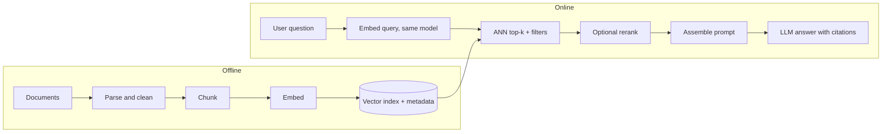

### Q1 ⭐⭐⭐ 🟢 What problem does RAG solve that a standalone LLM cannot, and why is it preferred over frequent retraining?
**Asked at:** all types; service-company, GCC and product GenAI loops
**Say this first (1 line):** A standalone LLM only knows what was in its training data, frozen at a cutoff, and it cannot show where an answer came from; RAG fetches the relevant text from my own up-to-date store at question time and makes the model answer from it, which is far cheaper and safer to keep current than retraining.

**Then explain:**
- **Four problems it addresses:** (1) knowledge cutoff, since the model has never seen last week's policy; (2) private data, since the model never saw my company documents; (3) hallucination, since the model fills gaps with plausible text; (4) provenance, since I can point to the chunk behind each claim.
- **Where the idea comes from:** the RAG paper (Lewis et al.) combines parametric memory (a pretrained seq2seq model) with non-parametric memory (a dense vector index of Wikipedia reached through a pretrained retriever). Per the abstract it set state of the art on three open-domain QA tasks and produced more specific, diverse and factual text than a parametric-only baseline. The same abstract names provenance and updating knowledge as open problems for pure parametric models.
- **Why not retrain often:** updating an index means re-embedding a few documents; retraining or fine-tuning means a GPU job, an evaluation cycle and a new model version. An index is auditable (I can see exactly what is in it), supports deletes (important for compliance) and rolls back by restoring a snapshot. Fine-tuning is poor at injecting facts reliably; it is better for behaviour and format (ladder in Part 4 Q1).
- **Honest limits:** retrieval quality caps answer quality, because if the right chunk is not retrieved the model cannot use it. RAG reduces hallucination but does not remove it; the model can still ignore or misread the context. It also adds latency and a system to operate.

**Example:** An HR bot must answer "how many leave days carry forward?". The policy changed last month. With RAG I re-index one PDF and the answer changes within minutes, with a citation to the policy chunk. With fine-tuning I would need a training run, and I still could not tell the user which paragraph the answer came from.

**Code:** none; the working pipeline is in Q14.

**Follow-ups:**
- *Does RAG replace fine-tuning?* No. RAG supplies knowledge, fine-tuning shapes behaviour and style; they combine (Q13).
- *Can RAG still hallucinate?* Yes: wrong retrieval, truncated context, or the generator ignoring the sources (Q11).
- *When is RAG not worth it?* A tiny stable corpus that fits in the prompt (Q13).

**Common mistakes:** Saying RAG "eliminates" hallucination; claiming fine-tuning is the way to add fresh facts; forgetting the provenance and delete/audit benefits; not mentioning that retrieval quality is the ceiling.

### Q2 ⭐⭐⭐ 🟢 Walk through a basic RAG pipeline end to end (offline indexing and online retrieval and generation).
**Asked at:** all types; GenAI-engineer and RAG-design loops
**Say this first (1 line):** Offline I parse, clean, chunk, embed and index the documents with metadata; online I embed the question with the same model, fetch the top-k chunks from an ANN index, optionally rerank, build a grounded prompt and let the LLM answer with citations.

**Then explain:**

- **Failure mode per stage (debug order in Q11):** parse (tables or scanned PDFs turn into garbage); chunk (a fact cut in half, Q3); embed (model does not know the domain vocabulary, Q6); index (stale or deleted documents still served); retrieve (right chunk not in top-k); rerank (adds latency, can drop the right chunk); prompt (context truncated or badly ordered, Q12); generate (ignores sources or invents).
- **Metadata matters:** store source, section, date, access-control tags with each chunk, so I can filter, cite and delete.
- **Evaluate the halves separately:** retrieval with recall@k and MRR, generation with faithfulness (Q10).
- Reranking depth, hybrid search and query rewriting are Part 7.

**Example:** For a 5,000-page policy corpus: nightly job parses PDFs, splits into about 400-token chunks, embeds them, upserts into the index. At query time, "can I carry forward leave?" is embedded, the top 5 chunks come back with source and page, the prompt numbers them, the LLM answers "up to five days [2]".

**Code:** a runnable end-to-end toy is in Q14.

**Follow-ups:**
- *Why the same embedding model at query time?* Different models give incompatible vector spaces (Q5).
- *How do you handle updates?* Re-embed changed docs, upsert by chunk id, delete removed ones, keep a document version in metadata.
- *What would you log?* Query, retrieved ids and scores, ids actually in the prompt, answer, citations.

**Common mistakes:** Describing only the online half; forgetting metadata and deletes; not naming where it breaks; treating generation as the only place errors happen.

### Q3 ⭐⭐⭐ 🟢 What is chunking, and why does chunk size matter for retrieval quality?
**Asked at:** all types
**Say this first (1 line):** Chunking splits documents into passages that I embed and retrieve individually; too small and a chunk loses the context needed to be meaningful, too large and one embedding blurs several topics and wastes prompt budget.

**Then explain:**
- **Why chunk at all:** a whole document gives one vector that averages many topics, and the model's context is limited and costs money per token.
- **Too small:** a sentence like "it is 30 days" has no subject; the fact may be split across two chunks and neither matches the query well.
- **Too large:** the embedding mixes many ideas so specific queries match weakly, and I spend prompt tokens on irrelevant text. Guides use illustrations such as about 50 tokens (too small) and about 2,000 tokens (too large); treat those as illustrations, not rules.
- **Fixes:** overlap between neighbouring chunks, or sentence-aware splitting. Strategies are compared in Q4.

**Example:** In the toy below the fact "The refund window is 30 days from delivery" sits across a 10-word boundary. With no overlap it is cut in two and no chunk contains it. With overlap 6 one chunk contains it whole. Sentence-aware packing keeps it whole with no overlap.

**Code:** (run; word counts stand in for tokens)
```python
def chunk_words(text, size, overlap):
    w = text.split()
    step = size - overlap
    return [" ".join(w[i:i + size]) for i in range(0, max(len(w) - overlap, 1), step)]

def chunk_sentences(text, size):
    """Sentence-aware: pack whole sentences until the word budget is hit."""
    out, cur = [], []
    for s in [s.strip() + "." for s in text.split(".") if s.strip()]:
        if cur and len(" ".join(cur + [s]).split()) > size:
            out.append(" ".join(cur)); cur = []
        cur.append(s)
    if cur: out.append(" ".join(cur))
    return out

doc = ("Employees accrue leave monthly. The refund window is 30 days from delivery. "
       "Refunds are issued to the original payment method. Gift cards cannot be refunded.")
fact = "The refund window is 30 days from delivery"
def found(chunks): return any(fact in c for c in chunks)

for name, ch in [("fixed 10 words, overlap 0", chunk_words(doc, 10, 0)),
                 ("fixed 10 words, overlap 6", chunk_words(doc, 10, 6)),
                 ("sentence-aware, budget 12", chunk_sentences(doc, 12))]:
    print(f"{name}: {len(ch)} chunks, fact intact in one chunk: {found(ch)}")
    for i, c in enumerate(ch): print(f"   [{i}] {c}")
```
Output (my run):
```
fixed 10 words, overlap 0: 3 chunks, fact intact in one chunk: False
   [0] Employees accrue leave monthly. The refund window is 30 days
   [1] from delivery. Refunds are issued to the original payment method.
   [2] Gift cards cannot be refunded.
fixed 10 words, overlap 6: 5 chunks, fact intact in one chunk: True
   [0] Employees accrue leave monthly. The refund window is 30 days
   [1] The refund window is 30 days from delivery. Refunds are
   [2] 30 days from delivery. Refunds are issued to the original
   [3] Refunds are issued to the original payment method. Gift cards
   [4] the original payment method. Gift cards cannot be refunded.
sentence-aware, budget 12: 3 chunks, fact intact in one chunk: True
   [0] Employees accrue leave monthly. The refund window is 30 days from delivery.
   [1] Refunds are issued to the original payment method.
   [2] Gift cards cannot be refunded.
```
Overlap 6 of 10 is extreme and only chosen to make the toy rescue visible; real overlaps are 10-20 percent (Q4), and overlap costs more chunks to store.

**Follow-ups:**
- *Is more overlap always better?* No: more duplicate chunks, more index size, near-duplicate results in top-k.
- *How do you pick the size?* Start from a reported range, then measure retrieval on a golden set (Q4, Q10).

**Common mistakes:** Treating chunk size as a fixed constant; splitting mid-sentence and mid-table; measuring size in characters while the limit is in tokens; never evaluating the choice.

### Q4 ⭐⭐⭐ 🟡 How do you choose chunk size and overlap? Compare fixed-size, recursive, structure-aware, semantic and parent-document chunking.
**Asked at:** all types; product, GCC, GenAI startups
**Say this first (1 line):** I start from a reported default (about 256-512 tokens with 10-20 percent overlap, or 200-500 with 50-100 overlap, per prep guides), pick the strategy that respects my document structure, then tune size and overlap by measuring recall@k and MRR on a golden set.

**Then explain:**

| Strategy | How it works | Good for | Weak spot |
|---|---|---|---|
| Fixed-size | Cut every N tokens, with overlap | Simple baseline, uniform text | Cuts sentences and tables mid-way |
| Recursive | Try separators in order (paragraph, line, sentence, word); recurse on oversized pieces | Default for prose | Still blind to headings and meaning |
| Structure-aware | Split on headings, sections, table or code boundaries | Manuals, policies, markdown, HTML | Needs a good parser; sections can be huge |
| Semantic (Q48) | Split where adjacent-sentence similarity drops | Topic-shifting text | Extra embedding cost; gains are not guaranteed |
| Parent-document (Q18) | Embed small child chunks, return the larger parent for the prompt | Precise match plus rich context | More storage and logic; parent may be long |

- **These ranges are reported starting points, not laws.** Tune with retrieval metrics (Q47), not by feel.
- **Overlap** protects facts that straddle a boundary but duplicates storage and top-k results.
- **Add metadata** (title, section path) to each chunk; a chunk saying "it is 30 days" is useless without "Refund policy".

**Example:** A 3-page return policy: fixed 500-token chunks split the "exceptions" list from its heading, so "which items cannot be returned?" misses. Structure-aware splitting keeps heading plus list together and recall on my golden set improves; I would confirm that by running both and comparing recall@5.

**Code:** (run; characters stand in for tokens; the invariants are asserted)
```python
SEPS = ["\n\n", "\n", ". ", " "]          # paragraph > line > sentence > word

def rsplit(text, max_size, seps=SEPS):
    """Recursive splitter: split on the coarsest separator, recurse on pieces that are still too big."""
    if len(text) <= max_size: return [text]
    if not seps:                                   # nothing left: hard cut
        return [text[i:i + max_size] for i in range(0, len(text), max_size)]
    sep, rest = seps[0], seps[1:]
    pieces = text.split(sep)
    out, cur = [], ""
    for i, p in enumerate(pieces):
        p = p + (sep if i < len(pieces) - 1 else "")
        if len(p) > max_size:                      # piece too big: flush then recurse
            if cur: out.append(cur); cur = ""
            out.extend(rsplit(p, max_size, rest)); continue
        if len(cur) + len(p) <= max_size: cur += p
        else: out.append(cur); cur = p
    if cur: out.append(cur)
    return out

def add_overlap(chunks, overlap):
    """Prefix each chunk with the last `overlap` chars of the previous one."""
    return [chunks[0]] + [chunks[i-1][-overlap:] + chunks[i] for i in range(1, len(chunks))]

text = ("Refund policy\n\nRefunds are allowed within 30 days. Items must be unused. "
        "Shipping fees are not refunded.\n\nWarranty\n\n" + "The warranty covers defects. " * 12 +
        "\n\nContact support by email.")
MAX, OV = 120, 20
base = rsplit(text, MAX)
assert all(len(c) <= MAX for c in base), "chunk over max"      # invariant 1
assert "".join(base) == text, "coverage broken"                 # invariant 2: nothing lost
over = add_overlap(base, OV)
assert all(len(c) <= MAX + OV for c in over)
print(f"{len(base)} chunks, max len {max(map(len, base))}, coverage OK, no chunk over {MAX}")
for i, c in enumerate(base[:4]): print(f"[{i}] {len(c):3d} {c!r}")
print("with overlap, chunk 1 starts with:", repr(over[1][:OV]))
```
Output (my run):
```
6 chunks, max len 117, coverage OK, no chunk over 120
[0] 116 'Refund policy\n\nRefunds are allowed within 30 days. Items must be unused. Shipping fees are not refunded.\n\nWarranty\n\n'
[1] 116 'The warranty covers defects. The warranty covers defects. The warranty covers defects. The warranty covers defects. '
[2] 116 'The warranty covers defects. The warranty covers defects. The warranty covers defects. The warranty covers defects. '
[3] 117 'The warranty covers defects. The warranty covers defects. The warranty covers defects. The warranty covers defects. \n'
with overlap, chunk 1 starts with: 'efunded.\n\nWarranty\n\n'
```
Note the character-level overlap starts mid-word ("efunded"); real splitters overlap on word or sentence boundaries. Also, here the heading "Warranty" landed at the end of chunk 0 instead of with its body, which is exactly why structure-aware splitting exists.

**Follow-ups:**
- *Which would you ship first?* Recursive with 10-20 percent overlap plus section titles in metadata, then measure.
- *When parent-document?* When small chunks match precisely but the answer needs surrounding context.
- *Semantic chunking worth it?* Test it; it costs extra embedding calls and gains vary by corpus (Q48).

**Common mistakes:** Quoting 512 tokens as a law; tuning by eyeballing a few queries; ignoring tables and code; measuring chunk size in characters but budgeting in tokens; no overlap tests or coverage tests on the splitter.

### Q5 ⭐⭐⭐ 🟡 What is an embedding, why does dense retrieval work, and why must indexing and querying use the same embedding model?
**Asked at:** all types
**Say this first (1 line):** An embedding is a vector produced by a model so that texts with similar meaning land close together; dense retrieval embeds the query and ranks chunks by closeness, and indexing and querying must share one model because each model defines its own private coordinate system.

**Then explain:**
- **Why it works:** the encoder is trained so related texts (a question and its answer passage, paraphrases) end up near each other, so "refund window" can match "return period" with no shared words, which keyword search cannot do. Background in B1P09-Q19.
- **Why the same model:** dimensions, axes and scales are arbitrary per model. Query vector from model B compared with document vectors from model A is comparing numbers from unrelated spaces; even same-dimension vectors are meaningless. This is a classic bug after "upgrading the embedding model" without re-indexing.
- **Consequence:** changing the model means re-embedding the whole corpus and rebuilding the index.
- **Limits:** dense models can miss exact identifiers and rare terms; that is why hybrid search exists (Part 7; B1P07-Q26).

**Example:** In the toy below, two embedders differ only in their hash seed. Same-embedder retrieval finds the right doc; mixed embedders drop to near chance.

**Code:** (run; TOY hashed bag-of-words, not semantic: it only matches shared words, so it demonstrates the mismatch, not dense retrieval quality)
```python
import numpy as np, re, zlib
def make_embedder(seed, dim=64):
    def emb(text):
        v = np.zeros(dim)
        for w in re.findall(r"[a-z]+", text.lower()):
            h = zlib.crc32(f"{seed}:{w}".encode())      # seeded hash: the seed defines the "model"
            v[h % dim] += 1.0 if (h >> 20) & 1 else -1.0
        n = np.linalg.norm(v); return v / n if n else v
    return emb

docs = ["refund within thirty days of delivery", "gift cards cannot be refunded",
        "reset your password from the login page", "invoices are emailed monthly",
        "delivery takes five working days", "contact support by phone or email",
        "warranty covers manufacturing defects", "shipping fees are not refunded"]
queries = [("how long is the refund window", 0), ("password reset", 2), ("when do invoices arrive", 3),
           ("how many days does delivery take", 4), ("warranty defects", 6)]
A, B = make_embedder(1), make_embedder(2)

def hit_rate(doc_emb, q_emb):
    D = np.stack([doc_emb(d) for d in docs])
    return sum(int(np.argmax(D @ q_emb(q)) == gold) for q, gold in queries) / len(queries)

print("index A, query A (same model):   top-1 =", hit_rate(A, A))
print("index B, query B (same model):   top-1 =", hit_rate(B, B))
print("index A, query B (mixed models): top-1 =", hit_rate(A, B))
print("chance level is", 1 / len(docs))
```
Output (my run):
```
index A, query A (same model):   top-1 = 1.0
index B, query B (same model):   top-1 = 0.6
index A, query B (mixed models): top-1 = 0.2
chance level is 0.125
```
The 0.6 for B is hash collisions in a 64-dim toy; the point is that mixing falls to about chance level. Five queries is too few for precise numbers.

**Follow-ups:**
- *Can I switch to a better model later?* Yes, but re-embed everything and re-evaluate; store the model name and version with the index.
- *Do query and document need the same prompt prefix?* Some models expect different query and document prefixes; follow the model's documentation.

**Common mistakes:** Mixing models across index and query; saying embeddings "understand" meaning rather than reflect training; forgetting to version the embedding model; assuming same dimension means compatible.

### Q6 ⭐⭐⭐ 🟡 How do you choose an embedding model for RAG (domain, language, dimension, max input length, cost, evaluation on your own data)?
**Asked at:** product, GCC, GenAI startups
**Say this first (1 line):** I shortlist models on practical criteria, then pick by measuring recall@k and MRR on a golden set built from my own documents and questions, not by public leaderboard rank alone.

**Then explain:**
- **Criteria:** domain and language fit (legal, code, Hindi or mixed-language text); max input length versus my chunk size; vector dimension (storage and search cost scale with it); latency and cost (API per-token cost or my own GPU/CPU hosting); licence and hosting constraints (data may not leave my VPC); and behaviour on my data.
- **Why own-data evaluation:** public benchmarks are averages over other corpora; my jargon, abbreviations and document style may behave differently. I name model families generically and check current docs for numbers, since prices and dimensions change.
- **Process:** build 100-300 real questions with gold chunk ids (a golden set), embed the corpus with each candidate, compute recall@k and MRR, then weigh against cost and latency. Re-index cost counts: switching later means re-embedding everything (Q5).
- **Also test:** small dimension or truncated vectors if offered, and a reranker on top (Part 7) can lift a weaker embedder.

**Example:** Two candidates: a small cheap model and a large one. On my golden set recall@5 is 0.86 versus 0.90 but the large one doubles index storage and latency. If the extra 4 points matter for my use case I take it; otherwise the small one plus a reranker (illustrative numbers, not measured).

**Code:** (run; TOY harness: the "models" are hashed bag-of-words with different dimensions, so the numbers show only how to compute the metrics)
```python
import numpy as np, re, zlib
def make_embedder(seed, dim, bigrams=False):
    def emb(text):
        ws = re.findall(r"[a-z]+", text.lower())
        toks = ws + ([a + "_" + b for a, b in zip(ws, ws[1:])] if bigrams else [])
        v = np.zeros(dim)
        for w in toks:
            h = zlib.crc32(f"{seed}:{w}".encode()); v[h % dim] += 1.0 if (h >> 20) & 1 else -1.0
        n = np.linalg.norm(v); return v / n if n else v
    return emb

corpus = ["refund within thirty days of delivery", "gift cards cannot be refunded", "reset password on login page",
          "invoices are emailed every month", "delivery takes five working days", "contact support by phone or email",
          "warranty covers manufacturing defects", "shipping fees are not refunded", "update your billing address in settings",
          "two factor login uses an authenticator app", "returns need the original packaging", "support hours are nine to six"]
golden = [("refund window days", {0}), ("gift card refund", {1}), ("forgot password login", {2}), ("monthly invoice email", {3}),
          ("how many days delivery", {4}), ("phone support contact", {5}), ("warranty defects", {6}), ("shipping fee refund", {7}),
          ("change billing address", {8}), ("authenticator app login", {9}), ("return packaging", {10}), ("support hours", {11})]

def evaluate(emb, k=3):
    D = np.stack([emb(d) for d in corpus]); rec, rr = 0, 0
    for q, gold in golden:
        order = np.argsort(-(D @ emb(q)))
        rec += len(set(order[:k]) & gold) / len(gold)
        rank = next((i + 1 for i, d in enumerate(order) if d in gold), None)
        rr += 1 / rank if rank else 0
    return rec / len(golden), rr / len(golden)

for name, e in [("toy-A (dim 16)", make_embedder(1, 16)), ("toy-B (dim 128)", make_embedder(1, 128)),
                ("toy-C (dim 128, +bigrams)", make_embedder(1, 128, True))]:
    r, m = evaluate(e); print(f"{name:26s} recall@3 = {r:.2f}   MRR = {m:.2f}")
```
Output (my run):
```
toy-A (dim 16)             recall@3 = 0.75   MRR = 0.74
toy-B (dim 128)            recall@3 = 0.92   MRR = 0.94
toy-C (dim 128, +bigrams)  recall@3 = 0.92   MRR = 0.84
```
With only 12 golden questions the differences are noisy; a real golden set needs a few hundred questions.

**Follow-ups:**
- *Bigger dimension always better?* No; it costs storage and search time and the gain may be small on my data.
- *Multilingual corpus?* Test with real queries in each language, including mixed-language queries.
- *How often re-evaluate?* When the corpus, query mix or candidate models change.

**Common mistakes:** Picking by leaderboard rank only; ignoring max input length versus chunk size; evaluating on a handful of hand-picked queries; forgetting re-index cost; quoting stale prices or dimensions.

### Q7 ⭐⭐⭐ 🟡 What does a vector database do, and how do you choose between a dedicated store, pgvector and an in-process library such as FAISS?
**Asked at:** all types; product, GCC, platform teams
**Say this first (1 line):** A vector database stores vectors with their metadata, builds an ANN index for fast similarity search, supports metadata filtering and updates or deletes; I choose between a dedicated store, pgvector and an in-process library based on scale, filtering needs, ops burden and team skills.

**Then explain:**
- **What it does:** insert, update, delete (CRUD) of vectors plus metadata (source, date, tenant, permissions); ANN search for top-k; filtered search; persistence and replication in the server products.
- **Options:**
  - *Dedicated vector store:* built for scale, filtering and ANN tuning; another system to run or pay for.
  - *pgvector (vector search inside Postgres):* one system, SQL joins and transactions with existing data; the techinterview article reports it as fine under about 1M vectors, which I treat as reported guidance, not a limit. Check current docs for index types and limits.
  - *In-process library (e.g. FAISS):* fastest to start, no server; you manage persistence, metadata, concurrency and deletes yourself.
- **Decision criteria:** scale and growth, filtering and access control, hybrid (keyword plus vector) support, operations and on-call cost, consistency needs (is a new document searchable immediately?), cost, team skills.
- **Hedge:** product features change quickly; I confirm against current docs and run a load test with my own data.

**Example:** A 200k-chunk internal HR bot where policies already live in Postgres: pgvector is the simplest start. A multi-tenant product with 100M chunks and strict per-tenant filters needs a dedicated store, and I would benchmark filtered recall and latency before committing.

**Code:** (run; exact brute-force search, so it shows the API and filter semantics, not ANN)
```python
import numpy as np
class TinyVectorStore:
    """In-memory vector store: add, delete, search with metadata filter. Exact (brute-force) search."""
    def __init__(self, dim):
        self.dim = dim; self.ids = []; self.vecs = np.zeros((0, dim)); self.meta = {}
    def add(self, id_, vec, meta=None):
        v = np.asarray(vec, float); v = v / np.linalg.norm(v)
        if id_ in self.meta: self.delete(id_)           # upsert
        self.ids.append(id_); self.vecs = np.vstack([self.vecs, v]); self.meta[id_] = meta or {}
    def delete(self, id_):
        i = self.ids.index(id_); self.ids.pop(i); self.vecs = np.delete(self.vecs, i, axis=0); del self.meta[id_]
    def search(self, q, k=3, where=None):
        q = np.asarray(q, float); q = q / np.linalg.norm(q)
        keep = [i for i, d in enumerate(self.ids) if not where or all(self.meta[d].get(a) == b for a, b in where.items())]
        if not keep: return []
        sims = self.vecs[keep] @ q                       # pre-filter, then exact scoring
        top = np.argsort(-sims)[:k]
        return [(self.ids[keep[j]], round(float(sims[j]), 3)) for j in top]

rng = np.random.default_rng(0)
s = TinyVectorStore(8)
for i in range(20):
    s.add(f"doc{i}", rng.normal(size=8), {"dept": "hr" if i % 2 else "fin", "year": 2023 + i % 3})
q = rng.normal(size=8)
print("no filter       :", s.search(q, 3))
print("dept=hr         :", s.search(q, 3, {"dept": "hr"}))
print("dept=hr,y=2025  :", s.search(q, 3, {"dept": "hr", "year": 2025}))
top = s.search(q, 1)[0][0]; s.delete(top)
print("deleted", top, "->", s.search(q, 3), "| size", len(s.ids))
assert top not in [d for d, _ in s.search(q, 20)]
assert all(s.meta[d]["dept"] == "hr" for d, _ in s.search(q, 20, {"dept": "hr"}))
print("tests passed")
```
Output (my run; random vectors):
```
no filter       : [('doc12', 0.588), ('doc19', 0.508), ('doc17', 0.17)]
dept=hr         : [('doc19', 0.508), ('doc17', 0.17), ('doc7', 0.141)]
dept=hr,y=2025  : [('doc17', 0.17), ('doc11', -0.483), ('doc5', -0.488)]
deleted doc12 -> [('doc19', 0.508), ('doc17', 0.17), ('doc7', 0.141)] | size 19
tests passed
```
A real store would use an ANN index and must decide whether filters apply before or after the ANN search (Q8 and Part 7).

**Follow-ups:**
- *Filter before or after search?* Post-filtering can return fewer than k results; pre-filtering on a plain graph index can be slow; filter-aware modes exist in some products (hedge: check docs).
- *How do deletes work?* Some indexes mark vectors deleted and compact later; test that deleted chunks never surface.
- *Why not just a database?* Plain SQL has no efficient similarity search unless it has a vector extension.

**Common mistakes:** Choosing by hype; ignoring filtering and ACL needs; quoting vendor numbers as fact; forgetting delete and update paths; assuming FAISS gives you a database.

### Q8 ⭐⭐⭐ 🟡 How do approximate nearest-neighbour indexes work for RAG (HNSW, IVF, product quantization), and what are their recall and latency knobs?
**Asked at:** product, GenAI startups, platform teams
**Say this first (1 line):** ANN indexes skip most of the corpus to find near neighbours fast, trading a little recall for large speed and memory gains: HNSW walks a layered graph, IVF searches only the nearest k-means cells, and PQ compresses vectors into short codes.
General ANN background is in B1P07-Q20; here is the RAG-focused view.

**Then explain:**
- **HNSW:** per its paper abstract, a stack of proximity graphs over nested subsets with random, exponentially decaying layer assignment, with logarithmic complexity scaling stated in the abstract; it outperforms earlier open-source vector-only methods and NSW. Knobs: M (links per node), efConstruction (build-time search width), efSearch (query-time width). Per the guide, only efSearch is tunable on a live index; raising it buys recall for latency. Cost: memory for the graph on top of the vectors.
- **IVF:** k-means splits vectors into nlist cells; at query time search the nprobe nearest cells. Boundary problem: a true neighbour sitting in a cell I did not probe is missed; raise nprobe.
- **PQ:** split each vector into sub-vectors and store a one-byte code per sub-vector. For 768 float32 dims: 768 x 4 = 3,072 bytes raw versus 96 bytes as 96 one-byte codes, a 32x reduction, at some accuracy loss (often a shortlist is reranked with full vectors).
- **Sizing check:** 100M x 768 x 4 bytes = 307.2 GB raw before any graph links, so memory planning matters (one source article understated this; I compute it myself).
- **Recall must be measured against exact search** on sampled production queries, and quoted with its k.

**Example:** In the synthetic run below (clustered random vectors, 20,000 x 32 dims, nlist 64), nprobe=1 scans about 2 percent of the vectors with recall@10 around 0.90; nprobe=2 gives 0.99. The data is well separated by construction, so real embeddings need more probes; the shape of the trade-off is the point.

**Code:** (run; SYNTHETIC clustered vectors, not text embeddings; timings are machine-specific)
```python
import numpy as np, time
rng = np.random.default_rng(0)
N, D, C, nlist, k = 20000, 32, 50, 64, 10
centres = rng.normal(size=(C, D)) * 3
X = centres[rng.integers(0, C, N)] + rng.normal(size=(N, D))
X /= np.linalg.norm(X, axis=1, keepdims=True)
Q = X[rng.choice(N, 200, replace=False)] + 0.05 * rng.normal(size=(200, D)); Q /= np.linalg.norm(Q, axis=1, keepdims=True)

def kmeans(X, n, iters=10):
    c = X[rng.choice(len(X), n, replace=False)].copy()
    for _ in range(iters):
        a = np.argmax(X @ c.T, 1)
        for j in range(n):
            m = X[a == j]
            if len(m): c[j] = m.mean(0)
        c /= np.linalg.norm(c, axis=1, keepdims=True)
    return c
cent = kmeans(X, nlist); assign = np.argmax(X @ cent.T, 1)
cells = [np.where(assign == j)[0] for j in range(nlist)]

def exact(q): return set(np.argsort(-(X @ q))[:k])
def ivf(q, nprobe):
    probe = np.argsort(-(cent @ q))[:nprobe]
    cand = np.concatenate([cells[j] for j in probe])
    return set(cand[np.argsort(-(X[cand] @ q))[:k]]), len(cand)

t0 = time.perf_counter(); truth = [exact(q) for q in Q]; t_ex = (time.perf_counter() - t0) / len(Q) * 1e3
print(f"exact search: {t_ex:.3f} ms/query (this machine)")
for nprobe in [1, 2, 4, 8, 16, 64]:
    t0 = time.perf_counter(); res = [ivf(q, nprobe) for q in Q]; t = (time.perf_counter() - t0) / len(Q) * 1e3
    rec = np.mean([len(r[0] & tr) / k for r, tr in zip(res, truth)]); scanned = np.mean([r[1] for r in res])
    print(f"nprobe={nprobe:2d}: recall@10={rec:.3f}  scanned {scanned:7.0f}/{N} vectors  {t:.3f} ms/query")
print("PQ memory: raw 768 x 4 =", 768 * 4, "bytes; 96 one-byte codes =", 96, "bytes; ratio", 768 * 4 // 96, "x")
print("100M x 768 float32 raw =", round(100e6 * 768 * 4 / 1e9, 1), "GB")
```
Output (my run; timings machine-specific):
```
exact search: 0.507 ms/query (this machine)
nprobe= 1: recall@10=0.901  scanned     410/20000 vectors  0.043 ms/query
nprobe= 2: recall@10=0.990  scanned     721/20000 vectors  0.059 ms/query
nprobe= 4: recall@10=1.000  scanned    1344/20000 vectors  0.095 ms/query
nprobe= 8: recall@10=1.000  scanned    2559/20000 vectors  0.180 ms/query
nprobe=16: recall@10=1.000  scanned    5081/20000 vectors  0.345 ms/query
nprobe=64: recall@10=1.000  scanned   20000/20000 vectors  1.579 ms/query
PQ memory: raw 768 x 4 = 3072 bytes; 96 one-byte codes = 96 bytes; ratio 32 x
100M x 768 float32 raw = 307.2 GB
```
Exact search here is a single numpy matrix product, so it is unusually fast; at 20k vectors ANN barely matters, and the speedup shows up at millions. nprobe=64 scans everything and is slower than exact because of the extra cell bookkeeping.

**Follow-ups:**
- *Recall dropped after adding data?* Re-measure against exact search; IVF centroids may be stale, HNSW parameters may need raising.
- *efSearch vs efConstruction?* efSearch is the live knob; efConstruction is fixed at build time.
- *Does ANN help under about 1M vectors?* A flat exact index is often enough (reported guidance).

**Common mistakes:** Quoting recall without k; confusing efSearch and efConstruction; forgetting IVF boundary misses; doing memory maths wrong; assuming PQ is lossless.

### Q9 ⭐⭐⭐ 🟡 Which similarity metric do you use for embeddings (cosine, dot product, L2), and how do you pick top-k or a similarity threshold?
**Asked at:** all types
**Say this first (1 line):** I follow the metric the embedding model was trained with, usually cosine; on L2-normalised vectors cosine equals dot product and L2 distance gives the same ranking, so I normalise once and use dot product for speed.
Full metric comparison is B1P07-Q16 and B1P09-Q38; this is the RAG angle.

**Then explain:**
- **Identities:** for unit vectors, cos(a,b) = a.b, and ||a-b||^2 = 2 - 2 a.b, so L2 distance is a monotone function of cosine: same ranking.
- **Why normalise:** raw dot product rewards long vectors, so a chunk can outrank a better match just because of its norm. Normalising removes length from the ranking.
- **Top-k:** always returns k chunks, even for an off-topic question, so it can feed junk to the generator.
- **Threshold:** drop chunks below a similarity score so the system can abstain. Thresholds are model-specific and must be calibrated on my own data (e.g. from scores of relevant versus irrelevant pairs), never copied from another model.
- **Common combination:** top-k capped by a threshold, then rerank (Part 7).

**Example:** The run below verifies the identities numerically, shows raw dot product ranking differently from cosine, and shows a threshold returning nothing for an off-topic query where top-3 still returns three chunks (scores are made up for the illustration).

**Code:** (run)
```python
import numpy as np
rng = np.random.default_rng(0)
A = rng.normal(size=(5, 16)) * rng.uniform(0.5, 5, size=(5, 1))   # vectors with very different lengths
q = rng.normal(size=16) * 3
def l2n(x): return x / np.linalg.norm(x, axis=-1, keepdims=True)
cos_raw = (A @ q) / (np.linalg.norm(A, axis=1) * np.linalg.norm(q))
An, qn = l2n(A), l2n(q)
dot_n = An @ qn
l2sq = ((An - qn) ** 2).sum(1)
print("cosine (raw)       :", np.round(cos_raw, 4))
print("dot (normalised)   :", np.round(dot_n, 4), "equal:", np.allclose(cos_raw, dot_n))
print("L2^2 = 2 - 2*cos   :", np.allclose(l2sq, 2 - 2 * dot_n))
print("same ranking cos vs L2:", (np.argsort(-dot_n) == np.argsort(l2sq)).all())
print("raw dot (unnormalised) ranking:", np.argsort(-(A @ q)), "vs cosine ranking:", np.argsort(-cos_raw))
sims = np.array([0.82, 0.61, 0.55, 0.31, 0.12]); thr = 0.5
print("top-3:", np.argsort(-sims)[:3], "| threshold 0.5:", np.where(sims >= thr)[0])
sims2 = np.array([0.41, 0.38, 0.30, 0.22, 0.10])   # an off-topic query: everything is weak
print("off-topic query: top-3 still returns", np.argsort(-sims2)[:3], "| threshold 0.5 returns", np.where(sims2 >= thr)[0], "(abstain)")
```
Output (my run):
```
cosine (raw)       : [ 0.2835 -0.2706  0.115  -0.0946  0.1923]
dot (normalised)   : [ 0.2835 -0.2706  0.115  -0.0946  0.1923] equal: True
L2^2 = 2 - 2*cos   : True
same ranking cos vs L2: True
raw dot (unnormalised) ranking: [4 0 2 3 1] vs cosine ranking: [0 4 2 3 1]
top-3: [0 1 2] | threshold 0.5: [0 1 2]
off-topic query: top-3 still returns [0 1 2] | threshold 0.5 returns [] (abstain)
```
The 0.5 threshold is arbitrary here; real values depend on the model.

**Follow-ups:**
- *How do you calibrate a threshold?* Score labelled relevant and irrelevant pairs from my own queries and pick the cut that meets the precision/recall I need.
- *Can I reuse a threshold after changing the model?* No; scores shift between models.
- *What k?* Start small (for example 3-10 chunks into the prompt) and tune with recall@k and answer quality; deeper retrieval plus rerank is Part 7.

**Common mistakes:** Using raw dot product on unnormalised vectors; copying a 0.8 threshold from a blog; assuming scores are probabilities; returning top-k without any abstain path.

### Q10 ⭐⭐⭐ 🟡 How do you evaluate retrieval separately from generation (recall@k, precision@k, MRR, nDCG, a golden set)?
**Asked at:** product, GenAI startups, GCC, evaluation-focused rounds
**Say this first (1 line):** I build a golden set of real questions with labelled relevant chunks and score the retriever alone with recall@k, precision@k, MRR and nDCG, so a bad answer can be blamed on retrieval or generation instead of one blended number.

**Then explain:**
- **Golden set:** a few hundred real questions, each with the gold chunk ids (or answer spans), ideally with graded relevance. Reported guidance from prep articles; size depends on your risk.
- **Metric choice:** recall@k for coverage (did the needed chunk make it in at all, the ceiling for generation); precision@k for noise in the prompt; MRR for how high the first relevant hit is; nDCG when relevance is graded and position matters.
- **Chunk level versus answer-span level:** a chunk can be "relevant" but not contain the answer sentence; span-level checks are stricter and catch wrong-chunk-right-document cases. Chunk ids change when I re-chunk, so label with stable document and span references.
- **Generation separately:** faithfulness and answer relevancy (Part 9).

**Example (worked by hand, matches the code):** ranked = d7, d2, d9, d4, d1; gold gains d2=3, d4=2, d5=1 (d5 never retrieved). recall@3 = 1/3 (only d2 in top 3). precision@3 = 1/3. MRR = 1/2 (first hit at rank 2). DCG@5 = 3/log2(3) + 2/log2(5) = 1.8928 + 0.8614 = 2.7541. Ideal order d2, d4, d5 gives IDCG = 3/log2(2) + 2/log2(3) + 1/log2(4) = 3 + 1.2619 + 0.5 = 4.7619. nDCG@5 = 2.7541 / 4.7619 = 0.5784.

**Code:** (run)
```python
import numpy as np
def recall_at_k(ranked, rel, k):    return len(set(ranked[:k]) & set(rel)) / len(rel)
def precision_at_k(ranked, rel, k): return len(set(ranked[:k]) & set(rel)) / k
def mrr(ranked, rel):
    for i, d in enumerate(ranked, 1):
        if d in rel: return 1 / i
    return 0.0
def ndcg_at_k(ranked, gains, k):
    """gains: dict doc -> graded relevance. Uses gain/log2(rank+1)."""
    dcg = sum(gains.get(d, 0) / np.log2(i + 1) for i, d in enumerate(ranked[:k], 1))
    ideal = sorted(gains.values(), reverse=True)[:k]
    idcg = sum(g / np.log2(i + 1) for i, g in enumerate(ideal, 1))
    return dcg / idcg if idcg else 0.0

ranked = ["d7", "d2", "d9", "d4", "d1"]          # retriever output, best first
gains = {"d2": 3, "d4": 2, "d5": 1}               # graded gold; d5 was never retrieved
rel = set(gains)
print("recall@3    =", round(recall_at_k(ranked, rel, 3), 4))
print("precision@3 =", round(precision_at_k(ranked, rel, 3), 4))
print("MRR         =", round(mrr(ranked, rel), 4))
print("nDCG@5      =", round(ndcg_at_k(ranked, gains, 5), 4))
dcg = 3 / np.log2(3) + 2 / np.log2(5); idcg = 3 / np.log2(2) + 2 / np.log2(3) + 1 / np.log2(4)
print("hand: DCG", round(dcg, 4), "IDCG", round(idcg, 4), "nDCG", round(dcg / idcg, 4))
assert abs(ndcg_at_k(ranked, gains, 5) - dcg / idcg) < 1e-12
```
Output (my run):
```
recall@3    = 0.3333
precision@3 = 0.3333
MRR         = 0.5
nDCG@5      = 0.5784
hand: DCG 2.7541 IDCG 4.7619 nDCG 0.5784
```

**Follow-ups:**
- *Why is recall@k most important for RAG?* The generator can only use what is retrieved; precision then matters for prompt noise.
- *No labels yet?* Start with a small hand-labelled set from real logs; synthetic questions generated by an LLM can bootstrap but need human spot checks (Part 9).
- *nDCG variants?* Another form uses (2^gain - 1) as the numerator; state which one you use.

**Common mistakes:** Quoting recall@k without k; reporting only end-to-end accuracy; labelling only one gold chunk when several answer it; golden set that is not from real users; forgetting to re-label when chunking changes.

### Q11 ⭐⭐⭐ 🟡 A RAG answer is wrong even though the right document exists. How do you debug it?
**Asked at:** all types; reported in interview-prep posts for GenAI-engineer loops
**Say this first (1 line):** I look at the retrieved chunks first, then walk the pipeline stage by stage: was the gold chunk in the index, did retrieval return it, did it survive into the prompt, and did the model use it.
The prompt is reported in LinkedIn interview-prep posts and guides; those are prep material, not verified candidate reports.

**Then explain:**
- **1. Stale or missing index:** is the chunk actually in the index, with the current version? Deleted or updated documents still surfacing is a reported key failure.
- **2. Retrieval failure:** gold not in top-k. Causes: chunk cut the fact in half (Q3), vocabulary mismatch, weak embedding model (Q6), filter excluded it, k too small. Fixes: better chunking, hybrid search, rerank, query rewriting (Part 7).
- **3. Context assembly failure:** gold was retrieved but dropped or truncated (token budget), buried in the middle, or deduplicated away. Fix ordering and budget (Q12).
- **4. Generation failure:** gold was in the prompt but the answer is unsupported: ignored the source, mixed in prior knowledge, or misread it. Fix the prompt, add quote-based answers, lower temperature, try a stronger model.
- **Log to make this possible:** gold or expected ids, retrieved ids and scores, ids actually in the prompt, and an answer-supported check.

**Example:** User asks about the carry-forward limit and gets "ten days". The log shows the 2023 policy chunk in the prompt but the 2024 chunk missing from the index. Diagnosis: stale index, not the model. Re-index and add a document-version field.

**Code:** (run; a MOCK diagnostic over ids and flags, not a real pipeline)
```python
def diagnose(gold, retrieved, in_prompt, answer_supported, index_has_gold=True):
    gold, retrieved, in_prompt = set(gold), list(retrieved), list(in_prompt)
    if not index_has_gold:                       return "stale/missing index: gold chunk not in the index"
    if not gold & set(retrieved):                return "retrieval failure: gold chunk not in top-k"
    if not gold & set(in_prompt):                return "context assembly failure: gold retrieved but cut/dropped before the prompt"
    if not answer_supported:                     return "generation failure: gold was in the prompt but the answer is not supported by it"
    return "no failure found at these four checks (look at gold labels / answer grading)"

cases = {
  "A": dict(gold=["c5"], retrieved=["c9", "c2", "c7"], in_prompt=["c9", "c2", "c7"], answer_supported=False),
  "B": dict(gold=["c5"], retrieved=["c9", "c2", "c5"], in_prompt=["c9", "c2"],       answer_supported=False),
  "C": dict(gold=["c5"], retrieved=["c5", "c2", "c7"], in_prompt=["c5", "c2", "c7"], answer_supported=False),
  "D": dict(gold=["c5"], retrieved=["c5", "c2", "c7"], in_prompt=["c5", "c2", "c7"], answer_supported=True),
  "E": dict(gold=["c5"], retrieved=["c1"],              in_prompt=["c1"],             answer_supported=False, index_has_gold=False),
}
for k, c in cases.items(): print(k, "->", diagnose(**c))
```
Output (my run):
```
A -> retrieval failure: gold chunk not in top-k
B -> context assembly failure: gold retrieved but cut/dropped before the prompt
C -> generation failure: gold was in the prompt but the answer is not supported by it
D -> no failure found at these four checks (look at gold labels / answer grading)
E -> stale/missing index: gold chunk not in the index
```

**Follow-ups:**
- *How do you scale this beyond one query?* Run it over the golden set and report the failure-stage split; fix the biggest bucket first.
- *The answer-supported flag, who decides?* A human at first, then an LLM judge checked against human labels (Part 9).
- *Retrieval OK but answer wrong, what next?* Check prompt, ordering and contradicting chunks (Q12).

**Common mistakes:** Blaming the LLM first; changing prompt and chunking at once; one end-to-end accuracy number; not logging prompt contents; not checking the index for the document at all.

### Q12 ⭐⭐⭐ 🟡 How do you prompt the generator in a RAG system (grounding, permission to say "I don't know", citations, context ordering)?
**Asked at:** all types
**Say this first (1 line):** I tell the model to answer only from the numbered sources, give it explicit permission to say it does not know, ask for citations by source number (ideally with a short supporting quote), and put the most relevant chunks where the model will use them best.
General prompt and tool design is Part 3 Q4/Q5; lost-in-the-middle is Part 1 Q19.

**Then explain:**
- **Grounding instruction:** "use only the sources below"; without it the model mixes in its own memory.
- **Abstain path:** a fixed phrase such as "I don't know" when sources lack the answer; also pair with a retrieval-score threshold (Q9).
- **Numbered chunks and citation format:** `[1] text`, with the chunk id kept in metadata so a citation maps back to a real source; verify that cited numbers exist in the prompt.
- **Quote-based answers:** ask for the supporting quote, then the answer; this makes unsupported claims easier to catch.
- **Ordering and budget:** best chunks first or at the ends, since models can underuse the middle (reported); respect a token budget and drop whole low-ranked chunks, not half of one.
- **Injection warning:** retrieved text is untrusted; treat instructions inside it as data (Part 11, Part 3 Q34).

**Example prompt text (not executed):**
```
Answer the question using ONLY the numbered sources below.
Cite each claim like [1]. If the sources do not contain the answer, reply exactly: I don't know.
[1] (hr-12) Employees may carry forward up to five unused leave days into the next calendar year.
[2] (hr-07) Leave requests must be approved by the line manager at least two days in advance.
Question: How many leave days can I carry forward?
```

**Example:** With sources as above, a good answer is "Up to five unused leave days [1]". If asked about a notice period not in the sources, the right output is "I don't know", and it is logged as a possible corpus gap.

**Code:** (run; word count is a proxy for tokens, real code uses the model's tokenizer)
```python
def build_prompt(question, chunks, budget_words=60):
    """chunks: list of (chunk_id, text) best first. Number them, stop when the word budget is used."""
    header = ("Answer using ONLY the numbered sources below. Cite sources like [1]. "
              "If the sources do not contain the answer, reply exactly: I don't know.\n\n")
    used, parts, kept = 0, [], []
    for i, (cid, text) in enumerate(chunks, 1):
        n = len(text.split())
        if used + n > budget_words: break
        used += n; parts.append(f"[{i}] ({cid}) {text}"); kept.append(cid)
    return header + "\n".join(parts) + f"\n\nQuestion: {question}\nAnswer:", kept, used

chunks = [("hr-12", "Employees may carry forward up to five unused leave days into the next calendar year."),
          ("hr-07", "Leave requests must be approved by the line manager at least two days in advance."),
          ("fin-3", "Expense claims above the policy limit need director approval and receipts for every item " * 2),
          ("hr-30", "Unused leave beyond the carry-forward limit lapses on 31 March.")]
p, kept, used = build_prompt("How many leave days can I carry forward?", chunks, budget_words=40)
print(p); print("\nkept:", kept, "| words used:", used, "(budget 40)")
assert used <= 40 and kept == ["hr-12", "hr-07"]
```
Output (my run):
```
Answer using ONLY the numbered sources below. Cite sources like [1]. If the sources do not contain the answer, reply exactly: I don't know.

[1] (hr-12) Employees may carry forward up to five unused leave days into the next calendar year.
[2] (hr-07) Leave requests must be approved by the line manager at least two days in advance.

Question: How many leave days can I carry forward?
Answer:

kept: ['hr-12', 'hr-07'] | words used: 30 (budget 40)
```
The builder stops at the first chunk that does not fit, so lower-ranked chunks (even one that would fit) are dropped; that keeps rank order honest, but a "skip and continue" policy is also reasonable.

**Follow-ups:**
- *How do you check citations are real?* Parse [n], confirm n is in the prompt, and ideally verify the quote is a substring of the chunk.
- *What if sources contradict?* Ask the model to flag the conflict and prefer the newer dated source (Part 7).
- *Does a stricter prompt guarantee grounding?* No; measure faithfulness (Part 9).

**Common mistakes:** No abstain instruction, so the model always answers; citations the model invents; stuffing too many chunks; truncating a chunk mid-sentence; treating retrieved text as trusted instructions.

### Q13 ⭐⭐⭐ 🟡 RAG vs fine-tuning vs stuffing everything into a long context: how do you decide for a specific product?
**Asked at:** all types; product, GCC, GenAI startups
**Say this first (1 line):** I decide by what changes and what must be proven: RAG for large or changing knowledge with citations and permissions, fine-tuning for form and behaviour, and long context for a small, stable corpus where simplicity beats cost; and they combine.
The prompting vs RAG vs fine-tuning ladder is Part 4 Q1; this answer adds long context.

**Then explain:**

| Need | RAG | Fine-tuning | Long context |
|---|---|---|---|
| Freshness | Re-index, minutes | Retrain, slow | Swap the document in the prompt |
| Per-user permissions | Filter at retrieval | Hard (weights are shared) | Must filter what you paste |
| Citations and audit | Natural | Poor | Possible if you label sources |
| Corpus size | Millions of chunks | Not for facts | Bounded by the context window |
| Latency and cost per query | Few chunks sent | Cheap at inference | Grows with tokens sent every query |
| Form, tone, format, task skill | Weak | Strong | Weak |

- **Long context fits** a small stable corpus (one manual, a few contracts) and prototypes, but cost and latency grow with tokens sent per query, and lost-in-the-middle can hurt (reported; Part 1 Q19). Prompt caching (check current provider docs) may soften repeat cost.
- **Combine:** RAG for knowledge plus a LoRA for style or output format is a reported pattern (Part 4 Q1).
- **Decide with a test:** run the candidates on the golden set and compare quality, latency, cost.

**Example:** A 40-page product FAQ that changes yearly for an internal tool with 50 queries a day: long context is fine. A 2M-page support corpus with role-based access and weekly updates: RAG. A bot that must always reply in a strict JSON schema in company tone: add fine-tuning on top.

**Code:** (run; all token counts and prices are ASSUMED for illustration, not real quotes)
```python
PRICE_IN_PER_M = 3.00        # ASSUMED USD per 1M input tokens (not a real price quote)
PRICE_OUT_PER_M = 15.00      # ASSUMED
QUERIES_PER_DAY = 10_000     # ASSUMED
QUESTION_TOK, ANSWER_TOK = 50, 300

def per_query(input_tokens):
    return input_tokens * PRICE_IN_PER_M / 1e6 + ANSWER_TOK * PRICE_OUT_PER_M / 1e6

rag_in = QUESTION_TOK + 5 * 400 + 150            # 5 chunks x 400 tokens + instructions
for corpus_tok in (50_000, 200_000):
    long_in = QUESTION_TOK + corpus_tok + 150
    r, l = per_query(rag_in), per_query(long_in)
    print(f"corpus {corpus_tok:>7,} tok | RAG input {rag_in:,} tok ${r:.4f}/query | long-context input {long_in:,} tok ${l:.4f}/query "
          f"| ratio {l/r:.1f}x | per day: RAG ${r*QUERIES_PER_DAY:,.0f} vs long ${l*QUERIES_PER_DAY:,.0f}")
```
Output (my run, assumed inputs):
```
corpus  50,000 tok | RAG input 2,200 tok $0.0111/query | long-context input 50,200 tok $0.1551/query | ratio 14.0x | per day: RAG $111 vs long $1,551
corpus 200,000 tok | RAG input 2,200 tok $0.0111/query | long-context input 200,200 tok $0.6051/query | ratio 54.5x | per day: RAG $111 vs long $6,051
```
This ignores retrieval infrastructure cost, caching and latency; it only shows that long-context cost scales with corpus size per query.

**Follow-ups:**
- *Can fine-tuning teach facts?* Unreliably and without citations; use it for behaviour (Part 4 Q1).
- *Does a bigger window kill RAG?* Not for large corpora, permissions or audit; cost per query and attention to the middle stay issues.
- *What if the corpus is 100 pages today but growing?* Start with long context, plan the RAG move with a measured trigger (cost or quality).

**Common mistakes:** Treating it as either/or; fine-tuning to add facts; ignoring per-query cost of long context; ignoring permissions; quoting a fixed context-window number that will be stale.


### Q14 ⭐⭐⭐ 🟡 Code: build a minimal RAG pipeline from scratch (chunk, embed, retrieve by cosine similarity, assemble the prompt, call a mocked LLM).
**Asked at:** product, big tech, live-coding rounds
**Say this first (1 line):** This is a toy: chunk the text, embed each chunk with feature-hashed bag-of-words (L2-normalised), retrieve by cosine (a dot product), build a numbered prompt, and let a mocked LLM quote the top chunk; a real system swaps in a real embedding model, a vector store, a reranker and a real LLM.

**Then explain:**
- **Chunk:** fixed word windows with overlap (Q3, Q4).
- **Embed:** hash each word to a bucket with a sign, sum, L2-normalise, so cosine becomes a dot product (Q9). Toy only: it matches shared words, not meaning.
- **Retrieve:** one matrix product, argsort, top-k with chunk ids.
- **Assemble and generate:** numbered sources and a grounding instruction (Q12); the mock "LLM" copies source [1] so the pipeline is testable without an API.
- **What a real system swaps in:** a trained embedding model (Q6), an ANN-backed vector store with metadata (Q7, Q8), a reranker and a score threshold (Q9), an actual LLM with citation checks, and evaluation on a golden set (Q10).

**Example:** In the run below, the query "carry forward leave days" retrieves leave#0 first (score 0.53) and the mock answer quotes it. The first query, "how many days do I have to return an item", fails: the toy retrieves leave#0 because it shares common words like "days" and "to" with that chunk, and misses the refund chunk because "return" and "refunds" are different words. That is the vocabulary-mismatch weakness of lexical hashing, and exactly what real dense embeddings (and hybrid search) are meant to handle. I am leaving the failure in on purpose.

**Code:** (run; TOY embeddings and a MOCK LLM, no model outputs)
```python
import numpy as np, re, zlib
DIM = 256
def embed(text):
    v = np.zeros(DIM)
    for w in re.findall(r"[a-z0-9]+", text.lower()):
        h = zlib.crc32(w.encode()); v[h % DIM] += 1.0 if (h >> 20) & 1 else -1.0   # feature hashing with sign
    n = np.linalg.norm(v); return v / n if n else v

def chunk(text, size=14, overlap=4):
    w = text.split(); step = size - overlap
    return [" ".join(w[i:i + size]) for i in range(0, max(len(w) - overlap, 1), step)]

DOCS = {
 "refunds": "Refunds are allowed within 30 days of delivery. Items must be unused and in original packaging. Shipping fees are not refunded.",
 "leave":   "Employees may carry forward up to five unused leave days into the next year. Unused leave beyond that lapses on 31 March.",
 "support": "Support is available on weekdays from nine to six by phone or email. Urgent outages are handled by the on-call engineer.",
}
index = []                                        # (chunk_id, text, vector)
for name, t in DOCS.items():
    for i, c in enumerate(chunk(t)): index.append((f"{name}#{i}", c, embed(c)))
M = np.stack([v for _, _, v in index])

def retrieve(q, k=2):
    s = M @ embed(q); o = np.argsort(-s)[:k]
    return [(index[i][0], index[i][1], float(s[i])) for i in o]

def build_prompt(q, hits):
    ctx = "\n".join(f"[{i}] {t}" for i, (_, t, _) in enumerate(hits, 1))
    return f"Use only the sources. Cite as [n]. Say I don't know if absent.\n{ctx}\nQuestion: {q}\nAnswer:"

def mock_llm(prompt):                             # stands in for a real model: quotes source [1]
    first = re.search(r"\[1\] (.*)", prompt).group(1)
    return f'"{first}" [1]'

for q in ["how many days do I have to return an item", "carry forward leave days", "when is phone support open"]:
    hits = retrieve(q)
    print("Q:", q); print("  retrieved ids:", [(h[0], round(h[2], 2)) for h in hits])
    print("  answer:", mock_llm(build_prompt(q, hits)))
```
Output (my run):
```
Q: how many days do I have to return an item
  retrieved ids: [('leave#0', 0.17), ('refunds#0', 0.08)]
  answer: "Employees may carry forward up to five unused leave days into the next year." [1]
Q: carry forward leave days
  retrieved ids: [('leave#0', 0.53), ('leave#1', 0.14)]
  answer: "Employees may carry forward up to five unused leave days into the next year." [1]
Q: when is phone support open
  retrieved ids: [('support#0', 0.36), ('support#1', 0.13)]
  answer: "Support is available on weekdays from nine to six by phone or email. Urgent" [1]
```
Two observations: query 1 shows a retrieval failure (low scores of 0.17 and 0.08; a threshold from Q9 would have made the system abstain), and query 3 shows a chunk cut mid-sentence by the fixed word window.

**Follow-ups:**
- *Where would you add a threshold?* After retrieval: if the best score is below a calibrated value, answer "I don't know" instead of calling the LLM.
- *How do you make this production-grade?* Real embeddings, a vector store with filters and deletes, a reranker, citation verification, logging of retrieved and prompted ids, and a golden-set evaluation (Q10, Q11).
- *Why mock the LLM?* To unit-test retrieval and prompt assembly deterministically and offline.

**Common mistakes:** Claiming the hashed embedding is semantic; forgetting to normalise; not showing a failing query; calling the real LLM before testing retrieval alone; no abstain path.
