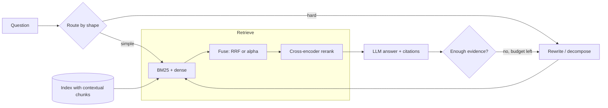

### Q1 ⭐⭐⭐ 🟢 Why does basic vector RAG fall short, and what does the standard advanced-RAG stack (hybrid search, reranking, query transformation) add?
**Asked at:** all types; GenAI-engineer and RAG-design loops
**Say this first (1 line):** Basic RAG (embed chunks, take the top-k by cosine, stuff the prompt) fails in five repeatable ways, and each advanced technique exists to fix one of them, so I add a stage only when a measured failure justifies its latency and cost.

**Then explain:**
| Failure | What goes wrong | Stage that targets it | What it costs |
|---|---|---|---|
| Exact-token and vocabulary misses | Dense models blur IDs, codes, names; paraphrases miss BM25 | Hybrid search (Q2-Q4) | a second index and a fusion step |
| Context-free chunks | "Revenue grew 3%" does not say which company or period | Contextual chunks (Q11) | an LLM call per chunk at index time |
| Noisy top-k order | The right chunk is at rank 14, not rank 3 | Reranking (Q5, Q6) | latency roughly proportional to candidates |
| Ambiguous or conversational queries | "and the price?" has no searchable words | Query rewriting, HyDE, multi-query (Q7-Q9; chat case in Part 6 Q28) | an LLM call before retrieval |
| Multi-hop and global questions | Evidence is spread over documents; "main themes?" has no nearest chunk | Decomposition, GraphRAG, agent loops (Q10, Q12, Q13) | several LLM calls, unpredictable latency |

- **Do not stack everything.** Each stage adds p95 latency and a new thing to break. Tag failures on a golden set (Part 6 Q40), find the biggest bucket, fix that, re-measure.
- **Route by question.** Simple lookups take the cheap path; only hard-looking queries pay for rewriting, decomposition or a loop.
- **Basics are in Part 6** (debugging a wrong answer Q11, a minimal pipeline Q14, hybrid basics Q29, reranking basics Q30); this part goes deeper on each stage.



**Example:** On an invented 17-query golden set tagged by failure type, the exact-token bucket has recall@5 of 0.25 but recall@20 of 0.75: the answer is retrieved, just ranked badly, so hybrid plus a reranker is the fix. The multi-hop bucket has recall@20 of 0.33: no reranker can help, so decomposition is the fix. The tag tells you which tool to reach for.

**Code:** (run; hard-coded mock retrieval logs, not a real system)
```python
# Failure-tagged recall@k on a small invented golden set: which failure class is hurting?
# Retrieval results are hard-coded stand-ins (mock logs), not outputs of a real system.
from collections import defaultdict
# (query tag, rank of the gold chunk in the retriever's list; None = not retrieved in top 20)
log = [
 ("exact_token", 14), ("exact_token", None), ("exact_token", 9), ("exact_token", 2),
 ("paraphrase", 1), ("paraphrase", 3), ("paraphrase", 2), ("paraphrase", 1),
 ("context_free_chunk", 17), ("context_free_chunk", None), ("context_free_chunk", 6),
 ("multi_hop", None), ("multi_hop", None), ("multi_hop", 12),
 ("conversational", None), ("conversational", 5), ("conversational", 11),
]
FIX = {"exact_token": "hybrid (BM25 + dense)", "paraphrase": "nothing needed",
       "context_free_chunk": "contextual chunks / rerank", "multi_hop": "decomposition or agent loop",
       "conversational": "query rewriting (Part 6 Q28)"}
by = defaultdict(list)
for tag, r in log: by[tag].append(r)
print(f"{'failure class':20s} n  recall@5 recall@20  fix to try")
for tag, rs in by.items():
    r5 = sum(r is not None and r <= 5 for r in rs) / len(rs)
    r20 = sum(r is not None and r <= 20 for r in rs) / len(rs)
    print(f"{tag:20s} {len(rs)}  {r5:7.2f} {r20:8.2f}   {FIX[tag]}")
```
Output (my run):
```
failure class        n  recall@5 recall@20  fix to try
exact_token          4     0.25     0.75   hybrid (BM25 + dense)
paraphrase           4     1.00     1.00   nothing needed
context_free_chunk   3     0.00     0.67   contextual chunks / rerank
multi_hop            3     0.00     0.33   decomposition or agent loop
conversational       3     0.33     0.67   query rewriting (Part 6 Q28)
```

**Follow-ups:**
- *What do you add first?* Usually hybrid retrieval plus a reranker, because they fix very common failures and keep the pipeline a fixed, predictable shape. Query transformation and agents come after measuring.
- *Why not just use a bigger context window?* Cost and latency grow with tokens, and long contexts can bury the relevant passage; retrieval quality still matters (Part 6 Q49).
- *How do you prove a stage was worth it?* Retrieval metrics before and after on the golden set, then end-to-end faithfulness, with the added p95 latency alongside.

**Common mistakes:** listing techniques without tying each to a failure; adding a reranker when recall@k itself is low; blaming the LLM for retrieval misses; shipping an agent loop for questions a hybrid retriever already handles.

### Q2 ⭐⭐⭐ 🟡 Hybrid search in depth: how do lexical (BM25), learned-sparse and dense retrievers differ, and how do you fuse their results?
**Asked at:** all types; product, GenAI startups, GCC
**Say this first (1 line):** BM25 matches the exact words, dense retrieval matches meaning, learned-sparse sits in between (term weights learned by a model); they fail on different queries, so I run two or three of them in parallel and fuse the ranked lists, starting with RRF.

**Then explain:**
- **BM25 (lexical).** Score of document D for query Q = sum over query terms of IDF(t) x f x (k1 + 1) / (f + k1 x (1 - b + b x |D| / avgdl)), where f is the term count in D. Three ideas: **IDF** (rare words count more), **term-frequency saturation** (the 10th occurrence adds far less than the 1st; k1 sets how fast), **length normalisation** (b = 1 fully penalises long documents, b = 0 not at all). Common defaults are k1 around 1.2 to 2.0 and b = 0.75 (from memory; tune on your corpus). Needs no training; a missing word scores zero.
- **Dense.** A bi-encoder embeds query and chunk; cosine similarity finds paraphrases and typos, but rare identifiers can be blurred (Part 6 Q29).
- **Learned sparse (SPLADE-style).** From memory, so hedge: a model outputs a weight per vocabulary term, including expansion terms that the text never contained, and it is served from an inverted index like BM25. It softens vocabulary mismatch while keeping exact-term behaviour. Q16 covers it.
- **Fusion.** Rank-based (RRF, Q3) needs no calibration. Score-based (weighted alpha, Q4) needs normalisation and tuning on labelled queries. Start with RRF; move to alpha once you have a labelled set.
- **Operational note.** Many engines run both retrievers in one query; check your engine's current docs. Do not promise a percentage gain: measure recall@k on your golden set.

**Example:** Invented support corpus. For "E4021" BM25 finds the error-code chunk but the toy dense model returns a neighbouring error; for "reimbursement please" and "unsubscribe" BM25 returns nothing (no shared word) while the toy dense model finds the refund and cancellation chunks. RRF got all four right.

**Code:** (run; BM25 from scratch; the "dense" model is a TOY of hand-made synonym clusters and hashed unknown tokens, not a real model)
```python
# BM25 from scratch vs a TOY dense retriever (hand-made synonym clusters + hashed unknown tokens).
# The "dense" model is a toy, NOT a real embedding model; it only shows complementary failures.
import re, math, zlib
import numpy as np

def toks(t): return re.findall(r"[a-z0-9]+", t.lower())
docs = {
 "d1": "Error E4021 means the payment gateway timed out",
 "d2": "Error E4012 means the card was declined by the bank",
 "d3": "To get your money back submit a refund request within 30 days",
 "d4": "A password reset link is sent to your registered email",
 "d5": "Error E4099 means the invoice could not be generated",
 "d6": "Our cancellation policy lets you terminate the subscription any time",
}
ids = list(docs)

def bm25(q, k1=1.5, b=0.75):
    D = [toks(docs[i]) for i in ids]; N = len(D); avg = sum(map(len, D)) / N
    df = {}
    for d in D:
        for w in set(d): df[w] = df.get(w, 0) + 1
    out = []
    for d in D:
        s = 0.0
        for w in toks(q):
            if w not in df: continue
            idf = math.log(1 + (N - df[w] + 0.5) / (df[w] + 0.5))
            tf = d.count(w)
            s += idf * tf * (k1 + 1) / (tf + k1 * (1 - b + b * len(d) / avg))
        out.append(s)
    return np.array(out)

CONCEPTS = [{"refund", "reimbursement", "money", "back", "repay"},
            {"password", "login", "credentials", "reset"},
            {"payment", "gateway", "card", "invoice", "bank"},
            {"error", "failure", "problem", "code", "means"},
            {"cancellation", "cancel", "terminate", "unsubscribe", "subscription"}]
def dense(text, hdim=16):
    v = np.zeros(len(CONCEPTS) + hdim)
    for w in toks(text):
        hit = [i for i, c in enumerate(CONCEPTS) if w in c]
        for i in hit: v[i] += 1
        if not hit: v[len(CONCEPTS) + zlib.crc32(w.encode()) % hdim] += 0.3
    n = np.linalg.norm(v); return v / n if n else v
DE = np.stack([dense(docs[i]) for i in ids])

tests = [("E4021", "d1"), ("reimbursement please", "d3"), ("unsubscribe", "d6"), ("payment gateway error E4021", "d1")]
def rank_map(sc, drop_zero=False):
    order = [j for j in np.argsort(-sc, kind="stable") if not (drop_zero and sc[j] <= 0)]
    return {ids[j]: r + 1 for r, j in enumerate(order)}   # docs a ranker did not return are absent
def rrf_top1(q, k=60, drop_zero=True):
    rb, rd = rank_map(bm25(q), drop_zero), rank_map(DE @ dense(q))
    return max(ids, key=lambda i: sum(1 / (k + m[i]) for m in (rb, rd) if i in m))
for q, gold in tests:
    sb = bm25(q); sd = DE @ dense(q)
    rb = [ids[j] for j in np.argsort(-sb, kind="stable")][0] if sb.max() > 0 else "none (all scores 0)"
    rd = ids[int(np.argmax(sd))]
    print(f"q={q!r:32} gold={gold}  BM25 top1={rb:20} dense top1={rd}  RRF top1={rrf_top1(q)}")
print("trap: if BM25 zero-score ties are ranked anyway, RRF top1 for 'unsubscribe' =", rrf_top1("unsubscribe", drop_zero=False))
```
Output (my run):
```
q='E4021'                          gold=d1  BM25 top1=d1                   dense top1=d5  RRF top1=d1
q='reimbursement please'           gold=d3  BM25 top1=none (all scores 0)  dense top1=d3  RRF top1=d3
q='unsubscribe'                    gold=d6  BM25 top1=none (all scores 0)  dense top1=d6  RRF top1=d6
q='payment gateway error E4021'    gold=d1  BM25 top1=d1                   dense top1=d1  RRF top1=d1
trap: if BM25 zero-score ties are ranked anyway, RRF top1 for 'unsubscribe' = d1
```
The last line is a trap: if you rank BM25's zero-score ties anyway, an arbitrary document (here d1) gets a high rank and pollutes the fusion. A ranker should return only documents it actually matched.

**Follow-ups:**
- *Why not just dense?* Exact identifiers and rare terms. Measure with a bucket of lexical queries on your golden set.
- *Why not just BM25?* No semantic match: a user saying "money back" never reaches "refund".
- *When is SPLADE worth it?* When vocabulary mismatch hurts but you want inverted-index serving; it adds index size and a model pass at index and query time (from memory).

**Common mistakes:** adding BM25 and cosine scores directly (Q4); fusing ranks for a ranker that returned nothing; forgetting both retrievers must see the same chunking and metadata filters; assuming hybrid always wins without a measurement.

### Q3 ⭐⭐⭐ 🟡 Explain reciprocal rank fusion: the formula, the role of k, its strengths and weaknesses, and code it.
**Asked at:** all types; product, GenAI startups
**Say this first (1 line):** RRF scores each document as the sum over rankers of 1 / (k + rank), with rank starting at 1 and k commonly 60, so it only uses positions, never raw scores, and rewards documents that several rankers place high.

**Then explain:**
- **Formula:** score(d) = sum over rankers r of 1 / (k + rank_r(d)); a document missing from a list contributes nothing. k = 60 is the commonly used default, reported from the original SIGIR 2009 work (Cormack et al.) and confirmed by secondary sources I saw.
- **Role of k:** it flattens the curve. Small k makes rank 1 dominate; large k makes all ranks count almost equally. See the run below.
- **Strengths:** score-free, so BM25 scores and cosines need no calibration; one line of code; robust to a ranker whose scale changes; consensus documents rise.
- **Weaknesses:** ignores score magnitude and confidence (rank 1 by a huge margin equals rank 1 by a hair); a weak ranker counts as much as a strong one unless you weight lists; results depend on list depth (a document at rank 51 contributes nothing if you only fetch 50).
- **The off-by-one trap:** rank starts at 1. With Python's `enumerate` default you get 0-based ranks, and the top document gets 1/60 instead of 1/61. It rarely changes order but fails hand-computed tests.

**Example:** Ranker A: u, w, m, n, v. Ranker B: v, w, o, p, u. At k = 60, w (rank 2 in both) scores 0.03226 and beats u and v (rank 1 in one list, 5 in the other: 0.03178). At k = 1 the three tie at 0.667, so small k lets top ranks dominate. Trusting A three times more flips the order to u, w, v.

**Code:** (run; standalone, with assertion tests)
```python
# Reciprocal rank fusion from scratch, with tests and the effect of k. No libraries needed.
def rrf(rankings, k=60, weights=None):
    """rankings: list of ranked lists of doc ids (best first). rank starts at 1.
    Returns [(doc, score)] best first. Ties broken by doc id for determinism."""
    weights = weights or [1.0] * len(rankings)
    score = {}
    for w, lst in zip(weights, rankings):
        seen = set()
        for rank, d in enumerate(lst, start=1):      # start=1: the off-by-one trap is using 0
            if d in seen: continue                    # a duplicate inside one list must not count twice
            seen.add(d)
            score[d] = score.get(d, 0.0) + w / (k + rank)
    return sorted(score.items(), key=lambda x: (-x[1], x[0]))

# test 1: hand-computed. 'a' is rank 1 in list A and rank 3 in list B, k=60
res = dict(rrf([["a", "b", "c"], ["x", "y", "a"]]))
assert abs(res["a"] - (1/61 + 1/63)) < 1e-12
# test 2: off-by-one trap. With 0-based ranks the top doc would get 1/60, not 1/61
assert abs(dict(rrf([["a"]]))["a"] - 1/61) < 1e-12
# test 3: scale robustness: only the order matters, so rescaling scores cannot change the result
s_bm25 = {"a": 12.0, "b": 9.0, "c": 3.0}; s_dense = {"a": 0.2, "b": 0.8, "c": 0.5}
order = lambda s: sorted(s, key=lambda d: -s[d])
scaled = {d: v * 1000 for d, v in s_bm25.items()}
assert rrf([order(s_bm25), order(s_dense)]) == rrf([order(scaled), order(s_dense)])
# test 4: a doc in both lists beats docs that top only one list (k=60)
top = rrf([["p", "q", "z"], ["r", "z", "s"]])[0][0]
assert top == "z", top
# test 5: duplicate in one list counted once
assert rrf([["a", "a", "b"]])[0][0] == "a" and abs(dict(rrf([["a", "a"]]))["a"] - 1/61) < 1e-12
print("all tests passed")

# effect of k: A says u is #1 and v is #5; B says v is #1 and u is #5; w is #2 in both
A = ["u", "w", "m", "n", "v"]; B = ["v", "w", "o", "p", "u"]
for k in (1, 10, 60, 1000):
    out = rrf([A, B], k=k)
    print(f"k={k:<5}", [(d, round(s, 5)) for d, s in out[:3]])
# weakness: scores ignore confidence. Same fused order whether ranker A was sure or barely separated
print("weighted (A trusted 3x), k=60:", [d for d, _ in rrf([A, B], weights=[3, 1])[:3]])
```
Output (my run):
```
all tests passed
k=1     [('u', 0.66667), ('v', 0.66667), ('w', 0.66667)]
k=10    [('w', 0.16667), ('u', 0.15758), ('v', 0.15758)]
k=60    [('w', 0.03226), ('u', 0.03178), ('v', 0.03178)]
k=1000  [('w', 0.002), ('u', 0.00199), ('v', 0.00199)]
weighted (A trusted 3x), k=60: ['u', 'w', 'v']
```

**Follow-ups:**
- *RRF or weighted scores?* RRF first because it needs no labels; alpha fusion (Q4) once you have labelled queries.
- *How deep should each list be?* Deep enough that the gold chunk can appear; recall@depth of each ranker bounds the fused recall.
- *Ties?* Break deterministically (here by id) or by the better individual rank.

**Common mistakes:** 0-based ranks; counting duplicate hits in one list twice; fusing a list from a ranker that matched nothing; treating k = 60 as a law instead of a tunable constant.

### Q4 ⭐⭐⭐ 🟡 Weighted (alpha) fusion of retrieval scores: why raw scores cannot be mixed, how do you normalise, and how do you tune alpha?
**Asked at:** product, GenAI startups, search teams
**Say this first (1 line):** BM25 scores and cosine scores live on different scales, so adding them lets the bigger scale win; I normalise each list per query (min-max or z-score), combine as alpha x dense + (1 - alpha) x BM25, and tune alpha on a labelled query set with a grid, reporting recall@k with confidence intervals.

**Then explain:**
- **Why raw sums fail:** BM25 is unbounded and depends on query length and corpus statistics (tens), cosine sits in a narrow band (0 to 1). The sum is almost just BM25.
- **Normalise per query:** min-max = (x - min) / (max - min) over that query's candidates; z-score = (x - mean) / std. Min-max is sensitive to one outlier; z-score less so. Details of normalisation: Q17.
- **Tune alpha:** grid 0 to 1 in steps of 0.1 on a dev split; pick the best; report on a held-out split with a bootstrap CI. With a few dozen queries the CI will be wide: say so.
- **Cheap sanity check:** compare to dense-only and BM25-only. One blog anecdote reports an untuned weight leaving hybrid MRR at 0.390 below dense-only at 0.410: a single reported case, not a rule, but it shows why you must compare.
- **Rule of thumb:** start with RRF (Q3); move to tuned alpha once you have labelled queries.

**Example:** Synthetic scores for 400 queries (half favour lexical, half favour semantic). Raw sum gives recall@3 of 0.557, essentially BM25 alone (0.560). Z-score fusion at 0.5 gives 0.745. On a held-out half: dense only 0.540, BM25 only 0.555, alpha 0.5 gives 0.730 with CI [0.665, 0.790], so the gain is clearly outside the noise here. These numbers describe the synthetic generator, not real retrievers.

**Code:** (run; SYNTHETIC scores, numpy only)
```python
# SYNTHETIC scores (not real retrievers): BM25-like scores on a ~0-30 scale, dense cosine-like on ~0-1.
# Shows (1) raw sums let the big-scale ranker dominate, (2) normalised fusion + an alpha sweep with CIs.
import numpy as np
rng = np.random.default_rng(0)
N_Q, N_D = 400, 30            # queries, candidates per query; candidate 0 is the relevant one

def make():
    bm = np.zeros((N_Q, N_D)); de = np.zeros((N_Q, N_D))
    for q in range(N_Q):
        lexical = rng.random() < 0.5          # half the queries favour BM25, half favour dense
        bm[q] = rng.gamma(2.0, 2.0, N_D)                      # scale ~ 0-25
        de[q] = np.clip(rng.normal(0.45, 0.08, N_D), 0, 1)    # scale ~ 0-1
        if lexical: bm[q, 0] += rng.normal(9, 3);  de[q, 0] += rng.normal(0.04, 0.05)
        else:       bm[q, 0] += rng.normal(1, 2);  de[q, 0] += rng.normal(0.22, 0.06)
    return bm, de
bm, de = make()

def hit_at(score, k):          # recall@k with exactly one relevant doc (index 0)
    top = np.argsort(-score, axis=1)[:, :k]
    return (top == 0).any(axis=1).astype(float)
def minmax(x): lo, hi = x.min(1, keepdims=True), x.max(1, keepdims=True); return (x - lo) / (hi - lo + 1e-12)
def zscore(x): return (x - x.mean(1, keepdims=True)) / (x.std(1, keepdims=True) + 1e-12)
K = 3
print(f"recall@{K}  BM25 only: {hit_at(bm, K).mean():.3f}   dense only: {hit_at(de, K).mean():.3f}")
print(f"raw sum bm+dense   : {hit_at(bm + de, K).mean():.3f}   (BM25 scale swamps dense; ~= BM25 only)")
for name, f in (("min-max", minmax), ("z-score", zscore)):
    print(f"{name:8} 0.5/0.5    : {hit_at(0.5 * f(de) + 0.5 * f(bm), K).mean():.3f}")

# tune alpha on a dev split, report on a held-out test split with bootstrap CI
dev, test = np.arange(N_Q) < 200, np.arange(N_Q) >= 200
alphas = np.round(np.linspace(0, 1, 11), 1)
fused = lambda a: a * zscore(de) + (1 - a) * zscore(bm)
dev_scores = {a: hit_at(fused(a), K)[dev].mean() for a in alphas}
best = max(dev_scores, key=dev_scores.get)
print("alpha sweep (dev recall@3):", {float(a): round(float(v), 3) for a, v in dev_scores.items()})
best = float(best); print("best alpha on dev:", best)
def boot_ci(x, n=2000):
    m = [rng.choice(x, len(x)).mean() for _ in range(n)]; return np.percentile(m, [2.5, 97.5])
for label, a in (("dense only", 1.0), ("bm25 only", 0.0), (f"alpha={best}", best)):
    x = hit_at(fused(a), K)[test]
    lo, hi = boot_ci(x)
    print(f"TEST {label:12} recall@{K} = {x.mean():.3f}  95% CI [{lo:.3f}, {hi:.3f}]  (n={len(x)})")
```
Output (my run):
```
recall@3  BM25 only: 0.560   dense only: 0.542
raw sum bm+dense   : 0.557   (BM25 scale swamps dense; ~= BM25 only)
min-max  0.5/0.5    : 0.728
z-score  0.5/0.5    : 0.745
alpha sweep (dev recall@3): {0.0: 0.565, 0.1: 0.57, 0.2: 0.595, 0.3: 0.635, 0.4: 0.705, 0.5: 0.76, 0.6: 0.72, 0.7: 0.67, 0.8: 0.615, 0.9: 0.58, 1.0: 0.545}
best alpha on dev: 0.5
TEST dense only   recall@3 = 0.540  95% CI [0.480, 0.605]  (n=200)
TEST bm25 only    recall@3 = 0.555  95% CI [0.485, 0.625]  (n=200)
TEST alpha=0.5    recall@3 = 0.730  95% CI [0.665, 0.790]  (n=200)
```

**Follow-ups:**
- *One global alpha or per-query?* Start global. Per-query weights (for example by query type) need more labels and a router.
- *Why z-score per query?* The scale shifts per query, so normalise within each candidate list.
- *Candidate missing from one list?* Give it that list's minimum normalised score (or 0) and say which you chose.

**Common mistakes:** normalising over the whole corpus instead of per query; tuning alpha on the test queries; quoting a point gain with no CI; skipping the dense-only baseline.

### Q5 ⭐⭐⭐ 🟡 How does cross-encoder reranking work in a RAG pipeline? Cover candidate counts, latency, fine-tuning and how you prove it helps.
**Asked at:** all types; product, GenAI startups, GCC
**Say this first (1 line):** A cross-encoder reads query and document together and outputs a relevance score, which is far more accurate than comparing two precomputed vectors but needs one model pass per candidate, so I retrieve n candidates cheaply and rerank them down to k for the prompt.

**Then explain:**
- **Why it is more accurate:** joint encoding lets every query token attend to every document token; a bi-encoder compresses each side separately (B1P07-Q37). Basics: Part 6 Q30.
- **Candidate count n:** latency is about n x per-pair cost (batching and GPUs help). Larger n raises shortlist recall but adds time; pick n from a recall@n curve. The shortlist is a ceiling: a gold chunk that is not retrieved cannot be rescued.
- **Fine-tuning:** train on (query, relevant, hard-negative) triples, where hard negatives are near-misses from your own first stage; this teaches the model the distinctions your corpus actually needs. Needs labelled queries.
- **Prove it helps:** before/after recall@k, MRR and nDCG@k on the golden set, then end-to-end faithfulness and answer quality, with p95 latency next to it (Part 6 Q40, Q31).
- **Failure modes:** truncation of long chunks, domain shift, language mismatch, rewarding chunks that restate the query (Q45).

**Example:** Toy corpus of 960 invented chunks, 60 queries. First stage is bag-of-words overlap; the second stage is a proximity scorer (a stand-in, not a trained model). With n = 20: MRR 0.175 to 0.983 and nDCG@10 0.232 to 0.983. With n = 5 the shortlist only contains the gold chunk 28% of the time, so MRR reaches only 0.283. Latency arithmetic with ASSUMED 10 ms per pair: n = 50 costs 500 ms serial, n = 200 costs 2 s, before batching.

**Code:** (run; TOY synthetic data; latency numbers are assumptions)
```python
# TOY two-stage retrieval on synthetic text. Stage 1: bag-of-words overlap (cheap, whole corpus).
# Stage 2: a hand-written pair scorer using term proximity (stand-in for a cross-encoder; NOT a learned model).
import random, math
random.seed(1)
vocab = [f"w{i}" for i in range(200)]
queries, docs, gold = [], [], []
for _ in range(60):
    q = random.sample(vocab, 3); queries.append(q)
    # gold doc: the 3 query words appear close together
    g = random.choices(vocab, k=25); pos = random.randrange(20); g[pos:pos+3] = q
    gi = len(docs); docs.append(g); gold.append(gi)
    # hard negatives: same 3 words but far apart (identical bag-of-words overlap)
    for _ in range(15):
        d = random.choices(vocab, k=25)
        for w, p in zip(q, (1, 12, 23)): d[p] = w
        docs.append(d)
order = list(range(len(docs))); random.shuffle(order)       # ties in stage 1 are broken by this random order
pos_in = {d: p for p, d in enumerate(order)}
def stage1(q, d): return sum(w in d for w in q)                      # bag-of-words overlap
def stage2(q, d):                                                    # proximity: tightest window holding all terms
    pos = [[i for i, x in enumerate(d) if x == w] for w in q]
    if any(not p for p in pos): return -1.0
    best = min(max(c) - min(c) for c in ((a, b, c) for a in pos[0] for b in pos[1] for c in pos[2]))
    return stage1(q, d) + 3.0 / (1 + best)
def rank_of(lst, t): return lst.index(t) + 1 if t in lst else None

def evaluate(n_cand):
    rr1, rr2, nd1, nd2, rec = [], [], [], [], 0
    for q, g in zip(queries, gold):
        s1 = sorted(order, key=lambda i: (-stage1(q, docs[i]), pos_in[i]))     # full-corpus first stage
        cand = s1[:n_cand]
        r1 = rank_of(cand, g)
        if r1 is None: rr1.append(0); rr2.append(0); nd1.append(0); nd2.append(0); continue
        rec += 1
        re = sorted(cand, key=lambda i: -stage2(q, docs[i])); r2 = rank_of(re, g)
        rr1.append(1 / r1); rr2.append(1 / r2)
        nd1.append(1 / math.log2(r1 + 1) if r1 <= 10 else 0); nd2.append(1 / math.log2(r2 + 1) if r2 <= 10 else 0)
    m = lambda x: round(sum(x) / len(x), 3)
    print(f"n={n_cand:3}: shortlist recall={rec/len(queries):.2f} | MRR {m(rr1)} -> {m(rr2)} | nDCG@10 {m(nd1)} -> {m(nd2)}")
print("corpus size:", len(docs))
for n in (5, 20, 50): evaluate(n)
print("ASSUMED per-pair cost (not measured), serial, no batching:")
for ms in (2, 10):
    print(f"  {ms} ms/pair: n=50 -> {50*ms} ms, n=200 -> {200*ms} ms; batching/GPU would cut this")
```
Output (my run):
```
corpus size: 960
n=  5: shortlist recall=0.28 | MRR 0.112 -> 0.283 | nDCG@10 0.154 -> 0.283
n= 20: shortlist recall=0.98 | MRR 0.175 -> 0.983 | nDCG@10 0.232 -> 0.983
n= 50: shortlist recall=1.00 | MRR 0.176 -> 1.0 | nDCG@10 0.232 -> 1.0
ASSUMED per-pair cost (not measured), serial, no batching:
  2 ms/pair: n=50 -> 100 ms, n=200 -> 400 ms; batching/GPU would cut this
  10 ms/pair: n=50 -> 500 ms, n=200 -> 2000 ms; batching/GPU would cut this
```

**Follow-ups:**
- *Reranker latency too high?* Lower n, truncate chunks, a smaller or distilled model, batch on GPU, or rerank only when first-stage scores look ambiguous.
- *Bi-encoder vs cross-encoder vs ColBERT?* See Q6.
- *LLM as reranker?* Possible, slower and costlier; Q18 and Q19 compare.

**Common mistakes:** reranking everything; ignoring the shortlist ceiling; testing only on the answer, not on retrieval metrics; no hard negatives when fine-tuning; evaluating on queries the reranker was trained on.

### Q6 ⭐⭐⭐ 🟡 What is late interaction (ColBERT)? Explain MaxSim, what is precomputed, the storage cost, and when to prefer it over a bi-encoder or a cross-encoder.
**Asked at:** product, GenAI startups, search and research-leaning teams
**Say this first (1 line):** ColBERT keeps one vector per token for both query and document and scores with MaxSim, the sum over query tokens of the best matching document token; document token vectors are computed offline, so it is richer than one vector per document and far cheaper than running a cross-encoder per pair.

**Then explain:**
- **MaxSim:** score(q, d) = sum over query tokens i of max over document tokens j of sim(q_i, d_j). Each query token picks its best partner, so a query word can match a synonym in a different spot.
- **Precomputed:** document token matrices, offline. At query time only the query is encoded.
- **Reported by the authors (abstract):** about two orders of magnitude faster and four orders of magnitude fewer FLOPs per query than BERT-based rankers, while competitive in effectiveness; the design also supports vector-similarity indexes for end-to-end retrieval, not only reranking. These are the authors' claims in their setting.
- **Storage:** tokens x dimension x bytes per document. Q50 does the large-scale version.
- **Comparison:**

| | Bi-encoder | ColBERT (late interaction) | Cross-encoder |
|---|---|---|---|
| Quality | good | between (reported competitive with BERT rankers) | usually best for reranking |
| Query-time cost | one dot product per doc (ANN) | token-matrix scoring, heavier | one model pass per pair |
| Precompute | one vector per doc | one matrix per doc | nothing |
| Storage | smallest | largest | none |

- **Pick it** when a single vector loses detail (long, multi-topic passages) and you can afford the index; pick a cross-encoder to rerank a short list; pick a bi-encoder for a cheap first stage.

**Example:** 10,000 chunks x 200 tokens x 128 dims x 2 bytes (fp16) = 0.51 GB, versus 30.7 MB for one 768-d fp32 vector per chunk: about 17x more storage. In the toy run the query "fix car engine" matches "mend an automobile engine" because each query token finds its synonym token.

**Code:** (run; TOY token vectors, not a trained ColBERT)
```python
# MaxSim from scratch with TOY token vectors (hashed random unit vectors; synonyms share a base vector + noise).
# Not a real ColBERT model: it only shows the scoring rule and the storage arithmetic.
import re, zlib
import numpy as np
D = 32
SYN = {"car": "auto", "automobile": "auto", "repair": "fix", "mend": "fix"}
def tok_vec(w):
    base = SYN.get(w, w)
    r = np.random.default_rng(zlib.crc32(base.encode())).normal(size=D)
    if w != base: r = r + 0.35 * np.random.default_rng(zlib.crc32(w.encode())).normal(size=D)
    return r / np.linalg.norm(r)
def enc(text): return np.stack([tok_vec(w) for w in re.findall(r"[a-z]+", text.lower())])   # (tokens, D)
def maxsim(Q, Dm): return (Q @ Dm.T).max(axis=1).sum()      # sum over query tokens of best doc-token match

docs = {"A": "how to mend an automobile engine quickly", "B": "engine oil and car paint colors list",
        "C": "repair guide for the washing machine"}
doc_mats = {k: enc(v) for k, v in docs.items()}             # precomputed offline, one matrix per doc
q = enc("fix car engine")
print("MaxSim :", {k: round(float(maxsim(q, m)), 2) for k, m in doc_mats.items()})
# single-vector (mean-pooled) comparison, still the same toy vectors
def pool(m): v = m.mean(0); return v / np.linalg.norm(v)
print("pooled :", {k: round(float(pool(q) @ pool(m)), 2) for k, m in doc_mats.items()})
# per-query-token view: which doc token did each query token pick in doc A?
print("doc A best match per query token:", [(w, docs["A"].split()[int(j)]) for w, j in zip(["fix", "car", "engine"], (q @ doc_mats["A"].T).argmax(1))])

# storage arithmetic (small example): 10,000 docs x 200 tokens x 128 dims, fp16 = 2 bytes
n_docs, toks, dim = 10_000, 200, 128
col = n_docs * toks * dim * 2
bi = n_docs * 768 * 4
print(f"ColBERT-style: {col/1e9:.2f} GB (tokens x dim x bytes)   single-vector 768-d fp32: {bi/1e6:.1f} MB   ratio {col/bi:.0f}x")
```
Output (my run):
```
MaxSim : {'A': 2.78, 'B': 2.29, 'C': 1.41}
pooled : {'A': 0.66, 'B': 0.54, 'C': 0.34}
doc A best match per query token: [('fix', 'mend'), ('car', 'automobile'), ('engine', 'engine')]
ColBERT-style: 0.51 GB (tokens x dim x bytes)   single-vector 768-d fp32: 30.7 MB   ratio 17x
```

**Follow-ups:**
- *Can you shrink the storage?* Fewer dimensions, lower precision, token pruning, or compression; trade-offs are in Q50 and need measuring.
- *Why not always use ColBERT?* Index size, operational complexity, and fewer managed-service options (check current support).
- *Is the toy meaningful?* It only shows the scoring rule.

**Common mistakes:** saying MaxSim is symmetric (it sums over query tokens only); forgetting storage; calling it a cross-encoder; quoting the speedup as a universal number.

### Q7 ⭐⭐⭐ 🟡 When does query rewriting help or hurt RAG, and how do you route queries to the right transformation?
**Asked at:** all types; product, GenAI startups
**Say this first (1 line):** Rewriting helps when the raw query is a poor search string (vocabulary mismatch, chat ellipsis, long messy text) and hurts when the query is already precise or the rewriter drifts, so I route by query shape, always keep the original query as a fallback, and fuse both result lists.

**Then explain:**
- **Helps:** vocabulary mismatch; conversational follow-ups like "and the price?" (Part 6 Q28); long, rambling queries condensed to keywords.
- **Hurts:** identifiers and quoted strings ("E4021"); precise queries; rewriters that add or drop terms (hallucinated entities, lost constraints); every rewrite adds an LLM call and its latency.
- **Route by shape:** short precise or code-like goes straight to hybrid retrieval; a follow-up with pronouns goes through history-aware rewriting; long messy text gets condensed; clearly multi-part gets decomposition (Q10). A small classifier or rules is enough.
- **Protect with fusion:** retrieve with original and rewritten, merge with RRF (Q3). The bad rewrite loses influence, the good one adds recall.
- **Measure:** recall@k before and after on a labelled set split by query type; track p95 latency, since the LLM call sits on the critical path.

**Example:** Mock rewriter, toy BM25 corpus, 3 queries. Original MRR 0.333, rewritten 0.667, fused 0.611. The chat follow-up and the messy query improved with rewriting; the precise code "E4021" dropped from 1.0 to 0.5 when the mock rewriter drifted to "payment problems troubleshooting guide", and fusion restored it to 1.0. Fused is slightly below rewrite-only on the average: fusion is insurance, not a free gain. Three cases only; shape, not evidence.

**Code:** (run; MOCK rewriter is a lookup table, TOY corpus)
```python
# Query rewriting with a MOCK rewriter (a lookup table, no LLM). TOY BM25 corpus.
import re, math
def toks(t): return re.findall(r"[a-z0-9]+", t.lower())
docs = {
 "price_pro":   "The Pro plan costs 49 dollars per month billed annually",
 "price_basic": "The Basic plan costs 9 dollars per month",
 "refund":      "Refund requests are accepted within 30 days of purchase",
 "e4021":       "Error E4021 means the payment gateway timed out",
 "pay_help":    "Payment problems troubleshooting guide for failed card transactions",
 "pay_faq":     "Frequently asked payment questions about cards and invoices",
}
ids = list(docs); D = {i: toks(t) for i, t in docs.items()}
N = len(D); avg = sum(map(len, D.values())) / N
df = {}
for d in D.values():
    for w in set(d): df[w] = df.get(w, 0) + 1
def bm25(q, k1=1.5, b=0.75):
    sc = {}
    for i, d in D.items():
        s = 0.0
        for w in toks(q):
            if w in df:
                tf = d.count(w); idf = math.log(1 + (N - df[w] + .5) / (df[w] + .5))
                s += idf * tf * (k1 + 1) / (tf + k1 * (1 - b + b * len(d) / avg))
        sc[i] = s
    return [i for i in sorted(ids, key=lambda i: -sc[i]) if sc[i] > 0]
def rrf(lists, k=60):
    s = {}
    for l in lists:
        for r, d in enumerate(l, 1): s[d] = s.get(d, 0) + 1 / (k + r)
    return sorted(s, key=lambda d: -s[d])

# MOCK rewriter: canned outputs. Case 2 shows a drifting rewriter on an already-precise query.
MOCK = {
 "and how much is that one?": "Pro plan price per month",                 # ellipsis resolved with chat history
 "i paid and nothing happened, money gone, help": "refund payment failed",     # messy long query condensed
 "E4021": "payment problems troubleshooting guide",                           # drift: precise code dropped
}
cases = [("and how much is that one?", "price_pro"),
         ("i paid and nothing happened, money gone, help", "refund"),
         ("E4021", "e4021")]
def rr(lst, g): return 1 / (lst.index(g) + 1) if g in lst else 0.0
tot = {"original": 0, "rewritten": 0, "fused (RRF)": 0}
for q, g in cases:
    o = bm25(q); w = bm25(MOCK[q]); f = rrf([o, w])
    for name, l in (("original", o), ("rewritten", w), ("fused (RRF)", f)): tot[name] += rr(l, g)
    print(f"{q[:34]!r:38} RR original={rr(o,g):.2f} rewritten={rr(w,g):.2f} fused={rr(f,g):.2f}")
print("MRR over 3 cases:", {k: round(v / 3, 3) for k, v in tot.items()})
```
Output (my run):
```
'and how much is that one?'            RR original=0.00 rewritten=1.00 fused=0.50
'i paid and nothing happened, money'   RR original=0.00 rewritten=0.50 fused=0.33
'E4021'                                RR original=1.00 rewritten=0.50 fused=1.00
MRR over 3 cases: {'original': 0.333, 'rewritten': 0.667, 'fused (RRF)': 0.611}
```

**Follow-ups:**
- *How do you detect drift?* Check that entities and numbers from the original appear in the rewrite; flag rewrites that add unseen entities.
- *Do you rewrite every query?* No, route; most precise queries skip it.
- *What if latency is tight?* Use a small model for rewriting, cache frequent rewrites, or rewrite only when first-pass scores are low.

**Common mistakes:** rewriting everything; dropping the original query; judging by a few hand-picked examples instead of a split metric; ignoring the added LLM call in the latency budget.

### Q8 ⭐⭐⭐ 🟡 What is HyDE (hypothetical document embeddings)? How does it work, when does it help, and what does it cost?
**Asked at:** all types; product, GenAI startups
**Say this first (1 line):** HyDE asks an LLM to write a hypothetical answer passage, embeds that passage instead of the short query, and retrieves real documents near it; the fake text is only a search aid and is never used as evidence.

**Then explain:**
- **Per the paper's abstract:** an instruction-following LM writes a document zero-shot that captures relevance patterns but may contain false details; an unsupervised contrastively trained encoder embeds it and retrieves real documents, and the encoder's dense bottleneck is said to filter out the incorrect details. It outperforms the unsupervised Contriever and is comparable to, not better than, fine-tuned retrievers across tasks and languages.
- **Helps:** short or vocabulary-mismatched queries, and corpora written in an answer-shaped style (manuals, FAQs), because the hypothetical passage looks like the target text.
- **Hurts:** ambiguous queries (the LLM picks one reading), domains where the LLM lacks knowledge (the passage drifts), and exact-identifier queries.
- **Cost:** one LLM generation plus one embedding per query, on the critical path. I do not quote latency or accuracy figures from blogs; measure on your data.
- **Safety:** retrieved real passages go to the answerer; the hypothetical text never does. Combine HyDE with the original-query results via RRF (Q3).

**Example:** Mock generator, toy hashed bag-of-words embedder. "why is my laptop so hot" retrieves the wrong chunk with the raw query (toy hash noise), but the mock hypothetical passage (thermal throttling, fans) retrieves the thermal chunk. The passage contains a made-up "95 C" that never reaches the user. A second query shows the failure: when the mock generator lacks knowledge and writes an off-topic passage, HyDE retrieves the wrong chunk.

**Code:** (run; MOCK generator with canned text, TOY embedder)
```python
# HyDE with a MOCK generator (canned text, no LLM) and a TOY hashed bag-of-words embedder (not a real encoder).
import re, zlib
import numpy as np
def toks(t): return re.findall(r"[a-z0-9]+", t.lower())
STOP = {"the", "a", "an", "of", "to", "is", "my", "and", "in", "when", "why", "does", "get", "it", "on", "or", "that", "can"}
def emb(text, d=128):
    v = np.zeros(d)
    for w in toks(text):
        if w not in STOP: v[zlib.crc32(w.encode()) % d] += 1
    n = np.linalg.norm(v); return v / n if n else v
corpus = {
 "thermal": "Thermal throttling reduces CPU clock speed when die temperature exceeds the safe limit; clean fans and replace thermal paste",
 "battery": "Battery wear lowers capacity after many charge cycles; calibrate the battery and check cycle count",
 "driver":  "A faulty graphics driver can cause crashes; reinstall the driver from the vendor",
 "wifi":    "Wifi disconnects often come from channel congestion; change the router channel",
 "storage": "Low disk space slows the system; delete temporary files and move media to external storage",
}
ids = list(corpus); E = np.stack([emb(corpus[i]) for i in ids])
def search(vec): return [ids[j] for j in np.argsort(-(E @ vec))]
# MOCK generator: canned hypothetical answers. Note the deliberate FALSE detail (a made-up 95 C limit)
# and the one case where the "LLM" lacks domain knowledge and writes an off-topic passage.
HYP = {
 "why is my laptop so hot": "Laptops get hot because of thermal throttling when the CPU temperature exceeds 95 C; dust in the fans and old thermal paste make it worse.",
 "laptop dies fast": "Laptops with a heavy graphics driver load crash when the router channel is congested.",   # unknowledgeable/drifting mock
}
tests = [("why is my laptop so hot", "thermal"), ("laptop dies fast", "battery")]
for q, gold in tests:
    plain = search(emb(q)); hyde = search(emb(HYP[q]))
    print(f"{q!r:28} gold={gold:8} plain top1={plain[0]:8} HyDE top1={hyde[0]:8} | hypothetical text contains a false detail: {'95 C' in HYP[q]}")
# The retrieved item is always a REAL corpus passage; the hypothetical text is never shown to the answerer as evidence.
print("returned passage for query 1:", corpus[search(emb(HYP[tests[0][0]]))[0]][:60], "...")
```
Output (my run):
```
'why is my laptop so hot'    gold=thermal  plain top1=wifi     HyDE top1=thermal  | hypothetical text contains a false detail: True
'laptop dies fast'           gold=battery  plain top1=thermal  HyDE top1=driver   | hypothetical text contains a false detail: False
returned passage for query 1: Thermal throttling reduces CPU clock speed when die temperat ...
```

**Follow-ups:**
- *HyDE vs multi-query?* HyDE changes the representation (answer-shaped); multi-query changes the wording (Q9).
- *HyDE with a weak LLM?* Expect drift; keep the original-query list in the fusion.
- *How do you evaluate it?* recall@k with and without on queries split by type, plus the added p95.

**Common mistakes:** feeding the hypothetical text to the answerer; using HyDE on exact-code queries; assuming it beats a fine-tuned retriever (the abstract says comparable); quoting blog gain numbers as facts.

### Q9 ⭐⭐⭐ 🟡 What are multi-query retrieval and query expansion, and how do you combine the results of several query variants?
**Asked at:** product, GenAI startups
**Say this first (1 line):** Multi-query asks an LLM for N rephrasings of the question, retrieves for each, and fuses the ranked lists with RRF and removes duplicates, trading N searches and one LLM call for higher recall.

**Then explain:**
- **Why it works:** one phrasing hits one slice of the vocabulary; several phrasings cover more of it. Query expansion is the same idea at term level (add synonyms or related terms to one query).
- **Combine:** RRF over the lists (Q3), key by chunk id so duplicates collapse, always include the original query.
- **Cost:** N searches (run in parallel, so latency is the slowest one plus fusion) plus an LLM call to generate variants; N is usually small (3 to 5).
- **Diversity versus drift:** variants must differ in wording, not in intent. A variant that changes the question pulls unrelated chunks into the top-k and adds noise for the LLM. Check recall@k and precision@k, not recall alone.
- **Use when:** ambiguous or underspecified queries, vocabulary mismatch. Skip for precise queries (Q7 routing).

**Example:** Toy HR corpus, mock variant generator. "how many days off do I get" retrieves leave2 only (recall@3 = 0.5). With three mock variants fused by RRF, recall@3 = 1.0 over 4 searches. One variant drifted to sick leave: used alone with the original it lets the sick-leave chunk into the top 3 and recall@3 stays at 0.5, and even in the 4-list fusion it holds rank 2, which is noise the LLM must read.

**Code:** (run; MOCK variants, TOY BM25 corpus)
```python
# Multi-query retrieval: MOCK variant generator (canned, no LLM), TOY BM25 corpus, RRF fusion with dedupe.
import re, math
def toks(t): return re.findall(r"[a-z0-9]+", t.lower())
docs = {
 "leave1": "Employees accrue paid leave at 1.5 days per month of service",
 "leave2": "Unused vacation days can be carried forward up to 10 days",
 "sick":   "Sick leave requires a medical certificate after three consecutive absences",
 "wfh":    "Remote work is allowed two days per week with manager approval",
 "travel": "Business travel must be booked through the company portal",
 "exp":    "Expense claims are reimbursed within 15 working days",
 "it":     "Laptops are replaced every 3 years by the IT desk",
 "perf":   "Performance reviews happen twice a year in June and December",
}
ids = list(docs); D = {i: toks(t) for i, t in docs.items()}
N = len(D); avg = sum(map(len, D.values())) / N
df = {}
for d in D.values():
    for w in set(d): df[w] = df.get(w, 0) + 1
def bm25(q, k=3, k1=1.5, b=0.75):
    sc = {}
    for i, d in D.items():
        s = 0.0
        for w in toks(q):
            if w in df:
                tf = d.count(w); idf = math.log(1 + (N - df[w] + .5) / (df[w] + .5))
                s += idf * tf * (k1 + 1) / (tf + k1 * (1 - b + b * len(d) / avg))
        sc[i] = s
    return [i for i in sorted(ids, key=lambda i: -sc[i]) if sc[i] > 0][:k]
def rrf(lists, k=60):
    s = {}
    for l in lists:
        for r, d in enumerate(l, 1): s[d] = s.get(d, 0) + 1 / (k + r)
    return sorted(s, key=lambda d: -s[d])           # a dict key is unique, so this also dedupes
q = "how many days off do I get"
gold = {"leave1", "leave2"}
VARIANTS = [q,                                       # always keep the original
            "paid leave accrual days per month",     # mock LLM variant 1 (good)
            "annual leave carried forward unused vacation",         # mock LLM variant 2 (good)
            "sick leave medical certificate"]     # mock LLM variant 3 (DRIFT: leaves the question's intent)
def recall(l): return len(gold & set(l)) / len(gold)
print("single query top3      :", bm25(q), "recall@3 =", recall(bm25(q)[:3]))
lists = [bm25(v) for v in VARIANTS]
for v, l in zip(VARIANTS, lists): print(f"  {v[:36]!r:40} -> {l}")
f = rrf(lists)
print("fused (4 variants) top3:", f[:3], "recall@3 =", recall(f[:3]), "| searches run:", len(VARIANTS), "| unique docs:", len(f))
f2 = rrf(lists[:3])
print("fused w/o drifting variant:", f2[:3], "recall@3 =", recall(f2[:3]))
f3 = rrf(lists[:1] + lists[3:])
print("original + ONLY the drifting variant:", f3[:3], "recall@3 =", recall(f3[:3]))
```
Output (my run):
```
single query top3      : ['leave2', 'exp', 'wfh'] recall@3 = 0.5
  'how many days off do I get'             -> ['leave2', 'exp', 'wfh']
  'paid leave accrual days per month'      -> ['leave1', 'wfh', 'sick']
  'annual leave carried forward unused '   -> ['leave2', 'sick', 'leave1']
  'sick leave medical certificate'         -> ['sick', 'leave1']
fused (4 variants) top3: ['leave1', 'sick', 'leave2'] recall@3 = 1.0 | searches run: 4 | unique docs: 5
fused w/o drifting variant: ['leave2', 'leave1', 'wfh'] recall@3 = 1.0
original + ONLY the drifting variant: ['leave2', 'sick', 'exp'] recall@3 = 0.5
```

**Follow-ups:**
- *How many variants?* Where recall@k stops improving; more variants cost more searches.
- *Why not concatenate the variants into one query?* That blurs the lexical match and dense embedding; separate searches then fusion is cleaner.
- *Weight the original?* Often, yes: give it a larger weight in RRF.

**Common mistakes:** dropping the original; no dedupe; variants that change the intent; running N sequential searches; measuring recall without looking at what noise was added.

### Q10 ⭐⭐⭐ 🟡 How do you handle multi-hop questions with query decomposition? Walk through the design, the ordering of sub-questions and the failure modes.
**Asked at:** product, GenAI startups, agent-building teams
**Say this first (1 line):** A planner splits the question into sub-questions with dependencies, each is retrieved and answered in dependency order (hop 2 uses the bridge entity found in hop 1), and a final step synthesises the answer from the sub-answers and their evidence.

**Then explain:**
- **When:** multi-hop ("where was the CEO of the maker of X born?"), comparisons ("A vs B"), aggregation ("all products with ..."). Not for single-fact lookups.
- **Design:** planner LLM produces sub-questions and a dependency graph; per sub-question: retrieve, answer from evidence only, store answer plus citations; independent sub-questions run in parallel; dependent ones wait and substitute the earlier answer; synthesise last.
- **Ordering:** a hop that needs a bridge entity cannot be retrieved until the previous hop is answered; sequential latency adds up.
- **Failure modes:** over-decomposing simple questions (extra cost and risk); **error propagation** (a wrong bridge entity gives a fluent wrong answer); lost context (sub-questions lose the original intent); cost (a planner call, one retrieval and often one LLM call per hop, and one for synthesis).
- **Guardrails:** cap the number of sub-questions, verify each hop's evidence, ask for "not found" instead of guessing, and fall back to normal RAG when planning fails. Agent loops (Q13, Part 8) generalise this with dynamic planning.

**Example:** Invented knowledge base. One retrieval of the full question with top-2 returns the "manufactured by" and "chief executive" passages but not the birthplace one. Decomposition: (1) maker of the Zorbo scooter gives Zentra Motors; (2) its chief executive gives Mira Quill; (3) where she was born gives Port Alder: 3 retrieval calls, plus a planner and a synthesis call in a real system. If hop 1 had returned the wrong company, the chain returned a confident wrong birthplace.

**Code:** (run; MOCK planner and reader over an invented KB)
```python
# MOCK multi-hop decomposition over a tiny INVENTED knowledge base (fictional entities). Planner and reader are mocks.
import re
KB = [
 "The Zorbo scooter is manufactured by Zentra Motors.",
 "Zentra Motors is led by chief executive Mira Quill.",
 "Mira Quill was born in Port Alder.",
 "Port Alder is a harbour town known for its lighthouse.",
 "Kelvo Bikes is led by chief executive Dan Orsk.",
 "Dan Orsk was born in Hill Marrow.",
]
def toks(t): return set(re.findall(r"[a-z0-9]+", t.lower())) - {"the", "is", "by", "of", "a", "in", "was", "who", "where"}
def retrieve(q, k=2):                       # keyword-overlap retriever (toy)
    s = sorted(KB, key=lambda d: -len(toks(q) & toks(d)))
    return [d for d in s[:k] if toks(q) & toks(d)]
# MOCK reader: pulls the answer span with a pattern, as a stand-in for an LLM reading retrieved text
PATTERNS = {"maker": r"scooter is manufactured by ([A-Z][\w ]+?)\.",
            "ceo":   r"{X} is led by chief executive ([A-Z][\w ]+?)\.",
            "birth": r"{X} was born in ([A-Z][\w ]+?)\."}
def read(kind, passages, x=None):
    pat = PATTERNS[kind].replace("{X}", re.escape(x or ""))
    for p in passages:
        m = re.search(pat, p)
        if m: return m.group(1)
    return None
# MOCK planner: fixed plan for this question. Each step names what it needs from an earlier step.
Q = "Where was the chief executive of the maker of the Zorbo scooter born?"
PLAN = [("s1", "maker", "Zorbo scooter manufacturer", None),
        ("s2", "ceo",   "{s1} chief executive", "s1"),
        ("s3", "birth", "{s2} born", "s2")]

print("single-shot retrieval of the full question:", retrieve(Q, 2))
ans, calls = {}, 0
for sid, kind, template, dep in PLAN:
    x = ans[dep] if dep else None
    if dep and x is None: print(sid, "skipped: dependency failed"); ans[sid] = None; continue
    sub = template.format(**{k: v for k, v in ans.items() if v})     # hop 2 needs hop 1's bridge entity
    passages = retrieve(sub); calls += 1
    ans[sid] = read(kind, passages, x)
    print(f"{sid}: query={sub!r:38} -> {ans[sid]!r}")
print("final answer:", ans["s3"], "| retrieval calls:", calls, "(+1 planner call +1 synthesis call in a real system)")

# error propagation: if hop 1 returns the wrong bridge entity, every later hop is confidently wrong
bad = "Kelvo Bikes"
c = read("ceo", retrieve(f"{bad} chief executive"), bad); b = read("birth", retrieve(f"{c} born"), c)
print("if hop 1 were wrong ('Kelvo Bikes'):", c, "->", b, " (fluent but wrong)")
```
Output (my run):
```
single-shot retrieval of the full question: ['The Zorbo scooter is manufactured by Zentra Motors.', 'Zentra Motors is led by chief executive Mira Quill.']
s1: query='Zorbo scooter manufacturer'           -> 'Zentra Motors'
s2: query='Zentra Motors chief executive'        -> 'Mira Quill'
s3: query='Mira Quill born'                      -> 'Port Alder'
final answer: Port Alder | retrieval calls: 3 (+1 planner call +1 synthesis call in a real system)
if hop 1 were wrong ('Kelvo Bikes'): Dan Orsk -> Hill Marrow  (fluent but wrong)
```

**Follow-ups:**
- *Decomposition vs agent loop?* Decomposition plans up front; an agent re-plans from observations. Use the plan when the structure is known.
- *How do you evaluate?* Hop-level recall (was each needed passage retrieved) and final accuracy, by question type.
- *GraphRAG for multi-hop?* If relations are the point and the collection is large (Q12).

**Common mistakes:** decomposing everything; running dependent hops in parallel; not carrying the original question into each hop; accepting a hop answer without evidence; no cap on hops.

### Q11 ⭐⭐⭐ 🟡 What is contextual retrieval? Explain contextual embeddings and contextual BM25, the reported gains, and the cost.
**Asked at:** product, GenAI startups, GCC
**Say this first (1 line):** Chunks lose the context of their document ("revenue grew 3%" with no company or period), so before indexing an LLM writes a short chunk-specific context (about 50 to 100 tokens) from the whole document and the chunk, and that text is prepended to the chunk before embedding and before building the BM25 index.

**Then explain:**
- **Two parts:** contextual embeddings (embed context + chunk) and contextual BM25 (index context + chunk); plus an optional reranker on top.
- **Reported results (Anthropic's blog, a vendor report):** the failure rate (1 - recall@20, averaged across the datasets they tested: codebases, fiction, arXiv papers, science papers, with one embedding model) fell by 35% with contextual embeddings, 49% with contextual embeddings plus contextual BM25, and 67% when reranking the top 150 down to 20 was added. One vendor, one metric, their setting: measure on your corpus.
- **Cost:** one LLM call per chunk at indexing, each seeing the full document. The post says prompt caching of the document makes this practical; I do not quote its price estimate. Re-index when documents change.
- **Reported guidance:** the post suggests that for knowledge bases under about 200,000 tokens you may skip RAG and put everything in the prompt. Generic whole-document summaries gave little gain per the post; the context must be specific to the chunk.
- **Trade-off:** index-time cost and complexity, no query-time latency. Cheaper variant: prepend metadata you already have (title, section path, date).

**Example:** Toy corpus of 6 invented companies x 2 quarters, 36 chunks. Context-free BM25 on "Acme Corp Q2 2023 revenue growth" cannot tell the revenue chunks apart: MRR 0.259, gold at rank 1 for only 1 of 12 queries. With a template-built context line prepended, MRR 1.0 and 12 of 12. The context here is a template, not an LLM, and the corpus is built so that context matters: a mechanism demo, not a gain estimate.

**Code:** (run; TOY, no LLM: context is built from metadata)
```python
# TOY contextual retrieval: invented filings, BM25 from scratch. The "context" is a template built from doc metadata
# (a stand-in for an LLM-written 50-100 token blurb). Shows the mechanism only, not real-world gains.
import re, math, random
random.seed(3)
def toks(t): return re.findall(r"[a-z0-9]+", t.lower())
companies = ["Acme Corp", "Borealis Ltd", "Cinder Foods", "Delta Works", "Evergreen Bank", "Fathom Labs"]
quarters = ["Q1 2023", "Q2 2023"]
chunks = []                       # (text, context, company, quarter, kind)
for c in companies:
    for q in quarters:
        g = random.randint(1, 9)
        chunks.append((f"Revenue grew {g}% over the previous quarter.", f"This chunk is from the {c} {q} earnings report, financial results section.", c, q, "revenue"))
        chunks.append(("Operating costs remained stable and headcount was flat.", f"This chunk is from the {c} {q} earnings report, cost section.", c, q, "cost"))
        chunks.append(("Management expects continued demand next quarter.", f"This chunk is from the {c} {q} earnings report, outlook section.", c, q, "outlook"))
def build(with_ctx):
    docs = [toks((ctx + " " if with_ctx else "") + t) for t, ctx, *_ in chunks]
    N = len(docs); avg = sum(map(len, docs)) / N; df = {}
    for d in docs:
        for w in set(d): df[w] = df.get(w, 0) + 1
    def score(q, k1=1.5, b=0.75):
        out = []
        for d in docs:
            s = 0.0
            for w in toks(q):
                if w in df:
                    tf = d.count(w); idf = math.log(1 + (N - df[w] + .5) / (df[w] + .5))
                    s += idf * tf * (k1 + 1) / (tf + k1 * (1 - b + b * len(d) / avg))
            out.append(s)
        return out
    return score
def evaluate(with_ctx):
    score = build(with_ctx); rr, hit1 = [], 0
    for c in companies:
        for q in quarters:
            gold = [i for i, ch in enumerate(chunks) if ch[2:] == (c, q, "revenue")][0]
            sc = score(f"{c} {q} revenue growth")
            order = sorted(range(len(chunks)), key=lambda i: (-sc[i], i))   # ties broken by index (stable)
            r = order.index(gold) + 1; rr.append(1 / r); hit1 += r == 1
    return round(sum(rr) / len(rr), 3), hit1
print("chunks:", len(chunks), "| queries: 12 (company + quarter + 'revenue growth')")
print("context-free  : MRR, hit@1 =", evaluate(False))
print("with context  : MRR, hit@1 =", evaluate(True))
print("example chunk alone:", repr(chunks[0][0]), "-> which company? which quarter? unknowable")
```
Output (my run):
```
chunks: 36 | queries: 12 (company + quarter + 'revenue growth')
context-free  : MRR, hit@1 = (0.259, 1)
with context  : MRR, hit@1 = (1.0, 12)
example chunk alone: 'Revenue grew 4% over the previous quarter.' -> which company? which quarter? unknowable
```

**Follow-ups:**
- *Does the context go to the answerer?* It can, but its job is retrieval; decide whether to show it.
- *Hallucinated context?* An LLM can write wrong context; constrain it to the document and spot-check.
- *Alternatives?* Metadata prefixes, parent-document retrieval, semantic chunking (Part 6 Q48), hierarchical summaries (Q27).

**Common mistakes:** adding generic summaries; contextualising only the embeddings and not BM25; quoting 35/49/67% as universal; forgetting the per-chunk LLM bill at re-index time.

### Q12 ⭐⭐⭐ 🟡 What is GraphRAG? When would you choose it over plain vector RAG, and when not?
**Asked at:** all types; product, GenAI startups, enterprise teams
**Say this first (1 line):** GraphRAG has an LLM build an entity knowledge graph from the corpus, group related entities into communities with pre-written summaries, and answer global questions by mapping over those summaries and reducing the partial answers; it is for whole-collection and connect-the-dots questions, not for simple lookups.

**Then explain:**
- **Per the paper's abstract:** vector RAG fails on global sensemaking questions over a whole corpus (query-focused summarisation). The method builds an entity graph, pre-generates community summaries, then each summary yields a partial answer and the partials are summarised into the final answer. The authors report gains in comprehensiveness and diversity on datasets around 1 million tokens; the abstract gives no judging details, so treat the gains as reported.
- **Per Microsoft's docs:** indexing includes entity, relationship and claim extraction and hierarchical community detection (the Leiden technique); query modes include Global, Local, DRIFT and Basic (plain vector search). The docs point to basic search for queries it already handles.
- **Choose it** for "what are the main themes?", "how are these entities connected?" over large collections. **Do not** for fact lookups: vector or hybrid retrieval is cheaper and enough.
- **Cost:** indexing needs LLM calls over every chunk (reported by explainers), plus summaries, and the graph must be refreshed as data changes. Query-time global answers also use many LLM calls (one per community in the map step).
- **Related:** RAPTOR (Q27), graph-versus-vector (Q28-Q30).

**Example:** Invented collection with three unrelated clusters (a farm and mill, a mapping startup, a wetlands council). Components give 3 communities; mock summaries produce themes; a map-reduce answer lists all three themes with 3 map calls plus 1 reduce. A single question like "what are the main themes?" has no nearest chunk for vector top-k. A local lookup ("who does Lumen Farms sell to?") is one triple and needs no graph.

**Code:** (run; TOY hand-labelled triples, connected components instead of Leiden, template summaries instead of an LLM)
```python
# TOY GraphRAG-style flow on hand-labelled triples (invented, harmless). No LLM: extraction is replaced by the triples,
# community detection is connected components (real GraphRAG uses hierarchical Leiden clustering per its docs),
# and "summaries" are templates standing in for LLM-written community reports.
from collections import defaultdict
triples = [
 ("Lumen Farms", "grows", "oats"), ("Lumen Farms", "sells_to", "Harbor Mills"), ("Harbor Mills", "produces", "porridge"),
 ("Quill Labs", "builds", "SkyMapper"), ("SkyMapper", "uses", "satellite imagery"), ("Quill Labs", "partners_with", "Orbit Co"),
 ("Marsh Council", "funds", "Reed Park"), ("Reed Park", "hosts", "bird census"), ("Marsh Council", "regulates", "wetland drainage"),
]
theme_of = {"Lumen Farms": "food supply chain", "Quill Labs": "geospatial software", "Marsh Council": "local wetlands policy"}
# union-find communities
parent = {}
def find(x):
    parent.setdefault(x, x)
    while parent[x] != x: parent[x] = parent[parent[x]]; x = parent[x]
    return x
for s, _, o in triples: parent[find(s)] = find(o)
groups = defaultdict(list)
for s, r, o in triples: groups[find(s)].append((s, r, o))
comms = list(groups.values())
def summarize(trs):       # MOCK summary: template, not an LLM
    ents = sorted({e for s, _, o in trs for e in (s, o)})
    anchor = next(e for e in ents if e in theme_of)
    return {"theme": theme_of[anchor], "entities": ents, "text": "; ".join(f"{s} {r.replace('_',' ')} {o}" for s, r, o in trs)}
summaries = [summarize(c) for c in comms]
print("communities found:", len(comms), "->", [s["theme"] for s in summaries])
# GLOBAL question: "What are the main themes in this collection?"
# MAP: one partial answer per community summary (mock: its theme + size). REDUCE: merge partials.
partials = [f"{s['theme']} ({len(s['entities'])} entities)" for s in summaries]
print("map-reduce global answer: the collection covers", "; ".join(partials), "| LLM calls (mock count): map =", len(summaries), "+ reduce = 1")
# LOCAL question: "Who does Lumen Farms sell to?" needs one passage; a plain lookup is enough, no graph needed
print("local lookup:", [f"{s} {r} {o}" for s, r, o in triples if s == "Lumen Farms" and r == "sells_to"])
```
Output (my run):
```
communities found: 3 -> ['food supply chain', 'geospatial software', 'local wetlands policy']
map-reduce global answer: the collection covers food supply chain (4 entities); geospatial software (4 entities); local wetlands policy (4 entities) | LLM calls (mock count): map = 3 + reduce = 1
local lookup: ['Lumen Farms sells_to Harbor Mills']
```

**Follow-ups:**
- *How do you evaluate it?* LLM-judged comprehensiveness and diversity in the paper; add human spot-checks and cost per query.
- *Staleness?* Incremental re-extraction for changed documents; community summaries for affected communities.
- *Cheaper alternative?* Hierarchical summaries (RAPTOR) or metadata filters.

**Common mistakes:** using GraphRAG for FAQ lookups; ignoring indexing cost; trusting LLM-extracted triples without checks; treating the reported gains as guaranteed.

### Q13 ⭐⭐⭐ 🟡 Agentic RAG vs single-pass RAG: when is an agent loop worth its cost, and how do you bound it?
**Asked at:** all types; product, GenAI startups, agent-building teams
**Say this first (1 line):** Agentic RAG replaces the fixed retrieve-then-generate pipeline with a control loop (plan, retrieve, judge whether the evidence is enough, retry or answer); it pays off for multi-hop, tool-choice or verification-heavy questions, not for simple lookups, and it must be bounded by steps, budgets and an independent sufficiency check.

**Then explain:**
- **Worth it when:** the number of retrievals is unknown in advance, sources differ (docs, SQL, web), or answers need verification. A claim-ratio-2023-vs-2022 type question needs several retrievals.
- **Not worth it when:** a lookup that one hybrid retrieval handles; the loop adds latency and variance.
- **Cost:** explainers report 5 to 10 times more LLM calls per query (a blog claim, illustrative; measure yours) and unpredictable latency.
- **Bounds:** max steps; token, cost and time budgets; a recorded stop reason (sufficient, max_steps, budget); a fallback of "not enough evidence" instead of guessing.
- **Independent evaluator:** an LLM judging its own retrieval is reported to be unreliable; use a separate checker (a different model, rules or a reranker-confidence threshold).
- **Middle option:** a fixed rewrite-then-retrieve step, or a single retry on low confidence. See Part 8 for agent design and Part 3 Q11 for tool-call loops.

**Example:** Mock loop with ASSUMED token costs (plan 300, judge 200, answer 400). Simple lookup: 1 step, 900 tokens. Multi-hop: 3 steps, 1,900 tokens. Unanswerable: stops at max_steps (3) with 1,500 tokens and says evidence is insufficient. Multi-hop under a 1,500 budget: stops after 2 steps with a partial flag. That is the point of bounds: the worst case is known.

**Code:** (run; MOCK retriever, planner and judge; token costs are assumptions)
```python
# Bounded agent loop: plan -> retrieve -> judge sufficiency -> retry or answer. Everything is MOCK (no LLM, toy retriever).
# Token counts are ASSUMED per-call costs, only to show budget accounting.
import re
KB = ["The Zorbo scooter is manufactured by Zentra Motors.", "Zentra Motors is led by chief executive Mira Quill.",
      "Mira Quill was born in Port Alder.", "Refunds are accepted within 30 days of purchase."]
def toks(t): return set(re.findall(r"[a-z0-9]+", t.lower())) - {"the", "is", "by", "of", "a", "in", "was", "who", "where", "are", "within"}
def retrieve(q): 
    best = max(KB, key=lambda d: len(toks(q) & toks(d)))
    return best if toks(q) & toks(best) else None
COST = {"plan": 300, "judge": 200, "answer": 400}       # ASSUMED tokens per mock LLM call

def judge(question_needs, evidence):    # INDEPENDENT sufficiency check: rule-based, does not reuse the planner's opinion
    return all(any(n in e for e in evidence) for n in question_needs)

def run(question, needs, first_query, next_query, max_steps=4, token_budget=2500):
    evidence, tokens, q = [], 0, first_query
    for step in range(1, max_steps + 1):
        if tokens + COST["plan"] + COST["judge"] + COST["answer"] > token_budget:   # keep room to finish with an answer
            return "stop: token_budget -> answer with what we have, flagged partial", evidence, tokens, step - 1
        tokens += COST["plan"]
        doc = retrieve(q)
        if doc and doc not in evidence: evidence.append(doc)
        tokens += COST["judge"]
        if judge(needs, evidence):
            tokens += COST["answer"]
            return "stop: sufficient evidence -> answer", evidence, tokens, step
        q = next_query(evidence)                     # mock planner: pick the next hop from what we have
    return "stop: max_steps -> say 'not enough evidence'", evidence, tokens, max_steps

def hop(evidence):
    text = " ".join(evidence)
    if "Mira Quill was born" in text: return "Port Alder"
    if "Mira Quill" in text: return "Mira Quill born"
    if "Zentra Motors" in text: return "Zentra Motors chief executive"
    return "Zorbo scooter manufacturer"

runs = [
 ("simple lookup", "Refunds accepted days", ["Refunds"], "refunds accepted days", hop, 4, 2500),
 ("multi-hop", "Where was the CEO of the Zorbo maker born?", ["born in Port Alder"], "Zorbo scooter manufacturer", hop, 4, 2500),
 ("unanswerable", "What is the CEO's salary?", ["salary"], "Zentra salary", hop, 3, 2500),
 ("multi-hop, tight budget", "Where was the CEO of the Zorbo maker born?", ["born in Port Alder"], "Zorbo scooter manufacturer", hop, 4, 1500),
]
for name, qn, needs, fq, nq, ms, tb in runs:
    reason, ev, tok, steps = run(qn, needs, fq, nq, ms, tb)
    print(f"{name:24} steps={steps} tokens={tok:4} evidence={len(ev)} | {reason}")
```
Output (my run):
```
simple lookup            steps=1 tokens= 900 evidence=1 | stop: sufficient evidence -> answer
multi-hop                steps=3 tokens=1900 evidence=3 | stop: sufficient evidence -> answer
unanswerable             steps=3 tokens=1500 evidence=3 | stop: max_steps -> say 'not enough evidence'
multi-hop, tight budget  steps=2 tokens=1000 evidence=2 | stop: token_budget -> answer with what we have, flagged partial
```

**Follow-ups:**
- *How do you evaluate an agent loop?* Task success, steps and tokens per query, stop-reason distribution, cost per correct answer (Part 9).
- *Loop never converges?* Dedupe repeated queries, detect no-progress steps, stop early.
- *Security?* Tool outputs are untrusted data (Part 11).

**Common mistakes:** unlimited loops; the same model judging its own sufficiency; using an agent for simple lookups; no stop reason logged; ignoring p95 latency.
