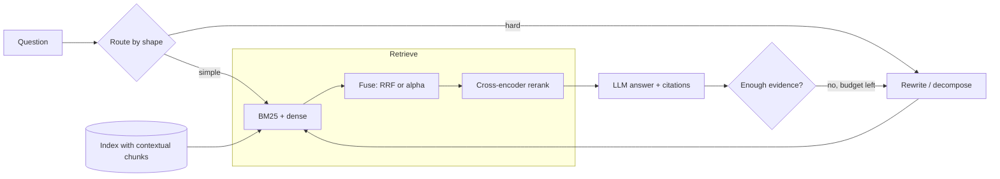

### Q1 ⭐⭐⭐ 🟢 Why does basic vector RAG fall short, and what does the standard advanced-RAG stack (hybrid search, reranking, query transformation) add?
**Asked at:** all types; GenAI-engineer and RAG-design loops
**Say this first (1 line):** Basic RAG (embed chunks, take the top-k by cosine, stuff the prompt) fails in five repeatable ways, and each advanced technique exists to fix one of them, so I add a stage only when a measured failure justifies its latency and cost.

**Then explain:**
| Failure | What goes wrong | Stage that targets it | What it costs |
|---|---|---|---|
| Exact-token and vocabulary misses | Dense models blur IDs, codes, names; paraphrases miss BM25 | Hybrid search (Q2-Q4) | a second index and a fusion step |
| Context-free chunks | "Revenue grew 3%" does not say which company or period | Contextual chunks (Q11) | an LLM call per chunk at index time |
| Noisy top-k order | The right chunk is at rank 14, not rank 3 | Reranking (Q5, Q6) | latency roughly proportional to candidates |
| Ambiguous or conversational queries | "and the price?" has no searchable words | Query rewriting, HyDE, multi-query (Q7-Q9; chat case in Part 6 Q28) | an LLM call before retrieval |
| Multi-hop and global questions | Evidence is spread over documents; "main themes?" has no nearest chunk | Decomposition, GraphRAG, agent loops (Q10, Q12, Q13) | several LLM calls, unpredictable latency |

- **Do not stack everything.** Each stage adds p95 latency and a new thing to break. Tag failures on a golden set (Part 6 Q40), find the biggest bucket, fix that, re-measure.
- **Route by question.** Simple lookups take the cheap path; only hard-looking queries pay for rewriting, decomposition or a loop.
- **Basics are in Part 6** (debugging a wrong answer Q11, a minimal pipeline Q14, hybrid basics Q29, reranking basics Q30); this part goes deeper on each stage.



**Example:** On an invented 17-query golden set tagged by failure type, the exact-token bucket has recall@5 of 0.25 but recall@20 of 0.75: the answer is retrieved, just ranked badly, so hybrid plus a reranker is the fix. The multi-hop bucket has recall@20 of 0.33: no reranker can help, so decomposition is the fix. The tag tells you which tool to reach for.

**Code:** (run; hard-coded mock retrieval logs, not a real system)
```python
{{code:q01}}
```
Output (my run):
```
{{out:q01}}
```

**Follow-ups:**
- *What do you add first?* Usually hybrid retrieval plus a reranker, because they fix very common failures and keep the pipeline a fixed, predictable shape. Query transformation and agents come after measuring.
- *Why not just use a bigger context window?* Cost and latency grow with tokens, and long contexts can bury the relevant passage; retrieval quality still matters (Part 6 Q49).
- *How do you prove a stage was worth it?* Retrieval metrics before and after on the golden set, then end-to-end faithfulness, with the added p95 latency alongside.

**Common mistakes:** listing techniques without tying each to a failure; adding a reranker when recall@k itself is low; blaming the LLM for retrieval misses; shipping an agent loop for questions a hybrid retriever already handles.

### Q2 ⭐⭐⭐ 🟡 Hybrid search in depth: how do lexical (BM25), learned-sparse and dense retrievers differ, and how do you fuse their results?
**Asked at:** all types; product, GenAI startups, GCC
**Say this first (1 line):** BM25 matches the exact words, dense retrieval matches meaning, learned-sparse sits in between (term weights learned by a model); they fail on different queries, so I run two or three of them in parallel and fuse the ranked lists, starting with RRF.

**Then explain:**
- **BM25 (lexical).** Score of document D for query Q = sum over query terms of IDF(t) x f x (k1 + 1) / (f + k1 x (1 - b + b x |D| / avgdl)), where f is the term count in D. Three ideas: **IDF** (rare words count more), **term-frequency saturation** (the 10th occurrence adds far less than the 1st; k1 sets how fast), **length normalisation** (b = 1 fully penalises long documents, b = 0 not at all). Common defaults are k1 around 1.2 to 2.0 and b = 0.75 (from memory; tune on your corpus). Needs no training; a missing word scores zero.
- **Dense.** A bi-encoder embeds query and chunk; cosine similarity finds paraphrases and typos, but rare identifiers can be blurred (Part 6 Q29).
- **Learned sparse (SPLADE-style).** From memory, so hedge: a model outputs a weight per vocabulary term, including expansion terms that the text never contained, and it is served from an inverted index like BM25. It softens vocabulary mismatch while keeping exact-term behaviour. Q16 covers it.
- **Fusion.** Rank-based (RRF, Q3) needs no calibration. Score-based (weighted alpha, Q4) needs normalisation and tuning on labelled queries. Start with RRF; move to alpha once you have a labelled set.
- **Operational note.** Many engines run both retrievers in one query; check your engine's current docs. Do not promise a percentage gain: measure recall@k on your golden set.

**Example:** Invented support corpus. For "E4021" BM25 finds the error-code chunk but the toy dense model returns a neighbouring error; for "reimbursement please" and "unsubscribe" BM25 returns nothing (no shared word) while the toy dense model finds the refund and cancellation chunks. RRF got all four right.

**Code:** (run; BM25 from scratch; the "dense" model is a TOY of hand-made synonym clusters and hashed unknown tokens, not a real model)
```python
{{code:q02}}
```
Output (my run):
```
{{out:q02}}
```
The last line is a trap: if you rank BM25's zero-score ties anyway, an arbitrary document (here d1) gets a high rank and pollutes the fusion. A ranker should return only documents it actually matched.

**Follow-ups:**
- *Why not just dense?* Exact identifiers and rare terms. Measure with a bucket of lexical queries on your golden set.
- *Why not just BM25?* No semantic match: a user saying "money back" never reaches "refund".
- *When is SPLADE worth it?* When vocabulary mismatch hurts but you want inverted-index serving; it adds index size and a model pass at index and query time (from memory).

**Common mistakes:** adding BM25 and cosine scores directly (Q4); fusing ranks for a ranker that returned nothing; forgetting both retrievers must see the same chunking and metadata filters; assuming hybrid always wins without a measurement.

### Q3 ⭐⭐⭐ 🟡 Explain reciprocal rank fusion: the formula, the role of k, its strengths and weaknesses, and code it.
**Asked at:** all types; product, GenAI startups
**Say this first (1 line):** RRF scores each document as the sum over rankers of 1 / (k + rank), with rank starting at 1 and k commonly 60, so it only uses positions, never raw scores, and rewards documents that several rankers place high.

**Then explain:**
- **Formula:** score(d) = sum over rankers r of 1 / (k + rank_r(d)); a document missing from a list contributes nothing. k = 60 is the commonly used default, reported from the original SIGIR 2009 work (Cormack et al.) and confirmed by secondary sources I saw.
- **Role of k:** it flattens the curve. Small k makes rank 1 dominate; large k makes all ranks count almost equally. See the run below.
- **Strengths:** score-free, so BM25 scores and cosines need no calibration; one line of code; robust to a ranker whose scale changes; consensus documents rise.
- **Weaknesses:** ignores score magnitude and confidence (rank 1 by a huge margin equals rank 1 by a hair); a weak ranker counts as much as a strong one unless you weight lists; results depend on list depth (a document at rank 51 contributes nothing if you only fetch 50).
- **The off-by-one trap:** rank starts at 1. With Python's `enumerate` default you get 0-based ranks, and the top document gets 1/60 instead of 1/61. It rarely changes order but fails hand-computed tests.

**Example:** Ranker A: u, w, m, n, v. Ranker B: v, w, o, p, u. At k = 60, w (rank 2 in both) scores 0.03226 and beats u and v (rank 1 in one list, 5 in the other: 0.03178). At k = 1 the three tie at 0.667, so small k lets top ranks dominate. Trusting A three times more flips the order to u, w, v.

**Code:** (run; standalone, with assertion tests)
```python
{{code:q03}}
```
Output (my run):
```
{{out:q03}}
```

**Follow-ups:**
- *RRF or weighted scores?* RRF first because it needs no labels; alpha fusion (Q4) once you have labelled queries.
- *How deep should each list be?* Deep enough that the gold chunk can appear; recall@depth of each ranker bounds the fused recall.
- *Ties?* Break deterministically (here by id) or by the better individual rank.

**Common mistakes:** 0-based ranks; counting duplicate hits in one list twice; fusing a list from a ranker that matched nothing; treating k = 60 as a law instead of a tunable constant.

### Q4 ⭐⭐⭐ 🟡 Weighted (alpha) fusion of retrieval scores: why raw scores cannot be mixed, how do you normalise, and how do you tune alpha?
**Asked at:** product, GenAI startups, search teams
**Say this first (1 line):** BM25 scores and cosine scores live on different scales, so adding them lets the bigger scale win; I normalise each list per query (min-max or z-score), combine as alpha x dense + (1 - alpha) x BM25, and tune alpha on a labelled query set with a grid, reporting recall@k with confidence intervals.

**Then explain:**
- **Why raw sums fail:** BM25 is unbounded and depends on query length and corpus statistics (tens), cosine sits in a narrow band (0 to 1). The sum is almost just BM25.
- **Normalise per query:** min-max = (x - min) / (max - min) over that query's candidates; z-score = (x - mean) / std. Min-max is sensitive to one outlier; z-score less so. Details of normalisation: Q17.
- **Tune alpha:** grid 0 to 1 in steps of 0.1 on a dev split; pick the best; report on a held-out split with a bootstrap CI. With a few dozen queries the CI will be wide: say so.
- **Cheap sanity check:** compare to dense-only and BM25-only. One blog anecdote reports an untuned weight leaving hybrid MRR at 0.390 below dense-only at 0.410: a single reported case, not a rule, but it shows why you must compare.
- **Rule of thumb:** start with RRF (Q3); move to tuned alpha once you have labelled queries.

**Example:** Synthetic scores for 400 queries (half favour lexical, half favour semantic). Raw sum gives recall@3 of 0.557, essentially BM25 alone (0.560). Z-score fusion at 0.5 gives 0.745. On a held-out half: dense only 0.540, BM25 only 0.555, alpha 0.5 gives 0.730 with CI [0.665, 0.790], so the gain is clearly outside the noise here. These numbers describe the synthetic generator, not real retrievers.

**Code:** (run; SYNTHETIC scores, numpy only)
```python
{{code:q04}}
```
Output (my run):
```
{{out:q04}}
```

**Follow-ups:**
- *One global alpha or per-query?* Start global. Per-query weights (for example by query type) need more labels and a router.
- *Why z-score per query?* The scale shifts per query, so normalise within each candidate list.
- *Candidate missing from one list?* Give it that list's minimum normalised score (or 0) and say which you chose.

**Common mistakes:** normalising over the whole corpus instead of per query; tuning alpha on the test queries; quoting a point gain with no CI; skipping the dense-only baseline.

### Q5 ⭐⭐⭐ 🟡 How does cross-encoder reranking work in a RAG pipeline? Cover candidate counts, latency, fine-tuning and how you prove it helps.
**Asked at:** all types; product, GenAI startups, GCC
**Say this first (1 line):** A cross-encoder reads query and document together and outputs a relevance score, which is far more accurate than comparing two precomputed vectors but needs one model pass per candidate, so I retrieve n candidates cheaply and rerank them down to k for the prompt.

**Then explain:**
- **Why it is more accurate:** joint encoding lets every query token attend to every document token; a bi-encoder compresses each side separately (B1P07-Q37). Basics: Part 6 Q30.
- **Candidate count n:** latency is about n x per-pair cost (batching and GPUs help). Larger n raises shortlist recall but adds time; pick n from a recall@n curve. The shortlist is a ceiling: a gold chunk that is not retrieved cannot be rescued.
- **Fine-tuning:** train on (query, relevant, hard-negative) triples, where hard negatives are near-misses from your own first stage; this teaches the model the distinctions your corpus actually needs. Needs labelled queries.
- **Prove it helps:** before/after recall@k, MRR and nDCG@k on the golden set, then end-to-end faithfulness and answer quality, with p95 latency next to it (Part 6 Q40, Q31).
- **Failure modes:** truncation of long chunks, domain shift, language mismatch, rewarding chunks that restate the query (Q45).

**Example:** Toy corpus of 960 invented chunks, 60 queries. First stage is bag-of-words overlap; the second stage is a proximity scorer (a stand-in, not a trained model). With n = 20: MRR 0.175 to 0.983 and nDCG@10 0.232 to 0.983. With n = 5 the shortlist only contains the gold chunk 28% of the time, so MRR reaches only 0.283. Latency arithmetic with ASSUMED 10 ms per pair: n = 50 costs 500 ms serial, n = 200 costs 2 s, before batching.

**Code:** (run; TOY synthetic data; latency numbers are assumptions)
```python
{{code:q05}}
```
Output (my run):
```
{{out:q05}}
```

**Follow-ups:**
- *Reranker latency too high?* Lower n, truncate chunks, a smaller or distilled model, batch on GPU, or rerank only when first-stage scores look ambiguous.
- *Bi-encoder vs cross-encoder vs ColBERT?* See Q6.
- *LLM as reranker?* Possible, slower and costlier; Q18 and Q19 compare.

**Common mistakes:** reranking everything; ignoring the shortlist ceiling; testing only on the answer, not on retrieval metrics; no hard negatives when fine-tuning; evaluating on queries the reranker was trained on.

### Q6 ⭐⭐⭐ 🟡 What is late interaction (ColBERT)? Explain MaxSim, what is precomputed, the storage cost, and when to prefer it over a bi-encoder or a cross-encoder.
**Asked at:** product, GenAI startups, search and research-leaning teams
**Say this first (1 line):** ColBERT keeps one vector per token for both query and document and scores with MaxSim, the sum over query tokens of the best matching document token; document token vectors are computed offline, so it is richer than one vector per document and far cheaper than running a cross-encoder per pair.

**Then explain:**
- **MaxSim:** score(q, d) = sum over query tokens i of max over document tokens j of sim(q_i, d_j). Each query token picks its best partner, so a query word can match a synonym in a different spot.
- **Precomputed:** document token matrices, offline. At query time only the query is encoded.
- **Reported by the authors (abstract):** about two orders of magnitude faster and four orders of magnitude fewer FLOPs per query than BERT-based rankers, while competitive in effectiveness; the design also supports vector-similarity indexes for end-to-end retrieval, not only reranking. These are the authors' claims in their setting.
- **Storage:** tokens x dimension x bytes per document. Q50 does the large-scale version.
- **Comparison:**

| | Bi-encoder | ColBERT (late interaction) | Cross-encoder |
|---|---|---|---|
| Quality | good | between (reported competitive with BERT rankers) | usually best for reranking |
| Query-time cost | one dot product per doc (ANN) | token-matrix scoring, heavier | one model pass per pair |
| Precompute | one vector per doc | one matrix per doc | nothing |
| Storage | smallest | largest | none |

- **Pick it** when a single vector loses detail (long, multi-topic passages) and you can afford the index; pick a cross-encoder to rerank a short list; pick a bi-encoder for a cheap first stage.

**Example:** 10,000 chunks x 200 tokens x 128 dims x 2 bytes (fp16) = 0.51 GB, versus 30.7 MB for one 768-d fp32 vector per chunk: about 17x more storage. In the toy run the query "fix car engine" matches "mend an automobile engine" because each query token finds its synonym token.

**Code:** (run; TOY token vectors, not a trained ColBERT)
```python
{{code:q06}}
```
Output (my run):
```
{{out:q06}}
```

**Follow-ups:**
- *Can you shrink the storage?* Fewer dimensions, lower precision, token pruning, or compression; trade-offs are in Q50 and need measuring.
- *Why not always use ColBERT?* Index size, operational complexity, and fewer managed-service options (check current support).
- *Is the toy meaningful?* It only shows the scoring rule.

**Common mistakes:** saying MaxSim is symmetric (it sums over query tokens only); forgetting storage; calling it a cross-encoder; quoting the speedup as a universal number.

### Q7 ⭐⭐⭐ 🟡 When does query rewriting help or hurt RAG, and how do you route queries to the right transformation?
**Asked at:** all types; product, GenAI startups
**Say this first (1 line):** Rewriting helps when the raw query is a poor search string (vocabulary mismatch, chat ellipsis, long messy text) and hurts when the query is already precise or the rewriter drifts, so I route by query shape, always keep the original query as a fallback, and fuse both result lists.

**Then explain:**
- **Helps:** vocabulary mismatch; conversational follow-ups like "and the price?" (Part 6 Q28); long, rambling queries condensed to keywords.
- **Hurts:** identifiers and quoted strings ("E4021"); precise queries; rewriters that add or drop terms (hallucinated entities, lost constraints); every rewrite adds an LLM call and its latency.
- **Route by shape:** short precise or code-like goes straight to hybrid retrieval; a follow-up with pronouns goes through history-aware rewriting; long messy text gets condensed; clearly multi-part gets decomposition (Q10). A small classifier or rules is enough.
- **Protect with fusion:** retrieve with original and rewritten, merge with RRF (Q3). The bad rewrite loses influence, the good one adds recall.
- **Measure:** recall@k before and after on a labelled set split by query type; track p95 latency, since the LLM call sits on the critical path.

**Example:** Mock rewriter, toy BM25 corpus, 3 queries. Original MRR 0.333, rewritten 0.667, fused 0.611. The chat follow-up and the messy query improved with rewriting; the precise code "E4021" dropped from 1.0 to 0.5 when the mock rewriter drifted to "payment problems troubleshooting guide", and fusion restored it to 1.0. Fused is slightly below rewrite-only on the average: fusion is insurance, not a free gain. Three cases only; shape, not evidence.

**Code:** (run; MOCK rewriter is a lookup table, TOY corpus)
```python
{{code:q07}}
```
Output (my run):
```
{{out:q07}}
```

**Follow-ups:**
- *How do you detect drift?* Check that entities and numbers from the original appear in the rewrite; flag rewrites that add unseen entities.
- *Do you rewrite every query?* No, route; most precise queries skip it.
- *What if latency is tight?* Use a small model for rewriting, cache frequent rewrites, or rewrite only when first-pass scores are low.

**Common mistakes:** rewriting everything; dropping the original query; judging by a few hand-picked examples instead of a split metric; ignoring the added LLM call in the latency budget.

### Q8 ⭐⭐⭐ 🟡 What is HyDE (hypothetical document embeddings)? How does it work, when does it help, and what does it cost?
**Asked at:** all types; product, GenAI startups
**Say this first (1 line):** HyDE asks an LLM to write a hypothetical answer passage, embeds that passage instead of the short query, and retrieves real documents near it; the fake text is only a search aid and is never used as evidence.

**Then explain:**
- **Per the paper's abstract:** an instruction-following LM writes a document zero-shot that captures relevance patterns but may contain false details; an unsupervised contrastively trained encoder embeds it and retrieves real documents, and the encoder's dense bottleneck is said to filter out the incorrect details. It outperforms the unsupervised Contriever and is comparable to, not better than, fine-tuned retrievers across tasks and languages.
- **Helps:** short or vocabulary-mismatched queries, and corpora written in an answer-shaped style (manuals, FAQs), because the hypothetical passage looks like the target text.
- **Hurts:** ambiguous queries (the LLM picks one reading), domains where the LLM lacks knowledge (the passage drifts), and exact-identifier queries.
- **Cost:** one LLM generation plus one embedding per query, on the critical path. I do not quote latency or accuracy figures from blogs; measure on your data.
- **Safety:** retrieved real passages go to the answerer; the hypothetical text never does. Combine HyDE with the original-query results via RRF (Q3).

**Example:** Mock generator, toy hashed bag-of-words embedder. "why is my laptop so hot" retrieves the wrong chunk with the raw query (toy hash noise), but the mock hypothetical passage (thermal throttling, fans) retrieves the thermal chunk. The passage contains a made-up "95 C" that never reaches the user. A second query shows the failure: when the mock generator lacks knowledge and writes an off-topic passage, HyDE retrieves the wrong chunk.

**Code:** (run; MOCK generator with canned text, TOY embedder)
```python
{{code:q08}}
```
Output (my run):
```
{{out:q08}}
```

**Follow-ups:**
- *HyDE vs multi-query?* HyDE changes the representation (answer-shaped); multi-query changes the wording (Q9).
- *HyDE with a weak LLM?* Expect drift; keep the original-query list in the fusion.
- *How do you evaluate it?* recall@k with and without on queries split by type, plus the added p95.

**Common mistakes:** feeding the hypothetical text to the answerer; using HyDE on exact-code queries; assuming it beats a fine-tuned retriever (the abstract says comparable); quoting blog gain numbers as facts.

### Q9 ⭐⭐⭐ 🟡 What are multi-query retrieval and query expansion, and how do you combine the results of several query variants?
**Asked at:** product, GenAI startups
**Say this first (1 line):** Multi-query asks an LLM for N rephrasings of the question, retrieves for each, and fuses the ranked lists with RRF and removes duplicates, trading N searches and one LLM call for higher recall.

**Then explain:**
- **Why it works:** one phrasing hits one slice of the vocabulary; several phrasings cover more of it. Query expansion is the same idea at term level (add synonyms or related terms to one query).
- **Combine:** RRF over the lists (Q3), key by chunk id so duplicates collapse, always include the original query.
- **Cost:** N searches (run in parallel, so latency is the slowest one plus fusion) plus an LLM call to generate variants; N is usually small (3 to 5).
- **Diversity versus drift:** variants must differ in wording, not in intent. A variant that changes the question pulls unrelated chunks into the top-k and adds noise for the LLM. Check recall@k and precision@k, not recall alone.
- **Use when:** ambiguous or underspecified queries, vocabulary mismatch. Skip for precise queries (Q7 routing).

**Example:** Toy HR corpus, mock variant generator. "how many days off do I get" retrieves leave2 only (recall@3 = 0.5). With three mock variants fused by RRF, recall@3 = 1.0 over 4 searches. One variant drifted to sick leave: used alone with the original it lets the sick-leave chunk into the top 3 and recall@3 stays at 0.5, and even in the 4-list fusion it holds rank 2, which is noise the LLM must read.

**Code:** (run; MOCK variants, TOY BM25 corpus)
```python
{{code:q09}}
```
Output (my run):
```
{{out:q09}}
```

**Follow-ups:**
- *How many variants?* Where recall@k stops improving; more variants cost more searches.
- *Why not concatenate the variants into one query?* That blurs the lexical match and dense embedding; separate searches then fusion is cleaner.
- *Weight the original?* Often, yes: give it a larger weight in RRF.

**Common mistakes:** dropping the original; no dedupe; variants that change the intent; running N sequential searches; measuring recall without looking at what noise was added.

### Q10 ⭐⭐⭐ 🟡 How do you handle multi-hop questions with query decomposition? Walk through the design, the ordering of sub-questions and the failure modes.
**Asked at:** product, GenAI startups, agent-building teams
**Say this first (1 line):** A planner splits the question into sub-questions with dependencies, each is retrieved and answered in dependency order (hop 2 uses the bridge entity found in hop 1), and a final step synthesises the answer from the sub-answers and their evidence.

**Then explain:**
- **When:** multi-hop ("where was the CEO of the maker of X born?"), comparisons ("A vs B"), aggregation ("all products with ..."). Not for single-fact lookups.
- **Design:** planner LLM produces sub-questions and a dependency graph; per sub-question: retrieve, answer from evidence only, store answer plus citations; independent sub-questions run in parallel; dependent ones wait and substitute the earlier answer; synthesise last.
- **Ordering:** a hop that needs a bridge entity cannot be retrieved until the previous hop is answered; sequential latency adds up.
- **Failure modes:** over-decomposing simple questions (extra cost and risk); **error propagation** (a wrong bridge entity gives a fluent wrong answer); lost context (sub-questions lose the original intent); cost (a planner call, one retrieval and often one LLM call per hop, and one for synthesis).
- **Guardrails:** cap the number of sub-questions, verify each hop's evidence, ask for "not found" instead of guessing, and fall back to normal RAG when planning fails. Agent loops (Q13, Part 8) generalise this with dynamic planning.

**Example:** Invented knowledge base. One retrieval of the full question with top-2 returns the "manufactured by" and "chief executive" passages but not the birthplace one. Decomposition: (1) maker of the Zorbo scooter gives Zentra Motors; (2) its chief executive gives Mira Quill; (3) where she was born gives Port Alder: 3 retrieval calls, plus a planner and a synthesis call in a real system. If hop 1 had returned the wrong company, the chain returned a confident wrong birthplace.

**Code:** (run; MOCK planner and reader over an invented KB)
```python
{{code:q10}}
```
Output (my run):
```
{{out:q10}}
```

**Follow-ups:**
- *Decomposition vs agent loop?* Decomposition plans up front; an agent re-plans from observations. Use the plan when the structure is known.
- *How do you evaluate?* Hop-level recall (was each needed passage retrieved) and final accuracy, by question type.
- *GraphRAG for multi-hop?* If relations are the point and the collection is large (Q12).

**Common mistakes:** decomposing everything; running dependent hops in parallel; not carrying the original question into each hop; accepting a hop answer without evidence; no cap on hops.

### Q11 ⭐⭐⭐ 🟡 What is contextual retrieval? Explain contextual embeddings and contextual BM25, the reported gains, and the cost.
**Asked at:** product, GenAI startups, GCC
**Say this first (1 line):** Chunks lose the context of their document ("revenue grew 3%" with no company or period), so before indexing an LLM writes a short chunk-specific context (about 50 to 100 tokens) from the whole document and the chunk, and that text is prepended to the chunk before embedding and before building the BM25 index.

**Then explain:**
- **Two parts:** contextual embeddings (embed context + chunk) and contextual BM25 (index context + chunk); plus an optional reranker on top.
- **Reported results (Anthropic's blog, a vendor report):** the failure rate (1 - recall@20, averaged across the datasets they tested: codebases, fiction, arXiv papers, science papers, with one embedding model) fell by 35% with contextual embeddings, 49% with contextual embeddings plus contextual BM25, and 67% when reranking the top 150 down to 20 was added. One vendor, one metric, their setting: measure on your corpus.
- **Cost:** one LLM call per chunk at indexing, each seeing the full document. The post says prompt caching of the document makes this practical; I do not quote its price estimate. Re-index when documents change.
- **Reported guidance:** the post suggests that for knowledge bases under about 200,000 tokens you may skip RAG and put everything in the prompt. Generic whole-document summaries gave little gain per the post; the context must be specific to the chunk.
- **Trade-off:** index-time cost and complexity, no query-time latency. Cheaper variant: prepend metadata you already have (title, section path, date).

**Example:** Toy corpus of 6 invented companies x 2 quarters, 36 chunks. Context-free BM25 on "Acme Corp Q2 2023 revenue growth" cannot tell the revenue chunks apart: MRR 0.259, gold at rank 1 for only 1 of 12 queries. With a template-built context line prepended, MRR 1.0 and 12 of 12. The context here is a template, not an LLM, and the corpus is built so that context matters: a mechanism demo, not a gain estimate.

**Code:** (run; TOY, no LLM: context is built from metadata)
```python
{{code:q11}}
```
Output (my run):
```
{{out:q11}}
```

**Follow-ups:**
- *Does the context go to the answerer?* It can, but its job is retrieval; decide whether to show it.
- *Hallucinated context?* An LLM can write wrong context; constrain it to the document and spot-check.
- *Alternatives?* Metadata prefixes, parent-document retrieval, semantic chunking (Part 6 Q48), hierarchical summaries (Q27).

**Common mistakes:** adding generic summaries; contextualising only the embeddings and not BM25; quoting 35/49/67% as universal; forgetting the per-chunk LLM bill at re-index time.

### Q12 ⭐⭐⭐ 🟡 What is GraphRAG? When would you choose it over plain vector RAG, and when not?
**Asked at:** all types; product, GenAI startups, enterprise teams
**Say this first (1 line):** GraphRAG has an LLM build an entity knowledge graph from the corpus, group related entities into communities with pre-written summaries, and answer global questions by mapping over those summaries and reducing the partial answers; it is for whole-collection and connect-the-dots questions, not for simple lookups.

**Then explain:**
- **Per the paper's abstract:** vector RAG fails on global sensemaking questions over a whole corpus (query-focused summarisation). The method builds an entity graph, pre-generates community summaries, then each summary yields a partial answer and the partials are summarised into the final answer. The authors report gains in comprehensiveness and diversity on datasets around 1 million tokens; the abstract gives no judging details, so treat the gains as reported.
- **Per Microsoft's docs:** indexing includes entity, relationship and claim extraction and hierarchical community detection (the Leiden technique); query modes include Global, Local, DRIFT and Basic (plain vector search). The docs point to basic search for queries it already handles.
- **Choose it** for "what are the main themes?", "how are these entities connected?" over large collections. **Do not** for fact lookups: vector or hybrid retrieval is cheaper and enough.
- **Cost:** indexing needs LLM calls over every chunk (reported by explainers), plus summaries, and the graph must be refreshed as data changes. Query-time global answers also use many LLM calls (one per community in the map step).
- **Related:** RAPTOR (Q27), graph-versus-vector (Q28-Q30).

**Example:** Invented collection with three unrelated clusters (a farm and mill, a mapping startup, a wetlands council). Components give 3 communities; mock summaries produce themes; a map-reduce answer lists all three themes with 3 map calls plus 1 reduce. A single question like "what are the main themes?" has no nearest chunk for vector top-k. A local lookup ("who does Lumen Farms sell to?") is one triple and needs no graph.

**Code:** (run; TOY hand-labelled triples, connected components instead of Leiden, template summaries instead of an LLM)
```python
{{code:q12}}
```
Output (my run):
```
{{out:q12}}
```

**Follow-ups:**
- *How do you evaluate it?* LLM-judged comprehensiveness and diversity in the paper; add human spot-checks and cost per query.
- *Staleness?* Incremental re-extraction for changed documents; community summaries for affected communities.
- *Cheaper alternative?* Hierarchical summaries (RAPTOR) or metadata filters.

**Common mistakes:** using GraphRAG for FAQ lookups; ignoring indexing cost; trusting LLM-extracted triples without checks; treating the reported gains as guaranteed.

### Q13 ⭐⭐⭐ 🟡 Agentic RAG vs single-pass RAG: when is an agent loop worth its cost, and how do you bound it?
**Asked at:** all types; product, GenAI startups, agent-building teams
**Say this first (1 line):** Agentic RAG replaces the fixed retrieve-then-generate pipeline with a control loop (plan, retrieve, judge whether the evidence is enough, retry or answer); it pays off for multi-hop, tool-choice or verification-heavy questions, not for simple lookups, and it must be bounded by steps, budgets and an independent sufficiency check.

**Then explain:**
- **Worth it when:** the number of retrievals is unknown in advance, sources differ (docs, SQL, web), or answers need verification. A claim-ratio-2023-vs-2022 type question needs several retrievals.
- **Not worth it when:** a lookup that one hybrid retrieval handles; the loop adds latency and variance.
- **Cost:** explainers report 5 to 10 times more LLM calls per query (a blog claim, illustrative; measure yours) and unpredictable latency.
- **Bounds:** max steps; token, cost and time budgets; a recorded stop reason (sufficient, max_steps, budget); a fallback of "not enough evidence" instead of guessing.
- **Independent evaluator:** an LLM judging its own retrieval is reported to be unreliable; use a separate checker (a different model, rules or a reranker-confidence threshold).
- **Middle option:** a fixed rewrite-then-retrieve step, or a single retry on low confidence. See Part 8 for agent design and Part 3 Q11 for tool-call loops.

**Example:** Mock loop with ASSUMED token costs (plan 300, judge 200, answer 400). Simple lookup: 1 step, 900 tokens. Multi-hop: 3 steps, 1,900 tokens. Unanswerable: stops at max_steps (3) with 1,500 tokens and says evidence is insufficient. Multi-hop under a 1,500 budget: stops after 2 steps with a partial flag. That is the point of bounds: the worst case is known.

**Code:** (run; MOCK retriever, planner and judge; token costs are assumptions)
```python
{{code:q13}}
```
Output (my run):
```
{{out:q13}}
```

**Follow-ups:**
- *How do you evaluate an agent loop?* Task success, steps and tokens per query, stop-reason distribution, cost per correct answer (Part 9).
- *Loop never converges?* Dedupe repeated queries, detect no-progress steps, stop early.
- *Security?* Tool outputs are untrusted data (Part 11).

**Common mistakes:** unlimited loops; the same model judging its own sufficiency; using an agent for simple lookups; no stop reason logged; ignoring p95 latency.
