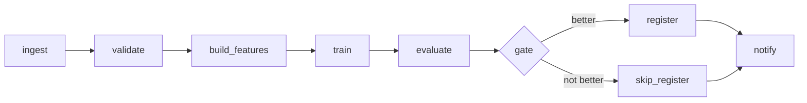

# Book 4 Part 5, Q1-Q10 answers (Wave B)

### Q1 ⭐⭐⭐ 🟢 What is Apache Airflow, and what is a DAG, a task, an operator and a task instance? Explain how a DAG file is just Python that declares structure, the scheduler, the DAG processor, the executor, workers, the metadata database and the web UI or API server, and what 'directed acyclic' rules out. Show a three-task ML DAG (extract, train, evaluate) written with the TaskFlow API. Parse it with DagBag and run it with airflow dags test on SQLite; no scheduler or web server is started.
**Asked at:** Airflow interview guides (hyring.com Airflow Interview Questions 2026, datavidhya.com Airflow interview pages, prachub.com 'Airflow Interview Questions for Data Engineers', datadriven.io, hirist.tech top 20 Airflow questions; search snippets only, not opened); editorial guides, not verified candidate reports; data engineering, MLOps and ML platform roles, including IT-services firms and GCCs
**Say this first (1 line):** Airflow is a scheduler for workflows written as Python: a DAG is the graph of tasks and their order, the scheduler decides when each task runs, and workers do the work.

**Then explain:**
- A **DAG** is a directed acyclic graph: arrows have a direction (A before B) and you can never walk a loop back to where you started. "Acyclic" rules out train -> evaluate -> train. A loop would never finish, so the scheduler could not order the tasks.
- A **task** is one node. An **operator** is the template for a task (`BashOperator`, `PythonOperator`, a cloud operator). With the TaskFlow API, a function with `@task` becomes a task. A **task instance** is one task in one DAG run (one date), with its own state, try number and logs.
- A DAG file is just Python that declares structure. The **DAG processor** parses the files and stores the result. The **scheduler** creates runs and queues task instances. The **executor** hands them to **workers**. The **metadata database** holds all state (runs, task states, XComs). The **API server** (Airflow 3) serves the UI and the REST API; check current docs for the exact process list in your version.
- Orchestrator rule: Airflow decides what runs when. Heavy work (Spark, a GPU job) belongs in other systems that the task only calls or waits on.
- Failure modes: a syntax error or a failing import shows up as a DAG import error and the DAG disappears from the UI. Network or database calls at the top level of the file run every parse and slow the whole scheduler. A cycle makes the DAG fail to load.

**Example:** `extract -> train -> evaluate`. For one daily run there are three task instances. If `train` fails, `evaluate` is not run (state `upstream_failed`), and you can retry just `train` for that date.

**Code:**
```python
# dags/ml_train.py  (Airflow 3: note airflow.sdk imports)
from pendulum import datetime
from airflow.sdk import dag, task

@dag(schedule="@daily", start_date=datetime(2026, 1, 1, tz="UTC"), catchup=False,
     default_args={"retries": 2}, tags=["ml"])
def ml_train():
    @task
    def extract(ds=None):
        return f"s3://bucket/raw/{ds}.parquet"

    @task
    def train(uri: str):
        print(f"training on {uri}")
        return "model-v1"

    @task
    def evaluate(model: str):
        print(f"evaluating {model}")
        return {"auc": 0.91}

    evaluate(train(extract()))

ml_train()

# check.py: parse with DagBag (Airflow 3 DagBag has no include_examples argument)
#   from airflow.models import DagBag
#   bag = DagBag(dag_folder=sys.argv[1])
#   print("import_errors:", bag.import_errors)
#   for d in bag.dags.values(): print(d.dag_id, "tasks:", [t.task_id for t in d.tasks])
```

```bash
export AIRFLOW_HOME=/tmp/af_home AIRFLOW__CORE__DAGS_FOLDER=/tmp/af_dags AIRFLOW__CORE__LOAD_EXAMPLES=False
mkdir -p $AIRFLOW_HOME $AIRFLOW__CORE__DAGS_FOLDER && cp ml_train.py $AIRFLOW__CORE__DAGS_FOLDER/
airflow db migrate                      # creates the SQLite metadata DB
python3 -I check.py $AIRFLOW__CORE__DAGS_FOLDER
airflow dags test ml_train 2026-10-01   # runs all tasks in-process: no scheduler, no web server
airflow tasks list ml_train
```

**Output (my run):** apache-airflow 3.3.2, Python 3.13, SQLite, own temp AIRFLOW_HOME. The `dags test` log is verbose (structlog lines); I kept the lines that matter.
```
import_errors: {}
ml_train tasks: ['extract', 'train', 'evaluate']
info: [DAG TEST] starting task_id=extract map_index=-1
info: Pushing xcom
info: [DAG TEST] starting task_id=train map_index=-1
training on s3://bucket/raw/2026-10-01.parquet
info: Pushing xcom
info: [DAG TEST] starting task_id=evaluate map_index=-1
evaluating model-v1
info: Marking run <DagRun ml_train @ 2026-10-01 00:00:00+00:00 ... run_type: manual> successful
(airflow tasks list ml_train prints: evaluate, extract, train)
```
Not executed: scheduler, DAG processor, API server, triggerer, any executor other than the in-process one used by `dags test`.

**Follow-ups:**
- *Is a DAG file run on every task?* The file is parsed repeatedly by the DAG processor, and again by the task runner when a task starts. So keep top-level code cheap.
- *Task vs task instance?* The task is the definition. The instance is that definition for one run, with state.
- *Why not cron?* No dependencies, retries, history or backfill (see Q15).

**Common mistakes:**
- Putting heavy imports or API calls at the top of the DAG file.
- Thinking `airflow dags test` equals a real scheduled run. It runs in one process, with no queueing or worker limits.
- Using Airflow 2 import paths (`from airflow.decorators import dag`) in new code; in Airflow 3 use `airflow.sdk` (the old path may still work with a warning; check current docs).

### Q2 ⭐⭐⭐ 🟡 Airflow scheduling: schedule, start_date, data interval, logical date and catchup. Explain why a daily run for 2026-01-01 starts only after that interval ends, what logical date and data_interval_start and data_interval_end mean, cron strings versus presets versus timetables, why a dynamic start_date such as datetime.now() is a bug, time zones (pendulum) and daylight saving, and what catchup=True does the first time a DAG is unpaused. Show a DAG with a fixed start_date and print its data interval from a test run. Check the Airflow 3 docs for renamed fields.
**Asked at:** Airflow interview guides (hyring.com Airflow Interview Questions 2026, datavidhya.com Airflow interview pages, prachub.com 'Airflow Interview Questions for Data Engineers', datadriven.io, hirist.tech top 20 Airflow questions; search snippets only, not opened); editorial guides, not verified candidate reports; data engineering, MLOps and ML platform roles, including IT-services firms and GCCs
**Say this first (1 line):** A schedule is a rule for making runs, each run covers a data interval, and the logical date names that run; with the classic interval timetables a run for Jan 1 starts only after Jan 1 has ended, because the data is not complete before that.

**Then explain:**
- `start_date` is the earliest point the DAG may produce runs. It must be a fixed date. `datetime.now()` moves every parse, so the first interval never completes and you get confusing or missing runs. Use a fixed value with a time zone (pendulum).
- **Interval timetable** (the Airflow 2 default for cron strings and presets): the daily run for 2026-01-01 has data interval Jan 1 00:00 to Jan 2 00:00 and starts at Jan 2 00:00. **Trigger timetable** (`CronTriggerTimetable`): the run starts at the cron time and the interval is a point.
- In my install (3.3.2) a plain `"@daily"` or `"0 2 * * *"` string became `CronTriggerTimetable`, and the config key `create_cron_data_intervals` was `False`. So do not assume Airflow 2 behaviour; check current docs for your version. If you want "run after the day ends" semantics, use `CronDataIntervalTimetable` explicitly.
- A manual run (and `dags test`) has `data_interval_start = data_interval_end = logical_date`. In Airflow 3 the field is `logical_date`; `execution_date` was removed from the context.
- `catchup=True` the first time you unpause creates a run for every missed interval since `start_date`. That can mean hundreds of runs and a flood on your warehouse. In 3.3.2 `catchup_by_default` is `False`. Time zones: store in UTC, and remember a local day around daylight saving is 23 or 25 hours, so "daily" in local time can shift against UTC.

**Example:** `@daily`, start 2026-01-01 UTC, interval timetable. First run: interval Jan 1 -> Jan 2, starts Jan 2 00:00. Trigger timetable, same cron: first run starts Jan 1 00:00 with an empty interval. The first reading is what you want when the job reads "all of Jan 1".

**Code:**
```python
# dags/daily_features.py
from pendulum import datetime
from airflow.sdk import dag, task

@dag(schedule="@daily", start_date=datetime(2026, 1, 1, tz="Asia/Kolkata"), catchup=False)
def daily_features():
    @task
    def show(logical_date=None, data_interval_start=None, data_interval_end=None, run_id=None):
        print("logical_date        :", logical_date)
        print("data_interval_start :", data_interval_start)
        print("data_interval_end   :", data_interval_end)
    show()

daily_features()

# timetable_types.py: what do the timetables do for the first run?
import pendulum
from airflow.timetables.interval import CronDataIntervalTimetable
from airflow.timetables.trigger import CronTriggerTimetable
from airflow.timetables.base import TimeRestriction
from airflow.sdk import DAG

for s in ["@daily", "0 2 * * *"]:
    d = DAG(f"d{len(s)}", schedule=s, start_date=pendulum.datetime(2026, 1, 1, tz="UTC"))
    print(repr(s), "->", type(d.timetable).__name__)

restr = TimeRestriction(earliest=pendulum.datetime(2026, 1, 1, tz="UTC"), latest=None, catchup=True)
i = CronDataIntervalTimetable("@daily", timezone="UTC").next_dagrun_info(last_automated_data_interval=None, restriction=restr)
print("CronDataIntervalTimetable:", i.data_interval.start, "->", i.data_interval.end, "| run_after", i.run_after)
j = CronTriggerTimetable("0 0 * * *", timezone="UTC").next_dagrun_info(last_automated_data_interval=None, restriction=restr)
print("CronTriggerTimetable     :", j.data_interval.start, "->", j.data_interval.end, "| run_after", j.run_after)
```

```bash
airflow dags test daily_features 2026-10-01
airflow dags test daily_features 2026-10-01T10:30:00
airflow config get-value scheduler create_cron_data_intervals
airflow config get-value scheduler catchup_by_default
```

**Output (my run):** apache-airflow 3.3.2, own AIRFLOW_HOME.
```
logical_date        : 2026-10-01 00:00:00+00:00
data_interval_start : 2026-10-01 00:00:00+00:00
data_interval_end   : 2026-10-01 00:00:00+00:00
(second test, T10:30)  logical_date : 2026-10-01 10:30:00+00:00 (start = end = same)
'@daily' -> CronTriggerTimetable
'0 2 * * *' -> CronTriggerTimetable
CronDataIntervalTimetable: 2026-01-01 00:00:00+00:00 -> 2026-01-02 00:00:00+00:00 | run_after 2026-01-02 00:00:00+00:00
CronTriggerTimetable     : 2026-01-01 00:00:00+00:00 -> 2026-01-01 00:00:00+00:00 | run_after 2026-01-01 00:00:00+00:00
create_cron_data_intervals = False ; catchup_by_default = False
```
Note: the DAG has an Asia/Kolkata start_date, but the manual run shows UTC because the install default time zone is `utc`. Not executed: a live scheduler creating scheduled runs.

**Follow-ups:**
- *Why is a dynamic start_date a bug?* The first interval never closes; behaviour changes every parse.
- *Cron vs preset vs timetable?* Cron and presets are shortcuts. A custom timetable handles rules cron cannot (business days, holidays).
- *What does catchup do on first unpause?* Creates a run per missed interval, up to `max_active_runs` at a time.

**Common mistakes:**
- Reading `{{ ds }}` as "today". It is the logical date.
- Assuming Airflow 2 and 3 treat `"@daily"` the same. I saw `CronTriggerTimetable` in 3.3.2; hedge and verify on your version.
- Scheduling in local time with no thought for daylight saving.

### Q3 ⭐⭐⭐ 🟡 Idempotency in pipeline tasks. Define it, explain why retries, reruns and backfills make it mandatory, and show three patterns: write to a partition keyed by the data interval and overwrite it, upsert on a business key, and write to a temp location then atomically rename. Show a bad task (append to a table on every run) and the fixed one, in Python with a local directory standing in for storage, and prove that running both twice gives different and identical results. Cover non-idempotent side effects such as emails, model registrations and external API calls.
**Asked at:** Airflow interview guides (hyring.com Airflow Interview Questions 2026, datavidhya.com Airflow interview pages, prachub.com 'Airflow Interview Questions for Data Engineers', datadriven.io, hirist.tech top 20 Airflow questions; search snippets only, not opened); editorial guides, not verified candidate reports; data engineering, MLOps and ML platform roles, including IT-services firms and GCCs
**Say this first (1 line):** A task is idempotent if running it twice for the same input leaves the world in the same state as running it once; retries, reruns and backfills all run tasks again, so without idempotency every one of them corrupts data.

**Then explain:**
- Tasks run more than once on purpose: a retry after a crash, a manual clear, a backfill, or two workers racing after a timeout. Design for "at least once".
- Pattern 1, **partition overwrite**: the output location is a function of the data interval (`dt=2026-10-01`). A rerun replaces the same partition. Write to a temp file and `os.replace` it, so readers never see half a file.
- Pattern 2, **upsert on a business key**: `MERGE` or `INSERT ... ON CONFLICT UPDATE` in a database. Same key, same row.
- Pattern 3, **temp then atomic rename**: build the output off to the side, then move it in one step. On object stores a rename is not always atomic (check your store); use a manifest or a "latest" pointer written last.
- Non-idempotent side effects (emails, model registrations, calls to a paid API, Slack messages) need a guard: a ledger of "already done" keys, an idempotency key sent to the API, or a registry that rejects the same version twice. Failure mode: a crash after the side effect but before the task is marked successful means the retry repeats it, so the key must be checked or stored atomically.
- Never use `datetime.now()` or "latest" inside the task for the output name; use the run's date.

**Example:** Raw rows for 2026-10-01 are u1:10 and u2:20. A bad append task run twice gives 4 rows. The partition overwrite run twice gives 2 rows. Count by hand: 2 rows per run, append adds, overwrite replaces.

**Code:**
```python
import csv, json, os, tempfile, pathlib

root = pathlib.Path(tempfile.mkdtemp())
rows = {"2026-10-01": [("u1", 10), ("u2", 20)]}

def bad(day, path):                       # appends every run
    with open(path, "a", newline="") as f:
        w = csv.writer(f)
        for u, v in rows[day]:
            w.writerow([day, u, v])

def good_partition(day, base):            # overwrite partition, temp file + atomic rename
    part = base / f"dt={day}"
    part.mkdir(parents=True, exist_ok=True)
    tmp = part / "data.csv.tmp"
    with open(tmp, "w", newline="") as f:
        csv.writer(f).writerows([[day, u, v] for u, v in rows[day]])
    os.replace(tmp, part / "data.csv")

def good_upsert(day, path):               # same key -> same slot
    state = json.loads(path.read_text()) if path.exists() else {}
    for u, v in rows[day]:
        state[f"{day}|{u}"] = v
    path.write_text(json.dumps(state, sort_keys=True))

def count_lines(p): return sum(1 for _ in open(p))

bad_path = root / "bad.csv"
for _ in range(2): bad("2026-10-01", bad_path)
print("BAD   rows after 2 runs:", count_lines(bad_path))
for _ in range(2): good_partition("2026-10-01", root / "tbl")
print("GOOD1 rows after 2 runs:", count_lines(root / "tbl/dt=2026-10-01/data.csv"),
      "| leftover tmp files:", [p.name for p in (root/"tbl/dt=2026-10-01").glob("*.tmp")])
up = root / "up.json"
for _ in range(2): good_upsert("2026-10-01", up)
print("GOOD2 keys after 2 runs:", len(json.loads(up.read_text())), json.loads(up.read_text()))

sent = root / "sent.txt"                  # guard for a side effect
def notify(run_key):
    done = sent.read_text().split() if sent.exists() else []
    if run_key in done:
        return "skipped (already sent)"
    sent.write_text(" ".join(done + [run_key]))
    return "sent"
print("email run 1:", notify("train|2026-10-01"))
print("email run 2:", notify("train|2026-10-01"))
```

**Output (my run):** `python3 -I`, Python 3.13, temp directory, pure standard library.
```
BAD   rows after 2 runs: 4
GOOD1 rows after 2 runs: 2 | leftover tmp files: []
GOOD2 keys after 2 runs: 2 {'2026-10-01|u1': 10, '2026-10-01|u2': 20}
email run 1: sent
email run 2: skipped (already sent)
```

**Follow-ups:**
- *Is the ledger itself safe?* Not under two racing workers: the check and the write must be one atomic step (a database unique key, or the API's own idempotency key).
- *Can append ever be idempotent?* Yes, if you delete the interval's rows first, or dedupe on a key afterwards; a partition overwrite is simpler.
- *Does Airflow give idempotency for free?* No. It only reruns your code; the code must be safe to rerun.

**Common mistakes:**
- Using "now" or an auto-increment ID as the output key.
- Overwriting in place: a crash mid-write leaves a half file.
- Registering a model on every retry and ending with duplicate versions.

### Q4 ⭐⭐⭐ 🟡 XCom and passing data between tasks. Explain what XCom is (small values in the metadata database, keyed by dag, run, task and key), push and pull, the automatic return-value XCom of TaskFlow, size limits and why a DataFrame or model must never go through XCom, the 'pass a path or ID and keep data in object storage' rule, custom XCom backends at concept level, and templating with Jinja. Show a task that passes an S3-style URI to the next task. Run it with airflow dags test and show what was pushed.
**Asked at:** Airflow interview guides (hyring.com Airflow Interview Questions 2026, datavidhya.com Airflow interview pages, prachub.com 'Airflow Interview Questions for Data Engineers', datadriven.io, hirist.tech top 20 Airflow questions; search snippets only, not opened); editorial guides, not verified candidate reports; data engineering, MLOps and ML platform roles, including IT-services firms and GCCs
**Say this first (1 line):** XCom is Airflow's small message box between tasks: values are stored in the metadata database keyed by DAG, run, task and key, so pass a path or an ID and keep the real data in object storage.

**Then explain:**
- A task pushes a value with `ti.xcom_push` or just by returning it (TaskFlow: the return value is pushed under key `return_value`). A downstream task pulls it with `xcom_pull`, or receives it as a function argument in TaskFlow. Wiring a return value into an argument also sets the dependency.
- XComs live in the `xcom` table of the metadata database (columns include dag_id, run_id, task_id, key, value). Size limits depend on the database and backend; check current docs. A DataFrame or a model in there bloats the database, slows the UI and the scheduler, and can fail on serialisation.
- Rule: **pass the address, not the data**. `s3://bucket/features/dt=2026-10-01/part-0.parquet`, a run ID, a model URI. Heavy data stays in object storage.
- A **custom XCom backend** (concept) stores big values in object storage and keeps only a reference in the database. It hides the rule, so it is easy to abuse; use deliberately.
- Jinja: `{{ ti.xcom_pull(task_ids='train') }}` in templated fields of classic operators. Note that `BashOperator` also pushes its last stdout line as `return_value`, which I saw in the table.
- Failure modes: a value that cannot be serialised to JSON fails the task. XComs are tied to a run, so a cleared task re-pushes; and a secret returned from a task sits in plain text in the database.

**Example:** `extract` returns the feature-file URI. `train` receives it, reads from storage and returns a small dict with the model URI and a row count. A `BashOperator` echoes the model URI via a Jinja pull. Three rows land in the `xcom` table; no big data is in them.

**Code:**
```python
# dags/xcom_demo.py
from pendulum import datetime
from airflow.sdk import dag, task
from airflow.providers.standard.operators.bash import BashOperator

@dag(schedule=None, start_date=datetime(2026, 1, 1, tz="UTC"), catchup=False)
def xcom_demo():
    @task
    def extract(ds=None):
        return f"s3://ml-bucket/features/dt={ds}/part-0.parquet"   # address only

    @task
    def train(uri: str):
        print("reading", uri)
        return {"model_uri": uri.replace("features", "models").replace("part-0.parquet", "model.pkl"), "rows": 1000}

    meta = train(extract())
    BashOperator(task_id="announce",
                 bash_command="echo model at {{ ti.xcom_pull(task_ids='train')['model_uri'] }}").set_upstream(meta)

xcom_demo()

# after `airflow dags test`, read what was pushed straight from SQLite
import sqlite3, os
c = sqlite3.connect(os.environ["AIRFLOW_HOME"] + "/airflow.db")
for r in c.execute("select task_id, key, value from xcom order by task_id"): print(r)
```

```bash
airflow dags test xcom_demo 2026-10-01
```

**Output (my run):** apache-airflow 3.3.2, SQLite, own AIRFLOW_HOME.
```
reading s3://ml-bucket/features/dt=2026-10-01/part-0.parquet
info: model at s3://ml-bucket/models/dt=2026-10-01/model.pkl
('announce', 'return_value', '"model at s3://ml-bucket/models/dt=2026-10-01/model.pkl"')
('extract', 'return_value', '"s3://ml-bucket/features/dt=2026-10-01/part-0.parquet"')
('train', 'return_value', '{"model_uri": "s3://ml-bucket/models/dt=2026-10-01/model.pkl", "rows": 1000}')
```
Not executed: a custom XCom backend or real S3. I did not test the size limit, so I give none.

**Follow-ups:**
- *Why not pass a DataFrame?* Database bloat and serialisation limits; pass a path and read it in the next task.
- *Can two DAGs share XCom?* Not by default; use assets, or an explicit store. XCom is scoped to a run.
- *Mapped tasks?* Each mapped instance pushes under its own map index (Q18).

**Common mistakes:**
- Returning a large list "just this once".
- Returning credentials or tokens from a task.
- Pulling from the wrong `task_ids` (returns None and fails later).

### Q5 ⭐⭐⭐ 🟡 Retries, timeouts and failure handling in Airflow. Explain retries, retry_delay, retry_exponential_backoff, max_retry_delay, execution_timeout, on_failure_callback, trigger rules (all_success, all_done, one_failed, none_failed), default_args versus task-level settings, and the difference between a failed and an up_for_retry or skipped state. Show a DAG with a task that fails twice then succeeds, and a cleanup task that runs with trigger_rule all_done. Run it with airflow dags test and show the retry log lines. Alerting channels are not executed.
**Asked at:** Airflow interview guides (hyring.com Airflow Interview Questions 2026, datavidhya.com Airflow interview pages, prachub.com 'Airflow Interview Questions for Data Engineers', datadriven.io, hirist.tech top 20 Airflow questions; search snippets only, not opened); editorial guides, not verified candidate reports; data engineering, MLOps and ML platform roles, including IT-services firms and GCCs
**Say this first (1 line):** Retries handle flaky tasks, timeouts stop hung ones, callbacks tell you about final failures, and trigger rules decide whether a downstream task still runs when an upstream one failed.

**Then explain:**
- Settings: `retries`, `retry_delay`, `retry_exponential_backoff` with `max_retry_delay`, and `execution_timeout` (kills a single try that runs too long; the task then fails and may retry). Put shared values in `default_args`; a task-level argument overrides it.
- States: `failed` is final. `up_for_retry` means it failed but has tries left. `skipped` means it was deliberately not run (branching, a trigger rule). `upstream_failed` means a parent failed so it never started.
- `on_failure_callback` fires when the task finally fails, not on every retry. In my run it fired once for the task with `retries=0` and never for the task that recovered. `on_retry_callback` is the one for retries.
- Trigger rules: `all_success` (default), `all_done` (run whatever happened: good for cleanup), `one_failed` (alerting task), `none_failed` (skipped is fine, failed is not).
- Gotcha I observed: the DAG run is marked **success** when the leaf task succeeds. My cleanup task is the only leaf and ran with `all_done`, so the run showed success even though `always_fails` failed. Make sure a failure cannot be masked: end with a check task, or use `setup`/`teardown` tasks (check current docs), or alert on task failure rather than run state.
- Retries only help if the task is idempotent (Q3). Retrying a non-idempotent task duplicates side effects.

**Example:** `flaky_fetch` fails on tries 1 and 2 and works on 3 (`retries=2`, delay 1 s). `always_fails` has `retries=0`, so it fails at once and the callback fires. `cleanup` (`all_done`) waits for both; it ran after `flaky_fetch` finished its third try.

**Code:**
```python
# dags/retry_demo.py
from datetime import timedelta
from pendulum import datetime
from airflow.sdk import dag, task

def alert(context):
    ti = context["ti"]
    print(f"ALERT callback: {ti.task_id} failed on try {ti.try_number}")   # swap for Slack/email

@dag(schedule=None, start_date=datetime(2026, 1, 1, tz="UTC"), catchup=False,
     default_args={"retries": 2, "retry_delay": timedelta(seconds=1), "on_failure_callback": alert})
def retry_demo():
    @task(execution_timeout=timedelta(minutes=5))
    def flaky_fetch(ti=None):
        print("attempt number", ti.try_number)
        if ti.try_number < 3:
            raise RuntimeError(f"upstream 503 on try {ti.try_number}")
        return "rows=100"

    @task(retries=0)
    def always_fails():
        raise ValueError("bad schema")

    @task(trigger_rule="all_done")
    def cleanup():
        print("cleanup runs even though a sibling failed")

    done = cleanup()
    [flaky_fetch(), always_fails()] >> done

retry_demo()
```

```bash
airflow dags test retry_demo 2026-10-01
```

**Output (my run):** apache-airflow 3.3.2, SQLite. Log trimmed (tracebacks cut to the last line).
```
ValueError: bad schema
ALERT callback: always_fails failed on try 1
attempt number 1
RuntimeError: upstream 503 on try 1
warning: No tasks to run. unrunnable tasks: {<TaskInstance: retry_demo.cleanup ...
attempt number 2
RuntimeError: upstream 503 on try 2
warning: No tasks to run. unrunnable tasks: {<TaskInstance: retry_demo.cleanup ...
attempt number 3
cleanup runs even though a sibling failed
info: Marking run <DagRun retry_demo @ 2026-10-01 ...> successful
final task_instance rows (task_id, state, try_number, max_tries):
('always_fails', 'failed', 1, 0)
('cleanup', 'success', 1, 2)
('flaky_fetch', 'success', 3, 2)
dag_run state: success
```
Not executed: real alert channels (email, Slack, pager), a real scheduler (the retry delay was honoured by `dags test`; I did not time it).

**Follow-ups:**
- *Why exponential backoff?* A flaky upstream gets breathing room; add `max_retry_delay` to cap it.
- *Timeout vs retries?* `execution_timeout` is per try; a timed-out try counts as a failure and can retry.
- *Skipped vs failed?* Skipped is intentional and not an error; failed needs attention.

**Common mistakes:**
- Retrying non-idempotent tasks.
- Trusting the DAG run state when the last task is a cleanup with `all_done`.
- No timeout, so a hung task holds a worker slot forever.

### Q6 ⭐⭐⭐ 🟡 Backfills and catchup. A feature table was wrong for the last 30 days; you must recompute it. Explain airflow backfill create (Airflow 3) versus the older airflow dags backfill, clearing task instances, catchup versus manual backfill, max_active_runs, why idempotent tasks make backfills safe, how to avoid flooding downstream systems, and what depends_on_past does. Show the command forms (check current docs) and run a short backfill on SQLite if the installed version allows, or show the real error.
**Asked at:** Airflow interview guides (hyring.com Airflow Interview Questions 2026, datavidhya.com Airflow interview pages, prachub.com 'Airflow Interview Questions for Data Engineers', datadriven.io, hirist.tech top 20 Airflow questions; search snippets only, not opened); editorial guides, not verified candidate reports; data engineering, MLOps and ML platform roles, including IT-services firms and GCCs
**Say this first (1 line):** To recompute 30 bad days I use a backfill: a bounded set of runs for past dates, created on demand; it is safe only because each task overwrites its own date's partition.

**Then explain:**
- **Catchup** is automatic and tied to the schedule: when a DAG is unpaused it creates runs for missed intervals since `start_date`. A **backfill** is manual and explicit: you pick the DAG and the date range. For fixing a bug in history, use a backfill, and keep `catchup=False` on the DAG.
- Airflow 3: `airflow backfill create --dag-id X --from-date ... --to-date ...`. The old `airflow dags backfill` is gone: in my install it printed "Command `dags backfill` has been removed. Please use `airflow backfill create`". In Airflow 3 backfills are created in the metadata DB and then executed by the **scheduler**; without one the runs stay `queued`.
- Options I saw in `--help`: `--dry-run`, `--max-active-runs`, `--reprocess-behavior {none,completed,failed}`, `--run-backwards`, `--dag-run-conf`. `reprocess-behavior` decides whether dates that already have a run are skipped, rerun if failed, or all rerun.
- Without the backfill command you can also **clear** task instances for a date range (UI or `airflow tasks clear`) to rerun existing runs; check current docs for flags.
- Flooding: 30 runs at once can hammer the warehouse. Use `--max-active-runs`, a pool for the heavy task, and a rate-limited target. `depends_on_past=True` makes a run wait for the previous date's success: safe for rolling features, but one failed day blocks all later days, and it is not supported with `--run-backwards`.
- Failure mode: non-idempotent tasks (append) will duplicate 30 days of data. Fix Q3 first.

**Example:** Feature table wrong for Oct 1-30. Plan: fix code, deploy, dry-run the range (30 logical dates listed), then create the backfill with `--max-active-runs 3`, watch the first run, check row counts for one date by hand, let the rest go. Each run overwrites `dt=...`, so reruns never double-count.

**Code:**
```python
# dags/rebuild_features.py
from pendulum import datetime
from airflow.sdk import dag, task

@dag(schedule="@daily", start_date=datetime(2026, 9, 1, tz="UTC"), catchup=False, max_active_runs=3)
def rebuild_features():
    @task
    def rebuild(ds=None):
        print(f"overwrite partition dt={ds}")     # idempotent, see Q3
    rebuild()

rebuild_features()
```

```bash
airflow dags reserialize     # put the DAG into the metadata DB first (otherwise: DagNotFound)
airflow backfill create --dag-id rebuild_features --from-date 2026-10-01 --to-date 2026-10-05 --dry-run
airflow backfill create --dag-id rebuild_features --from-date 2026-10-01 --to-date 2026-10-03 \
        --max-active-runs 2 --reprocess-behavior failed
airflow dags backfill rebuild_features      # old Airflow 2 form
```

**Output (my run):** apache-airflow 3.3.2, SQLite. Before `dags reserialize` both create calls raised `DagNotFound: Could not find Dag rebuild_features`: a real error worth knowing.
```
Performing dry run of backfill.
Printing params:
    - dag_id = rebuild_features
    - from_date = 2026-10-01 00:00:00+00:00
    - to_date = 2026-10-03 00:00:00+00:00
(dry run for 10-01..10-05 then printed a table with one row per logical date: 10-01 to 10-05, five rows)
info: Created backfill Dag run. backfill_id=1 dag_id=rebuild_features logical_date=2026-10-01
info: Created backfill Dag run. ... logical_date=2026-10-02
info: Created backfill Dag run. ... logical_date=2026-10-03
backfill row: (1, 'rebuild_features', '2026-10-01', '2026-10-03', 2, 'failed')
dag_run rows: 10-01 backfill queued / 10-02 backfill queued / 10-03 backfill queued
airflow dags command error: argument COMMAND: Command `dags backfill` has been removed. Please use `airflow backfill create`
```
Not executed: the runs themselves (no scheduler was started, so they stay `queued`). `to-date` is inclusive.

**Follow-ups:**
- *Backfill vs rerun failed runs?* Rerun/clear touches existing runs; backfill creates runs that do not exist (and with `reprocess-behavior` can touch old ones).
- *Why `max_active_runs`?* To cap parallel dates and protect downstream systems.
- *Does a backfill use today's code?* Yes, current DAG code by default (there is a `--run-on-latest-version` option; check current docs for DAG versioning behaviour).

**Common mistakes:**
- Backfilling non-idempotent tasks.
- Forgetting that `dags backfill` is removed in Airflow 3.
- Backfilling 30 dates with no concurrency limit.

### Q7 ⭐⭐⭐ 🟡 Airflow sensors versus plain tasks. When do you wait for a file, a partition, an upstream DAG (ExternalTaskSensor or asset events) or an API? Explain poke versus reschedule mode, deferrable operators and the triggerer, timeout, poke_interval and soft_fail, and why many long-poking sensors can exhaust worker slots. Show a file sensor in reschedule mode and a deferrable alternative. Run the sensor DAG against a local file with airflow dags test. Real S3 or cloud sensors are not executed.
**Asked at:** Airflow interview guides (hyring.com Airflow Interview Questions 2026, datavidhya.com Airflow interview pages, prachub.com 'Airflow Interview Questions for Data Engineers', datadriven.io, hirist.tech top 20 Airflow questions; search snippets only, not opened); editorial guides, not verified candidate reports; data engineering, MLOps and ML platform roles, including IT-services firms and GCCs
**Say this first (1 line):** Use a sensor when the thing you need is produced outside Airflow's control and you must wait for it; use reschedule or deferrable mode so waiting does not hold a worker slot.

**Then explain:**
- A **sensor** is a task that polls a condition (a file, an S3 key, a partition, another DAG's run, an API) and succeeds when true. If you already know the data is there, a plain task is simpler and better.
- **poke mode** holds a worker slot the whole time and sleeps between checks. **reschedule mode** frees the slot between pokes: the task goes to `up_for_reschedule` and returns after `poke_interval`. Use poke only for very short waits.
- **Deferrable** operators hand the wait to the **triggerer** (an async process that runs many waits in one event loop), freeing the worker entirely. It needs a triggerer running in real deployments.
- `timeout` is the total time before the sensor fails; `soft_fail=True` marks it skipped instead of failed (downstream is skipped too). Pick it deliberately: a skipped sensor can hide a missing upstream.
- Failure mode: many long poke-mode sensors can fill all worker slots and starve real work (a deadlock if the sensors wait on something that needs a slot). `ExternalTaskSensor` needs the same logical date alignment as the other DAG; for cross-DAG data dependencies, assets (Q22) are usually cleaner. Better still: have the upstream write a success marker file.

**Example:** Upstream writes `_SUCCESS` when its files are complete. The sensor waits for that marker (not for the data files, which could be half written), then `train` runs.

**Code:**
```python
# dags/wait_for_file.py : reschedule mode
from pendulum import datetime
from airflow.sdk import dag, task
from airflow.providers.standard.sensors.filesystem import FileSensor

LANDING = "/tmp/q7/landing/_SUCCESS"

@dag(schedule=None, start_date=datetime(2026, 1, 1, tz="UTC"), catchup=False)
def wait_for_file():
    wait = FileSensor(task_id="wait_for_success_marker", filepath=LANDING,
                      fs_conn_id="fs_default",
                      mode="reschedule", poke_interval=2, timeout=60, soft_fail=False)

    @task
    def train():
        print("marker found, training starts")

    wait >> train()

wait_for_file()

# dags/wait_deferrable.py : same wait, handed to the triggerer
@dag(schedule=None, start_date=datetime(2026, 1, 1, tz="UTC"), catchup=False)
def wait_deferrable():
    wait = FileSensor(task_id="wait_async", filepath=LANDING, fs_conn_id="fs_default",
                      deferrable=True, poke_interval=2)

    @task
    def train():
        print("marker found (deferrable), training starts")

    wait >> train()

wait_deferrable()
```

```bash
export AIRFLOW_CONN_FS_DEFAULT='fs://?path=/'      # without a fs_default connection the sensor has nothing to use
( sleep 8; touch /tmp/q7/landing/_SUCCESS ) &      # the file appears while the sensor waits
airflow dags test wait_for_file 2026-10-01
rm -f /tmp/q7/landing/_SUCCESS
( sleep 14; touch /tmp/q7/landing/_SUCCESS ) &
airflow dags test wait_deferrable 2026-10-01
```

**Output (my run):** apache-airflow 3.3.2, local file, own AIRFLOW_HOME. `connections get fs_default` said "Connection not found." until I set the env var.
```
--- wait_for_file (reschedule)
info: Poking for file /tmp/.../landing/_SUCCESS
info: Poking for file /tmp/.../landing/_SUCCESS
marker found, training starts
info: Marking run <DagRun wait_for_file ...> successful
--- wait_deferrable
info: Poking for file /tmp/.../landing/_SUCCESS
info: [DAG TEST] running trigger in line
info: [DAG TEST] Trigger completed
info: wait_async completed successfully as /tmp/.../landing/_SUCCESS found.
marker found (deferrable), training starts
info: Marking run <DagRun wait_deferrable ...> successful
```
`dags test` ran the trigger in line; no triggerer process was started, so real triggerer behaviour is not executed. Real S3 or cloud sensors: not executed.

**Follow-ups:**
- *Sensor vs asset-triggered DAG?* Assets fit data produced by other Airflow DAGs; sensors fit outside producers.
- *Why a marker file?* Data files may be partially written; the marker means complete.
- *Reschedule vs deferrable?* Reschedule still uses a slot briefly each poke; deferrable uses none but needs the triggerer.

**Common mistakes:**
- Poke mode with a 6-hour timeout across many DAGs.
- Waiting for the data file instead of a completion marker.
- `soft_fail=True` hiding a real outage.

### Q8 ⭐⭐⭐ 🟡 Airflow TaskFlow API versus classic operators. Explain @dag and @task, automatic XCom wiring, type hints, multiple_outputs, mixing with BashOperator and PythonOperator, dynamic task mapping with expand, @task.virtualenv or external Python for isolated dependencies, and when classic operators and provider packages are still the better choice. Show the same two-step ML DAG both ways. Parse and test both with DagBag and show the task lists.
**Asked at:** Airflow interview guides (hyring.com Airflow Interview Questions 2026, datavidhya.com Airflow interview pages, prachub.com 'Airflow Interview Questions for Data Engineers', datadriven.io, hirist.tech top 20 Airflow questions; search snippets only, not opened); editorial guides, not verified candidate reports; data engineering, MLOps and ML platform roles, including IT-services firms and GCCs
**Say this first (1 line):** TaskFlow turns plain Python functions into tasks and wires XCom for you, which is shorter and easier to read; classic operators are still the right tool when a provider operator already does the job or you need an operator's exact features.

**Then explain:**
- `@dag` and `@task` (from `airflow.sdk` in Airflow 3). Calling a task inside the DAG function builds the graph; passing one task's result into another sets the dependency and the XCom in one step. Type hints document what travels.
- `multiple_outputs=True` (or returning a dict with a `dict` type hint) pushes each key as its own XCom, so you can write `out["path"]`. I saw the keys `path`, `rows` and the whole `return_value` pushed.
- Classic `PythonOperator` needs you to write the `xcom_pull` yourself and set `>>` by hand. Both styles mix freely in one DAG (a `BashOperator` next to a `@task`).
- Dynamic task mapping: `task.expand(...)` creates one mapped instance per item at runtime (Q18).
- Isolated dependencies: `@task.virtualenv(requirements=[...])` builds a venv for that task; `@task.external_python` points at an existing interpreter; `@task.docker` or the pod operator for full images (Q35). Heavy ML libraries should not be in the Airflow environment.
- Prefer classic operators for provider integrations (`SQLExecuteQueryOperator`, cloud job operators) that handle auth, polling and deferral for you. Failure modes: top-level code still runs at parse time in both styles; a virtualenv task is slow and needs network at run time.

**Example:** Same two steps. `prepare` returns `{"path", "rows"}`; `train` prints "train on /data/train.parquet with 100 rows". Both DAGs give the same log line; TaskFlow is about half the wiring.

**Code:**
```python
# dag_taskflow.py
from pendulum import datetime
from airflow.sdk import dag, task

@dag(dag_id="two_step_taskflow", schedule=None, start_date=datetime(2026, 1, 1, tz="UTC"), catchup=False)
def two_step():
    @task(multiple_outputs=True)
    def prepare(n_rows: int = 100) -> dict:
        return {"path": "/data/train.parquet", "rows": n_rows}

    @task
    def train(path: str, rows: int) -> str:
        print(f"train on {path} with {rows} rows")
        return "model-v1"

    @task.virtualenv(requirements=["scikit-learn==1.5.2"], system_site_packages=False)
    def isolated_score():
        import sklearn
        return sklearn.__version__

    out = prepare()
    train(out["path"], out["rows"])
    isolated_score()

two_step()

# dag_classic.py
from airflow.sdk import DAG
from airflow.providers.standard.operators.python import PythonOperator

def prepare(n_rows=100, **_):
    return {"path": "/data/train.parquet", "rows": n_rows}

def train(ti, **_):
    out = ti.xcom_pull(task_ids="prepare")          # you wire the XCom yourself
    print(f"train on {out['path']} with {out['rows']} rows")
    return "model-v1"

with DAG("two_step_classic", schedule=None, start_date=datetime(2026, 1, 1, tz="UTC"), catchup=False):
    p = PythonOperator(task_id="prepare", python_callable=prepare)
    t = PythonOperator(task_id="train", python_callable=train)
    p >> t
```

```bash
python3 -I check.py $AIRFLOW__CORE__DAGS_FOLDER      # DagBag parse of both files
airflow dags test two_step_classic 2026-10-01
airflow dags test two_step_taskflow 2026-10-01
```

**Output (my run):** apache-airflow 3.3.2, SQLite. Note that `dags test` really ran the virtualenv task: it pip-installed scikit-learn 1.5.2 into a fresh venv through the proxy and returned its version.
```
import_errors: {}
two_step_taskflow tasks: ['prepare', 'train', 'isolated_score']
two_step_classic tasks: ['prepare', 'train']
train on /data/train.parquet with 100 rows     (classic run)
train on /data/train.parquet with 100 rows     (taskflow run)
xcom rows: ('isolated_score', '"1.5.2"'), ('prepare', '"/data/train.parquet"'), ('prepare', 100),
           ('prepare', '{"path": "/data/train.parquet", "rows": 100}'), ('train', '"model-v1"')
```
Not executed: `@task.docker`, `external_python`, mapping (see Q18).

**Follow-ups:**
- *Does TaskFlow hide the DAG?* The graph is still explicit in the calls; check the graph view.
- *Where is classic still better?* Provider operators with deferral and rich args, and teams that want declarative DAGs.
- *Why venv per task?* Dependency isolation, at the cost of build time on every run.

**Common mistakes:**
- Calling a `@task` function twice in the DAG by accident (I did this in Q5 at first and got two copies of the task, `cleanup` and `cleanup__1`).
- Returning big objects (Q4).
- Using `@task.virtualenv` for a task that runs every minute.

### Q9 ⭐⭐⭐ 🟡 Design a daily model-training pipeline as an Airflow DAG: ingest, validate data, build features, train, evaluate, compare with the production model, register, and notify. Draw the task graph (Mermaid), say which steps run in Airflow itself and which are delegated to Spark, a Kubernetes pod or a cloud training job, where artifacts live, the gate between evaluate and register (branching), and what happens on a partial failure. Show the DAG with BranchPythonOperator or @task.branch and run it with airflow dags test. Real training platforms are not executed.
**Asked at:** Airflow interview guides (hyring.com Airflow Interview Questions 2026, datavidhya.com Airflow interview pages, prachub.com 'Airflow Interview Questions for Data Engineers', datadriven.io, hirist.tech top 20 Airflow questions; search snippets only, not opened); editorial guides, not verified candidate reports; data engineering, MLOps and ML platform roles, including IT-services firms and GCCs
**Say this first (1 line):** The Airflow DAG is the control plane: it orders ingest, validate, features, train, evaluate, a gate and register, while the heavy compute runs elsewhere (Spark, a Kubernetes pod, a cloud training job) and Airflow just launches and waits.

**Then explain:**
- Steps: `ingest -> validate -> build_features -> train -> evaluate -> gate -> (register | skip) -> notify`. Validation raises on bad data, so nothing downstream runs on a poisoned table.
- Where work runs: ingest and features in Spark or the warehouse; training as a pod or managed job (Airflow submits it and waits, ideally deferrable). Airflow tasks stay small and pass paths and IDs (Q4). Artifacts (features, model files, metrics) live in object storage under a path with the run date; the model registry (Part 4) holds versions.
- The **gate** is a branch task (`@task.branch`) returning the next task_id: register if the candidate beats production by a margin, else skip. The other branch is `skipped`. The join task needs `trigger_rule="none_failed_min_one_success"`, otherwise skipped upstreams skip it too.
- Partial failure: each stage writes to an idempotent location (Q3), so rerunning from the failed task (clear it) continues without redoing earlier stages. Retries for flaky stages, a timeout on training, and an alert on the final failure. Registration is the one step with a side effect; guard it with the run key.
- Failure modes: comparing to "latest prod" that changed between train and gate; a gate that compares on a different dataset from the production metric; branching on a metric read from a big XCom.

**Example:** Candidate AUC 0.93 vs production 0.90: register runs, skip is `skipped`. Production at 0.95: skip runs, register is `skipped`, nothing is registered, and notify still runs.



**Code:**
```python
# dags/daily_train.py
from pendulum import datetime
from airflow.sdk import dag, task

@dag(schedule="@daily", start_date=datetime(2026, 1, 1, tz="UTC"), catchup=False,
     default_args={"retries": 1}, tags=["ml", "training"], params={"prod_auc": 0.90})
def daily_train():
    @task
    def ingest(ds=None):
        return f"s3://lake/raw/dt={ds}"

    @task
    def validate(uri: str):
        print("validated", uri)       # real life: schema, null rate, row count; raise to stop
        return uri

    @task
    def build_features(uri: str):
        return uri.replace("raw", "features")

    @task
    def train(features: str):
        print("submit training job for", features, "(delegated; Airflow only waits)")
        return {"model_uri": features.replace("features", "models") + "/model.pkl", "auc": 0.93}

    @task
    def evaluate(result: dict):
        return result

    @task.branch
    def gate(result: dict, params=None):
        better = result["auc"] > params["prod_auc"]
        print(f"candidate auc {result['auc']} vs prod {params['prod_auc']} -> {'register' if better else 'skip_register'}")
        return "register" if better else "skip_register"

    @task
    def register(result: dict):
        print("registered", result["model_uri"])

    @task
    def skip_register():
        print("kept production model")

    @task(trigger_rule="none_failed_min_one_success")
    def notify():
        print("notify team: run finished")

    r = evaluate(train(build_features(validate(ingest()))))
    g = gate(r)
    g >> [register(r), skip_register()] >> notify()

daily_train()
```

```bash
airflow dags test daily_train 2026-10-01 --conf '{"prod_auc": 0.90}'
airflow dags test daily_train 2026-10-01 --conf '{"prod_auc": 0.95}'
```

**Output (my run):** apache-airflow 3.3.2, SQLite; DagBag showed tasks `['ingest', 'validate', 'build_features', 'train', 'evaluate', 'gate', 'register', 'skip_register', 'notify']`. The training "job" is just a print.
```
=== conf {"prod_auc": 0.90}
candidate auc 0.93 vs prod 0.9 -> register
info: Downstream tasks skipped
registered s3://lake/models/dt=2026-10-01/model.pkl
notify team: run finished
=== conf {"prod_auc": 0.95}
candidate auc 0.93 vs prod 0.95 -> skip_register
info: Downstream tasks skipped
kept production model
notify team: run finished
```
Not executed: any real Spark job, pod, cloud training job, registry or notification channel.

**Follow-ups:**
- *Why not register inside train?* A separate gate task makes the decision visible, testable and rerunnable.
- *What if notify is the leaf and always succeeds?* It can hide failures; see Q5.
- *Where does the production metric come from?* From the registry or a metrics store, read in the gate (Part 4); here it is a param.

**Common mistakes:**
- Forgetting the join trigger rule so notify is skipped.
- Training inside the Airflow worker.
- A gate with no margin, so noise swaps models daily.

### Q10 ⭐⭐⭐ 🟡 Kubeflow Pipelines basics. Explain a pipeline as a graph of components, each running in its own container on Kubernetes, the kfp SDK (@dsl.component, @dsl.pipeline), typed inputs and outputs, Artifacts versus parameters, compile to IR YAML, and the cluster pieces (API server, persistence, workflow engine, UI, metadata). Write a two-component pipeline, compile it with kfp to YAML, and inspect the YAML keys. Submitting to a cluster is not executed; no cluster is available.
**Asked at:** Kubeflow Pipelines docs and prep pages (kubeflow.org KFP v2 caching docs, climbtheladder Kubeflow interview questions; search snippets only, not opened); docs and generic prep page, not interview reports; Kubernetes-heavy MLOps and ML platform roles
**Say this first (1 line):** Kubeflow Pipelines (KFP) describes a pipeline as a graph of components, each one a container step on Kubernetes; you write it in Python with the kfp SDK, compile it to an IR YAML file, and submit that file to a KFP backend.

**Then explain:**
- `@dsl.component` turns a Python function into a component; `@dsl.pipeline` wires components into a graph. Calling a component inside the pipeline function creates a task; data flow between tasks gives the dependency order.
- **Parameters** are small typed values (int, float, str, bool, list, dict) passed by value. **Artifacts** (`Dataset`, `Model`, `Metrics`) are files: the step reads and writes `.path`, and KFP moves them through object storage and records metadata. Never pass a big file as a parameter.
- Compile: `Compiler().compile(pipeline, "x.yaml")`. The YAML is the pipeline definition: pipeline info, components, executors (container image and command), and the DAG of tasks.
- Cluster pieces (concept, check current docs): an API server, a database for runs and metadata, object storage for artifacts, a workflow engine that creates the pods, a UI, and ML Metadata for lineage. The Kubeflow platform overview is Part 3.
- Failure modes: imports must be inside the component function (it is shipped alone to a container); a lightweight component pip-installs `kfp` itself at start (I saw this in the YAML), which costs seconds on every step.

**Example:** `make_data` writes a Dataset file. `train` reads it, writes a Model and a Metrics artifact, and returns a string. In the compiled YAML the `train` task lists `make-data` in `dependentTasks`, and the root has two parameters, `n_rows` (default 100) and `lr` (default 0.1).

**Code:**
```python
# pipe.py
from kfp import dsl, compiler
from kfp.dsl import Input, Output, Dataset, Model, Metrics

@dsl.component(base_image="python:3.12")
def make_data(n_rows: int, out: Output[Dataset]):
    with open(out.path, "w") as f:
        for i in range(n_rows):
            f.write(f"{i},{i % 2}\n")

@dsl.component(base_image="python:3.12")
def train(data: Input[Dataset], lr: float, model: Output[Model], metrics: Output[Metrics]) -> str:
    rows = sum(1 for _ in open(data.path))
    open(model.path, "w").write(f"model trained on {rows} rows, lr={lr}")
    metrics.log_metric("rows", rows)
    return "ok"

@dsl.pipeline(name="two-step-demo", description="make data then train")
def two_step(n_rows: int = 100, lr: float = 0.1):
    d = make_data(n_rows=n_rows)
    train(data=d.outputs["out"], lr=lr)

if __name__ == "__main__":
    compiler.Compiler().compile(two_step, "two_step.yaml")
    print("compiled")

# inspect_yaml.py
import yaml
doc = list(yaml.safe_load_all(open("two_step.yaml")))[0]
print("top-level keys        :", sorted(doc))
print("pipelineInfo          :", doc["pipelineInfo"])
print("components            :", sorted(doc["components"]))
print("executors             :", sorted(doc["deploymentSpec"]["executors"]))
for name, t in doc["root"]["dag"]["tasks"].items():
    print("task", name, "-> component", t["componentRef"]["name"], "| depends on", t.get("dependentTasks", []))
print("train inputs          :", {k: list(v) for k, v in doc["components"]["comp-train"]["inputDefinitions"].items()})
print("train outputs         :", {k: list(v) for k, v in doc["components"]["comp-train"]["outputDefinitions"].items()})
print("root params           :", doc["root"]["inputDefinitions"]["parameters"])
print("train image           :", doc["deploymentSpec"]["executors"]["exec-train"]["container"]["image"])
```

```bash
python3 -I pipe.py && head -3 two_step.yaml && python3 -I inspect_yaml.py
```

**Output (my run):** kfp 2.17.3, Python 3.13, in a temp dir, no cluster.
```
compiled
# PIPELINE DEFINITION
# Name: two-step-demo
# Description: make data then train
top-level keys        : ['components', 'deploymentSpec', 'pipelineInfo', 'root', 'schemaVersion', 'sdkVersion']
pipelineInfo          : {'description': 'make data then train', 'name': 'two-step-demo'}
components            : ['comp-make-data', 'comp-train']
executors             : ['exec-make-data', 'exec-train']
task make-data -> component comp-make-data | depends on []
task train -> component comp-train | depends on ['make-data']
train inputs          : {'artifacts': ['data'], 'parameters': ['lr']}
train outputs         : {'artifacts': ['metrics', 'model'], 'parameters': ['Output']}
root params           : {'lr': {'defaultValue': 0.1, 'isOptional': True, 'parameterType': 'NUMBER_DOUBLE'}, 'n_rows': {'defaultValue': 100.0, 'isOptional': True, 'parameterType': 'NUMBER_INTEGER'}}
train image           : python:3.12
schemaVersion: 2.1.0 / sdkVersion: kfp-2.17.3
executor command starts: ['sh', '-c', '... python3 -m pip install --quiet ... kfp==2.17.3 --no-deps ... && "$0" "$@"']
```
Not executed: submitting to a cluster (no cluster is available), so the pods, artifact store and UI are described from docs only; the compile and YAML checks above did run.

**Follow-ups:**
- *Why does the function return type become `parameters: Output`?* A returned value is exposed as the output parameter named `Output`.
- *Where does the YAML run?* On any KFP v2 backend; Vertex AI Pipelines accepts the same file (Q29, check current docs).
- *KFP vs Airflow?* KFP gives container-per-step plus artifact tracking on Kubernetes; Airflow is a general scheduler (Q14).

**Common mistakes:**
- Importing at module top and using the import inside the component.
- Passing a big dataset as a parameter instead of an artifact.
- Forgetting that every lightweight step installs packages on each run (build an image instead).
