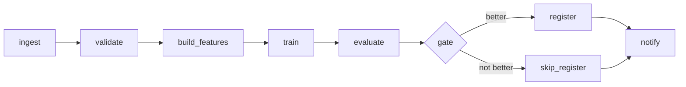

**Say this first (1 line):** The Airflow DAG is the control plane: it orders ingest, validate, features, train, evaluate, a gate and register, while the heavy compute runs elsewhere (Spark, a Kubernetes pod, a cloud training job) and Airflow just launches and waits.

**Then explain:**
- Steps: `ingest -> validate -> build_features -> train -> evaluate -> gate -> (register | skip) -> notify`. Validation raises on bad data, so nothing downstream runs on a poisoned table.
- Where work runs: ingest and features in Spark or the warehouse; training as a pod or managed job (Airflow submits it and waits, ideally deferrable). Airflow tasks stay small and pass paths and IDs (Q4). Artifacts (features, model files, metrics) live in object storage under a path with the run date; the model registry (Part 4) holds versions.
- The **gate** is a branch task (`@task.branch`) returning the next task_id: register if the candidate beats production by a margin, else skip. The other branch is `skipped`. The join task needs `trigger_rule="none_failed_min_one_success"`, otherwise skipped upstreams skip it too.
- Partial failure: each stage writes to an idempotent location (Q3), so rerunning from the failed task (clear it) continues without redoing earlier stages. Retries for flaky stages, a timeout on training, and an alert on the final failure. Registration is the one step with a side effect; guard it with the run key.
- Failure modes: comparing to "latest prod" that changed between train and gate; a gate that compares on a different dataset from the production metric; branching on a metric read from a big XCom.

**Example:** Candidate AUC 0.93 vs production 0.90: register runs, skip is `skipped`. Production at 0.95: skip runs, register is `skipped`, nothing is registered, and notify still runs.



**Code:**
```python
# dags/daily_train.py
from pendulum import datetime
from airflow.sdk import dag, task

@dag(schedule="@daily", start_date=datetime(2026, 1, 1, tz="UTC"), catchup=False,
     default_args={"retries": 1}, tags=["ml", "training"], params={"prod_auc": 0.90})
def daily_train():
    @task
    def ingest(ds=None):
        return f"s3://lake/raw/dt={ds}"

    @task
    def validate(uri: str):
        print("validated", uri)       # real life: schema, null rate, row count; raise to stop
        return uri

    @task
    def build_features(uri: str):
        return uri.replace("raw", "features")

    @task
    def train(features: str):
        print("submit training job for", features, "(delegated; Airflow only waits)")
        return {"model_uri": features.replace("features", "models") + "/model.pkl", "auc": 0.93}

    @task
    def evaluate(result: dict):
        return result

    @task.branch
    def gate(result: dict, params=None):
        better = result["auc"] > params["prod_auc"]
        print(f"candidate auc {result['auc']} vs prod {params['prod_auc']} -> {'register' if better else 'skip_register'}")
        return "register" if better else "skip_register"

    @task
    def register(result: dict):
        print("registered", result["model_uri"])

    @task
    def skip_register():
        print("kept production model")

    @task(trigger_rule="none_failed_min_one_success")
    def notify():
        print("notify team: run finished")

    r = evaluate(train(build_features(validate(ingest()))))
    g = gate(r)
    g >> [register(r), skip_register()] >> notify()

daily_train()
```

```bash
airflow dags test daily_train 2026-10-01 --conf '{"prod_auc": 0.90}'
airflow dags test daily_train 2026-10-01 --conf '{"prod_auc": 0.95}'
```

**Output (my run):** apache-airflow 3.3.2, SQLite; DagBag showed tasks `['ingest', 'validate', 'build_features', 'train', 'evaluate', 'gate', 'register', 'skip_register', 'notify']`. The training "job" is just a print.
```
=== conf {"prod_auc": 0.90}
candidate auc 0.93 vs prod 0.9 -> register
info: Downstream tasks skipped
registered s3://lake/models/dt=2026-10-01/model.pkl
notify team: run finished
=== conf {"prod_auc": 0.95}
candidate auc 0.93 vs prod 0.95 -> skip_register
info: Downstream tasks skipped
kept production model
notify team: run finished
```
Not executed: any real Spark job, pod, cloud training job, registry or notification channel.

**Follow-ups:**
- *Why not register inside train?* A separate gate task makes the decision visible, testable and rerunnable.
- *What if notify is the leaf and always succeeds?* It can hide failures; see Q5.
- *Where does the production metric come from?* From the registry or a metrics store, read in the gate (Part 4); here it is a param.

**Common mistakes:**
- Forgetting the join trigger rule so notify is skipped.
- Training inside the Airflow worker.
- A gate with no margin, so noise swaps models daily.
