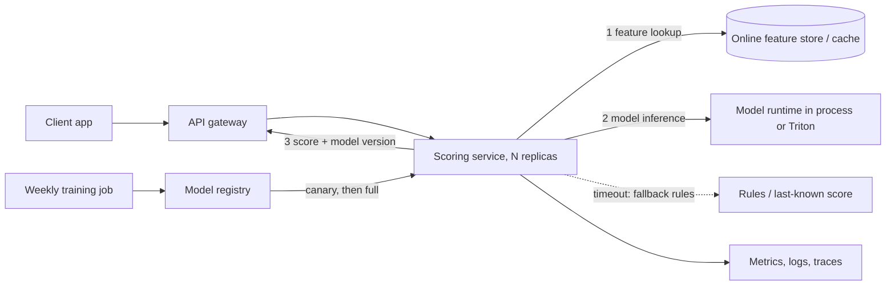

### Q13 ⭐⭐⭐ 🟡 Safe rollout of a new model: shadow, canary, A/B test and blue-green. Define each, what it protects against (shadow: no user risk, compares outputs and latency; canary: small traffic share with automatic rollback; A/B: measures business impact with a proper experiment; blue-green: instant switch and instant rollback), the metrics to watch (error rate, p99, prediction distribution, business KPI), sticky assignment by user id, and why a canary cannot detect a slow quality regression that needs labels. Give a decision table and a runnable simulation: a router that sends 5 percent of requests to model B by hashing the user id, logs both predictions in shadow mode, and reports agreement rate and latency difference. Real infrastructure (Istio, KServe, a service mesh) is not executed; Part 3 owns Kubernetes and Part 7 owns CI/CD promotion.
**Asked at:** Deployment-strategy guides (techinterview.org 'ML model serving system low-level design: versioned deployment, A/B testing, shadow mode', seldon.io 'Essential guide to ML model serving strategies', qwak.com A/B testing ML models; search snippets only, not opened); vendor and editorial pages, thresholds are examples; MLOps and ML platform roles
**Say this first (1 line):** Shadow shows a new model's answers to nobody, canary gives it a small slice of real users with a rollback, A/B is a proper experiment on a business metric, and blue-green keeps the old stack warm so I can flip back instantly.

**Then explain:**
- **Shadow:** every request is answered by the old model. A copy also goes to the new model and only its output and latency are logged. No user risk. It tells me about crashes, latency and how often the two models disagree. It cannot tell me which one is right.
- **Canary:** a small share of live traffic (for example 5 percent) gets the new model's answer. I watch error rate, p99, and the shape of the predictions. If a guard metric breaks, traffic goes back to the old model automatically. The 5 percent is an example, not a standard.
- **A/B test:** users are split on purpose, stay in their group, and I measure a business KPI long enough to reach a decision (sample size, one primary metric). It answers "is B better for the business".
- **Blue-green:** two full environments. Switching is one routing change, and so is rollback. It costs double capacity while both are up. It is a switch, not a gradual test.
- **Sticky assignment:** hash the user id (not a random number per request), so one user always sees one model. Without it a user flips between models and my A/B groups are polluted.
- **Failure mode:** a canary sees errors and latency fast, but a slow quality regression needs labels (the true outcome), and labels arrive days or weeks later. A canary that looks green for an hour says "it does not crash", not "it is more accurate". Use shadow agreement, prediction-distribution checks and a delayed-label review for that.

| Strategy | User risk | What it answers | Rollback | Cost |
|---|---|---|---|---|
| Shadow | none | does B run, how fast, how often does it differ | nothing to roll back | extra compute for B |
| Canary | small share | is B safe on real traffic | route share back to A | small |
| A/B test | the B group | does B move the business KPI | stop the experiment | needs traffic and time |
| Blue-green | all users after the flip | can I switch instantly | flip back | double environment |

**Example:** `bucket = sha256(user_id) mod 100`. If bucket < 5, user goes to B. The bucket of `user-1` is 79, so it is always on A, on every pod, on every day. That is why 20,000 users routed twice give identical answers, and why the share lands near 5 percent but not exactly (5.110 percent in my run). Real infrastructure (Istio, KServe canary, service mesh weights) is not executed; Part 3 owns Kubernetes and Part 7 owns CI/CD promotion.

**Code:** (run with `python3 -I`, venv has sklearn)
```python
# Q13: sticky 5% canary by hashing user id + shadow mode. Model A = logistic regression, model B = decision tree (iris).
import hashlib, statistics, time
import numpy as np
from sklearn.datasets import load_iris
from sklearn.linear_model import LogisticRegression
from sklearn.tree import DecisionTreeClassifier

X, y = load_iris(return_X_y=True)
A = LogisticRegression(max_iter=500).fit(X, y)
B = DecisionTreeClassifier(max_depth=3, random_state=0).fit(X, y)

def bucket(user_id: str) -> int:           # stable 0..99, same user -> same bucket, on every pod
    return int(hashlib.sha256(user_id.encode()).hexdigest(), 16) % 100

def route(user_id: str, canary_pct: int = 5) -> str:
    return "B" if bucket(user_id) < canary_pct else "A"

# 1) stickiness and share
users = [f"user-{i}" for i in range(20000)]
first = {u: route(u) for u in users}
assert all(route(u) == first[u] for u in users), "assignment must be sticky"
share = sum(v == "B" for v in first.values()) / len(users)
print(f"sticky: yes (20000 users, routed twice, identical)")
print(f"share routed to B: {share:.3%} (target 5%; hash gives about 5%, not exactly 5%)")
print("bucket('user-1') =", bucket("user-1"), "-> route:", route("user-1"))

# 2) shadow: every request is answered by A; B also scores a copy, nothing from B reaches the user
rng = np.random.default_rng(0)
rows = X[rng.integers(0, len(X), 3000)] + rng.normal(0, 0.15, (3000, 4))   # noisy traffic
agree, lat_a, lat_b = 0, [], []
for r in rows:
    r = r.reshape(1, -1)
    t = time.perf_counter(); pa = A.predict(r)[0]; lat_a.append(time.perf_counter() - t)
    t = time.perf_counter(); pb = B.predict(r)[0]; lat_b.append(time.perf_counter() - t)
    agree += int(pa == pb)                  # logged only; the user got pa
print(f"shadow agreement A vs B: {agree/len(rows):.3%} over {len(rows)} requests")
d = (statistics.median(lat_b) - statistics.median(lat_a)) * 1000
print(f"median latency B minus A: {d:+.3f} ms (this sandbox only, in-process sklearn, not a benchmark)")
```

**Output (my run):**
```
sticky: yes (20000 users, routed twice, identical)
share routed to B: 5.110% (target 5%; hash gives about 5%, not exactly 5%)
bucket('user-1') = 79 -> route: A
shadow agreement A vs B: 96.233% over 3000 requests
median latency B minus A: -0.019 ms (this sandbox only, in-process sklearn, not a benchmark)
```
The latency difference is this-sandbox-only, in-process sklearn and not a benchmark; it will change on every run. The agreement figure comes from my own noisy sample of iris rows, so it only shows the mechanics.

**Follow-ups:**
- *Why hash the user id and not pick randomly per request?* A user must keep seeing the same model, and any pod must make the same choice without shared state.
- *How do I know a canary is safe to widen?* Guard metrics held for a set time: error rate, p99, prediction distribution, plus a business KPI if available. The thresholds are my choice and I write them down before starting.
- *When shadow, when canary?* Shadow first when a wrong answer is costly (credit, fraud). Then a canary. Then maybe an A/B test for the KPI.

**Common mistakes:**
- Calling a canary "validation of accuracy" when no labels have arrived yet.
- Random per-request routing, so one user sees both models.
- Shadow mode that doubles the load on a shared feature store, or shadow calls made in the user's request path so they add latency (make them async and drop them on overload).
- Changing the model and the feature code in one rollout, so a regression has two suspects.

---

### Q14 ⭐⭐⭐ 🟡 What is NVIDIA Triton Inference Server and how is a model repository laid out? Explain the repository directory (model name, numeric version folders, model file, config.pbtxt), the config fields (name, platform or backend such as onnxruntime, max_batch_size, input and output tensors with data_type and dims, instance_group), supported backends at concept level (ONNX Runtime, TensorRT, PyTorch, Python), HTTP and gRPC ports and the health and metrics endpoints, and when Triton is worth its complexity over FastAPI (many models, GPU, batching, multi-framework). Build a real repository directory for the ONNX iris model with a valid config.pbtxt, check it with a Python script (file layout, text parses, dims match the ONNX model), and state clearly that the Triton server itself was not executed because no container or GPU is available here.
**Asked at:** Triton write-ups (apxml.com serving models with Triton, reintech.io Triton deep dive, oneuptime.com Triton posts 2026, softwaremill.com Triton tips and tricks, a 2025 academia.edu FastAPI-versus-Triton benchmark note; search snippets only, not opened); tutorials and one small benchmark note, not interview reports, check NVIDIA docs; GPU serving and ML platform roles
**Say this first (1 line):** Triton is NVIDIA's open-source inference server: you point it at a model repository (a folder per model, numeric version folders, a model file and a `config.pbtxt`) and it serves every model over HTTP and gRPC with batching, multiple frameworks and metrics.

**Then explain:**
- **Layout:** `repo/<model_name>/config.pbtxt` and `repo/<model_name>/<version>/model.<ext>` (for ONNX the default file name is `model.onnx`). Version folders must be numbers. By default Triton serves the latest version; a version policy can change that (check current docs).
- **Config fields:** `name` (matches the folder), `backend` (or the older `platform`) such as `onnxruntime`, `max_batch_size` (0 means the model does no batching and shapes include the batch dim), `input` and `output` with `name`, `data_type` and `dims` (dims leave out the batch dimension when `max_batch_size` > 0), and `instance_group` (how many copies and on CPU or GPU).
- **Backends, concept level:** ONNX Runtime, TensorRT, PyTorch (LibTorch), TensorFlow, Python backend for custom code, and others. Check the current docs for the list in your version.
- **Ports and endpoints (defaults, check docs):** HTTP 8000, gRPC 8001, Prometheus metrics 8002 at `/metrics`; health at `/v2/health/live` and `/v2/health/ready`.
- **When it is worth it:** many models, GPUs, need for dynamic batching, several frameworks, one protocol for all. For one small sklearn model, FastAPI is simpler. Triton adds a repo format, a container, and a config language to learn.
- **Failure modes:** dims that do not match the ONNX file make the model fail to load; a config `name` that differs from the folder; a version folder that is not a number is ignored; a per-item scalar output needs `dims: [1]` with a `reshape` (check docs) because empty dims are not allowed with batching.

**Example:** My ONNX model has input `X` with shape `[-1, 4]` (batch, 4 features), so with `max_batch_size: 8` the config says `dims: [4]`. Output `label` is `[-1]`, one number per item, so `dims: [1]` plus `reshape: { shape: [ ] }`. Output `probabilities` is `[-1, 3]`, so `dims: [3]`.

**Code:** the repository file, then the checker.
```protobuf
# model_repository/iris_onnx/config.pbtxt
name: "iris_onnx"
backend: "onnxruntime"
max_batch_size: 8
input [
  { name: "X", data_type: TYPE_FP32, dims: [ 4 ] }
]
output [
  { name: "label", data_type: TYPE_INT64, dims: [ 1 ], reshape: { shape: [ ] } },
  { name: "probabilities", data_type: TYPE_FP32, dims: [ 3 ] }
]
instance_group [
  { count: 1, kind: KIND_CPU }
]
```
```python
# ===== make_model.py =====
# make_model.py OUTDIR : train iris LogisticRegression, export ONNX (zipmap off), check it, save to OUTDIR/iris.onnx
import sys, pathlib, numpy as np, onnx, onnxruntime as ort
from sklearn.datasets import load_iris
from sklearn.linear_model import LogisticRegression
from skl2onnx import to_onnx
out = pathlib.Path(sys.argv[1]); out.mkdir(parents=True, exist_ok=True)
X, y = load_iris(return_X_y=True); X = X.astype(np.float32)
m = LogisticRegression(max_iter=500).fit(X, y)
onx = to_onnx(m, X[:1], target_opset=17, options={id(m): {"zipmap": False}})
onnx.checker.check_model(onx)
(out / "iris.onnx").write_bytes(onx.SerializeToString())
s = ort.InferenceSession(str(out / "iris.onnx"), providers=["CPUExecutionProvider"])
print("inputs ", [(i.name, i.shape, i.type) for i in s.get_inputs()])
print("outputs", [(o.name, o.shape, o.type) for o in s.get_outputs()])
print("agree with sklearn on 150 rows:", bool((s.run(None, {"X": X})[0] == m.predict(X)).all()))

# ===== pbtxt.py =====
# pbtxt.py: tiny parser for the protobuf TEXT format subset used in Triton config.pbtxt.
# It is NOT Triton's schema check. It only proves the file is well-formed text and lets us assert on fields.
import re
TOK = re.compile(r'\s*(#[^\n]*|"(?:[^"\\]|\\.)*"|[A-Za-z_][A-Za-z_0-9]*|-?\d+\.?\d*|[{}\[\]:,])')
def tokens(s):
    pos, out = 0, []
    while pos < len(s):
        m = TOK.match(s, pos)
        if not m:
            if s[pos:].strip() == "": break
            raise ValueError(f"bad text near: {s[pos:pos+20]!r}")
        pos = m.end()
        if not m.group(1).startswith("#"): out.append(m.group(1))
    return out
def val(t):
    if t.startswith('"'): return t[1:-1]
    if re.fullmatch(r"-?\d+", t): return int(t)
    if re.fullmatch(r"-?\d+\.\d*", t): return float(t)
    return t                                   # enum such as TYPE_FP32 or KIND_CPU
def parse_msg(t, i, closer=None):
    d = {}
    def add(k, v): d.setdefault(k, []).append(v)
    while i < len(t) and t[i] != closer:
        if t[i] == ",": i += 1; continue          # commas between fields are allowed
        k = t[i]; i += 1
        if t[i] == ":": i += 1
        if t[i] == "{":
            v, i = parse_msg(t, i + 1, "}"); i += 1; add(k, v)
        elif t[i] == "[":
            i += 1
            while t[i] != "]":
                if t[i] == ",": i += 1; continue
                if t[i] == "{":
                    v, i = parse_msg(t, i + 1, "}"); i += 1; add(k, v)
                else: add(k, val(t[i])); i += 1
            i += 1
        else: add(k, val(t[i])); i += 1
    return d, i
def parse(s):
    d, i = parse_msg(tokens(s), 0)
    return d

# ===== q14/check_repo.py =====
# check_repo.py REPO : layout + config text parses + dims match the ONNX file. Triton itself is NOT run.
import sys, pathlib, onnx
sys.path.insert(0, str(pathlib.Path(__file__).parent.parent))
from pbtxt import parse
repo = pathlib.Path(sys.argv[1]); ok = True
def check(cond, msg):
    global ok; ok &= bool(cond); print(("PASS " if cond else "FAIL ") + msg)
for mdir in sorted(p for p in repo.iterdir() if p.is_dir()):
    cfg = parse((mdir / "config.pbtxt").read_text())
    check(cfg["name"][0] == mdir.name, f"config name equals folder name ({mdir.name})")
    versions = [p.name for p in mdir.iterdir() if p.is_dir()]
    check(versions and all(v.isdigit() for v in versions), f"version folders are numeric: {versions}")
    mf = mdir / versions[0] / "model.onnx"
    check(mf.exists(), "default ONNX file name is <version>/model.onnx")
    check(cfg["backend"][0] == "onnxruntime", "backend onnxruntime")
    mb = cfg["max_batch_size"][0]
    g = onnx.load(str(mf)).graph
    shapes = lambda vs: {v.name: [d.dim_value if d.dim_value else -1 for d in v.type.tensor_type.shape.dim] for v in vs}
    onx_in, onx_out = shapes(g.input), shapes(g.output)
    for t in cfg["input"]:
        want = onx_in[t["name"][0]]
        check(mb > 0 and want[1:] == t["dims"], f"input {t['name'][0]}: ONNX {want} = batch dim + config dims {t['dims']}")
    for t in cfg["output"]:
        want = onx_out[t["name"][0]]
        dims = t["dims"]; rs = "reshape" in t   # empty shape [] parses to an empty message
        # a per-item scalar is declared dims [1] with reshape [] (check current Triton docs)
        check(want[1:] == dims or (want[1:] == [] and dims == [1] and rs),
              f"output {t['name'][0]}: ONNX {want}, config dims {dims}")
    check(cfg["instance_group"][0]["kind"][0] == "KIND_CPU", "instance_group kind KIND_CPU")
print("ALL OK" if ok else "PROBLEMS"); sys.exit(0 if ok else 1)
```
```bash
# how it was run: make_model.py writes iris.onnx, then the folders are built and checked
python3 -I make_model.py ./out
mkdir -p model_repository/iris_onnx/1 && cp out/iris.onnx model_repository/iris_onnx/1/model.onnx
python3 -I check_repo.py model_repository
```

**Output (my run):**
```
model_repository
model_repository/iris_onnx
model_repository/iris_onnx/1
model_repository/iris_onnx/1/model.onnx
model_repository/iris_onnx/config.pbtxt
PASS config name equals folder name (iris_onnx)
PASS version folders are numeric: ['1']
PASS default ONNX file name is <version>/model.onnx
PASS backend onnxruntime
PASS input X: ONNX [-1, 4] = batch dim + config dims [4]
PASS output label: ONNX [-1], config dims [1]
PASS output probabilities: ONNX [-1, 3], config dims [3]
PASS instance_group kind KIND_CPU
ALL OK
--- broken copy (config dims 5 instead of 4):
FAIL input X: ONNX [-1, 4] = batch dim + config dims [5]
PROBLEMS
```
**The Triton server itself was not executed.** No container runtime and no GPU here. What did run: the layout check, a hand-written parser for the text format, and a dims check against the real ONNX file. My parser is not Triton's schema check, so a pass here does not prove Triton will load the model (for example, it does not know every field name). Check NVIDIA's current docs.

**Follow-ups:**
- *`max_batch_size: 0` or 8?* With 8, Triton can batch up to 8 items and dims exclude the batch dim. With 0, I own the batch dim inside the shapes.
- *Can Triton serve two versions?* Yes, through the version policy (latest N, all, or specific). Check the docs for the exact syntax.
- *What do I scrape for monitoring?* Port 8002 `/metrics` (Prometheus format) for request counts, queue time and compute time.

**Common mistakes:**
- Putting the batch dimension in `dims` while `max_batch_size` > 0.
- Folder name and `name:` that differ.
- Reaching for Triton for a single small model with no batching or GPU need.
- Trusting a hand-made check as a substitute for starting the server in a test environment (staging with a container) before release.

---

### Q15 ⭐⭐⭐ 🟡 Capacity planning for a model service: how many replicas do you need for 800 requests per second at p99 under 100 ms? Explain measuring single-replica throughput at the target latency (not at saturation), headroom (target 50 to 70 percent utilisation), N+1 or zone failure margin, the effect of batching and of CPU versus GPU, warm-up time, and why you plan from measured numbers, not from the model's FLOPs. Work the arithmetic with sample numbers (state they are invented inputs) in a small Python function with tests, and add a tiny measured demo against a local FastAPI endpoint with a labelled-machine-specific throughput figure. No cluster is used.
**Asked at:** Load-testing and latency sources (docs.databricks.com 'what is a load test' for model serving, tianpan.co 'Load testing LLM applications', loadforge.com guides, mintlify ml-in-production-practice module 6; search snippets only, not opened); docs and blogs, some promotional; serving and SRE-leaning ML roles
**Say this first (1 line):** Measure how many requests per second ONE replica sustains while still meeting the p99 target, divide the goal by that number times a utilisation I choose (50 to 70 percent), round up, and add a spare replica or a zone's worth for failures.

**Then explain:**
- **Measure at the latency target, not at saturation.** A replica that does 1,000 requests per second with p99 of 2 seconds is useless for a 100 ms target. Ramp the load and read the highest throughput where p99 is still inside the budget.
- **Headroom:** plan to use only 50 to 70 percent of that number, so a traffic bump, a slow neighbour or a GC pause does not push p99 over.
- **Failure margin:** N+1 (one extra replica) or, if I must survive losing a zone, enough replicas that the remaining zones still carry the load.
- **CPU vs GPU, batching:** batching raises throughput per replica but adds queue wait and changes the latency curve, so I re-measure after turning it on. GPU replicas are fewer and costlier and warm up slower.
- **Warm-up:** a new replica needs time to pull the image and load the model, so capacity is not instant. Plan minimum replicas for the daily peak ramp.
- **Plan from measured numbers, not FLOPs.** FLOPs ignore serialisation, Python overhead, feature fetching and the network. Measure the real service.
- **Failure mode:** measuring on a laptop that also runs the load generator. The two compete for the same CPU, so the number is wrong (and the real number is probably higher with a separate client).

**Example (invented inputs, state them out loud):** target 800 rps, one replica holds 100 rps at p99 under 100 ms, plan 60 percent. Usable per replica = 60 rps. 800 / 60 = 13.33, round up to 14, plus 1 spare = 15. Zone check: 15 replicas over 3 zones, lose one zone (5), 10 left, 10 x 100 = 1,000 rps at full load, still above 800. With 9 replicas, losing a zone leaves 6 x 100 = 600, which is not enough.

**Code:**
```python
# ===== serve_app.py =====
# serve_app.py : small FastAPI service around the iris ONNX model (used by Q15 and Q16). MODEL_PATH env var.
import os
from contextlib import asynccontextmanager
import numpy as np, onnxruntime as ort
from fastapi import FastAPI, Response
from pydantic import BaseModel, Field

state = {}
@asynccontextmanager
async def lifespan(app):
    state["s"] = ort.InferenceSession(os.environ["MODEL_PATH"], providers=["CPUExecutionProvider"])
    yield
    state.clear()
app = FastAPI(lifespan=lifespan)

class Req(BaseModel):
    features: list[float] = Field(min_length=4, max_length=4)

@app.get("/readyz")
def readyz(r: Response):
    if "s" not in state:
        r.status_code = 503; return {"status": "loading"}
    return {"status": "ready"}

@app.post("/v1/predict")
def predict(req: Req):
    x = np.array([req.features], dtype=np.float32)
    return {"label": int(state["s"].run(["label"], {"X": x})[0][0])}

# ===== q15/capacity.py =====
import math
def replicas(target_rps, per_replica_rps, utilisation=0.6, spare=1):
    """per_replica_rps = throughput ONE replica sustains while meeting the p99 target (measured, not at saturation).
    utilisation = fraction of that we plan to use (headroom). spare = extra replicas for a failure (N+1)."""
    if target_rps <= 0 or per_replica_rps <= 0 or not 0 < utilisation <= 1 or spare < 0:
        raise ValueError("bad input")
    return math.ceil(target_rps / (per_replica_rps * utilisation)) + spare

def survives_zone_loss(n, zones, target_rps, per_replica_rps, utilisation=1.0):
    """spread evenly over zones; lose the biggest zone; do the rest still carry target_rps at 'utilisation'?"""
    biggest = math.ceil(n / zones)
    return (n - biggest) * per_replica_rps * utilisation >= target_rps

# ===== q15/test_capacity.py =====
import pytest
from capacity import replicas, survives_zone_loss
def test_hand_example():
    # invented inputs: 800 rps target, one replica sustains 100 rps at p99 target, plan 60%, +1 spare
    assert replicas(800, 100, 0.6, 1) == 15            # 800 / 60 = 13.33 -> 14, +1 = 15
def test_no_headroom_is_smaller():
    assert replicas(800, 100, 1.0, 0) == 8
def test_batching_changes_the_input_not_the_formula():
    assert replicas(800, 250, 0.6, 1) == 7             # 800 / 150 = 5.33 -> 6, +1
def test_zone_loss():
    assert survives_zone_loss(15, 3, 800, 100, 1.0)    # lose 5, 10 left = 1000 rps >= 800
    assert not survives_zone_loss(9, 3, 800, 100, 1.0) # lose 3, 6 left = 600 < 800
@pytest.mark.parametrize("bad", [(0, 100), (800, 0)])
def test_bad_input(bad):
    with pytest.raises(ValueError): replicas(*bad)

# ===== q15/measure.py =====
# measure.py URL : closed-loop, a few concurrency levels, 3 s each, one local uvicorn process (sandbox only, not a benchmark)
import asyncio, sys, time, statistics, httpx
URL = sys.argv[1]; BODY = {"features": [6.7, 3.0, 5.2, 2.3]}
async def run(conc, secs=3.0):
    lat, errs, stop = [], 0, time.perf_counter() + secs
    async with httpx.AsyncClient(base_url=URL, limits=httpx.Limits(max_connections=conc)) as c:
        async def worker():
            nonlocal errs
            while time.perf_counter() < stop:
                t = time.perf_counter()
                r = await c.post("/v1/predict", json=BODY)
                lat.append(time.perf_counter() - t); errs += r.status_code != 200
        await asyncio.gather(*[worker() for _ in range(conc)])
    lat.sort(); p99 = lat[int(0.99 * len(lat)) - 1] * 1000
    return len(lat) / secs, p99, errs
async def main():
    async with httpx.AsyncClient(base_url=URL) as c:
        for _ in range(50): await c.post("/v1/predict", json=BODY)       # warm-up, not measured
    for conc in (1, 4, 16, 64):
        rps, p99, e = await run(conc)
        print(f"concurrency {conc:>2}: {rps:7.0f} req/s, p99 {p99:7.1f} ms, errors {e}")
asyncio.run(main())
```
```bash
. "$(dirname "$0")/../env.sh"; D=$(cd "$(dirname "$0")" && pwd)
cd $D && $PY -I -m pytest -q -p no:cacheprovider --rootdir=$D test_capacity.py 2>&1 | tail -4
export MODEL_PATH=$W/model/iris.onnx
cd $D/..; PYTHONPATH=$D/.. $PY -m uvicorn serve_app:app --port 8213 --log-level warning > $W/q15_uvicorn.log 2>&1 &
SRV=$!
for i in $(seq 30); do curl -sf localhost:8213/readyz >/dev/null && break; sleep 0.3; done
curl -s localhost:8213/readyz; echo
$PY -I $D/measure.py http://localhost:8213
kill $SRV; wait $SRV 2>/dev/null; sleep 0.5; echo "server stopped"
```

**Output (my run):**
```
......                                                                   [100%]
6 passed in 0.01s
{"status":"ready"}
concurrency  1:     352 req/s, p99     6.2 ms, errors 0
concurrency  4:     555 req/s, p99    17.0 ms, errors 0
concurrency 16:     333 req/s, p99   226.6 ms, errors 0
concurrency 64:     143 req/s, p99  2000.3 ms, errors 0
server stopped
```
These throughput figures are specific to this sandbox (4 cores, the load client and the server on the same machine, one uvicorn process) and are not a benchmark. Notice what the shape teaches: throughput rises from concurrency 1 to 4, then falls and p99 explodes by concurrency 64. So the "sustainable" number for a p99 target is the point just before the p99 breaks, not the peak. No cluster is used.

**Follow-ups:**
- *Why not scale at 90 percent CPU?* No room for bursts, and the p99 curve bends well before 100 percent.
- *How does batching change the plan?* Per-replica rps goes up, but I add the batching delay to latency, so I re-measure the curve with batching on.
- *Is the answer a fixed number?* No. It is a minimum count plus autoscaling between a floor and a ceiling (Part 3 owns the Kubernetes side).

**Common mistakes:**
- Using peak throughput (at saturation) as the capacity.
- Forgetting the failure margin and warm-up time.
- Testing with one repeated request, which hits caches and flatters the number.
- Quoting the measured throughput from one machine as if it applied to production hardware.

---

### Q16 ⭐⭐⭐ 🟡 Load testing an inference API. Explain what to measure (p50, p95, p99, throughput, error rate, saturation of CPU, memory and GPU), ramp, steady-state, spike and soak patterns, closed-loop versus open-loop load (and coordinated omission, which makes tail latency look better than it is), realistic payloads and input sizes instead of one repeated request, warm-up before measuring, and tools (Locust, k6, hey, vegeta, Triton perf_analyzer, wrk) at concept level. Write a small asyncio plus httpx load generator with a fixed concurrency and a fixed request rate, run it against a local uvicorn FastAPI/ONNX app, and report percentiles with a clear note that the numbers are specific to this sandbox. Other load tools are not executed.
**Asked at:** Load-testing and latency sources (docs.databricks.com 'what is a load test' for model serving, tianpan.co 'Load testing LLM applications', loadforge.com guides, mintlify ml-in-production-practice module 6; search snippets only, not opened); docs and blogs, some promotional; serving and SRE-leaning ML roles
**Say this first (1 line):** Drive the API with realistic payloads at a controlled load, measure percentiles (p50, p95, p99), throughput and errors after a warm-up, and use an open-loop generator (fixed arrival rate) so slow responses cannot hide by slowing the test down.

**Then explain:**
- **What to measure:** latency percentiles (never only the average), throughput, error rate, and saturation of CPU, memory and GPU on the server. Percentiles matter because a p50 of 200 ms can hide a p99 of several seconds.
- **Patterns:** ramp (find the knee), steady state (the number I report), spike (does it recover), soak (leaks, slow memory growth).
- **Closed loop vs open loop:** closed loop = a fixed number of workers, each sends the next request only after the last answer. When the server stalls, the workers stall too and send fewer requests, so only a few requests look slow. This is **coordinated omission**. Open loop = requests are sent at a fixed rate whatever the server does, like real users. A stall then shows up in every request that arrives during it.
- **Latency from the intended time:** in an open loop I measure from when a request should have been sent, so a late generator does not make latency look better.
- **Realistic payloads:** real input sizes and a spread of values. One repeated request hits caches and hides batching and parsing costs.
- **Warm up first:** discard the first requests (model load, JIT, connection setup).
- **Tools at concept level (not executed here):** Locust, k6, hey, vegeta, wrk, Triton `perf_analyzer`. Check each tool's current docs. Generic HTTP tools can mislead for streaming LLM responses.
- **Failure modes:** load client on the same box as the server steals CPU; a client that cannot generate the rate itself becomes the bottleneck; averaging percentiles across runs.

**Example:** I send 80 requests per second for 4 seconds. At t = 1 s I inject a 0.3 s stall on the server. A closed loop with one worker issues about 1,300 requests, and exactly one is slow. The open loop sends all 320 on schedule, and every request that arrived in the 0.3 s window, about 24 of them (80 x 0.3), waits behind the stall. So the p99 of the open loop is close to the stall length, while the closed loop p99 stays at a few ms.

**Code:**
```python
# ===== serve_app.py =====
# serve_app.py : small FastAPI service around the iris ONNX model (used by Q15 and Q16). MODEL_PATH env var.
import os
from contextlib import asynccontextmanager
import numpy as np, onnxruntime as ort
from fastapi import FastAPI, Response
from pydantic import BaseModel, Field

state = {}
@asynccontextmanager
async def lifespan(app):
    state["s"] = ort.InferenceSession(os.environ["MODEL_PATH"], providers=["CPUExecutionProvider"])
    yield
    state.clear()
app = FastAPI(lifespan=lifespan)

class Req(BaseModel):
    features: list[float] = Field(min_length=4, max_length=4)

@app.get("/readyz")
def readyz(r: Response):
    if "s" not in state:
        r.status_code = 503; return {"status": "loading"}
    return {"status": "ready"}

@app.post("/v1/predict")
def predict(req: Req):
    x = np.array([req.features], dtype=np.float32)
    return {"label": int(state["s"].run(["label"], {"X": x})[0][0])}

# ===== q16/app_stall.py =====
# the Q15 app plus a /stall route that blocks the event loop (simulates a GC pause or a slow batch). Demo only.
import time
from serve_app import app
@app.get("/stall")
async def stall(secs: float = 0.5):
    time.sleep(secs)             # blocking on purpose
    return {"stalled": secs}

# ===== q16/loadgen.py =====
# loadgen.py URL : closed-loop (fixed concurrency) and open-loop (fixed rate) generators, one 0.3 s stall injected at t=1 s.
import asyncio, sys, time, httpx
STALL = len(sys.argv) < 3; URL = sys.argv[1]; BODY = {"features": [6.7, 3.0, 5.2, 2.3]}; SECS = 4.0
def pct(xs, p):
    xs = sorted(xs); return xs[min(len(xs) - 1, int(p / 100 * len(xs)))] * 1000
def show(name, lat, extra=""):
    print(f"{name:<34} n={len(lat):>4}  p50 {pct(lat,50):7.1f}  p95 {pct(lat,95):7.1f}  p99 {pct(lat,99):7.1f}  max {max(lat)*1000:7.1f} ms {extra}")
async def stall_once(c):
    await asyncio.sleep(1.0); await c.get("/stall", params={"secs": 0.3}, timeout=10)

async def closed_loop(conc):
    lat = []; end = time.perf_counter() + SECS
    async with httpx.AsyncClient(base_url=URL) as c:
        async def w():
            while time.perf_counter() < end:
                t = time.perf_counter(); await c.post("/v1/predict", json=BODY); lat.append(time.perf_counter() - t)
        await asyncio.gather(stall_once(c), *[w() for _ in range(conc)])
    return lat

async def open_loop(rate):
    sent_lat, true_lat = [], []; n = int(rate * SECS); t0 = time.perf_counter() + 0.1
    async with httpx.AsyncClient(base_url=URL, limits=httpx.Limits(max_connections=1000)) as c:
        async def one(i):
            intended = t0 + i / rate                               # when the request SHOULD have been sent
            await asyncio.sleep(max(0, intended - time.perf_counter()))
            s = time.perf_counter(); await c.post("/v1/predict", json=BODY); e = time.perf_counter()
            sent_lat.append(e - s); true_lat.append(e - intended)
        await asyncio.gather(*( [stall_once(c)] if STALL else [] ), *[one(i) for i in range(n)])
    return sent_lat, true_lat

async def main():
    async with httpx.AsyncClient(base_url=URL) as c:
        for _ in range(100): await c.post("/v1/predict", json=BODY)      # warm-up, discarded
    show("closed loop, concurrency 1", await closed_loop(1))
    s, t = await open_loop(80)
    show("open loop 80 rps, from send time", s)
    show("open loop 80 rps, from intended time", t, "<- the honest one")
asyncio.run(main())
```
```bash
. "$(dirname "$0")/../env.sh"; D=$(cd "$(dirname "$0")" && pwd)
export MODEL_PATH=$W/model/iris.onnx
cd $D; PYTHONPATH=$D/..:$D $PY -m uvicorn app_stall:app --port 8216 --log-level warning > $W/q16_uvicorn.log 2>&1 &
SRV=$!
for i in $(seq 30); do curl -sf localhost:8216/readyz >/dev/null && break; sleep 0.3; done
$PY -I $D/loadgen.py http://localhost:8216
kill $SRV; wait $SRV 2>/dev/null; echo "server stopped"
```

**Output (my run):**
```
closed loop, concurrency 1         n=1301  p50     2.5  p95     4.8  p99     6.9  max   304.8 ms 
open loop 80 rps, from send time   n= 320  p50     3.9  p95   149.3  p99   278.4  max   311.8 ms 
open loop 80 rps, from intended time n= 320  p50     5.2  p95   150.7  p99   279.7  max   313.5 ms <- the honest one
server stopped
```
Numbers are specific to this sandbox: one 4-core machine, client and server together, one uvicorn process, ONNX iris model. They are a demo of the method and not a benchmark. The point is the gap between the closed-loop p99 and the open-loop p99. In the open loop, "from send time" and "from intended time" are almost the same here because my generator was never late; they diverge when the generator itself falls behind. Locust, k6, hey, vegeta, wrk and perf_analyzer were not executed.

**Follow-ups:**
- *How long should a test run?* Long enough for percentiles to stabilise and to include a few GC cycles; soak tests run for hours. I do not give a magic number.
- *Why not just use the average?* One slow request in a thousand disappears in the average but a user feels it.
- *Where do I run the load generator?* On a separate machine from the server, close to it on the network.

**Common mistakes:**
- Reporting only mean latency.
- Closed-loop tests only, and then saying p99 is fine.
- Not warming up, or testing with one repeated payload.
- Comparing numbers measured on different machines.

---

### Q17 ⭐⭐⭐ 🔴 Design question: a real-time fraud or recommendation scoring service with a 50 ms p99 budget, 2,000 requests per second at peak, and a model that is retrained weekly. Cover the request path (gateway, feature lookup, model, response), where each millisecond of the budget goes, FastAPI versus Triton, online feature fetch and caching (Part 9 owns feature stores), model loading and versioning, autoscaling, canary, fallbacks when the model or feature store is slow, observability, and what you would test first. Draw the architecture in Mermaid, give a latency budget table, and write a small script that checks the budget sums to under the target. Nothing is deployed; numbers are planning inputs, not measurements.
**Asked at:** Serving interview-prep and glossary pages (nerdleveltech.com MLOps engineer interviews 'model serving infrastructure', techinterview.org MLOps interview and model-serving design posts, wecreateproblems.com MLOps interview questions, insertchat.com model-serving glossary; search snippets only, not opened); editorial guides, not verified candidate reports; MLOps, ML platform and ML engineer roles
**Say this first (1 line):** I split the 50 ms p99 into a budget per hop, keep the model call and the feature lookup in one process or very close, protect the tail with timeouts and fallbacks, and test the slowest hop (the feature fetch) first.

**Then explain:**
- **Request path:** client, gateway (auth, rate limit), scoring service, feature lookup (cache first, then the online store), model inference, response. The model is often not the slow part; the feature fetch and the network are.
- **Budget (planning numbers, not measurements):** every hop gets a p99 slice and the slices plus a reserve must add up below 50 ms. Adding p99s is conservative (the real p99 of a sum is lower), which is what I want in a plan.
- **FastAPI vs Triton:** FastAPI plus ONNX Runtime in process is enough for a small tabular model and is easiest to run and debug. Triton earns its place with GPUs, many models, dynamic batching or several frameworks. For a 50 ms budget, dynamic batching adds queue delay, so I keep the delay tiny or skip batching for CPU models. I choose after measuring.
- **Features:** (Part 9 owns feature stores.) Precompute what I can, cache hot keys in memory, keep the online store in the same region and zone, set a timeout per lookup, and use a default value or a cheaper model when a feature is missing.
- **Model loading and versioning:** load at startup and gate readiness on it, swap versions by routing (Q18, Q13), keep the previous version loaded for instant rollback. Weekly retraining means weekly promotion through a canary.
- **Autoscaling:** scale on requests in flight or latency, not CPU alone. Minimum replicas for the peak because a new replica needs time to start (Q15).
- **Fallbacks:** timeout on the feature store gives the last known score or a rule; timeout on the model gives a rule or a "review" decision. Define in advance what a fraud service does when it cannot score: fail open or fail closed is a business decision.
- **Observability:** p50/p95/p99 per hop, error rate, fallback rate, feature-missing rate, prediction distribution, model version on every response and every log line.
- **Test first:** the feature lookup under load, with realistic keys and a cold cache, because it holds the largest slice and the largest variance.
- **Failure modes:** retry storms (retries multiply load when a hop is slow), cold cache after deploy, a slow feature store dragging the whole service, one slow replica, GC pauses.

**Example:** budget below: 39 ms of hops plus 5 ms reserve gives 44 ms against a 50 ms target, so 6 ms of headroom. If the feature store grows from 12 ms to 25 ms, the script fails by 7 ms, which is exactly the signal I want in a design review. For 2,000 rps with an invented 150 rps per replica at 60 percent utilisation: 2,000 / 90 = 22.2, so 23, plus 2 spare = 25 replicas. Those are planning inputs until measured.

**Code:**

```python
# budget.py : planning inputs (invented, NOT measurements). Checks the p99 budget adds up and prints the capacity sketch.
import math, sys
TARGET_MS = 50
BUDGET = {                       # ms at p99, per hop. Hops add up in the worst case here (conservative on purpose)
    "network client->gateway":     5,
    "gateway + auth":              3,
    "request parse + validation":  2,
    "feature lookup (cache/store)": 12,
    "model inference":             10,
    "response + serialisation":    2,
    "network back":                5,
}
SLACK_MS = 5                     # kept in reserve for GC, noisy neighbours, retries
total = sum(BUDGET.values())
for k, v in BUDGET.items(): print(f"{k:<32}{v:>4} ms")
print(f"{'sum of hops':<32}{total:>4} ms\n{'reserve':<32}{SLACK_MS:>4} ms\n{'target':<32}{TARGET_MS:>4} ms")
assert total + SLACK_MS <= TARGET_MS, f"over budget by {total + SLACK_MS - TARGET_MS} ms"
print("budget OK: hops + reserve <= target, headroom", TARGET_MS - total - SLACK_MS, "ms")
# capacity sketch for 2000 rps peak. per_replica_rps is an invented planning input until you measure it.
per_replica_rps, util, spare = 150, 0.6, 2
print("replicas:", math.ceil(2000 / (per_replica_rps * util)) + spare, "(2000 / (150*0.6) = 22.2 -> 23, +2 spare)")
# the check really fails when a hop grows
BUDGET["feature lookup (cache/store)"] = 25
try:
    assert sum(BUDGET.values()) + SLACK_MS <= TARGET_MS, f"over budget by {sum(BUDGET.values()) + SLACK_MS - TARGET_MS} ms"
except AssertionError as e: print("feature store at 25 ms ->", e)
```

**Output (my run):**
```
network client->gateway            5 ms
gateway + auth                     3 ms
request parse + validation         2 ms
feature lookup (cache/store)      12 ms
model inference                   10 ms
response + serialisation           2 ms
network back                       5 ms
sum of hops                       39 ms
reserve                            5 ms
target                            50 ms
budget OK: hops + reserve <= target, headroom 6 ms
replicas: 25 (2000 / (150*0.6) = 22.2 -> 23, +2 spare)
feature store at 25 ms -> over budget by 7 ms
```
The Mermaid diagram was **not rendered or syntax-checked** here (no mermaid-cli in the sandbox); only the Python budget script ran. Nothing is deployed and all numbers are planning inputs, not measurements.

**Follow-ups:**
- *What if the model is a deep net needing GPU?* Then Triton or a GPU runtime with a small dynamic-batching delay, and I re-do the budget with a measured inference time.
- *How do I handle a feature store outage?* Timeout, default or cached features, a flag in the response, and an alert on the fallback rate.
- *How do I roll out the weekly model?* Shadow, then canary with guard metrics, then promote (Q13; Part 7 owns CI/CD promotion).

**Common mistakes:**
- Optimising the model while the feature fetch takes most of the budget.
- Budgeting with averages instead of p99.
- No timeouts and unlimited retries.
- No decision on fail open vs fail closed.

---

### Q18 ⭐⭐ 🟡 Loading models in a service: at startup, lazily on first request, or per request. Explain why per-request loading is a bug (seconds of latency, memory churn), eager loading at startup with readiness gating, lazy loading with a lock (avoid two requests loading at once), memory-mapped weights, cold-start cost, and reloading a new model without downtime (load the new one beside the old and swap a reference atomically). Show a small FastAPI model holder class with a thread-safe swap and an admin reload endpoint, and a pytest that proves requests during a reload never see a half-loaded model. Run it with TestClient.
**Asked at:** FastAPI docs and tutorials (fastapi.tiangolo.com advanced events/lifespan page, reintech.io 'FastAPI ML model serving production REST APIs', docs.truefoundry.com deploy-model-fastapi; search snippets only, not opened); docs and tutorials, not interview reports; ML engineer and MLOps roles that ship model APIs, including IT-services firms, product companies and GCCs
**Say this first (1 line):** Load the model once at startup (before the service reports ready), never per request, and to change versions load the new one beside the old and swap one reference.

**Then explain:**
- **Per request loading is a bug:** it costs seconds of latency and churns memory on every call. A test with one request hides it.
- **Eager at startup:** use the FastAPI lifespan, return 503 on `/readyz` until the model is in memory, so the load balancer sends nothing early. Cost: slower start, but the first user is not the one who pays.
- **Lazy on first request:** fine for rarely used models, but the first caller waits for the load and, without a lock, two requests can load twice. Use a lock and re-check inside it.
- **Memory-mapped weights:** some formats can be mapped from disk so the OS shares pages between workers and the load is faster. Concept level; the saving depends on format and workers.
- **Cold start:** image pull plus model load plus warm-up call. Keep a minimum replica count if this hurts.
- **Zero downtime reload:** build the new model object completely, then assign it to the holder in one step. Each request takes one reference at its start and uses only that, so it sees either the old or the new model, never a mix. Do not mutate the live object step by step.
- **Failure modes:** a failed load must not replace a good model (build first, swap only on success); reloads should not overlap (a lock); old model memory is freed only after in-flight requests finish (they hold the reference).

**Example:** v1 is serving. `/admin/reload?version=v2` builds v2 for 0.3 s while four reader threads keep calling `/predict`. During those 0.3 s they get v1 answers. After the swap they get v2 answers. No response is an error, and none mixes v1's version with v2's weights. A control test mutates the live object in two steps and proves the same check catches a half-loaded read.

**Code:**
```python
# ===== q18/holder.py =====
import threading, time
from contextlib import asynccontextmanager
from fastapi import FastAPI, HTTPException

class Model:
    """Loading is slow and happens in steps. A reader must never see it half done."""
    def __init__(self, version: str, load_secs: float = 0.0):
        self.version = None; self.weights = None
        self.version = version
        time.sleep(load_secs)                     # a window where the object is half built
        self.weights = f"weights-of-{version}"
    def predict(self, x: float):
        assert self.version is not None and self.weights == f"weights-of-{self.version}", "half-loaded model seen!"
        return {"version": self.version, "y": x * (2 if self.version == "v1" else 3)}

class Holder:
    def __init__(self): self._m = None; self._reload_lock = threading.Lock()
    def get(self): return self._m                 # a plain attribute read: atomic in CPython
    def reload(self, version, load_secs=0.0):
        with self._reload_lock:                   # one reload at a time
            new = Model(version, load_secs)       # build fully BESIDE the old one
            self._m = new                         # then swap one reference

holder = Holder()
@asynccontextmanager
async def lifespan(app):
    holder.reload("v1"); yield
app = FastAPI(lifespan=lifespan)

@app.get("/readyz")
def readyz():
    if holder.get() is None: raise HTTPException(503, "loading")
    return {"ready": True, "version": holder.get().version}
@app.post("/predict")
def predict(x: float):
    m = holder.get()                              # take ONE reference, use it for the whole request
    if m is None: raise HTTPException(503, "loading")
    return m.predict(x)
@app.post("/admin/reload")
def admin_reload(version: str, load_secs: float = 0.0):
    holder.reload(version, load_secs); return {"now": version}

# ===== q18/test_holder.py =====
import threading, time
from fastapi.testclient import TestClient
from holder import app, holder

def test_not_ready_before_lifespan():
    holder._m = None
    c = TestClient(app)                           # no "with": lifespan not run
    assert c.get("/readyz").status_code == 503

def test_reload_never_shows_half_loaded_model():
    with TestClient(app) as c:
        assert c.get("/readyz").json() == {"ready": True, "version": "v1"}
        seen, errors, stop = set(), [], threading.Event()
        def reader():
            while not stop.is_set():
                r = c.post("/predict", params={"x": 1.0})
                if r.status_code != 200: errors.append(r.text); continue
                seen.add(r.json()["version"])
        ts = [threading.Thread(target=reader) for _ in range(4)]
        [t.start() for t in ts]
        time.sleep(0.1)
        assert c.post("/admin/reload", params={"version": "v2", "load_secs": 0.3}).status_code == 200   # slow load beside v1
        time.sleep(0.1); stop.set(); [t.join() for t in ts]
        assert errors == [], errors               # no 500 from the half-loaded assertion, no 503
        assert seen == {"v1", "v2"}, seen         # old served during the load, new after the swap
        assert c.post("/predict", params={"x": 2.0}).json() == {"version": "v2", "y": 6.0}

def test_naive_in_place_reload_is_caught():
    """control: mutate the LIVE object in steps. The same reader check must catch it."""
    import holder as h
    m = h.Model("v1"); stop = threading.Event(); bad = []
    def reader():
        while not stop.is_set():
            try: m.predict(1.0)
            except AssertionError as e: bad.append(str(e))
    t = threading.Thread(target=reader); t.start()
    m.version = "v2"; time.sleep(0.2); m.weights = "weights-of-v2"       # half-loaded window
    stop.set(); t.join()
    assert bad and "half-loaded" in bad[0]
```
```bash
cd q18 && PYTHONPATH=. python -m pytest -v -p no:cacheprovider -W ignore test_holder.py
```

**Output (my run):**
```
test_holder.py::test_not_ready_before_lifespan PASSED                    [ 33%]
test_holder.py::test_reload_never_shows_half_loaded_model PASSED         [ 66%]
test_holder.py::test_naive_in_place_reload_is_caught PASSED              [100%]
============================== 3 passed in 1.11s ===============================
```
`pytest` with FastAPI `TestClient` (inside `with`, so the lifespan runs). `/admin/reload` has no authentication here; in production it must be protected or internal only. Reading the holder is relied on to be atomic (a plain attribute read in CPython); say that you are relying on it.

**Follow-ups:**
- *Several uvicorn workers?* Each process has its own holder, so a reload endpoint reaches only one. Use a rollout of the whole deployment, or have every worker watch the model file or registry.
- *How do I know a reload is safe?* Run a smoke prediction on the new object before the swap.
- *Why not load in the first request?* The first user waits and `/readyz` lies.

**Common mistakes:**
- `joblib.load` inside the endpoint function.
- Reloading by mutating the live object.
- A reload that swaps first and validates later.
- Not gating readiness, so a pod gets traffic while loading.

---

### Q19 ⭐⭐ 🟡 Triton dynamic batching and instance groups. Explain the dynamic_batching block (preferred_batch_size, max_queue_delay_microseconds), what the server does with client batch size 1 requests, instance_group (count and kind GPU or CPU, several instances of one model to overlap work), sequence batching at concept level, and how you would tune with perf_analyzer or Model Analyzer (check current docs). Write the config.pbtxt for the iris ONNX model with dynamic batching and two CPU instances, validate it with a Python parser script (required keys present, values sane, preferred sizes not above max_batch_size), and compute by hand the queue delay added to p50. The Triton server and perf_analyzer are not executed.
**Asked at:** Triton write-ups (apxml.com serving models with Triton, reintech.io Triton deep dive, oneuptime.com Triton posts 2026, softwaremill.com Triton tips and tricks, a 2025 academia.edu FastAPI-versus-Triton benchmark note; search snippets only, not opened); tutorials and one small benchmark note, not interview reports, check NVIDIA docs; GPU serving and ML platform roles
**Say this first (1 line):** Dynamic batching lets Triton hold single-item requests for a very short time and glue them into one batch, and instance groups run several copies of the model so work overlaps; the price is a small queue delay added to latency.

**Then explain:**
- **`dynamic_batching` block:** `preferred_batch_size` lists batch sizes the server tries to form; `max_queue_delay_microseconds` is how long it may wait for more requests before sending what it has. It needs `max_batch_size` > 0, and preferred sizes cannot exceed it.
- **Client batch size 1:** clients keep sending one item each. The server combines requests from different clients into one model call. The client code does not change.
- **`instance_group`:** `count` copies of the model on `kind` CPU or GPU. Two instances let one batch run while the next one is being prepared. More instances use more memory and can fight over cores, so I measure.
- **Sequence batching** (concept): for stateful models (a sequence of requests that belong together) the scheduler keeps a sequence on one instance. Not needed for iris.
- **Tuning:** use `perf_analyzer` for the load curve and Model Analyzer to search configs (check current docs). Start with a small delay and look at throughput versus p99.
- **Added latency:** at low traffic a request waits the full delay (it never finds a partner). At high traffic batches fill quickly and the wait shrinks. So the delay hurts p50 most when the system is quiet.
- **Failure modes:** delay set larger than the latency budget; preferred size above max (rejected or ignored); batching a model whose per-item cost is already tiny, so batching only adds delay.

**Example (hand check):** `max_queue_delay_microseconds: 100` is 0.1 ms. A lone request waits at most 0.1 ms, so p50 grows by at most about 0.1 ms. If the request p50 without batching is 3.0 ms, the worst case with batching is about 3.1 ms. My toy simulation agrees: at 500 and 5,000 req/s the median wait is the full 0.1 ms, and at 50,000 req/s it falls to about 0.05 ms because batches fill before the timer expires.

**Code:**
```protobuf
name: "iris_onnx"
backend: "onnxruntime"
max_batch_size: 8
input [
  { name: "X", data_type: TYPE_FP32, dims: [ 4 ] }
]
output [
  { name: "label", data_type: TYPE_INT64, dims: [ 1 ], reshape: { shape: [ ] } },
  { name: "probabilities", data_type: TYPE_FP32, dims: [ 3 ] }
]
dynamic_batching {
  preferred_batch_size: [ 4, 8 ]
  max_queue_delay_microseconds: 100
}
instance_group [
  { count: 2, kind: KIND_CPU }
]
```
```python
# ===== pbtxt.py =====
# pbtxt.py: tiny parser for the protobuf TEXT format subset used in Triton config.pbtxt.
# It is NOT Triton's schema check. It only proves the file is well-formed text and lets us assert on fields.
import re
TOK = re.compile(r'\s*(#[^\n]*|"(?:[^"\\]|\\.)*"|[A-Za-z_][A-Za-z_0-9]*|-?\d+\.?\d*|[{}\[\]:,])')
def tokens(s):
    pos, out = 0, []
    while pos < len(s):
        m = TOK.match(s, pos)
        if not m:
            if s[pos:].strip() == "": break
            raise ValueError(f"bad text near: {s[pos:pos+20]!r}")
        pos = m.end()
        if not m.group(1).startswith("#"): out.append(m.group(1))
    return out
def val(t):
    if t.startswith('"'): return t[1:-1]
    if re.fullmatch(r"-?\d+", t): return int(t)
    if re.fullmatch(r"-?\d+\.\d*", t): return float(t)
    return t                                   # enum such as TYPE_FP32 or KIND_CPU
def parse_msg(t, i, closer=None):
    d = {}
    def add(k, v): d.setdefault(k, []).append(v)
    while i < len(t) and t[i] != closer:
        if t[i] == ",": i += 1; continue          # commas between fields are allowed
        k = t[i]; i += 1
        if t[i] == ":": i += 1
        if t[i] == "{":
            v, i = parse_msg(t, i + 1, "}"); i += 1; add(k, v)
        elif t[i] == "[":
            i += 1
            while t[i] != "]":
                if t[i] == ",": i += 1; continue
                if t[i] == "{":
                    v, i = parse_msg(t, i + 1, "}"); i += 1; add(k, v)
                else: add(k, val(t[i])); i += 1
            i += 1
        else: add(k, val(t[i])); i += 1
    return d, i
def parse(s):
    d, i = parse_msg(tokens(s), 0)
    return d

# ===== q19/validate.py =====
# validate.py CONFIG : parse config.pbtxt, check dynamic-batching rules, then a small queue-delay model. Triton is NOT run.
import sys, pathlib, random, statistics
sys.path.insert(0, str(pathlib.Path(__file__).parent.parent))
from pbtxt import parse
def validate(text):
    c, errs = parse(text), []
    for k in ("name", "backend", "max_batch_size", "input", "output", "dynamic_batching", "instance_group"):
        if k not in c: errs.append(f"missing key: {k}")
    if errs: return errs
    mb = c["max_batch_size"][0]
    if mb < 1: errs.append("dynamic batching needs max_batch_size > 0")
    db = c["dynamic_batching"][0]
    pref = db.get("preferred_batch_size", [])
    if any(p > mb for p in pref): errs.append(f"preferred_batch_size {pref} above max_batch_size {mb}")
    if pref != sorted(pref): errs.append("preferred_batch_size should be ascending")
    d = db.get("max_queue_delay_microseconds", [0])[0]
    if not 0 <= d <= 10_000: errs.append(f"queue delay {d} us outside the sane 0..10000 range for an online model")
    for g in c["instance_group"]:
        if g.get("count", [1])[0] < 1: errs.append("instance count < 1")
        if g["kind"][0] not in ("KIND_CPU", "KIND_GPU"): errs.append("bad kind")
    return errs
text = pathlib.Path(sys.argv[1]).read_text()
print("config problems:", validate(text) or "none")
print("bad config (preferred 16 > max 8, delay 50000):", validate(text.replace("[ 4, 8 ]", "[ 4, 16 ]").replace("100\n", "50000\n")))

# Queue-delay model (a toy of the idea, not Triton's scheduler): a batch starts when the first request arrives and is
# sent when preferred size is reached or max_queue_delay has passed. Single worker model is ignored; only waiting is measured.
def waits(rate_per_ms, delay_ms, pref, n=20000, seed=1):
    rnd, t, arr = random.Random(seed), 0.0, []
    for _ in range(n): t += rnd.expovariate(rate_per_ms); arr.append(t)
    w, i = [], 0
    while i < n:
        start, j = arr[i], i
        while j + 1 < n and arr[j + 1] - start <= delay_ms and (j - i + 1) < pref: j += 1
        close = arr[j] if (j - i + 1) >= pref else start + delay_ms   # full batch leaves at once, else wait for the delay
        w += [close - a for a in arr[i:j + 1]]; i = j + 1
    return w
print("delay = 0.1 ms (100 us), preferred 8:")
for rate in (0.5, 5, 50):       # requests per millisecond: 500, 5000, 50000 req/s
    w = waits(rate, 0.1, 8)
    print(f"  arrival {rate*1000:>7.0f} req/s: p50 queue wait {statistics.median(w):.3f} ms, max {max(w):.3f} ms")
print("hand check: one lone request waits the full 0.100 ms, so p50 added is at most about 0.1 ms")
```

**Output (my run):**
```
config problems: none
bad config (preferred 16 > max 8, delay 50000): ['preferred_batch_size [4, 16] above max_batch_size 8', 'queue delay 50000 us outside the sane 0..10000 range for an online model']
delay = 0.1 ms (100 us), preferred 8:
  arrival     500 req/s: p50 queue wait 0.100 ms, max 0.100 ms
  arrival    5000 req/s: p50 queue wait 0.100 ms, max 0.100 ms
  arrival   50000 req/s: p50 queue wait 0.053 ms, max 0.100 ms
hand check: one lone request waits the full 0.100 ms, so p50 added is at most about 0.1 ms
```
**The Triton server and `perf_analyzer` were not executed.** The queue-delay model is my own toy (Poisson arrivals, a batch closes when full or when the timer ends) to show the shape of the effect; it is not Triton's scheduler. The parser check is mine and not NVIDIA's schema validation.

**Follow-ups:**
- *Why is preferred_batch_size optional?* Triton can batch up to `max_batch_size` anyway; preferred sizes matter when some sizes are faster (GPU kernels). Check the current docs.
- *When do two instances help?* When one instance leaves the device idle between batches. Measure.
- *Does batching help a tiny CPU model?* Often not much; start without it.

**Common mistakes:**
- A delay in milliseconds when the field is microseconds.
- Preferred sizes above `max_batch_size`.
- Turning batching on and judging only throughput, not p99.

---

### Q20 ⭐⭐ 🔴 Triton ensembles, the Python backend and pre- and post-processing. Explain an ensemble model (an ensemble_scheduling graph that wires the output of a preprocessing model into a classifier and then a postprocessor, with input_map and output_map), why it moves glue logic out of the client, the Python backend (model.py with initialize, execute and finalize) for tokenisers and business rules, business logic scripting at concept level, and the trade-offs (Python backend speed, debugging, one failing step fails the whole request). Write an ensemble config.pbtxt for preprocess -> classify -> postprocess and a Python-backend model.py skeleton, and validate the ensemble wiring (every tensor consumed is produced) with a Python script. Triton itself is not executed.
**Asked at:** Triton write-ups (apxml.com serving models with Triton, reintech.io Triton deep dive, oneuptime.com Triton posts 2026, softwaremill.com Triton tips and tricks, a 2025 academia.edu FastAPI-versus-Triton benchmark note; search snippets only, not opened); tutorials and one small benchmark note, not interview reports, check NVIDIA docs; GPU serving and ML platform roles
**Say this first (1 line):** A Triton ensemble is a graph in config that feeds one model's output into the next (preprocess, classify, postprocess), so the client sends raw input and gets the final answer in one call.

**Then explain:**
- **Ensemble:** a model with `platform: "ensemble"` and an `ensemble_scheduling` block of steps. Each step names a model and uses `input_map` and `output_map` to connect that model's tensor names to names inside the ensemble. The ensemble's own inputs and outputs are what the client sees.
- **Why:** glue logic (tokenising, scaling, label names) moves out of every client, runs next to the model, and stays versioned with it. Tensors pass between steps inside the server.
- **Python backend:** a `model.py` with a `TritonPythonModel` class: `initialize` (once: load vocab or rules), `execute` (gets a list of requests, returns one response per request), `finalize` (clean up). Good for tokenisers and business rules.
- **Business logic scripting** (concept): newer Triton versions have a way to call other models from Python code with control flow. Check current docs for the exact API.
- **Trade-offs:** Python backend code is slower than C++ backends and has the Python GIL; debugging is harder (logs only, no breakpoint in the server); one failing step fails the whole request; ensemble steps with different batch sizes need care.
- **Failure modes:** a tensor name typo in a map (the model fails to load or the request fails), shape or dtype mismatch between steps, `output_map` naming an output the model does not have.

**Example:** `RAW_TEXT` goes into `preprocess` as `RAW`, which makes `features_tensor`; `classifier` consumes it as `X` and makes `label_tensor`; `postprocess` takes it as `LABEL` and produces `LABEL_NAME`, which is the ensemble output. If step 2 asks for `features_typo`, nothing produced it, and my script says so.

**Code:**
```protobuf
# repo/pipeline/config.pbtxt (the other three configs: see the files in the scratch folder, each a few lines)
name: "pipeline"
platform: "ensemble"
max_batch_size: 8
input [
  { name: "RAW_TEXT", data_type: TYPE_STRING, dims: [ 1 ] }
]
output [
  { name: "LABEL_NAME", data_type: TYPE_STRING, dims: [ 1 ] }
]
ensemble_scheduling {
  step [
    {
      model_name: "preprocess"
      model_version: -1
      input_map { key: "RAW" value: "RAW_TEXT" }
      output_map { key: "FEATURES" value: "features_tensor" }
    },
    {
      model_name: "classifier"
      model_version: -1
      input_map { key: "X" value: "features_tensor" }
      output_map { key: "label" value: "label_tensor" }
    },
    {
      model_name: "postprocess"
      model_version: -1
      input_map { key: "LABEL" value: "label_tensor" }
      output_map { key: "NAME" value: "LABEL_NAME" }
    }
  ]
}
```
```python
# ===== q20/repo/preprocess/1/model.py =====
# Triton Python backend skeleton. Runs inside Triton only (triton_python_backend_utils is provided by the server).
import json
import numpy as np
import triton_python_backend_utils as pb_utils

class TritonPythonModel:
    def initialize(self, args):                       # once per model instance: load vocab, rules, tokenizer
        self.config = json.loads(args["model_config"])

    def execute(self, requests):                      # a LIST of requests (the server may batch them)
        responses = []
        for request in requests:
            raw = pb_utils.get_input_tensor_by_name(request, "RAW").as_numpy()   # shape [batch, 1], bytes
            feats = np.array([[float(v) for v in row[0].decode().split(",")] for row in raw], dtype=np.float32)
            out = pb_utils.Tensor("FEATURES", feats)
            responses.append(pb_utils.InferenceResponse(output_tensors=[out]))
        return responses                              # one response per request, same order

    def finalize(self):                               # on unload: release files, sockets
        pass

# ===== pbtxt.py =====
# pbtxt.py: tiny parser for the protobuf TEXT format subset used in Triton config.pbtxt.
# It is NOT Triton's schema check. It only proves the file is well-formed text and lets us assert on fields.
import re
TOK = re.compile(r'\s*(#[^\n]*|"(?:[^"\\]|\\.)*"|[A-Za-z_][A-Za-z_0-9]*|-?\d+\.?\d*|[{}\[\]:,])')
def tokens(s):
    pos, out = 0, []
    while pos < len(s):
        m = TOK.match(s, pos)
        if not m:
            if s[pos:].strip() == "": break
            raise ValueError(f"bad text near: {s[pos:pos+20]!r}")
        pos = m.end()
        if not m.group(1).startswith("#"): out.append(m.group(1))
    return out
def val(t):
    if t.startswith('"'): return t[1:-1]
    if re.fullmatch(r"-?\d+", t): return int(t)
    if re.fullmatch(r"-?\d+\.\d*", t): return float(t)
    return t                                   # enum such as TYPE_FP32 or KIND_CPU
def parse_msg(t, i, closer=None):
    d = {}
    def add(k, v): d.setdefault(k, []).append(v)
    while i < len(t) and t[i] != closer:
        if t[i] == ",": i += 1; continue          # commas between fields are allowed
        k = t[i]; i += 1
        if t[i] == ":": i += 1
        if t[i] == "{":
            v, i = parse_msg(t, i + 1, "}"); i += 1; add(k, v)
        elif t[i] == "[":
            i += 1
            while t[i] != "]":
                if t[i] == ",": i += 1; continue
                if t[i] == "{":
                    v, i = parse_msg(t, i + 1, "}"); i += 1; add(k, v)
                else: add(k, val(t[i])); i += 1
            i += 1
        else: add(k, val(t[i])); i += 1
    return d, i
def parse(s):
    d, i = parse_msg(tokens(s), 0)
    return d

# ===== q20/validate_ensemble.py =====
# validate_ensemble.py REPO : every tensor a step consumes is produced earlier; every model exists; python files compile.
import sys, pathlib, ast
sys.path.insert(0, str(pathlib.Path(__file__).parent.parent))
from pbtxt import parse
def load(repo):
    return {p.name: parse((p / "config.pbtxt").read_text()) for p in pathlib.Path(repo).iterdir() if (p / "config.pbtxt").exists()}
def check(cfgs, name="pipeline"):
    errs, ens = [], cfgs[name]
    known = {t["name"][0] for t in ens["input"]}                 # tensors available: ensemble inputs
    for n, s in enumerate(ens["ensemble_scheduling"][0]["step"], 1):
        m = s["model_name"][0]
        if m not in cfgs: errs.append(f"step {n}: model {m} not in repository"); continue
        inner_in = {t["name"][0] for t in cfgs[m]["input"]}; inner_out = {t["name"][0] for t in cfgs[m]["output"]}
        for kv in s.get("input_map", []):
            k, v = kv["key"][0], kv["value"][0]
            if k not in inner_in: errs.append(f"step {n}: {m} has no input {k}")
            if v not in known: errs.append(f"step {n}: tensor {v} is consumed before anything produces it")
        for kv in s.get("output_map", []):
            k, v = kv["key"][0], kv["value"][0]
            if k not in inner_out: errs.append(f"step {n}: {m} has no output {k}")
            known.add(v)
    for t in ens["output"]:
        if t["name"][0] not in known: errs.append(f"ensemble output {t['name'][0]} is never produced")
    return errs
repo = sys.argv[1]; cfgs = load(repo)
print("models found:", sorted(cfgs))
print("wiring problems:", check(cfgs) or "none")
for f in pathlib.Path(repo).rglob("model.py"):
    tree = ast.parse(f.read_text()); cls = [n for n in tree.body if isinstance(n, ast.ClassDef)][0]
    print(f"{f.relative_to(repo)}: class {cls.name}, methods {[n.name for n in cls.body if isinstance(n, ast.FunctionDef)]}")
# broken copy: classifier reads a tensor nobody produces
cfgs["pipeline"]["ensemble_scheduling"][0]["step"][1]["input_map"][0]["value"] = ["features_typo"]
print("after introducing a typo:", check(cfgs))
```

**Output (my run):**
```
models found: ['classifier', 'pipeline', 'postprocess', 'preprocess']
wiring problems: none
preprocess/1/model.py: class TritonPythonModel, methods ['initialize', 'execute', 'finalize']
after introducing a typo: ['step 2: tensor features_typo is consumed before anything produces it']
```
**Triton was not executed**, and `model.py` imports `triton_python_backend_utils`, which exists only inside Triton, so it was only parsed (class and method names) and never run. The wiring checker is my own script, not Triton's validator. `postprocess` has a config but no `model.py` in my scratch repo; its shape matches `preprocess`.

**Follow-ups:**
- *Ensemble or client-side glue?* Ensemble when many clients need the same preprocessing; client-side if only one client exists and the logic changes often.
- *Does an ensemble batch?* Each step's model can batch on its own (check the docs for details).
- *Python backend or a C++ custom backend?* Python first for speed of development; C++ only if profiling says so.

**Common mistakes:**
- Tensor names that differ in case or spelling between maps.
- Heavy model code in the Python backend.
- No tests for the preprocessing, so training-serving skew goes unnoticed.

---

### Q21 ⭐⭐ 🟡 Calling an inference server with the KServe v2 / Open Inference Protocol and the tritonclient library. Show the JSON request body (inputs with name, shape, datatype, data), the response shape, the health endpoints (v2/health/live, v2/health/ready), model metadata, and the same call with tritonclient.http. Explain why binary tensor data and gRPC are used for big payloads, shape and dtype mismatches (the usual 400), and batch dimension handling. Install tritonclient, build the request in Python, and show that the client raises a connection error when no server is running; also write a tiny FastAPI mock that speaks the v2 infer route for the iris model and call it with the real client body shape. A real Triton server is not executed.
**Asked at:** Triton write-ups (apxml.com serving models with Triton, reintech.io Triton deep dive, oneuptime.com Triton posts 2026, softwaremill.com Triton tips and tricks, a 2025 academia.edu FastAPI-versus-Triton benchmark note; search snippets only, not opened); tutorials and one small benchmark note, not interview reports, check NVIDIA docs; GPU serving and ML platform roles
**Say this first (1 line):** The KServe v2 / Open Inference Protocol is a standard REST and gRPC shape for inference: `POST /v2/models/<name>/infer` with a list of named inputs (each with shape, datatype and data), health at `/v2/health/live` and `/v2/health/ready`, and the `tritonclient` library speaks it for Triton and other servers.

**Then explain:**
- **Request body:** `{"inputs":[{"name","shape","datatype","data"}], "outputs":[...optional...]}`. `data` is a flat row-major list. `shape` includes the batch dim, for example `[2, 4]` for two rows of four features.
- **Response:** `model_name`, `model_version`, `id`, and `outputs` with the same fields (`name`, `shape`, `datatype`, `data`).
- **Health and metadata:** `GET /v2/health/live`, `/v2/health/ready`, `GET /v2/models/<name>` (inputs and outputs with datatype and shape, `-1` for dynamic dims), `GET /v2/models/<name>/ready`.
- **Binary data and gRPC:** JSON for a big tensor is slow (numbers as text, floats printed with many digits, see below). The HTTP protocol has a binary-tensor extension (the client sets `binary_data=True`), and gRPC sends tensors as raw bytes. Use them for images and big batches.
- **The usual 400:** wrong datatype (FP64 sent to an FP32 model), wrong shape (3 features instead of 4), or a missing batch dimension.
- **Batch dim:** if the model config has `max_batch_size` > 0 the request shape must start with the batch size; with 0 the shape is whatever the model declares.
- **Failure mode:** float32 values sent as JSON arrive as float64 text (you see `6.699999809265137`), a hint that the JSON path costs bytes and precision noise.

**Example:** Two rows `[6.7, 3.0, 5.2, 2.3]` and `[5.1, 3.5, 1.4, 0.2]` go in as shape `[2, 4]` with 8 numbers. The reply has `label` `[2, 0]` (virginica, setosa) and `probabilities` of shape `[2, 3]`.

**Code:** a **mock** server (not Triton) that speaks the v2 routes, and the real client.
```python
# ===== q21/mock_v2.py =====
# A tiny FastAPI MOCK of the KServe v2 / Open Inference Protocol HTTP routes for the iris ONNX model. Not Triton.
import os, numpy as np, onnxruntime as ort
from contextlib import asynccontextmanager
import json
from fastapi import FastAPI, Request, Response
from fastapi.responses import JSONResponse
S = {}
@asynccontextmanager
async def lifespan(app):
    S["s"] = ort.InferenceSession(os.environ["MODEL_PATH"], providers=["CPUExecutionProvider"]); yield
app = FastAPI(lifespan=lifespan)
@app.get("/v2/health/live")
def live(): return Response(status_code=200)
@app.get("/v2/health/ready")
def ready(): return Response(status_code=200 if "s" in S else 503)
@app.get("/v2/models/iris_onnx/ready")
def mready(): return Response(status_code=200)
@app.get("/v2/models/iris_onnx")
def meta():
    return {"name": "iris_onnx", "versions": ["1"], "platform": "mock",
            "inputs": [{"name": "X", "datatype": "FP32", "shape": [-1, 4]}],
            "outputs": [{"name": "label", "datatype": "INT64", "shape": [-1]},
                        {"name": "probabilities", "datatype": "FP32", "shape": [-1, 3]}]}
@app.post("/v2/models/iris_onnx/infer")
async def infer(request: Request):
    body = json.loads(await request.body())          # the client sends no JSON content-type, so parse the raw body
    t = body["inputs"][0]
    if t["datatype"] != "FP32" or len(t["shape"]) != 2 or t["shape"][1] != 4:
        return JSONResponse({"error": f"unexpected input: datatype {t['datatype']} shape {t['shape']}, want FP32 [N,4]"}, 400)
    x = np.array(t["data"], dtype=np.float32).reshape(t["shape"])      # JSON data is a flat row-major list
    label, prob = S["s"].run(None, {"X": x})
    return {"model_name": "iris_onnx", "model_version": "1", "id": body.get("id", ""),
            "outputs": [{"name": "label", "datatype": "INT64", "shape": [len(label)], "data": label.tolist()},
                        {"name": "probabilities", "datatype": "FP32", "shape": list(prob.shape), "data": prob.astype(float).flatten().round(4).tolist()}]}

# ===== q21/client.py =====
import json, numpy as np, tritonclient.http as httpclient
from tritonclient.utils import InferenceServerException
URL = "localhost:8221"
c = httpclient.InferenceServerClient(url=URL)
x = np.array([[6.7, 3.0, 5.2, 2.3], [5.1, 3.5, 1.4, 0.2]], dtype=np.float32)
inp = httpclient.InferInput("X", list(x.shape), "FP32")
inp.set_data_from_numpy(x, binary_data=False)                 # JSON data; binary_data=True is the fast path on real Triton
print("input tensor JSON the client builds:", json.dumps(inp._get_tensor()))   # _get_tensor is a private helper, for display only
print("live:", c.is_server_live(), " ready:", c.is_server_ready(), " model ready:", c.is_model_ready("iris_onnx"))
print("metadata inputs:", c.get_model_metadata("iris_onnx")["inputs"])
r = c.infer("iris_onnx", [inp], outputs=[httpclient.InferRequestedOutput("label", binary_data=False),
                                          httpclient.InferRequestedOutput("probabilities", binary_data=False)])
print("label:", r.as_numpy("label"), " probabilities shape:", r.as_numpy("probabilities").shape)
bad = httpclient.InferInput("X", [1, 3], "FP32"); bad.set_data_from_numpy(np.zeros((1, 3), np.float32), binary_data=False)
try: c.infer("iris_onnx", [bad])
except InferenceServerException as e: print("wrong shape ->", e)

# ===== q21/nosrv.py =====
import tritonclient.http as h
try: h.InferenceServerClient(url="localhost:8999").is_server_live()
except Exception as e: print("no server running ->", type(e).__name__)
```
```bash
. "$(dirname "$0")/../env.sh"; D=$(cd "$(dirname "$0")" && pwd)
$PY -I $D/nosrv.py
export MODEL_PATH=$W/model/iris.onnx
cd $D; $PY -m uvicorn mock_v2:app --port 8221 --log-level warning > $W/q21.log 2>&1 &
SRV=$!
for i in $(seq 30); do curl -sf localhost:8221/v2/health/ready >/dev/null && break; sleep 0.3; done
echo '--- curl, raw v2 JSON:'
curl -s -XPOST localhost:8221/v2/models/iris_onnx/infer -H 'content-type: application/json' \
 -d '{"inputs":[{"name":"X","shape":[2,4],"datatype":"FP32","data":[6.7,3.0,5.2,2.3,5.1,3.5,1.4,0.2]}]}'; echo
echo '--- tritonclient.http:'
$PY -I $D/client.py
kill $SRV; wait $SRV 2>/dev/null; echo "server stopped"
```

**Output (my run):**
```
no server running -> ConnectionRefusedError
--- curl, raw v2 JSON:
{"model_name":"iris_onnx","model_version":"1","id":"","outputs":[{"name":"label","datatype":"INT64","shape":[2],"data":[2,0]},{"name":"probabilities","datatype":"FP32","shape":[2,3],"data":[0.0001,0.0807,0.9193,0.9816,0.0184,0.0]}]}
--- tritonclient.http:
input tensor JSON the client builds: {"name": "X", "shape": [2, 4], "datatype": "FP32", "data": [6.699999809265137, 3.0, 5.199999809265137, 2.299999952316284, 5.099999904632568, 3.5, 1.399999976158142, 0.20000000298023224]}
live: True  ready: True  model ready: True
metadata inputs: [{'name': 'X', 'datatype': 'FP32', 'shape': [-1, 4]}]
label: [2 0]  probabilities shape: (2, 3)
wrong shape -> [400] unexpected input: datatype FP32 shape [1, 3], want FP32 [N,4]
server stopped
```
The `tritonclient` calls were real (version 2.73.0 from pip) but they talked to **my mock, not a real Triton server**. A real Triton server was not executed (no container, no GPU). The mock needed to parse the raw body itself because the client does not send a JSON content-type header; a first try with a normal FastAPI body model got a 422, which is a good example of protocol detail that a mock hides or exposes. The mock does not implement binary tensors, gRPC, or any of the many optional fields.

**Follow-ups:**
- *HTTP or gRPC?* gRPC for service-to-service with big payloads or streaming; HTTP/JSON at the edge and for debugging.
- *What does `-1` in the metadata mean?* A dynamic dimension, usually the batch.
- *Is v2 only Triton?* No, several servers (KServe runtimes among them) implement it; check each one's docs for which parts they support.

**Common mistakes:**
- Sending float64 (NumPy's default) to an FP32 model.
- Forgetting the batch dimension.
- Sending very large JSON when binary or gRPC is available.

---

### Q22 ⭐⭐ 🟡 BentoML for packaging and serving models. Explain a BentoML service (the @bentoml.service class, @bentoml.api methods, input and output typing), running it with bentoml serve, health endpoints (/livez, /readyz), adaptive batching with batchable=True at concept level, building a Bento (bentofile or pyproject, bentoml build), containerising it (bentoml containerize; Part 2 owns Docker), the model store versus a plain file, and how it compares with hand-written FastAPI. Write a service that wraps the iris ONNX model, serve it on localhost with the real bentoml CLI, call it with curl, run bentoml build, and show the output. Docker containerisation and BentoCloud are not executed.
**Asked at:** Serving interview-prep and glossary pages (nerdleveltech.com MLOps engineer interviews 'model serving infrastructure', techinterview.org MLOps interview and model-serving design posts, wecreateproblems.com MLOps interview questions, insertchat.com model-serving glossary; search snippets only, not opened); editorial guides, not verified candidate reports; MLOps, ML platform and ML engineer roles
**Say this first (1 line):** BentoML turns a Python class into a served, versioned, containerisable service: you write `@bentoml.service` and `@bentoml.api`, run it with `bentoml serve`, package it with `bentoml build`, and ship the result with `bentoml containerize`.

**Then explain:**
- **Service and API:** a class decorated with `@bentoml.service`; its `__init__` runs once per worker (load the model there); methods decorated with `@bentoml.api` become HTTP endpoints. Python type hints (`list[float]`, `int`) drive the input validation and the OpenAPI schema; bad input returns a 4xx (400 in my run).
- **Health:** `/livez` and `/readyz` are served for you (both returned 200 in my run). It also serves a Swagger page at `/` (check current docs).
- **Adaptive batching** (concept, **not tested here**): `@bentoml.api(batchable=True)` with a batch dimension lets the server merge concurrent requests into one call, similar to Triton's dynamic batching, with limits you set. I did not run it.
- **Build and containerise:** a `bentofile.yaml` (or `pyproject.toml`) lists the service, files and packages; `bentoml build` makes a Bento (a versioned bundle with code, dependencies and metadata); `bentoml containerize` makes a Docker image (Part 2 owns Docker). I did not run containerize.
- **Model store vs plain file:** BentoML has a local model store (`bentoml.models`) that versions models by tag. A plain file path (what I used) is simpler, and the file travels in the Bento through `include`. A registry such as MLflow (Part 4) can also be the source of truth.
- **Versus hand-written FastAPI:** BentoML gives the packaging, the batching, the CLI and the Bento artifact for free, at the price of a framework to learn and its release cadence; FastAPI gives full control and a very small surface. Choose with the team's needs, not with a speed claim.
- **Failure modes:** model path wrong at startup (the service never becomes ready); dependencies missing from `bentofile.yaml` so the container fails later; `bentoml serve` run from a different directory than the service file.

**Example:** POST `{"features": [6.7, 3.0, 5.2, 2.3]}` to `/predict` and the answer is `2` (the same label as sklearn and the plain ONNX model). A string instead of a list gives HTTP 400.

**Code:**
```python
import os
import numpy as np, onnxruntime as ort, bentoml

@bentoml.service(traffic={"timeout": 30})
class Iris:
    def __init__(self) -> None:                    # runs once per worker at startup
        self.sess = ort.InferenceSession(os.environ.get("MODEL_PATH", "iris.onnx"), providers=["CPUExecutionProvider"])

    @bentoml.api
    def predict(self, features: list[float]) -> int:
        x = np.array([features], dtype=np.float32)
        return int(self.sess.run(["label"], {"X": x})[0][0])
```
```yaml
service: "service:Iris"
include:
  - "service.py"
  - "iris.onnx"
python:
  packages:
    - onnxruntime
    - numpy
```
```bash
. "$(dirname "$0")/../env.sh"; D=$(cd "$(dirname "$0")" && pwd)
export BENTOML_HOME=$W/q22_home; rm -rf $BENTOML_HOME $W/q22_proj; mkdir -p $W/q22_proj
cp $D/service.py $D/bentofile.yaml $W/model/iris.onnx $W/q22_proj/
cd $W/q22_proj; export MODEL_PATH=$W/q22_proj/iris.onnx; BIN=$(dirname $PY)
$BIN/bentoml serve service:Iris --port 8222 > $W/q22_serve.log 2>&1 &
SRV=$!
for i in $(seq 60); do curl -sf localhost:8222/readyz >/dev/null && break; sleep 0.5; done
echo "livez: $(curl -s -o /dev/null -w '%{http_code}' localhost:8222/livez)  readyz: $(curl -s -o /dev/null -w '%{http_code}' localhost:8222/readyz)"
echo -n "predict [6.7,3.0,5.2,2.3] -> "; curl -s -XPOST localhost:8222/predict -H 'content-type: application/json' -d '{"features":[6.7,3.0,5.2,2.3]}'; echo
echo -n "bad input (a string instead of a list), HTTP status -> "; curl -s -o /dev/null -w '%{http_code}' -XPOST localhost:8222/predict -H 'content-type: application/json' -d '{"features":"oops"}'; echo
kill $SRV; wait $SRV 2>/dev/null; echo "server stopped"
echo '--- bentoml build'; $BIN/bentoml build -f bentofile.yaml 2>&1 | grep -E "Successfully|containerize"
echo '--- bentoml list'; $BIN/bentoml list 2>&1 | tail -4
```

**Output (my run):** BentoML 1.4.40 in the venv, `BENTOML_DO_NOT_TRACK=True`, `BENTOML_HOME` in a temp dir, port 8222, server stopped afterwards.
```
livez: 200  readyz: 200
predict [6.7,3.0,5.2,2.3] -> 2
bad input (a string instead of a list), HTTP status -> 400
server stopped
--- bentoml build
Successfully built Bento(tag="iris:zczkhlgrlow3wax4").
* Containerize your Bento with `bentoml containerize`:
    $ bentoml containerize iris:zczkhlgrlow3wax4 
--- bentoml list
 Tag                    Size       Model Size  Creation Time       
 iris:zczkhlgrlow3wax4  19.49 KiB  0.00 B      2026-10-26 16:39:16 
```
`bentoml containerize` (needs Docker) and BentoCloud were **not executed**. The Bento tag changes on every build. Behaviour, flags and output change between BentoML versions; check the current docs.

**Follow-ups:**
- *What goes in a Bento?* Code, the files in `include`, a lockable dependency list and metadata; it is the unit you containerise or deploy.
- *When would I pick BentoML over FastAPI?* When I want batching, a standard packaging path and several services behind one CLI without writing the glue.
- *Where does the model file come from in CI?* From the registry (Part 4/7), pulled before `bentoml build`.

**Common mistakes:**
- Loading the model inside the API method.
- Forgetting to list the model file and the packages in `bentofile.yaml`.
- Assuming `bentoml serve` locally means the container will start (test the container too).

---

### Q23 ⭐⭐ 🟡 TorchServe, KServe and Seldon at concept level. For each say what it is (TorchServe: PyTorch model server with .mar archives and handlers; KServe: Kubernetes InferenceService with a standard protocol, transformers, autoscaling and canary; Seldon Core: Kubernetes serving with inference graphs and routers), what problem each solves, how they relate to Triton and BentoML, and the maintenance and licensing situation you should check before adopting (project status and licences change; check current repos and release notes). Give a comparison table with hedged claims, an InferenceService YAML example validated for structure with pyyaml, and say what is not executed (no cluster, no CRDs installed). Part 3 owns Kubernetes and Part 11 owns managed cloud serving.
**Asked at:** KServe, Seldon and TorchServe concept pages (ubuntu.com 'what is KFServing', oneuptime.com model-serving tag, slideshare KFServing deck, equinor MLOps pre-production testing page; search snippets only, not opened); vendor-adjacent and tutorial pages, not interview reports; Kubernetes-heavy ML platform roles
**Say this first (1 line):** TorchServe is a model server for PyTorch, KServe is a Kubernetes layer that runs model servers behind a standard `InferenceService` resource, and Seldon Core is another Kubernetes serving framework built around inference graphs; check the project status of each before adopting.

**Then explain:**
- **TorchServe:** a PyTorch model server. You package a model and a handler into a `.mar` archive with `torch-model-archiver`, then serve it with REST and gRPC, with management and metrics APIs. Handlers hold the pre- and post-processing. Its maintenance state has been reported as limited; **check the repo and release notes** before starting new work on it.
- **KServe:** Kubernetes custom resource `InferenceService` with a predictor (the model server), optional transformer (pre/post-processing), a standard v2 protocol (Q21), autoscaling (including scale to zero in the serverless mode through Knative, if installed), and canary rollout with a traffic percentage. It runs servers such as Triton, sklearn, XGBoost or a custom container as runtimes. Needs a cluster with its controllers installed.
- **Seldon Core:** Kubernetes serving with `SeldonDeployment`, routers and **inference graphs** (several models and combiners in a graph), and A/B routing. Its licence and the split between version lines (Core 1 vs Core 2) changed over time; **check the current licence and support status**.
- **How they relate:** Triton and BentoML are model servers / packaging frameworks that run on one box or in a container. KServe and Seldon are the platform that deploys servers on Kubernetes and handles rollout and scaling. KServe can run Triton as its runtime. TorchServe is one more runtime.
- **Decision:** one team, a few models, existing Kubernetes skills gives a plain Deployment with FastAPI or BentoML; many models and teams with a platform group gives KServe; graphs and routing gives look at Seldon. Part 3 owns Kubernetes; Part 11 owns managed cloud serving.
- **Failure modes:** adopting a project with no maintenance, a CRD version mismatch with the cluster, cluster-level dependencies (Istio or Knative, cert-manager) that the platform team must own, scale-to-zero cold starts that break a latency budget.

| | TorchServe | KServe | Seldon Core |
|---|---|---|---|
| What it is | PyTorch model server | Kubernetes serving platform | Kubernetes serving platform |
| Unit | `.mar` archive plus handler | `InferenceService` | `SeldonDeployment` |
| Strength | PyTorch-specific handlers | standard protocol, canary, autoscaling | inference graphs, routing |
| Needs a cluster | no | yes | yes |
| Check before adopting | maintenance status | which runtimes, Knative or not | licence, version line, support |

(Hedged: the table says what each is for, not a ranking, and statuses change.)

**Example:** the YAML below asks KServe for an ONNX model with 1 to 5 replicas and 10 percent of traffic to the newest revision. Note `s3://example-bucket/...` is a placeholder.

**Code:**
```yaml
# Example only. Field names follow the KServe v1beta1 InferenceService as I know it; check the current KServe docs.
apiVersion: serving.kserve.io/v1beta1
kind: InferenceService
metadata:
  name: iris
  namespace: ml-serving
spec:
  predictor:
    minReplicas: 1
    maxReplicas: 5
    canaryTrafficPercent: 10          # send 10% to the newest revision, the rest to the previous good one
    model:
      modelFormat:
        name: onnx
      storageUri: s3://example-bucket/models/iris/   # placeholder, not a real bucket
      resources:
        requests: {cpu: "1", memory: 1Gi}
        limits: {cpu: "2", memory: 2Gi}
```
```python
# Structure check with pyyaml only. No cluster, no CRD, so this does NOT prove KServe would accept the file.
import sys, yaml
d = yaml.safe_load(open(sys.argv[1])); errs = []
def need(cond, msg):
    if not cond: errs.append(msg)
need(d.get("apiVersion", "").startswith("serving.kserve.io/"), "apiVersion should be serving.kserve.io/...")
need(d.get("kind") == "InferenceService", "kind must be InferenceService")
need(d.get("metadata", {}).get("name"), "metadata.name missing")
p = d.get("spec", {}).get("predictor", {})
need(p, "spec.predictor missing")
m = p.get("model", {})
need(m.get("modelFormat", {}).get("name"), "predictor.model.modelFormat.name missing")
need(str(m.get("storageUri", "")).split("://")[0] in ("s3", "gs", "pvc", "https", "hf", "oci"), "storageUri scheme unexpected")
need(0 <= p.get("canaryTrafficPercent", 0) <= 100, "canaryTrafficPercent must be 0..100")
need(p.get("minReplicas", 0) <= p.get("maxReplicas", 10**9), "minReplicas > maxReplicas")
print("structure problems:", errs or "none")
d["spec"]["predictor"]["canaryTrafficPercent"] = 150; d["kind"] = "InferenceServce"
errs.clear()
need(d["kind"] == "InferenceService", "kind must be InferenceService"); need(0 <= d["spec"]["predictor"]["canaryTrafficPercent"] <= 100, "canaryTrafficPercent must be 0..100")
print("after two deliberate typos:", errs)
```
```bash
python3 -I validate.py inferenceservice.yaml
```

**Output (my run):**
```
structure problems: none
after two deliberate typos: ['kind must be InferenceService', 'canaryTrafficPercent must be 0..100']
```
**Not executed:** no cluster, no KServe CRDs, no Seldon, no TorchServe install, so the YAML was never applied. The only validation that ran is a pyyaml structure check I wrote; it does **not** prove that KServe accepts the file (field names are from my knowledge of the v1beta1 API; check the current KServe docs).

**Follow-ups:**
- *KServe or a Deployment with FastAPI?* A Deployment is simpler for few models. KServe pays off when many teams want the same rollout, protocol and autoscaling.
- *Where does Triton fit?* As a runtime inside KServe or by itself in a Deployment.
- *Scale to zero?* Saves cost for idle models and costs a cold start on the first request.

**Common mistakes:**
- Choosing a platform before knowing the number of models and teams.
- Not checking whether a project is still maintained or whether its licence fits.
- Believing a YAML is valid because it parses.

---
