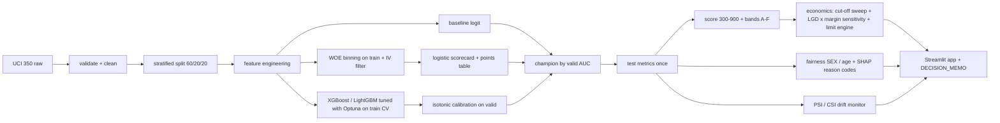
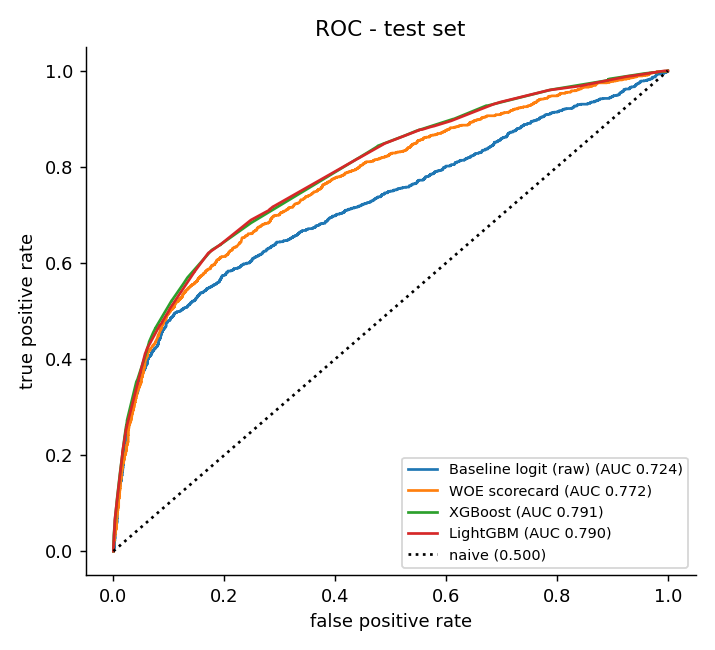
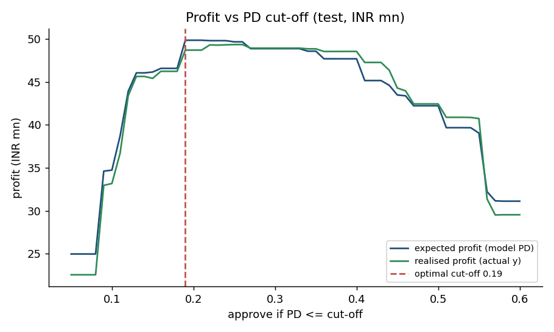

# Case Study 01 - Credit Risk Scorecard and Credit-Limit Engine

A card issuer wants to (a) predict next-month default (PD), (b) turn PD into a 300-900 bureau-style score with bands A-F, and (c) choose an approve/decline cut-off and limit actions that maximise expected profit. This repo builds a WOE/logistic **scorecard**, XGBoost/LightGBM **challengers** with isotonic calibration, an **economics layer** (EL, optimal cut-off, LGD x margin sensitivity), a **fairness audit**, SHAP **reason codes**, a **drift monitor** and a 4-tab Streamlit app.

All numbers below are generated from `outputs/summary.json` and `outputs/metrics.json` by `analysis/make_docs.py` (never typed by hand).

## Problem

See `docs/PROBLEM_STATEMENT.md`. Primary KPI: expected portfolio profit (INR) at the chosen cut-off versus approve-all. Model KPIs: ROC-AUC >= 0.78, KS >= 0.42, Gini >= 0.56, Brier <= 0.14, calibration slope 0.9-1.1.

## Data

UCI "Default of Credit Card Clients" (id 350), Yeh and Lien (2009), CC BY 4.0, https://archive.ics.uci.edu/dataset/350. Amounts are NT$; converted to INR (`fx_ntd_inr`) only in business outputs. Month alignment: `PAY_0`, `BILL_AMT1`, `PAY_AMT1` = September (latest).

<!-- DATA:START -->
30,000 customers, default rate 22.12%, 590 rows with negative BILL_AMT1 (1930 with any negative bill), 35 duplicate rows (kept). Stratified split: 18,000 / 6,000 / 6,000 (train / valid / test).
<!-- DATA:END -->

Loader order (`src/credit/data.py`): `data/raw/uci350.parquet` cache, then local xls in `$AMPBA_DATA_DIR` (default `C:\ampba_data`), then `ucimlrepo`, then the direct UCI zip. Tests are offline (a 1,500-row stratified sample `tests/fixtures/uci350_sample.csv` plus `make_fixture(n)` synthetic data).

## Approach



Key design choices: split first; binning, scaling and tuning fitted on train only; calibration on valid only; the champion is chosen on validation AUC of the *uncalibrated* model (isotonic fitted on valid would flatter valid metrics); the test set is evaluated once. `SEX` is never a model input (kept only for the fairness audit).

## Results (test set)

<!-- RESULTS:START -->
| Model | Test AUC | Test Gini | Test KS | Test Brier | Cal. slope | Valid AUC |
|---|---|---|---|---|---|---|
| Naive (predict base rate) | 0.500 | 0.000 | 0.000 | 0.1723 | n/a | 0.500 |
| Baseline logistic (raw features) | 0.7243 | 0.4486 | 0.3852 | 0.1437 | 0.983 | 0.7024 |
| WOE scorecard (logistic) | 0.7720 | 0.5439 | 0.4206 | 0.1356 | 0.988 | 0.7627 |
| XGBoost (isotonic-calibrated) **(champion)** | 0.7907 | 0.5815 | 0.4498 | 0.1312 | 1.012 | 0.7863 |
| LightGBM (isotonic-calibrated) | 0.7899 | 0.5798 | 0.4498 | 0.1318 | 1.006 | 0.7840 |
| Benchmark R1 (Abhinav19-isb) | 0.783 | - | 0.424 | - | - | - |

All headline targets were met on the test set.

| Metric | Target | Achieved (test, champion) | Result |
|---|---|---|---|
| ROC-AUC | >= 0.78 | 0.7907 | PASS |
| KS | >= 0.42 | 0.4498 | PASS |
| Gini | >= 0.56 | 0.5815 | PASS |
| Brier | <= 0.14 | 0.1312 | PASS |
| Calibration slope | 0.9 - 1.1 | 1.012 | PASS |
| Points table reproduces score | within 1 point | max diff 0.043 | PASS |
<!-- RESULTS:END -->

Figures are in `figures/`: `eda_*.png` (6 EDA charts), `roc_test.png`, `calibration_test.png`, `lift_deciles.png`, `score_distribution.png`, `band_bad_rate.png`, `profit_curve.png`, `sensitivity_heatmap.png`, `shap_global_bar.png`. Tables are in `outputs/` (`scorecard_points.csv`, `iv_table.csv`, `band_table.csv`, `profit_curve.csv`, `sensitivity_lgd_margin.csv`, `fairness_*.csv`, `csi_*.csv`, `reason_code_samples.csv`).

 

## Business impact

<!-- BUSINESS:START -->
- Optimal cut-off: approve if PD <= **0.19** (score >= 529); break-even PD = margin/(margin+LGD) = 0.217.
- Approval rate **65.5%**; bad rate among approved **10.7%** vs 22.1% approve-all.
- Expected profit INR 49.9 mn vs INR 2.8 mn approve-all (uplift INR 47.0 mn; realised-outcome uplift INR 52.8 mn).
- Sensitivity (LGD 0.45-0.85 x margin 0.10-0.26): optimal cut-off 0.11-0.36; uplift range INR 23.0 mn to INR 86.5 mn (positive in every cell).
- Assumptions: margin 0.18, LGD 0.65, NT$->INR 2.6; all test-set (6,000 customers).
<!-- BUSINESS:END -->

Risk bands and limit engine:

<!-- BANDS:START -->
| band | n | bad_rate | avg_pd | score_min | score_max | share |
|---|---|---|---|---|---|---|
| A | 1035 | 5.0% | 3.6% | 573 | 753 | 17.2% |
| B | 1363 | 9.3% | 9.7% | 547 | 557 | 22.7% |
| C | 1535 | 15.7% | 17.1% | 530 | 543 | 25.6% |
| D | 738 | 22.8% | 24.6% | 507 | 524 | 12.3% |
| E | 876 | 44.9% | 45.9% | 478 | 505 | 14.6% |
| F | 453 | 76.4% | 71.5% | 307 | 472 | 7.5% |

Limit engine value by band (INR mn, config actions applied):

| band | n | action | profit_before_mn | profit_after_mn | delta_mn |
|---|---|---|---|---|---|
| A | 1035 | increase | 24.96 | 29.39 | 4.43 |
| B | 1363 | increase | 18.96 | 20.02 | 1.06 |
| C | 1535 | hold | 5.95 | 5.95 | 0.0 |
| D | 738 | decrease | -1.27 | -0.52 | 0.75 |
| E | 876 | decline | -17.48 | 0.0 | 17.48 |
| F | 453 | decline | -28.29 | 0.0 | 28.29 |
<!-- BANDS:END -->

Fairness audit at the optimal cut-off:

<!-- FAIRNESS:START -->
**By SEX**

| group | n | approval_rate | bad_rate_approved | default_rate | auc | di_ratio | passes_80pct |
|---|---|---|---|---|---|---|---|
| female | 3628 | 66.8% | 9.4% | 20.8% | 0.795 | 1.000 | True |
| male | 2372 | 63.6% | 12.7% | 24.1% | 0.783 | 0.952 | True |

**By AGE**

| group | n | approval_rate | bad_rate_approved | default_rate | auc | di_ratio | passes_80pct |
|---|---|---|---|---|---|---|---|
| 30-39 | 2206 | 70.1% | 10.0% | 19.9% | 0.793 | 1.000 | True |
| 40-49 | 1296 | 63.5% | 11.5% | 24.5% | 0.794 | 0.906 | True |
| 50+ | 572 | 59.8% | 13.7% | 26.0% | 0.763 | 0.853 | True |
| <30 | 1926 | 63.4% | 10.2% | 21.9% | 0.792 | 0.904 | True |
<!-- FAIRNESS:END -->

Full write-ups: `docs/DECISION_MEMO.md`, `docs/MODEL_CARD.md`.

## Decisions

- **Duplicates kept** (35 exact duplicate rows in 30,000 is immaterial; documented in `docs/data_quality.md`). Negative bills are kept (credit balances).
- **EDUCATION {0,5,6} -> 4; MARRIAGE 0 -> 3** per spec.
- **Scorecard**: monotonic optimal binning (optbinning), IV >= 0.02, correlation cap 0.70, positive-coefficient variables dropped; points table = per-bin points that sum to the score.
- **EAD** = LIMIT_BAL x avg utilisation (floored at 5%, capped at 150%) in INR.

## Limitations

Taiwan 2005 data and a random split (no out-of-time test); margin, LGD and limit-action effects are assumptions; outcomes are known only for the approved population in real life (no reject inference); age and limit may proxy protected attributes; calibration uses a single 6,000-row validation split.

## Deviations

- The baseline logistic uses the 22 raw features without `SEX` (the spec says "23 raw features" but also excludes SEX from every model).
- Champion selection uses validation AUC of the uncalibrated model (spec: "valid AUC"), to avoid bias from fitting the isotonic map on the same validation set. Champion is chosen among the challengers (XGBoost, LightGBM); the scorecard is the explainable alternative.
- Python 3.12 system interpreter and no virtualenv were used in this build (spec suggests 3.11 venv); `requirements.txt` is pinned to the installed versions and CI uses 3.11.
- `ruff` line length is 160 (tabular code); notebooks are excluded from lint.
- `models/*.joblib` are git-ignored; the app needs `python tasks.py train` first (or Docker build + train).
- Score PSI under the -20% LIMIT_BAL shift is small (the model hardly uses the limit); the alert fires at the *feature* level (see memo). Both are reported.

## How to run

```powershell
pip install -r requirements.txt        # python tasks.py setup also does pip install -e .
python tasks.py all                    # lint, test, data, train (30 Optuna trials), evaluate, docs  (about 6 minutes)
python tasks.py app                    # Streamlit app (4 tabs)
python tasks.py test | lint | data | train | evaluate
```
`make <target>` works too where `make` exists. Docker: `docker build -t credit-scorecard . && docker run -p 8501:8501 credit-scorecard` (run `python tasks.py train && python tasks.py evaluate` first so artefacts are in the image).

## Milestone log

<!-- LOG:START -->
- **2026-10-20 M1-M5 complete.** Data validated (30,000 customers, default rate 22.12%, 590 rows with negative BILL_AMT1 (1930 with any negative bill), 35 duplicate rows (kept). Stratified split: 18,000 / 6,000 / 6,000 (train / valid / test).) ; scorecard test AUC 0.7720; champion xgb test AUC 0.7907, KS 0.4498; optimal cut-off 0.19; uplift INR 47.0 mn. All headline targets were met on the test set.
<!-- LOG:END -->

## References

- R1 [Abhinav19-isb/credit-risk-scorecard](https://github.com/Abhinav19-isb/credit-risk-scorecard) - benchmark (AUC 0.783, KS 0.424) and presentation structure; design inspiration only, no code copied.
- R3 [RishabhBansal2409/Predicting_Credit_Card_Approvals](https://github.com/RishabhBansal2409/Predicting_Credit_Card_Approvals) - naive baseline reference.
- Yeh, I.-C. and Lien, C.-H. (2009). The comparisons of data mining techniques for the predictive accuracy of probability of default of credit card clients. Expert Systems with Applications. DOI 10.1016/j.eswa.2007.12.020. Dataset DOI 10.24432/C55S3H.
- optbinning (https://gnpalencia.org/optbinning/), SHAP, Optuna, XGBoost, LightGBM, Streamlit.
