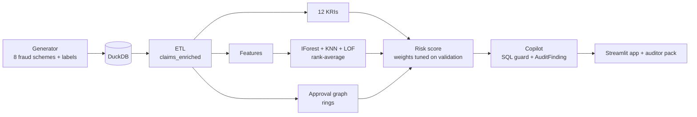

# Project 02 — T&E Expense Fraud Detection + GenAI Audit Copilot

| | |
|---|---|
| Domain | FinTech / internal audit (Deloitte-style anomaly detection) |
| Difficulty / effort | ★★★ · about 40–45 hours over 2 weeks |
| Repo name | `ampba-02-tne-fraud-copilot` |
| Python package (`PKG`) | `tne` |
| Data | Synthetic labelled generator (you write it) + real unlabelled UK council p-card spend. See [DATA.md](DATA.md) |
| Shared setup | [../00-COMMON-SETUP.md](../00-COMMON-SETUP.md) |

---

## 1. What you are building

Internal audit manually reviews fewer than 5% of travel-and-expense (T&E) claims. You will build a system that **ranks every claim by fraud risk, explains why, and produces an auditor-ready case list**: 12 rule-based Key Risk Indicators (KRIs), an unsupervised anomaly ensemble, an approval-network (ring) detector, a combined risk score tuned on a validation slice, and an **audit copilot** — natural-language questions become guarded read-only SQL, and each risky claim gets a structured `AuditFinding`.



**KPIs (master plan):** precision@top-5% ≥ 0.60; recall of fraud **₹ value** in the top-10% ≥ 0.70; ensemble beats KRI-only on PR-AUC; label prevalence 2.5–3.5%; copilot returns valid `AuditFinding` JSON in mock mode; DROP/UPDATE rejected; memo gives ₹ at risk and hours saved at 15 minutes per claim.

## 2. Read first

| Repo | Look at |
|---|---|
| [adarshb3/ISB_AMPBA_Capstone-Project_Deloitte--Anomaly-Detection-in-Business-Processes-using-Generative-AI](https://github.com/adarshb3/ISB_AMPBA_Capstone-Project_Deloitte--Anomaly-Detection-in-Business-Processes-using-Generative-AI) | KNN anomaly + rule KRIs + LangChain agent + Mage ETL + Postgres + Tableau. It reports **no precision/recall** because it has no labels — your labelled generator fixes exactly that |

## 3. Step 0 — project setup

```powershell
cd "C:\Users\11624\OneDrive - Indian School of Business\Documents\personal\isb_ampba\projects\02-tne-fraud-genai-audit"
py -3.11 -m venv C:\venvs\ampba-02
C:\venvs\ampba-02\Scripts\Activate.ps1
python -m pip install --upgrade pip wheel
pip install -r requirements.in
$pkg = "tne"
mkdir config, data\raw, data\interim, data\processed, notebooks, "src\$pkg", analysis, outputs, figures, models, app, tests\fixtures, docs, .github\workflows
New-Item "src\$pkg\__init__.py", tests\__init__.py -ItemType File
git init
```
Follow common setup §3–§8 (`.gitignore` must include `*.duckdb`, `outputs/llm_usage.csv`; `tasks.py` with `PKG = "tne"`; CI; Dockerfile; `pip install -e .`). Put the `config/config.yaml` from DATA.md §1 in place and write `docs/PROBLEM_STATEMENT.md`.

---

## 4. Milestones

### M1 — Synthetic generator + ETL (about 10 h)

**Goal:** ~100k+ claim lines with ~3% labelled fraud in DuckDB, plus an enriched claims table.

**Design (write it in this order, printing `df.head()` after each step):**
1. `make_employees` — 1,500 employees: grade G1–G5 (probabilities .35/.28/.20/.12/.05), department, home city (10 Indian cities), cost center, `join_date`, and a `manager_id` that is someone **more senior** (same department if possible).
2. `make_policy` — daily limit per (grade, category): `BASE_LIMIT[category] × GRADE_MULT[grade]`, rounded to ₹10 (BASE: airfare 9000, hotel 3500, meals 700, taxi 900, mileage 1800, misc 600; MULT 1.0/1.3/1.7/2.2/3.0).
3. `make_legit_claims` — honest behaviour: trips (airfare out and back, hotel nights, meals, cabs; weekend meals are allowed *inside* a trip) and local weekday claims (taxi, meals, mileage, misc). Amounts: `limit × lognormal(median 0.5, σ 0.35)`, capped at 1.08× limit, 8% honest round amounts. Mileage = `distance_km × ₹12`, with distance = city norm × 2 × U(0.7, 1.4). About 2% of honest claims are approved by the manager's manager.
4. `inject_fraud` — the eight schemes (code below), with disjoint fraudsters per scheme.
5. `finish_claims` — receipt flag (always when amount ≥ ₹500, else 85%), submission lag (1 + geometric(0.2) days; 3% late 31–90 days), approval delay (lognormal, median 18 h; 1% instant), **shuffle, then assign `claim_id`**.
6. `write_duckdb` — tables `employees, policy, claims, labels`.

Reference implementation:

```python
GRADES = ["G1", "G2", "G3", "G4", "G5"]
DEPTS = ["Sales", "Engineering", "Operations", "Finance", "HR", "Marketing"]
CATEGORIES = ["airfare", "hotel", "meals", "taxi", "mileage", "misc"]
SCHEMES = {1: "duplicate", 2: "split", 3: "weekend_meals", 4: "below_receipt", 5: "personal_merchant",
           6: "mileage_inflation", 7: "collusion", 8: "round_numbers"}
SCHEME_SHARE = {1: .15, 2: .14, 3: .12, 4: .12, 5: .10, 6: .12, 7: .13, 8: .12}     # share of fraud lines
CITY_KM = {"Mumbai": 14, "Delhi": 18, "Bengaluru": 16, "Hyderabad": 15, "Chennai": 13, "Pune": 11,
           "Kolkata": 12, "Ahmedabad": 10, "Jaipur": 9, "Kochi": 8}                  # typical ONE-WAY local distance
CITIES = list(CITY_KM)
BASE_LIMIT = {"airfare": 9000, "hotel": 3500, "meals": 700, "taxi": 900, "mileage": 1800, "misc": 600}
GRADE_MULT = {"G1": 1.0, "G2": 1.3, "G3": 1.7, "G4": 2.2, "G5": 3.0}
MERCHANTS = {"airfare": ["SkyBridge Air", "IndoWings", "AirKaveri", "Gateway Airlines", "FlyNimbus"],
             "hotel": ["Lakeview Residency", "Grand Meridian", "StayEasy Inn", "Orchid Suites", "CityNest Hotel", "Harbour Palace"],
             "meals": ["Spice Route", "Cafe Mocha", "The Curry Leaf", "Urban Tadka", "Bistro 21", "Dosa Corner", "Pizza Hub", "Green Bowl"],
             "taxi": ["MetroCabs", "RideNow", "CityWheels", "QuickCab", "AutoGo"], "mileage": ["Personal vehicle"],
             "misc": ["PrintWorld", "OfficeMart", "TechAccessories Co", "CourierXpress", "ConnectTel Recharge"]}
PERSONAL_MERCHANTS = ["Zenith Jewellers", "Royal Spirits & Wines", "Sparkle Gold House", "Cellar Door Liquor", "Diamond Arcade", "Luxe Watches"]
DEPT_TRAVEL = {"Sales": 1.5, "Operations": 0.9, "Marketing": 0.8, "Engineering": 0.5, "Finance": 0.3, "HR": 0.3}


def make_employees(cfg, rng):
    g = cfg["generator"]; n = g["n_employees"]; start = pd.Timestamp(g["start_date"])
    emp = pd.DataFrame({"emp_id": [f"E{i:05d}" for i in range(n)],
                        "grade": rng.choice(GRADES, n, p=[.35, .28, .20, .12, .05]),
                        "dept": rng.choice(DEPTS, n, p=[.25, .25, .20, .10, .08, .12]),
                        "city": rng.choice(CITIES, n)})
    emp["cost_center"] = emp["dept"].str[:3].str.upper() + "-" + rng.integers(1, 6, n).astype(str)
    emp["join_date"] = start - pd.to_timedelta(rng.integers(30, 3650, n), unit="D")
    rank = emp["grade"].map({g_: i for i, g_ in enumerate(GRADES)}).to_numpy()
    mgr = np.empty(n, dtype=object)
    for i in range(n):                                   # manager = someone senior, same dept if possible
        same = np.where((emp["dept"].to_numpy() == emp["dept"].iloc[i]) & (rank > rank[i]))[0]
        any_ = np.where(rank > rank[i])[0]
        top = np.where((rank == rank[i]) & (np.arange(n) != i))[0]     # top grade: a peer top-grade manager
        pool = same if len(same) else (any_ if len(any_) else top)
        mgr[i] = emp["emp_id"].iloc[rng.choice(pool)]
    emp["manager_id"] = mgr
    return emp[["emp_id", "grade", "dept", "cost_center", "manager_id", "city", "join_date"]]


def make_policy(cfg):
    return pd.DataFrame([{"grade": g_, "category": c, "daily_limit_inr": float(round(BASE_LIMIT[c] * GRADE_MULT[g_], -1))}
                         for g_ in GRADES for c in CATEGORIES])


def _legit_amount(limit, rng):
    amt = np.minimum(limit * np.exp(rng.normal(np.log(0.50), 0.35, len(limit))), limit * 1.08)
    amt = np.round(amt)
    rnd = rng.random(len(amt)) < 0.08                    # some honest round amounts
    amt[rnd] = np.round(amt[rnd], -2)
    return np.maximum(amt, 50.0)
```

`make_legit_claims` (per employee: trips ~ `Poisson(5 × intensity)`, local claims ~ `Poisson(35 × (1.1 − 0.3 × intensity/1.5))`, intensity = `DEPT_TRAVEL[dept] × (1 + 0.1 × grade_index)`; build a list of `(date, category, city, trip_id)` tuples per employee, concat, then fill amount, merchant, description, mileage distance, skip-level approvals). Write it yourself from the design above; the part people get wrong is the vectorised amount step:

```python
limit = np.array([lim[(gr, ca)] for gr, ca in zip(c["grade"], c["category"])])
c["amount_inr"] = _legit_amount(limit, rng)
mil = c["category"] == "mileage"
c["distance_km"] = np.nan
c.loc[mil, "distance_km"] = np.round(c.loc[mil, "city"].map(CITY_KM).to_numpy() * 2 * rng.uniform(0.7, 1.4, mil.sum()), 1)
c.loc[mil, "amount_inr"] = np.round(c.loc[mil, "distance_km"] * cfg["generator"]["mileage_rate_inr_per_km"])
mgr_of = emp.set_index("emp_id")["manager_id"]
skip = rng.random(len(c)) < 0.02                         # ~2% honest skip-level approvals
alt = c.loc[skip, "approved_by"].map(mgr_of)
ok = alt.notna() & (alt != c.loc[skip, "emp_id"])
c.loc[alt[ok].index, "approved_by"] = alt[ok]
c["fraud_type"] = ""
```
If `len(claims)` lands far from 120,000, scale the two Poisson rates; the spec target is ~120k lines (check yours with `len(tables["claims"])`).

**Fraud injectors.** Common helper: a `Ctx` object holding the policy limit lookup, weekdays, off-days (weekends + holidays) and the employee table, with `new_row(...)` returning a claim dict that carries `fraud_type`. Each injector gets a quota of lines and a set of fraudsters (`_spread` divides the quota among them, ≥ 1 each):

| # | Scheme | Injection |
|---|---|---|
| 1 | duplicate | copy an honest claim of the same employee (meals/taxi/misc/hotel): same merchant and amount, date + 0–2 days |
| 2 | split | one spend of `limit × U(1.35, 2.2)` broken into 2–3 same-day, same-merchant claims, each ≤ `0.97 × limit` |
| 3 | weekend_meals | meals on a weekend/holiday with `trip_id = None`, amount `limit × U(0.75, 1.0)` |
| 4 | below_receipt | amount `U{460…499}` (`thr−40 … thr−1`), `receipt_flag = 0` |
| 5 | personal_merchant | jewellery (₹3,000–40,000) or liquor (₹1,500–9,000) merchant in `misc`/`meals` |
| 6 | mileage_inflation | edit the employee's own mileage lines: km = city norm × 2 × U(2.2, 3.5); add rows for the remainder |
| 7 | collusion | 3 rings × 4 employees; a member claims `limit × U(1.4, 2.3)` (hotel/misc/meals/airfare) approved by another ring member within 0.5–4.5 minutes (5% self-approved) |
| 8 | round_numbers | edit honest claims upward to multiples of ₹100 (₹500 above ₹1,500) for a few employees |

```python
def inject_split(c, ctx, emps, quota, rng):
    new = []
    for eid, k in _spread(quota, emps, rng).items():
        grade = ctx.emp.loc[eid, "grade"]
        while k > 0:
            cat = rng.choice(["meals", "taxi", "misc", "hotel"])
            limit, parts = ctx.lim[(grade, cat)], int(rng.choice([2, 3]))
            total = limit * rng.uniform(1.35, 2.2)
            day, merchant = ctx.weekdays[rng.integers(0, len(ctx.weekdays))], rng.choice(MERCHANTS[cat])
            for _ in range(parts):
                amt = min(total / parts * rng.uniform(0.92, 1.0), limit * 0.97)
                new.append(ctx.new_row(eid, day, cat, merchant, round(amt), 2, receipt=1))
            k -= parts
    return new

def inject_collusion(c, ctx, rings, quota, rng):
    new, per_ring = [], quota // len(rings)
    for ring in rings:
        for _ in range(per_ring):
            eid = rng.choice(ring); others = [x for x in ring if x != eid]
            approver = eid if rng.random() < 0.05 else rng.choice(others)
            cat = rng.choice(["hotel", "misc", "meals", "airfare"])
            limit = ctx.lim[(ctx.emp.loc[eid, "grade"], cat)]
            new.append(ctx.new_row(eid, ctx.weekdays[rng.integers(0, len(ctx.weekdays))], cat, rng.choice(MERCHANTS[cat]),
                                   round(limit * rng.uniform(1.4, 2.3)), 7, receipt=1, approved_by=approver,
                                   approval_min=float(rng.uniform(0.5, 4.5))))
    return new
```
Write the other six in the same style following the table. Total fraud quota: `total = round(fraud_target × n0 / (1 − fraud_target × 0.6))` (about 60% of fraud lines are added rows, so the final share stays at the target); split by `SCHEME_SHARE`; fraudsters per scheme = `max(3, quota // lines_per_fraudster)` taken sequentially from a shuffled employee pool so they are disjoint.

`finish_claims` and orchestration:

```python
def finish_claims(c, emp, cfg, rng):
    n, thr = len(c), cfg["generator"]["receipt_threshold_inr"]
    has_receipt = np.where(c["amount_inr"] >= thr, 1, (rng.random(n) < 0.85).astype(int))
    c["receipt_flag"] = c["receipt_flag"].fillna(pd.Series(has_receipt, index=c.index)).astype(int) if "receipt_flag" in c else has_receipt
    lag = np.where(rng.random(n) < 0.03, rng.integers(31, 90, n), 1 + rng.geometric(0.2, n))
    tod = pd.to_timedelta(rng.integers(9 * 60, 19 * 60, n), unit="m")
    c["submitted_at"] = pd.to_datetime(c["date"]) + pd.to_timedelta(lag, unit="D") + tod
    mins = np.exp(rng.normal(np.log(18 * 60), 1.0, n))
    mins = np.where(rng.random(n) < 0.01, rng.uniform(1, 4.9, n), mins)
    if "approval_min_override" in c:
        mins = np.where(c["approval_min_override"].notna(), c["approval_min_override"].fillna(0), mins)
    c["approved_at"] = c["submitted_at"] + pd.to_timedelta(mins, unit="m")
    c = c.sample(frac=1.0, random_state=int(rng.integers(0, 2**31 - 1))).sort_values("submitted_at", kind="stable").reset_index(drop=True)
    c["claim_id"] = [f"C{i:06d}" for i in range(1, len(c) + 1)]       # AFTER shuffling
    return c

def generate(cfg=None):
    cfg = cfg or load_config(); rng = np.random.default_rng(cfg["seed"])
    emp, policy = make_employees(cfg, rng), make_policy(cfg)
    allc = finish_claims(inject_fraud(make_legit_claims(emp, policy, cfg, rng), emp, policy, cfg, rng), emp, cfg, rng)
    labels = allc[["claim_id", "fraud_type"]].copy()
    labels["is_fraud"] = (labels["fraud_type"] != "").astype(int)
    labels["fraud_type"] = labels["fraud_type"].replace("", None)
    cols = ["claim_id", "emp_id", "date", "category", "merchant", "city", "amount_inr", "receipt_flag",
            "submitted_at", "approved_by", "approved_at", "description", "trip_id", "distance_km"]
    return {"employees": emp, "policy": policy, "claims": allc[cols].copy(), "labels": labels[["claim_id", "is_fraud", "fraud_type"]]}
```
Run `python -m src.tne.generate`. **Sanity checks:** prevalence between 2.5% and 3.5% (assert it in a test); every scheme present in `labels.fraud_type`; `claim_id` order uncorrelated with the label; five honest-looking rows printed side by side with five fraud rows should be hard to tell apart by eye for duplicate/round-number schemes.

**`src/tne/etl.py`** — enrich in DuckDB SQL. Create `city_km` and `holidays` tables, then:

```sql
CREATE OR REPLACE TABLE claims_enriched AS
WITH base AS (
    SELECT c.*, e.grade, e.dept, e.cost_center, e.manager_id, e.city AS home_city,
           m.manager_id AS skip_manager_id,
           p.daily_limit_inr, k.km_one_way
    FROM claims c
    JOIN employees e USING (emp_id)
    LEFT JOIN employees m ON m.emp_id = e.manager_id
    JOIN policy p ON p.grade = e.grade AND p.category = c.category
    LEFT JOIN city_km k ON k.city = c.city
)
SELECT b.*,
       isodow(b.date) >= 6                                         AS is_weekend,
       (b.date IN (SELECT hdate FROM holidays))                    AS is_holiday,
       b.amount_inr / b.daily_limit_inr                            AS limit_ratio,
       date_diff('day', b.date, CAST(b.submitted_at AS DATE))      AS submit_lag_days,
       date_diff('second', b.submitted_at, b.approved_at) / 60.0   AS approval_minutes,
       (b.approved_by = b.manager_id)                              AS approver_is_manager,
       (b.approved_by = b.manager_id OR b.approved_by = b.skip_manager_id) AS approver_in_chain,
       (b.approved_by = b.emp_id)                                  AS self_approved,
       (b.trip_id IS NOT NULL)                                     AS in_trip,
       (b.amount_inr >= {receipt_threshold})                       AS receipt_required,
       b.distance_km / NULLIF(2 * b.km_one_way, 0)                 AS km_ratio,
       CAST(substr(CAST(CAST(b.amount_inr AS BIGINT) AS VARCHAR), 1, 1) AS INTEGER) AS first_digit,
       (b.amount_inr % 100 = 0)                                    AS is_round100,
       COUNT(*)          OVER (PARTITION BY b.emp_id, b.date, b.category) AS same_day_n,
       SUM(b.amount_inr) OVER (PARTITION BY b.emp_id, b.date, b.category) AS same_day_sum,
       EXISTS (SELECT 1 FROM claims d WHERE d.emp_id = b.emp_id AND d.merchant = b.merchant
                 AND d.amount_inr = b.amount_inr AND d.claim_id < b.claim_id
                 AND abs(date_diff('day', d.date, b.date)) <= 2)    AS is_dup_of_earlier
FROM base b
```
(`approver_in_chain` = the approver is the claimant's manager **or the manager's manager** — the honest skip-level case. Without this, honest delegations look like collusion.) The correlated `EXISTS` is slow on 100k+ rows; if it takes more than a minute, replace it with a self-join on `(emp_id, merchant, amount_inr)` and a date filter.

Check the DuckDB functions against the docs if a name errors: https://duckdb.org/docs/ (`isodow`, `date_diff`).

**EDA notebook** (`notebooks/01_eda.ipynb`): spend by category and grade; claims per employee per month; share of claims over limit (a few % for honest claims); approval-delay histogram; first-digit distribution against Benford for all claims.

**Pitfalls:** using `labels` anywhere outside evaluation; assigning `claim_id` before shuffling (leaks label order); fraudsters overlapping between schemes (per-scheme recall becomes ambiguous); forgetting `approver_in_chain`.

```powershell
git add -A; git commit -m "M1: synthetic T&E generator with 8 labelled schemes, DuckDB ETL (prevalence <x>%)"
```

---

### M2 — Rule-based KRIs and baseline (about 7 h)

**Goal:** 12 KRIs, each returning `flag`, `severity` (1–5) and an evidence string; a KRI-only baseline.

```python
def _out(df, flag, sev, text_fn):
    flag = np.asarray(flag, dtype=bool)
    out = pd.DataFrame({"flag": flag, "severity": np.where(flag, sev, 0)}, index=df.index)
    ev = pd.Series("", index=df.index, dtype=object)
    if flag.any():
        ev[flag] = [text_fn(r) for r in df[flag].itertuples()]
    out["evidence"] = ev
    return out
```

| KRI | Rule | Severity |
|---|---|---|
| K01_duplicate | `is_dup_of_earlier` | 4 |
| K02_split | `same_day_n ≥ 2` and `same_day_sum > limit` and `limit_ratio ≤ 1` | 4 |
| K03_weekend_no_trip | meals on weekend/holiday and not in a trip | 3 |
| K04_below_receipt | amount in [450, 499] and `receipt_flag == 0` | 3 |
| K05_personal_merchant | merchant contains jewel/gold/diamond/watch/liquor/spirits/wines | 5 |
| K06_mileage | mileage and `km_ratio > 1.8` | 4 |
| K07_peer_self_approval | `~approver_in_chain` (approver is neither the manager nor the manager's manager) | 4 |
| K08_round_number | round-100 amount ≥ ₹300 and ≥ 30% of the employee's claims that month are round | 3 |
| K09_over_limit | `limit_ratio > 1` | 2 |
| K10_late_submission | submitted > 30 days after the expense date | 2 |
| K11_fast_approval | approved < 5 minutes after submission | 3 |
| K12_missing_receipt | `amount ≥ threshold` and no receipt | 3 |

```python
def k02_split(df):
    f = (df["same_day_n"] >= 2) & (df["same_day_sum"] > df["daily_limit_inr"]) & (df["limit_ratio"] <= 1.0)
    return _out(df, f, 4, lambda r: f"{r.same_day_n} claims on {r.date:%Y-%m-%d} in {r.category} total {r.same_day_sum:.0f} vs daily limit {r.daily_limit_inr:.0f}")

def k08_round_number(df):
    ym = df["date"].dt.to_period("M")
    share = df.groupby([df["emp_id"], ym])["is_round100"].transform("mean")
    f = df["is_round100"] & (share >= 0.30) & (df["amount_inr"] >= 300)
    return _out(df, f, 3, lambda r: f"Round amount {r.amount_inr:.0f}; most claims by this employee this month are round")

KRIS = {"K01_duplicate": k01_duplicate, ... , "K12_missing_receipt": k12_missing_receipt}

def run_all_kris(df):
    parts = {}
    for name, fn in KRIS.items():
        r = fn(df); parts[f"f_{name}"], parts[f"s_{name}"], parts[f"e_{name}"] = r["flag"], r["severity"], r["evidence"]
    out = pd.DataFrame(parts, index=df.index)
    out["kri_severity_sum"] = out[[c for c in out if c.startswith("s_")]].sum(axis=1)
    out["kri_max"] = out[[c for c in out if c.startswith("s_")]].max(axis=1)
    out["kri_count"] = out[[c for c in out if c.startswith("f_")]].sum(axis=1)
    out.insert(0, "claim_id", df["claim_id"].to_numpy())
    return out
```
Write all 12 yourself in this style.

**Baseline.** Join `labels` for evaluation only (`df = df.merge(labels, on="claim_id")`). Rank by `kri_severity_sum` (break ties with `limit_ratio × 1e-6`) and compute precision@5%, PR-AUC (`sklearn.metrics.average_precision_score`), recall of ₹ value in the top 10%, and **per-KRI precision** (of the claims a KRI flags, how many are fraud). Expect low-severity KRIs (over-limit, late, fast approval, missing receipt) to have low precision because honest claims also trip them — that is the point of weighting by severity.

```python
def precision_at_k(y, score, frac=0.05):
    k = max(1, int(len(y) * frac)); top = np.argsort(-np.asarray(score), kind="mergesort")[:k]
    return float(np.asarray(y)[top].mean())

def recall_value_at_k(y, amount, score, frac=0.10):
    y, amount = np.asarray(y), np.asarray(amount); k = max(1, int(len(y) * frac))
    top = np.argsort(-np.asarray(score), kind="mergesort")[:k]
    return float((amount * y)[top].sum() / (amount * y).sum())
```
Note: with 3% prevalence, a **perfect** ranking has precision@5% of at most 0.03/0.05 = 0.60. The master plan target of ≥ 0.60 is therefore the *ceiling*; at k = 5% of claims you can never exceed `prevalence / 0.05`. Report the achieved precision **and** the ceiling (and consider reporting precision@3% as well). Write this in the README — a reviewer will notice.

**Pitfalls:** per-claim KRIs counting honest claims (K09, K11) — keep severity low; K08 firing on every employee with honest round amounts (hence the monthly 30% share condition).

```powershell
git add -A; git commit -m "M2: 12 KRIs, KRI-only baseline (PR-AUC <x>, precision@5% <y>, ceiling <z>)"
```

---

### M3 — Anomaly ensemble, graph, combined risk (about 9 h) → **Mid-review**

**Goal:** unsupervised ensemble, ring detection and a tuned combined score, with per-scheme recall.

1. **`features.py`** — claim-level and employee-level features, **no label columns**:
   `amount_z` (z-score within grade × category × city), `limit_ratio`, `just_below_limit` (0.90–1.0 of limit), `log_amount`, weekend/holiday flag, `no_trip_weekend_meal`, `submit_lag_days` (clipped 0–90), `log_approval_min`, `approver_off_chain`, `same_day_n`, `same_day_ratio`, `km_ratio`, `is_round100`, `missing_receipt`; and broadcast employee features: Benford first-digit MAD (needs ≥ 20 claims), claims per active day, weekend ratio, just-below-limit ratio, round ratio, approver concentration (HHI of `approved_by` shares), off-chain approval ratio.

```python
BENFORD = np.log10(1 + 1 / np.arange(1, 10))
def benford_mad(first_digits):
    if len(first_digits) < 20: return 0.0
    obs = np.bincount(first_digits.clip(1, 9), minlength=10)[1:] / len(first_digits)
    return float(np.abs(obs - BENFORD).mean())
def hhi(series):
    share = series.value_counts(normalize=True); return float((share ** 2).sum())
```

2. **`anomaly.py`** — `pyod` IsolationForest, KNN and LOF; scale with `RobustScaler`, clip to ±10; **fit on a 30,000-row random subsample** (distance methods are slow) and score all rows; rank-average the three scores into `anomaly_score`.

```python
from pyod.models.iforest import IForest
from pyod.models.knn import KNN
from pyod.models.lof import LOF
dets = {"iforest": IForest(n_estimators=200, contamination=0.03, random_state=seed, n_jobs=-1),
        "knn": KNN(n_neighbors=20, method="largest", contamination=0.03),
        "lof": LOF(n_neighbors=30, contamination=0.03)}
Xs = np.clip(RobustScaler().fit_transform(X.to_numpy(float)), -10, 10)
idx = np.random.default_rng(seed).choice(len(Xs), size=min(30000, len(Xs)), replace=False)
for name, det in dets.items():
    det.fit(Xs[idx]); out[name] = det.decision_function(Xs)          # higher = more anomalous
out["anomaly_score"] = np.column_stack([rankdata(out[c]) / len(out) for c in dets]).mean(axis=1)
```
   Evaluate each detector alone and the ensemble: PR-AUC and precision@5% against `labels`. Optional autoencoder (spec: optional) is a stretch goal.

3. **`graph.py`** — approval network. Edges `approver → claimant` for **irregular** approvals (approver not in the chain) with weight ≥ 2; rings = strongly connected components of size ≥ 2 (a pair that approves each other is a ring of 2; self-approval is a self-loop). Claim-level flag: irregular **and** approver and claimant in the same ring, or self-approved.

```python
irr = df[~df["approver_in_chain"]]
edges = irr.groupby(["approved_by", "emp_id"]).agg(n=("claim_id", "size"), amount=("amount_inr", "sum")).reset_index()
edges = edges[edges["n"] >= 2]
G = nx.DiGraph(); [G.add_edge(r.approved_by, r.emp_id, n=int(r.n), amount=float(r.amount)) for r in edges.itertuples()]
rings = sorted([set(c) for c in nx.strongly_connected_components(G) if len(c) >= 2], key=len, reverse=True)
```
   **Sanity:** you should recover the 3 planted rings of 4 (compare member sets with the generator's rings — store them in a `rings` table for evaluation only). Spurious extra rings of size 2 are possible; report them honestly.

4. **`risk.py`** — `final_risk = w1 × anomaly_score + w2 × kri_norm + w3 × graph_flag` with `kri_norm = kri_severity_sum / max(kri_severity_sum)`. **Split the labelled data by employee** (`GroupShuffleSplit(test_size=0.2)`): 20% validation to tune weights, 80% test to report — one employee's claims never straddle the split. Grid-search `(w1, w2, w3)` on the simplex with step 0.1 maximising validation PR-AUC.

```python
def tune_weights(y, anomaly, kri_norm, graph_flag, step=0.1):
    rows = []
    for w1, w2 in itertools.product(np.arange(0, 1 + 1e-9, step), repeat=2):
        w3 = 1 - w1 - w2
        if w3 < -1e-9: continue
        w = (round(w1, 2), round(w2, 2), round(max(w3, 0), 2))
        s = w[0] * anomaly + w[1] * kri_norm + w[2] * graph_flag
        rows.append({"w_anomaly": w[0], "w_kri": w[1], "w_graph": w[2], "pr_auc": average_precision_score(y, s), "p_at_5": precision_at_k(y, s, 0.05)})
    res = pd.DataFrame(rows).sort_values(["pr_auc", "p_at_5"], ascending=False).reset_index(drop=True)
    return (res.w_anomaly[0], res.w_kri[0], res.w_graph[0]), res
```
   Report on the **test** slice: PR-AUC and precision@5% for KRI-only, anomaly-only and combined (the ensemble must beat KRI-only on PR-AUC), recall of ₹ value in the top 10%, and a **per-scheme recall table at the top 5%** (KRI-only vs anomaly-only vs combined) — this table shows which schemes rules catch and which need ML. Write `outputs/per_scheme_recall.csv`, plus `risk_scores(claim_id, final_risk, risk_rank)` and `kri_flags` tables into DuckDB (the copilot reads them).

5. Build the **mid-review deck** (§9).

**Pitfalls:** tuning weights on the whole labelled set (report test only); building features from `labels`; `pyod` KNN `method="largest"` vs `"mean"` (check `help(KNN)`); fitting detectors on all 100k+ rows (very slow).

```powershell
git add -A; git commit -m "M3: anomaly ensemble + approval graph + tuned risk score; test PR-AUC <x> vs KRI-only <y>"
```

---

### M3b — Real-data check on the council p-card files (about 3 h)

**Goal:** show the pipeline runs on messy real transactions and read the top of the queue. **No metrics** (no labels).

```python
REAL_COLS = ["Date Posted", "Original Amount", "Merchant", "Category", "Service Area/Directorate"]
CAT_MAP = {"ACCOMMODATION": "hotel", "ACCOMODATION": "hotel", "TRAVEL": "airfare", "CAR HIRE/REPAIR": "taxi", "CAR HIRE / REPAIR": "taxi"}

def load_pcard(path):
    raw = pd.read_excel(path, sheet_name="Data", usecols=REAL_COLS).dropna(how="all").reset_index(drop=True)
    df = pd.DataFrame({"claim_id": [f"C{i:06d}" for i in range(1, len(raw) + 1)],
                       "emp_id": raw["Service Area/Directorate"].fillna("UNKNOWN"),     # PROXY: no cardholder id
                       "date": pd.to_datetime(raw["Date Posted"]),
                       "category_raw": raw["Category"].fillna("UNKNOWN").str.strip().str.upper(),
                       "merchant": raw["Merchant"].fillna("UNKNOWN").str.strip(),
                       "amount_inr": raw["Original Amount"].astype(float)})              # pounds sterling; name kept for the pipeline
    df["category"] = df["category_raw"].map(CAT_MAP).fillna("misc")
    df["merchant_norm"] = (df["merchant"].str.lower().str.replace(r"[\d\*\.]+", " ", regex=True)
                           .str.replace(r"\b(gb|ltd|limited|uk)\b", " ", regex=True).str.replace(r"\s+", " ", regex=True).str.strip())
    return df
```
Features for the real data (no approver, receipt or limit columns exist): `is_refund`, `log_abs_amount`, `amount_z` within category × directorate, `merchant_rarity = 1/count(merchant_norm)`, `amount_vs_merchant_median`, `same_day_merchant_n`, `same_amount_merchant_n`, `is_round`, `weekend_post`, `personal_keyword` (jewel, gold, liquor, spirits, wine, casino, bet, vape). Run the same IsolationForest + KNN + LOF ensemble (fit on all rows — the files are small, 893–1,234 rows each), print the top 25 with a "why" string (the three features with the largest z-scores).

**Expected:** top items are large hotel blocks, unusual merchants, exact repeated charges and refunds. Many are legitimate; write 5 lines of qualitative commentary per file in `docs/real_data_notes.md`, stating that no precision/recall can be computed. The copyright/licence note goes in the README.

---

### M4 — Audit copilot (about 8 h)

**Goal:** a mock-first LLM wrapper, a guarded NL→SQL tool, and structured `AuditFinding` output.

1. **`schemas.py`** (pydantic):
```python
class AuditFinding(BaseModel):
    claim_id: str = Field(pattern=r"^C\d{6}$")
    risk_level: Literal["low", "medium", "high", "critical"]
    schemes: list[str] = Field(default_factory=list)       # validated against SCHEME_NAMES
    evidence: list[str] = Field(min_length=1)
    recommended_action: str = Field(min_length=5)
    inr_at_risk: float = Field(ge=0)                       # the spec's "₹_at_risk"; Python identifiers cannot contain ₹
class SqlPlan(BaseModel):  sql: str = Field(min_length=6);  rationale: str = ""
class CopilotAnswer(BaseModel):  question: str; sql: str; n_rows: int; answer: str; cited_claim_ids: list[str] = []
```
2. **`llm.py`** — wrapper with `LLM_PROVIDER` ∈ {`mock`, `groq`, `openai`}, default mock. `complete(system, user, schema=None)`; mock calls a handler registered per schema name; real providers use `groq.Groq(api_key=...)` or `openai.OpenAI(api_key=...)` with `client.chat.completions.create(model=..., messages=[...], temperature=0, response_format={"type": "json_object"})` (both SDKs share this call shape; the prompt must contain the word "JSON"); validate with `schema.model_validate_json(text)` and on `ValidationError` retry with the error text appended; 3 attempts with 1/2/4 s back-off; append `ts, provider, model, prompt_tokens, completion_tokens, seconds` to `outputs/llm_usage.csv`. Defaults: `GROQ_MODEL=llama-3.3-70b-versatile`, `OPENAI_MODEL=gpt-4o-mini` — **confirm both model names and the free-tier limits yourself** at https://console.groq.com/docs/models and https://console.groq.com/docs/rate-limits; they change. Keys in environment variables only.

3. **`sqlguard.py`** — three layers: (1) parse with `sqlglot` and allow only **one** query statement over an allow-list of tables (`claims_enriched, employees, policy, risk_scores, kri_flags`), no table functions (`read_csv(...)`), no qualified names, no DML/DDL/`COPY`/`ATTACH`/`PRAGMA`; (2) wrap in an outer `SELECT * FROM (<query>) q LIMIT 500` so the cap cannot be overridden; (3) execute on a **read-only** DuckDB connection with `SET enable_external_access = false`.

```python
def validate_sql(sql, row_cap=500, dialect="duckdb"):
    if not sql or not sql.strip(): raise UnsafeSQL("empty statement")
    stmts = [s for s in sqlglot.parse(sql, read=dialect) if s is not None]
    if len(stmts) != 1: raise UnsafeSQL(f"exactly one statement allowed, got {len(stmts)}")
    tree = stmts[0]
    if not isinstance(tree, exp.Query): raise UnsafeSQL(f"only SELECT statements are allowed, got {type(tree).__name__}")
    for node in tree.walk():
        node = node[0] if isinstance(node, tuple) else node
        if isinstance(node, FORBIDDEN_NODES): raise UnsafeSQL(f"forbidden construct: {type(node).__name__}")
    cte_names = {c.alias_or_name.lower() for c in tree.find_all(exp.CTE)}
    for t in tree.find_all(exp.Table):
        if not isinstance(t.this, exp.Identifier): raise UnsafeSQL("table functions are not allowed")
        if t.db or t.catalog: raise UnsafeSQL("qualified table names are not allowed")
        if t.name.lower() not in ALLOWED_TABLES and t.name.lower() not in cte_names: raise UnsafeSQL(f"table not allowed: {t.name}")
    return exp.select("*").from_(tree.subquery("q")).limit(row_cap).sql(dialect=dialect)
```
   with `FORBIDDEN_NODES = (exp.Insert, exp.Update, exp.Delete, exp.Drop, exp.Create, exp.Alter, exp.Merge, exp.Command, exp.Copy, exp.Set, ...)` — check which node classes exist in your installed sqlglot version (`dir(sqlglot.expressions)`), and add an allow-list of function names that parse as `exp.Anonymous` (for example `isodow`, `date_diff`). `sqlglot` node names vary slightly between versions — your **tests** (below) are what prove the guard works, so write them first and make them pass.

4. **`copilot.py`** — tools `sql_query(sql)`, `get_claim(id)`, `get_employee_profile(id)`, `kri_explain(id)` (all through `run_readonly`; IDs validated with `re.fullmatch(r"C\d{5,6}")` / `E\d{5,6}` before being put in SQL), `ask(question)` → `SqlPlan` → guard → rows → `CopilotAnswer` with **cited claim IDs**, and `explain_claim(claim_id)` → `AuditFinding`. **The model never supplies the rupee figure:** after the LLM answers, overwrite `inr_at_risk` and `claim_id` from the database.
   The mock `SqlPlan` handler maps keywords to SQL (`split` → `same_day_n >= 2 AND same_day_sum > daily_limit_inr AND limit_ratio <= 1`; `weekend` → meals on non-working days without a trip; a "department" name → `dept = '…'`; "above ₹50k"/"over 50000" → amount threshold; `Q2` → date range) so the example question "show split transactions in Sales above ₹50k in Q2" works offline. The mock `AuditFinding` handler builds the finding from the claim's KRI evidence and a fixed action text per scheme.

5. Run: `Copilot().ask("show split transactions in Sales above 50k in Q2")` and `Copilot().explain_claim("C000123")`.

**Pitfalls:** string-formatting user text into SQL anywhere except the validated-ID tools; trusting the LLM's SQL (it is untrusted input); returning more than 500 rows; a guard that blocks `WITH` CTEs you actually need (allow CTE names).

```powershell
git add -A; git commit -m "M4: mock-first LLM wrapper, guarded NL->SQL copilot, AuditFinding schema, SQL-injection tests"
```

---

### M5 — Auditor pack, app, memo, CI (about 6 h) → **Final review**

1. **`report.py`** — auditor pack: top-N cases by `final_risk` → HTML/markdown + CSV (claim, employee, schemes, evidence, `AuditFinding`, ₹ at risk).
2. **`app/streamlit_app.py`** — five tabs: **Risk queue** (sortable, filters by dept/scheme/amount) · **Claim drill-down** (KRI evidence, feature contributions, LLM finding) · **Network view** (`pyvis` ring graph embedded with `streamlit.components.v1.html`) · **Ask the auditor copilot** (chat with the SQL shown and rows returned) · **Executive dashboard** (₹ at risk by department and scheme). Read precomputed tables from DuckDB (read-only); `LLM_PROVIDER=mock` for the public demo.
3. Tests (§7), `ruff`, CI, README with per-scheme recall table and the precision ceiling note, `docs/DECISION_MEMO.md`, `docs/MODEL_CARD.md`.

```powershell
git add -A; git commit -m "M5: auditor pack, Streamlit app (5 tabs), tests, CI, memo"
```

---

## 5. Business layer — decision memo

Compute from the **test** slice (`outputs/summary.json`):
- ₹ fraud value in the top 5% of the ranking vs a random 5% (random expectation = 5% of fraud value) → value found by auditing the top 5%.
- Recovered value = found × `recovery_rate` (0.80, assumption) minus audit cost (reviewed claims × 15 min × ₹800/h).
- Hours: auditing the top 5% takes `0.05 × N × 15 / 60` hours; compare with the hours needed to find the same fraud ₹ at random.

```markdown
# Decision memo — Risk-ranked expense audit
**Decision requested:** Replace random 5% sampling with a risk-ranked 5% review queue.
**Recommendation:** Audit the top 5% by combined risk score; use the copilot for triage.
**Impact (synthetic data, test slice):** the top 5% contains {{value_share_top5}} of fraud ₹ ({{fraud_inr_found}}) vs 5% by random sampling; precision@5% {{p_at_5}} against a ceiling of {{p_ceiling}}; net recovery ₹{{net_recovery_inr}} after ₹{{audit_cost_inr}} audit cost ({{hours}} auditor hours).
**Evidence:** combined PR-AUC {{pr_auc_combined}} vs KRI-only {{pr_auc_kri}} and anomaly-only {{pr_auc_anom}}; rings recovered {{rings_found}}/3; per-scheme recall in the README.
**Risks & limitations:** synthetic data with assumed fraud mechanics; real fraud adapts; a real company has different base rates; the copilot's mock output is templated, not a language model; real p-card data was only used for an unlabelled sanity check.
**Next steps:** run the KRIs on a real quarter of claims, have auditors label the top 500 to start a supervised model, A/B the queue against random sampling.
```

## 6. Tests (≥ 10)

| Test | Asserts |
|---|---|
| `test_generator_is_reproducible` | Same seed → identical `claims` and `labels` (hash of the frames) |
| `test_label_prevalence_in_range` | `is_fraud.mean()` between 0.025 and 0.035 |
| `test_all_eight_schemes_present` | Every scheme appears in `labels.fraud_type` |
| `test_claim_id_order_carries_no_label_signal` | Spearman correlation between claim index and `is_fraud` is near 0 (|ρ| < 0.02) |
| `test_features_do_not_use_labels` | `build_feature_table` runs on a frame without `is_fraud`/`fraud_type` columns |
| `test_no_label_columns_in_enriched_table` | `claims_enriched` has no `is_fraud` or `fraud_type` |
| `test_kri_shapes_and_severity_range` | Each KRI returns `flag`, `severity` in 0–5, empty evidence where unflagged |
| `test_kri_split_fires_on_crafted_rows` | Two same-day claims under the limit summing over it → K02 fires |
| `test_skip_level_approval_is_not_flagged` | Approver = manager's manager → `approver_in_chain` true, K07 silent |
| `test_graph_finds_planted_ring` | A hand-built 4-person reciprocal-approval frame yields one ring of 4 |
| `test_precision_at_k_and_ceiling` | Perfect ranking gives precision `min(1, prevalence/frac)` |
| `test_ensemble_beats_kri_only_on_prauc` | On the test slice, combined PR-AUC > KRI-only PR-AUC (use a fixed small generated dataset, e.g. 150 employees) |
| `test_unsafe_sql_rejected` | Parametrised: `DROP`, `UPDATE`, `DELETE`, `INSERT`, `CREATE`, `ALTER`, stacked statements, `COPY`, `ATTACH`, `PRAGMA`, `read_csv(...)`, unknown table, qualified table, empty string all raise `UnsafeSQL` |
| `test_safe_sql_accepted` | Plain `SELECT`, CTE, join and `UNION` pass and are wrapped in `LIMIT 500` |
| `test_row_cap_overrides_a_bigger_user_limit` | `LIMIT 100000` still returns ≤ 500 rows |
| `test_readonly_execution_and_cap` | After a rejected `DROP TABLE`, the table is intact (row count unchanged) |
| `test_audit_finding_valid_in_mock_mode` | `explain_claim` returns an `AuditFinding` with a valid claim ID, ≥ 1 evidence line, and `inr_at_risk` equal to the DB amount |
| `test_copilot_cites_claim_ids` | `ask(...)` returns `cited_claim_ids` that exist in the table |
| `test_tools_reject_bad_ids` | `get_claim("C1'; DROP TABLE x;--")` raises `ValueError` |

Use a tiny generated dataset (for example 150 employees) in a session-scoped fixture so tests stay fast.

## 7. Acceptance checklist

- [ ] Generator reproducible; label prevalence 2.5–3.5%.
- [ ] Ensemble beats KRI-only on PR-AUC (test slice); precision@5% reported with its ceiling (`prevalence/0.05`); fraud-₹ recall in top 10% ≥ 0.70 or honest gap explained.
- [ ] Per-scheme recall table (rules vs ML vs combined).
- [ ] Copilot returns valid `AuditFinding` JSON in mock mode; SQL-injection tests pass (DROP/UPDATE rejected).
- [ ] Memo: ₹ at risk detected and hours saved at 15 min per claim.
- [ ] Real p-card check run with commentary, and clearly marked unlabelled.

## 8. Review slide outlines

**Mid-review (after M3):** 1 Problem and audit coverage gap · 2 Why labels need a generator, plus the real-data track · 3 Generator design and the 8 schemes · 4 EDA highlights · 5 The 12 KRIs and baseline precision · 6 Features and the 3-detector ensemble · 7 Approval graph and recovered rings · 8 Tuning weights on a validation slice · 9 Test results and per-scheme recall · 10 Copilot and app plan.

**Final review (after M5):** 1 Recap and results table · 2 Precision ceiling explained · 3 ₹ value found vs random · 4 Hours saved and audit cost · 5 Copilot demo with SQL shown · 6 Guardrail design (three layers) and injection tests · 7 Network view · 8 Real p-card sanity check · 9 Limitations · 10 Pilot plan.

## 9. Stretch goals and interview talking points

**Stretch:** autoencoder detector (the spec lists it as optional); calibrate the risk score; supervised LightGBM trained on the auditors' confirmations; Postgres via docker-compose; compare your ring detector with Louvain communities.

**Likely questions:**
1. *Why synthetic data, and how do you stop the model learning the generator?* — Labels are the only way to measure recall; mitigate with honest look-alikes (round amounts, skip-level approvals), shuffled IDs, disjoint fraudsters and a per-employee split.
2. *Why is precision@5% capped near 0.6?* — Prevalence 3% means at most 3% of claims are fraud; a 5% queue cannot exceed 0.6 even if perfect.
3. *Why rank-average the detectors?* — Their scores have different scales; ranks make them comparable and robust.
4. *How is the copilot safe?* — LLM SQL is untrusted: single read-only SELECT over allow-listed tables, a hard row cap, a read-only connection, and numbers/IDs overwritten from the database.
5. *What would you do with real data?* — Run the KRIs first, let auditors label the top of the queue, then train a supervised model and A/B against random sampling.

## 10. Troubleshooting

| Symptom | Cause / fix |
|---|---|
| Generator output far from 120k rows | Scale the two Poisson rates in `make_legit_claims` |
| Prevalence off target | Check the `fraud_target / (1 − 0.6 × fraud_target)` quota formula; edited-row schemes (6, 8) may under-fill |
| ETL `EXISTS` subquery very slow | Replace with a self-join on `(emp_id, merchant, amount_inr)` |
| KNN/LOF take forever | Fit on a 30k subsample, score all rows; or lower `n_neighbors` |
| `sqlglot` node-class `AttributeError` | Class names differ by version — inspect `dir(sqlglot.expressions)` and adjust `FORBIDDEN_NODES` |
| `read_excel` error on `.xlsx` | `pip install openpyxl`; read only sheet `Data` |
| Real-data top items all one directorate | The directorate is a proxy for employee; large departments dominate — expected |
| Groq/OpenAI returns invalid JSON | Keep `temperature=0`, request `json_object`, retry with the validation error appended |
