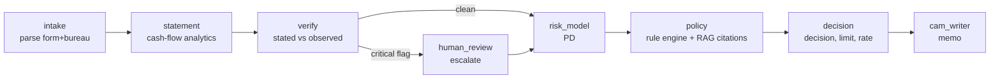

# Project 03 — Agentic Credit Underwriting (Retail / MSME loans)

| | |
|---|---|
| Domain | FinTech GenAI — credit appraisal automation |
| Difficulty / effort | ★★★★ · about 45–55 hours over 2 weeks |
| Repo name | `ampba-03-agentic-underwriting` |
| Python package (`PKG`) | `uw` |
| Data | UCI Statlog German Credit (real, 1,000 applicants) + synthetic documents. See [DATA.md](DATA.md) |
| Shared setup | [../00-COMMON-SETUP.md](../00-COMMON-SETUP.md) |
| Do first | Project 01 (you reuse its PD-model and cost-threshold ideas) |

---

## 1. What you are building

A credit officer spends about 45 minutes per file reading an application form, six months of bank statements and a bureau summary. You will build a **multi-step pipeline (a graph of "agents")** that reads the three documents and produces a **credit appraisal memo (CAM)** with a decision (APPROVE / REFER / DECLINE), a limit, a price and conditions. A human officer keeps final authority.

Each "agent" is a small, testable Python component; only two of them may use an LLM (intake cross-check and CAM prose), and **everything runs offline with a deterministic mock LLM** so tests need no API key.



**KPIs / targets (master plan):** decision agreement with ground truth ≥ 80%; cost-weighted error (a bad loan approved costs 5×, a good loan declined costs 1×) lower than the PD model alone; CAM generated in < 60 s; 100% of policy rules cited; inconsistency recall ≥ 85%; 0 hallucinated numbers in 200 mock CAMs.

> **Honest framing for the README.** The decision "ground truth" is the German Credit label (good/bad). The documents are synthetic and the misrepresentation rate is label-dependent *by design* (an assumption), so the harness measures whether the pipeline is wired correctly and what verification is worth under that assumption — not real-world underwriting accuracy.

## 2. Read first (design inspiration only)

| Repo | Look at |
|---|---|
| [anmolisb/CR](https://github.com/anmolisb/CR) | `agents/`, `orchestrator/`, `prompts/`, `evaluation/` folder layout |
| [anmolisb/Escalant_SurveyProgramming](https://github.com/anmolisb/Escalant_SurveyProgramming) | LangGraph multi-agent structure and the evaluation-harness discipline (milestones, metrics) |
| [Abhinav19-isb/credit-risk-scorecard](https://github.com/Abhinav19-isb/credit-risk-scorecard) | The PD-model half — see also Project 01 |
| LangGraph docs: https://langchain-ai.github.io/langgraph/ | `StateGraph`, nodes, conditional edges (page ✔ reachable 2026-10-13) |

## 3. Step 0 — project setup

```powershell
cd "C:\Users\11624\OneDrive - Indian School of Business\Documents\personal\isb_ampba\projects\03-agentic-credit-underwriting"
py -3.11 -m venv C:\venvs\ampba-03
C:\venvs\ampba-03\Scripts\Activate.ps1
python -m pip install --upgrade pip wheel
pip install -r requirements.in
$pkg = "uw"
mkdir config, data\raw, data\interim, data\processed, notebooks, "src\$pkg", "src\$pkg\agents", "src\$pkg\evaluation", analysis, outputs, figures, models, app, tests\fixtures, docs, .github\workflows
New-Item "src\$pkg\__init__.py", "src\$pkg\agents\__init__.py", "src\$pkg\evaluation\__init__.py", tests\__init__.py -ItemType File
git init
```
Then follow common setup §3–§8 (`.gitignore`, `pyproject.toml`, `config.py`, `tasks.py` with `PKG = "uw"`, CI, Dockerfile) and `pip install -e .`. Add `data/processed/docs.jsonl` and `truth.csv` to `.gitignore` (regenerable), but commit the 79 KB `german.data` copy to `tests/fixtures/` (CC BY 4.0; cite it).

Write `docs/PROBLEM_STATEMENT.md` (objective, KPIs above, constraints: human has final authority, no label in documents, SEX/foreign-worker never model inputs).

`config/config.yaml` (every assumption lives here):

```yaml
seed: 42
paths: {raw: data/raw, interim: data/interim, processed: data/processed, outputs: outputs, figures: figures, models: models}
data:
  uci_id: 144
  zip_url: https://archive.ics.uci.edu/static/public/144/statlog+german+credit+data.zip
  raw_file: data/raw/german.data
  holdout_n: 200                   # stratified hold-out that only the evaluation harness touches
money:
  dm_to_inr: 45                    # illustrative (assumption, not a market quote)
  emi_rate: 0.14                   # annual rate used to compute EMIs
docs:
  as_of: "2026-09-30"
  inject_rate_bad: 0.18            # P(misrepresentation | eventual default)  <- assumption, swept in M4
  inject_rate_good: 0.06           # P(misrepresentation | repaid)            overall ~ 9.6%
  type_probs: {income_inflation: 0.45, undisclosed_emi: 0.40, age_mismatch: 0.15}
costs:
  bad_approved: 5                  # official German Credit cost matrix
  good_declined: 1
  refer_cost: 0.25                 # officer time for one referred file, same units
  human_accuracy: 0.80             # assumed probability the reviewer decides correctly (swept in M4)
verify:
  income_ratio_flag: 1.15          # stated / observed income above this -> critical
  emi_gap_abs: 1000                # INR per month
  emi_gap_pct: 0.05                # of observed income
  age_gap_years: 3
policy:
  age_min: 21
  age_max: 65
  foir_max: 0.50
  foir_decline: 0.60
  min_income_inr: 12000
  max_unsecured_inr: 500000
  max_msme_inr: 800000
  max_bounces_6m: 2
  max_tenure_months: 60
  max_dpd_12m: 30
  decline_dpd: 90
  max_loan_to_annual_income: 1.0
decision:
  base_rate: 0.12
  refer_multiplier: 1.6            # PD in [t, 1.6*t] -> REFER ; above -> DECLINE (t = cost-optimal threshold)
  premium: {0.08: 0.02, 0.12: 0.035, 0.17: 0.05}   # PD upper bound -> premium; above the last bound -> 0.07
rag:
  backend: tfidf                   # tfidf | st (sentence-transformers + FAISS)
  top_k: 3
  st_model: sentence-transformers/all-MiniLM-L6-v2
llm:
  provider: mock                   # mock | groq | openai (env LLM_PROVIDER overrides)
```

## 4. Data (summary — see DATA.md)

Real: 1,000 German Credit applicants (700 good / 300 bad). Synthetic: for each applicant a 6-month bank statement CSV, an application text and a bureau text, plus a hidden `truth.csv`. Split: 800 development rows (train the PD model, set the threshold) and **200 stratified hold-out rows that only the evaluation harness touches**.

---

## 5. Milestones

### M1 — Data, codes, PD model, cost-optimal threshold (about 8 h)

**Goal:** the structured half works: decoded data, split, PD model, cost-optimal approve threshold.

1. Download the zip, inspect `german.doc` and `german.data` in a notebook. Confirm shape (1000 × 21), 300 bad.
2. Create `src/uw/codes.py` from DATA.md §2 and `src/uw/data.py`:

```python
"""Load UCI Statlog German Credit (id 144), add readable labels, make the dev / hold-out split."""
from __future__ import annotations
import io, zipfile
import pandas as pd, requests
from sklearn.model_selection import train_test_split
from .codes import CATEGORICAL, CODES, COLUMNS
from .config import ROOT, get_logger, load_config
log = get_logger(__name__)


def _from_zip(url):
    r = requests.get(url, headers={"User-Agent": "Mozilla/5.0"}, timeout=120); r.raise_for_status()
    with zipfile.ZipFile(io.BytesIO(r.content)) as z, z.open("german.data") as f:
        return pd.read_csv(f, sep=r"\s+", header=None, names=COLUMNS)


def _from_ucimlrepo(uci_id):
    from ucimlrepo import fetch_ucirepo
    d = fetch_ucirepo(id=uci_id)
    df = d.data.features.copy()
    df.columns = COLUMNS[:-1]                      # arrives as Attribute1..Attribute20; verify the order against german.data
    df["label"] = d.data.targets.iloc[:, 0].to_numpy()
    return df


def load_german(cfg=None) -> pd.DataFrame:
    cfg = cfg or load_config()
    path = ROOT / cfg["data"]["raw_file"]
    if path.exists():
        df = pd.read_csv(path, sep=r"\s+", header=None, names=COLUMNS)
    else:
        try:
            df = _from_zip(cfg["data"]["zip_url"])
        except Exception as e:
            log.warning("zip download failed (%s); trying ucimlrepo", e)
            df = _from_ucimlrepo(cfg["data"]["uci_id"])
        path.parent.mkdir(parents=True, exist_ok=True)
        df.to_csv(path, sep=" ", header=False, index=False)
    df["bad"] = (df["label"] == 2).astype(int)
    return df


def decode(df):
    out = df.copy()
    for c in CATEGORICAL:
        out[f"{c}_txt"] = out[c].map(CODES[c])
    return out


def split_holdout(df, cfg=None):
    """`dev` (800) for modelling; `holdout` (200) only for the evaluation harness."""
    cfg = cfg or load_config()
    dev, hold = train_test_split(df, test_size=cfg["data"]["holdout_n"], stratify=df["bad"], random_state=cfg["seed"])
    return dev.sort_index(), hold.sort_index()
```

3. EDA notebook (`01_eda.ipynb`): bad rate by checking status, credit history, purpose, duration; amount distribution. Note `credit_amount` is in DM (1994).
4. **`src/uw/agents/risk_model.py`** — the PD model. Two candidates (regularised logistic regression, small XGBoost) in a `Pipeline` with one-hot + scaling; 5-fold stratified CV on the 800 dev rows; champion = best CV AUC; **cost-optimal threshold** from out-of-fold predictions (approve if PD ≤ t). Exclude `personal_status_sex` and `foreign_worker` from the features.

```python
FEATURES = MODEL_CATEGORICAL + MODEL_NUMERIC

def training_frame(df, fx):
    X = df[FEATURES].copy(); X["credit_amount"] = X["credit_amount"] * fx      # INR
    return X

def best_threshold(y, p, cost_bad=5.0, cost_good=1.0, grid=None):
    grid = np.arange(0.05, 0.60, 0.005) if grid is None else grid
    y, p = np.asarray(y), np.asarray(p)
    costs = [cost_bad * ((p <= t) & (y == 1)).sum() + cost_good * ((p > t) & (y == 0)).sum() for t in grid]
    i = int(np.argmin(costs)); return float(grid[i]), float(costs[i])

def train(dev, cfg):
    seed, fx = cfg["seed"], cfg["money"]["dm_to_inr"]
    X, y = training_frame(dev, fx), dev["bad"].to_numpy()
    cv = StratifiedKFold(5, shuffle=True, random_state=seed)
    results = {}
    for name, pipe in _candidates(seed).items():              # {"logreg": Pipeline(...), "xgb": Pipeline(...)}
        oof = cross_val_predict(pipe, X, y, cv=cv, method="predict_proba")[:, 1]
        results[name] = {"oof": oof, "cv_auc": float(roc_auc_score(y, oof))}
    champion = max(results, key=lambda k: results[k]["cv_auc"])
    t, cost = best_threshold(y, results[champion]["oof"], cfg["costs"]["bad_approved"], cfg["costs"]["good_declined"])
    model = _candidates(seed)[champion].fit(X, y)
    return {"model": model, "name": champion, "threshold": t, "oof_cost": cost,
            "cv_auc": {k: v["cv_auc"] for k, v in results.items()},
            "theory_threshold": cfg["costs"]["good_declined"] / (cfg["costs"]["good_declined"] + cfg["costs"]["bad_approved"])}
```
   with
```python
def _prep():
    return ColumnTransformer([("cat", OneHotEncoder(handle_unknown="ignore"), MODEL_CATEGORICAL),
                              ("num", StandardScaler(), MODEL_NUMERIC)])
def _candidates(seed):
    return {"logreg": Pipeline([("prep", _prep()), ("clf", LogisticRegression(C=0.3, max_iter=2000, random_state=seed))]),
            "xgb": Pipeline([("prep", _prep()), ("clf", XGBClassifier(n_estimators=250, max_depth=3, learning_rate=0.04,
                     subsample=0.8, colsample_bytree=0.8, min_child_weight=5, reg_lambda=5.0, tree_method="hist",
                     n_jobs=1, random_state=seed))])}
```
   **Sanity:** CV AUC on German Credit is typically around 0.75–0.80. The theoretical threshold for a *calibrated* PD with a 5:1 cost matrix is 1/6 ≈ 0.167; your empirical threshold on out-of-fold PDs should be in that neighbourhood (a grid minimum at the edge of 0.05–0.60 means a bug). Keep the hold-out untouched.

5. Write `models/pd_model.joblib` with `joblib.dump(bundle, ...)`.

**Pitfalls:** training on all 1,000 rows (then the hold-out is contaminated); forgetting the INR conversion in *both* training and inference; 5-fold CV on 800 rows gives noisy AUC (±0.03) — never choose between models on a 0.005 difference.

```powershell
git add -A; git commit -m "M1: German Credit loader+codes, PD model (CV AUC <x>), 5:1 cost threshold <t>"
```

---

### M2 — Synthetic documents, statement and verify agents (about 12 h)

**Goal:** generate three documents per applicant, parse them, compute cash-flow facts, and catch injected inconsistencies.

1. **State model (`src/uw/state.py`)** — typed state that flows through the graph (pydantic). Fields grow as agents run:

```python
class Extracted(BaseModel):                 # parsed from application + bureau; codes are German Credit codes
    applicant_id: str; segment: str; age: int; kyc_age: int
    personal_status_sex: str; housing: str; residence_since: int; job: str; employment_since: str
    n_dependents: int; telephone: str; foreign_worker: str; checking_status: str; savings: str
    property: str; other_debtors: str; other_installment_plans: str; n_existing_credits: int
    purpose: str; credit_history: str; credit_amount_inr: float; duration_months: int
    stated_income: float; declared_emi: float; installment_rate: int
    bureau_score: int; max_dpd_12m: int; active_accounts: int; bureau_obligations: float; enquiries_6m: int
    method: str = "regex"

class StatementFacts(BaseModel):
    months_seen: int; avg_monthly_income: float; observed_emi: float; bounce_count: int; avg_balance: float; min_balance: float

class Ratios(BaseModel):
    proposed_emi: float; foir_stated: float; foir_observed: float

class Flag(BaseModel):
    code: str; severity: Literal["critical", "warn"]; message: str

class RuleHit(BaseModel):
    rule_id: str; severity: Literal["DECLINE", "REFER", "ADJUST", "INFO"]; message: str; citation: str = ""

class UnderwritingState(BaseModel):
    applicant_id: str
    docs: dict[str, str] = Field(default_factory=dict)            # application / bureau / statement
    extracted: Optional[Extracted] = None; statement: Optional[StatementFacts] = None; ratios: Optional[Ratios] = None
    pd: Optional[float] = None; pd_model: str = ""
    flags: list[Flag] = Field(default_factory=list); rule_hits: list[RuleHit] = Field(default_factory=list)
    decision: Optional[Literal["APPROVE", "REFER", "DECLINE"]] = None
    decision_reasons: list[str] = Field(default_factory=list)
    limit_inr: Optional[float] = None; rate: Optional[float] = None; conditions: list[str] = Field(default_factory=list)
    escalated: bool = False; cam: Optional[str] = None; trace: list[str] = Field(default_factory=list)

    @property
    def critical_flags(self): return [f for f in self.flags if f.severity == "critical"]
```
   (Write each field on its own line in your file; they are shortened here.)

2. **`src/uw/docs_gen.py`** — the document generator. Design: per applicant a seeded RNG (`default_rng(seed*100_003 + idx)`); back out income from the EMI and the instalment-rate band; derive existing EMIs from `n_existing_credits` and `other_installment_plans`; inject misrepresentation with a label-dependent probability; build the statement, the application text and the bureau text; return a hidden `truth` dict.

```python
def emi(principal, months, annual_rate):
    r = annual_rate / 12
    return principal * r * (1 + r) ** months / ((1 + r) ** months - 1)

def make_docs(row, idx, cfg):
    rng = np.random.default_rng(cfg["seed"] * 100_003 + idx)
    dc, fx = cfg["docs"], cfg["money"]["dm_to_inr"]
    aid, bad = f"UW-{idx:04d}", int(row["label"] == 2)
    amount, months = float(row["credit_amount"]) * fx, int(row["duration_months"])
    new_emi = emi(amount, months, cfg["money"]["emi_rate"])
    band = int(row["installment_rate"])
    income = max(15_000.0, round(new_emi / INSTALLMENT_BAND_RATIO[band], -2))
    n_ex, plans = int(row["n_existing_credits"]), row["other_installment_plans"]
    frac = 0.04 * (n_ex - 1) + {"A141": 0.10, "A142": 0.05, "A143": 0.0}[plans]
    existing_emi = round(income * frac * rng.uniform(0.8, 1.2), -1) if frac > 0 else 0.0
    n_loans = max(1 if existing_emi > 0 else 0, n_ex - 1 + (plans != "A143"))
    msme, true_age = row["purpose"] == "A49", int(row["age"])

    # ---- misrepresentation (probability depends on the label: an ASSUMPTION, swept in M4) ----
    p_inj = dc["inject_rate_bad"] if bad else dc["inject_rate_good"]
    inj = None
    if rng.random() < p_inj:
        t = dc["type_probs"]
        inj = rng.choice(list(t), p=np.array(list(t.values())) / sum(t.values()))
    stated_income, declared_emi, app_age, hidden_emi = income, existing_emi, true_age, 0.0
    if inj == "income_inflation":
        stated_income = round(income * rng.uniform(1.2, 1.8), -2)
    elif inj == "undisclosed_emi":
        hidden_emi = round(income * rng.uniform(0.10, 0.30), -1)          # in the statement, not on the form
    elif inj == "age_mismatch":
        step = int(rng.integers(3, 9))
        app_age = true_age - step if true_age > 55 else true_age + step if true_age < 25 else true_age + step * int(rng.choice([-1, 1]))
        app_age = int(max(19, app_age))
    app_band = band if inj != "income_inflation" else ratio_to_band(new_emi / stated_income)
    # ... statement rows, application text, bureau text: see below
```
   The statement: for each of the 6 months (`_months(as_of)`), add a salary credit (`NEFT CR SALARY <employer>`; for MSME 3–5 `UPI CR CUSTOMER RECEIPT` credits), an occasional `UPI CR REFUND` and `TRF FROM OWN A/C` (these must **not** count as income), one `NACH DR <lender> EMI` debit per lender for `existing_emi + hidden_emi` split across lenders, rent if `housing == A151`, a Dirichlet-split `POS/UPI DR SPEND`, and — with Poisson(λ) bounces, λ from `checking_status` (+0.5 if history A33, +0.3 if A34) — an `ECS RETURN CHG INSUFFICIENT FUNDS` debit. Opening balance by `savings` band. `balance = open + cumsum(credit) − cumsum(debit)`. Write with `DataFrame.to_csv` into a string (`date, narration, debit, credit, balance`).
   The application text is `Key: value` lines (`Applicant ID`, `Segment`, `Age`, `Personal status`, `Housing`, …, `Loan amount requested (INR)`, `Tenure (months)`, `Stated net monthly income (INR)`, `Declared existing monthly EMIs (INR)`, `EMI-to-income band (1-4)`), using `CODES[col][code]` for readable values. The bureau text has `Age per KYC` (the **true** age), `Bureau score`, `Credit history`, `Active loan accounts`, `Total monthly obligations per bureau (INR)`, `Maximum days past due (last 12 months)`, `Enquiries (last 6 months)` — DPD drawn from the credit-history code.
   **The label never appears in any document.** `generate_all(df)` writes `data/processed/docs.jsonl` and `truth.csv` (truth: `bad, injected, inject_type, true_income, stated_income, hidden_emi, true_bounces, true_existing_emi, true_age, stated_age`).

   *Write the generator yourself in this order and print one applicant's three documents after each step so you can eyeball them.* A full reference implementation is about 200 lines; the formulas above are everything non-obvious.

3. **`agents/intake.py`** — a regex key/value parser:
```python
LINE = re.compile(r"^\s*([^:\n]+?)\s*:\s*(.+?)\s*$", re.M)
def _kv(text): return {k.strip(): v.strip() for k, v in LINE.findall(text)}
def _code(col, label): return REVERSE[col][label]        # raise a clear error for an unknown label
def parse_documents(application, bureau) -> Extracted:
    a, b = _kv(application), _kv(bureau)
    return Extracted(applicant_id=a["Applicant ID"], segment=a["Segment"], age=int(a["Age"]), kyc_age=int(b["Age per KYC"]),
                     housing=_code("housing", a["Housing"]), ...)       # one line per field
```
   The node `run(state, llm)` parses with regex, and **only if `llm.provider != "mock"`** asks the LLM to extract the same schema and records how many fields differ (a cross-check; an LLM failure must never break intake).

4. **`agents/statement.py`** — pure pandas cash-flow analytics. Classification by narration: income = credits not matching `REFUND|OWN A/C|SELF|REVERSAL`; EMI = debits matching `EMI|NACH|ECS` excluding bounces; bounce = `RETURN|BOUNCE|INSUFF`. Returns `StatementFacts`; also compute `Ratios`: `proposed_emi = emi(amount, tenure, rate)`, `foir_stated = (declared_emi + proposed_emi)/stated_income`, `foir_observed = (observed_emi + proposed_emi)/observed_income`.
```python
def analyse_statement(csv_text):
    df = pd.read_csv(io.StringIO(csv_text), parse_dates=["date"])
    df["month"] = df["date"].dt.to_period("M"); narr = df["narration"].astype(str)
    is_bounce = narr.str.contains(BOUNCE); is_emi = narr.str.contains(EMI_LINE) & ~is_bounce
    is_income = (df["credit"] > 0) & ~narr.str.contains(NOT_INCOME); months = df["month"].nunique()
    return StatementFacts(months_seen=int(months), avg_monthly_income=float(df.loc[is_income, "credit"].sum() / months),
        observed_emi=float(df.loc[is_emi, "debit"].sum() / months), bounce_count=int(is_bounce.sum()),
        avg_balance=float(df["balance"].mean()), min_balance=float(df["balance"].min()))
```
   (`NOT_INCOME`, `BOUNCE`, `EMI_LINE` are `re.compile(..., re.I)` constants.)

5. **`agents/verify.py`** — thresholds from `config.verify`:
```python
def find_flags(ex, sf, vcfg):
    flags = []
    ratio = ex.stated_income / max(sf.avg_monthly_income, 1.0)
    if ratio > vcfg["income_ratio_flag"]:
        flags.append(Flag(code="INCOME_MISMATCH", severity="critical", message=f"Stated income is {ratio:.2f}x the income seen in bank credits (stated {ex.stated_income:,.0f}, observed {sf.avg_monthly_income:,.0f})"))
    gap = sf.observed_emi - ex.declared_emi
    if gap > max(vcfg["emi_gap_abs"], vcfg["emi_gap_pct"] * sf.avg_monthly_income):
        flags.append(Flag(code="UNDISCLOSED_EMI", severity="critical", message=f"Statement shows EMIs of {sf.observed_emi:,.0f}/month but only {ex.declared_emi:,.0f} declared (gap {gap:,.0f})"))
    if abs(ex.age - ex.kyc_age) >= vcfg["age_gap_years"]:
        flags.append(Flag(code="AGE_MISMATCH", severity="critical", message=f"Application age {ex.age} differs from KYC age {ex.kyc_age}"))
    return flags

def route_after_verify(state):               # conditional edge used by the graph
    return "human_review" if state.critical_flags else "risk_model"
```

6. **Measure verify against the hidden truth** (notebook, all 1,000 applicants): recall of `injected` applicants (target ≥ 85%) and the false-positive rate on clean ones. Expect recall close to 1 for income inflation and undisclosed EMI; **age mismatch is the hardest** — an application age shifted by < 3 years is not flagged by design (the threshold is 3 years while the generator shifts by 3–8). If recall is below target, check your income classification first (refunds/self-transfers counted as income is the usual bug).

**Pitfalls:** counting `TRF FROM OWN A/C` as income inflates observed income and hides income inflation; counting the ECS bounce *charge* as an EMI; regex failing on thousands separators; documents accidentally containing the label (write `test_docs_do_not_leak_the_label`).

```powershell
git add -A; git commit -m "M2: synthetic docs generator, intake/statement/verify agents; inconsistency recall <r>"
```

---

### M3 — Policy RAG, decision, graph (about 12 h) → **Mid-review**

**Goal:** 15-rule policy with cited passages, decision logic, and the LangGraph graph running end-to-end offline.

1. **Write `config/credit_policy.md`** — 15 rules, each as `### P01 - Title` followed by a `Severity:` line and a plain-English paragraph. Rules (illustrative, written for this project): P01 age 21–65 (DECLINE); P02 FOIR ≤ 50% (ADJUST 50–60%, DECLINE > 60%); P03 employment/business vintage (DECLINE unemployed, REFER below minimum; MSME needs 4 years); P04 unsecured cap ₹5 lakh retail / ₹8 lakh MSME (ADJUST); P05 > 2 bounces in 6 months (DECLINE); P06 average balance ≥ proposed EMI (REFER); P07 bureau DPD ≥ 90 DECLINE, 31–89 REFER; P08 tenure ≤ 60 months (REFER); P09 stated income > 115% of observed (REFER); P10 undisclosed EMIs (REFER); P11 KYC age mismatch (REFER); P12 minimum income ₹12,000 (DECLINE); P13 loan ≤ 100% of annual income (REFER); P14 purpose "others" needs end-use documents (REFER); P15 model PD cut-offs and pricing (DECLINE above `1.6 × t`, REFER between `t` and `1.6 t`). State at the top that it is an assumption set, **not any lender's actual policy**.

2. **`agents/policy.py`** — two parts, deliberately separated:
   - **Rule engine** (deterministic `evaluate_rules(facts, pcfg, pd, t_approve, refer_mult)` returning `[(rule_id, severity, message)]`) — rules are code, so they are testable. Facts come from `build_facts(state, verified)`; `verified=True` uses what the documents show (observed income, observed EMIs, KYC age), `False` uses what the applicant stated (needed for the "PD + policy" evaluation arm).
   - **Retrieval** (`PolicyIndex`) — splits the markdown into one chunk per rule (`re.compile(r"^### (P\d{2}) - (.+)$", re.M).split(md)`), TF-IDF (`TfidfVectorizer(ngram_range=(1,2), sublinear_tf=True, stop_words="english")`) with cosine search; optional backend `st` = `sentence-transformers` + FAISS `IndexFlatIP`. Every rule hit gets a **citation = the retrieved policy passage**; if the top-1 retrieval is a different rule than the one that fired, fall back to that rule's exact text (the harness counts retrieval misses).

```python
def cite(index, rule_id, title_hint, message):
    top = index.search(f"{title_hint}. {message}", k=1)[0][0]
    if top["id"] != rule_id:
        top = next(c for c in index.chunks if c["id"] == rule_id)
    return top["text"]
```
   Rule logic example (write all 15 in the same style):
```python
if not pcfg["age_min"] <= f["age"] <= pcfg["age_max"]:
    add("P01", "DECLINE", f"Age {f['age']} is outside {pcfg['age_min']}-{pcfg['age_max']}")
if f["foir"] > pcfg["foir_decline"]:   add("P02", "DECLINE", f"FOIR {f['foir']:.1%} exceeds {pcfg['foir_decline']:.0%}")
elif f["foir"] > pcfg["foir_max"]:     add("P02", "ADJUST", f"FOIR {f['foir']:.1%} exceeds {pcfg['foir_max']:.0%}; limit reduced to fit")
if "INCOME_MISMATCH" in f["flags"]:    add("P09", "REFER", "Stated income is not supported by bank credits")
if pd_ is not None and t_approve is not None:
    if pd_ > refer_mult * t_approve:   add("P15", "DECLINE", f"PD {pd_:.1%} is above the decline cut-off {refer_mult * t_approve:.1%}")
    elif pd_ > t_approve:              add("P15", "REFER", f"PD {pd_:.1%} is between the approve cut-off {t_approve:.1%} and {refer_mult * t_approve:.1%}")
```
   Design note to write in your README: *rules are deterministic code, retrieval supplies the citation text.* An LLM never decides a rule; it can only summarise.

3. **`agents/decision.py`** — precedence DECLINE > REFER (or escalated) > APPROVE; for APPROVE/REFER compute an indicative limit and rate: limit = requested, capped under P04; reduced under P02-ADJUST to the amount whose EMI fits `foir_max × observed income − observed EMIs` (annuity formula `max_emi × ((1+r)^n − 1) / (r (1+r)^n)`); rate = base rate + premium by PD band (`premium` in config); conditions (guarantor if PD > 12% and no other debtor, NACH mandate, "terms indicative until officer clears referral" if REFER).

4. **`graph.py`** — LangGraph. Dependencies are injected so tests can pass a mock LLM and a small model:

```python
from langgraph.graph import END, START, StateGraph

def human_review_node(state):
    codes = ", ".join(f.code for f in state.critical_flags)
    return {"escalated": True, "trace": state.trace + [f"human_review: escalated for officer review ({codes})"]}

def build_graph(bundle, index, cfg, llm):
    pcfg, dcfg, vcfg = cfg["policy"], cfg["decision"], cfg["verify"]
    emi_rate, t = cfg["money"]["emi_rate"], bundle["threshold"]
    g = StateGraph(UnderwritingState)
    g.add_node("intake", lambda s: intake.run(s, llm))
    g.add_node("statement", lambda s: statement.run(s, emi_rate))
    g.add_node("verify", lambda s: verify.run(s, vcfg))
    g.add_node("human_review", human_review_node)
    g.add_node("risk_model", lambda s: risk_model.run(s, bundle))
    g.add_node("policy", lambda s: policy.run(s, index, pcfg, t, dcfg["refer_multiplier"], verified=True))
    g.add_node("decision", lambda s: decision.run(s, dcfg, pcfg, emi_rate))
    g.add_node("cam_writer", lambda s: cam_writer.run(s, llm))
    g.add_edge(START, "intake"); g.add_edge("intake", "statement"); g.add_edge("statement", "verify")
    g.add_conditional_edges("verify", verify.route_after_verify, {"human_review": "human_review", "risk_model": "risk_model"})
    g.add_edge("human_review", "risk_model")          # analysis continues so the officer gets a complete CAM
    g.add_edge("risk_model", "policy"); g.add_edge("policy", "decision"); g.add_edge("decision", "cam_writer"); g.add_edge("cam_writer", END)
    return g.compile()

def underwrite(graph, applicant_id, docs):
    out = graph.invoke(UnderwritingState(applicant_id=applicant_id, docs=docs))
    return out if isinstance(out, UnderwritingState) else UnderwritingState(**out)
```
   Each node returns a **partial state update** (a dict) and appends a line to `trace` — that line is what the app shows as the "live agent trace". Check the installed LangGraph API with `help(StateGraph.add_conditional_edges)`; the pydantic model as graph state works in current versions, and `invoke` may return either the model or a dict (hence the last line of `underwrite`).

5. Risk-model node: `risk_model.run(state, bundle)` builds a one-row DataFrame from `Extracted` (`extracted_to_frame`: model categorical columns + numeric columns, amounts already in INR) and returns `pd`, `pd_model`. Note that the model sees the **application as stated**; verification flags are handled by the policy/decision layer.

6. Run the graph on 20 hold-out applicants in a notebook; print `state.trace`, `state.decision`, one CAM. Then build the **mid-review deck** (§9).

**Pitfalls:** policy rule that fires from stated rather than verified facts in the main path (use `verified=True`); LangGraph node returning the full state instead of a partial dict (works, but you then overwrite `trace`); retrieval returning another rule for short messages (add the title to the query as above).

```powershell
git add -A; git commit -m "M3: 15-rule policy + TF-IDF retrieval citations, decision agent, LangGraph graph (mock LLM)"
```

---

### M4 — CAM writer, faithfulness check, evaluation harness (about 10 h)

**Goal:** CAMs with zero invented numbers; a harness that compares three arms on the 200 hold-out applicants.

1. **`llm.py`** — wrapper with provider from `LLM_PROVIDER` ∈ {`mock`, `groq`, `openai`}, default mock. Groq exposes an OpenAI-compatible endpoint, so one client works for both (`pip install openai`; `base_url="https://api.groq.com/openai/v1"`, key from `GROQ_API_KEY`; models from `GROQ_MODEL` / `OPENAI_MODEL`). Retry 3× with exponential back-off; append token usage to `outputs/llm_usage.csv`; `temperature=0`. For structured output request `response_format={"type": "json_object"}` and validate with `schema.model_validate_json`. Confirm current model names and free-tier limits in the provider consoles before use (they change).

```python
class LLM:
    def __init__(self, provider=None):
        self.provider = (provider or os.getenv("LLM_PROVIDER", "mock")).lower()
        if self.provider == "groq":     self.model = os.getenv("GROQ_MODEL", "llama-3.3-70b-versatile")   # check the current name
        elif self.provider == "openai": self.model = os.getenv("OPENAI_MODEL", "gpt-4o-mini")
        elif self.provider != "mock":   raise ValueError(...)
    def complete(self, system, user, schema=None):
        if self.provider == "mock":
            facts = json.loads(user); return facts["template"].format(**facts["values"])     # deterministic stand-in
        ...
```
   The mock works because the CAM writer always sends a JSON `{"template": ..., "values": ...}` block: the mock just fills the template, a real LLM rewrites it as prose.

2. **`agents/cam_writer.py`** — the **numbers come from the state; the LLM only writes the prose around them.** Sections: 1 Summary (LLM prose from template+values), 2 Applicant, 3 Financials (a stated-vs-verified table: income, EMIs, FOIR), 4 Risks (LLM prose + a bullet per flag), 5 Mitigants (guarantor, real estate, zero bounces), 6 Policy compliance (each hit with its **cited passage** as a blockquote), 7 Decision and conditions, and the line "Final approval rests with a human credit officer." Use the system prompt: *"Rewrite the draft paragraph in clear, formal English. Use ONLY the numbers in `values`; never add, round differently or invent numbers."*

3. **`evaluation/faithfulness.py`** — regex every number token in the CAM and require it to match a value in the state (as-is, or ×100 for percentages) within a rounding tolerance; numbers quoted from a cited policy passage or a flag message are allowed; ignore applicant IDs (`UW-\d+`), rule IDs (`P\d{2}`), dates and heading numbers.

```python
NUM = re.compile(r"(?<![\w.])-?\d[\d,]*\.?\d*")
def unsupported_numbers(cam, state):
    text = cam
    for p in STRIP: text = p.sub(" ", text)                     # ids, dates, numbered headings
    allowed = allowed_numbers(state)                            # all numeric leaves of state.model_dump() (except docs/cam/trace) + numbers in citations and flag messages + {6, 12}
    bad = []
    for tok in NUM.findall(text):
        raw = tok.replace(",", "").rstrip(".")
        if not raw or raw == "-": continue
        val = float(raw); dec = len(raw.split(".")[1]) if "." in raw else 0
        tol = 0.5 * 10 ** (-dec) + 1e-9
        if not any(abs(val - a * s) <= tol for a in allowed for s in (1.0, 100.0)): bad.append(tok)
    return bad
```
   Write a test that **injects an invented number** into a CAM and asserts it is caught (a checker that cannot fail is worthless).

4. **`evaluation/harness.py`** — run the 200 hold-out applicants through three arms and compare on cost-weighted loss.

   | Arm | What it does |
   |---|---|
   | `pd_only` | approve if PD ≤ threshold, else decline |
   | `pd_policy` | PD + the policy rules evaluated on what the applicant **stated** (no cross-verification) |
   | `agentic` | the full graph (verification + policy + decision) |

   **Loss model (an assumption — put it in the README):** APPROVE of a bad loan costs 5, DECLINE of a good loan costs 1; a REFER costs `refer_cost = 0.25` (officer time) plus `(1 − human_accuracy) × (cost of a wrong human call)`, with `human_accuracy = 0.8`. REFERs are the price of verification, so report **break-even human accuracy** (the reviewer accuracy at which the agentic arm stops beating `pd_only`) and the loss when REFER is treated as DECLINE (the conservative bound).

```python
def case_loss(decision, bad, ccfg, human_accuracy=None, refer_cost=None):
    h = ccfg["human_accuracy"] if human_accuracy is None else human_accuracy
    rc = ccfg["refer_cost"] if refer_cost is None else refer_cost
    if decision == "APPROVE": return ccfg["bad_approved"] if bad else 0.0
    if decision == "DECLINE": return 0.0 if bad else ccfg["good_declined"]
    wrong = ccfg["bad_approved"] if bad else ccfg["good_declined"]
    return rc + (1 - h) * wrong
```
   Per arm report: refer rate, approve rate, accuracy on auto-decided cases (APPROVE = predicts good, DECLINE = predicts bad), expected agreement (`(correct auto + human_accuracy × refers) / n` — target ≥ 80%), total and per-case loss. Also report: inconsistency recall and false-positive rate on the hold-out, hallucinated numbers (total and number of CAMs affected), rule-citation coverage (rule ID and passage both present in the CAM), retrieval top-1 hit rate, CAM seconds (mean, max; target < 60 s). Save `outputs/harness_metrics.json` and `outputs/harness_cases.csv`.

   Because the misrepresentation rates are assumptions, add a **sensitivity sweep** over `inject_rate_bad ∈ {0.06, 0.12, 0.18, 0.30}` × `human_accuracy ∈ {0.6, 0.7, 0.8, 0.9}`, regenerate documents for each, and show where the agentic arm wins. If it does not win everywhere, say where it does not — that is a finding, not a failure.

5. Run on 200 CAMs in mock mode (seconds), then — optionally — 20 cases with a real LLM (`$env:LLM_PROVIDER="groq"; $env:GROQ_API_KEY="..."`) and report the hallucination rate separately for the real model. Keys go in environment variables, never in files.

**Pitfalls:** using the hold-out to set the threshold (use dev OOF only); a faithfulness checker whose tolerance is so loose everything passes; mock CAM text containing numbers not in the state (it fails the check — good, fix the template).

```powershell
git add -A; git commit -m "M4: CAM writer, faithfulness check, 3-arm harness (agentic loss <x> vs pd-only <y>)"
```

---

### M5 — API, app, memo, CI (about 8 h) → **Final review**

1. **`api.py` (FastAPI)** — `GET /health`, `POST /underwrite` accepting either `applicant_id` or the three raw documents; returns decision, PD, limit, rate, flags, rule hits, conditions, trace and the CAM. Build the graph once with `functools.lru_cache`.
```powershell
uvicorn src.uw.api:app --reload      # then open http://127.0.0.1:8000/docs
```
   Test with FastAPI's `TestClient` (needs `httpx`).
2. **`app/streamlit_app.py`** — pick or upload an applicant → **live agent trace** (print `state.trace` lines) → CAM (markdown) → **approve / override with a reason**, logged to `outputs/overrides.csv` (`ts, applicant_id, agent_decision, officer_decision, reason`). This log is the dataset for later retraining.
3. Tests (§7); `ruff check .`; CI.
4. README (architecture diagram, results table for three arms, KPIs vs targets, limitations), `docs/DECISION_MEMO.md`, `docs/MODEL_CARD.md`, optional `docs/SIMULATOR.md` describing the document generator and its assumptions.
5. Deploy the app with `LLM_PROVIDER=mock` (public demo needs no key).

```powershell
git add -A; git commit -m "M5: FastAPI + Streamlit app with override log, tests, CI, memo and model card"
```

---

## 6. Business layer — decision memo (numbers from `outputs/harness_metrics.json`)

```markdown
# Decision memo — Agentic appraisal assistant for retail/MSME loans
**Decision requested:** Pilot the assistant as a first-pass appraiser with human sign-off.
**Recommendation:** Use `agentic` mode; auto-decide only clear approvals/declines and route {{refer_rate}} of files to officers.
**Impact (200 hold-out applicants; loss units: bad approved = 5, good declined = 1):**
- Cost-weighted loss per case: PD-only {{loss_pd_only}} · PD+policy {{loss_pd_policy}} · agentic {{loss_agentic}}.
- Expected decision agreement {{agreement}} (target 80%); inconsistency recall {{recall}} with false-positive rate {{fpr}}.
- Officer time: {{n_refer}} of 200 files need review; if a manual file takes 45 minutes and the assistant prepares the CAM, review time per referred file falls to <assumption> minutes — state the assumption.
**Evidence:** hallucinated numbers {{halluc}} in 200 mock CAMs; rule-citation coverage {{citation_cov}}; CAM time {{secs_mean}} s mean.
**Risks & limitations:** documents are synthetic and misrepresentation rates are assumptions (swept: result holds for {{sweep_summary}}); German Credit is 1994 data with a 1,000-row sample; loss of REFER is an assumed human-accuracy model (break-even {{breakeven_h}}); the policy is illustrative.
**Next steps:** shadow-run on real files with officer overrides logged; retrain on the override log; add real OCR for statements.
```

## 7. Tests (≥ 10; all offline, mock LLM)

| Test | Asserts |
|---|---|
| `test_codes_cover_every_value_in_the_data` | Every code in `german.data` exists in `CODES`; labels unique per column |
| `test_docs_are_deterministic` | `make_docs` twice for one applicant gives identical text |
| `test_docs_do_not_leak_the_label` | No document contains the label or the word "bad"/"good" as a status, for all 1,000 applicants |
| `test_injection_rate_and_label_dependence` | Overall injection ≈ 9.6% (±2 pp); rate among bad > rate among good |
| `test_intake_round_trip` | `parse_documents` recovers amount, tenure, age, codes of the source row |
| `test_statement_agent_recovers_clean_applicants` | For non-injected applicants, observed income within 5% of true income and observed EMI within ₹100 of true |
| `test_inconsistency_recall_and_false_positive_rate` | Recall ≥ 0.85 on injected, FPR < 0.05 on clean |
| `test_clean_applicant_fires_no_rule` | A hand-built clean fact set fires no rule |
| `test_each_policy_rule_fires` | Parametrised: one crafted input per rule P01…P15 fires exactly that rule/severity |
| `test_pd_cutoff_rule_p15` | PD just above `t` → REFER; above `1.6 t` → DECLINE |
| `test_policy_has_fifteen_rules_and_retrieval_finds_each` | 15 chunks parsed; top-1 retrieval of each rule's title returns that rule |
| `test_decision_precedence` | DECLINE hit beats REFER hit beats APPROVE |
| `test_pricing_rises_with_pd_and_limit_is_adjusted` | Rate non-decreasing in PD; P04 caps the limit; P02-ADJUST reduces it |
| `test_best_threshold_matches_cost_ratio_for_calibrated_pd` | Simulated calibrated PDs → threshold within 0.03 of 1/6 |
| `test_graph_runs_end_to_end_in_mock_mode` | Decision is valid, CAM exists, trace starts intake→statement→verify and ends cam_writer |
| `test_critical_flag_routes_through_human_review` | An income-inflation case sets `escalated` and is never auto-approved |
| `test_every_rule_hit_is_cited_in_the_cam` | For 60 applicants every hit's ID and citation text appear in the CAM |
| `test_no_hallucinated_numbers_in_mock_cams` | `unsupported_numbers` is empty for 80 applicants |
| `test_faithfulness_check_catches_an_invented_number` | Appending "₹9,99,999" to a CAM makes the check non-empty |
| `test_cost_matrix_and_refer_loss` | `case_loss` values for APPROVE/DECLINE/REFER on good and bad |
| `test_mock_llm_is_deterministic` | Same input → same output |
| `test_api_underwrite` | `TestClient` POST returns 200 with a decision for a known applicant and 404 for an unknown one |

## 8. Acceptance checklist

- [ ] Graph runs end-to-end in mock mode in tests.
- [ ] Full agentic cost-weighted loss < PD-only loss on the 200 hold-out applicants (state the human-accuracy assumption; report break-even).
- [ ] Inconsistency recall ≥ 85% on injected cases (per type reported).
- [ ] 0 hallucinated numbers in 200 mock CAMs; hallucination rate reported for a real LLM sample.
- [ ] Every policy hit cited in the CAM (100% coverage).
- [ ] CAM time < 60 s.
- [ ] Override log written by the app.
- [ ] README discloses that documents and misrepresentation rates are synthetic assumptions.

## 9. Review slide outlines

**Mid-review (after M3):** 1 Problem: 45-minute files · 2 Architecture (graph diagram) · 3 Data: German Credit + synthetic documents (why synthetic) · 4 PD model and 5:1 cost threshold · 5 Document generator and injected cases · 6 Statement and verify agents with recall · 7 Policy: 15 rules, rules-as-code + cited retrieval · 8 Decision logic and pricing · 9 Live trace of one applicant · 10 Evaluation plan, risks.

**Final review (after M5):** 1 Recap · 2 Three-arm comparison (loss per case) · 3 Where verification pays (by injection type) · 4 Sensitivity to the injection-rate and human-accuracy assumptions · 5 Faithfulness: 0 invented numbers, how it is checked · 6 Real-LLM sample: cost, latency, hallucination rate · 7 Human-in-the-loop and override log · 8 API + app demo · 9 Limitations (synthetic documents, 1994 data) · 10 Recommendation and pilot design.

## 10. Stretch goals and interview talking points

**Stretch:** (1) Swap the TF-IDF backend for `sentence-transformers` + FAISS (`rag.backend: st`) and compare retrieval hit rate. (2) Add an LLM "reviewer" that critiques the CAM against the state. (3) Noisy statements (OCR-like narration variants). (4) Retrain the PD model on the override log. (5) Use the South German Credit file (DATA.md) as a robustness check for the PD model.

**Likely questions:**
1. *Why is the rule engine code and not an LLM?* — Credit rules must be auditable and reproducible; the LLM adds nothing but risk there. Retrieval supplies the citation text; the LLM only rewrites prose.
2. *How do you know the CAM has no invented numbers?* — Every numeric token is matched to the state, there is a test that the checker catches an injected number, and the metric is reported for real LLM output separately.
3. *What does verification buy you, and what does it cost?* — It catches misstated income/EMIs (recall by type) at the price of REFERs; the loss model makes that trade explicit and the break-even human accuracy shows when it stops paying.
4. *Why a mock LLM?* — Offline, deterministic tests and CI; the graph is the product, the model behind the prose is swappable.
5. *What are the biggest threats to validity?* — Label-dependent injection is an assumption; German Credit is old and small; the human-accuracy model is assumed; the policy is illustrative.

## 11. Troubleshooting

| Symptom | Cause / fix |
|---|---|
| `ValueError: unknown ... label` in intake | Document text uses a label not in `CODES`; check for duplicate or edited labels |
| Observed income too high | Refunds / `TRF FROM OWN A/C` counted as income — check the `NOT_INCOME` regex |
| Graph returns a dict, not a model | LangGraph version difference — `underwrite` wraps it with `UnderwritingState(**out)` |
| `langgraph` import error on Python 3.12/3.13 | Upgrade `langgraph`; use Python 3.11 per common setup |
| Threshold at the grid edge | Out-of-fold PDs not calibrated or labels reversed (class 2 = bad) |
| Faithfulness check fails on percentages | Allowed numbers must include ×100 versions (as in the code above) |
| Real LLM returns invalid JSON | Lower temperature, request `json_object` mode, retry; the cross-check must never break intake |
| `sentence-transformers` install is huge | Stay on `rag.backend: tfidf`; install CPU torch first if you do want `st` |
