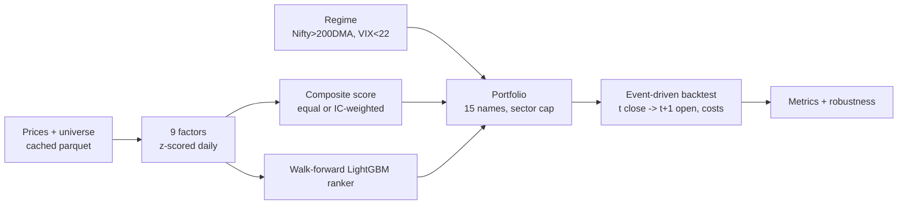

# Project 04 — NSE Factor Screener & Regime-aware Backtester

| | |
|---|---|
| Domain | Capital markets (swing trading on NSE stocks) |
| Difficulty / effort | ★★★ · about 40 hours over 2 weeks |
| Repo name | `ampba-04-nse-factor-backtester` |
| Python package (`PKG`) | `quant` |
| Data | `yfinance` NSE prices + niftyindices.com constituent lists. See [DATA.md](DATA.md) |
| Shared setup | [../00-COMMON-SETUP.md](../00-COMMON-SETUP.md) |

> **Disclaimer to put in the README and the app:** research and education only; not investment advice; backtests are not forecasts.

---

## 1. What you are building

A transparent rules-plus-ML swing-trading model for NSE stocks with an **honest backtest**: no look-ahead, trading costs and slippage on every fill, an explicit out-of-sample period, parameter-sweep and bootstrap robustness checks, and limitations stated up front. Pieces: nine cross-sectional factors → a composite score → a regime filter (Nifty above its 200-day average and India VIX below 22) → a 15-stock portfolio with sector caps and five exit layers → an event-driven daily backtest (signal at close *t*, trade at open *t+1*) → a walk-forward LightGBM ranking variant → a Streamlit screener.



**KPIs (out-of-sample 2023-01 → latest):** CAGR above the Nifty 50 (total-return proxy), Sharpe ≥ 1.0, max drawdown ≤ 20%, all after 0.25% round-trip cost + 0.10% slippage per side. Report honestly whether you meet them.

## 2. Read first

| Repo | Look at |
|---|---|
| [anmolisb/Stock2026](https://github.com/anmolisb/Stock2026) | 9-factor scoring of Nifty-500, regime filter (Nifty > 200-DMA, VIX < 22), post-earnings drift entry, 5-layer exits, paper trading |

## 3. Step 0 — project setup

```powershell
cd "C:\Users\11624\OneDrive - Indian School of Business\Documents\personal\isb_ampba\projects\04-nse-factor-backtester"
py -3.12 -m venv C:\venvs\ampba-04
C:\venvs\ampba-04\Scripts\Activate.ps1
python -m pip install --upgrade pip wheel
pip install -r requirements.in
$pkg = "quant"
mkdir config, data\raw, data\interim, data\processed, notebooks, "src\$pkg", analysis, outputs, figures, models, app, tests\fixtures, docs, .github\workflows
New-Item "src\$pkg\__init__.py", tests\__init__.py -ItemType File
git init
```
Follow common setup §3–§8 (add `data/raw/prices/` to `.gitignore`; keep `config/universe_fallback.txt` in git). `config/config.yaml`:

```yaml
seed: 42
paths: {raw: data/raw, interim: data/interim, processed: data/processed, outputs: outputs, figures: figures, models: models}
data: {start: "2015-01-01", end: null, benchmark: "^NSEI", tri_proxy: "NIFTYBEES.NS", vix: "^INDIAVIX", batch_size: 20, retries: 4, max_age_days: 3}
universe:
  name: nifty100                 # nifty50 | nifty100 | nifty200 | nifty500
  url: "https://www.niftyindices.com/IndexConstituent/ind_{name}list.csv"
  fallback_file: config/universe_fallback.txt
  min_traded_value_cr: 10        # median 60-day traded value, Rs crore
  liq_window: 60
factors:
  zclip: 3.0
  signs: {mom_12_1: 1, mom_3m: 1, rel_strength: 1, dist_52w_high: 1, low_vol_60d: 1, volume_surge_20d: 1, rsi_14: 1, trend: 1, earnings_drift: 1}   # freeze after IC research on data <= 2022-12-31
signals: {weighting: equal, ic_horizon: 20, ic_window: 252, rank_exit: 50, require_trend: true}
regime: {dma: 200, vix_max: 22}
portfolio: {n_positions: 15, weighting: equal, max_sector_weight: 0.20, max_position_weight: 0.10, rebalance: "W-FRI"}
exits: {atr_window: 14, initial_stop_atr: 2.0, trail_atr: 3.0, time_stop_days: 30}
costs: {roundtrip_pct: 0.25, slippage_pct: 0.10}        # round trip split half per side; slippage per side on top
backtest: {initial_capital: 10000000, oos_start: "2023-01-01", rf_annual: 0.0}
walkforward: {train_years: 3, test_years: 1, horizon: 20, embargo_days: 5}
```
Write `docs/PROBLEM_STATEMENT.md` and a one-page **Limitations** section skeleton (survivorship, index vs total return, adjusted prices) now.

---

## 4. Milestones

### M1 — Data and universe (about 6 h)

**Goal:** a cached price panel on the Nifty trading calendar with a quality report.

1. **`universe.py`** — download the constituent CSV with a browser User-Agent; verify the expected columns; keep `Series == "EQ"`; build `yahoo = Symbol + ".NS"`; fall back to the cached snapshot, then to `config/universe_fallback.txt` (create it with a hand-typed Nifty 50 list: one symbol per whitespace-separated token).
```python
def fetch_constituents(name, url_template, timeout=30):
    r = requests.get(url_template.format(name=name), headers={"User-Agent": "Mozilla/5.0"}, timeout=timeout); r.raise_for_status()
    df = pd.read_csv(StringIO(r.text)); df.columns = [c.strip() for c in df.columns]
    missing = {"Company Name", "Industry", "Symbol", "Series", "ISIN Code"} - set(df.columns)
    if missing: raise ValueError(f"unexpected columns, missing {missing}")
    return df
```
2. **`data.py`** — batched download with retry, a per-ticker parquet cache (replace `^` and `&` in file names), and a whole-history refresh when a cache file is older than `max_age_days`:
```python
def download_batch(tickers, start, end, retries=4):
    for attempt in range(1, retries + 1):
        try:
            raw = yf.download(tickers, start=start, end=end, auto_adjust=True, group_by="ticker", progress=False, threads=True, timeout=30)
            res = _split_download(raw, tickers)                       # {ticker: OHLCV frame}; empty frame if a ticker failed
            if any(len(v) for v in res.values()): return res
            raise RuntimeError("empty download")
        except Exception as exc:                                      # rate limit, timeout, JSON errors
            time.sleep(min(60, 2 ** attempt) + random.uniform(0, 1.5))
    return {t: pd.DataFrame() for t in tickers}

def _split_download(raw, tickers):
    out = {}
    level0 = raw.columns.get_level_values(0) if raw is not None and not raw.empty else []
    for t in tickers:
        if t not in level0: out[t] = pd.DataFrame(); continue
        df = raw[t][["Open", "High", "Low", "Close", "Volume"]].dropna(how="all")
        df.index = pd.DatetimeIndex(df.index).tz_localize(None).normalize(); out[t] = df
    return out
```
   Check the column layout of your installed `yfinance` once (`print(raw.columns[:6])`): recent versions return a MultiIndex of (ticker, field) when `group_by="ticker"`; a single ticker may come back without the outer level — handle it. Sleep 1–2 s between batches.
3. **`to_panel(prices, calendar)`** — wide frames `open/high/low/close/volume` reindexed to the **Nifty calendar** (`^NSEI` close dates). Do **not** forward-fill stock prices (a missing price means not tradable that day).
4. **Quality report** per ticker: first/last date, rows, % missing since first price, zero-volume days, count of daily moves above ±25% → `outputs/data_quality.csv`. Investigate every ticker with a ±25% move: real event (e.g. a demerger) or data error?
5. **Liquidity mask** — median of `close × volume` over the trailing 60 days ≥ ₹10 crore (`1e7` rupees per crore); the window ends at *t*.
```python
def liquidity_mask(close, volume, min_value_cr=10.0, window=60):
    med = (close * volume).rolling(window, min_periods=int(window * 0.8)).median()
    return med > min_value_cr * 1e7
```
6. **EDA notebook:** number of eligible stocks per day; tickers with short histories; Nifty and VIX plots.

**Sanity:** all or nearly all tickers download (about 100 of 100 on 2026-10-13); the panel's last date is the latest trading day; the eligible-stock count is stable at a few dozen to ~100 for Nifty 100.

**Pitfalls:** appending new rows to a stale cache after a split; downloading 500 tickers in one call; forgetting `.NS`; tz-aware indexes that do not align with the benchmark.

```powershell
python -m src.quant.data
git add -A; git commit -m "M1: universe loader, batched cached yfinance download, quality report, liquidity mask"
```

---

### M2 — Factors and IC research (about 8 h)

**Goal:** nine cross-sectionally standardised factors, and evidence of which ones have predictive power **using data up to 2022-12-31 only**.

1. **`factors.py` — raw factors (higher = more attractive before the sign in config):**

| Factor | Definition (all use data up to and including *t*) |
|---|---|
| `mom_12_1` | `close[t−21] / close[t−252] − 1` (12-month return skipping the last month) |
| `mom_3m` | 63-day return |
| `rel_strength` | 126-day stock return − 126-day Nifty return |
| `dist_52w_high` | `close / rolling_max(close, 252) − 1` (0 = at the high) |
| `low_vol_60d` | − std of daily returns over 60 days (calm = high score) |
| `volume_surge_20d` | `ln(mean vol 20d / mean vol 100d) × sign(20-day return)` |
| `rsi_14` | Wilder RSI (EWM with `alpha = 1/14`) |
| `trend` | `(close > SMA50) + (SMA50 > SMA200)` (0, 1 or 2; NaN until SMA200 exists) |
| `earnings_drift` | EPS-surprise % (capped ±50) decayed linearly to 0 over 60 trading days, switched on the first trading day **strictly after** the announcement date; NaN = no event |

```python
def rsi(close, n=14):
    d = close.diff(); up, dn = d.clip(lower=0.0), (-d).clip(lower=0.0)
    au, ad = up.ewm(alpha=1/n, adjust=False, min_periods=n).mean(), dn.ewm(alpha=1/n, adjust=False, min_periods=n).mean()
    return 100.0 - 100.0 / (1.0 + au / ad.replace(0, np.nan))

def atr(high, low, close, n=14):
    pc = close.shift(1); tr = np.fmax(np.fmax(high - low, (high - pc).abs()), (low - pc).abs())
    return tr.ewm(alpha=1/n, adjust=False, min_periods=n).mean()
```
2. **Cross-sectional z-score** each day over eligible stocks only: blank ineligible names, winsorise at the 1st/99th percentiles of that day, standardise, clip at ±3. A missing `earnings_drift` becomes 0 (neutral) so the composite is not dropped.
```python
def zscore_cs(df, mask=None, clip=3.0, winsor=0.01):
    x = df.where(mask) if mask is not None else df.copy()
    x = x.clip(lower=x.quantile(winsor, axis=1), upper=x.quantile(1 - winsor, axis=1), axis=0)
    z = x.sub(x.mean(axis=1), axis=0).div(x.std(axis=1, ddof=0).replace(0.0, np.nan), axis=0)
    return z.clip(-clip, clip)
```
3. **Optional earnings events (`earnings.py`)** — `yf.Ticker(t).get_earnings_dates(limit=40)`; convert the timestamp from `America/New_York` to `Asia/Kolkata`, take the date; keep `Surprise(%)`. One failing ticker must not stop the run. Report how many tickers have events; if almost none, say the factor is effectively off.
4. **Forward returns (labels, never features):** a trade that follows the signal buys at the **open of t+1** and sells at the open of `t+1+h`: `fwd = open.shift(−(1+h)) / open.shift(−1) − 1`.
5. **IC research (`research.py`):**
```python
def rank_ic(factor, fwd, min_names=20):
    fr, rr = factor.rank(axis=1), fwd.rank(axis=1); both = factor.notna() & fwd.notna()
    return fr.where(both).corrwith(rr.where(both), axis=1).where(both.sum(axis=1) >= min_names)

def ic_summary(ic, horizon):
    ic = ic.dropna(); thin = ic.iloc[::horizon]             # overlapping h-day returns inflate t-stats: thin to every h-th day
    return {"ic_mean": ic.mean(), "ic_ir": ic.mean() / ic.std(ddof=1), "hit_rate": float((ic > 0).mean()),
            "t_stat_thinned": thin.mean() / (thin.std(ddof=1) / np.sqrt(len(thin))), "n_days": int(len(ic))}
```
   For each factor on data **≤ 2022-12-31**: mean rank-IC at a 20-day horizon, IC-IR, thinned t-stat, **quintile spread** (mean forward return of the top vs bottom quintile on non-overlapping dates), **IC decay** at 1/5/10/20/40/60 days, and the average cross-sectional **factor correlation matrix**. Decide each factor's sign and freeze `factors.signs` in the config **before** looking at 2023+ (write the decision and the date in `docs/factor_research.md`). A factor whose IC sign is negative may be flipped; one with no signal can stay in at weight 0 only if you document it.
6. Figures: IC bars with t-stats, quintile bars, IC-decay lines, factor correlation heat-map.

**Sanity:** mean ICs on equities are small (0.01–0.05 is typical for a *good* factor); a mean IC above 0.2 means leakage. `mom_12_1` often has modest IC and decay over months; `low_vol_60d` and `dist_52w_high` can behave differently by period — report what you find, not what the literature says.

**Pitfalls:** using `fwd` as a feature; computing z-scores over the whole panel instead of per day; letting the `earnings_drift` switch on the announcement day; choosing factor signs after seeing 2023+.

```powershell
git add -A; git commit -m "M2: nine factors, daily z-scores, IC/quintile/decay research on <=2022 data; signs frozen"
```

---

### M3 — Rules backtest, exits, regime (about 10 h) → **Mid-review**

**Goal:** an event-driven backtest with every cost applied and no look-ahead.

1. **Regime (`regime.py`):** `risk_on = (Nifty close > 200-day SMA) & (VIX close < 22)`, evaluated at the close of *t* and acted on at the open of *t+1*; VIX forward-filled by at most 3 days; unknown = risk-off.
2. **Composite (`signals.py`):** weighted mean of available z-scores (needs ≥ 6 of 9 factors non-NaN), equal weights by default; the **IC-weighted** variant uses the rolling 252-day mean rank-IC, floored at 0, **shifted by `horizon + 1` days** because the IC of day *s* needs prices up to `open[s+1+h]`:
```python
def ic_weights(z, open_, horizon=20, window=252, min_periods=60):
    fwd = forward_returns(open_, horizon); ic = pd.DataFrame({k: rank_ic(df, fwd) for k, df in z.items()})
    known = ic.shift(horizon + 1)                                  # forgetting this shift is the classic look-ahead bug
    w = known.rolling(window, min_periods=min_periods).mean().clip(lower=0.0)
    s = w.sum(axis=1); w = w.div(s.where(s > 0), axis=0)
    return w.where(s > 0, 1.0 / len(z))                            # equal weights until enough history
```
3. **Portfolio (`portfolio.py`):** up to 15 positions; weekly rebalance (last trading day of the week, `W-FRI`); entry candidates = top composite scores that are eligible, in an up-trend (`close > SMA50 > SMA200`), and only when `risk_on`; **sector cap** 20% → at most `floor(0.20 × 15) = 3` names per sector (use the constituent file's `Industry`); equal weight (1/N) or inverse-volatility weights, each position capped at 10% of equity.
4. **Exits (`exits.py`)** — evaluated at the close, executed at the next open; the first layer that fires wins, in this priority:
   1. regime turns risk-off; 2. **initial stop** `close < entry − 2 × ATR(entry)` (fixed at entry); 3. **trailing stop** `close < highest close since entry − 3 × ATR(now)`; 4. **rank decay** (composite rank worse than 50, or no score); 5. **time stop** (held ≥ 30 trading days).
5. **Backtest engine (`backtest.py`)** — loop over days; for day *i*: (a) execute yesterday's orders at today's **open** (sells first so they fund buys); buys fill at `open × (1 + slip)`, sells at `open × (1 − slip)`; fee = value × (roundtrip% / 200) per side; (b) mark to market at the close; (c) decide: update highest close, check exits, and on rebalance days when risk-on fill empty slots from the ranked candidate list; orders go to the open of *i+1*. Record every fill and every closed trade (entry/exit date, net return, days, exit reason). Turnover = traded value / 2 / mean equity / years.
```python
for i in range(T):
    # 1. execute yesterday's orders at today's open
    for j in list(pend_exit):
        px = O[i, j]
        if np.isnan(px): continue                                   # cannot trade today, try tomorrow
        pos = held.pop(j); fill = px * (1.0 - slip); value = pos.shares * fill; fee = value * half_fee; cash += value - fee
        ...record fill and trade...
    for j, w, atr_sig in pend_entry:
        px = O[i, j]
        if np.isnan(px) or j in held: continue
        fill = px * (1.0 + slip); value = min(w * prev_equity, cash / (1.0 + half_fee))
        if value < 0.002 * prev_equity: continue
        fee = value * half_fee; shares = value / fill; cash -= value + fee
        held[j] = Position(j, i, fill, shares, fill - 2.0 * atr_sig, fill, fee)
    # 2. mark to market at the close; 3. decisions at the close of day i -> orders for the open of i+1
```
   Write the full loop yourself from this skeleton (about 100 lines): keep a `Position` dataclass `(ticker_idx, entry_i, entry_px, shares, stop0, high_close, cost_in)`, a `pend_exit` dict `{col: reason}`, a `pend_entry` list `(col, target_weight, atr_at_signal)`. Rebalance flag: `~pd.Series(dates.to_period("W-FRI")).duplicated(keep="last")`.
6. **Metrics (`metrics.py`):** CAGR (`(end/start)^(1/years) − 1`), annual volatility, Sharpe (`mean/std × √252` with `rf_annual`), Sortino (target downside deviation), max drawdown, Calmar, hit rate, average win/loss, payoff ratio, turnover; monthly returns via `resample("ME")` (older pandas: `"M"`). Report **in-sample (≤ 2022-12-31), out-of-sample (≥ 2023-01-01) and full** side by side, against Nifty 50 (price index and the ETF proxy), and a **cost audit** (total fees in ₹, % of starting capital).
7. **Mid-review deck** (§8).

**Sanity:** exit reasons spread across layers (not 100% one reason); average holding days below 30 unless the time stop never fires; fees > 0 on every fill; equity never negative; positions never exceed 15; no trade in a ticker on a day its open is NaN; **run `test_no_lookahead` (§6) before believing any result.**

**Pitfalls:** acting on a signal at the same close it is computed (use the next open); costs on only one side; sector cap counting held and new names separately; resetting the trailing stop's high on every rebalance; the IC-weight shift (see above).

```powershell
git add -A; git commit -m "M3: regime filter, composite score, 5-layer exits, event-driven backtest with costs; OOS CAGR <x>, Sharpe <y>, MDD <z>"
```

---

### M4 — ML ranker and robustness (about 10 h)

**Goal:** a walk-forward LightGBM ranking variant and evidence on how fragile (or robust) the results are.

1. **Dataset (`walkforward.build_dataset`)** — long table (date, ticker) of the nine z-score features + `fwd` (20-day forward return) + a relevance **grade** 0–4 = the forward-return quintile **within each date** (LambdaRank wants small integers).
2. **Walk-forward ranker** — for each test year: train on the previous 3 years, **purge** every training row whose label window (up to `t+1+20` trading days) reaches into the test period and add a 5-day embargo, subsample every 5th date to thin overlapping labels, fit `lgb.LGBMRanker(objective="lambdarank", n_estimators=300, learning_rate=0.05, num_leaves=15, min_child_samples=200, subsample=0.8, colsample_bytree=0.8, reg_lambda=5.0)` with `group` = number of stocks per date, predict the test year. Concatenate out-of-sample scores; use them in place of the composite and run the **same** backtest.
```python
purge_end = uniq[max(pos_t0 - (horizon + 1 + embargo_days), 0)]            # last usable training date
tr_dates = uniq[(uniq >= pd.Timestamp(f"{ty - train_years}-01-01")) & (uniq <= purge_end)][::sample_every]
model = lgb.LGBMRanker(**base).fit(tr[features], tr["grade"].astype(int), group=tr.groupby(level="date").size().to_numpy())
```
   Report ML vs rules out-of-sample (same period, same costs) and average feature importance by fold. If the ML variant does not beat the rules, say so.
3. **Robustness (`robustness.py`):**
   - **Parameter sweep** over `n_positions ∈ {10, 15, 20}` × `initial_stop_atr ∈ {1.5, 2, 3}` (and optionally rebalance frequency): table with in-sample and out-of-sample Sharpe/CAGR/MDD; **choose parameters using the in-sample columns only**; show an OOS heat-map.
   - **Block bootstrap of monthly returns** (circular blocks of 3 months, 5,000 resamples) → Sharpe 95% CI and P(Sharpe < 0).
   - **Monte-Carlo trade shuffle** (order of closed-trade returns, each sized 1/N) → distribution of max drawdown and final equity.
```python
def block_bootstrap_sharpe(monthly, n_boot=5000, block=3, seed=42):
    rng = np.random.default_rng(seed); x = monthly.to_numpy(); n = len(x); nb = int(np.ceil(n / block)); out = np.empty(n_boot)
    for b in range(n_boot):
        idx = ((rng.integers(0, n, nb)[:, None] + np.arange(block)[None, :]).ravel()[:n]) % n
        s = x[idx]; out[b] = s.mean() / s.std(ddof=1) * np.sqrt(12) if s.std(ddof=1) > 0 else np.nan
    return {"ci_low": float(np.nanpercentile(out, 2.5)), "ci_high": float(np.nanpercentile(out, 97.5)), "p_sharpe_below_zero": float(np.nanmean(out < 0))}
```
4. **Optional HMM regime** (`hmmlearn.GaussianHMM`, 2 states on [Nifty log-return, log VIX]): fit **only on data up to the train end** and use the **filtered** probability each day (the last row of `predict_proba` on data up to *t*) — calling `predict()` once on the whole history uses future data (smoothing = look-ahead).
5. **Limitations write-up (`docs/limitations.md`):** survivorship bias (today's constituents), yfinance adjustment quirks and renamed/demerged tickers, index vs total-return benchmark, short histories, costs are a flat assumption, no capacity/impact model, regime thresholds were chosen from prior knowledge not tuned (state it), results depend on one market path.

```powershell
git add -A; git commit -m "M4: purged walk-forward LightGBM ranker, parameter sweep, bootstrap Sharpe CI, Monte-Carlo drawdowns"
```

---

### M5 — App, tests, CI, memo (about 6 h) → **Final review**

1. `analysis/run_analysis.py` → `outputs/summary.json` and all figures (equity vs benchmarks, drawdown, monthly heat-map, IC charts, sweep heat-map).
2. **`app/streamlit_app.py`** tabs: **Today's screen** (ranked table with factor bars, regime banner; from the last cached date) · **Backtest** (equity vs Nifty, drawdown, monthly heat-map, metrics table in-/out-of-sample) · **Factor lab** (IC charts) · **Regime** (Nifty, VIX, risk-on shading) · **Stock drill-down** (price chart with entries/exits). Disclaimer on every tab.
3. `paper.py`: a daily run that writes today's watchlist and orders to CSV (no broker integration).
4. Tests (§6), CI, README with the three-way table (rules, ML, benchmark; IS vs OOS), `DECISION_MEMO.md`, `MODEL_CARD.md`.

```powershell
git add -A; git commit -m "M5: Streamlit screener, paper-trade CSV, tests, CI, memo"
```

---

## 5. Business layer — decision memo

```markdown
# Decision memo — Regime-aware factor swing strategy (research)
**Decision requested:** Whether to run this strategy in paper trading for 3 months.
**Recommendation:** Paper-trade the {{variant}} variant; do not allocate capital yet.
**Evidence (out-of-sample {{oos_start}} → {{oos_end}}, after {{roundtrip_pct}}% round-trip cost + {{slippage_pct}}% slippage):** CAGR {{cagr_oos}} vs Nifty 50 {{cagr_bench}} (ETF proxy {{cagr_tri}}); Sharpe {{sharpe_oos}} (bootstrap 95% CI {{ci_low}} to {{ci_high}}); max drawdown {{mdd_oos}}; turnover {{turnover}}× per year; costs ₹{{fees_inr}}.
**KPI check:** CAGR > benchmark: {{pass1}}; Sharpe ≥ 1.0: {{pass2}}; MDD ≤ 20%: {{pass3}}.
**Robustness:** best/worst parameter combination OOS Sharpe {{sweep_max}} / {{sweep_min}}; ML ranker {{ml_vs_rules}}.
**Risks & limitations:** survivorship bias (today's constituents), single market path, regime thresholds not tuned, flat cost model, no market impact, data from an unofficial source.
**Next steps:** paper trade, track slippage vs assumption, refresh data weekly, re-run research each year.
```

## 6. Tests (≥ 10)

| Test | Asserts |
|---|---|
| `test_no_lookahead` | Perturb all prices after date `T` by a large random factor: every factor, composite score, regime flag, rank and ATR value for dates ≤ `T` is unchanged |
| `test_backtest_signal_at_close_trade_at_next_open` | Every fill's date is the trading day after the signal date; fill price equals that day's open ± slippage |
| `test_costs_applied_on_every_fill` | `fee > 0` for every fill; total fees equal the sum over fills |
| `test_turnover_reported` | Turnover > 0 and consistent with traded value |
| `test_zscore_cross_sectional` | Each row has mean ≈ 0 and std ≈ 1 (before clipping) over eligible names; ineligible names are NaN |
| `test_rsi_bounds_and_wilder_value` | RSI in [0, 100]; matches a hand-computed value on a short series |
| `test_atr_positive` | ATR ≥ 0 and equals the true-range average on a constant-range series |
| `test_mom_12_1_skips_last_month` | Changing the last 21 closes does not change `mom_12_1` at `t` |
| `test_earnings_factor_starts_after_announcement` | Factor is NaN on the announcement date and non-NaN from the next trading day |
| `test_ic_weights_use_shifted_ic` | Altering prices after `t − 21` days changes no weight at `t` |
| `test_sector_cap` | Selected names never exceed 3 per sector with 15 positions and a 20% cap |
| `test_exit_priority` | Regime-off beats initial stop beats trailing stop beats rank decay beats time stop when several fire together |
| `test_liquidity_mask_is_trailing` | Mask at `t` unchanged by volumes after `t` |
| `test_regime_unknown_is_risk_off` | NaN VIX or short history → risk-off |
| `test_purged_training_excludes_test_label_windows` | No training row's label window overlaps the test year (plus embargo) |
| `test_metrics_known_values` | CAGR, Sharpe, max drawdown match hand calculations on a toy equity curve |
| `test_universe_fallback` | With the download mocked to fail, the universe loads from the fallback file |

## 7. Acceptance checklist

- [ ] `test_no_lookahead` passes.
- [ ] Costs applied on every trade; turnover reported.
- [ ] Out-of-sample metrics table for rules and ML vs benchmark (price index and total-return proxy) in the README, with in-sample alongside.
- [ ] Parameter sweep, bootstrap Sharpe CI and Monte-Carlo drawdown reported.
- [ ] Limitations section (survivorship bias, adjusted prices, benchmark choice) and the research-only disclaimer present.
- [ ] KPI table states honestly which targets were met.

## 8. Review slide outlines

**Mid-review (after M3):** 1 Question and KPIs · 2 Data, universe, quality findings · 3 Survivorship and other biases · 4 The nine factors · 5 IC research on pre-2023 data · 6 Composite, regime and portfolio rules · 7 Exits and cost model · 8 No-look-ahead design (the test) · 9 Out-of-sample results · 10 ML and robustness plan.

**Final review (after M5):** 1 Recap · 2 Rules vs ML vs benchmark · 3 In-sample vs out-of-sample · 4 Parameter robustness · 5 Bootstrap and Monte-Carlo · 6 Where it lost (drawdowns) · 7 App demo · 8 Limitations · 9 Paper-trading plan · 10 Recommendation.

## 9. Stretch goals and interview talking points

**Stretch:** point-in-time constituents to remove survivorship; `vectorbt` cross-check of your engine; volatility-targeted sizing; transaction-cost sensitivity (0.1–0.5%); a Kite stub for paper orders; bhavcopy data via `jugaad-data` (DATA.md).

**Likely questions:**
1. *How did you avoid look-ahead?* — Signals from data ≤ *t*, trades at open *t+1*, trailing windows only, IC weights shifted by horizon + 1, a perturbation test that proves it.
2. *Why is IC small yet the strategy can still work?* — Small average IC across many stocks and dates compounds; judge by IC-IR and the quintile spread.
3. *What are the main biases?* — Survivorship (today's constituents), data-snooping from choosing parameters, one market path.
4. *Why an out-of-sample period and a sweep chosen in-sample?* — To separate fitting from evaluation; the OOS sweep heat-map shows whether performance is a fragile peak.
5. *Why walk-forward with a purge?* — Labels overlap in time; without purging, training labels leak the test period.

## 10. Troubleshooting

| Symptom | Cause / fix |
|---|---|
| `YFRateLimitError` / empty frames | Smaller batches (10), longer back-off, rerun — the per-ticker cache keeps progress |
| `KeyError: 'TCS.NS'` after download | Single-ticker download has no outer column level; handle that case in `_split_download` |
| Strange jump in an old price series | Mixed adjusted/unadjusted history — re-download the whole ticker |
| Results look too good | Run `test_no_lookahead`; check sell fills use the **open** after the signal and that costs are on both sides |
| Equity curve flat for months | Regime filter off (VIX > 22 or Nifty < 200-DMA) — expected; report the share of time risk-on |
| `resample("ME")` error | Older pandas: use `"M"` |
| `hmmlearn` fails to install | Skip the HMM (optional) or use a precompiled wheel on Python 3.11/3.12 |
| Sector cap never binds | Industry column mapping failed — check `sector` dict has no `Unknown` for most tickers |
