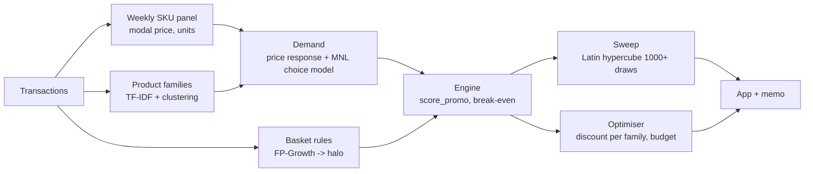

# Project 05 — Promotion Cannibalisation Engine

| | |
|---|---|
| Domain | E-commerce pricing / category management |
| Difficulty / effort | ★★★ · about 35–40 hours over 1.5 weeks |
| Repo name | `ampba-05-promo-cannibalisation` |
| Python package (`PKG`) | `promo` |
| Data | UCI Online Retail II (real). See [DATA.md](DATA.md) — it also lists real promotion datasets (Dunnhumby) for validation |
| Shared setup | [../00-COMMON-SETUP.md](../00-COMMON-SETUP.md) |

---

## 1. What you are building

Category managers judge a promotion by the **promoted SKU's** uplift. That ignores three things: the discount given away on units that would have sold anyway, margin lost when shoppers switch from sibling products, and extra items pulled into the basket. You will build an engine that scores a discount on **family net contribution**:

> `family_net = direct − subsidy − cannibalised + halo`

where `direct` is the margin on incremental units of the promoted SKU, `subsidy` is the discount given on baseline units, `cannibalised` is the margin lost on sibling SKUs, and `halo` is the margin on extra basket items. Then you will sweep the uncertain assumptions (elasticity, substitution, margin, halo), show how often a promotion that looks profitable on the dashboard is **not** profitable for the family, and choose the best discount per family under a budget with an optimiser.



**KPIs (master plan):** engine identity holds to ±1e-6; sweep ≥ 1,000 draws reproducible with a seed; memo reports the reference promotion's family net, % profitable under both views, and the break-even elasticity.

## 2. Read first

| Repo | Look at |
|---|---|
| [akash-sood97/promotion-cannibalisation-engine](https://github.com/akash-sood97/promotion-cannibalisation-engine) | Same data. On UCI Online Retail II it reports that the dashboard-preferred promo looks profitable in 86% of conditions but is profitable for the whole family in only 11%. Read how it defines families, the choice model and the decision memo. **Your numbers will differ; do not try to match them** |

## 3. Step 0 — project setup

```powershell
cd "C:\Users\11624\OneDrive - Indian School of Business\Documents\personal\isb_ampba\projects\05-promotion-cannibalisation"
py -3.12 -m venv C:\venvs\ampba-05
C:\venvs\ampba-05\Scripts\Activate.ps1
python -m pip install --upgrade pip wheel
pip install -r requirements.in
$pkg = "promo"
mkdir config, data\raw, data\interim, data\processed, notebooks, "src\$pkg", analysis, outputs, figures, models, app, tests\fixtures, docs, .github\workflows
New-Item "src\$pkg\__init__.py", tests\__init__.py -ItemType File
git init
```
Follow common setup §3–§8. `config/config.yaml`:

```yaml
seed: 42
paths: {raw: data/raw, interim: data/interim, processed: data/processed, outputs: outputs, figures: figures, models: models}
data:
  uci_zip: https://archive.ics.uci.edu/static/public/502/online+retail+ii.zip
  non_product_codes: [POST, D, DOT, M, "BANK CHARGES", S, AMAZONFEE, ADJUST, ADJUST2, CRUK, PADS, C2, TEST001, TEST002]
panel: {price_col: modal}                     # list price = modal unit price per SKU-week
families: {distance_threshold: 0.75, min_family_size: 2, top_skus: 1500}
baskets: {top_skus: 400, min_support: 0.01, min_lift: 1.5, min_confidence: 0.20}
demand:
  min_weeks: 40
  min_price_drops: 5
  prior_elasticity: -2.0                      # used when a SKU fails the identifiability filter and its family has no estimate
  outside_share: 0.40                         # share of "no purchase from this family" in the MNL (assumption, swept)
engine:
  promo_weeks: 2
  unit_cost_share: 0.60                       # unit cost = 60% of list price -> 40% margin (assumption; the data has no costs)
  halo_factor: 0.5                            # share of basket-rule pull that is truly incremental (assumption)
  gbp_to_inr: 105.0
sweep: {n_draws: 2000, elasticity: [-6.0, -1.0], substitution_share: [0.0, 0.8], margin: [0.25, 0.55], halo: [0.0, 1.0]}
optimiser: {discounts: [0.0, 0.05, 0.10, 0.15, 0.20, 0.25], budget_frac: 0.30, max_promos_per_week: 4, horizon_weeks: 8}
```
Write `docs/PROBLEM_STATEMENT.md` now.

## 4. Data (summary — see DATA.md)

1,067,371 raw lines → 1,037,082 clean sales lines, 39,517 invoices, 4,903 SKUs, £20.12 million revenue, 2009-12-01 → 2011-12-09. No costs and no promotion flags exist: **margin and "promotion" are assumptions / inferences** and must be labelled as such everywhere.

---

## 5. Milestones

### M1 — Data, weekly panel, product families (about 9 h)

**Goal:** a clean sales table, a SKU-week panel with a list price you can trust, and SKU families.

1. **Load and cache** (code in DATA.md): read both sheets once, cast `invoice`, `stock_code` to `str`, `description` to `string`, `customer_id` to `Int64`, write `data/interim/transactions.parquet`. Check: 1,067,371 rows.
2. **`data.load_clean()`** — drop cancellations (`invoice.startswith("C")`), non-product codes (config list), `quantity ≤ 0`, `price ≤ 0`; keep rows without a customer ID (this project works at invoice level); `revenue = quantity × unit_price`; strip/upper the description and take the **most frequent description per SKU**. Expect **1,037,082** lines, 39,517 invoices, 4,903 SKUs.
3. **Weekly SKU panel** — week = `invoice_date.dt.to_period("W").dt.start_time`. For each (SKU, week): `units`, `revenue`, `n_baskets` (distinct invoices) and **modal price** (the unit price at which the most units sold):
```python
g = sales.groupby(["stock_code", "week", "unit_price"]).quantity.sum().reset_index()
g = g.sort_values(["stock_code", "week", "quantity"], ascending=[True, True, False])
modal = g.drop_duplicates(["stock_code", "week"])[["stock_code", "week", "unit_price"]].rename(columns={"unit_price": "price"})
panel = modal.merge(sales.groupby(["stock_code", "week"]).agg(units=("quantity", "sum"), revenue=("revenue", "sum"), n_baskets=("invoice", "nunique")).reset_index(), on=["stock_code", "week"])
```
   Modal price beats `revenue/units` because wholesale tiers make the average price move with customer mix. **Expected:** 197,944 SKU-weeks.
4. **Identifiability check (do this before modelling):** share of consecutive weeks in which the modal price changed (>1%, >5%), share of price **drops** > 5%, and the number of SKUs with ≥ 40 weeks and ≥ 5 drops. Measured on this file: price changes in ~30% of consecutive weeks; 1,584 SKUs have ≥ 40 weeks and ≥ 5 drops; 556 SKUs have one price only. Put the table in `docs/data_quality.md`.
5. **Families (`catalog.py`)** — substitutes are products of the same *type* (variants/colours/sizes). Method: TF-IDF on the cleaned description (word unigrams + bigrams, drop numbers), cosine distance, **agglomerative clustering with a distance threshold** (not a fixed k) on the top-1,500 SKUs by revenue:
```python
from sklearn.feature_extraction.text import TfidfVectorizer
from sklearn.cluster import AgglomerativeClustering
X = TfidfVectorizer(ngram_range=(1, 2), min_df=1, stop_words="english", token_pattern=r"[A-Za-z]{2,}").fit_transform(desc)
fam = AgglomerativeClustering(n_clusters=None, distance_threshold=0.75, metric="cosine", linkage="average").fit_predict(X.toarray())
```
   (`metric` replaced the old `affinity` argument; check `help(AgglomerativeClustering)` if you see an error.) Inspect 20 families by eye; adjust the threshold until families look like product types ("… LUNCH BAG" variants, "… MUG" variants) and not colour words. Singletons stay singletons (no cannibalisation).
6. **Substitution check by co-purchase:** for each family compute the share of invoices containing a member that also contain **another member** of the same family. True substitutes are rarely bought together; a high co-purchase share means variants are bought as a set (typical for wholesalers buying every colour). Flag families with a high co-purchase share as **weak substitutes** and cap their substitution share in the engine. This is a real limitation of this dataset; discuss it in the README.
7. **Manual override file** `config/family_overrides.csv` (`stock_code,family`) applied last, so you can fix bad clusters without touching code.
8. EDA notebook: top families by revenue, seasonality (Q4 ≈ 38% of revenue), price variation, family sizes.

**Pitfalls:** parquet write failing on mixed dtypes; using average price instead of modal price; clustering on all colour words so "RED" and "PINK" separate the same product; treating a family with high co-purchase as a pure substitute set.

```powershell
git add -A; git commit -m "M1: clean sales (1,037,082 lines), weekly modal-price SKU panel, TF-IDF product families"
```

---

### M2 — Baskets and demand (about 9 h)

**Goal:** halo from basket rules, a price-response estimate where identifiable, and a calibrated choice model.

1. **Basket rules (`baskets.py`)** — restrict to the top-400 SKUs by invoice count; build an invoice × SKU boolean table; mine with FP-Growth; keep rules with lift ≥ 1.5 and confidence ≥ 0.20 (single-item antecedent and consequent), **excluding consequents in the same family** (those are substitutes/complements within the family, handled separately).
```python
from mlxtend.frequent_patterns import fpgrowth, association_rules
basket = sales[sales.stock_code.isin(top)].assign(v=True).pivot_table(index="invoice", columns="stock_code", values="v", aggfunc="max", fill_value=False)
fi = fpgrowth(basket, min_support=0.01, use_colnames=True)
rules = association_rules(fi, metric="lift", min_threshold=1.5)       # check help(association_rules): newer mlxtend versions add a required argument
rules = rules[(rules.antecedents.map(len) == 1) & (rules.consequents.map(len) == 1) & (rules.confidence >= 0.20)]
```
   Halo per promoted SKU *i*: `halo_units_per_incremental_unit_i = Σ_k confidence(i→k)` over allowed consequents, and the matching margin `Σ_k confidence(i→k) × unit_margin_k`. Confidence is an association, not a causal pull — hence the `halo_factor` (0–1) assumption.
2. **Price response (`demand.py`, part 1)** — for SKUs that pass the identifiability filter (≥ 40 weeks, ≥ 5 price drops of > 5%), fit `ln(units) ~ ln(price) + Q4 dummy + week-of-year effects` by OLS with HC robust errors; keep `eps_hat` and its standard error. For all other SKUs use the **family median** of eligible estimates, else the global prior (−2.0). Shrink noisy estimates toward the family median (weight `tau²/(tau² + se²)`, like Project 08). Report the distribution of `eps_hat`; **expect many positive or implausible values** because prices are not randomised — drop positive ones and say how many. Label the result "price-response estimate with confounding caveats".
```python
import statsmodels.formula.api as smf
m = smf.ols("np.log(units) ~ np.log(price) + C(month)", data=d).fit(cov_type="HC1")
eps, se = m.params["np.log(price)"], m.bse["np.log(price)"]
```
3. **Choice model per family (`demand.py`, part 2) — multinomial logit with an outside option:**
   - baseline units `u_j` = mean weekly units of SKU *j* over its last 52 active weeks; market size `M = Σ u_j / (1 − outside_share)`; shares `s_j = u_j / M`, `s_0 = outside_share`;
   - one price coefficient β calibrated so the **promoted SKU's own-price elasticity equals its `eps_hat`** (own elasticity in MNL = `−β × p_i × (1 − s_i)`): `β_i = −eps_i / (p_i (1 − s_i))`;
   - alternative-specific constants from the baseline shares: `a_j = ln(s_j / s_0) + β p_j`;
   - after a discount `d` on SKU *i* (`p_i' = p_i (1 − d)`): `s_j' = exp(a_j − β p_j') / (1 + Σ_k exp(a_k − β p_k'))`, units `u_j' = M s_j'`.
```python
def mnl_after_discount(u, p, i, d, eps_i, outside_share):
    s0 = outside_share; M = u.sum() / (1 - s0); s = u / M
    beta = -eps_i / (p[i] * (1 - s[i]))
    a = np.log(s / s0) + beta * p
    p2 = p.copy(); p2[i] = p[i] * (1 - d)
    e = np.exp(a - beta * p2); s2 = e / (1 + e.sum())
    return M * s2                                         # new units for every SKU in the family
```
   **MNL has the IIA property**: lost sales of siblings are drawn in proportion to their shares, and the outside option loses share too (market expansion). State it.
4. Diagnostics: for 5 families plot baseline vs promoted units for every member; check `Σ s_j' + s_0' = 1`; check that the numerical elasticity from a tiny discount (`d = 0.001`) equals `eps_i` (this is a test).
5. **Optional validation with real promotion data:** Dunnhumby "Breakfast at the Frat" (DATA.md §3) — estimate promo lift and sibling response with store and week fixed effects and compare the cannibalised share with what your MNL implies.

**Pitfalls:** `association_rules` signature changes between mlxtend versions; using confidence as a causal effect; accepting positive "elasticities"; building the invoice × SKU matrix as a dense DataFrame of all 4,903 SKUs (memory) — restrict to the top 400.

```powershell
git add -A; git commit -m "M2: FP-Growth halo table, price-response estimates with identifiability filter, MNL choice model per family"
```

---

### M3 — Engine and sweep (about 8 h) → **Mid-review**

**Goal:** `score_promo`, the break-even elasticity, a reference promotion for 24 SKUs, and a 2,000-draw sweep.

1. **Engine (`engine.py`)** — all money in £, over a promo of `promo_weeks` weeks; `unit_cost = unit_cost_share × price` for every SKU (assumption: the data has no costs).
```python
def score_promo(u, p, i, d, eps_i, margin, halo_per_unit, halo_margin_per_unit, cfg):
    """u, p: baseline weekly units and prices of the family; i: promoted SKU index; d: discount."""
    W = cfg["engine"]["promo_weeks"]; c = (1 - margin) * p                                # unit costs
    u2 = mnl_after_discount(u, p, i, d, eps_i, cfg["demand"]["outside_share"])
    p_i2 = p[i] * (1 - d)
    delta_i = (u2[i] - u[i]) * W                                                           # incremental units of the promoted SKU
    direct = delta_i * (p_i2 - c[i])                                                       # margin on the incremental units
    subsidy = d * p[i] * u[i] * W                                                          # discount given on units that would have sold anyway
    sib = np.arange(len(u)) != i
    cannibalised = float((np.maximum(u[sib] - u2[sib], 0.0) * W * (p[sib] - c[sib])).sum())    # margin lost on siblings
    halo = cfg["engine"]["halo_factor"] * delta_i * halo_margin_per_unit                   # margin on extra basket items
    net = direct - subsidy - cannibalised + halo
    return {"direct_uplift": direct, "subsidy_cost": subsidy, "cannibalised_margin": cannibalised, "halo_margin": halo,
            "promoted_only": direct - subsidy, "family_net": net, "incremental_units": delta_i}
```
   Write `family_net` as the sum of the four terms **by construction** and unit-test the identity.
2. **Break-even elasticity:** the elasticity at which `family_net = 0` for a given SKU and discount, found with `scipy.optimize.brentq` on `[-12, -0.5]`; return `NaN` when the sign never changes (the promotion never pays for the family at any elasticity in range).
3. **Reference promotion:** 10% off for the top-24 SKUs by revenue (DATA of this plan's preparation: Regency Cakestand 3 Tier, White Hanging Heart T-Light Holder, Jumbo Bag Red Retrospot, Party Bunting, … — your top-24 list is computed from your own panel). For each: the **waterfall** (direct, subsidy, cannibalised, halo, net), promoted-only vs family view, and its break-even elasticity.
4. **Parametric engine for the sweep (`sweep.py`)** — the MNL gives one substitution pattern per family; the sweep varies it directly. For a SKU with baseline units `u0` and price `p`, discount `d`, elasticity `ε`, substitution share `s` (fraction of incremental units taken from siblings), margin `m` (unit margin as a share of price), halo factor `h`:
   - incremental units `Δ = u0 × ((1 − d)^ε − 1)`
   - `direct = Δ × (p(1 − d) − (1 − m)p)`, `subsidy = d p u0`, `cannibalised = s × Δ × m p`, `halo = h × Δ × halo_margin_ref`
   - promoted-only profit = `direct − subsidy`; family net = `direct − subsidy − cannibalised + halo`.
   Draw `n_draws = 2000` points with a **Latin hypercube** (`scipy.stats.qmc.LatinHypercube(d=4, seed=42)`, scaled to the config ranges: ε ∈ [−6, −1], s ∈ [0, 0.8], m ∈ [0.25, 0.55], h ∈ [0, 1]).
```python
from scipy.stats import qmc
u = qmc.LatinHypercube(d=4, seed=cfg["seed"]).random(cfg["sweep"]["n_draws"])
lo, hi = np.array([-6.0, 0.0, 0.25, 0.0]), np.array([-1.0, 0.8, 0.55, 1.0])
eps, sub, mar, halo = (qmc.scale(u, lo, hi)).T
```
   Report: share of draws with promoted-only profit > 0; share with family net > 0; the **"dashboard trap"** share (promoted-only > 0 but family net ≤ 0); and a tornado chart (which assumption flips the sign most often). With these ranges the family view should be profitable far less often than the dashboard view; **report whatever you get** (the reference repo's 86% vs 11% is a different parameterisation).
5. **Mid-review deck** (§9).

**Pitfalls:** using the MNL substitution share in the sweep *and* varying `s` (pick one per analysis); mixing weekly and promo-window units (everything × `promo_weeks`); sign of elasticity (negative) in `(1 − d)^ε`.

```powershell
git add -A; git commit -m "M3: promo engine (identity-tested), break-even elasticity, reference promo for 24 SKUs, 2,000-draw sweep"
```

---

### M4 — Optimiser (about 6 h)

**Goal:** the best discount per family (and week) under a discount budget.

1. For every family and discount level `d ∈ {0, 5, 10, 15, 20, 25%}`: take the family's **best promotable SKU** (or the top-revenue SKU) and compute `family_net[f, d]` and `subsidy[f, d]` with the MNL engine (`d = 0` has net 0).
2. **Single-period model** (pulp): one binary variable per (family, discount); exactly one level per family; total subsidy ≤ `budget_frac × total weekly promo-eligible revenue`; maximise total family net.
```python
import pulp
prob = pulp.LpProblem("promo_plan", pulp.LpMaximize)
x = {(f, d): pulp.LpVariable(f"x_{f}_{int(d*100)}", cat="Binary") for f in fams for d in levels}
prob += pulp.lpSum(net[f, d] * x[f, d] for f in fams for d in levels)
for f in fams: prob += pulp.lpSum(x[f, d] for d in levels) == 1
prob += pulp.lpSum(subsidy[f, d] * x[f, d] for f in fams for d in levels) <= budget
prob.solve(pulp.PULP_CBC_CMD(msg=False))                   # default CBC solver ships with pulp
plan = {f: d for (f, d), var in x.items() if var.value() > 0.5}
```
   `pulp` can also call HiGHS (`pulp.HiGHS(msg=False)`) if `highspy` is installed — check `pulp.listSolvers(onlyAvailable=True)`.
3. **Eight-week calendar:** extend to `x[f, w, d]` with at most one promo per family in the horizon, at most `max_promos_per_week` per week, subsidy budget over the horizon, and net scaled by a **seasonal index** for week *w* (same weeks of the previous year from the panel; the data ends 2011-12-09, so the next 8 weeks correspond to Dec 2010 – Jan 2011 patterns). Report the plan (family, week, discount, expected net) and compare with "promote the top-revenue SKUs by the dashboard view".
4. Check: the optimiser never exceeds the budget; if every family's best discount is 0 the plan is empty — that is a legitimate answer ("do not discount") under pessimistic assumptions; show it.

```powershell
git add -A; git commit -m "M4: discount-level optimiser under budget (pulp), 8-week promo calendar"
```

---

### M5 — App, tests, CI, memo (about 5 h) → **Final review**

1. `analysis/run_analysis.py` → `outputs/summary.json` (reference-promo table, % profitable under both views, dashboard-trap share, break-even elasticity distribution, optimiser plan) and figures (`waterfall`, `tornado`, sweep heat-maps by elasticity × substitution).
2. **`app/streamlit_app.py`**: pick SKU + discount → waterfall (`plotly.graph_objects.Waterfall`: direct, −subsidy, −cannibalised, +halo, net); sliders for elasticity, substitution, margin, halo; family view (all members' baseline vs promoted units); recommended promo plan.
3. Tests (§7), CI, README (mermaid, results table, limitations: no cost data, no promotion flag, wholesaler co-purchase, MNL IIA, one-week window, no pull-forward), `DECISION_MEMO.md`, `MODEL_CARD.md`.

```powershell
git add -A; git commit -m "M5: waterfall app, tests, CI, memo"
```

---

## 6. Business layer — decision memo (numbers from `outputs/summary.json`)

```markdown
# Decision memo — Judge promotions on family contribution, not SKU uplift
**Decision requested:** Change the promotion approval metric from promoted-SKU uplift to family net contribution.
**Recommendation:** Approve promotions only when family net > 0 under the base case **and** the break-even elasticity is below the SKU's estimated elasticity; use the optimiser's plan for the next {{horizon_weeks}} weeks.
**Impact (reference promo: {{discount}}% off the top-24 SKUs, margin {{margin}} assumed, GBP→INR {{fx}}):** promoted-only view: {{n_pos_promoted_only}} of 24 look profitable (£{{promoted_only_total}}); family view: {{n_pos_family}} of 24 are profitable (£{{family_net_total}}). Cannibalised margin £{{cannibalised_total}}; halo £{{halo_total}}.
**Sweep ({{n_draws}} assumption draws):** promoted-only profitable in {{pct_promoted_only}}% of conditions; family net profitable in {{pct_family}}%; {{pct_trap}}% are "dashboard traps" (profitable for the SKU, unprofitable for the family). Median break-even elasticity {{breakeven_median}}.
**Optimiser:** discounting {{n_promoted_families}} of {{n_families}} families at the budget of £{{budget}} yields £{{plan_net}} net (vs £{{naive_net}} for the dashboard's choices).
**Risks & limitations:** no cost data (margin is an assumption); no promotion flags (price drops are inferred and not randomised); wholesale customers buy variants together, so substitution may be overstated; MNL assumes IIA; one-week effects only (no pull-forward or stockpiling).
**Next steps:** run controlled promotions with sibling tracking; replace assumed margins with finance data; validate against a dataset with real promo flags (Dunnhumby).
```

## 7. Tests (≥ 10)

| Test | Asserts |
|---|---|
| `test_clean_sales_rules` | No `C…` invoices, no non-product codes, quantity and price > 0 |
| `test_modal_price_picks_most_sold_price` | On a crafted SKU-week with two prices, the modal price is the one with more units |
| `test_panel_units_sum_to_sales` | Sum of panel units equals sum of clean sales quantity |
| `test_families_cover_every_sku_once` | Every SKU belongs to exactly one family |
| `test_family_override_applied` | Override CSV moves a SKU to the requested family |
| `test_mnl_shares_sum_to_one` | After any discount, `Σ s' + s0' = 1` and all shares ∈ (0, 1) |
| `test_mnl_recovers_own_elasticity` | Numerical elasticity from `d = 0.001` equals `eps_i` within 1% |
| `test_mnl_zero_discount_is_baseline` | `d = 0` returns the baseline units |
| `test_engine_identity` | `family_net == direct − subsidy − cannibalised + halo` within 1e-6 for random inputs |
| `test_no_promo_zero_effect` | `d = 0` gives all terms 0 |
| `test_cannibalised_nonnegative` | `cannibalised ≥ 0` for any input |
| `test_promoted_only_ignores_siblings` | Changing sibling prices changes `family_net` but not `promoted_only` |
| `test_break_even_root` | `family_net` evaluated at the returned break-even elasticity is ≈ 0 |
| `test_sweep_reproducible` | Same seed → identical draws and results |
| `test_sweep_size` | `n_draws ≥ 1000` and every draw within the configured ranges |
| `test_elasticity_regression_recovers_slope` | On a simulated log-log panel with slope −2.5, the estimate is within ±0.3 |
| `test_optimiser_respects_budget` | Total subsidy of the plan ≤ budget; one level per family |
| `test_optimiser_empty_plan_when_all_negative` | If all nets are ≤ 0, every family gets `d = 0` |

## 8. Acceptance checklist

- [ ] Engine identity test passes (±1e-6).
- [ ] Sweep ≥ 1,000 draws; results reproducible with the seed.
- [ ] Memo reports: reference-promo family net, % profitable under both views, break-even elasticity.
- [ ] README states: margin assumed, promotions inferred, wholesaler co-purchase caveat, MNL/IIA.
- [ ] Optimiser plan respects the budget; app runs; CI green.

## 9. Review slide outlines

**Mid-review (after M3):** 1 Problem: SKU uplift hides costs · 2 Data and what it lacks · 3 Price variation and identifiability · 4 Product families · 5 Basket halo · 6 Price response estimates · 7 Choice model and cannibalisation · 8 Engine and waterfall · 9 Break-even elasticity and reference promotion · 10 Sweep plan.

**Final review (after M5):** 1 Recap · 2 Reference promotion results · 3 Dashboard trap (sweep) · 4 Which assumption flips the answer · 5 Optimiser plan · 6 App demo · 7 Validation with real promo data (if done) · 8 Limitations · 9 Pilot design · 10 Recommendation.

## 10. Stretch goals and interview talking points

**Stretch:** nested logit (siblings closer than outside); pull-forward and post-promo dip; Dunnhumby validation; heterogeneous elasticity by customer segment; stochastic budget constraint.

**Likely questions:**
1. *What is cannibalisation and why does the dashboard miss it?* — Promoted-SKU uplift counts units that switched from siblings and discounts on units that would have sold anyway.
2. *How do you choose substitutes without a catalogue?* — Text similarity clusters plus a co-purchase check; wholesalers buy variants together, so treat substitution as uncertain and sweep it.
3. *Is your elasticity causal?* — No: prices were not randomised; hence an identifiability filter, shrinkage, priors and a wide sweep.
4. *What does the MNL assume?* — IIA: lost sales come from siblings in proportion to their share; outside option included.
5. *When is a promotion worth it?* — When the break-even elasticity is below the estimated elasticity for the family, given margin and substitution.

## 11. Troubleshooting

| Symptom | Cause / fix |
|---|---|
| `ArrowTypeError` writing parquet | Cast `invoice`, `stock_code` to `str`, `description` to `string` |
| Excel read takes minutes | Expected; do it once |
| Families look like colour clusters | Remove colour words or raise the distance threshold; use overrides |
| `AgglomerativeClustering` rejects `affinity` | Use `metric="cosine"` (newer scikit-learn) |
| `association_rules` raises about a missing argument | Newer mlxtend requires an extra argument (the number of itemsets); check `help(association_rules)` |
| Many positive elasticities | Prices not randomised; filter, shrink, and fall back to priors |
| Family net always negative | Margin or halo assumptions too pessimistic, or MNL substitution too strong — show the sweep, do not tune to a desired answer |
