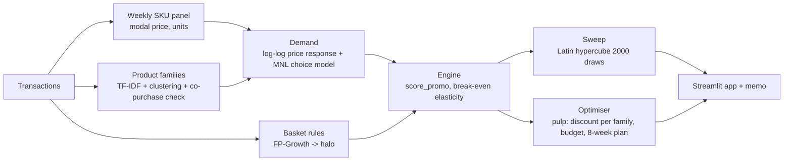
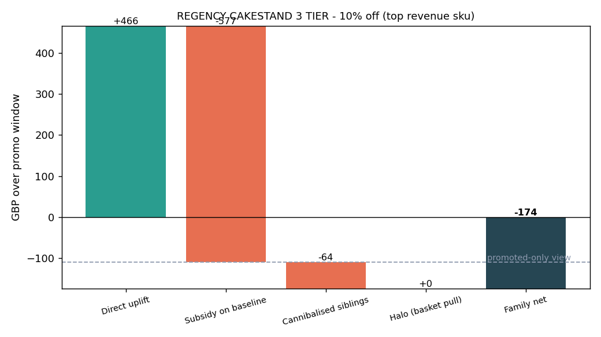
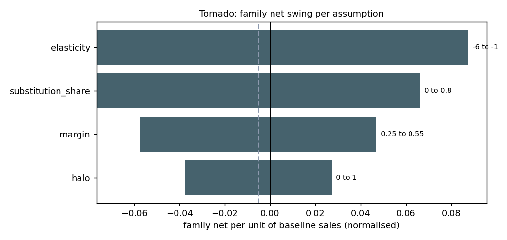
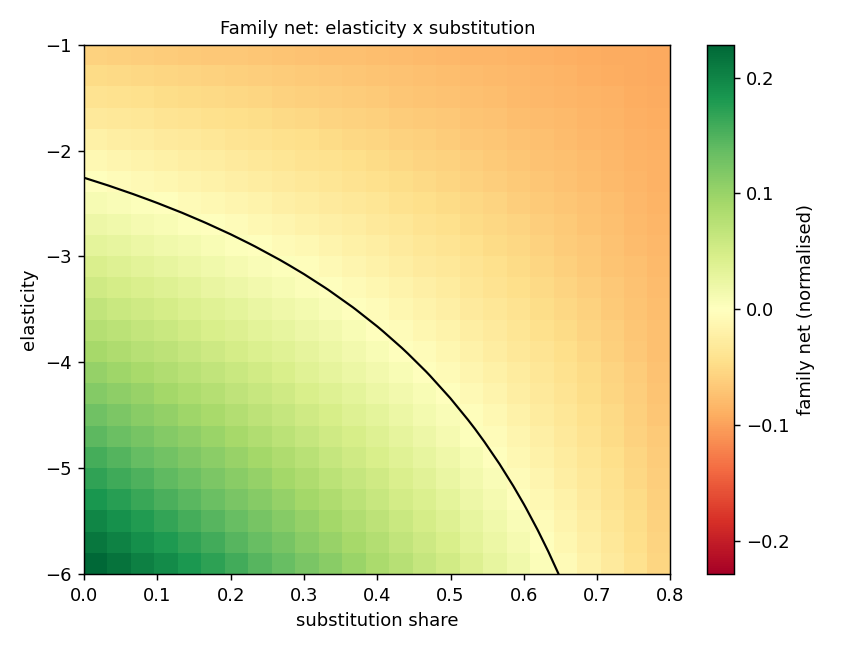

# Promotion Cannibalisation Engine (Case Study 05)

Score a discount on **family net contribution** instead of the promoted SKU's uplift:

`family_net = direct - subsidy - cannibalised + halo`

Built on UCI Online Retail II (real data). Package `promo`, seed 42, all assumptions in `config/config.yaml`.

## Problem
Category managers judge promotions by the promoted SKU's uplift. That ignores (1) the discount given away on units that would have sold anyway (**subsidy**), (2) margin lost when shoppers switch from sibling products (**cannibalised**) and (3) extra items pulled into the basket (**halo**). The engine scores all four terms, sweeps the uncertain assumptions (elasticity, substitution share, margin, halo), shows how often a promo that looks profitable on the dashboard is not profitable for the family, and picks the best discount per family under a subsidy budget. See `docs/PROBLEM_STATEMENT.md`.

## Data
UCI Online Retail II (id 502): UK online gift-ware retailer, 2009-12-01 to 2011-12-09, about 1.07M lines. **No costs and no promotion flags exist**: margin is an assumption (`unit_cost_share` in the config) and "promotions" are inferred from price drops that were not randomised. Loader order: `data/raw` cache, `$AMPBA_DATA_DIR/online_retail_ii.parquet` (default `C:/ampba_data`), `ucimlrepo` id 502, UCI zip download. Cleaning: drop cancellations (kept separately), `Quantity <= 0`, `Price <= 0`, non-product codes; missing Customer ID kept (invoice-level project). Identifiability numbers: `docs/data_quality.md`.

## Approach


| Module | What it does |
|---|---|
| `data.py` | load/clean, weekly SKU panel with modal price, identifiability report, synthetic `make_fixture()` for offline tests |
| `catalog.py` | TF-IDF + agglomerative families (colour/size words removed), co-purchase substitution check (weak-substitute families get capped cannibalisation), manual override CSV |
| `baskets.py` | FP-Growth rules (lift/confidence filters, same-family consequents excluded) -> halo per SKU |
| `demand.py` | per-SKU log-log elasticity (month effects, HC1 errors) behind an identifiability filter, shrinkage to family median / prior, pooled SKU+week fixed-effects cross-check; MNL with outside option calibrated to each SKU's own elasticity |
| `engine.py` | `score_promo` (identity by construction), `break_even_elasticity` (brentq), `EngineContext` |
| `sweep.py` | Latin-hypercube sweep of a normalised parametric engine, tornado, heat-maps, classification KPI |
| `optimise.py` | pulp/HiGHS: best discount in {0,5,10,15,20,25%} per family under a budget; 8-week calendar with seasonal index; dashboard-style baselines |
| `viz.py`, `report.py`, `pipeline.py` | charts, number-bearing docs generated from `outputs/summary.json`, stage orchestration |

**Identification, honestly.** Prices are not randomised, so elasticities are *price-response associations with confounding caveats*, estimated only for SKUs that pass an identifiability filter (enough weeks and enough price drops), shrunk toward the leave-one-out family median, and replaced by the family median or a global prior where price does not vary. The sweep then varies elasticity over a wide range so conclusions do not rest on any single estimate. Positive estimates are dropped and counted.

## Results
<!-- RESULTS:START -->
*Generated by `python analysis/run_analysis.py` from `outputs/summary.json` - do not edit by hand. Runtime 66.5 s (evaluate stage).*

### Reference promotion (10% off, top-24 SKUs by revenue, margin 40% assumed, 2 weeks)
| Metric | Promoted-only (dashboard) view | Family-net view |
|---|---|---|
| Total contribution | £133 | **£779** (₹81,796) |
| SKUs profitable | 10 of 24 | 10 of 24 (3 dashboard traps) |
| Terms | direct £5,098, subsidy -£4,965 | cannibalised -£1,436, halo £2,082 |
| Break-even elasticity (median, 23 defined) | | -3.50 (multiplier vs estimated: 1.22) |

Sensitivity of the reference total to the two untestable assumptions:

| Margin | Outside share | Family net total | Promoted-only total | SKUs profitable (family) |
|---|---|---|---|---|
| 30% | 20% | -£2,074 | -£2,033 | 5 |
| 30% | 40% | -£1,082 | -£1,566 | 6 |
| 30% | 60% | -£302 | -£1,228 | 9 |
| 40% | 20% | -£622 | -£568 | 6 |
| 40% | 40% | £779 | £133 | 10 |
| 40% | 60% | £1,875 | £640 | 12 |
| 50% | 20% | £830 | £898 | 8 |
| 50% | 40% | £2,640 | £1,833 | 15 |
| 50% | 60% | £4,052 | £2,509 | 18 |

### Assumption sweep (2,000 Latin-hypercube draws, 10% off; reproducible with seed: True)
| View | % of conditions profitable |
|---|---|
| Promoted-only | 60.5% |
| Family net | 38.7% |
| Dashboard trap (promoted-only > 0, family <= 0) | 23.4% |

Break-even elasticity: median -3.76, p10 -7.39, p90 -2.16; 5.9% never break even within the range.

By discount level:

| Discount | Promoted-only profitable | Family profitable | Dashboard trap | Median break-even elasticity |
|---|---|---|---|---|
| 5% | 63.9% | 42.9% | 22.1% | -3.54 |
| 10% | 60.5% | 38.7% | 23.4% | -3.76 |
| 15% | 56.0% | 34.2% | 23.8% | -3.90 |
| 20% | 49.5% | 29.1% | 22.6% | -4.00 |
| 25% | 42.9% | 23.9% | 20.8% | -3.98 |

### Classification KPI vs simulation truth
Dashboard rule 75.0% correct; family-net rule with parameter noise 10% / 25% / 50%: 91.8% / 82.5% / 72.9%.

### Optimiser (8-week calendar, budget £28,332)
| Policy | Promos | True family net |
|---|---|---|
| Optimiser (pulp/HiGHS) | 28 | **£6,294** |
| Dashboard (rank by promoted-only, common 10%) | 32 | £1,591 |
| Top revenue | 32 | -£809 |

Budget sensitivity (calendar):

| Budget fraction | Budget | Promos | Subsidy used | Family net | Binding |
|---|---|---|---|---|---|
| 1% | £944 | 9 | £944 | £2,779 | yes |
| 3% | £2,833 | 26 | £2,833 | £5,164 | yes |
| 10% | £9,444 | 28 | £5,244 | £6,294 | no |
| 30% | £28,332 | 28 | £5,244 | £6,294 | no |

### Demand estimates
1,593 identifiable SKUs, 1,579 negative estimates (median -2.39), 14 positive dropped; pooled SKU+week fixed-effects elasticity -2.03; elasticity sources across all SKUs: {'prior': 2913, 'estimated_shrunk': 1579, 'family_median': 214}. MNL checks: share-sum error 2.2e-16, own-elasticity error 0.40%.

### Acceptance criteria
| Criterion | Target | Achieved | Pass |
|---|---|---|---|
| Engine identity | within 1e-6 | `tests/test_engine.py::test_engine_identity` | see pytest |
| Sweep draws, reproducible | >= 1,000 and seeded | 2,000, reproducible = True | yes |
| Memo reports reference family net, % profitable both views, break-even | present | `docs/DECISION_MEMO.md` | yes |
| Optimiser within budget | subsidy <= budget | £5,244 <= £28,332 | yes |

Figures: `figures/waterfall_*.png`, `reference_promo.png`, `tornado.png`, `heatmap_*.png`, `breakeven_distribution.png`, `elasticity_estimates.png`, `plan_comparison.png`, `family_units_*.png`.




<!-- RESULTS:END -->

## Business impact
`docs/DECISION_MEMO.md` gives the CXO view: reference-promo family net, % profitable under both views, break-even multiplier and the optimiser plan. `docs/MODEL_CARD.md` covers intended use, diagnostics and failure modes.

## Limitations
- **No cost data**: margin is assumed and swept; the sign of the reference total depends on it (see the sensitivity table).
- **No promotion flags**: price drops are inferred, not randomised; elasticities are associations.
- **Wholesaler co-purchase**: many customers buy every variant together, so true substitution may be lower than the MNL implies; weak-substitute families (high co-purchase share) are capped, not removed.
- **MNL / IIA**: sibling losses are proportional to share; the outside option also loses share (market expansion). Nested logit is not implemented.
- **One promo window**: no pull-forward, stockpiling, post-promo dip or competitor reaction.
- Basket confidence is an association, not causal pull (hence `halo_factor`); baseline units are means over active weeks and overstate sporadic SKUs.
- The classification KPI is measured against a *simulation truth* (drawn parameters), not against real promotion outcomes.

## Deviations from the spec / plan
1. **Python 3.12, system interpreter, no venv** (template says 3.11 + venv); Docker and CI use 3.12 with the pinned versions of this machine. PuLP 4.x API (`add_variable`) is used with a fallback for older PuLP; solver is HiGHS (CBC fallback).
2. **Cleaning is slightly stricter than the plan**: only 5-digit-prefixed product codes are kept (drops `gift_*`, `DCGS*`, `SP*` ...), codes are upper-cased, and two fully cancelled bulk orders (quantity >= 10,000 with a matching cancellation) are removed because one of them otherwise dominated a reference SKU. Counts therefore differ a little from `DATA.md`; the exact numbers are in `docs/data_quality.md`.
3. **Week fixed effects**: a per-SKU regression has one observation per SKU-week, so it uses month effects (as in the plan); week FE enter through the pooled SKU+week two-way FE estimate, which is reported as a cross-check but not used per SKU.
4. **Choice model**: MNL only; nested logit is a stretch goal in the plan and is not implemented.
5. **Weak-substitute cap** is implemented as a scaling (`weak_sub_weight`) of sibling unit losses in families with a high co-purchase share.
6. **Sweep**: runs on a normalised parametric engine (per unit of baseline sales); the basket-halo reference ratio is data-derived (median over the reference SKUs of basket revenue per incremental unit relative to own price) and reported in `summary.json`.
7. **Reference promotion** uses the top-24 SKUs by revenue *among SKUs still active at the end of the data* (the count of inactive SKUs excluded is in `summary.json`).
8. **Optimiser**: candidates are the top-200 families by revenue, promoted SKU = top-revenue active member; budget = `budget_frac` x one week of the promoted SKUs' revenue; budget sensitivity table shows when it binds. Net and subsidy are scaled by a seasonal index from the same weeks one year earlier.
9. **Classification KPI** ("% promos correctly classified vs simulation truth") is implemented on the sweep draws with parameter-knowledge noise levels.
10. Optional Dunnhumby validation and the review-slide decks are not produced. No `git init`/commit was performed.
11. Large interim parquet files are written to `$AMPBA_INTERIM_DIR` (`tasks.py` defaults to `C:/ampba_data/05_interim`) to keep them out of OneDrive.

## How to run
```powershell
python tasks.py all        # data -> train -> evaluate -> test -> lint  (a few minutes on the full data)
python tasks.py app        # streamlit run app/streamlit_app.py
python analysis/run_analysis.py --fixture   # offline end-to-end run on synthetic data
python -m pytest -q        # offline tests (synthetic fixture)
```
Individual stages: `python tasks.py data|train|evaluate|test|lint`. `make <target>` works too if `make` is installed. Manual family fixes: edit `config/family_overrides.csv` (`stock_code,family`), then `python tasks.py train evaluate` stages again.

Outputs: `outputs/summary.json`, `metrics.json`, `reference_promo.csv`, `sweep_draws.csv`, `promo_plan.csv`, `engine_inputs.parquet` (read by the app); figures in `figures/`.

## Milestone log
| Milestone | Scope | Status |
|---|---|---|
| M1 | data, weekly modal-price panel, families + co-purchase check + overrides | done |
| M2 | FP-Growth halo, price-response estimates, MNL per family | done |
| M3 | engine, break-even elasticity, reference promo, 2,000-draw sweep | done |
| M4 | pulp optimiser, 8-week calendar | done |
| M5 | Streamlit app, tests, CI, memo, model card | done |

## References
- Reference repo (design inspiration only, no code copied): [akash-sood97/promotion-cannibalisation-engine](https://github.com/akash-sood97/promotion-cannibalisation-engine) (R7). Its headline (dashboard-preferred promo profitable in 86% of conditions vs 11% for the family) uses a different parameterisation; this project reports its own numbers.
- Chen, D. (2019). Online Retail II. UCI Machine Learning Repository, https://archive.ics.uci.edu/dataset/502/online+retail+ii (DOI 10.24432/C5CG6D).
- Dunnhumby "Breakfast at the Frat" (suggested validation, not used): https://www.dunnhumby.com/source-files/
