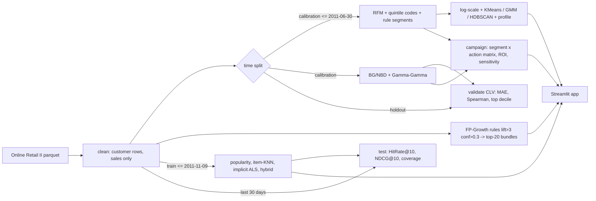
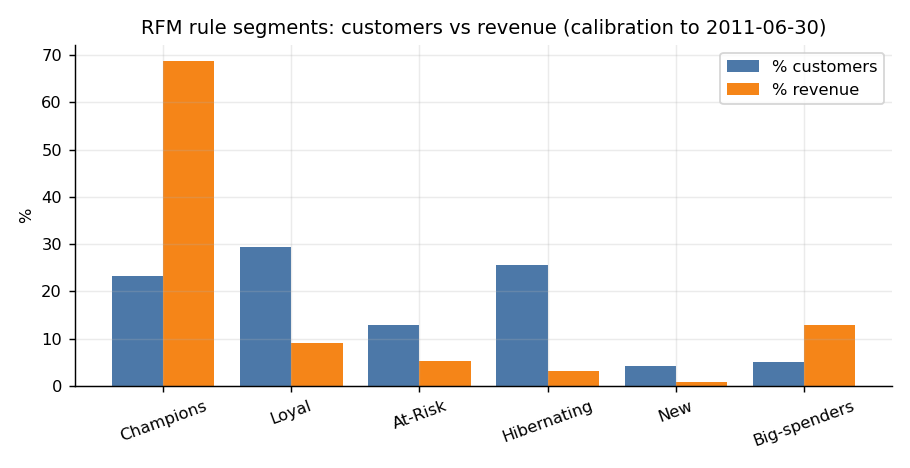
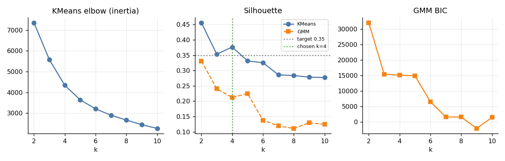
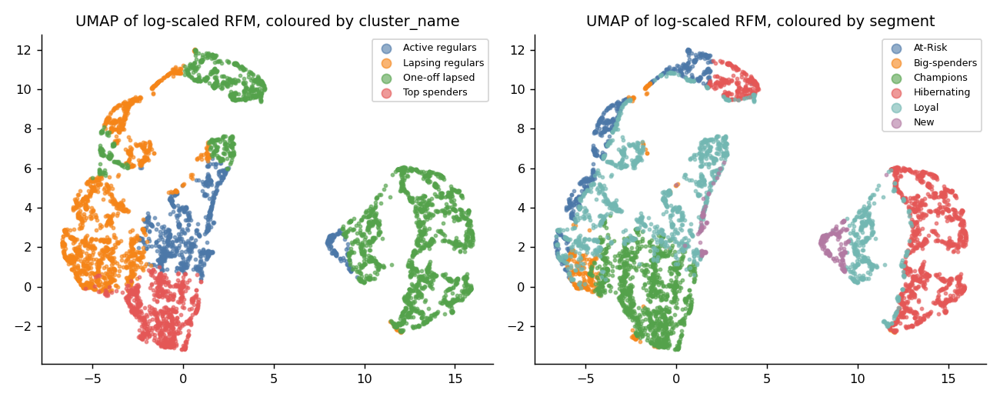
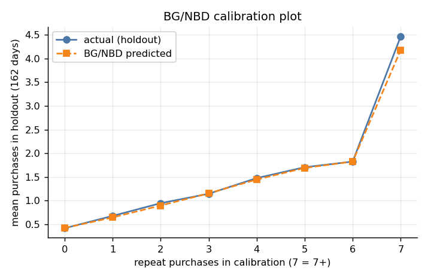
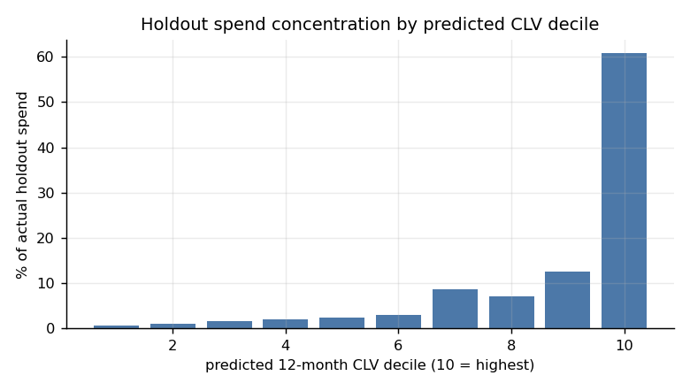
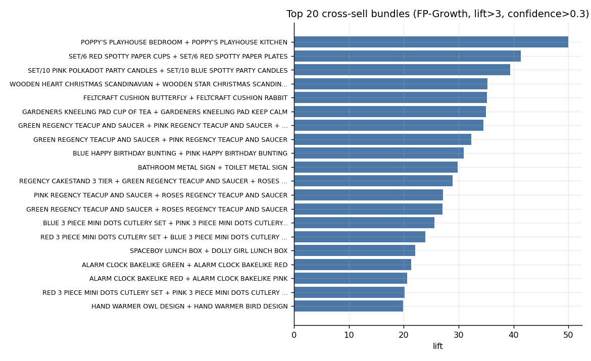
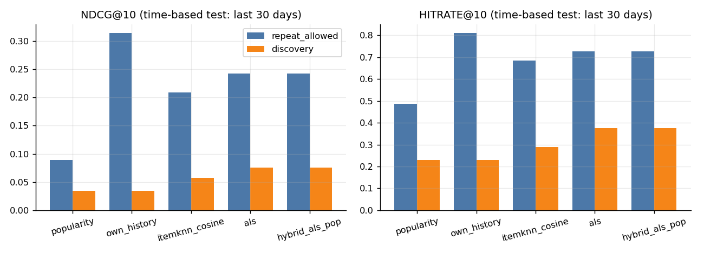
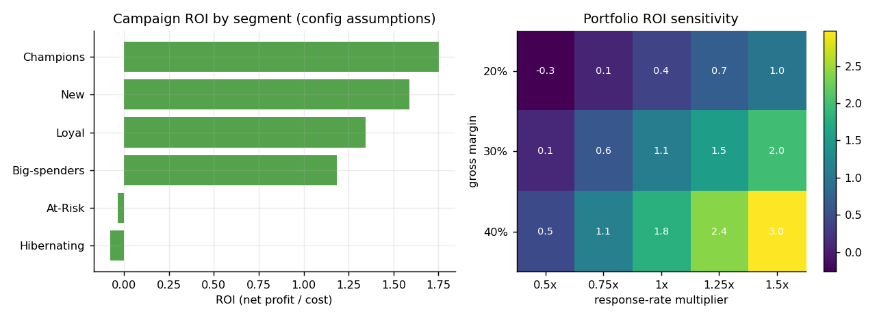

# Case Study 06 - RFM Segmentation, CLV, Market Basket and Recommender

CRM analytics on UCI Online Retail II: actionable segments, 12-month customer lifetime value, cross-sell bundles,
personalised top-10 recommendations and a segment-level campaign plan, plus a Streamlit app.
Package `crm` (`src/crm/`), spec in [SPEC.md](SPEC.md), data notes in [DATA.md](DATA.md).
Every number below is written by code into `outputs/metrics.json` / `outputs/summary.json`; the results block is
regenerated by `analysis/render_docs.py` (do not edit it by hand).

## Problem
The CRM team needs (a) segments it can act on, (b) a 12-month CLV per customer, (c) cross-sell bundles and
(d) top-10 product recommendations for e-mail. KPIs: silhouette >= 0.35; CLV MAE / Spearman vs holdout; recommender
NDCG@10 and HitRate@10 at least 30% above popularity. See [docs/PROBLEM_STATEMENT.md](docs/PROBLEM_STATEMENT.md).

## Data
UCI Online Retail II (id 502), customer-identified clean sales lines only (cancellations, non-product codes,
non-positive quantity/price removed; exact duplicate lines are **kept**, see Deviations). Calibration up to 2011-06-30,
holdout 2011-07-01 to 2011-12-09. Recommender: train up to 2011-11-09, test = last 30 days.
Loader order: `data/raw/` cache, then `$AMPBA_DATA_DIR` (default `C:/ampba_data`) `online_retail_ii.parquet`, then `ucimlrepo`
id 502, then the UCI zip. `crm.data.make_fixture()` generates a synthetic offline frame used by all tests.

## Approach


## Results
<!-- RESULTS:START -->

### Targets vs achieved
| Metric | Target | Achieved | Met? |
|---|---|---|---|
| Segment silhouette (KMeans, k=4) | >= 0.35 | 0.377 | yes |
| ALS NDCG@10 / popularity (repeat_allowed) | >= 1.30x | 2.73x | yes |
| ALS NDCG@10 / popularity (discovery) | >= 1.30x | 2.20x | yes |
| CLV MAE (spend) beats historical baseline | lower | 549 vs 570 | yes |
| CLV Spearman (spend) beats baseline | higher | 0.608 vs 0.567 | yes |
| Bundles (lift>3, conf>0.3) | top 20 | 20 | yes |

### Data (from `outputs/metrics.json`)
802,634 clean sales lines, 5,852 customers; calibration (<= 2011-06-30)
5,016 customers, holdout (2011-07-01 to 2011-12-09) 3,360 customers
(2,524 in both), holdout spend GBP 4,831,459.

### Segments (rule-based RFM, as of 2011-06-30)
| Segment | Customers | % customers | % revenue (to 2011-06-30) | Mean recency (d) | Mean orders | Mean spend | Action |
|---|---|---|---|---|---|---|---|
| Champions | 1,166 | 23.2% | 68.7% | 32 | 14.00 | 7,426 | VIP loyalty perks + early access |
| Loyal | 1,471 | 29.3% | 9.2% | 107 | 3.00 | 784 | Loyalty points + cross-sell bundle |
| At-Risk | 642 | 12.8% | 5.3% | 294 | 3.50 | 1,050 | Win-back offer (10% off) |
| Hibernating | 1,278 | 25.5% | 3.1% | 357 | 1.20 | 308 | Low-cost reactivation e-mail |
| New | 208 | 4.1% | 0.7% | 28 | 1.20 | 432 | Welcome series + second-order incentive |
| Big-spenders | 251 | 5.0% | 13.0% | 193 | 8.70 | 6,505 | Upsell: personalised bundle + account manager call |



### Clustering
KMeans (log1p + z-score on recency, frequency, monetary): best silhouette over k=2..10 is
0.456 at k=2; the final model uses
k=4 (smallest k >= 3 with the best silhouette) with silhouette
**0.377**. GMM silhouette at the same k is 0.212
(BIC prefers k=9); HDBSCAN finds 3 clusters with
34.4% noise points (silhouette on non-noise 0.221).
Adjusted Rand index of KMeans vs rule segments: 0.318.
Feature-set ablation (reported honestly; the 6-feature space from the spec does not reach the target):

| Feature set | Best k | Best silhouette | Silhouette at final k |
|---|---|---|---|
| RFM only (primary) | 2 | 0.456 | 0.377 |
| rfm_plus_tenure | 3 | 0.409 | 0.339 |
| all_six | 2 | 0.323 | 0.257 |

| cluster | name | customers | customer_share | revenue_share | recency | frequency | monetary | tenure | avg_basket | n_products |
|---|---|---|---|---|---|---|---|---|---|---|
| 0 | One-off lapsed | 2093 | 0.42 | 0.06 | 287.65 | 1.39 | 350.69 | 331.68 | 273.48 | 24.46 |
| 1 | Top spenders | 735 | 0.15 | 0.64 | 28.48 | 19.40 | 11059.54 | 500.88 | 527.24 | 196.33 |
| 2 | Lapsing regulars | 1443 | 0.29 | 0.24 | 174.90 | 5.05 | 2100.58 | 447.99 | 499.28 | 86.47 |
| 3 | Active regulars | 745 | 0.15 | 0.06 | 24.93 | 3.34 | 951.84 | 258.67 | 315.11 | 53.09 |




### CLV (BG/NBD + Gamma-Gamma, fitted on calibration only; 162-day holdout)
| Model | MAE spend (GBP) | MAE purchases | Spearman spend | Spearman purchases |
|---|---|---|---|---|
| BG/NBD + Gamma-Gamma | 549.000 | 0.959 | 0.608 | 0.619 |
| Historical average (baseline) | 570.500 | 1.029 | 0.567 | 0.543 |
| Population mean (naive) | 1106.900 | - | - | - |

Top decile of customers by predicted 12-month CLV holds **58.9%** of predicted
12-month CLV and, ranked by the 162-day holdout prediction, **60.7%** of actual
holdout spend (oracle ceiling 72.1%; baseline ranking
59.8%). Predicted total holdout spend
GBP 3,420,031 vs actual GBP 4,189,658 (the holdout contains the Q4 peak,
which BG/NBD does not model).




### Market basket
FP-Growth on 36,275 invoices x top 2,500 items; min_support tuned over a
grid and set to 0.012 (655 itemsets, 309 rules with
lift>3 and confidence>0.3). Top lift 50.0; median lift of the top 20 29.3.

| rank | bundle | support | confidence | lift |
|---|---|---|---|---|
| 1 | POPPY'S PLAYHOUSE BEDROOM + POPPY'S PLAYHOUSE KITCHEN | 0.013 | 0.849 | 49.991 |
| 2 | SET/6 RED SPOTTY PAPER CUPS + SET/6 RED SPOTTY PAPER PLATES | 0.013 | 0.787 | 41.278 |
| 3 | SET/10 PINK POLKADOT PARTY CANDLES + SET/10 BLUE SPOTTY PARTY CANDLES | 0.013 | 0.801 | 39.335 |
| 4 | WOODEN HEART CHRISTMAS SCANDINAVIAN + WOODEN STAR CHRISTMAS SCANDINAVIAN | 0.013 | 0.706 | 35.243 |
| 5 | FELTCRAFT CUSHION BUTTERFLY + FELTCRAFT CUSHION RABBIT | 0.012 | 0.657 | 35.116 |
| 6 | GARDENERS KNEELING PAD CUP OF TEA + GARDENERS KNEELING PAD KEEP CALM | 0.013 | 0.729 | 34.986 |
| 7 | GREEN REGENCY TEACUP AND SAUCER + PINK REGENCY TEACUP AND SAUCER + ROSES REGENCY TEACUP AND SAUCER | 0.015 | 0.719 | 34.537 |
| 8 | GREEN REGENCY TEACUP AND SAUCER + PINK REGENCY TEACUP AND SAUCER | 0.018 | 0.841 | 32.251 |
| 9 | BLUE HAPPY BIRTHDAY BUNTING + PINK HAPPY BIRTHDAY BUNTING | 0.012 | 0.690 | 30.917 |
| 10 | BATHROOM METAL SIGN + TOILET METAL SIGN | 0.015 | 0.761 | 29.779 |
| 11 | REGENCY CAKESTAND 3 TIER + GREEN REGENCY TEACUP AND SAUCER + ROSES REGENCY TEACUP AND SAUCER | 0.012 | 0.753 | 28.890 |
| 12 | PINK REGENCY TEACUP AND SAUCER + ROSES REGENCY TEACUP AND SAUCER | 0.017 | 0.801 | 27.166 |
| 13 | GREEN REGENCY TEACUP AND SAUCER + ROSES REGENCY TEACUP AND SAUCER | 0.021 | 0.797 | 27.021 |
| 14 | BLUE 3 PIECE MINI DOTS CUTLERY SET + PINK 3 PIECE MINI DOTS CUTLERY SET | 0.017 | 0.623 | 25.593 |
| 15 | RED 3 PIECE MINI DOTS CUTLERY SET + BLUE 3 PIECE MINI DOTS CUTLERY SET | 0.015 | 0.615 | 23.935 |
| 16 | SPACEBOY LUNCH BOX + DOLLY GIRL LUNCH BOX | 0.019 | 0.673 | 22.045 |
| 17 | ALARM CLOCK BAKELIKE GREEN + ALARM CLOCK BAKELIKE RED | 0.019 | 0.674 | 21.383 |
| 18 | ALARM CLOCK BAKELIKE RED + ALARM CLOCK BAKELIKE PINK | 0.014 | 0.649 | 20.578 |
| 19 | RED 3 PIECE MINI DOTS CUTLERY SET + PINK 3 PIECE MINI DOTS CUTLERY SET | 0.014 | 0.550 | 20.128 |
| 20 | HAND WARMER OWL DESIGN + HAND WARMER BIRD DESIGN | 0.015 | 0.580 | 19.884 |



### Recommender (train to 2011-11-09, test = last 30 days)
ALS best params (tuned on a validation window inside the training period): {'factors': 64, 'regularization': 1.0, 'alpha': 1.0, 'iterations': 15}; hybrid weight (popularity) = 0.0.

**Protocol `repeat_allowed`** (re-orders count; 1,474 users):
| Model | HitRate@10 | NDCG@10 | Coverage | NDCG vs popularity | NDCG vs own_history | 95% CI (vs popularity) |
|---|---|---|---|---|---|---|
| random | 0.0706 | 0.0081 | 0.9569 | - | - | - |
| popularity | 0.4878 | 0.0888 | 0.0022 | - | - | - |
| own_history | 0.8100 | 0.3141 | 0.3362 | 3.54x | - | - |
| itemknn_cosine | 0.6839 | 0.2087 | 0.2344 | 2.35x | 0.66x | [2.20, 2.52] |
| als | 0.7273 | 0.2421 | 0.1333 | 2.73x | 0.77x | [2.54, 2.99] |
| hybrid_als_pop | 0.7273 | 0.2421 | 0.1333 | 2.73x | 0.77x | [2.54, 2.95] |

**Protocol `discovery`** (already-bought items excluded; 1,335 users):
| Model | HitRate@10 | NDCG@10 | Coverage | NDCG vs popularity | NDCG vs own_history | 95% CI (vs popularity) |
|---|---|---|---|---|---|---|
| random | 0.0449 | 0.0049 | 0.9428 | - | - | - |
| popularity | 0.2292 | 0.0342 | 0.0174 | - | - | - |
| own_history | 0.2292 | 0.0342 | 0.0174 | 1.00x | - | - |
| itemknn_cosine | 0.2899 | 0.0570 | 0.1289 | 1.67x | 1.67x | [1.49, 1.89] |
| als | 0.3753 | 0.0753 | 0.1761 | 2.20x | 2.20x | [1.92, 2.58] |
| hybrid_als_pop | 0.3753 | 0.0753 | 0.1761 | 2.20x | 2.20x | [1.94, 2.57] |

`own_history` is a personalised baseline (rank the user's own past items by purchase count, popularity tie-break).
Under `repeat_allowed` it scores NDCG@10 0.3141, i.e. ALS is
0.77x of it: the 2.73x lead over popularity is mostly
re-order memory, not discovery. Under `discovery` (seen items excluded) the baseline collapses to popularity and ALS is
2.20x, which is the fair headline for "new product" e-mail content.



### Campaign planner (assumptions in `config/config.yaml`)
| Segment | Action | Contacts | Cost (GBP) | Incr. revenue (GBP) | Net profit (GBP) | ROI | Funded |
|---|---|---|---|---|---|---|---|
| Champions | VIP loyalty perks + early access | 1166 | 2,332 | 21,379 | 4,082 | 1.75 | 100.0% |
| New | Welcome series + second-order incentive | 208 | 366 | 3,158 | 581 | 1.59 | 100.0% |
| Loyal | Loyalty points + cross-sell bundle | 1471 | 1,471 | 11,487 | 1,975 | 1.34 | 100.0% |
| Big-spenders | Upsell: personalised bundle + account manager call | 251 | 1,506 | 10,970 | 1,785 | 1.19 | 55.2% |
| At-Risk | Win-back offer (10% off) | 642 | 1,419 | 4,558 | -51 | -0.04 | 0.0% |
| Hibernating | Low-cost reactivation e-mail | 1278 | 554 | 1,702 | -43 | -0.08 | 0.0% |

Unconstrained portfolio: cost GBP 7,647, net profit GBP 8,329,
ROI 1.09. With a GBP 5,000 budget: funded cost GBP 5,000,
net profit GBP 7,623, ROI 1.52.
Sensitivity range (response multiplier 0.5x-1.5x, margin 20-40%): portfolio ROI -0.27 to 2.97.



<!-- RESULTS:END -->

## Business impact
See [docs/DECISION_MEMO.md](docs/DECISION_MEMO.md): segment sizes and revenue share, CLV top-decile share and the campaign ROI table.
Campaign uplifts, costs and margin are **assumptions** in `config/config.yaml` (swept in the sensitivity table), not measured effects.

## Limitations
- ~5k customers with heavy-tailed spend: segments, deciles and clusters are noisy.
- BG/NBD ignores seasonality; the holdout contains the Q4 peak. First-purchase dates are left-censored at 2009-12-01.
- The dataset has no category taxonomy and no campaign history; campaign response is assumed, not learned.
- Recommender evaluated on purchases only; wholesale re-orders make "repeat_allowed" scores much higher than "discovery".
- Segments/CLV are a 2011-06-30 snapshot so predictions can be validated; a production run would refit on all data.

- The popularity-blend weight chosen on the validation window is 0.0, so the "hybrid" row equals plain ALS (blending did not help).
- Runtime: about 6 min for `train` on an idle laptop (measured 341 s); under heavy CPU contention the full `all` took ~31 min, so allow headroom.

## Deviations
| Spec item | What was done | Why |
|---|---|---|
| `n_categories` in RFM | `n_products` (distinct StockCodes) | the data has no category field |
| Clustering on all six features | primary space = log1p(recency, frequency, monetary); 6-feature and RFM+tenure variants reported as ablations | the 6-feature space does not reach silhouette 0.35 (see Results); reported honestly |
| Final k | best silhouette among k >= 3 (k=2 is only active vs lapsed) | actionability; unconstrained best k also reported |
| UMAP | `umap-learn` installed and used (PCA fallback in code) | spec asks for UMAP |
| LightFM | not used | optional in spec; hybrid ALS+popularity added instead |
| Cleaning | non-product codes also include C2, PADS, TEST001/2, GIFT*; exact duplicate lines kept | per data-sources skill; DATA.md counts differ slightly (802,634 vs 802,914 lines) |
| CLV currency | GBP (data native), INR only as display factor in config | spec mentions INR |
| BG/NBD penalizer | 0.001 (0.01 produced numerically invalid predictions for 484 customers); chosen without looking at holdout metrics | lifetimes numerical issue |
| ALS | confidence = alpha * log1p(count); tuned on a validation window inside the training period | no tuning on the test window |
| Recsys protocols | both `repeat_allowed` (primary, chosen before seeing results) and `discovery` reported | DATA.md pitfall 5 |
| Recsys baseline (review fix) | added personalised `own_history` baseline next to popularity; headline vs popularity kept per spec, but ALS does not beat own_history under `repeat_allowed` (see Results) | popularity alone is a weak, non-personal bar for wholesale re-order data |
| Review run (CPU contention) | review re-ran `pytest`, `ruff`, `python tasks.py evaluate` only; the full `all` was not re-run, `outputs/metrics.json` ALS/CLV/cluster numbers are from the earlier train | other projects were running concurrently |
| Python/venv | Python 3.12, no venv; deps pinned in requirements.txt to the installed versions | environment |

## How to run
```bash
python tasks.py setup      # pip install -r requirements.txt
python tasks.py all        # data -> train -> evaluate (figures, summary.json, docs) -> lint -> test
python tasks.py app        # streamlit run app/streamlit_app.py
```
Equivalent `make <target>` works where make exists. Individual steps: `python tasks.py data|train|evaluate|test|lint`.
Tests run fully offline on the synthetic fixture (`pytest -q`).

## Milestone log
| Milestone | Built | Status |
|---|---|---|
| M1 | data loader/cleaner, RFM quintile codes, named segments | done |
| M2 | KMeans k=2..10, GMM, HDBSCAN, profile table, UMAP embedding | done |
| M3 | BG/NBD + Gamma-Gamma, holdout validation, calibration plot, decile share | done |
| M4 | FP-Growth bundles, popularity/item-KNN/ALS/hybrid recommender, time-split evaluation | done |
| M5 | campaign planner, Streamlit app, tests, CI, docs, memo, model card | done |

## References
- [R17 RishabhBansal2409/Recommendation_Engine](https://github.com/RishabhBansal2409/Recommendation_Engine) - user/item CF; design inspiration only (extended here with implicit ALS and a time split).
- [R7 akash-sood97/promotion-cannibalisation-engine](https://github.com/akash-sood97/promotion-cannibalisation-engine) - basket rules on the same data.
- ISB AMPBA capstone title "Customer Profiling & Market Basket Analysis".
- Fader, Hardie, Lee (2005) BG/NBD; Fader and Hardie Gamma-Gamma; `lifetimes`, `mlxtend`, `implicit` libraries.
- Dataset: Chen, D. (2019) Online Retail II, UCI Machine Learning Repository, DOI 10.24432/C5CG6D.
