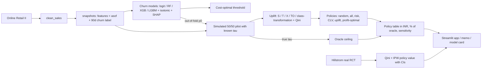

# Case Study 07 - Churn Prediction + Uplift-based Retention (`churnx`)

Retention budget is wasted on customers who would stay anyway or who cannot be saved. This project (1) predicts who will
churn in the next 90 days, (2) picks a cost-optimal contact threshold, (3) estimates **who actually responds to an offer**
(uplift) from randomised data, and (4) compares six targeting policies in INR against a perfect-hindsight oracle -
including when "target the highest-risk customers" loses money.

> **Simulated vs real.** Track A (policy-vs-oracle numbers) uses a **simulated** 50/50 offer pilot on top of **real** churn
> labels - the offer's effect is invented (docs/SIMULATOR.md). Track B uses the **real** Hillstrom e-mail RCT with
> oracle-free IPW evaluation. Every number below is generated by code into `outputs/summary.json` / `outputs/metrics.json`.

## Problem
See [docs/PROBLEM_STATEMENT.md](docs/PROBLEM_STATEMENT.md). KPIs: churn AUC >= 0.75; Qini > 0; uplift policy > risk-only > random;
uplift policy >= 70% of oracle; `test_features_before_asof` passes.

## Data
- **UCI Online Retail II (id 502)** - 1.07M invoice lines, 2009-12-01 to 2011-12-09. `data.py` resolution order: cache in
  `data/interim` -> `data/raw` -> `$AMPBA_DATA_DIR/online_retail_ii.parquet` (default `C:/ampba_data`) -> `ucimlrepo` -> zip download.
- **Churn label:** customer with >= 2 orders in the previous 180 days and **no purchase in the next 90 days**. Train snapshots
  2011-03-01 / 04-01 / 05-01, test 2011-08-01 (last train label window ends 2011-07-30, before the test snapshot).
- **Hillstrom e-mail RCT** (64,000 customers, 3 arms) for Track B; downloaded to `data/raw/hillstrom.csv` (skipped gracefully offline).
- Offline tests use `make_fixture()` / `make_hillstrom_fixture()` synthetic data.

## Approach

Modules (`src/churnx/`): `data`, `snapshot`, `models`, `threshold`, `pilot`, `uplift`, `policy`, `survival`, `hillstrom`,
`train`, `report`, `docgen`, `plots`, `validate`, `config`. Uplift learners and Qini/AUUC are implemented from scratch with
LightGBM/scikit-learn (no `causalml` / `scikit-uplift` dependency; the sklift cross-check test is skipped when it is not installed).

## Results
<!-- RESULTS:START -->

### Targets vs achieved

| Metric | Target | Achieved | Pass? |
|---|---|---|---|
| Churn AUC (test 2011-08-01) | >= 0.75 | 0.747 | **FAIL** |
| Qini > 0 (selected learner, pilot test cohort) | > 0 | 6,307 (S-learner) | PASS |
| Uplift policy % of oracle (base case) | >= 70% | 92.3% | PASS |
| Uplift > risk-only > random (profit) | ordering | yes | PASS |
| test_features_before_asof | passes | passes | PASS |

### Churn models (temporal split: train 2011-03/04/05, test 2011-08-01)

| Model | grouped-CV AUC (train) | test AUC | PR-AUC | KS | Brier | mean pred |
|---|---|---|---|---|---|---|
| logit (champion by CV) | 0.783 | 0.747 | 0.523 | 0.382 | 0.176 | 0.322 |
| rf | 0.777 | 0.747 | 0.516 | 0.382 | 0.179 | 0.351 |
| xgb | 0.777 | 0.740 | 0.514 | 0.357 | 0.181 | 0.333 |
| lgbm | 0.767 | 0.732 | 0.503 | 0.337 | 0.187 | 0.338 |
| champion + isotonic (group-CV) | - | 0.746 | 0.518 | 0.385 | 0.177 | 0.319 |
| naive baseline (train churn rate) | - | 0.500 | - | - | 0.217 | 0.401 |

Snapshots (eligible customers and churn rate):

| Snapshot | Split | Eligible | Churn rate |
|---|---|---|---|
| 2010-12-01 | pilot_hist | 1,999 | 48.6% |
| 2011-01-01 | pilot_hist | 1,962 | 48.2% |
| 2011-02-01 | pilot_hist | 1,863 | 46.2% |
| 2011-03-01 | train | 1,822 | 42.6% |
| 2011-04-01 | train | 1,758 | 41.2% |
| 2011-05-01 | train | 1,551 | 35.7% |
| 2011-08-01 | test | 1,471 | 28.5% |

Mean calibrated prediction on the test snapshot is 0.319 versus an observed churn rate of
0.285: the pre-Christmas season lowers churn relative to the training snapshots, so calibration drifts
even though ranking (AUC) holds. A logit trained on 6 snapshots (pilot history + train) reaches test AUC
0.756 (supplementary, not the headline; train-only check on the 2011-05-01 snapshot: AUC 0.783 with train-only history, 0.768 with pilot history added, 0.780 with stronger regularisation (C=0.05), so the wider window was NOT adopted). SHAP top drivers (mean |SHAP|, xgb):
`tenure_days` 0.430, `frequency_6m` 0.345, `ipt_mean` 0.324, `ipt_std` 0.311, `recency_days` 0.221.

### Cost-optimal contact threshold (risk-only, constant save rate 20%, offer cost ₹250)

Best threshold 0.01: contact 1,374 of 1,471 customers, expected profit
₹5,293,336 versus ₹5,274,991 for contacting everybody and ₹0 for nobody
(these are *expected* profits under the assumed constant save rate, not measured outcomes). With a cheap offer the optimum is
to contact almost everyone; the best threshold rises with the offer cost:

| Save rate | Offer cost (INR) | Best threshold | Contacted | Expected profit (INR) |
|---|---|---|---|---|
| 0.05 | 100 | 0.01 | 1,374 | 1,271,809 |
| 0.05 | 250 | 0.01 | 1,374 | 1,065,709 |
| 0.05 | 500 | 0.09 | 1,154 | 748,265 |
| 0.05 | 1,000 | 0.19 | 932 | 239,232 |
| 0.05 | 2,500 | 0.91 | 5 | 108,202 |
| 0.05 | 5,000 | 0.91 | 5 | 95,702 |
| 0.05 | 10,000 | 0.91 | 5 | 70,702 |
| 0.10 | 100 | 0.01 | 1,374 | 2,681,018 |
| 0.10 | 250 | 0.01 | 1,374 | 2,474,918 |
| 0.10 | 500 | 0.01 | 1,374 | 2,131,418 |
| 0.10 | 1,000 | 0.09 | 1,154 | 1,496,530 |
| 0.10 | 2,500 | 0.86 | 10 | 232,165 |
| 0.10 | 5,000 | 0.91 | 5 | 216,404 |
| 0.10 | 10,000 | 0.91 | 5 | 191,404 |
| 0.20 | 100 | 0.01 | 1,374 | 5,499,436 |
| 0.20 | 250 | 0.01 | 1,374 | 5,293,336 |
| 0.20 | 500 | 0.01 | 1,374 | 4,949,836 |
| 0.20 | 1,000 | 0.01 | 1,374 | 4,262,836 |
| 0.20 | 2,500 | 0.09 | 1,154 | 2,416,059 |
| 0.20 | 5,000 | 0.86 | 10 | 464,330 |
| 0.20 | 10,000 | 0.91 | 5 | 432,809 |
| 0.30 | 100 | 0.01 | 1,374 | 8,317,854 |
| 0.30 | 250 | 0.01 | 1,374 | 8,111,754 |
| 0.30 | 500 | 0.01 | 1,374 | 7,768,254 |
| 0.30 | 1,000 | 0.01 | 1,374 | 7,081,254 |
| 0.30 | 2,500 | 0.06 | 1,231 | 5,103,211 |
| 0.30 | 5,000 | 0.18 | 962 | 2,380,790 |
| 0.30 | 10,000 | 0.91 | 5 | 674,213 |

### Uplift learners on the simulated pilot (test cohort; treatment effect is SYNTHETIC)

Selected by grouped-CV Qini on the training pilot: **S**. Pilot sanity: observed ATE
0.059 (SE 0.023) vs mean true tau 0.047.

| Scorer | Qini | 95% bootstrap CI | % of oracle Qini | uplift at 30 | tau corr (Pearson) | tau corr (Spearman) |
|---|---|---|---|---|---|---|
| S (selected) | 6,307 | [-7,887, 21,115] | 107% | 0.096 | 0.79 | 0.79 |
| T | 2,761 | [-12,379, 17,285] | 47% | 0.106 | 0.66 | 0.57 |
| X | -629 | [-14,768, 14,286] | -11% | 0.078 | 0.70 | 0.66 |
| TO | -913 | [-15,829, 12,269] | -16% | 0.031 | 0.30 | 0.35 |
| CT | -5,309 | [-17,025, 10,159] | -90% | 0.041 | 0.54 | 0.53 |
| oracle | 5,871 | [-7,863, 20,881] | 100% | 0.093 | - | - |
| random | -1,019 | [-16,057, 10,532] | -17% | 0.075 | - | - |
| risk_only | 2,737 | [-10,766, 17,441] | 47% | 0.069 | - | - |

All Qini confidence intervals are wide because the test cohort has only 1,471 customers; an interval that
includes 0 means the ranking is not statistically distinguishable from random on this cohort alone.

### Policy comparison (exact value vs perfect-hindsight oracle; offer cost ₹250, 30% budget)

| Policy | Treated | Profit (INR) | % of oracle |
|---|---|---|---|
| random | 441 | 802,532 | 28.7% |
| all | 1,471 | 2,751,518 | 98.2% |
| risk_top_k | 441 | 1,275,673 | 45.5% |
| clv_top_k | 441 | 602,721 | 21.5% |
| uplift_top_k | 441 | 1,351,339 | 48.2% |
| profit_optimal | 1,098 | 2,584,617 | 92.3% |
| oracle | 1,214 | 2,801,136 | 100.0% |
| risk_threshold_m2 | 1,372 | 2,770,631 | 98.9% |

`profit_optimal` is the uplift policy (contact iff predicted tau x value > cost): 92.3% of the oracle.
`risk_threshold_m2` is the M2 cost-optimal threshold rule scored against the true effect. Random-policy expected profit
over repeated draws: ₹824,894.
With such a low offer cost almost every customer has positive incremental profit, so contacting everybody is already
near the oracle; targeting only pays when the offer is expensive relative to customer value (next table).

Profit (INR million) by policy as the offer cost rises (base margin and CLV horizon; masks recomputed per cell):

| Policy \ offer cost (INR) | 100 | 250 | 500 | 1,000 | 2,500 | 5,000 | 10,000 |
|---|---|---|---|---|---|---|---|
| random | 0.87 | 0.80 | 0.69 | 0.47 | -0.19 | -1.29 | -3.50 |
| all | 2.97 | 2.75 | 2.38 | 1.65 | -0.56 | -4.24 | -11.59 |
| risk_top_k | 1.34 | 1.28 | 1.17 | 0.94 | 0.28 | -0.82 | -3.02 |
| clv_top_k | 0.67 | 0.60 | 0.49 | 0.27 | -0.39 | -1.49 | -3.70 |
| uplift_top_k | 1.42 | 1.35 | 1.24 | 1.02 | 0.36 | -0.74 | -2.95 |
| profit_optimal | 2.81 | 2.58 | 2.24 | 1.68 | 0.71 | 0.17 | 0.10 |
| risk_threshold_m2 | 2.98 | 2.77 | 2.43 | 1.81 | 0.44 | -0.34 | -0.24 |
| oracle | 2.99 | 2.80 | 2.51 | 2.00 | 1.04 | 0.39 | 0.12 |

Across the full cost x margin x CLV grid (63 cells) risk-top-30% loses money in
21 cells, `profit_optimal` in 0,
contact-all in 24, and `profit_optimal` beats risk-top-30% in
63 cells.

Who earns / loses under risk-only targeting (base case, risk top 30%):

| Segment | Customers | Treated by risk-top-30% | Mean true tau | Profit contribution (INR) |
|---|---|---|---|---|
| Champions | 194 | 0 | 0.000 | 0 |
| Hibernating | 107 | 93 | 0.023 | 52,136 |
| Mid-frequency | 482 | 87 | 0.080 | 735,234 |
| Other | 688 | 261 | 0.041 | 488,303 |

**Different response pattern** (simulator re-run with the response bump on *high* frequency, learner re-selected:
`X`):

| Policy | Treated | Profit (INR) | % of oracle |
|---|---|---|---|
| random | 441 | 508,049 | 29.8% |
| all | 1,471 | 1,670,330 | 98.0% |
| risk_top_k | 441 | 488,714 | 28.7% |
| clv_top_k | 441 | 851,966 | 50.0% |
| uplift_top_k | 441 | 752,036 | 44.1% |
| profit_optimal | 575 | 942,597 | 55.3% |
| oracle | 1,235 | 1,704,887 | 100.0% |

### Survival view (optional)

KM P(no purchase by day 30/60/90) = 0.61/0.40/0.28; Cox concordance 0.655.

### Track B - Hillstrom e-mail RCT (REAL randomised treatment; oracle-free IPW evaluation)

n = 64,000 (held-out half 32,000); max |standardised covariate difference| between arms 0.009; policy learner `X` chosen on a validation slice of the training half.

| Policy (held-out half) | Treated | IPW profit per 1,000 customers (USD) | 95% bootstrap CI |
|---|---|---|---|
| random_30 | 9,600 | 3.1 | [-64.7, 57.0] |
| all | 32,000 | 72.0 | [-17.5, 166.4] |
| history_top_30 | 9,600 | 35.0 | [-36.2, 92.6] |
| uplift_top_30 | 9,600 | 21.8 | [-25.4, 65.6] |
| uplift_profit_optimal | 24,327 | 39.1 | [-34.4, 113.9] |

| Outcome | Learner | Qini | 95% bootstrap CI |
|---|---|---|---|
| visit | S | 3,292,377 | [1,661,194, 4,923,580] |
| visit | T | 2,279,784 | [711,636, 3,826,468] |
| visit | X | 2,450,105 | [812,176, 3,861,756] |
| visit | TO | 2,603,654 | [1,011,808, 4,123,987] |
| visit | random | 359,120 | [-1,266,703, 1,880,892] |
| conversion | S | 9,176 | [-457,333, 460,283] |
| conversion | T | -255,004 | [-659,458, 176,642] |
| conversion | X | -114,702 | [-608,165, 272,444] |
| conversion | TO | -170,303 | [-635,979, 255,586] |
| conversion | random | 324,456 | [-100,245, 784,486] |
| spend | S | -18,240,812 | [-80,723,958, 45,350,470] |
| spend | T | 7,912,878 | [-52,436,070, 73,771,703] |
| spend | X | -10,245,191 | [-73,217,892, 49,940,577] |
| spend | TO | -8,633,129 | [-68,375,309, 53,816,615] |
| spend | random | 45,556,248 | [-19,278,095, 102,244,867] |

<!-- RESULTS:END -->

Figures are in [figures/](figures/): churn rate by snapshot, ROC, calibration, lift, SHAP, threshold profit, Qini curves,
tau recovery, policy profit, risk-only segment breakdown, cost sensitivity, Hillstrom Qini, Kaplan-Meier.

## Business impact
See [docs/DECISION_MEMO.md](docs/DECISION_MEMO.md) (generated from the JSON outputs): why the highest-risk customers are not the
best targets, how large the gap to the oracle is, and which assumptions drive it.

## Limitations
- Track A treatment effects are simulated; policy-vs-oracle conclusions hold by construction of the simulator (sensitivity to
  the response pattern and economics is reported).
- The pilot test cohort has ~1.5k customers, so Qini bootstrap CIs are wide.
- Churn rate drifts from ~49% to ~28% across snapshots (pre-Christmas season in the test window): AUC is stable but calibration drifts.
- Hillstrom is an e-mail experiment for a different business with tiny conversion rates; IPW policy intervals are wide.
- Margin, offer cost, FX and the 12-month value horizon are assumptions in `config/config.yaml`.
- Duplicate invoice lines are not dropped (some are genuine repeats); the first/last-year data window is left-censored for `tenure_days`.

## Deviations from the spec / plan
- **AUC target:** see the targets table above - the champion's test AUC is reported as measured; it is not tuned on the test snapshot.
  Champion selection uses grouped-CV AUC on the training snapshots only.
- **Uplift libraries:** `causalml` and `scikit-uplift` are not used (hand-rolled learners, as the plan allows); the sklift
  cross-check test is skipped if the package is absent.
- **Class-transformation** learner added to the plan's S/T/X/TO set (spec lists it); valid for the 50/50 pilot only.
- **Policy `profit_optimal`** is the "uplift policy" for the 70%-of-oracle criterion; `uplift_top_k` (30% budget) is reported separately.
- **Learner selection** for policies uses grouped-CV Qini on the training pilot (not the test cohort). The selected learner can be
  noisy; per-learner results are in `outputs/summary.json` -> `policy.per_learner`.
- **Pilot test `p0`** is the calibrated champion probability logit-shifted to the realised churn rate (simulator truth only).
- Offer cost base case is the plan's INR 250; higher costs are swept (INR 100 ... 10,000).
- Features: the plan's list plus `recency_over_ipt` (recency / mean inter-purchase time).
- Hillstrom bootstraps use 500 resamples (config); pilot Qini bootstraps use 200.
- Kaplan-Meier / Cox survival (optional) is included via `lifelines` (installed locally); Cox may warn about convergence at the
  chosen penaliser.
- Runs use the system Python without a venv (`PYTHONPATH=src` is set by `tasks.py` / `Makefile`); `pip install -e .` also works.

## How to run
```powershell
python tasks.py all        # data -> train -> evaluate (figures, outputs, docs) -> ruff -> pytest
python tasks.py data|train|evaluate|test|lint
python tasks.py app        # streamlit run app/streamlit_app.py
```
`make all` is equivalent where `make` exists. Docker: `docker build -t churnx . && docker run -p 8501:8501 churnx`.
Set `AMPBA_DATA_DIR` to the folder holding `online_retail_ii.parquet` to avoid the slow Excel download.

## Milestone log
| Milestone | Status | Notes |
|---|---|---|
| M1 snapshots + labels | done | snapshot sizes / churn rates match the plan's sanity table |
| M2 churn models + threshold | done | see Results |
| M3 pilot + uplift (+ Hillstrom) | done | see Results |
| M4 policy comparison | done | see Results |
| M5 app / tests / CI / memo | done | Streamlit verified with `streamlit.testing.v1.AppTest` |

## References
- Reference repo (design inspiration only, no code copied): [akash-sood97/partner-retention-system](https://github.com/akash-sood97/partner-retention-system) (R9) - cost-optimal thresholds and policy-vs-ceiling framing.
- Kunzel et al. (2019), metalearners (X-learner); Jaskowski & Jaroszewicz (2012), class transformation; Radcliffe, Qini curves.
- UCI Online Retail II: Chen, D. (2019), DOI 10.24432/C5CG6D. Hillstrom (2008), MineThatData e-mail analytics challenge.
- scikit-uplift docs (metric definitions): https://www.uplift-modeling.com/
