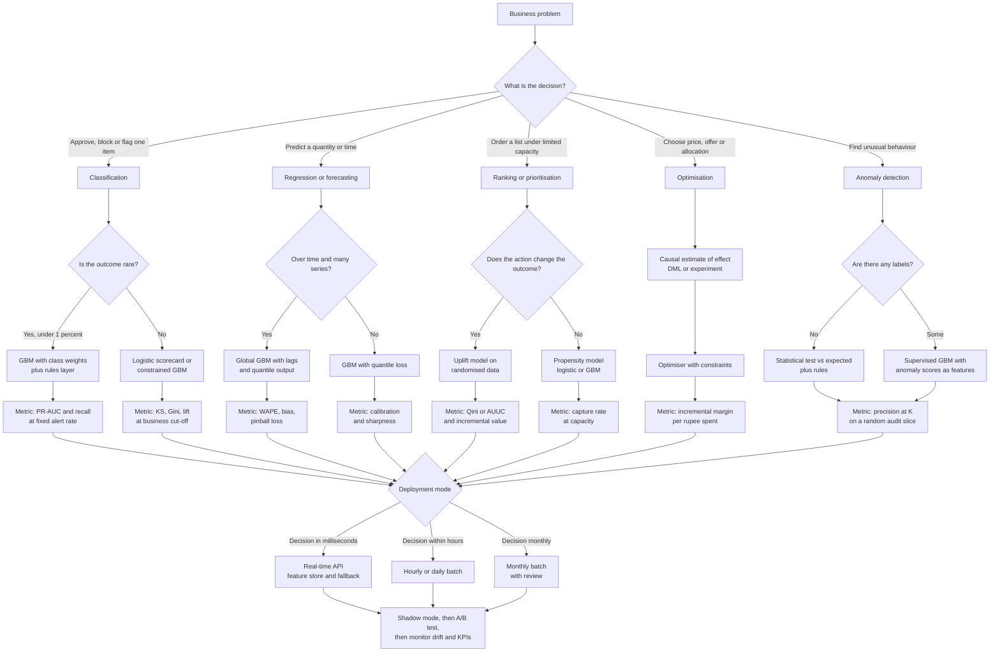

# Frameworks and Lessons Across All 10 Cases

This file pulls the ten case studies together into reusable tools: a decision table, a flowchart, a domain comparison, fifteen lessons, and a self-test.

---

## 1. Cross-Case Decision Framework

Use this table when a real project throws one of these situations at you. The last column tells you which case shows it in detail.

| Situation | Recommended approach | Why | Seen in |
| --- | --- | --- | --- |
| **Severe class imbalance** (fraud at 0.04%) | Keep every positive, downsample negatives or use class weights, never resample the test set, judge with PR-AUC and recall at a fixed alert rate | Accuracy and ROC-AUC hide failure on rare events. Resampling before the split leaks | Case 2 |
| **Mild imbalance** (7 to 15% positives) | Do nothing special. No SMOTE. Use ranking metrics (KS, lift, PR-AUC) | The model sees enough positives, and resampling only distorts probabilities | Cases 1, 4, 9 |
| **Latency under 100 ms** | Precompute heavy features in a feature store, use a small tree model, set a timeout, and keep a rules fallback | Slow scoring harms every user, and a fallback means the model can never take the product down | Cases 2, 6 |
| **Explainability or regulation** (RBI, model-risk review) | Scorecard or monotonic-constrained GBM, SHAP-based reason codes, full documentation, champion-challenger rollout | A decision you cannot explain to the customer or the auditor cannot go live | Case 1 |
| **Explainability for operations** (mentors, RMs, analysts) | Top 3 reasons per score in plain business language, with a suggested action | People act on reasons, and trust grows when they can check them | Cases 2, 4, 9, 10 |
| **Cold start** (new store, SKU, course, program) | Borrow from similar entities (clusters, attributes), use relative features, ramp curves, wider safety margins at first | With no history, the best prior is a similar entity | Cases 5, 6, 9, 10 |
| **Label delay** (months before the outcome is known) | Maturity window for training, early proxy labels for monitoring, vintage analysis, time-based validation | You cannot wait a year to learn the model is broken, and unmatured rows look falsely good | Cases 1, 2, 10 |
| **Censored data** (event not yet happened, or hidden by stock-outs) | Minimum history, survival or hazard models, stock-adjusted demand | "Not yet" is not "never", and zero sales is not zero demand | Cases 4, 5, 8 |
| **Small data** (hundreds of positives) | Simple regularised models, pooling across groups, fewer features, strong baselines | Complex models memorise. Pooling shares strength | Case 10 |
| **Seasonality and events** | Calendar and event features, rolling-origin backtests that include festivals, bias correction layer, human overrides logged | Patterns repeat yearly but history is short, so combine data with domain knowledge | Cases 5, 6, 7 |
| **Selection bias** (only treated or approved cases have outcomes) | Small randomised slice, inverse-propensity weights, reject-inference only with caution | The model otherwise learns the old policy and not the world | Cases 1, 3, 8, 10 |
| **Feedback loop** (the model changes the data it later learns from) | Permanent random exploration or holdout, retrain on it with weights | Otherwise the training data shrinks to what the model already believes | Cases 3, 7, 8 |
| **Capacity constraint** (calls, recounts, counsellors) | Rank by expected value, fill capacity from the top, evaluate at the capacity size | The list size is a business limit, not a probability cut-off | Cases 3, 4, 8, 10 |
| **Asymmetric cost of error** | Quantile loss or cost-based threshold chosen from business costs | Being late, wrongly blocked, or wrongly hidden each have different prices | Cases 2, 5, 6, 8 |
| **No labels at start** | Statistical anomaly scores and rules first, then collect labels through action (recounts, reviews) | Value on day one, and the actions create the labels | Case 8 |
| **Adversarial drift** (fraudsters adapt) | Fast retraining, a rules lane for hot fixes, anomaly signals for unseen patterns | Attackers move faster than a training cycle | Case 2 |
| **Intervention effect matters more than risk** | Uplift modelling on randomised data | "Who will leave" is not "who can be saved" | Cases 3, 4, 9 |
| **Price or action effects must be causal** | Randomised tests, DML, instrumental variables, hold-out validation | Correlation in observational history is usually confounded | Case 7 |

---

## 2. Decision Flowchart

Start from the business problem and walk down. Each path ends in a deployment mode.

---

## 3. Domain Comparison

| Dimension | Finance | Quick Commerce | EdTech |
| --- | --- | --- | --- |
| **Regulation** | Heavy: RBI rules on lending, digital lending, fair practices, fraud reporting, customer liability. Model-risk governance | Moderate: consumer protection, MRP rules, food safety, competition law, data protection. Public scrutiny of rider safety | Light to moderate: consumer protection, data protection (extra care for minors), advertising claims, refund rules |
| **Typical latency need** | Milliseconds for fraud, seconds for credit decisions, monthly for churn | Milliseconds to seconds for ETA and pricing display, hourly or daily for forecasting and inventory | Seconds for lead routing, weekly for dropout |
| **Nature of data** | Structured, transactional, bureau data, strong labels but delayed | High-frequency operational data (orders, stock, riders, GPS), noisy timestamps | Event logs (clicks, videos, classes), sparse early on, small positives for sales |
| **Label quality and delay** | Delayed (3 to 12 months), selection bias from approvals | Mostly fast, but censored (stock-outs) or noisy (rider taps) | Delayed (30 to 45 days for sales, weeks for dropout), contaminated by interventions |
| **Cost of error** | High and asymmetric: one default or fraud loss can wipe out dozens of good decisions. Also regulatory and reputational | Moderate per event, high in aggregate: a late order, an empty shelf, wastage | Low per event, moderate in aggregate: a lost learner or lead. Reputation matters over time |
| **Explainability need** | Very high for credit decisions. High for fraud blocks | Low to moderate, mostly for operations teams | Moderate, for mentors and counsellors to act on |
| **Drift speed** | Fast for fraud (weeks), slow for credit (quarters) | Fast: festivals, weather, competitor moves, new stores (days to weeks) | Medium: campaign mix and course changes (weeks) |
| **Typical metrics** | KS, Gini, PR-AUC, recall at alert rate, bad rate, roll rate, expected loss | WAPE, bias, pinball loss, calibration, availability, wastage, incremental margin | Precision at capacity, lift, lead time, capture rate, completion rate, conversion |
| **Biggest trap** | Label delay, selection bias, leakage from bureau and collections data | Treating sales as demand, ignoring asymmetric cost, confounded price history | Late warnings, intervention contamination, post-contact leakage |
| **Where value comes from** | Better decisions on risk, with compliance | Better inventory and prices at scale, thin margins | Directing scarce human time (mentors, counsellors) to the right learner or lead |

---

## 4. Top 15 Lessons from 15 Years in Industry

1. **Define the label before you touch a model.** Most failed projects fail on the definition of "default", "churn" or "dropout", not on the algorithm.
2. **The decision is the product, not the prediction.** Always ask what action the score triggers, who takes it, and what it costs.
3. **Respect the clock.** Every feature must be available at the moment of prediction. Most "great" models are leaking the future.
4. **Beat a simple baseline first.** A good rule or a table of historical averages tells you how much room ML really has, and becomes your safe fallback.
5. **Validate like you will deploy.** Time-based splits, group splits (customer, cohort, store), and a gap equal to the label delay. Random splits flatter you.
6. **Choose the metric from the business cost.** Accuracy is almost never right. Use capture at capacity, PR-AUC, pinball loss, or incremental margin, and say why.
7. **Capacity decides the threshold.** Calls, recounts, counsellors and reviewers are limited. Rank by expected value and fill the capacity.
8. **Predicting risk is not predicting impact.** When you can intervene, measure the effect of the action, using a small randomised group.
9. **Keep a small random slice forever.** It is your only unbiased view and the cure for feedback loops and selection bias.
10. **A forecast is a distribution.** Give ranges and quantiles, and choose the quantile by the cost of too much versus too little.
11. **Simple and trusted beats complex and ignored.** Adoption by the people who must act decides whether value is realised.
12. **Design for failure.** Timeouts, fallbacks, monitoring, and a kill switch matter as much as the model.
13. **Monitor the business, not just the model.** Drift in inputs is a symptom. Watch rupees, orders, complaints and refunds.
14. **Translate everything into rupees and plain words.** If you cannot explain the value in three lines to a leader, you do not yet understand it.
15. **Ethics and compliance are design constraints, not afterthoughts.** Consent, fairness, rider safety and customer harm should shape the system from day one.

---

## 5. Junior's Self-Assessment

Try each question on your own first, then read the answer.

### Question 1

A lender trains a default model on all loans disbursed in the last 2 years, including loans that are only 3 months old. The model looks very good in testing. What went wrong?

**Answer:** Unmatured loans are labelled "good" simply because they have not had time to default. The model learns that recent loans are good. Fix: train only on loans with a full maturity window (for example 12 months), use an early proxy such as 30+ DPD at month 3 to monitor newer cohorts, and validate out-of-time.

### Question 2

Your fraud model has ROC-AUC of 0.98 and accuracy of 99.95%. Your manager is delighted. What do you say?

**Answer:** Both numbers are inflated by the huge number of easy negatives, and a model that predicts "no fraud" always can score 99.96% accuracy. Report PR-AUC, recall at a fixed alert rate (for example 0.5% of transactions flagged), and value-weighted recall. Show the false-alarm cost in rupees.

### Question 3

In the collections case, why is a "who will default?" model a poor way to decide whom to call?

**Answer:** It ranks by risk, not by the effect of a call. People who will pay anyway (sure things) and people who cannot pay (lost causes) get calls with little benefit. The valuable group is the persuadables. Use uplift modelling on randomised call or no-call data, and rank by expected incremental recovery, then fill the capacity.

### Question 4

For a quick-commerce ETA, why should the promised time be a high quantile (such as P80) and not the average predicted time?

**Answer:** Late deliveries cost much more than early ones (refunds, lost trust), so the cost of error is asymmetric. A mean-based promise is late for about half of orders by design. Train with quantile (pinball) loss at the quantile set by the cost trade-off, and check calibration and sharpness, not just MAE.

### Question 5

Your demand forecast has a MAPE of 35%. Why is MAPE a bad choice for SKU-store forecasts, and what would you use?

**Answer:** MAPE is undefined for zero-sales days, explodes for tiny sales, and treats small and large errors the same. Use WAPE (weighted by volume), bias, and pinball loss at the quantile used for ordering, and always measure availability and wastage in simulation.

### Question 6

A new dark store opens next month with no sales history. How do you forecast demand?

**Answer:** Cluster similar mature stores by catchment type (office, residential, student), scale by the expected store size and an opening ramp curve (for example 40% of mature volume in week 1 and 80% by week 8), use SKU attributes to borrow strength, and move to store-specific learning as data accumulates. Add safety margin at first and monitor bias closely.

### Question 7

Past discounts were set by category managers during festivals and weekends. You fit a model of units on price and it says higher prices lead to more sales. What is happening and what do you do?

**Answer:** It is confounding: prices were higher (or discounts lower) in weeks when demand was already high. The coefficient is not a price effect. Run a small randomised price test (switchback by store-day), use causal methods such as double machine learning or instrumental variables, validate elasticity against the experiment, and optimise margin under constraints (MRP cap, budget, margin floor).

### Question 8

Phantom-inventory detection has only a few labels, and they come from counts chosen by an old rule. How do you get an honest evaluation?

**Answer:** Reserve a permanent slice of counts (for example 30%) chosen at random, stratified by category and sales speed. Evaluate precision and recall on that slice, and use it with weights in training. Start with a statistical anomaly score relative to expected demand, so you have value before labels accumulate.

### Question 9

A dropout model reaches 92% AUC using all activity from the full course. Why is it not useful, and how should you rebuild it?

**Answer:** It uses information from after the prediction time, and it does not tell you who to help early. Rebuild with weekly checkpoints, features cut at each checkpoint, group splits by cohort, and metrics per checkpoint including lead time. Choose the earliest checkpoint with precision good enough to act on, and measure the effect of interventions with a randomised control group.

### Question 10

A lead-scoring model uses "number of calls made" and "discount offered" as top features. Why is this a problem, and what should the features be?

**Answer:** These happen after a counsellor starts working the lead, so they are unavailable when you decide whom to call first, and they reflect the old policy. Use only pre-contact features: source, form data, early behaviour (demo attended, pricing views), reachability signals. Also use a maturity cut-off of 45 days for labels and keep a small random-order calling slice to correct for selection bias.
