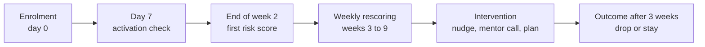
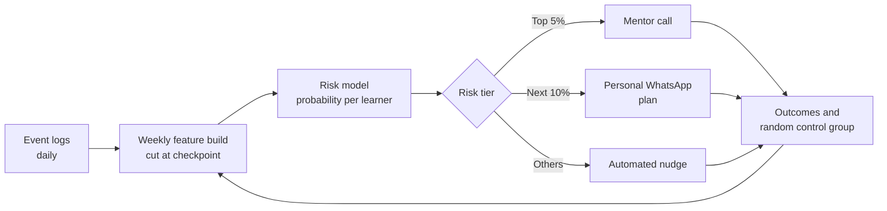

# Case Study 9: Course Dropout Early-Warning System

**Domain:** EdTech | **Problem Type:** Time-aware classification (early warning, person-week hazard) | **Difficulty:** Intermediate

---

## 1. Business Context

### Company background

- **SkillSutra** (fictional) is an online learning platform for working professionals and final-year students. Courses: data analytics, web development, product management, digital marketing.
- Format: **12-week cohort courses** with recorded videos, weekly live classes, assignments, a mentor, and a final project. Average fee ₹16,000, paid upfront or through EMI (monthly instalments) with a financing partner.
- Scale: about **3.2 lakh learners a year**, about 900 cohorts, revenue about ₹512 Cr a year.
- At any moment, about 74,000 learners are in the middle of a course.

### The pain, with numbers

| Item | Value |
| --- | --- |
| Dropout rate (share of learners who go inactive before completing) | about 38%, so about 1.22 lakh learners a year |
| Learners who never start (no activity in the first 7 days) | about 9% of enrolments |
| Cost of each dropout (refund or chargeback requests, lost next-course sale, lost referrals, support effort) | about ₹6,500 |
| **Annual cost of dropouts** | **about ₹79 Cr** |
| Mentor capacity | 120 mentors, about 25 calls a day each, so about 15,000 calls a week |
| Intervention cost | WhatsApp or app nudge about ₹5, mentor call about ₹250 |
| Current approach | Mentors call learners who have not logged in for 14 days |

- By day 14 of inactivity, most learners are already gone. Calls at that point rescue only about 4% of them.
- Target: bring dropout from 38% to about 33% by acting **earlier**.

### Stakeholders and what each wants

| Stakeholder | What they want | What they fear |
| --- | --- | --- |
| Chief Academic Officer | Higher completion and better learning outcomes | Treating completion as a vanity number |
| Head of Learner Success (mentors) | A short list of learners to help each week, with reasons | Calls to learners who did not need help |
| Chief Business Officer | Fewer refunds, more upsell and referrals | Spending on retention that does not pay back |
| Product and design | Insights on what in the course makes people leave | A model that is accurate but gives no product direction |
| Finance and the EMI partner | Lower refund requests and lower default on EMIs | Learners stopping payments after dropping out |
| Learners | Support when they struggle, not nagging | Spammy reminders |

---

## 2. Translating Business to ML

### The business question vs the ML question

| Business question | ML question |
| --- | --- |
| "Who is going to quit, and can we help them in time?" | "Every week, for each active learner, estimate the probability of becoming inactive for 21 or more days within the next 3 weeks, using only what we know up to today. Surface the top 15% with reasons." |

> **Mentor note:** A dropout model has a **time dimension** that juniors forget. A model that is 95% accurate at week 11 is worthless because the learner left in week 4. The question is not just "who", it is "who, early enough to act". Every feature and every evaluation must respect the clock.

### Target variable definition

- **Dropout event:** the learner has **21 consecutive days without learning activity** (video watched, assignment submitted, live class attended, quiz taken) before completing the course, or formally withdraws or requests a refund.
- **Completion:** at least 70% of content done and the final assessment submitted.
- **Prediction label at each weekly checkpoint:** `drop_next_3w = 1` if the learner becomes a dropout within the next 3 weeks, given they are still active at the checkpoint.

### Edge cases

| Edge case | Recommended treatment | Reason |
| --- | --- | --- |
| Approved pause (illness, travel, exams) | Exclude the paused period, and the learner is not a dropout | The learner told us, and may come back |
| Never started (zero activity in the first 7 days) | A separate **activation** problem with its own model or rule (onboarding calls, reminders) | Different behaviour and action. Mixing them confuses both |
| Learner completes early or finishes content but skips the final assessment | Define completion consistently, and discuss with academics | Avoid labelling a successful learner as a dropout |
| Learner gets a refund in week 1 (buyer's remorse) | Separate "early refund" class | Not a learning-engagement problem |
| Cohort rescheduled or batch merged | Flag and exclude affected weeks | Platform-caused inactivity |
| Learners under 18 (if any) | Check data-use rules with Legal, for example children's data provisions under the DPDP Act, 2023 | Compliance first |

### Unit of prediction

- One **learner x week** (a "person-week" row). A learner contributes one row for each week they are still active.

### Prediction timing



- First risk score at the end of week 2 (enough data, still early). Rescored every week until week 9.
- Intervention is used within 48 hours of scoring.

### What success looks like

| Lens | Success |
| --- | --- |
| Business | Dropout from 38% to about 33%, about 15,000 more completers a year, net benefit about ₹9 Cr after intervention costs |
| Model | In the top 15% flagged each week, at least 50% really drop within 3 weeks (the base rate is about 14%). Median lead time of at least 2 weeks before inactivity |
| Learner experience | No increase in complaints about reminders or calls |

---

## 3. Data Understanding

### Data sources and key features

| Feature group | Source | Why it matters |
| --- | --- | --- |
| Platform activity (logins, active days, video minutes, completion %) | Learning platform logs | The most direct engagement signal |
| Live class attendance and recording views | Class system | Social and scheduled engagement |
| Assignments and quizzes (submitted, late, scores, attempts) | LMS (Learning Management System) | Struggle and progress signals |
| Doubts and forum activity, mentor session attendance | Community and mentor tools | Engaged learners ask questions |
| Profile at signup (work experience, goal, hours per week they can commit, prior knowledge) | Enrolment form | Sets expectation and fit |
| Payment (EMI or upfront, fee, discount) | Billing | Financial pressure and commitment |
| Support tickets and sentiment | Helpdesk | Frustration signals |
| Device and connectivity (mobile only, buffering events, offline downloads) | App analytics | Mobile-first learners on weak networks behave differently |
| Course and cohort attributes (difficulty, instructor, size, start date) | Course master | Some courses and cohorts have more dropout |

### Data volume, granularity and refresh

- **Volume:** 3.2 lakh learners a year. Over 2 years, about 6 lakh learners x about 9 weeks = about 54 lakh person-week rows.
- **Granularity:** event logs (millions per day), aggregated to learner-week.
- **Refresh:** features updated daily. Scores generated weekly (Monday morning) with an optional mid-week refresh for new risk flags.

### Common data issues

| Issue | How it shows up here |
| --- | --- |
| Time leakage | Using activity from after the checkpoint, or the final status of the learner |
| Label definition | Pauses, early completion and refunds blur "dropout" |
| **Intervention contamination** | Past mentor calls saved some learners, so the history shows outcomes under the old action. A learner flagged and called who then stays looks like a "non-dropout" |
| Cohort and course effects | Cohorts differ (instructor quality, start date), and learners within a cohort are correlated |
| Cold start | New courses have no history |
| Small differences across seasons | Exam season, festive season, appraisal season affect time |
| Bots or logging gaps | A video left playing overnight inflates engagement |
| Sparse early data | At week 2 there is little to go on |

> **Mentor note: Where juniors usually go wrong here.**
>
> - They compute "total videos watched" over the whole course. That includes weeks after the prediction date, so the model learns from the future and looks perfect.
> - They split rows randomly, so the same learner (or same cohort) is in train and test. Performance is inflated.
> - They treat "predict dropout" as the goal. The goal is **saving** learners. The next step after this case is measuring which learners can be saved (see Case 3).

---

## 4. Approach and Decision Points

### Baseline first

- **Baseline 1 (current):** call learners with 14 days of no login. Late, and saves about 4%.
- **Baseline 2:** a simple rule from week-by-week data: "fewer than 2 active days in the last 7 days, or missed the last live class and the last assignment".
- **Why it matters:** simple engagement rules are strong in this domain. A model must prove it adds lead time and precision beyond them.

### Candidate models

| Model | Pros | Cons | Verdict |
| --- | --- | --- | --- |
| Rule-based risk score | Immediate, explainable | Crude, hard to tune | Baseline and fallback |
| Logistic regression | Interpretable, fast | Misses interactions | Good benchmark |
| **Gradient boosting on person-week rows** (with week number as a feature) | Accurate, handles missing data and interactions, simple to run weekly | Needs careful time-based features | **Primary model** |
| Survival or discrete-time hazard models | Produces risk over time, handles learners at different stages | More complex to explain | Good for analysis, and person-week GBM already acts as a hazard model |
| Sequence models (LSTM, transformer on daily activity) | Learn patterns from raw sequences | Hard to explain, more data and maintenance | Not worth it at this stage |
| Uplift models | Find learners who can be **saved** | Need randomised intervention data | Phase 2 (Case 3 idea) |

### Decision scenarios

| What if... | Recommended action | Reasoning |
| --- | --- | --- |
| **A prediction at week 10 is accurate but week 2 is poor** (timing trade-off) | Build checkpoints at weeks 2, 3, 4, 6 and 8. Report performance **per checkpoint** and choose the earliest checkpoint where precision is good enough to act. Show the trade-off to the business: earlier means less accurate but more saveable | Value = accuracy x time left to act. A late perfect model has little value |
| **New course launched with no dropout history** (cold start) | Use course-agnostic features, mainly **relative engagement** (learner vs cohort median, z-score by week), rather than absolute minutes. Add course difficulty and format as features. Start with the pooled model and monitor | Relative behaviour transfers across courses, and absolute minutes do not |
| **Mentors already called some learners in the past, which changed outcomes** | Log every intervention with a timestamp. Train with an `intervened` flag and avoid using post-intervention behaviour. Keep a **10% random no-contact control** from now on | Otherwise the model learns "learners who got calls stay", which is not about who is at risk |
| **Mentors can call only 15,000 learners a week** | Pick the list size from capacity and cost-benefit. Use the model to split into 3 tiers: top 5% get a mentor call, next 10% get a personal WhatsApp plan, others get automated nudges | Match the intervention cost to risk. Calls are scarce |
| **Mentors ask why a learner is flagged** | Show 3 reasons from SHAP in plain language ("missed the last 2 live classes", "assignment overdue by 9 days", "active days fell from 5 to 1"). Add a suggested action for each reason | Reasons become a script for the mentor's call, and build trust |
| **Dropout is mostly due to one hard module** | Aggregate model reasons by module and cohort, and send the insight to the academic team. Add "module difficulty" features | The best use of the model may be to fix the course, not only to chase learners |
| **Learners are in cohorts, so rows are correlated** | Validate with **group splits by cohort** (or by course for cold-start tests) | Random splits leak cohort-level patterns |

---

## 5. Feature Engineering

### Top 10 features to build

| # | Feature | Business logic |
| --- | --- | --- |
| 1 | Activation in the first 48 hours (first video watched, profile completed) | Early momentum predicts persistence |
| 2 | Active days in the last 7 days, and change from the previous 7 days | Core engagement and its trend |
| 3 | Share of scheduled live classes attended so far, and whether the last one was missed | Social, scheduled commitment |
| 4 | Assignment submission rate and average days late | Falling behind is a strong dropout signal |
| 5 | Content progress versus the planned pace (percent completed minus percent planned for this week) | How far behind the learner is |
| 6 | Engagement relative to cohort (z-score of weekly minutes) | Works across courses and cohorts |
| 7 | Quiz first-attempt score and number of retries | Struggle with content |
| 8 | Doubts asked, forum posts, and mentor session attendance | Help-seeking learners are usually more committed |
| 9 | Commitment at signup (hours per week promised) versus actual hours so far | Gap between intention and reality |
| 10 | Payment mode (EMI or upfront), fee-to-income band, and learner type (student or working professional) | Financial and time constraints |

### Features to avoid (leakage risks)

| Feature | Problem |
| --- | --- |
| Final completion percentage, certificate flag, final grade | Known only at the end |
| Refund request, withdrawal flag, "inactive" status | Direct label or label-derived |
| Activity after the checkpoint date | Look-ahead |
| Engagement **after** a mentor call, as a feature for the same decision | Result of the intervention |
| Cohort-level dropout computed over the whole cohort period | Leakage through aggregation |
| Gender, religion, caste, or proxies used to infer them | Fairness and legal risk |

Safe weekly features (cut at the checkpoint):

```python
# Build features strictly from events up to and including the checkpoint date
def weekly_features(events, learner_id, checkpoint):
    e = events[(events.learner_id == learner_id) & (events.ts <= checkpoint)]
    last7 = e[e.ts > checkpoint - pd.Timedelta(days=7)]
    prev7 = e[(e.ts <= checkpoint - pd.Timedelta(days=7)) &
              (e.ts > checkpoint - pd.Timedelta(days=14))]
    return {
        "active_days_7": last7.ts.dt.date.nunique(),
        "active_days_trend": last7.ts.dt.date.nunique() - prev7.ts.dt.date.nunique(),
    }
```

---

## 6. Evaluation Strategy

### Metrics

| Metric | Role | Why |
| --- | --- | --- |
| **Precision and recall at the capacity-based list size** (top 15% each week) | Primary | The list size is set by mentors, not by a probability cut-off |
| **PR-AUC** | Primary model metric | Better than ROC-AUC for a minority class (about 14% positive) |
| **Lead time** (weeks between the flag and the actual inactivity) | Primary, specific to this case | A late flag cannot save anyone |
| Lift in the top decile | Business-friendly | Easy to show |
| Calibration | Secondary | Needed for the tiers and cost-benefit decisions |
| Save rate in a randomised test | Business | Measures the effect of interventions |
| Net value per learner contacted | Business | Includes the cost of the call |

### Metrics that look good but are misleading here

- **Accuracy:** about 86% by predicting "nobody drops" at each checkpoint.
- **ROC-AUC computed over all weeks mixed:** later weeks are easier, so the overall figure hides poor early-week performance.
- **Recall without lead time:** catching learners the day before they leave is not useful.
- **Precision on learners who have already been inactive for 10 days:** easy and late.

### Validation strategy

| Step | Design | Why |
| --- | --- | --- |
| Time-based split | Train on cohorts that started in months 1 to 12, validate on months 13 to 15, test on months 16 to 18 | Mimics deployment |
| Group split by cohort | Never split a cohort across train and test | Cohort effects leak |
| Checkpoint-level evaluation | Report metrics for weeks 2, 4, 6 and 8 separately | Shows the timing trade-off |
| Course-holdout test | Hold out one whole course | Tests the cold-start behaviour |
| Randomised intervention test | Randomise flagged learners into call vs no call (and nudge vs no nudge) | Measures the save rate, which is the real goal |

### From model metric to business value

- 1.22 lakh dropouts a year. The list of about 1 lakh flagged learners during their courses (unique learners) captures about **50%** of them (about 60,800), with about 55% precision.
- Intervention package (tiered nudge, plan and mentor call) saves about **25%** of captured dropouts: about 15,200 learners. That is about 4.75 points on the dropout rate, from 38% to about 33%.
- Value: 15,200 x ₹6,500 = about **₹9.9 Cr**.
- Cost: about 30,000 mentor calls x ₹250 = ₹0.75 Cr, plus nudges and plans, about ₹1 Cr in total.
- **Net benefit about ₹9 Cr a year.** The 25% save rate is a pilot figure and must be verified with a randomised test.

---

## 7. Deployment and Monitoring

### Batch vs real time

- **Weekly batch scoring** on Monday morning, with a mid-week refresh for newly inactive learners.
- Real time is not needed. A learner is not saved by a minute's difference.
- Output: a ranked list per mentor with the tier, the top 3 reasons, and a suggested action. Also sent to the CRM for automated nudges.



### What to monitor

| Type | What to track | Alert trigger |
| --- | --- | --- |
| Data quality | Event volume per day, missing live-class attendance, duplicate logs | Drop of more than 20% from normal |
| Data drift | Feature distributions (active days, progress gap) by course | PSI above 0.2 |
| Model performance | Precision at top 15% and lead time on matured labels (3 weeks later) | Precision falls 8 points |
| Intervention effect | Save rate vs the random control group | Below break-even |
| Business KPIs | Dropout rate, completion rate, refund requests, NPS | Outside agreed bands |
| Learner experience | Opt-outs, complaints about messages, message frequency per learner | Frequency above the policy limit |
| Fairness | Flag rates and save rates by region, device, EMI vs upfront | Large unexplained gaps |

### Retraining

- **Scheduled:** monthly, after the labels for the latest cohorts mature.
- **Triggered:** a new course type, a platform change (new app, new live-class tool) or an exam-season shift.

### A/B test or champion-challenger design

- **Level 1 (model value):** old rule vs new model list, with the same call capacity, randomised at **cohort** level.
- **Level 2 (intervention value):** within the flagged list, randomise **learners** into mentor call vs no call. Keep 10% as a permanent control.
- Primary: dropout rate at week 12 and completion. Guardrails: complaints, opt-outs, mentor time per call.

---

## 8. Stakeholder Communication

### Explain it to a non-technical leader

> "Every Monday, the system looks at how each learner behaved in the last 2 weeks: classes attended, assignments submitted, days active, and how far behind the plan they are. It gives each learner a risk score for quitting within the next 3 weeks.
> Our mentors get a short list of the learners who most need help, with the reason, for example 'missed two live classes and is 9 days late on the assignment'.
> We find struggling learners about 2 weeks earlier than today, when a call can still make a difference.
> We expect dropout to fall from 38% to about 33%, and we keep a small control group to measure whether the calls really work."

### Questions leadership will ask

| Question | Suggested answer |
| --- | --- |
| "Why not call everyone who is behind?" | "We have capacity for about 15,000 calls a week, and many learners who are behind will recover alone. We call where help is most likely to matter" |
| "How early can we spot them?" | "At the end of week 2 we have a usable signal. It is less accurate than at week 6 but gives time to act. We tune this trade-off together" |
| "Is it just reminding people who were going to stay anyway?" | "That is the right question. Phase 1 predicts risk. Our randomised control group measures how many are really saved. Phase 2 uses that to focus on the learners where help changes the outcome" |
| "Can this tell us why people leave?" | "Yes. Reasons aggregated by module and cohort show where the course loses people. Academics can fix content and pacing" |
| "Will learners feel tracked?" | "We use learning activity data that learners know we collect, we do not use sensitive attributes, and we cap messages per learner. We will review privacy with Legal" |

---

## 9. Common Pitfalls and Lessons

| Mistake | Why it happens | How to avoid it |
| --- | --- | --- |
| Using full-course aggregates as features | Easy to compute from final tables | Build features per checkpoint, cut at the checkpoint date, and test for leakage |
| Random train-test split | Default setting | Time-based split with group splits by cohort |
| Reporting one overall metric | Simple | Report per checkpoint week and show lead time |
| Ignoring past interventions | Logs live in different systems | Join intervention logs, add flags, and keep a random control group |
| Predicting risk but never measuring savings | Model accuracy is easy to report | Run randomised interventions, then move to uplift |
| Mixing never-started learners with mid-course dropouts | One label for all | Separate the activation problem and solve it with onboarding steps |
| Absolute engagement features across courses | Works within one course | Use cohort-relative features to transfer to new courses |
| A black-box list for mentors | Accuracy first | Provide reasons and suggested actions, and listen to mentor feedback |
| Over-messaging learners | Cheap automation | Add a frequency cap and monitor opt-outs |

---

## 10. Mentor's Focus Checklist

- ✅ **Where to spend 80% of the effort:**
  - A precise dropout definition (pauses, early finishers, never-started) agreed with academics.
  - Time discipline: checkpoint-based features, no leakage, time and cohort-aware validation.
  - The timing vs accuracy trade-off, and lead time as a first-class metric.
  - Intervention design with a randomised control group, and reasons for mentors.
- ❌ **What not to over-engineer:**
  - Deep sequence models on click-streams for a first version.
  - A different model for every course before the pooled model is tested.
  - Perfect probability calibration when tiers and capacity drive actions.
- 💡 **Key takeaway:** **An early warning that arrives late is not a warning.** Design the prediction around the moment a human can still act, and then measure whether the action works.
