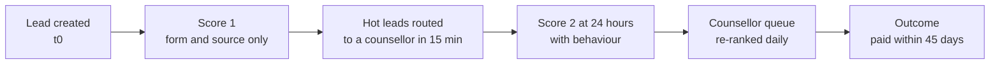
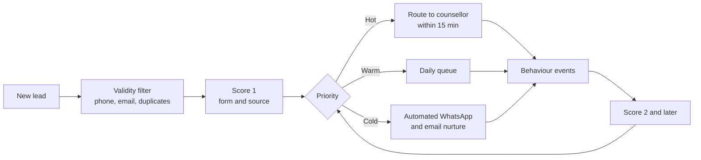

# Case Study 10: Lead Scoring for Paid-Course Conversion

**Domain:** EdTech | **Problem Type:** Ranking / propensity scoring (binary classification used for prioritisation) | **Difficulty:** Beginner

---

## 1. Business Context

### Company background

- **LearnLadder** (fictional) is an online platform for upskilling and exam preparation. It sells paid programs with an average ticket of about **₹32,000** (for example data analytics, UPSC foundation, and coding bootcamps).
- Customers first leave their details as a **lead**: they sign up for a free demo class, download a brochure, join a webinar, or fill a form after clicking an ad.
- About **2.4 lakh new leads a month** arrive from paid ads (Meta, Google, YouTube), organic search, partnerships, referrals, and webinars.
- **80 counsellors** (the sales team) call leads, explain the program and close the sale. EMI options are available.

### The pain, with numbers

| Item | Value |
| --- | --- |
| New leads per month | 2.4 lakh |
| Counsellor capacity (80 counsellors x 45 conversations a day x 26 days) | about 93,600 conversations a month, about **39% of leads** |
| Paid enrolments per month | about 4,800 (2.0% of leads within 45 days) |
| Average ticket | ₹32,000, so about ₹15.4 Cr revenue a month, about ₹184 Cr a year |
| Marketing spend | about ₹9 Cr a month, so about ₹18,750 per enrolment |
| Invalid or junk leads (wrong number, fake email, students just exploring, competitors) | about 18% |
| Median time to first call today | about 26 hours (leads are called roughly in the order they arrive) |
| Effect of delay | Conversion roughly halves if the first call comes after 24 hours |
| Current prioritisation | First come, first served, with a short rule: calls from paid-ad leads first |

- Many hot leads (people who attended a demo class and viewed the pricing page) wait a day, while counsellors spend time on cold ones.
- Target: **same team, more enrolments**, by calling the right leads first and fast.
- Value: about 700 more enrolments a month (4,800 to 5,500) is about **₹27 Cr** more revenue a year, which is about **₹12 Cr** of contribution margin at a 45% margin.

### Stakeholders and what each wants

| Stakeholder | What they want | What they fear |
| --- | --- | --- |
| Head of Sales | More enrolments with the same headcount | A scoring model that counsellors ignore |
| Counsellors | A list of leads who are likely to buy, so they are not wasting time | Being told to ignore leads they believe in, and lower incentives |
| Head of Marketing | Lower cost per enrolment, and feedback on which campaigns bring quality | Being blamed for poor lead quality |
| Finance | Better return on marketing spend | Revenue forecast misses |
| Academic and product teams | The right learners joining the right program | Mis-selling to unfit learners for a quick sale |
| Compliance and Legal | Respect for consent (calls and WhatsApp only with permission, DND rules) | Complaints about unwanted calls |

---

## 2. Translating Business to ML

### The business question vs the ML question

| Business question | ML question |
| --- | --- |
| "Which leads should counsellors call first?" | "For each new lead, estimate the probability of a paid enrolment within 45 days. Score at sign-up and update after new behaviour. Rank leads so the 39% capacity goes to the highest scores, and route the hottest leads to a counsellor within 15 minutes." |

> **Mentor note:** This is the simplest case in the guide, and it is a good first project because the business value is easy to explain. But do not underestimate it. The hard parts are the 45-day label delay, the speed-to-lead effect, and the fact that **calling a lead changes the outcome**. A lead that was never called has no chance to convert, so the data is biased by the old calling order.

### Target variable definition

- **Primary target:** `enrolled_45d = 1` if the lead made a **paid enrolment (first payment received)** within 45 days of the lead creation date.
- **Why 45 days:** more than 90% of conversions happen within 45 days, and counsellors follow up within this window.

### Edge cases

| Edge case | Recommended treatment | Reason |
| --- | --- | --- |
| Lead enrols after 45 days | Label as 0 for the main model, but track the share and review the window | Keep a clear cut-off. If late conversions are large, extend |
| Lead converts directly online without any call | Count as 1, and flag as "self-serve" | Still a conversion, but the call was not needed |
| Refund within 7 days | Count as 1 for the main model, and build a second "retained enrolment" target later | Quality matters, but do not complicate the first version |
| Duplicate leads (same person, many sign-ups) | Deduplicate by phone and email, keep the first lead and merge behaviour | Duplicates leak outcomes across rows |
| Enrolment for a different program than the lead's interest | Count as 1 | Business cares about any enrolment |
| Junk leads (invalid phone, bot) | Remove in a **pre-filter** step, and do not score them | A different problem and a different rule |

### Unit of prediction

- One **lead** (after de-duplication).

### Prediction timing



- **Score 1** at sign-up uses only the form, the source, and the device. It is used for instant routing.
- **Score 2 and later** add behaviour (demo attended, pricing page views, replies). It re-ranks the queue.
- The label becomes available after 45 days.

### What success looks like

| Lens | Success |
| --- | --- |
| Business | Enrolments from 4,800 to about 5,500 a month with the same 80 counsellors. About ₹27 Cr more revenue a year |
| Model | Top 20% of leads by score captures about 52% of eventual enrolments, and the top 39% captures about 76% (FIFO captures about 39%, since it is close to random). AUC about 0.82 |
| Operations | Median time to first call for the hottest 10% of leads under 15 minutes. Counsellors follow the list at least 80% of the time |

---

## 3. Data Understanding

### Data sources and key features

| Feature group | Source | Why it matters |
| --- | --- | --- |
| Lead source, campaign, ad creative, keyword | Marketing platforms, UTM tags | Source quality differs hugely |
| Form data (course interest, current role, years of experience, education, city, goal and urgency) | Sign-up form | Fit and intent |
| Behaviour on site and app (demo class attended, brochure download, pricing page views, sessions in 24 hours) | Web and app analytics | The strongest intent signals |
| Communication response (call answered, WhatsApp opened or replied, email opens) | Dialler and messaging tools | Reachability and interest |
| Lead quality checks (phone valid, disposable email, duplicate) | Validation services | Remove junk |
| Previous history (earlier purchases, past leads, past enrolments) | CRM | Repeat and cross-sell |
| EMI pre-check result | Financing partner | Ability to pay |
| Time features (hour and weekday of sign-up, time to first call) | CRM | Speed-to-lead |

### Data volume, granularity and refresh

- **Volume:** 2.4 lakh leads a month. With 12 months of **matured** leads, about 29 lakh rows (after removing the latest 45 days). About 2% convert, so about 58,000 positives.
- **Granularity:** one row per lead, with behaviour snapshots at fixed times (at creation, 1 hour, 24 hours).
- **Refresh:** events stream in continuously. Scores update at set times and on key events (demo attended, pricing page viewed).

### Common data issues

| Issue | How it shows up here |
| --- | --- |
| **Label delay and censoring** | Leads from the last 45 days have not had time to convert. Treating them as 0 makes recent data look worse than it is |
| **Selection bias from the calling order** | Leads called first converted more partly because they were called early. The model may learn the old calling rule |
| Lead-mix drift | A new ad campaign suddenly brings 50,000 low-quality leads, and the score distribution shifts |
| Junk and duplicate leads | Waste counsellor time and distort the base rate |
| Leakage from counsellor actions | Call counts, notes, and discounts offered exist only after contact |
| Small data for new programs | A new program has only a few hundred enrolments |
| Attribution noise | Source tags are missing or wrong for 10 to 15% of leads |

> **Mentor note: Where juniors usually go wrong here.**
>
> - They include "number of calls made" or "demo booked by counsellor" as features. These happen **after** the lead is already being worked, so the model looks excellent and is useless for deciding whom to call first.
> - They train on all leads, including the last 3 weeks, labelling those as non-converters.
> - They reach for a deep network on a few thousand positives when a simple model with 20 good features would do better and be easier to explain to counsellors.

---

## 4. Approach and Decision Points

### Baseline first

- **Baseline 1 (current):** first come, first served with a priority for paid-ad leads. The top 39% of the queue captures about 39 to 42% of conversions.
- **Baseline 2:** rank by source historical conversion rate (a simple lookup table). Captures about 54% of conversions in the top 39%.
- **Baseline 3:** a simple rule, "attended demo class or viewed the pricing page twice".
- **Why it matters:** source and a couple of intent behaviours already give a big part of the gain. A model must clearly beat these, and the lookup table becomes the fallback.

### Candidate models

| Model | Pros | Cons | Verdict |
| --- | --- | --- | --- |
| Rule or lookup table by source and behaviour | Instant, transparent | Crude and hard to maintain | Baseline and fallback |
| **Logistic regression** (with simple binning) | Fast, explainable to counsellors, stable on small data | Misses interactions | **Strong first model** |
| **Gradient boosting** (LightGBM) with about 30 to 40 features | Accurate, handles missing values and interactions | Needs monitoring for lead-mix drift | **Production model** |
| Source-specific models | Tailored to each channel | Too little data per source | Not worth it. Use source as a feature |
| Deep learning on sequences of events | Can use raw clicks | Needs more data, harder to explain | Not needed |
| Uplift or causal models | Find leads where a call changes the outcome | Need randomised data | Phase 2 (see Case 3) |

### Decision scenarios

| What if... | Recommended action | Reasoning |
| --- | --- | --- |
| **Labels take 45 days, and the newest leads are unlabelled** | Train only on leads older than 45 days. Use **early proxies** (demo attended within 7 days, counsellor-qualified within 7 days, payment link sent) to monitor recent cohorts. Consider a time-to-event view if the conversion window is long | You cannot wait 45 days to find out the model is off. A proxy gives an early warning |
| **A new program has only 300 enrolments** (small data) | Pool programs in one model with program as a feature, use stronger regularisation, and borrow from similar programs. Start with logistic regression | With so few positives a complex model memorises. Pooling shares strength across programs |
| **A new campaign floods the funnel with a different type of lead** | Use source-aware features, monitor the share of leads per source and the score distribution, and recalibrate by source weekly. Train on the last 6 months, not 3 years | Lead mix changes weekly, and an old model can mis-rank a new source |
| **Hot leads need a call in minutes, but behaviour data arrives later** | Run two stages: **Score 1** at sign-up (form and source only) for instant routing, and **Score 2** after behaviour (demo attended, pricing views) for re-ranking | Speed-to-lead matters more than a perfect score. A quick decent score beats a slow great one |
| **The old calling order biases the data** | Reserve about 5 to 10% of leads for **random-order calling** (a "shuffle" slice) to measure the true effect of priority and to train with weights | Without any random slice, you cannot tell how much of the conversion is due to being called early |
| **Counsellors do not trust the score** | Show 3 plain-English reasons ("attended the demo yesterday", "viewed pricing 3 times", "referred by an existing learner"), and let them flag mistakes. Track overrides | Adoption decides whether any value is realised. A list that is ignored is worth zero |
| **Marketing wants to use the score too** | Share the score as a "quality signal" to optimise campaigns, and send conversion events back to ad platforms. Keep it separate from counsellor routing and review privacy and consent | Same model, a second use. Start with the sales use case, and add marketing once stable |
| **A big share of leads are junk** | Add a pre-filter for phone and email validity, duplicates and bot behaviour. Score only valid leads | It removes noise and protects the base rate |

---

## 5. Feature Engineering

### Top 10 features to build

| # | Feature | Business logic |
| --- | --- | --- |
| 1 | Lead source and campaign, plus the smoothed historical conversion rate of that source (using only past data) | Source quality is the strongest signal at sign-up |
| 2 | Demo class attended (yes or no, and minutes watched) | Direct evidence of intent |
| 3 | Pricing or program page views in the first 24 hours | Price-seeking behaviour is a buying signal |
| 4 | Number of sessions and total time on site in the first 24 hours | Engagement depth |
| 5 | Stated urgency and goal ("want to switch jobs in 3 months", "exam in 6 months") | Time pressure drives buying |
| 6 | Current role, years of experience, and fit with the chosen program | Fit with the offer and ability to benefit |
| 7 | City tier and device type | Income and access proxies (use carefully, check fairness) |
| 8 | Communication response in the first 24 hours (answered call, opened or replied to WhatsApp) | Reachability and interest |
| 9 | Referral flag, or earlier purchases from the platform | Trust and past relationship |
| 10 | Sign-up hour and weekday, and minutes since sign-up at scoring time | Timing patterns and speed-to-lead |

### Features to avoid (leakage risks)

| Feature | Problem |
| --- | --- |
| Number of calls made, call duration, counsellor notes | Occur after contact starts, and reflect the old policy |
| Discount or scholarship offered by a counsellor | Depends on the sales process, and often follows buying signals |
| Payment link opened, EMI application started | Happens right before conversion. Fine for later-stage scoring, but leaks if used for first-contact ranking |
| Counsellor ID or team | Encodes who got which lead and skill differences |
| Fields filled **during** counselling (budget, objections) | Post-contact |
| Future-looking aggregates of source conversion (including leads from after the lead date) | Look-ahead leakage |

Source conversion rate computed only from the past (target encoding without leakage):

```python
# Source conversion using only leads old enough to have a known outcome at each lead's creation date
df = df.sort_values("created_at")
df["src_conv_past"] = (
    df.groupby("source")["enrolled_45d"]
      .transform(lambda s: s.shift(45 * 24).expanding().mean())  # lag by label window
)
```

---

## 6. Evaluation Strategy

### Metrics

| Metric | Role | Why |
| --- | --- | --- |
| **Capture rate at capacity** (share of eventual enrolments found in the top 39% of leads) | Primary business metric | It matches the actual constraint on counsellor time |
| **Cumulative gains and lift charts** (top 10%, 20%, 39%) | Primary, easy for sales leaders | Visual and simple |
| **PR-AUC and AUC** | Model quality | Good for ranking when the positive rate is about 2% |
| Calibration (predicted vs actual conversion by decile) | Secondary | Needed if the score feeds budgets or forecasts |
| Enrolments per counsellor-day and time-to-first-call for hot leads | Operational | Shows whether the model changes how work gets done |
| Revenue per lead and cost per enrolment | Business | The final outcome |

### Metrics that look good but are misleading here

- **Accuracy:** about 98% by predicting that nobody converts.
- **Conversion rate of called leads:** high mostly because the best leads were called first.
- **AUC on all leads, including junk:** junk leads are easy negatives, and AUC rises without helping decisions.
- **Evaluation including unmatured leads:** the newest leads look like non-converters.

### Validation strategy

| Step | Design | Why |
| --- | --- | --- |
| Time-based split | Train on leads created in months 1 to 8, validate on months 9 and 10, test on months 11 and 12 (all matured, with a 45-day gap) | Matches deployment, avoids immature labels |
| Source-aware check | Report capture rate by source group and by program | Finds weak spots hidden by the average |
| Stability check | Compare gains charts by month | Lead-mix drift shows up |
| Random-order slice | Evaluate on the 5 to 10% random-order calling slice | Unbiased view of conversion by score |
| Shadow mode | Score live leads for 3 weeks without changing the queue, and compare with outcomes | Real-world check without risk |
| Online A/B test | Randomise counsellor **teams** (or lead batches by hash) into FIFO vs score-ordered queues, same capacity | Direct measure of extra enrolments |

### From model metric to business value

- Replay of last quarter's leads with the new ordering and the same capacity:
  - top 39% by score contains about 76% of eventual enrolments, against about 40% with FIFO;
  - hot leads are called within 15 minutes instead of 26 hours, which keeps their conversion from decaying.
- Expected result: enrolments from 4,800 to about 5,500 a month, which is **+700 a month**.
- Revenue: 700 x ₹32,000 x 12 = about **₹27 Cr a year**. At a 45% contribution margin, about **₹12 Cr**.
- Cost: data and engineering of about ₹0.8 Cr a year. Counsellor cost is unchanged.

---

## 7. Deployment and Monitoring

### Batch vs real time

- **Near real time** (within 1 to 2 seconds) for **Score 1** at lead creation, so that hot leads reach a counsellor in minutes. Latency need is modest, unlike Case 2.
- **Scheduled re-scoring** at 1 hour and 24 hours, plus **event-triggered** re-scoring when a strong signal appears (demo attended, pricing page visited again).
- **Daily batch** to re-rank each counsellor's queue every morning.



### What to monitor

| Type | What to track | Alert trigger |
| --- | --- | --- |
| Lead-mix drift | Share of leads by source, score distribution, PSI of key features | PSI above 0.2, or a source above 20% of volume suddenly |
| Model performance | Capture rate at 39% on matured cohorts, and early proxies (demo attended, qualified) on new ones | Capture rate falls by 8 points |
| Calibration | Predicted vs actual conversion by decile and by source | Gap above 25% relative |
| Operations | Time to first call by priority tier, override rate, queue backlog | Hot-lead median above 30 minutes |
| Business KPIs | Enrolments, revenue per lead, cost per enrolment, refund rate | Outside agreed bands |
| Compliance | Calls and messages only to leads with consent, DND checks | Any breach |
| Quality of sale | 7-day refund rate and early dropout by score tier | Rises for the top tier (a sign of mis-selling) |

### Retraining

- **Scheduled:** monthly, on a rolling 6 to 9 month window of matured leads.
- **Triggered:** a major new campaign type, a new program, a pricing change or a drift alert.
- **Weekly:** quick recalibration by source if the lead mix has shifted.

### A/B test or champion-challenger design

- **Champion:** FIFO queue. **Challenger:** score-ordered queue with the hot-lead fast lane.
- Randomise at the level of **lead batches** (for example by hashing the lead ID) within each team, so that all counsellors work both types and counsellor skill is balanced out. Keep capacity equal.
- Run for 4 to 6 weeks, since conversions take time. Use the early proxies (qualified rate and demo-to-call time) for a first read and paid enrolments for the final read.
- Keep the 5 to 10% random-order slice running permanently.

---

## 8. Stakeholder Communication

### Explain it to a non-technical leader

> "Every lead gets a score from 0 to 100 that tells us how likely they are to buy in the next 45 days. It uses the source, what they told us in the form, and what they did on our site, like attending the demo class or checking the price page.
> Counsellors work the highest scores first, and the hottest leads get a call within 15 minutes instead of the next day.
> With the same team, we expect about 700 more enrolments a month, worth about ₹27 Cr a year.
> Low-score leads are not ignored. They get automated WhatsApp and email follow-ups, and they move up if they show interest."

### Questions leadership will ask

| Question | Suggested answer |
| --- | --- |
| "Will we lose good leads that the model scores low?" | "Some, yes. No model is perfect. The low-score group converts at a fraction of the rate, and they still get automated follow-up. If they show interest, their score rises and they enter the call queue" |
| "Why not hire more counsellors?" | "We can, and the model makes each new counsellor more productive. But hiring 30% more counsellors costs far more than the model, and the model also helps decide where to add them" |
| "How do we know the model, not the speed, brings the gain?" | "Both help. We test the score-ordered queue against FIFO, and also look at the effect of fast response, so we can tell the two apart" |
| "Can counsellors override the score?" | "Yes, always. We log overrides and review them monthly. They often reveal features we can add" |
| "Will it push counsellors to sell to people who should not buy?" | "We watch the 7-day refund rate and early dropout by score tier. If the top tier shows more refunds, we adjust. The goal is good-fit learners, not just any sale" |

---

## 9. Common Pitfalls and Lessons

| Mistake | Why it happens | How to avoid it |
| --- | --- | --- |
| Using post-contact features (calls, discounts, notes) | They are the strongest predictors in the CRM | Only use data available at scoring time, and name each feature's availability time |
| Labelling unmatured leads as non-converters | Wanting the newest data | Use a 45-day maturity cut-off, and monitor new cohorts with early proxies |
| Ignoring selection bias from the old calling order | The data looks complete | Keep a random-order slice, and test the model against it |
| Not handling lead-mix drift | Training once on a long history | Use a rolling window, source-aware features, and weekly recalibration |
| Scoring junk leads | No validity check | Filter invalid phone and email, and duplicates first |
| Overcomplicating the model | Fascination with deep learning | Begin with logistic regression and a small LightGBM. Explain to counsellors |
| Ignoring adoption | The model is seen as a technical project | Involve counsellors early, show reasons, track overrides |
| Measuring only conversion of called leads | Simple to compute | Measure capture rate and total enrolments under a controlled test |
| Forgetting the quality of sale | Focus on volume | Track 7-day refunds and early dropout by score tier |

---

## 10. Mentor's Focus Checklist

- ✅ **Where to spend 80% of the effort:**
  - Leakage-free features with a clear "available at scoring time" rule.
  - Label design: the 45-day window, maturity cut-off, de-duplication, junk filtering.
  - The two-stage score (instant routing, then behaviour-based re-ranking) and speed-to-lead.
  - Counsellor adoption, and an honest A/B test with a random-order slice.
- ❌ **What not to over-engineer:**
  - Deep learning or complex ensembles on 58,000 positives.
  - Separate models for every source or program.
  - Perfect calibration if the main use is ranking.
- 💡 **Key takeaway:** **Start simple and make it adoptable.** A clean, leakage-free logistic regression that counsellors trust and use will beat a brilliant black box that sits unused. Also remember that ranking decides who gets human attention, so test it against what would have happened anyway.
