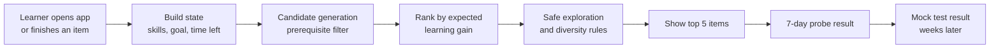
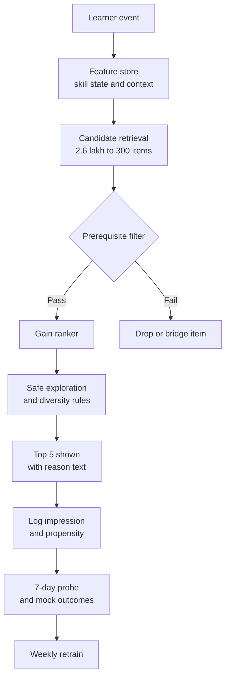

# Case Study 51: Next-Best-Content Recommendation for a Test-Prep App

**Domain:** EdTech | **Problem Type:** Recommender system with a learning-outcome objective (ranking plus contextual bandit exploration) | **Difficulty:** Advanced

---

## 1. Business Context

### Company background

- **PrepNaksh** (fictional) is a test-prep app for JEE, NEET and Class 9 to 12 board exams, sold as an annual subscription of about **₹7,500**.
- The app has about **18 lakh monthly active learners**, of whom about **6 lakh are paid subscribers**. Most are in Tier 2 and Tier 3 cities and use mid-range Android phones on patchy data.
- The content library has about **2.6 lakh items**: recorded video lessons, short concept notes, practice sets, chapter tests and full-length mock tests. Each item is tagged to a chapter and a topic in a **syllabus graph** (a map of topics and which topics must be understood first).
- Today the home screen shows "Continue watching", "Trending in your exam" and a teacher-curated "Today's plan". The "Trending" row is ranked by recent watch time.

### The pain, with numbers

| Item | Value |
| --- | --- |
| Paid subscribers | 6 lakh |
| Average subscription | ₹7,500, so about ₹450 Cr annual recurring revenue |
| Annual renewal rate | about 52% |
| Average weekly study time of a paid learner | about 4.2 hours, mostly video |
| Share of study time on video vs practice and tests | about 78% vs 22% |
| Average mock-test score gain over 8 weeks | about 6 percentile points |
| Learners who say "I do not know what to study next" in exit surveys | about 41% of non-renewers |
| Home-row click-through on "Trending" | about 9%, but only 1 in 4 clicks leads to a completed item |

- Learners binge popular lectures by star teachers and skip weak chapters and practice. Watch time is high, but mock scores move slowly.
- A previous attempt ranked items by predicted watch time. Watch time rose 11%, but the mock-score gain did not move, and renewal stayed flat.
- Target: raise renewal by **4 points** (52% to 56%) by making learners visibly improve.
- Value: 4% of 6 lakh is 24,000 extra renewals. At ₹7,500 that is **₹18 Cr** a year of revenue, about **₹10.8 Cr** of contribution at a 60% margin.

### Stakeholders and what each wants

| Stakeholder | What they want | What they fear |
| --- | --- | --- |
| Head of Product | A home screen that makes learners improve and renew | A "smart" feed that lowers daily active use |
| Academic Head | Recommendations that respect the teaching order (algebra before calculus) | A model that sends a weak learner to an advanced lecture they cannot follow |
| Growth and Marketing | Higher engagement and word of mouth | Falling session time reported to investors |
| Content team | Fair exposure for new and niche lessons | The same five star lectures getting all the traffic |
| Learners and parents | Visible improvement before the exam | Wasted hours and anxiety, especially close to exam dates |
| Compliance and Legal | Responsible use of minors' data under the DPDP Act 2023 (verifiable parental consent, no behavioural targeting of children for ads) | Profiling of under-18 users beyond what is needed for learning |

---

## 2. Translating Business to ML

### The business question vs the ML question

| Business question | ML question |
| --- | --- |
| "What should this learner study next, so they improve and keep subscribing?" | "For a learner in a given state, rank eligible items by the expected **learning gain** (improvement in the next mock test on the topics the item covers), subject to prerequisite rules, a time budget and a diversity limit. Explore new items only when it is safe." |

> **Mentor note:** This is the case where the obvious target is wrong. Clicks and watch time are easy to measure, and they are **not** what the learner paid for. The learner paid for a better rank in an exam eight months away. Your job is to build a proxy for learning gain that you can measure within days, and to keep checking that the proxy still predicts the real exam outcome.

### Target variable definition

- **Long-term outcome (north star):** change in the learner's score on the topic in the next scheduled mock test, adjusted for starting level. This arrives weeks later.
- **Short-term learning proxy (training label):** for each recommendation shown, `topic_gain_7d` = improvement in accuracy on a **fresh, unseen** question set for that topic within 7 days, compared with the learner's earlier accuracy on it.
- **Reward used for ranking:** `reward = completion_quality x expected_topic_gain`, where completion quality is 1 only if the learner finished the item with real effort (for example a practice set attempted with at least 70% of questions answered, not skipped).

### Edge cases

| Edge case | Recommended treatment | Reason |
| --- | --- | --- |
| Learner watches a video at 2x speed and never attempts practice | No learning credit until a follow-up check is attempted | Passive watching is not evidence of gain |
| Learner repeats an item many times | Cap credit after the second view | Repeats are often anxiety or autoplay |
| Topic never re-tested within 7 days | Use a delayed label (next mock) and treat the 7-day label as missing, not zero | Missing is not the same as no gain |
| Learner already strong in the topic (ceiling effect) | Reward is the gain on **harder** items, not accuracy on easy ones | Easy topics give fake gains |
| Learner guesses answers randomly on the probe set | Down-weight probes with very fast answers | Noise in the label |
| Learner switches exam target (JEE to NEET) | Reset the goal state, keep the skill state | Past mastery is still valid |
| Item is retired or edited | Remove from candidates, keep history flagged | Avoid stale joins |

### Unit of prediction

- One **(learner, item, context)** triple: the learner's current skill state, a candidate item, and the context (time left in the session, days to exam, device and network).

### Prediction timing



- Recommendations are computed at session start and after each completed item, in under 200 ms.
- The 7-day probe arrives within a week, and the mock-test outcome in 2 to 8 weeks.

### What success looks like

| Lens | Success |
| --- | --- |
| Business | Renewal from 52% to 56%, about ₹18 Cr more revenue a year, with no fall in paid-learner satisfaction |
| Model | Offline estimate of learning gain for the top-ranked item is at least 30% higher than the watch-time ranker. Prerequisite violations under 1% of impressions |
| Learner outcome | Mock-test gain over 8 weeks from about 6 to at least 7.5 percentile points in the treated group |
| Guardrails | Weekly study time does not drop by more than 5%, and the share of items from one teacher stays under 25% of impressions |

---

## 3. Data Understanding

### Data sources and key features

| Feature group | Source | Why it matters |
| --- | --- | --- |
| Item metadata (type, topic, difficulty, length, teacher, language, prerequisites) | Content management system, syllabus graph | Defines what is eligible and what the item teaches |
| Learner interaction log (play, pause, seek, speed, completion, answers, time per question) | App events | Shows effort and understanding, not only attention |
| Skill state per topic (estimated mastery, confidence, last practised) | Knowledge tracing service (see Case 53) | The core input for choosing the next topic |
| Test history (chapter tests, mocks, topic scores, time per section) | Assessment service | The real outcome and weak-topic signals |
| Goal and calendar (exam, target year, days to exam, daily time budget) | Onboarding form, study planner | Urgency and scope |
| Context (device, network speed, time of day, offline downloads) | App and device | A 90-minute lecture on 2G is a bad recommendation |
| Social and cohort signals (what similar learners improved on) | Aggregated learner data | Useful for cold start and new items |
| Teacher plan and curriculum order | Academic team | Constraints and a fallback ranking |

### Data volume, granularity and refresh

- **Volume:** about 9 crore interaction events a day. A year of recommendation impressions with outcomes is about 60 crore rows, and about 4 crore of them have a 7-day probe label.
- **Granularity:** one row per impression, joined to the item, the learner state at that moment and later outcomes.
- **Refresh:** skill state updates after every attempted question. Item embeddings refresh daily. The ranker is retrained weekly.

### Common data issues

| Issue | How it shows up here |
| --- | --- |
| **Delayed and sparse outcomes** | Mock tests happen every 2 to 4 weeks, and only about 35% of learners take them regularly |
| **Exposure bias** | Only items that were shown could be consumed, and "Trending" showed the same few lectures |
| **Engagement-learning mismatch** | The items with the best watch time are often entertaining, not effective |
| Cold-start learners | A new learner has no history, and the first 3 days decide retention |
| Cold-start items | New lessons have no interactions and no popularity |
| Sparse skill graph edges | Prerequisites tagged by teachers are incomplete for newer syllabus changes |
| Selection into tests | Confident learners take more mocks, so improvement data is biased upward |
| Minor users | Under-18 learners need consent and limited profiling (DPDP Act 2023) |

> **Mentor note: Where juniors usually go wrong here.**
>
> - They optimise click-through or watch time because the data is rich, and then proudly report a higher "engagement" that does not help the exam.
> - They train on logged impressions as if every unshown item were a bad item. Items were not shown because the old ranker never chose them.
> - They ignore the prerequisite graph and recommend an advanced lecture because similar learners watched it. Those learners had the foundation. This one does not.

---

## 4. Approach and Decision Points

### Baseline first

- **Baseline 1 (current):** "Trending" by recent watch time, plus the teacher plan.
- **Baseline 2:** **Weakest-topic-first rule.** Pick the topic with the lowest mastery that has met its prerequisites, then the standard next item in the curriculum for that topic. This is cheap, explainable, and usually a big improvement.
- **Baseline 3:** Collaborative filtering on completions (people like you also finished...). Good for engagement, weak for learning.
- **Why it matters:** the weakest-topic rule is the bar. A learned ranker must beat it on learning gain, not on clicks.

### Candidate models

| Model | Pros | Cons | Verdict |
| --- | --- | --- | --- |
| Rule-based curriculum path | Safe, teachers trust it | Same path for everyone, ignores pace | Baseline and fallback |
| Matrix factorisation or two-tower retrieval | Fast candidate generation from 2.6 lakh items | Learns popularity, not learning | Use only for retrieval inside the prerequisite filter |
| **Gradient boosting ranker with a learning-gain label** | Uses skill state and item features, handles missing values | Needs counterfactual care | **Production ranker** |
| Contextual bandit (Thompson sampling over a small candidate set) | Explores in a controlled way and learns online | Needs logged propensities and guardrails | **Exploration layer** |
| Reinforcement learning over full study paths | Optimises long-term outcomes in theory | Needs a simulator and huge data, unsafe to explore | Not now |
| LLM-based tutor suggestions | Natural language explanations | Hard to guarantee the prerequisite rules | Use only to phrase the reason, not to choose |

### Decision scenarios

| What if... | Recommended action | Reasoning |
| --- | --- | --- |
| **The watch-time model clearly beats the learning-gain model on clicks, but mock gain is flat** | Ship the learning-gain ranker, report clicks as a guardrail only, and keep a small "popular lectures" row for choice | Clicks are a means. A feed that learners like but that does not help them will fail at renewal time |
| **A brand-new learner has no history** | Run a 6-question onboarding diagnostic on the chosen exam, start from the syllabus-order path, and borrow a prior from learners with the same exam, class and board | A short quiz gives skill signal in minutes. Without it the first week is generic |
| **A new video has no interactions** | Score it by teacher, topic, length and embedding of its transcript, then give it a capped exploration share, for example 3% of eligible impressions, only for learners who meet the prerequisites | The content team needs a way for good new lessons to be found, but never at the cost of a weak learner's time |
| **The model recommends a lecture on integration to a learner who has not mastered limits** | Hard-filter candidates by the prerequisite graph: every prerequisite topic needs mastery above a threshold, or the item is dropped. Allow a bridge item (a short recap) instead | Rules the model must never break belong in constraints, not in the loss function |
| **Exploration could send a stressed learner a useless item 3 weeks before JEE** | Reduce exploration to near zero as the exam date nears, explore only among items already judged safe, and never explore in the last 2 weeks | Exploration has a real cost for the learner. A bad hour in April is not the same as a bad hour in October |
| **The 7-day probe label disagrees with the mock-test outcome** | Check the correlation between the 7-day gain and the 8-week mock gain on a held-out set. If it falls below about 0.4, redesign the probe. Use the mock outcome to calibrate the proxy | The proxy is only useful if it predicts the real goal |
| **Learner engagement drops in the first week of the new feed** | Look at the cohort split. If new sessions are shorter but practice completion is higher, that is expected. Keep the experiment running to the planned length and watch the 4-week retention | Learning-focused sessions can be shorter. Judging only on week 1 would kill a good change |
| **Two learners with identical skill states have different best items because of language** | Add language and exam-board as hard filters for item eligibility and test per-language performance | A Hindi-medium learner may gain nothing from an English-only lecture |

---

## 5. Feature Engineering

### Top 10 features to build

| # | Feature | Business logic |
| --- | --- | --- |
| 1 | Mastery estimate and uncertainty of the item's target topic | The main driver of expected gain |
| 2 | Gap to goal: target mastery minus current mastery, weighted by the topic's exam weightage | Spend time where marks are available |
| 3 | Prerequisite readiness (minimum mastery across prerequisites) | Safety feature and relevance |
| 4 | Item difficulty relative to learner mastery (the zone of proximal development, meaning "not too easy, not too hard") | Best learning happens when items are slightly above current level |
| 5 | Days since the topic was last practised, and forgetting-curve estimate | Spaced revision matters near the exam |
| 6 | Historical learning gain of the item for learners with a similar state (item effectiveness, adjusted for starting level) | Separates effective items from popular ones |
| 7 | Item type fit: video vs practice vs test, given the learner's mix so far | Fixes the 78% video imbalance |
| 8 | Time budget fit: item length vs the learner's typical session minutes and network | A long item that never finishes has no gain |
| 9 | Days to exam and mock-test calendar | Changes the value of revision vs new topics |
| 10 | Recent effort signals: skips, rewinds, answer time, hint use | Shows struggle or boredom |

### Features to avoid (leakage risks)

| Feature | Problem |
| --- | --- |
| Item popularity or total watch time over the full period | Reflects the old ranker's exposure and creates a feedback loop |
| Post-item test results used as a feature for that item's own recommendation | Leaks the outcome |
| Renewal flag or future payment data | Leaks the business outcome and invites unethical targeting |
| Features computed from the full mock test after the recommendation date | Look-ahead leakage |
| Teacher star rating | A halo effect that favours famous teachers and lowers diversity |
| Parent income or caste proxies from address | Unfair and not needed for learning |

Counterfactual-aware training weights (inverse propensity, clipped to avoid extreme values):

```python
import numpy as np

# propensity = probability the old policy showed this item to this learner (logged at serving time)
w = 1.0 / np.clip(df["propensity"], 0.05, 1.0)
w = np.minimum(w, 20.0)                      # cap extreme weights
df["w"] = w / w.mean()

# Only consider candidates whose prerequisites are met
eligible = df["prereq_min_mastery"] >= 0.6
model.fit(df.loc[eligible, features], df.loc[eligible, "topic_gain_7d"],
          sample_weight=df.loc[eligible, "w"])
```

---

## 6. Evaluation Strategy

### Metrics

| Metric | Role | Why |
| --- | --- | --- |
| **Mock-test improvement on targeted topics at 4 and 8 weeks, treated vs control** | Primary online metric | Directly measures learning |
| **7-day probe gain per recommendation** | Fast proxy, primary offline | Feeds iteration within days |
| Off-policy estimate of expected gain (inverse propensity or doubly robust) | Offline | Compares rankers without a live test |
| Prerequisite violation rate | Hard constraint | Must stay under 1% |
| Practice and test share of study time | Behaviour | Shows balance moving away from pure video |
| Catalogue coverage and teacher concentration | Health | Avoids a rich-get-richer effect |
| Weekly active days, session length, 4-week retention | Guardrail | Confirms the feed is not driving people away |
| Renewal rate at 12 months | Business | Final outcome, but slow |

### Metrics that look good but are misleading here

- **Click-through rate and watch time:** easy to inflate with entertaining lectures.
- **Average rating of recommended items:** biased towards popular teachers.
- **NDCG against logged consumption:** it rewards copying the old ranker.
- **Offline accuracy of predicting the next item watched:** this predicts habit, not benefit.

### Validation strategy

| Step | Design | Why |
| --- | --- | --- |
| Time-based split | Train on weeks 1 to 30, validate on weeks 31 to 36, test on weeks 37 to 42 | Syllabus and seasons change |
| Off-policy evaluation | Doubly robust estimate of gain using logged propensities | Do not ship rankers that only look good on logged data |
| Slice analysis | By exam, class, language, device tier, new vs old learners, and days to exam | Finds groups where the model hurts |
| Prerequisite audit | Teachers review 500 sampled recommendations for sensibility | Domain check that metrics miss |
| Proxy validation | Correlation of 7-day gain with 8-week mock gain | Keeps the proxy honest |
| Online A/B test | Randomise learners (stratified by exam and starting level) between the weakest-topic rule and the new ranker | Direct measure of outcome. Needs 8 weeks and a mock test in the window |

### From model metric to business value

- Assume the A/B test shows mock-test gain rising from 6.0 to 7.6 percentile points in 8 weeks.
- Earlier surveys show learners who gain more than 7 points renew at about 58%, against about 51% for those who gain under 6.
- If 65% of paid learners move into the higher-gain group (0.65 x 58% plus 0.35 x 51% is about 55.6%), renewal rises from about 52% to about 56%:
  - 6 lakh subscribers, 4% more renewals is about 24,000 learners;
  - 24,000 x ₹7,500 is about **₹18 Cr** a year, about **₹10.8 Cr** contribution at 60%.
- Cost: data science and engineering about ₹2.2 Cr a year, plus about ₹0.5 Cr for the experiment platform and extra probe questions. Net contribution is about ₹8 Cr, before counting lower support load.

---

## 7. Deployment and Monitoring

### Batch vs real time

- **Real time (under 200 ms)** for the home screen and the "what next" prompt after each item. State is read from a feature store.
- **Batch** for item embeddings, item effectiveness tables and the weekly ranker retrain.
- **Fallback** to the weakest-topic rule if the model service is slow or down.



### What to monitor

| Type | What to track | Alert trigger |
| --- | --- | --- |
| Constraint safety | Prerequisite violation rate, share of items outside language or board | Above 1% |
| Learning outcome | 7-day probe gain by cohort, 8-week mock gain | Drop of 15% relative |
| Proxy health | Correlation between probe gain and mock gain | Below 0.4 |
| Engagement guardrails | Weekly active days, session length, 4-week retention | Weekly study time down more than 5% |
| Diversity | Top-10 teacher share of impressions, share of new items shown | Top teacher share above 25% |
| Cold-start | Day-3 and day-7 retention of new learners | Below the control arm |
| Exploration cost | Gain of explored impressions vs exploited ones | Gap larger than planned budget |
| Fairness | Gain by language, board, gender, city tier and device | Gap above 20% relative between groups |
| Data and privacy | Consent status for minors, data retention | Any breach |

### Retraining

- **Scheduled:** weekly for the ranker, daily for item effectiveness and embeddings.
- **Triggered:** syllabus change, new exam pattern (for example a changed JEE paper format), a big new content batch, or proxy drift.
- **Before the exam season:** freeze exploration and review the ranker with the Academic Head.

### A/B test or champion-challenger design

- **Champion:** weakest-topic-first rule. **Challenger:** gain ranker with bandit exploration.
- Randomise at the **learner** level, stratified by exam, class and starting mastery. Keep the same total content and teacher pool.
- Run at least 8 weeks so that a mock test falls inside the window. Pre-register the primary metric (mock gain on targeted topics) and the guardrails.
- Keep a permanent 2% holdout on the baseline for long-term renewal comparison.
- Do not run experiments during the last 3 weeks before a major national exam.

---

## 8. Stakeholder Communication

### Explain it to a non-technical leader

> "Today our feed shows what is popular. The new feed shows what will help this learner improve the most, based on what they already know, what the exam rewards, and what they are ready for.
> It never sends a learner to a lesson that needs knowledge they do not have, and it only tries new content when that is safe.
> We judge it by mock-test improvement, not by watch time. We expect about 1.5 more percentile points in 8 weeks, and about 4 points higher renewal, which is worth about ₹18 Cr a year."

### Questions leadership will ask

| Question | Suggested answer |
| --- | --- |
| "Watch time went down. Is it failing?" | "Maybe less video and more practice is the point. We track weekly active days and retention as guardrails. If those hold and mock scores rise, it is working" |
| "Why not just maximise engagement? It is simpler" | "We tried it. Watch time rose 11% and scores and renewals did not move. Engagement is a means, not the goal" |
| "Will famous teachers lose views?" | "Some. We cap concentration at 25% and show teacher-level impact reports so that teachers see their lessons help the right learners" |
| "Is it safe for students close to the exam?" | "Exploration is turned off near exams, and everything shown is checked against prerequisites and the teacher plan" |
| "How do we know the gain is real and not just motivated learners?" | "We randomise learners, so motivation is balanced across both groups. We also compare 7-day probes with mock results" |
| "What about children's data?" | "We use only what is needed for learning, follow parental consent rules under the DPDP Act 2023, and use no recommendation data for advertising" |

---

## 9. Common Pitfalls and Lessons

| Mistake | Why it happens | How to avoid it |
| --- | --- | --- |
| Optimising watch time or clicks | They are plentiful and quick to measure | Define a learning-gain reward, keep engagement as a guardrail |
| Ignoring the prerequisite graph | Collaborative filtering does not know pedagogy | Hard constraints on eligibility, teacher audits |
| Treating unshown items as bad | Logged data only contains what was shown | Log propensities, use off-policy evaluation, explore safely |
| Unsafe exploration | Textbook bandits explore uniformly | Restrict exploration to safe items, shrink it near exams |
| Trusting a proxy label blindly | A 7-day probe is easy to game or noisy | Validate the proxy against mock outcomes regularly |
| Ignoring cold-start learners | They are a small share of data but decide retention | Short diagnostic, cohort priors, a rule-based path |
| Evaluating too early | Learning outcomes need weeks | Pre-register the window, use early proxies only for iteration |
| One feed for everyone | Averages hide harm to subgroups | Slice by language, board, device and starting level |
| Rewarding famous teachers | Ratings and watch time are biased | Use effectiveness adjusted for starting level |

---

## 10. Mentor's Focus Checklist

- ✅ **Where to spend 80% of the effort:**
  - The reward definition: a learning-gain proxy that is validated against real mock outcomes.
  - Prerequisite and eligibility constraints, built with the Academic team.
  - Exposure bias: logged propensities, off-policy evaluation, and safe exploration.
  - Cold-start learners and items, and a rule-based fallback.
  - An honest 8-week randomised test on mock-test gain.
- ❌ **What not to over-engineer:**
  - Reinforcement learning over full study paths before the one-step ranker works.
  - Huge neural retrieval models when the candidate list is already filtered by topic.
  - Perfect personalised explanations written by an LLM.
- 💡 **Key takeaway:** **A recommender is only as good as the thing it optimises.** For learners that thing is learning, not attention. Measure what the learner paid for, protect them with constraints, and explore only where a mistake costs little.
