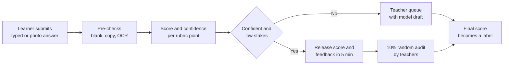
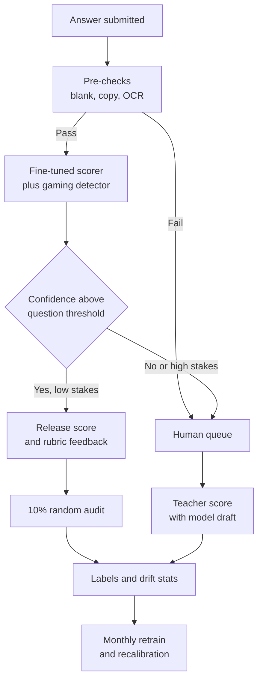

# Case Study 52: Automated Grading of Subjective Answers

**Domain:** EdTech | **Problem Type:** NLP ordinal scoring (regression and ordinal classification with a human-in-the-loop) | **Difficulty:** Advanced

---

## 1. Business Context

### Company background

- **MarkMitra** (fictional) is an online learning platform for Class 8 to 12 board exams and for writing-heavy competitive exams (UPSC mains answer writing, CA foundation, law entrance).
- Learners submit **subjective answers**: 2 to 5 mark short answers, 6 to 12 mark long answers, essays and step-by-step maths solutions, either typed or as photos of handwritten pages.
- About **1,100 part-time teachers** (evaluators) grade the answers and write feedback. Answers are graded against a **rubric** (a marking scheme with points for each idea, step or structure element).
- Questions are in English, Hindi and a few regional languages, with a lot of Hinglish in learner writing.

### The pain, with numbers

| Item | Value |
| --- | --- |
| Subjective answers submitted a month | about 40 lakh (30 lakh short, 8 lakh long, 2 lakh essays or full maths solutions) |
| Cost of human evaluation per answer | about ₹8 for short, ₹22 for long, ₹45 for essay or maths |
| Monthly evaluation cost | 30 lakh x ₹8 + 8 lakh x ₹22 + 2 lakh x ₹45 = ₹2.40 Cr + ₹1.76 Cr + ₹0.90 Cr = about **₹5.06 Cr** |
| Median turnaround | about 38 hours, 90th percentile about 4 days |
| Learners who do not attempt written practice because "feedback is too slow" | about 35% in surveys |
| Agreement between two human graders (quadratic weighted kappa) | about 0.78 for long answers, 0.84 for short answers |
| Teacher grading drift (same teacher, same answer, a week apart) | about 12% of answers move by 1 mark or more |
| Evaluator capacity in exam season | Falls short by about 25%, with delays of a week |

- Learners want feedback in minutes while they still remember what they wrote. Teachers are expensive, inconsistent and hard to scale.
- Target: grade about **60% of answers automatically** within 5 minutes, with the rest sent to teachers, and keep the quality the same as a human second grader.
- Value:
  - 60% of ₹5.06 Cr is about ₹3.04 Cr a month saved on direct evaluation;
  - a 10% human audit of auto-graded answers costs about ₹0.30 Cr, and model and inference cost is about ₹0.45 Cr a month;
  - net saving is about ₹2.3 Cr a month, or about **₹27 Cr** a year, plus faster feedback that raises practice volume.

### Stakeholders and what each wants

| Stakeholder | What they want | What they fear |
| --- | --- | --- |
| Head of Academics | Scores learners can trust, same as a good teacher | Wrong marks that damage the brand |
| Teachers (evaluators) | Less repetitive grading, more time on complex answers | Losing income, or being blamed for model errors |
| Learners and parents | Quick and fair marks, and useful feedback | Unfair scoring, "the machine did not understand my answer" |
| Finance | Lower cost per graded answer | Hidden costs of re-grading and complaints |
| Product | Instant feedback loops that raise practice | A slow or flaky grader |
| Compliance and Legal | Fair treatment, data protection for minors (DPDP Act 2023), clear human review route for disputes | Automated decisions on high-stakes results without recourse |

---

## 2. Translating Business to ML

### The business question vs the ML question

| Business question | ML question |
| --- | --- |
| "Can we grade answers instantly and cheaply, as fairly as teachers do?" | "For each answer to a given question and rubric, predict the rubric score (an integer from 0 to the maximum marks) and a confidence. Auto-release only when the model is confident and the stakes are low. Send the rest to a teacher. Give feedback tied to rubric points." |

> **Mentor note:** Your model cannot be better than the human labels. If two good teachers agree with each other at a quadratic weighted kappa (QWK) of 0.78, a model that reaches 0.76 is essentially at the human level. Chasing 0.95 means you are fitting teacher noise. The real engineering is in knowing **which answers not to grade automatically**.

### Target variable definition

- **Primary target:** the **consensus rubric score** for each answer. Use the mean of two independent teacher scores rounded to the nearest mark, or the senior-reviewer score where the two disagreed by more than one mark.
- **Secondary targets:** per-rubric-point flags (idea present, step correct) so that feedback can be explained.
- **Model form:** predict the score as an ordinal variable (marks have an order), and output a probability for each mark.

### Edge cases

| Edge case | Recommended treatment | Reason |
| --- | --- | --- |
| Two teachers disagree by 2 or more marks | Send to a senior reviewer and use that as the label, flag as hard | These are the noisy cases and they distort training |
| Answer is blank, copied from the question, or off-topic | Rule-based filter, score 0 with an "off-topic" flag, no model call | Cheap and clear |
| Answer is copied from the textbook or from another learner | Plagiarism check first, send to human review | Different problem, and a fairness issue |
| Handwritten photo with poor OCR (text recognition) | Check OCR confidence, send low-confidence cases to humans | The model would grade OCR mistakes, not the learner |
| Maths answer reaches the correct final number through wrong steps | Grade steps separately from the final answer | The rubric usually gives step marks |
| Answer in Hinglish or with regional-language words | Normalise transliteration, test per language | Language mix is a bias risk |
| Learner raises a dispute | Always route to a human, and keep as a high-quality label | Disputes are valuable and a fairness right |

### Unit of prediction

- One **(question, answer)** pair. The question and its rubric are part of the input.

### Prediction timing



- Scoring runs within seconds of submission, and release happens within 5 minutes.
- Human review of low-confidence answers target is under 12 hours.

### What success looks like

| Lens | Success |
| --- | --- |
| Business | About 60% of answers auto-graded, a net saving of about ₹2.3 Cr a month, and median turnaround under 5 minutes |
| Model | QWK versus the consensus score at least 0.76 on long answers and 0.82 on short answers (within 0.02 of the human-human level), and exact-or-adjacent agreement above 95% |
| Quality | Among auto-released answers, the rate of an error of 2 or more marks under 1.5%. Dispute-overturn rate under 3% |
| Fairness | QWK within 0.03 across languages, boards and handwriting versus typed answers |

---

## 3. Data Understanding

### Data sources and key features

| Feature group | Source | Why it matters |
| --- | --- | --- |
| Answer text (typed or OCR output) | Submission service and OCR engine | The main input |
| Question text, model answer and rubric points with marks | Content team | The model grades against the rubric, not in a vacuum |
| Teacher scores, per-point rubric marks and comments | Evaluation tool | Labels and feedback examples |
| Teacher identity, time spent and batch | Evaluation tool | Noise and bias analysis (not a model input) |
| Learner metadata (language, board, grade, typed or handwritten) | Learner profile | Fairness slicing only |
| Embeddings of the answer and the reference points | Language models | Semantic similarity to rubric ideas |
| Maths-step structure (parsed equations and operations) | Symbolic maths parser | Checks each step |
| Dispute and re-evaluation history | Support system | High-quality labels and trust signal |

### Data volume, granularity and refresh

- **Volume:** about 2.2 crore graded answers in the last 2 years. About **12 lakh** have two independent grader scores, which is the gold-standard set. About 60,000 questions each have at least 150 graded answers.
- **Granularity:** one row per answer, with per-rubric-point labels for about 35% of answers.
- **Refresh:** labels arrive daily from teachers. The model is retrained monthly, and calibration is checked weekly.

### Common data issues

| Issue | How it shows up here |
| --- | --- |
| **Label noise and teacher drift** | Teachers differ in strictness. Some give a mark for effort, some do not |
| **Score distribution skew** | Most answers get middle marks, and the extremes (0 and full marks) are rare |
| Many questions, few answers per question | New questions have no graded answers, and questions change every year |
| Handwriting OCR errors | A badly read line is graded as a missing idea |
| Language and style bias | Fluent English or well-formatted answers get higher marks than correct but plain ones |
| **Gaming** | Learners paste long lists of keywords, or write the rubric terms in random order |
| Time-of-day teacher fatigue | Labels given late in the evening are harsher |
| Duplicate answers from coaching notes | Many learners write near-identical memorised answers |

> **Mentor note: Where juniors usually go wrong here.**
>
> - They report accuracy against a single teacher and call it 90%, without measuring how often two teachers agree with each other.
> - They split train and test randomly, so the same question appears in both. The model then memorises questions rather than learning to grade.
> - They never test what happens when a learner writes a wrong answer that uses all the right words.

---

## 4. Approach and Decision Points

### Baseline first

- **Baseline 1:** keyword and rubric-point matching (does the answer contain the key terms). Quick, but easily gamed. QWK about 0.55 to 0.62.
- **Baseline 2:** embedding similarity between the answer and the model answer, then a regression on top. QWK about 0.68.
- **Baseline 3:** predict the mean score for each question (to understand how much is just question difficulty). QWK near 0.30 across questions.
- **Why it matters:** human-human QWK of 0.78 to 0.84 is the **ceiling**, so you need to know where on the line from 0.55 to 0.78 each approach sits and what it costs.

### Candidate models

| Model | Pros | Cons | Verdict |
| --- | --- | --- | --- |
| Keyword and rubric matching | Transparent, instant | Gamed easily, misses paraphrase | Baseline and a gaming detector |
| Embeddings plus gradient boosting or ridge regression | Cheap, fast, easy to calibrate | Weak on reasoning and maths steps | Good for short answers |
| **Fine-tuned multilingual transformer** (ordinal head, question and rubric in the input) | Best accuracy per rupee at scale, can be calibrated per question | Needs labelled data, retraining, GPU | **Main model for short and long answers** |
| **LLM with a rubric prompt** (zero or few-shot) | Strong on new questions, can write feedback | Costly per call, can vary between runs, harder to calibrate, can be talked into a higher score | Cold-start questions, feedback text, second opinion |
| LLM-as-judge ensemble plus fine-tuned model | Disagreement is a good uncertainty signal | Two systems to run | Phase 2 for essays |
| Symbolic maths step checker | Exact on algebra and arithmetic | Fails on messy handwriting and unusual methods | Use for step validation in maths |

### Decision scenarios

| What if... | Recommended action | Reasoning |
| --- | --- | --- |
| **The model reaches QWK 0.77 and the product lead asks for 0.90** | Show the human-human QWK of 0.78 from the double-graded set, and explain that going higher means copying one teacher's quirks. Spend effort on confidence and routing instead | The ceiling is set by label agreement. Beyond it you gain nothing real |
| **A new question has no graded answers** | Use the LLM with a rubric to grade the first 200 answers, send all of them to teachers as well, then fine-tune on the teacher labels. Keep the question in "human-only" mode until its calibration is checked | Cold-start questions are risky. Teacher labels are cheap when only 200 are needed |
| **Learners paste rubric keywords in a random list and get high marks** | Add a gaming detector (keyword density, coherence score, sentence structure checks), train with adversarial examples of keyword stuffing labelled low, and cap the score of incoherent answers | A grader that can be gamed teaches learners to game. Gaming has to be a trained and monitored class, not a surprise |
| **The model works for typed English but is weaker on handwritten Hindi** | Report QWK per segment, set a higher confidence bar for that segment, send more to humans until the gap closes, and gather more labels there | A fair system is judged by its worst group, not its average |
| **A teacher is consistently harsher than the others** | Estimate teacher severity from double-graded answers and adjust training labels (or weight those labels less). Do not fit the harsh teacher's style | Otherwise the model learns noise and bias from individual graders |
| **The model is 92% confident but wrong on an answer that is creative but correct** | Check calibration per question, not globally. Add a novelty signal (distance from training answers) and route far-from-training answers to humans | Confidence from the model's own probabilities is over-trusting on unusual answers |
| **Board exam mock results go into a parent report card** | Set high-stakes mode: auto-release only if the model is very confident, send every borderline answer (within 1 mark of a grade boundary) to a human | The cost of an error rises with the stakes. Use a stricter threshold |
| **Teachers say the model's feedback is generic** | Generate feedback from the per-rubric-point predictions ("you stated the cause but not the effect"), and let teachers edit and rate feedback to improve it | Feedback needs to tie to the rubric to be believable and useful |

---

## 5. Feature Engineering

### Top 10 features to build

| # | Feature | Business logic |
| --- | --- | --- |
| 1 | Semantic similarity of each answer sentence to each rubric point | Which required ideas are present |
| 2 | Rubric point coverage count and weighted coverage | Direct basis of marks |
| 3 | Contradiction and negation flags against the model answer | A mentioned idea may be stated wrongly |
| 4 | Answer length relative to the expected length for the marks | Very short or very long answers are suspicious |
| 5 | Coherence and logical order score (does step B follow step A) | Needed for essays and maths |
| 6 | Keyword density versus coverage of ideas | Gaming signal |
| 7 | Maths step validity (each line follows from the previous, final value correct) | Separate step marks from final answer marks |
| 8 | Language, script and transliteration quality | Fairness slicing and OCR reliability |
| 9 | OCR confidence per line (handwritten answers) | Decides whether to trust the text |
| 10 | Distance from nearest training answers for the same question (novelty) | Triggers human review for unusual answers |

### Features to avoid (leakage risks)

| Feature | Problem |
| --- | --- |
| Teacher ID, teacher comments or time spent grading | Not available at scoring time, and encodes teacher bias |
| Learner's historical average score | The model would predict the learner, not the answer, and entrench labels |
| Learner's name, gender, school, city | Unfair and irrelevant to the answer |
| Question ID as a free feature | The model memorises per-question score averages |
| Prior grade given by an earlier model version | Feedback loop |
| Final dispute outcome | Only known after release |

Ordinal scoring with a safety check on keyword stuffing (the idea is to demote answers with high keyword density and low coherence):

```python
import numpy as np

# probs: array (n, max_marks + 1) from an ordinal model, one row per answer
expected = (probs * np.arange(probs.shape[1])).sum(axis=1)

stuffed = (df["keyword_density"] > 0.35) & (df["coherence"] < 0.40)
score = np.where(stuffed, np.minimum(expected, 0.3 * max_marks), expected)

pred = np.clip(np.rint(score), 0, max_marks).astype(int)
confidence = probs.max(axis=1)
send_to_human = (confidence < tau[df["question_id"]]) | stuffed | (df["novelty"] > 0.8)
```

---

## 6. Evaluation Strategy

### Metrics

| Metric | Role | Why |
| --- | --- | --- |
| **Quadratic weighted kappa (QWK) vs consensus score** | Primary model metric | Penalises larger errors more, and is the standard for scoring |
| **Human-human QWK on double-graded answers** | The ceiling | The reference for whether the model is good enough |
| Exact and adjacent (within 1 mark) agreement | Easy to explain | Teachers understand it |
| Large error rate (2 or more marks off) among auto-released answers | Safety metric | The error that hurts learners |
| **Auto-grade coverage at a fixed error budget** (share released automatically) | Primary business metric | Value comes from coverage at safe quality |
| Calibration per question (expected vs actual agreement by confidence band) | Reliability | The release rule depends on it |
| Mean score difference by group (language, board, handwriting) | Fairness | Detects systematic bias |
| Dispute and overturn rate | Trust | Real-world signal of errors |

### Metrics that look good but are misleading here

- **Accuracy against one teacher:** ignores noise between teachers.
- **Correlation:** high even when the model is shifted by 1 mark for everyone.
- **Overall QWK pooled across questions:** inflated by differences between easy and hard questions. Report QWK within each question and then average.
- **Random-split results:** the same question in train and test lets the model memorise.

### Validation strategy

| Step | Design | Why |
| --- | --- | --- |
| Question-grouped split | Hold out whole questions (30% of questions never seen in training) | Tests generalisation to new questions |
| Time-based split | Train on older exam seasons, test on the latest one | Syllabus and learner writing change |
| Double-graded gold set | 12 lakh answers with two scores, include tough ones | Gives the human ceiling and a clean test |
| Slice analysis | By language, handwriting vs typed, board, grade, score band | Finds hidden bias |
| Adversarial test set | Keyword-stuffed, paraphrased, irrelevant but fluent, and correct-but-unusual answers | Tests robustness against gaming |
| Shadow mode | Model scores live answers for 4 weeks while teachers still grade | Real data, no risk |
| Online test | Auto-release for a randomised 50% of eligible low-stakes answers, with 100% teacher audit during the test | Measures errors, disputes and learner behaviour |

### From model metric to business value

- 40 lakh answers a month. The model plus confidence thresholds auto-releases 60%, that is **24 lakh** answers (18 lakh short, 4.8 lakh long, 1.2 lakh essay or maths):
  - saved cost: 18 lakh x ₹8 + 4.8 lakh x ₹22 + 1.2 lakh x ₹45 = ₹1.44 Cr + ₹1.06 Cr + ₹0.54 Cr = about **₹3.04 Cr**;
  - audit cost (10% of auto-graded answers graded by a human): about ₹0.30 Cr;
  - model, OCR and LLM inference about ₹0.45 Cr.
- Net monthly saving about **₹2.3 Cr**, or about ₹27 Cr a year.
- Error budget: with 1.5% large errors in 24 lakh auto-released answers, about 36,000 answers a month are off by 2 or more marks. The audit and dispute path must catch and fix these, so the dispute channel is part of the cost.
- Platform cost: data labelling, engineering and GPUs about ₹3 Cr a year.

---

## 7. Deployment and Monitoring

### Batch vs real time

- **Near real time** (a few seconds) for typed answers, and under a minute for handwritten ones (OCR is the slow part).
- **Batch** for re-scoring answers after model updates, and for audit sampling.
- LLM calls are used only for cold-start questions and feedback text, to control cost and variability.



### What to monitor

| Type | What to track | Alert trigger |
| --- | --- | --- |
| Agreement | QWK on the weekly audit sample, by question type and language | Fall of 0.03 or more |
| Large errors | Share of audited auto-released answers off by 2 or more marks | Above 1.5% |
| Calibration | Confidence versus agreement per question and per segment | Gap above 5 points |
| Coverage | Share of answers auto-released, by segment | Drops 10 points (the model is losing confidence) |
| Gaming | Keyword-density outliers, share of flagged answers, sudden score jumps for a cohort | Rising trend |
| Fairness | Mean score difference and QWK by language, board, handwriting | Gap above 0.03 QWK |
| Disputes | Dispute rate, overturn rate, time to resolve | Overturn above 3% |
| Teacher side | Teacher time per answer, teacher agreement with model drafts | Rubber-stamping (agreement near 100% with very short review time) |
| Data protection | Retention of minors' answers and images, access logs | Any breach |

### Retraining

- **Scheduled:** monthly, using the latest teacher and audit labels.
- **Triggered:** new syllabus or exam pattern, a new language, a new question bank, a gaming wave, or a QWK drop.
- **Per-question recalibration:** after the first 150 graded answers, and weekly in exam season.

### A/B test or champion-challenger design

- **Champion:** the all-human flow. **Challenger:** model with confidence-based release.
- Randomise at the **answer** level among eligible low-stakes answers, and keep a human audit of both arms to measure real error.
- Primary outcomes: large-error rate, dispute rate, time to feedback, and learner practice volume in the next 2 weeks.
- Test a stricter threshold arm and a looser one to map the coverage versus error curve before choosing.
- Roll out question type by question type, starting with short answers.

---

## 8. Stakeholder Communication

### Explain it to a non-technical leader

> "The system reads each answer against the same marking scheme teachers use, gives a score and tells the learner which points they covered or missed.
> When it is sure, it releases the score within minutes. When it is unsure, or the answer is unusual, or the result matters a lot, a teacher decides.
> Two good teachers agree about 78% to 84% as measured by the standard scoring metric, and the model is within 0.02 of that, so it is as consistent as a second teacher.
> At 60% automatic grading, we expect to save about ₹27 Cr a year and give feedback in minutes, not days."

### Questions leadership will ask

| Question | Suggested answer |
| --- | --- |
| "Why not 95% accuracy?" | "Two teachers do not agree 95% of the time. The honest ceiling is about 0.78 to 0.84. Beyond that we would be copying noise" |
| "What if learners learn to game it?" | "We train on stuffed and nonsense answers, monitor keyword patterns, and cap incoherent answers. Gaming is expected and watched" |
| "Is the LLM enough, so we can skip training our own model?" | "LLMs are great for new questions and writing feedback, but they cost more per answer and their scores can vary. A fine-tuned model is cheaper and easier to calibrate for the bulk of answers" |
| "What about a student who disputes a mark?" | "Every dispute goes to a human. That is a promise, and it also gives us the best labels" |
| "Is it fair across languages and handwriting?" | "We measure agreement per language and per script, and we send more to humans where the model is weaker, until the gap closes" |
| "Will teachers lose their jobs?" | "Teachers move to harder answers, audits and disputes. Total volume is growing, and a part-time teacher's work becomes higher value" |

---

## 9. Common Pitfalls and Lessons

| Mistake | Why it happens | How to avoid it |
| --- | --- | --- |
| Reporting agreement with one teacher | It is the easy label | Measure human-human QWK and treat it as the ceiling |
| Random train-test split | Convenient | Split by question, and by time |
| Pooled QWK across questions | Question difficulty inflates it | Report per-question QWK averages |
| Ignoring gaming | Models learn what correlates with marks | Adversarial test set, gaming detector, monitoring |
| One global confidence threshold | Calibration differs by question | Calibrate per question, and per segment |
| Training on noisy double-graded disagreements | Treating all labels as equal | Adjudicate with a senior reviewer, adjust for teacher severity |
| Bias hidden in language or handwriting | The average looks fine | Slice every metric, set minimum per-group quality |
| Letting reviewers rubber-stamp | Model drafts look convincing | Hide the draft on audit samples, track review time and agreement |
| No explanation for the learner | Focus on the score only | Per-rubric-point feedback tied to the marking scheme |

---

## 10. Mentor's Focus Checklist

- ✅ **Where to spend 80% of the effort:**
  - Label quality: double grading, adjudication, teacher severity, and an agreement ceiling.
  - Confidence, calibration per question, and the routing rule for humans.
  - Robustness: gaming, novelty, and OCR failure.
  - Fairness slices by language, board and handwriting.
  - Explainable, rubric-linked feedback.
- ❌ **What not to over-engineer:**
  - Chasing a QWK above the human-human level.
  - Using the largest LLM for every short answer when a fine-tuned small model is enough.
  - Fully automatic grading of high-stakes essays. Keep humans there.
- 💡 **Key takeaway:** **Knowing when not to grade is the skill.** A model at human-level agreement, honest confidence, and a clean route to a teacher is worth more than a slightly higher score on a noisy benchmark.
