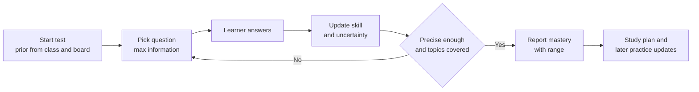
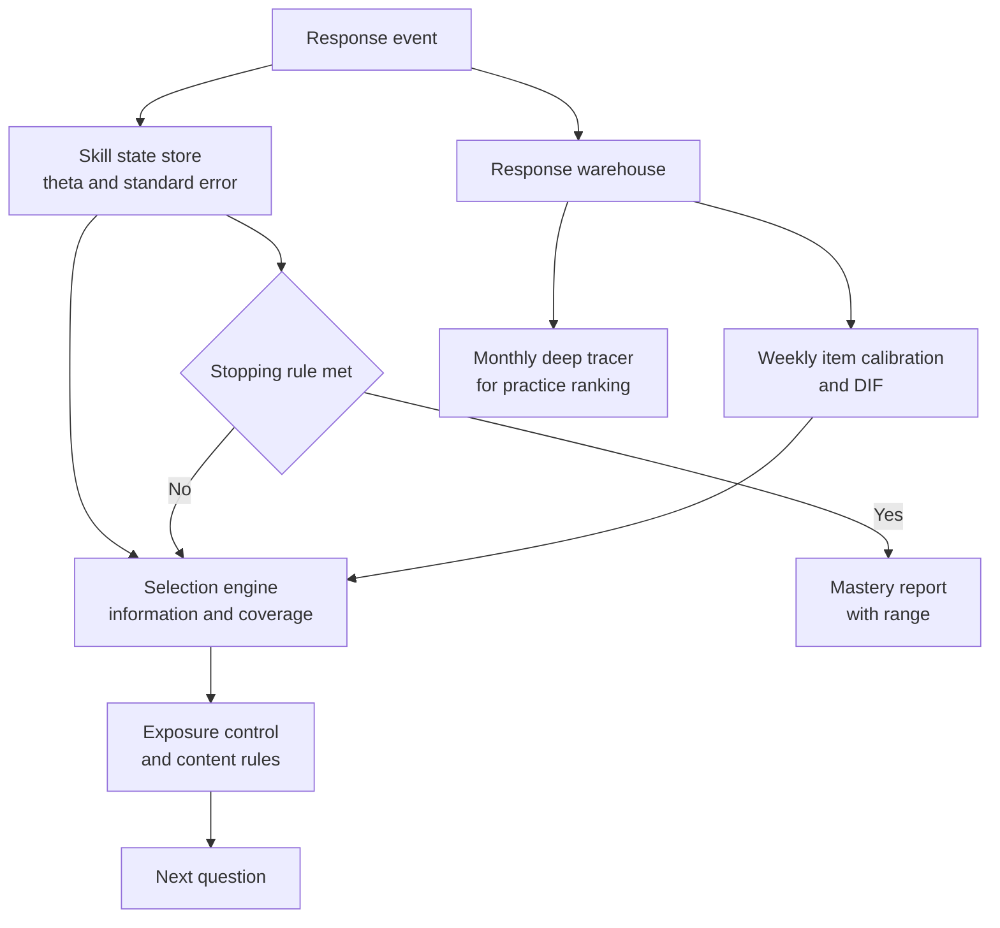

# Case Study 53: Knowledge Tracing and Adaptive Testing

**Domain:** EdTech | **Problem Type:** Sequence modelling and item response theory (latent skill estimation plus sequential question selection) | **Difficulty:** Advanced

---

## 1. Business Context

### Company background

- **GyanGauge** (fictional) provides diagnostic tests and practice for Class 6 to 12 (CBSE, ICSE and several state boards) and for foundation-level competitive exams. It sells to learners directly, and to about 2,500 schools and coaching centres.
- Content is available in **English, Hindi, Marathi, Tamil, Telugu and Bengali**. The question bank has about **1.8 lakh questions**, each tagged to a topic and a skill.
- A learner takes a **diagnostic test** to find strong and weak topics. The result drives a personalised study plan, which is the main reason people pay.
- Today the diagnostic is a **fixed test of 60 questions** (about 45 minutes), the same for every learner in a class.

### The pain, with numbers

| Item | Value |
| --- | --- |
| Diagnostic tests started a month | about 8 lakh |
| Completion rate of the 60-question test | about 71% |
| Average time to finish | about 45 minutes, with many drop-offs after question 35 |
| Share of questions that are too easy or too hard for a given learner | about 55% (little information gained) |
| Precision of the topic mastery estimate (for a 60-question test) | standard error of about 0.33 on the skill scale |
| Share of teachers who say the "mastery %" is a black box | about 60% |
| Conversion of diagnostic completers to a paid plan | about 4.5% |
| Complaints of unfair tests from regional-language users | about 3x more per test than English |

- Weak learners get demoralised by hard questions, and strong learners are bored by easy ones. Both quit.
- A test that adapts to the learner can reach the same precision in about **25 questions**.
- Value:
  - completion rises from 71% to 86%, so on 8 lakh tests that is about 1.2 lakh more completed diagnostics a month;
  - these extra completers convert at about 3% (lower than the 4.5% average), giving 3,600 more paid plans a month at about ₹6,000;
  - that is about ₹2.16 Cr a month, or about **₹26 Cr** a year of revenue, plus a better study plan for everyone.

### Stakeholders and what each wants

| Stakeholder | What they want | What they fear |
| --- | --- | --- |
| Head of Product | Shorter tests, higher completion, a better plan | A clever test that confuses users |
| Academic Head | Scientifically valid measurement, topic coverage that matches the syllabus | Tests that skip important chapters |
| Teachers and school partners | Explanations they can use in class | A "mastery" number they cannot explain to parents |
| Learners and parents | A fair and short test | Being judged unfairly because of language or board |
| Content and Psychometrics team | Well-calibrated questions, controlled exposure of questions | Leaked or overused items |
| Compliance and Legal | Fair treatment across language groups, minors' data protection (DPDP Act 2023) | Discrimination complaints, retaining children's data too long |

---

## 2. Translating Business to ML

### The business question vs the ML question

| Business question | ML question |
| --- | --- |
| "How well does this learner know each topic, using as few questions as possible, and what should we ask next?" | "Maintain a probabilistic estimate of each learner's skill per topic that updates after each response. Choose the next question that gives the most information, subject to content coverage and exposure rules. Stop when the estimate is precise enough." |

> **Mentor note:** There are really two models here. One **estimates** the skill (knowledge tracing or item response theory). The other **chooses** the next question (the selection policy). Juniors often build a fancy deep network for the first and forget that the second decides whether the test is short, fair and safe. Also, a mastery number must come with a **range**, not as a single point.

### Target variable definition

- **Latent target:** the learner's skill level per topic at the time of the test. Skill is **not directly observed**, so we cannot train on it.
- **Observed training signal:** the **correct or incorrect** response to each question, in order.
- **Model task:** predict the probability that the learner answers the next question correctly, given the history. A good skill estimate is one that predicts future responses well.
- **Validation of the skill estimate:** agreement with a long, fixed, high-quality test (a 100-question gold test) taken by a sample of learners.

### Edge cases

| Edge case | Recommended treatment | Reason |
| --- | --- | --- |
| Learner guesses on a multiple-choice question (4 options, 25% chance by luck) | Model a **guessing parameter**, and down-weight very fast answers | Otherwise a lucky guess raises the skill estimate |
| Learner knows the topic but makes a careless slip | Model a **slip parameter**, and avoid concluding from a single wrong answer | One error should not erase mastery |
| Learner skips a question | Treat as missing with a mild negative signal, not as wrong | Skipping can be fear or lack of time |
| Learner leaves the test and returns later | Save state, and allow resume within 24 hours | Mobile apps get interrupted |
| Question is flawed (ambiguous or wrong key) | Flag when strong learners fail it, and remove or review | Bad items damage estimates |
| Learner forgets a topic after weeks | Let skill decay over time in tracing across sessions | Knowledge is not permanent |
| Learner shares the phone with a sibling | Detect odd pattern shifts, and ask for re-verification at the start of long tests | Mixed-up responses corrupt estimates |

### Unit of prediction

- A **(learner, topic, time)** triple for skill estimates, and a **(learner, question)** pair for the next-response prediction.

### Prediction timing



- Each update takes under 100 ms, so that the next question appears instantly.
- The test ends when the stopping rule is met, and the skill state continues to be updated from later practice.

### What success looks like

| Lens | Success |
| --- | --- |
| Business | Diagnostic completion from 71% to 86%, test length from 60 to about 25 questions, about ₹26 Cr more revenue a year |
| Model | Standard error of the overall skill estimate of 0.33 or less at 25 questions (same as the fixed 60-question test). Correlation with the 100-question gold test at least 0.90 |
| Predictive | AUC of next-response prediction at least 0.76 on held-out learners |
| Fairness | The error of estimates and the test length are within 10% across languages and boards (after controlling for true skill) |
| Trust | Teachers can see, for each topic, which questions drove the mastery estimate |

---

## 3. Data Understanding

### Data sources and key features

| Feature group | Source | Why it matters |
| --- | --- | --- |
| Response log (learner, question, correct, time taken, attempt number, timestamp) | Test and practice app | Raw material for all models |
| Question metadata (topic, skill tags, type, language version, options, author, year) | Content system | Links responses to skills and enables cold-start |
| Question statistics (past difficulty, discrimination, guess rate) | Psychometrics pipeline | The item parameters |
| Skill and prerequisite map | Academic team | Structures topics for tracing and coverage |
| Learner profile (class, board, medium of instruction, school type) | Profile | Priors and fairness slices (not to set the score) |
| Test conditions (device, network, interruptions, time of day) | App | Context for noisy responses |
| Gold-test results | Sample of 20,000 learners taking a long test | Ground truth for validation |
| Teacher feedback on mastery reports | School dashboards | Trust and interpretability checks |

### Data volume, granularity and refresh

- **Volume:** about 3 crore responses a month, and about 36 crore a year, from about 25 lakh learners. A typical learner has 40 to 200 responses a month.
- **Granularity:** one row per response with time taken and attempt number.
- **Refresh:** responses stream in real time. Item parameters are re-estimated weekly. The sequence model is retrained monthly.

### Common data issues

| Issue | How it shows up here |
| --- | --- |
| **Cold-start questions** | About 4,000 new questions a month have no responses, and cannot be placed on the difficulty scale |
| **Non-random question exposure** | Adaptive tests show easy questions to weak learners, so naive difficulty statistics are biased |
| Guessing and fast-click behaviour | Many learners answer in under 3 seconds to finish quickly |
| Language versions of the same question | The Hindi version may be harder to read than the English one (translation effects) |
| Sparse data per learner per topic | Only 2 to 4 responses on a given topic in one test |
| Shifting syllabus and question quality | Boards change chapters, and flawed items persist |
| Learners practising the same question many times | Memorisation, not skill |
| Time-limited access | Learners from low-bandwidth areas drop mid-question |

> **Mentor note: Where juniors usually go wrong here.**
>
> - They calculate difficulty as "percent of learners who got it right", ignoring which learners saw it. In adaptive tests weak learners get easy questions, so the percent right is meaningless without adjusting for the learner.
> - They treat deep knowledge tracing as the obvious winner, because papers show high AUC, and ignore that some of that AUC comes from leaking the question ID or the immediate repeat of the same question.
> - They report one mastery number with no uncertainty, and then wonder why teachers distrust it.

---

## 4. Approach and Decision Points

### Baseline first

- **Baseline 1 (current):** a fixed 60-question test, with percent correct by topic.
- **Baseline 2:** a simple **Rasch (1-parameter IRT) model**: probability of a correct answer depends on skill minus question difficulty. Strong and well understood.
- **Baseline 3:** an **adaptive version** of Rasch: always pick a question whose difficulty is close to the current skill estimate.
- **Why it matters:** a Rasch-based adaptive test already delivers most of the gain, and gives a clear, explainable result. A deep model needs to beat it on predictive accuracy **and** be usable in practice.

### Candidate models

| Model | Pros | Cons | Verdict |
| --- | --- | --- | --- |
| Percent correct (classical test) | Trivial, no modelling | Not comparable across question sets, long test needed | Baseline |
| **IRT (Rasch, 2PL, 3PL with a guessing parameter)** | Principled, gives uncertainty, item parameters are interpretable, works for adaptive selection | Static skill, not good for learning over time, assumes one skill | **Core for the diagnostic test** |
| **Bayesian knowledge tracing (BKT)** | Models learning, guessing and slip per skill, easy for teachers to read | Needs a clean skill tagging, one skill per question, weak on forgetting | **Good for practice mode** |
| Performance factors analysis or logistic models with counts | Simple, uses counts of past successes and failures | Weaker on order effects | Useful middle option |
| **Deep knowledge tracing** (LSTM or attention, for example SAKT or AKT) | Higher predictive accuracy on long histories, picks up cross-skill patterns | Black box, needs a lot of data, tends to be unstable, hard to explain | **Candidate for practice recommendations, not for the reported mastery** |
| IRT item parameters fed into a deep tracer | Combines interpretable difficulty with sequence strength | More moving parts | Phase 2 |

### Decision scenarios

| What if... | Recommended action | Reasoning |
| --- | --- | --- |
| **Deep tracing beats IRT by 3 AUC points, but teachers cannot explain it** | Use IRT or BKT for the reported mastery and the diagnostic. Use deep tracing for ranking practice questions behind the scenes. Distil what the deep model finds into skill-level hints | A 3-point AUC gain is not worth losing the trust of teachers and parents. Interpretability is a product requirement here |
| **A brand-new question has no responses** | Predict its difficulty from text embeddings, topic, and past authors, set a wide uncertainty, and use it as a **pilot item** (ungraded, mixed into tests) until about 200 responses arrive | Cold-start questions need a controlled trial so that they do not distort scores |
| **Many fast, random answers on a 4-option question** | Model guessing explicitly (3PL), use response time to flag guesses, and require 2 or more consistent signals before declaring mastery | A lucky guess must not lift mastery, and a slip must not drop it |
| **The test is meant to stop early. When is "enough"** | Stop when the standard error of the main skill estimate is below 0.30 **and** each major topic has at least 3 questions **and** a minimum of 15 questions, with a cap at 40 | Precision alone can skip chapters. A coverage rule is also needed |
| **The most informative questions are overexposed and are shared on Telegram** | Use exposure control: randomise among the top 5 most informative questions, and retire any question seen by more than a fixed share of learners in a month | Pure information-maximising picks the same few questions, which then leak |
| **Hindi-medium learners score lower on a maths word problem than English-medium learners with the same skill** | Run **differential item functioning** (DIF) analysis, and compare item difficulty across language versions among learners of equal overall skill. Revise or flag items with large gaps | The item may be testing reading level, not maths. Fairness is a modelling task, not just a policy |
| **A learner's mastery drops from 80% to 40% after 3 wrong answers** | Smooth with a prior, show the range, and wait for more evidence before downgrading | The estimate should move with evidence, not panic |
| **Learners practise the same questions repeatedly** | Track attempt number. Discount repeated attempts and treat them as memory evidence only | The skill estimate would otherwise be inflated |

---

## 5. Feature Engineering

### Top 10 features to build

| # | Feature | Business logic |
| --- | --- | --- |
| 1 | Question difficulty and discrimination (IRT parameters, with uncertainty) | Core of the model |
| 2 | Learner skill estimate and its standard error, per topic | Primary state, and the basis of the stopping rule |
| 3 | Guessing indicator (very fast answer, option position patterns) | Separates luck from knowledge |
| 4 | Recent response sequence (last 10 correct or wrong, with time taken) | Captures learning and fatigue in the deep model |
| 5 | Time since the learner last practised this skill, with forgetting curve | Knowledge decays |
| 6 | Prerequisite skill mastery | A weak foundation predicts failure on advanced items |
| 7 | Number of attempts at the same question or its clones | Memory vs skill |
| 8 | Question text embedding and skill tags | Cold-start difficulty prediction |
| 9 | Language version and reading load of the question (word count, script) | Fairness analysis and DIF |
| 10 | Test position and elapsed time (fatigue) | Late-test responses are noisier |

### Features to avoid (leakage risks)

| Feature | Problem |
| --- | --- |
| Question ID as a raw input in the deep model | The model memorises per-question accuracy and looks better than it is. Use parameters and embeddings, and test on unseen questions |
| Future responses in the same session when training next-response prediction | Look-ahead leakage |
| Final test score or percentile as an input | Leaks the outcome |
| Learner ID embeddings in a model meant to generalise to new learners | Cannot handle cold-start |
| Language or board as a direct multiplier of skill | Bakes group differences into the score |
| Purchase status or plan type | Irrelevant, and unfair |

Next-question selection with exposure control (choose the question with the most information, but randomise among the best few):

```python
import numpy as np

def pick_next(theta, items, seen, exposure, k=5, max_exposure=0.20):
    # 2PL information: a^2 * p * (1 - p)
    p = 1 / (1 + np.exp(-items["a"] * (theta - items["b"])))
    info = items["a"] ** 2 * p * (1 - p)
    ok = ~items["id"].isin(seen) & (exposure[items["id"]] < max_exposure) & items["topic_needed"]
    top = info.where(ok).nlargest(k)           # k most informative eligible items
    return np.random.choice(top.index, p=top / top.sum())
```

---

## 6. Evaluation Strategy

### Metrics

| Metric | Role | Why |
| --- | --- | --- |
| **Standard error of the skill estimate at stopping** | Primary precision metric | Directly tied to test quality |
| **Test length at a target precision** | Primary efficiency metric | The business gain |
| **Correlation and RMSE against the gold 100-question test** | Validity | Proves short adaptive tests measure the same thing |
| AUC and log loss of next-response prediction on **unseen learners and unseen questions** | Predictive quality | Compares IRT, BKT and deep models |
| Calibration of predicted probabilities | Reliability | A "70% chance correct" must mean 70% |
| Test-retest reliability (two adaptive tests a week apart, same learner) | Stability | A trustworthy score is repeatable |
| DIF flags and estimate error by language and board | Fairness | Detects unfair items and groups |
| Completion rate and time to complete | Business | Shows the user effect |

### Metrics that look good but are misleading here

- **AUC on random splits of responses:** the model sees the same learner and question in both sets.
- **Accuracy of predicting "correct":** most responses are correct (about 62%), so a naive guess already scores high.
- **Percent mastery shown without a range:** looks precise, but may be unreliable.
- **Average test length alone:** a short test is useless if it skips topics.

### Validation strategy

| Step | Design | Why |
| --- | --- | --- |
| Learner-grouped split | Hold out 20% of learners entirely | Tests generalisation to new learners |
| Question-grouped split | Hold out 10% of questions, treat as new | Tests cold-start predictions |
| Time-based split | Train on older months, test on the latest 2 months | Syllabus drift |
| **Simulation of adaptive tests** | Replay logged learners with a simulated adaptive engine using the model's answers on held-out items | Estimate test length and precision before any live test |
| Gold-test study | 20,000 learners take both the adaptive and 100-question tests | Validity |
| Slice analysis and DIF | By language, board, gender, school type and device | Fairness |
| Online A/B test | Randomise new diagnostic starters between fixed 60-question and adaptive tests | Measures completion, plan quality and conversion |

### From model metric to business value

- 8 lakh diagnostics a month, with completion rising from 71% (5.68 lakh) to 86% (6.88 lakh), which is about **1.2 lakh** extra completions.
- Extra completers convert at about 3%: 1.2 lakh x 3% = **3,600** more paid plans a month.
- At about ₹6,000 per plan: 3,600 x ₹6,000 = about **₹2.16 Cr a month**, about **₹26 Cr a year**.
- Cost: engineering, psychometrics, and question piloting of about ₹2.5 Cr a year. Compute for 3 crore responses a month is small.
- Side benefits not counted: better study plans, less load on support, and stronger teacher trust.

---

## 7. Deployment and Monitoring

### Batch vs real time

- **Real time (under 100 ms per step)** for ability updates and question selection during a test.
- **Batch (weekly)** for item parameter recalibration and DIF checks.
- **Batch (monthly)** for deep tracer retraining and gold-test comparisons.



### What to monitor

| Type | What to track | Alert trigger |
| --- | --- | --- |
| Test quality | Standard error at stop, test length, share hitting the 40-question cap | Cap reached by more than 10% |
| Item health | Item difficulty drift, discrimination, guess rate, answer-key problems | Difficulty shift above 0.3 logits |
| Exposure | Share of learners seeing each question, overall and by region | Any item above the cap |
| Fairness | DIF flags, test length and error by language and board | Gap above 10% relative |
| Prediction | AUC and calibration on the last week | AUC drop of 0.02 |
| Reliability | Test-retest correlation on repeat takers | Below 0.85 |
| Behaviour | Completion, time per question, abandonment point | Completion down 5 points |
| Cheating or leaks | Shared answer patterns, sudden jumps in item accuracy | Spike in accuracy of one item |
| Data protection | Retention of minors' response logs | Over the policy |

### Retraining

- **Weekly:** item parameters and exposure counts.
- **Monthly:** deep tracer and BKT parameters per skill.
- **Triggered:** new syllabus, a new language version, a flagged item cluster, or a drift alert.
- **Pilot items:** a steady flow of new questions mixed in as ungraded items, so the bank stays fresh.

### A/B test or champion-challenger design

- **Champion:** fixed 60-question test. **Challenger:** adaptive Rasch or 2PL test with coverage and exposure rules.
- Randomise at the **learner** level on first diagnostic, stratified by class and language.
- Primary outcome: completion rate. Secondary outcomes: precision against a later gold test, plan activation, 30-day practice, and conversion.
- Run for 4 weeks, then follow outcomes for 8 weeks.
- Roll out by class (start with Class 9 to 10) and keep a fixed-test fallback.

---

## 8. Stakeholder Communication

### Explain it to a non-technical leader

> "Instead of giving every learner the same 60 questions, the test picks each next question based on how they answered the last one. If they get it right, the next one is a bit harder. If they miss it, a bit easier.
> That lets us measure what they know in about 25 questions instead of 60, with the same accuracy. We also show a range, for example 'Fractions: 60 to 75%', instead of a false exact number.
> We expect about 15 more learners in every 100 to finish the test, which is worth about ₹26 Cr a year, and we check that the test is fair across languages and boards."

### Questions leadership will ask

| Question | Suggested answer |
| --- | --- |
| "Why not use the most advanced deep model for everything?" | "It predicts a bit better, but teachers and parents need to understand the score. We use the simple model for the report and the deep one behind the scenes" |
| "Is a 25-question test as good as 60?" | "It reaches the same precision, because every question is chosen to be informative. We check it against a long test on 20,000 learners" |
| "What about a learner who guesses a lot?" | "We model guessing, use time taken, and need consistent evidence before calling a topic mastered" |
| "Will learners in regional languages be treated unfairly?" | "We test every question for unfair behaviour across language versions, and report test quality for each language. Flagged questions are fixed or removed" |
| "What if questions get leaked?" | "We cap how often any question is shown and keep adding new ones. Leaks show up as unusual accuracy and are retired" |
| "Can teachers see why the score is what it is?" | "Yes. For each topic they see the questions that drove it, and the range of uncertainty" |

---

## 9. Common Pitfalls and Lessons

| Mistake | Why it happens | How to avoid it |
| --- | --- | --- |
| Estimating difficulty as percent correct | It is simple | Use IRT calibrated on learner skill, and adjust for adaptive exposure |
| Evaluating on random splits | Easy to code | Hold out learners, questions and time |
| Choosing deep tracing for its AUC alone | Papers highlight accuracy | Weigh interpretability, stability and fairness, and test on unseen questions |
| Ignoring guessing and slip | One-skill, one-answer thinking | Use 3PL or BKT with guess and slip, use response time |
| Pure information maximising | It looks optimal | Add content coverage and exposure control |
| Stopping on precision alone | Easy rule | Add topic coverage and a minimum length |
| No cold-start path for new questions | Bank grows monthly | Pilot items, text-based priors, wide uncertainty |
| Treating language differences as skill differences | Averages are compared directly | Run DIF analysis and fix reading-load issues |
| Showing a single mastery number | It looks neat | Show a range and the evidence |

---

## 10. Mentor's Focus Checklist

- ✅ **Where to spend 80% of the effort:**
  - Item calibration: difficulty, discrimination, guessing, cold-start items, and pilot flow.
  - The selection policy: information with coverage, exposure control, and a sound stopping rule.
  - Validation against a gold test, with held-out learners and questions.
  - Fairness: DIF analysis across languages and boards.
  - Interpretable reports for teachers, with uncertainty.
- ❌ **What not to over-engineer:**
  - A deep tracer for the reported mastery score when IRT or BKT is enough.
  - Multi-skill fancy graph models before the skill tags are clean.
  - Chasing the last 1 point of AUC at the cost of explainability.
- 💡 **Key takeaway:** **A good test is a good measurement.** Spend your effort on knowing how sure you are, how fair the questions are, and when to stop, and use the deep model where it helps without hiding the answer from teachers.
