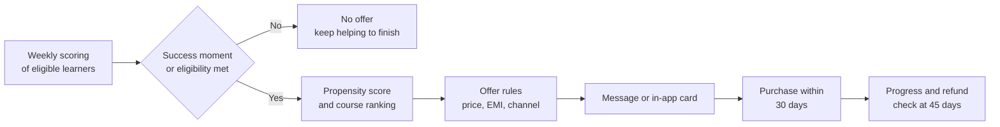
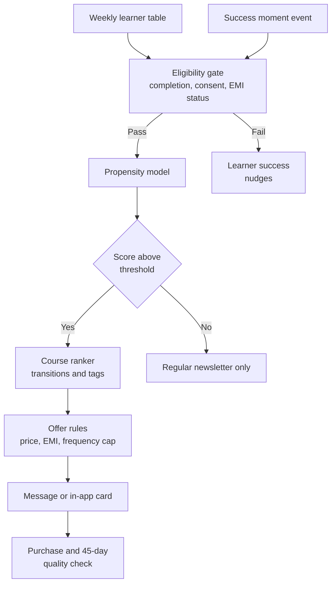

# Case Study 54: Course Cross-Sell Recommendation to Existing Learners

**Domain:** EdTech | **Problem Type:** Propensity modelling plus next-course recommender (two-stage: whether and which) | **Difficulty:** Intermediate

---

## 1. Business Context

### Company background

- **BharatUpskill** (fictional) is an online upskilling platform for working professionals and graduates. It sells cohort and self-paced courses in data analytics, digital marketing, finance, product management, spoken English and certification prep.
- The catalogue has about **120 paid courses** in 9 categories, priced from **₹3,000 to ₹60,000**. The average second purchase is about **₹14,000**.
- About **6 lakh learners** have bought at least one course. About **38%** of purchases use **EMI** through lending partners (NBFCs and banks), with a no-cost EMI offer on larger courses.
- Each learner is contacted by email, WhatsApp, app notifications and sometimes a counsellor call.

### The pain, with numbers

| Item | Value |
| --- | --- |
| Past buyers (existing learner base) | 6 lakh |
| Share who buy a second course within 12 months | about 7% (about 42,000 learners) |
| Average value of a second purchase | about ₹14,000 |
| Revenue from cross-sell | 42,000 x ₹14,000 = about ₹58.8 Cr a year |
| Current approach | Every buyer gets the same "20% off" blast, 3 times a month, across email and WhatsApp |
| Monthly opt-out from marketing messages | about 2.1% of the base |
| Net Promoter Score (NPS) of existing learners | about 38 |
| Second-purchase rate if the first course was **completed** (over 70%) | about 13% |
| Second-purchase rate if the first course was **not completed** | about 3% |
| Refund or complaint rate on second purchases by learners who did not finish course 1 | about 2.5x higher |

- Check: 40% of buyers complete the first course. 0.40 x 13% + 0.60 x 3% = 5.2% + 1.8% = 7.0%.
- The blast treats everyone alike. It discounts to people who would have bought anyway, and annoys others, including learners who are stuck on their first course.
- Target: raise the second-purchase rate from **7% to 9%** with better targeting, while NPS holds or improves.
- Value: 2% of 6 lakh is about 12,000 extra purchases. At ₹14,000, that is about **₹16.8 Cr** a year of revenue, about **₹9.2 Cr** of contribution at a 55% margin.

### Stakeholders and what each wants

| Stakeholder | What they want | What they fear |
| --- | --- | --- |
| Head of Growth | More repeat purchases without more discount spend | Lower sales because the model is "too careful" |
| Academic and Learner Success | Learners finishing what they bought, and moving to relevant next steps | Selling a second course to someone struggling with the first |
| Finance | Higher revenue per learner, controlled discounts, fewer refunds | Revenue pulled forward, then refunded |
| Brand and CX | Trust and word of mouth, good NPS | Pushy messages and complaints on social media |
| Lending partners | Healthy repayments | EMI for learners who cannot afford it |
| Compliance and Legal | Consent for messages (DND and opt-in rules), fair EMI disclosure, DPDP Act 2023 purpose limits | Unwanted marketing, mis-selling complaints |

---

## 2. Translating Business to ML

### The business question vs the ML question

| Business question | ML question |
| --- | --- |
| "Which existing learners should we offer another course, which course, when, and at what price?" | "For each eligible learner and each day, estimate the probability of buying any new course in the next 30 days (propensity). Then, for learners above a threshold, rank courses by probability of purchase **and** completion. Apply rules for eligibility, timing and price offer." |

> **Mentor note:** Cross-sell is not "sell as much as possible". A learner who buys a second course and abandons it becomes a refund, a bad review and a lost customer. In education the product only works if the learner **succeeds**. So we only make offers at moments of success, and the target we care about is a purchase that is **used**, not just paid.

### Target variable definition

- **Stage 1 (whether):** `buy_30d = 1` if the learner pays for a new course within 30 days of the scoring date.
- **Stage 2 (which):** among purchasers, the course they bought, treated as a ranking problem across the catalogue.
- **Quality-adjusted outcome:** `good_buy = 1` if the purchase is not refunded and the learner reaches at least 25% progress within 45 days.

### Edge cases

| Edge case | Recommended treatment | Reason |
| --- | --- | --- |
| Learner bought a course before the offer was sent | Remove such rows from training, or label them as non-offer | Otherwise the model gets credit for pre-existing intent |
| Bundle purchases (2 courses at once) | Treat as one purchase, with multiple courses as positives in stage 2 | Avoid double counting |
| Purchase made by a company or sponsor | Separate flag, exclude from propensity | A different buying process |
| Learner buys the same course again (renewal or extension) | Exclude from cross-sell, handle in another model | Different intent |
| Refund within 14 days | Counts as 0 for `good_buy` | We want purchases that stick (see Case 55) |
| Learner has an open EMI payment overdue | Excluded from offers | Responsible lending and complaint risk |
| Learner who opted out of marketing | Never scored for outreach, but available for in-app recommendations if consent allows | Respect consent |

### Unit of prediction

- One **(learner, scoring week)** for propensity, and one **(learner, candidate course)** for recommendation.

### Prediction timing



- Scores are refreshed weekly, and also after **success moments**: finishing a course, passing a final assessment, getting a certificate, or a big score jump.
- The outcome window is 30 days for the purchase and 45 days for the quality check.

### What success looks like

| Lens | Success |
| --- | --- |
| Business | Second-purchase rate from 7% to 9%, about 12,000 more purchases, about ₹16.8 Cr more revenue a year |
| Model | Top 20% of learners by propensity capture about 55% of purchases. AUC about 0.78 |
| Recommender | The bought course is in the top 3 recommended for about 45% of purchasers |
| Guardrails | Opt-out rate not above 1.5% a month (from 2.1%), NPS not lower than 38, refund rate on second purchases not higher than the current rate |

---

## 3. Data Understanding

### Data sources and key features

| Feature group | Source | Why it matters |
| --- | --- | --- |
| Purchase history (courses, dates, price, discount, payment mode, EMI) | Billing and payment data | Past behaviour and price sensitivity |
| Progress in each course (percent complete, assessments passed, certificate, last active date) | Learning platform | The most important readiness signal |
| Success moments (final score, project grade, rank in cohort, mentor feedback) | Learning platform and mentors | Best timing for an offer |
| Learner profile (role, experience, industry, goal at sign-up, city tier) | Onboarding and CRM | Which courses are relevant |
| Browsing and wishlist (course pages viewed, syllabus downloaded, wishlist adds) | Web and app analytics | Direct interest |
| Catalogue graph (which course follows which, tags, level, price) | Academic team | Sequence and prerequisites |
| Communication history (messages sent, opens, replies, opt-outs) | Marketing tools | Fatigue and consent |
| Support and sentiment (tickets, refund requests, ratings, NPS comments) | Support and survey systems | Trust and satisfaction |
| Credit and EMI signals (EMI eligibility result, repayment status) | Lending partners | Affordability and responsible selling |

### Data volume, granularity and refresh

- **Volume:** 6 lakh learners, about 42,000 second purchases a year. Over 2 years that is about **75,000 positives** across 120 courses, which is thin for per-course models (many courses have under 300 buyers).
- **Granularity:** one row per learner-week for propensity. A learner is in the data for up to 104 weeks (so there are tens of millions of rows, with only about 0.15% positives per week).
- **Refresh:** progress and browsing data daily, billing in near real time, scores weekly.

### Common data issues

| Issue | How it shows up here |
| --- | --- |
| **Small purchase data** | Only about 75,000 purchases across 120 courses, and new courses have none |
| **Past discounts affect the label** | The old blast offered 20% to everyone, so we never saw what happens without a discount |
| Offer exposure bias | Learners who were messaged more often had more chances to buy |
| Success moments are not logged everywhere | Mentor feedback and project grades are in separate tools |
| Mixed course types | Cohort courses and self-paced courses have different buying rhythms |
| Price changes and seasonality | Salary hike season (April to June) and new-year resolutions raise demand |
| Delayed refunds and EMI cancellations | A purchase may look successful for 2 weeks and then disappear |
| Consent gaps | Some learners opted out of WhatsApp but still receive email |

> **Mentor note: Where juniors usually go wrong here.**
>
> - They build one model that predicts "will buy" and use it on everyone, including learners stuck at 10% progress in course 1. Propensity can look high because they browse a lot, but the right action is to help them, not sell to them.
> - They train a separate model per course with 150 positives each, and get noise.
> - They count a purchase as a win even when it is refunded or never started.

---

## 4. Approach and Decision Points

### Baseline first

- **Baseline 1 (current):** blast "20% off" to everyone, 3 times a month.
- **Baseline 2:** send only to learners who completed course 1, recommend the **most popular** course in the same category.
- **Baseline 3:** a **next-course rule table** built by the academic team (for example data analytics to machine learning, digital marketing to performance ads).
- **Why it matters:** Baseline 2 is a strong, simple rule that captures much of the gain. A model must beat it in both conversion **and** quality of purchase.

### Candidate models

| Model | Pros | Cons | Verdict |
| --- | --- | --- | --- |
| Rules by completion and category | Transparent, safe | Misses personal signals and timing | Baseline and eligibility layer |
| **Logistic regression for propensity** | Stable on rare events, explainable | Limited interactions | **Strong first model** |
| **Gradient boosting for propensity** | Handles non-linear patterns and missing values | Needs calibration, monitoring | **Production model** |
| Item-to-item co-purchase and sequence rules (people who bought A then bought B) | Works with small data, interpretable | Needs smoothing, weak for new courses | **Good for recommendation** |
| Matrix factorisation or neural recommender | Learns tastes | 75,000 purchases are too few | Not at this scale |
| Content-based ranking (profile and course tags) | Handles new courses | Weaker on actual buying patterns | Use as a prior and for cold-start |
| Hierarchical model by category, then course | Shares strength across courses | More complex to maintain | Good middle path |
| Uplift model for the discount decision | Finds who needs an incentive | Needs random discounts | Phase 2 (see Case 3 and Case 7) |

### Decision scenarios

| What if... | Recommended action | Reasoning |
| --- | --- | --- |
| **Propensity is highest for learners who have only finished 15% of course 1** | Make **completion of course 1 (above 70%) a rule-based gate** for paid offers. For those learners, trigger learner-success help (mentor nudge, easier plan) instead | A high browsing score does not mean they are ready. A second course adds pressure to someone already behind |
| **Offers should go out at the best moment** | Trigger offers within 48 hours of a success moment (final test passed, certificate issued, project praised), and avoid the week after a failed assessment or a support complaint | The same message works differently at a high and a low moment |
| **A learner would buy anyway, but we give them 20% off** | Test a no-discount arm, and give discounts only where the model says price is the barrier (cart abandoned, repeated price page views, EMI check done but not completed) | Blanket discounts give away margin. The discount belongs where it changes the decision |
| **The learner can only afford the course on EMI** | Show monthly EMI, total cost and interest clearly. Do not push a course whose EMI exceeds a set share of the learner's stated income range, and check EMI eligibility before the offer | Responsible selling, lower defaults, and fewer complaints. Fits with RBI digital lending expectations on disclosure |
| **A new course launches with zero purchases** | Use content-based similarity to existing courses, reserve a small share (for example 5%) of eligible offers as pilot exposure to relevant learners, and promote it by the academic team's next-step table | Without exposure, a new course never gets data |
| **A learner is highly likely to buy a high-priced course, but their completion history is poor** | Recommend a shorter, lower-priced bridge course, or a refresher, instead of the premium one | Fit with the learner's demonstrated pace protects the outcome |
| **Opt-out rate rises while sales rise** | Add a **message frequency cap** (for example 2 a month), suppress after 2 ignored messages, and treat opt-out and NPS as guardrails with a cost in rupees | Short-term sales can be bought at the cost of the relationship. We need the long-term view |
| **The target is "any second purchase", but many learners buy the same course category** | Add the sequential pattern: the second course is usually in the same category or an adjacent one at a higher level. Use that for ranking | Course sequence carries information that a simple popularity list does not |

---

## 5. Feature Engineering

### Top 10 features to build

| # | Feature | Business logic |
| --- | --- | --- |
| 1 | Course 1 completion percent, and whether a certificate was earned | Readiness and satisfaction |
| 2 | Days since the last success moment (final test passed, project graded, rank) | Timing for the offer |
| 3 | Recent activity (days active in the last 14 days, trend) | Engagement now, not months ago |
| 4 | Assessment performance relative to the cohort | Confidence and fit with the next level |
| 5 | Course page views, wishlist adds and syllabus downloads for specific courses in the last 30 days | Direct interest |
| 6 | Category match between learner goal and the candidate course | Relevance |
| 7 | Next-course transition strength (share of past learners who moved from course 1 to the candidate) | Sequential pattern |
| 8 | Price tier of the first purchase vs the candidate price, and past discount use | Price sensitivity |
| 9 | EMI history and eligibility (used EMI, repayment status, pre-check passed) | Affordability |
| 10 | Messages received in the last 30 days, opens, and opt-out status | Fatigue and consent |

### Features to avoid (leakage risks)

| Feature | Problem |
| --- | --- |
| Whether a discount coupon was **redeemed** | Happens only at purchase, and leaks the outcome |
| Cart creation and payment page visits after the offer | These happen right before purchase. Fine for in-session decisions, not for weekly targeting |
| Counsellor call notes after the offer | Post-treatment information |
| Refund and cancellation of the second purchase | Future information |
| Total number of courses bought (including the target purchase) | Includes the outcome |
| Learner's exact income or religion or caste proxies | Unfair and not needed |

Gating offers on completion and success, then ranking courses with smoothed transition counts:

```python
# Eligibility gate before scoring: do not sell to learners who are still struggling
elig = (
    (df["c1_completion"] >= 0.70)
    & (df["emi_overdue"] == 0)
    & (df["marketing_consent"] == 1)
    & (df["msgs_last_30d"] < 2)
)

# Smoothed transition strength from course A to course B (Laplace-style shrinkage)
alpha = 5
trans = (pairs["n_AB"] + alpha * pairs["prior_B"]) / (pairs["n_A"] + alpha)
```

---

## 6. Evaluation Strategy

### Metrics

| Metric | Role | Why |
| --- | --- | --- |
| **Lift and capture rate at the contact budget** (share of purchases in the top 20% scored) | Primary offline metric | Matches how many messages we can send |
| **PR-AUC and AUC** for propensity | Model quality | Positives are about 0.15% of learner-weeks, so use PR-AUC |
| Calibration by decile | Secondary | Needed if scores drive discounts and forecasts |
| **Top-3 hit rate** of the recommended course | Recommender quality | Matches how many cards we show |
| **Good-buy rate** (purchase not refunded and 25% progress in 45 days) | Primary business metric | Quality of sale |
| Incremental purchases from a randomised holdout | True business impact | Separates the effect of the campaign from natural demand |
| Opt-out rate, complaint rate and NPS change | Guardrails | The relationship is an asset |
| Discount cost per incremental purchase | Efficiency | Controls margin leakage |

### Metrics that look good but are misleading here

- **Accuracy:** above 99% by predicting that nobody buys.
- **Conversion of messaged learners:** includes people who would have bought anyway.
- **Open or click rate:** measures curiosity, not buying or learning.
- **Revenue per message** without netting out refunds and discounts.

### Validation strategy

| Step | Design | Why |
| --- | --- | --- |
| Time-based split | Train on weeks 1 to 70, validate on weeks 71 to 88, test on weeks 89 to 104, with a 45-day gap for the quality label | Avoid look-ahead and immature labels |
| Course-group check | Evaluate recommendation separately for large, medium and small courses | The average is driven by a few popular courses |
| Slice analysis | By city tier, role, EMI vs non-EMI, and completion band | Finds weak groups |
| Seasonality check | Include April to June and October to December separately | Demand changes |
| Randomised holdout | 10% of eligible learners receive no targeted offer (only regular newsletters) | Measures incremental purchases |
| Online A/B test | Compare the blast, the rule-based Baseline 2, and the model-driven offer | Direct view of lift and guardrails |

### From model metric to business value

- Baseline: 7% of 6 lakh = 42,000 second purchases, about ₹58.8 Cr.
- Target: 9% = 54,000, so **+12,000** purchases.
- 12,000 x ₹14,000 = **₹16.8 Cr** revenue. At 55% contribution about **₹9.2 Cr**.
- Cost side:
  - discount spend falls because discounts go only to the price-sensitive segment (about 30% of today's discount cost saved);
  - engineering and data cost about ₹0.9 Cr a year, and the holdout group gives up some sales (about 10% of eligible learners for part of the year, a small cost that buys measurement).
- Refund guardrail: if the refund rate on second purchases stays at 4%, about 480 of the 12,000 are refunded, which is about ₹0.67 Cr of the revenue. The net is about ₹16.1 Cr.

---

## 7. Deployment and Monitoring

### Batch vs real time

- **Weekly batch** for propensity and course ranking for all eligible learners.
- **Event-triggered** scoring within hours of a success moment (certificate issued, final test passed).
- **Real time** only for in-app cards after a course page view, and for the EMI calculator.



### What to monitor

| Type | What to track | Alert trigger |
| --- | --- | --- |
| Model performance | Capture rate in the top 20% on matured cohorts, top-3 hit rate | Falls by 8 points |
| Calibration | Predicted vs actual purchase by decile | Gap above 25% relative |
| Business | Incremental purchases vs holdout, discount cost per purchase | Below target for 4 weeks |
| Quality of sale | Good-buy rate, 14-day refund rate, 45-day progress | Refund rate above baseline |
| Relationship | Opt-out rate, complaints, NPS of messaged vs holdout | Opt-out above 1.5% a month, NPS drop of 2 points |
| Fatigue | Messages per learner per month, ignored message streaks | Above the cap |
| Fairness | Offer rates and EMI offers by city tier, gender, and income band | Gaps above 20% unexplained by relevance |
| Compliance | Consent status, DND checks, EMI disclosure shown | Any breach |
| Catalogue | Share of offers to new courses, course concentration | A single course above 30% of offers |

### Retraining

- **Scheduled:** monthly for propensity, weekly for transition tables.
- **Triggered:** a new course category, major price change, EMI partner change, or opt-out spike.
- **Seasonal:** review before April (appraisal season) and January.

### A/B test or champion-challenger design

- **Champion:** the blast. **Challenger A:** completion gate with the popular-course rule. **Challenger B:** the gated model.
- Randomise at the **learner** level, stratified by completion band and category.
- Primary outcome: **good-buy rate per 1,000 eligible learners** over 60 days. Secondary: revenue, discount cost, opt-outs, and NPS.
- Run for at least 8 weeks (30-day purchase window plus a 45-day quality check on early cohorts).
- Keep a permanent 5% holdout that sees no targeted offers.

---

## 8. Stakeholder Communication

### Explain it to a non-technical leader

> "Instead of sending the same discount to every past learner, we only make offers to learners who have finished their first course, at the moment they succeed, and for the course that most learners like them take next.
> Learners who are still struggling get help, not a sales message.
> We expect the second-purchase rate to go from 7% to 9%, about ₹16.8 Cr more a year, while discounts and opt-outs fall."

### Questions leadership will ask

| Question | Suggested answer |
| --- | --- |
| "Won't we lose sales by not messaging the incomplete learners?" | "A few, yes, but they convert at 3% and refund more. We would rather help them finish, and then offer" |
| "Why not give discounts to everyone? It works." | "It works because some would have bought anyway. We will measure who needs the discount, and save the margin on the rest" |
| "Can we push EMI to increase sales?" | "EMI helps real affordability, but we check eligibility, show the full cost, and avoid offers that strain the learner. This protects repayments and our brand" |
| "How will we know the model, and not the season, caused the lift?" | "We hold out a random group that gets no targeted offers, and compare" |
| "What if the new course has no history?" | "We use content similarity and the academic team's next-step map, and show it to a small set of well-matched learners first" |
| "What is the long-term cost of over-selling?" | "Higher refunds, opt-outs and lower NPS. We track these as guardrails, with a rupee value, next to sales" |

---

## 9. Common Pitfalls and Lessons

| Mistake | Why it happens | How to avoid it |
| --- | --- | --- |
| Selling to learners who have not finished course 1 | Propensity looks high from browsing | Completion gate, learner-success actions instead |
| Counting refunded or unused purchases as wins | Easy revenue label | Use a good-buy target with progress and refund checks |
| Per-course models on tiny data | Wanting personalisation | Hierarchical models, transition tables, content priors |
| Blanket discounts | Simple to run | Target discounts at price-sensitive segments, test no-discount arms |
| Ignoring the exposure of past blasts | Data looks complete | Randomised holdout, and weight by exposure |
| Over-messaging | Short-term sales improve | Frequency caps, opt-out and NPS guardrails |
| Mis-timing offers | Weekly batch only | Trigger on success moments, avoid after failures and complaints |
| Pushing unaffordable EMI | Higher ticket size | EMI eligibility and disclosure rules, check repayment outcomes |
| Ignoring seasonality | Short test windows | Test across at least one demand cycle, or compare with a holdout |

---

## 10. Mentor's Focus Checklist

- ✅ **Where to spend 80% of the effort:**
  - Label design: a purchase that sticks (not refunded, started), not just a payment.
  - Eligibility gates and timing: completion, success moments, consent and EMI status.
  - A sequence-based course ranker that works with small data and new courses.
  - A randomised holdout to measure true incremental sales.
  - Guardrails for opt-outs, NPS, refunds and affordability.
- ❌ **What not to over-engineer:**
  - Deep recommenders on 75,000 purchases.
  - Per-course models for 120 courses.
  - A very precise price-elasticity model before the basic targeting works.
- 💡 **Key takeaway:** **Sell at the moment of success, to learners who are ready.** In education, a sale that the learner cannot use is a future refund and a lost customer, so the best cross-sell model is one that also knows when to stay quiet.
