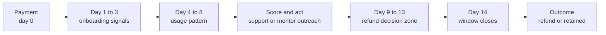
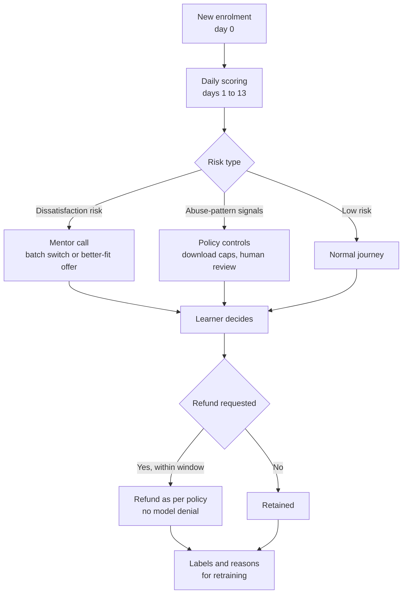

# Case Study 55: Refund Request Prediction and Refund Abuse

**Domain:** EdTech | **Problem Type:** Classification (time-to-event risk) plus abuse detection and intervention targeting | **Difficulty:** Intermediate

---

## 1. Business Context

### Company background

- **CohortCraft** (fictional) runs live, instructor-led **cohort programs** for working professionals (data science, product management, digital marketing, UPSC foundation). Programs run 3 to 6 months, with an average price of about **₹24,000**.
- Every enrolment comes with a **14-day money-back guarantee** counted from the date of payment. Learners can ask for a full refund through the app or support within that window, without giving a reason.
- About **12,000 new enrolments a month**. About **40%** are paid through EMI from lending partners (the refund must flow back to the lender).
- Learners get immediate access to **recorded content, downloadable notes and previous-batch lecture videos** from day one, even before the live cohort starts.

### The pain, with numbers

| Item | Value |
| --- | --- |
| New enrolments a month | about 12,000 |
| Revenue booked a month | 12,000 x ₹24,000 = about ₹28.8 Cr |
| Refund rate within the 14-day window | about 11% (about 1,320 refunds a month) |
| Refunded value | 1,320 x ₹24,000 = about **₹3.17 Cr a month** |
| Estimated genuine dissatisfaction (wrong course, expectations mismatch, life event, EMI trouble) | about 72% of refunds (about 950) |
| Estimated abuse (consume content, download all, then claim refund) | about 28% of refunds (about 370, about ₹0.89 Cr a month) |
| Non-recoverable cost per refund (payment gateway fees, counsellor commission, content cost) | about 4% of price, about ₹960 |
| Median day of refund request | day 11 of 14 (a cluster on days 12 to 14) |
| Share of refund requests that are the first contact with support | about 45% |

- Many refunds are requested on the last 2 or 3 days of the window. The window is a **clock**, and both genuine and abusive learners decide near its end.
- Previous approach: a blunt rule that blocked refunds for learners who downloaded more than 50% of content. It led to **complaints**, a viral social media thread, and a notice from a consumer forum for a delayed refund.
- Target: **reduce avoidable refunds** by helping genuinely unsatisfied learners before they leave (switch batch, mentor call, a better-fit course) and **reduce abuse** with fair, transparent controls, without refusing legitimate refunds.
- Value:
  - save about 20% of the 950 genuine refund cases through early intervention: 190 x ₹24,000 = about **₹0.46 Cr a month**;
  - reduce abuse by about 40% with early gating of downloads and clear terms: 148 x ₹24,000 = about **₹0.36 Cr a month**;
  - total about ₹0.81 Cr a month, or about **₹9.7 Cr a year**, plus fewer complaints and legal risk.

### Stakeholders and what each wants

| Stakeholder | What they want | What they fear |
| --- | --- | --- |
| Head of Finance | Lower refund leakage, predictable revenue | Revenue recognised and then reversed |
| Head of Learner Success | A chance to help unhappy learners before they leave | Being asked to "fight" refund requests |
| Head of Product and Content | Protect content from mass download and redistribution | Heavy restrictions that spoil the learning experience |
| Counsellors and Sales | Honest selling, no mis-selling blamed on them | Commission clawbacks |
| Legal and Compliance | Refund policy that respects consumer-protection norms and the Consumer Protection Act, clear disclosure, timely refunds | Regulatory action or consumer forum cases for denied or delayed refunds |
| Lending partners | EMI cancellation handled properly | Loan disbursed, then refund delays |
| Learners | A fair, quick refund if the course is not right for them | Being treated like a cheat |

---

## 2. Translating Business to ML

### The business question vs the ML question

| Business question | ML question |
| --- | --- |
| "Who is going to ask for a refund, why, and what should we do before they do, without ever denying a legitimate refund?" | "Each day of the 14-day window, estimate the probability that a learner will request a refund before the window closes. Separate the risk into a **dissatisfaction-type** pattern and an **abuse-type** pattern. Choose a supportive action for the first, and a protective (never punitive) action for the second." |

> **Mentor note:** This is where an ML model can do real harm if used carelessly. The model must **not** be an automatic "deny" button. The money-back guarantee is a promise made to learners, and consumer-protection norms in India expect refund policies to be clear and honoured. Use the model to **help earlier and design access wisely**, and keep refund decisions rule-based, transparent and reviewable by a human.

### Target variable definition

- **Primary target:** `refund_requested_in_window = 1` if the learner requests a refund within 14 days of payment.
- **Time view:** for each learner-day `d` (day 1 to day 13), `refund_in_next_k_days`, where `k` is the remaining days or the next 3 days. This is a **time-to-event** problem with a hard deadline.
- **Secondary labels (weaker):** `reason_group` from the refund form and support notes (dissatisfied, wrong fit, financial or life event, abuse-suspected). These are noisy.

### Edge cases

| Edge case | Recommended treatment | Reason |
| --- | --- | --- |
| Refund requested on day 15 (just outside) | Not in the target, but track it and review policy and goodwill cases | Honour the stated window, and learn how many lie just past it |
| Refund requested twice or reversed (learner withdraws request) | Count the first request, track withdrawals | The first request is the event of interest |
| Learner on EMI cancels with the lender, not with us | Count as a refund request | The commercial effect is the same |
| Learner transfers to another cohort instead of refunding | Count as "saved", not as a refund | This is a good outcome |
| Genuine technical problem (live class failed, access error) | Exclude from abuse flags, count as dissatisfaction | The company caused it |
| Learner in a group (colleagues or a corporate batch) | Separate segment | Different buying and refund rules |
| Chargeback raised with the bank instead of a refund request | Treat as a separate target, with the same warning features | The bank dispute process has its own timelines |

### Unit of prediction

- One **(enrolment, day in window)**. Score at day 1, day 3, day 5, day 7, day 9 and day 11, so that there is still time to act.

### Prediction timing



- The score is updated daily, and **actions** are triggered at a few fixed points (for example day 3, day 6 and day 10).
- Actions that come after day 10 have very little time. The earlier signals matter most.

### What success looks like

| Lens | Success |
| --- | --- |
| Business | Refund rate from 11% to about 8.2% (about 340 fewer refunds a month), about ₹9.7 Cr a year of retained revenue and avoided leakage |
| Model | At day 6, the top 15% of learners by risk captures about 55% of eventual refunds. AUC about 0.80 at day 6 |
| Abuse detection | Precision of at least 70% on the flagged abuse-pattern group, checked by human review |
| Fairness and trust | **Zero** automatic refund denials by the model. Complaints about refunds do not rise. 100% of refunds processed within the stated timeline |

---

## 3. Data Understanding

### Data sources and key features

| Feature group | Source | Why it matters |
| --- | --- | --- |
| Enrolment details (program, price, discount, EMI or full pay, sales channel, counsellor) | CRM and billing | Context, price and mis-selling risk |
| Pre-purchase journey (demo attended, counselling call length, promises noted, time from lead to purchase) | CRM and call logs | Rushed or pressured sales raise refunds |
| Onboarding and access (first login time, profile completion, orientation attended) | Learning platform | Early engagement |
| Content usage by day (videos watched, minutes, downloads, number of files, fraction of library downloaded) | Platform logs | Genuine use versus bulk download |
| Live class participation and cohort start date | Class system | Whether the cohort has begun |
| Support and sentiment (tickets, chats about refund, complaints, NPS) | Support tools | Direct signals of unhappiness |
| Device and account signals (new device, many accounts per device, screen recording tools flagged by the app, VPN) | App and security logs | Abuse patterns |
| Payment and EMI (UPI vs card vs EMI, past refund history, lender, chargebacks) | Payment gateway and lenders | Refund and chargeback behaviour |
| Learner profile (role, goal, city tier, stated expectation at sign-up) | Onboarding form | Fit between expectation and program |

### Data volume, granularity and refresh

- **Volume:** about 12,000 enrolments a month, so about **1.4 lakh a year**, with about 15,000 refunds. Learner-day rows over 14 days are about 20 lakh a year.
- **Granularity:** one row per enrolment per day. The label is known after 14 days.
- **Refresh:** platform usage in near real time, and scoring once a day in the early morning.

### Common data issues

| Issue | How it shows up here |
| --- | --- |
| **Label ambiguity** | A refund form reason like "personal reasons" hides both genuine and abusive cases |
| **Genuine vs abuse overlap** | A learner can download everything because they like the content and plan to study offline in a low-network area |
| Time clock and censoring | Enrolments in the last 14 days have no final outcome, and a score on day 5 can only see 5 days of data |
| Seasonal and campaign effects | Big sale periods bring impulse buyers, and refunds follow 2 weeks later |
| Sales-driven bias | A few counsellors account for a large share of refunds |
| Small number of labelled abuse cases | Only a few hundred confirmed after manual review |
| Policy changes | A new rule on downloads changes behaviour, and the old model's signal fades |
| Missing data on offline use | Learners who download and study offline look inactive |

> **Mentor note: Where juniors usually go wrong here.**
>
> - They treat "refunded" as "abuser". Most refunds are genuine, and a model trained that way becomes a punishment tool.
> - They use features that are only known on day 13, such as "has contacted support about refund", and get a wonderful AUC that is useless for early action.
> - They forget that intervention changes outcomes. A learner who got a mentor call and stayed is a **saved** case, not a model failure.

---

## 4. Approach and Decision Points

### Baseline first

- **Baseline 1 (current):** a rule that flags learners who downloaded over 50% of the content. High false positives, and led to complaints.
- **Baseline 2:** historical refund rate by program, price band and sales channel (a lookup table).
- **Baseline 3:** a simple rule "no login in first 3 days" or "attended nothing by day 7" for dissatisfaction risk.
- **Why it matters:** the simple usage rules catch a good share of risk, and the model must add precision and earlier warning to justify its place.

### Candidate models

| Model | Pros | Cons | Verdict |
| --- | --- | --- | --- |
| Rules on usage and channel | Transparent, quick | Crude, and may unfairly hit genuine learners | Baseline and policy guardrail |
| **Logistic regression with day-wise snapshots** | Explainable, stable, easy to audit | Limited non-linearity | **Strong first model** |
| **Gradient boosting** (LightGBM) | Accurate, handles missing values and interactions | Needs explanation tools and monitoring | **Production risk model** |
| Discrete-time survival model (hazard by day) | Models the deadline clock directly | Needs more care to explain | Good extension |
| Two-model design: dissatisfaction risk and abuse-pattern score | Different actions for different causes | Abuse labels are scarce and noisy | **Recommended design** |
| Anomaly detection on usage patterns | Works without labels for abuse | High false positive rate on its own | Use as a feature, with human review |
| Deep sequence models on clickstream | Rich | Hard to explain, risky for a decision affecting consumers | Not needed |

### Decision scenarios

| What if... | Recommended action | Reasoning |
| --- | --- | --- |
| **A learner has downloaded 90% of content on day 2, and the model gives a high abuse score** | Do not deny or delay any refund. Apply a policy-level control instead: limit bulk download for **everyone** in the first 7 days (for example, a daily cap or streaming-only until the cohort starts), and show the policy clearly at purchase | A uniform, disclosed rule is fair. A secret per-person model score is not. It also stops the behaviour without accusing anyone |
| **Refund requests cluster on days 12 to 14** | Score and act at days 3, 6 and 10, and build features that capture day-by-day trends. Check that mentors reach learners before day 10 | The window decides when to act. An alert on day 13 comes too late to help |
| **Labels do not tell genuine from abuse** | Build a **human-reviewed sample** of 1,500 refund cases a quarter (support team reads the usage logs and chat), and label them in 4 groups. Use it for the abuse model and for evaluation. Treat other refunds as "unknown" for the abuse model | A noisy label gives a noisy model. A small clean label set is more valuable than a large dirty one |
| **A learner who may refund asks for a mentor call, then stays** | Count it as a saved case. Evaluate interventions by a randomised holdout, not by comparing refund rates of those called and not called | The people who got the call were chosen by the model, so a raw comparison is biased |
| **A single counsellor has a 25% refund rate** | Investigate the sales process, listen to calls, review promises made, and fix the sales issue rather than adding that counsellor ID to the model | Refunds can be a signal of mis-selling, which is a business and regulatory risk. The fix is at the source |
| **A learner requests a refund on day 15 and complains about a technical failure on day 3** | Escalate to a human for a goodwill review. Do not apply the window mechanically where the company caused the problem | Fair treatment and consumer-law risk. The model should not decide this |
| **Refund prediction is very good for full-pay but weak for EMI learners** | Evaluate by payment type. Add EMI-specific features (loan approval time, cancellation behaviour at the lender), and consider a separate threshold | The mix of reasons differs. EMI learners may face a financial shock rather than a quality issue |
| **Marketing runs a big flash sale and the refund rate jumps** | Add the sale and campaign flags as features, score separately for sale cohorts, and add a cooling-off call for sale buyers on day 2 | Impulse buying produces predictable regret, and an early call can help them decide with more information |

---

## 5. Feature Engineering

### Top 10 features to build

| # | Feature | Business logic |
| --- | --- | --- |
| 1 | Days since payment, and days until the cohort starts | The clock. Cohorts starting after day 14 give no live experience before the window closes |
| 2 | Engagement trend: minutes watched on days 1 to 3 versus days 4 to 6 | Falling engagement signals disappointment |
| 3 | Orientation or first live class attended (yes or no) | Early commitment |
| 4 | Fraction of library downloaded, and **speed** of download (for example over 70% within 24 hours) | Bulk-download signature, shown with other signals and never alone |
| 5 | Ratio of downloads to actual viewing time | Downloading without ever viewing is the abuse-style pattern. Offline learners will show viewing later |
| 6 | Counselling call length, lead-to-purchase time, and discount pressure (a large last-minute discount) | Rushed or pressured sales cause regret |
| 7 | Expectation fit: stated goal and the program (for example a beginner buying an advanced course) | Mismatch is a leading cause of genuine refunds |
| 8 | Support contacts about content, schedule or fees in the first week, and sentiment | Direct unhappiness signals |
| 9 | Payment type, EMI status and past refund or chargeback history | Different reasons and behaviours |
| 10 | Device and account patterns (multiple accounts per device, shared IPs, new device after purchase) | Abuse and resale networks |

### Features to avoid (leakage risks)

| Feature | Problem |
| --- | --- |
| Refund form reason, ticket about refund | Only exists at or after the request |
| Day-14 snapshot features when scoring on day 6 | Look-ahead leakage |
| Counsellor ID as a raw feature | Encodes who sold, not what the learner will do, and unfair to individuals. Use for audit, not for scoring |
| Caste, religion, gender or location proxies such as pin code level income | Unfair and illegal bias risk |
| Whether the lender has already cancelled the EMI mandate | Happens after the decision to leave |
| Outcome of any intervention (call outcome) used as a feature in the base risk model | Post-treatment. Use only in an uplift or evaluation step |

Building day-wise snapshots without look-ahead (each row only uses data up to that day):

```python
import pandas as pd

rows = []
for d in [1, 3, 6, 9, 11]:
    snap = events[events["day_since_pay"] <= d]                 # only data available on day d
    f = snap.groupby("enrol_id").agg(
        mins=("watch_min", "sum"),
        dl_files=("is_download", "sum"),
        classes=("live_attended", "sum"),
    ).reset_index()
    f["score_day"] = d
    rows.append(f)

X = pd.concat(rows).merge(enrol_static, on="enrol_id")
X = X.merge(labels[["enrol_id", "refund_day"]], on="enrol_id")
X["y"] = (X["refund_day"] > X["score_day"]) & (X["refund_day"] <= 14)   # refund still to come
```

---

## 6. Evaluation Strategy

### Metrics

| Metric | Role | Why |
| --- | --- | --- |
| **Capture rate at a fixed outreach capacity** (share of eventual refunds in the top 15% by risk) | Primary business metric | Mentors can call only so many learners |
| **PR-AUC and AUC at each score day (3, 6, 10)** | Model quality | Shows how early the model is useful |
| **Lead time** (days between first high score and request) | Actionability | A warning on the day of the request is worthless |
| Calibration by risk band | Needed for staffing and forecasts | Predicted vs actual refund rate |
| Precision on human-reviewed abuse labels | Abuse model quality | Keeps false accusations low |
| **Save rate in a randomised holdout** (refund rate of called vs not called among high-risk) | True intervention impact | Separates the effect of outreach from selection |
| Share of legitimate refunds delayed or denied | Fairness and compliance guardrail | Must be zero from the model |
| Complaints and consumer-forum cases | Trust guardrail | The real cost of unfair practice |

### Metrics that look good but are misleading here

- **Accuracy:** about 89% by predicting no refunds.
- **AUC using day-13 data:** includes support contact about refunds and is useless for early action.
- **Reduction in refund rate without a control:** may be due to seasonality or a policy change.
- **"Abuse caught" counted as refunds denied:** that is not a success, it is a risk.

### Validation strategy

| Step | Design | Why |
| --- | --- | --- |
| Time-based split | Train on enrolments from months 1 to 8, validate on months 9 and 10, test on months 11 and 12 (all windows closed) | Matches deployment |
| Score-day evaluation | Report metrics separately at days 3, 6, 10 | Usefulness depends on timing |
| Slice analysis | By program, price band, payment mode, sale vs non-sale cohort, sales channel | Finds weak or unfair areas |
| Human-reviewed audit | Review 300 flagged and 300 non-flagged learners each quarter | Real-world check of the abuse score |
| Randomised intervention test | Among high-risk learners, randomise outreach vs no outreach | Measures the save rate |
| Fairness check | Compare high-risk flag rates by city tier, gender, language and age groups | Prevents unequal treatment |

### From model metric to business value

- 12,000 enrolments a month, 11% refund, so **1,320** refunds a month, about ₹3.17 Cr.
- Genuine dissatisfaction: 72% = **950**. Mentor outreach and batch switching save 20%: 190 x ₹24,000 = **₹0.456 Cr** a month.
- Abuse-pattern: 28% = **370**. Policy controls on bulk downloads (not individual denial) cut it by 40%: 148 x ₹24,000 = **₹0.355 Cr** a month.
- Total about **₹0.81 Cr a month**, or about **₹9.7 Cr a year**.
- Costs: mentor time (about 1,800 outreach calls a month at ₹150 each is about ₹2.7 lakh), engineering and review about ₹1.2 Cr a year, so the net benefit is still about ₹8 Cr a year.
- Not counted: lower complaint handling cost, lower gateway and commission loss (about 4% of price per refund avoided), and the legal risk avoided.

---

## 7. Deployment and Monitoring

### Batch vs real time

- **Daily batch** scoring during the 14-day window, at about 5 am so that mentors have a list at 9 am.
- **Event triggers** for strong signals: a refund-related chat message, or a failed live class that affects the learner.
- **No real-time scoring at the refund request step.** The refund is processed by policy, not by the model.



### What to monitor

| Type | What to track | Alert trigger |
| --- | --- | --- |
| Model performance | Capture rate at 15%, PR-AUC at days 3, 6, 10, on closed windows | Fall of 8 points |
| Calibration | Predicted vs actual refund rate by risk band | Gap above 25% relative |
| Intervention | Outreach coverage, save rate vs holdout, time of outreach | Outreach after day 9 above 20% |
| Abuse signals | Share of enrolments with bulk-download patterns, new device clusters | Rising trend after policy changes |
| Fairness | Flag rate and outreach rate by city tier, language, gender, payment mode | Gap above 20% relative |
| Compliance | Refund processing time, share of legitimate requests honoured, EMI cancellation turnaround | Any request beyond the stated timeline |
| Complaints | Refund-related complaints, social media mentions, consumer forum notices | Rising trend |
| Sales quality | Refund rate by counsellor and campaign | Above 2x average |
| Data | Missing usage logs (offline use), event delays | Over 5% missing |

### Retraining

- **Scheduled:** monthly, on a rolling 9 to 12 month window of closed windows.
- **Triggered:** a change in refund policy, a new program, a new download policy, a major campaign or an abuse pattern shift.
- **Label refresh:** every quarter, add the newly human-reviewed cases.

### A/B test or champion-challenger design

- **Champion:** current flow (rule on 50% downloads, with no outreach). **Challenger:** model-driven outreach and uniform download caps.
- Two separate tests:
  - **Outreach test:** among learners above the risk threshold, randomise 50% to mentor outreach, 50% to usual flow.
  - **Download policy test:** randomise by cohort or enrolment hash into capped vs uncapped bulk download for the first 7 days.
- Primary outcomes: refund rate, retained learners at day 30, complaint rate, learner satisfaction. Fairness and refund-timeliness are hard guardrails.
- Run for 6 to 8 weeks to cover multiple cohorts. Check with Legal before any change in what learners see.

---

## 8. Stakeholder Communication

### Explain it to a non-technical leader

> "Most refunds come from learners who are not happy or who bought on impulse, and a smaller number from people who download everything and then ask for their money back.
> The model helps us spot, in the first week, who is likely to leave, so a mentor can help them switch batches or choose a better-fit program. It does not decide refunds. Every valid request in the 14-day window is still honoured.
> For bulk downloads, we change the rules for everyone in the first week, which stops the behaviour without accusing anyone.
> We expect about ₹9.7 Cr a year of saved revenue, with no rise in complaints."

### Questions leadership will ask

| Question | Suggested answer |
| --- | --- |
| "Can we just refuse refunds to people we think are abusing?" | "No. The guarantee is a promise, and consumer-protection norms expect us to honour it. A secret score is not a fair basis to refuse. We reduce abuse through uniform access rules and clear terms" |
| "How do you know it is abuse and not a keen learner?" | "We do not decide by one signal. We use a reviewed sample of cases, and treat the model as a flag for a human or for a policy, never as a verdict" |
| "Why not extend the window to see more usage?" | "A longer window may increase abuse. It is a business decision. The model gives data to compare options, such as 7 vs 14 days" |
| "What if the model is unfair to some groups?" | "We compare flag and outreach rates across city tiers, language and gender, and remove features that cause gaps" |
| "How will we know the calls actually help?" | "We randomise who gets a call among high-risk learners and compare refund rates. Without that, we would be fooled by selection" |
| "What do we tell regulators?" | "Refund policy is clear at purchase, all valid requests are processed on time, and the model is used for support, not for denial" |

---

## 9. Common Pitfalls and Lessons

| Mistake | Why it happens | How to avoid it |
| --- | --- | --- |
| Treating every refund as abuse | Finance pressure | Separate dissatisfaction and abuse, review a labelled sample |
| Using the model to deny refunds | Looks efficient | Keep refunds rule-based and honoured, use the model for support |
| Using late features (refund chat, day 13 data) | They are the strongest predictors | Score on fixed days with only data available then |
| Ignoring the clock | Standard classification mindset | Day-wise scoring, lead time as a metric |
| Evaluating interventions by naive comparison | The model chose who got the call | Randomised holdout |
| Fixing signals with the wrong lever | Per-person scores feel precise | Use uniform policies (download caps) for abuse |
| Overlooking mis-selling | Blaming learners | Audit sales channels, counsellor patterns and promises |
| Ignoring EMI flows | Treating all payments alike | Separate analysis by payment mode, and handle lender refunds |
| Ignoring fairness | Focus on loss reduction | Fairness slices and complaint monitoring |

---

## 10. Mentor's Focus Checklist

- ✅ **Where to spend 80% of the effort:**
  - Clear problem framing: dissatisfaction versus abuse, and which action fits each.
  - Day-wise scoring with no look-ahead, and enough lead time to act.
  - A human-reviewed label set to handle ambiguity.
  - Policy-level abuse controls and a no-denial rule for the model.
  - A randomised test of outreach, plus fairness and compliance guardrails.
- ❌ **What not to over-engineer:**
  - A complex deep model on 15,000 refunds a year.
  - A perfect abuse classifier when scarce labels will limit it. Policy design does more.
  - Real-time scoring at the refund step. It does not help and creates risk.
- 💡 **Key takeaway:** **Use the model to help earlier, not to refuse later.** A refund window is a promise to the learner. The best use of prediction is to fix the problem before it becomes a refund, and to design fair rules that make abuse unattractive for everyone.
