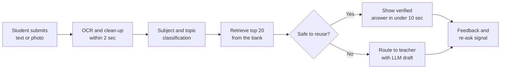
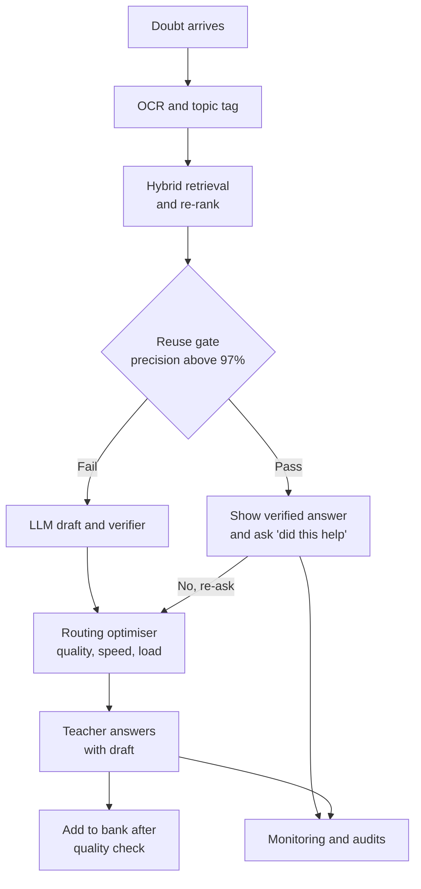

# Case Study 56: Doubt Routing and Answer Retrieval for Student Questions

**Domain:** EdTech | **Problem Type:** Retrieval and ranking plus routing optimisation | **Difficulty:** Advanced

---

## 1. Business Context

### Company background

- **PadhaiPal** (fictional) is an online K-12 test-prep platform for JEE, NEET and school boards (classes 6 to 12), with about **12 lakh paying students**.
- Students get stuck while studying, so the app has a **"Ask a doubt"** button. A student types a question or, much more often, **clicks a photo of a textbook or notebook page** and uploads it.
- A pool of about **1,800 part-time doubt-solving teachers** (subject experts, many of them college students and retired teachers) answers these in text, image or a short video.
- The platform has a **solved-doubts bank** of about **1.2 crore** past questions with answers, built over 4 years. Nobody searches it today. Every doubt goes to a human.

### The pain, with numbers

| Item | Value |
| --- | --- |
| New doubts per month | about 45 lakh (about 1.5 lakh a day) |
| Share submitted as photo | about 70% (handwritten or printed, often tilted, dark or cropped) |
| Teacher capacity (1,800 teachers x 60 doubts a day x 30 days) | about 32.4 lakh doubts a month |
| Doubts that wait more than 2 hours or expire unanswered | about 12.6 lakh (28%) |
| Median response time today | about 38 minutes. 90th percentile about 4.5 hours |
| Promise to paid students | 80% of doubts answered within 15 minutes |
| Cost per teacher-answered doubt | about ₹17 (1,800 x ₹30,000 a month = ₹5.4 Cr, divided by 32.4 lakh) |
| Estimated share of new doubts that already have a good solved match in the bank | about 55% (many students ask the same textbook problem) |
| Student satisfaction on resolved doubts (thumbs up) | about 71% |

- The shortfall of 12.6 lakh doubts a month would need about **700 more teachers** (12.6 / 32.4 x 1,800) to clear by hiring. That is about 700 x ₹30,000 x 12 = **₹25 Cr a year**.
- Slow answers hurt most near exam time, when doubt volume rises 2x to 3x. Students who wait more than an hour often stop studying that topic and ask a free app instead.
- Target: **auto-resolve about 35% of doubts** (about 15.75 lakh a month) with verified answers, so teachers see about 29.25 lakh doubts, which is below their 32.4 lakh capacity.

### Stakeholders and what each wants

| Stakeholder | What they want | What they fear |
| --- | --- | --- |
| Head of Learning Experience | 15-minute SLA met for most doubts, higher satisfaction | A wrong auto-answer going viral on social media |
| Academic Head | Correct, well-explained, curriculum-aligned answers | Students learning wrong methods from a bad retrieval or a hallucinating LLM |
| Doubt-teacher community manager | Fair load, steady earnings, no burnout | Teachers losing income because "the bot took my doubts" |
| Finance | Lower cost per resolved doubt, no new hiring for peak season | Savings that disappear because students re-ask auto-answered doubts |
| Product | A fast, simple "ask" experience | Extra steps such as forcing students to crop or confirm |
| Parents and students | A quick, correct answer they trust | Being fobbed off with a generic or wrong answer |

---

## 2. Translating Business to ML

### The business question vs the ML question

| Business question | ML question |
| --- | --- |
| "Can we answer doubts faster without hiring more teachers?" | "For each incoming doubt, (1) read it (OCR for photos), (2) retrieve candidate solved doubts, (3) decide whether a bank answer is safe to show, and (4) if not, route the doubt to the best available teacher within the SLA" |
| "Which teacher should get this?" | "Rank eligible teachers by expected answer quality and speed, subject to capacity and fairness, as an assignment problem" |
| "Can an AI write the answer?" | "Draft an answer with an LLM, verify it, and show it only if verification passes. Otherwise a teacher answers, using the draft as a head start" |

> **Mentor note:** This is really **three models and one optimiser** glued together, and the weakest link sets the quality. A great retriever with poor OCR gives wrong matches. A great match shown for a question that only looks the same ("find the maximum" vs "find the minimum") gives a confidently wrong answer. So the central design question is not "how do I retrieve" but **"when is it safe to reuse?"**. Spend your effort on that decision.

### Target definitions

- **Retrieval relevance (label for the matcher):** a teacher or annotator marks whether a bank answer **fully solves the new question**, partly solves it, or does not. Labels come from three sources:
  - student "this solved my doubt" clicks (noisy);
  - teachers who reused an old answer and said so in the tool;
  - an expert-labelled set of about 20,000 pairs, which is the gold standard.
- **Reuse decision:** `safe_to_reuse = 1` if an expert judges the candidate answer correct and complete for this exact question.
- **Routing target:** predicted time to first answer and predicted quality score for each (doubt, teacher) pair.

### Edge cases

| Edge case | Recommended treatment | Reason |
| --- | --- | --- |
| Same problem with changed numbers (a different value of a variable) | Treat as **not a match** for answer reuse, but a good match for "similar worked example" | The final number differs, so reusing the answer is wrong |
| Photo has several questions on one page | Segment into separate questions, or ask the student to tap the one they mean | One embedding for a whole page matches nothing well |
| Photo is blurry, cropped or in poor light | Ask for a retake if OCR confidence is low, otherwise route to a teacher who can read images | A bad read must never reach auto-answer |
| Doubt is a concept question ("why does the moon look bigger") | Retrieve explanations, allow reuse if the match is strong | Concept answers are more reusable than numerical ones |
| Mixed Hindi and English or Hinglish text, or regional language | Use a multilingual model, and route by language skill as well as subject | Many students write in Hinglish |
| Doubt is a complaint or non-academic ("my payment failed") | Send to a support intent classifier (see Case 22) | Not a doubt |
| Student re-asks after an auto-answer | Treat as a **failed reuse**, escalate to a teacher at top priority | This is the strongest negative label |

### Unit of prediction

- One **doubt** (a student, a question, a timestamp) for retrieval and reuse decisions.
- One **(doubt, teacher)** pair for routing.

### Prediction timing



- Everything before the teacher step must finish in **a few seconds**, because the student is looking at the screen.
- The routing step runs when a doubt joins the queue, and **re-runs every 60 seconds** for waiting doubts as teacher availability changes.
- Quality labels (satisfaction, re-ask within 24 hours) arrive hours to a day later.

### What success looks like

| Lens | Success |
| --- | --- |
| Business | Median response time from 38 minutes to under 8 minutes. 80% within 15 minutes met in the peak season. About ₹25 Cr a year of hiring avoided |
| Model | Recall at 20 of the right answer in the bank above 90% when one exists. Safe-reuse precision at least 97% at the chosen threshold, covering about 35% of doubts |
| Student | Satisfaction on resolved doubts from 71% to above 78%. Re-ask rate within 24 hours below 6% on auto-answers |
| Teachers | Average load within 15% of capacity, no teacher above 110% for more than a day |

---

## 3. Data Understanding

### Data sources and key features

| Feature group | Source | Why it matters |
| --- | --- | --- |
| Question image or text, OCR output with per-word confidence | Doubt upload service, OCR engine | The raw input. Low confidence means do not auto-answer |
| Text embeddings and image embeddings of the question | Embedding model, vector index | Finds similar questions, including photo-to-text matches |
| Subject, topic and sub-topic tags, class and exam (JEE, NEET, board) | Curriculum taxonomy, classifier | Narrows the search, and routes to the right expert |
| Solved-doubts bank (question, answer, teacher, quality rating, year, syllabus version) | Doubt database | The answers to reuse |
| Student context (class, exam goal, recent lessons, language) | Learning records | Helps rank answers that fit their level and language |
| Teacher profile (subjects, topics, languages, rating, speed, shift timings) | Teacher tool | Routing eligibility and quality |
| Live queue (open doubts, teacher status, active load) | Queue service | Capacity and SLA decisions |
| Outcomes (thumbs up or down, re-ask, follow-up doubt, teacher edit of an LLM draft) | App events, teacher tool | Learning signals and evaluation |

### Data volume, granularity and refresh

- **Doubts:** about 45 lakh a month, so about 5.4 crore a year. The solved bank is about 1.2 crore after de-duplication and quality filtering.
- **Image storage:** about 70% photos at about 300 KB each is about 1 TB a month (31.5 lakh photos x 300 KB). Keep only embeddings and OCR text for old doubts, and apply a retention rule (see data issues).
- **Vector index:** 1.2 crore vectors of 768 dimensions is about 37 GB in float32 (1.2 x 10^7 x 768 x 4 bytes). Use compression to fit in memory.
- **Refresh:** new solved doubts are added to the index in minutes after a quality check. Teacher availability updates every few seconds.

### Common data issues

| Issue | How it shows up here |
| --- | --- |
| **OCR errors on handwriting and maths** | Subscripts, fractions, chemical formulae and Devanagari text get garbled, and one wrong symbol changes the problem |
| Near-duplicates that are not duplicates | "Find the area" and "find the perimeter" embed almost the same |
| Quality of old answers | Some bank answers are wrong, old-syllabus, or terse. Reusing them spreads errors |
| Noisy satisfaction labels | Students click thumbs-up on a fast answer even if it is wrong, and rarely rate at all |
| Teacher-student feedback loop | Fast teachers get more doubts, so they have more ratings, and slow-but-good teachers look unreliable |
| Cold topics | New chapters or a syllabus change (for example a new board pattern) have no bank coverage |
| Privacy of uploads | Photos can contain faces, names, school IDs or notebook covers with a phone number |
| Language mix | Hinglish and regional text have much less labelled data |

> **Mentor note: Where juniors usually go wrong here.**
>
> - They measure retrieval with a similarity score threshold alone. High cosine similarity does **not** mean "same answer". Add a second-stage model that judges "does this answer solve this exact question".
> - They evaluate on random pairs. Easy negatives make the matcher look great. Use **hard negatives** (same topic, different numbers or different ask).
> - They treat OCR as a solved problem. For handwritten maths it is usually the **largest source of error** in the whole pipeline.
> - They forget the bank has no expiry. An answer for an old syllabus may now be wrong.

---

## 4. Approach and Decision Points

### Baseline first

- **Baseline 1 (current):** every doubt goes to a teacher, assigned by subject and a simple round-robin.
- **Baseline 2:** keyword (BM25) search on OCR text over the bank, with an exact-match shortcut for textbook problems by chapter and problem number. Covers perhaps 12 to 15% of doubts safely.
- **Baseline 3:** subject-based routing to the least-loaded eligible teacher.
- **Why it matters:** textbook exercise questions repeat a lot, so exact-match and BM25 already catch the easy repeats. The new system has to beat this and give a clear gain on the harder middle.

### Candidate models

| Component | Option | Pros | Cons | Verdict |
| --- | --- | --- | --- | --- |
| OCR | Off-the-shelf OCR plus a maths-aware or handwriting-tuned model | Fast, available | Weak on handwriting and formulae | Use, plus a confidence score and a retake prompt |
| Retrieval | BM25 only | Exact on terms, cheap | Misses paraphrase and photo noise | Baseline and a hybrid part |
| Retrieval | **Hybrid: BM25 plus multilingual dense embeddings** | Catches paraphrase and exact terms | Needs an index and tuning | **Production first stage** |
| Re-ranking | **Cross-encoder that reads question and candidate together** | Much better at "same problem or not" | Slower, so run on top 20 only | **Production second stage** |
| Topic classification | Fine-tuned classifier on the curriculum taxonomy | Clear and fast | Needs labelled data for new topics | Use for routing and as a retrieval filter |
| Answer generation | **LLM with retrieval of similar solved doubts, plus a verifier** | Covers the long tail | Can be fluent and wrong | Draft for teachers, auto-show only if verified |
| Routing | Greedy least-loaded | Simple | Ignores skill and SLA | Baseline |
| Routing | **Scoring plus assignment (matching) with SLA penalties** | Balances quality, speed and load | More moving parts | **Production** |

### Decision scenarios

| What if... | Recommended action | Reasoning |
| --- | --- | --- |
| **The top match has 0.93 similarity but the numbers in the question differ** | Extract numbers and units from both, and compare. If key quantities differ, block reuse and show it as a "similar solved example" instead | Similarity ignores the exact numbers, and a reused final answer would be wrong |
| **OCR confidence is low on a handwritten photo** | Do not auto-answer. Ask for a retake with a tip ("hold phone flat, good light"), and if the student skips it, route to a teacher with the image only | A wrong read makes every later step wrong. A 10-second retake is cheaper than a wrong answer |
| **A page photo has 4 questions** | Run a layout detector to split the page. Show crops and let the student tap one. Default to the question with the pen mark or the red box | One vector for four questions matches none of them |
| **The LLM drafts an answer but it cannot be verified** | Send to a teacher with the draft marked "unverified", and log how much the teacher edits it | Drafts speed up teachers, but only verified answers may reach students directly |
| **At 9 pm on exam eve, doubts triple and the SLA is breached** | Switch on **surge mode**: raise the reuse share by lowering the threshold slightly for low-risk concept doubts only, prioritise paid exam-batch students, show an honest estimated wait, and call in on-call teachers | Protect the 15-minute promise without letting quality fall for numerical questions |
| **A teacher has a very high rating, so the router sends them everything** | Add a load penalty and a cap. Mix in a small share of exploration for newer teachers with senior review | Otherwise the best teacher burns out and new teachers never build ratings |
| **A student re-asks the same question after getting a bank answer** | Treat as a failed reuse, put the doubt at the top of the queue, and add the pair as a hard negative for retraining | The best free label for "reuse was wrong" |
| **A syllabus change makes 8% of the bank outdated** | Tag bank entries with syllabus version, and expire or down-weight old ones by topic. Trigger teacher re-review of high-traffic entries | Old answers silently go wrong when the exam pattern changes |

---

## 5. Feature Engineering

### Top 10 features to build

| # | Feature | Business logic |
| --- | --- | --- |
| 1 | OCR confidence (minimum and average per line) and share of unreadable symbols | Gates auto-answer, and drives retake prompts |
| 2 | Dense embedding similarity between the new question and each candidate | First-stage retrieval signal |
| 3 | Cross-encoder match score for the pair | Judges "same problem" much better than cosine similarity |
| 4 | Number, unit and variable match flags between question and candidate | Catches "same problem, different numbers" |
| 5 | Topic and sub-topic agreement, and class level match | Prevents a class 9 explanation for a class 12 question |
| 6 | Candidate answer quality (teacher rating, past thumbs-up rate, reuse count, age, syllabus version) | Prefer proven answers |
| 7 | Doubt type (numerical, conceptual, proof, diagram-based) | Reuse is safer for conceptual doubts, riskier for numerical |
| 8 | Teacher fit (topic skill score, language, past rating on this sub-topic, image-reading ability) | Routing quality |
| 9 | Teacher speed and load now (open doubts, average answer time, minutes left in shift) | Predicts time to first answer |
| 10 | Queue pressure (open doubts per available teacher, minutes to the SLA limit) | Decides surge handling and priority |

### Features to avoid (leakage risks)

| Feature | Problem |
| --- | --- |
| Thumbs-up on the answer, or "resolved" flag | Known only after the answer is shown. Fine as a label, never as an input |
| Teacher edit time or final answer length | Exists only after the teacher has worked on the doubt |
| Follow-up doubts by the same student on the same topic | Future information, and a mix of "unclear answer" and "healthy curiosity" |
| Student's test score after the doubt | Future outcome, and confounded by many things |
| Teacher ID as a free feature in the reuse model | Learns which teachers were assigned easy doubts in the old process |
| Bank answers added **after** the question's date | Look-ahead leakage in offline retrieval tests, since the answer was unavailable then |

Hybrid retrieval with a number-aware re-rank (simplified):

```python
# Score a candidate: dense similarity, then block reuse if key numbers differ
def reuse_score(q, cand, cross_encoder):
    sim = cosine(q.embedding, cand.embedding)             # first-stage signal
    pair = cross_encoder.predict(q.text, cand.text)       # same exact problem?
    numbers_match = set(q.numbers) == set(cand.numbers)   # 12 vs 15 must not match
    if not numbers_match and q.doubt_type == "numerical":
        return 0.0                                        # never reuse the final answer
    return 0.3 * sim + 0.7 * pair * cand.quality_weight
```

---

## 6. Evaluation Strategy

### Metrics

| Metric | Role | Why |
| --- | --- | --- |
| **Recall at 20** and **MRR** (mean reciprocal rank) for retrieval | Retrieval quality | Did the right answer appear near the top when one exists |
| **Precision of safe-reuse decisions at the chosen threshold** | Primary safety metric | Wrong auto-answers harm students and trust |
| **Coverage** (share of doubts auto-resolved) | Primary business metric | Reuse only matters if it covers enough doubts |
| OCR character and word error rate on a handwritten maths test set | Input quality | Largest single source of error |
| Topic classification accuracy, and top-3 routing accuracy | Routing quality | Right subject expert gets the doubt |
| **Time to first answer** (median, p90) and **SLA hit rate** | Primary operational | The 15-minute promise |
| Student satisfaction, re-ask rate within 24 hours | Primary outcome | Whether the student was really helped |
| Teacher load balance (Gini of load, share above 110% load) | Fairness to teachers | Burnout and earnings fairness |

### Metrics that look good but are misleading here

- **Cosine similarity or top-1 accuracy on random pairs:** easy negatives inflate it.
- **Thumbs-up rate alone:** fast answers get thumbs-up even when wrong, and only about 1 in 5 students rates.
- **Average response time:** the median hides the long tail. Students who wait 4 hours are the ones who leave.
- **LLM-as-judge scores without human audits:** the judge often agrees with the generator.

### Validation strategy

| Step | Design | Why |
| --- | --- | --- |
| Gold set | 20,000 expert-labelled (question, candidate) pairs, with 40% hard negatives, refreshed each quarter | Honest measure of reuse precision |
| Time-based split | Index only bank entries that existed before each test doubt's date | Avoids look-ahead leakage |
| Slice analysis | Report by subject, class, language, photo vs text, handwritten vs printed, numerical vs conceptual | The average hides weak slices like Hinglish handwritten physics |
| Shadow mode | Run the system for 3 weeks, show nothing to students, and have teachers rate what it would have shown | Real-world safety check with no risk |
| Expert audit | Weekly sample of 500 auto-answers reviewed by senior teachers | Catches silent decay |
| Online A/B test | Randomise students (not doubts) into control (all to teachers) and treatment (reuse plus routing) | Measures time and satisfaction cleanly |

### From model metric to business value

- Monthly doubts: 45 lakh. Auto-resolved at 35% coverage: **15.75 lakh**.
- Teachers then see 29.25 lakh doubts against capacity of 32.4 lakh, about **90% utilisation**, which leaves room for peaks.
- Avoided hiring: about 700 teachers x ₹30,000 x 12 = about **₹25 Cr a year**.
- Running cost: vector search, OCR and LLM calls. At about ₹1.5 per auto-resolved doubt, the cost is 15.75 lakh x ₹1.5 = about ₹24 lakh a month, or about **₹2.8 Cr a year**, plus about ₹1.2 Cr of engineering. Net saving is about **₹21 Cr a year**.
- Risk cost: if 3% of auto-answers are wrong and half of those lead to a re-ask at ₹17 teacher cost, extra cost is small (15.75 lakh x 1.5% x ₹17 = about ₹4 lakh a month). The larger cost is trust, so the precision target is strict.

---

## 7. Deployment and Monitoring

### Batch vs real time

- **Real time** for OCR, retrieval, the reuse decision and routing at submission. The student should see something within 10 seconds.
- **Re-routing loop** every 60 seconds for waiting doubts.
- **Batch** for bank clean-up, embedding refresh, duplicate merging, teacher skill scores, and syllabus-version expiry.



### Guardrails for answer quality

- **Reuse gate:** answer must have a high cross-encoder score, matching numbers, matching class level, an in-date syllabus version, and a good past quality record.
- **Verifier for LLM answers:** a separate check that (a) re-solves numerical problems with a calculator or symbolic tool, (b) checks the answer against the retrieved solved examples, and (c) checks that the steps follow the curriculum method. If any check fails, a teacher answers.
- **No auto-answer** for low OCR confidence, safety-sensitive topics, or anything the verifier cannot check.
- **Every auto-answer has a visible "ask a teacher" button**, and re-asks escalate at top priority.

### What to monitor

| Type | What to track | Alert trigger |
| --- | --- | --- |
| Safety | Reuse precision on weekly expert audit, re-ask rate within 24 hours on auto-answers | Precision below 96%, or re-ask rate above 8% |
| Retrieval | Recall at 20 on a rolling gold set, share of doubts with no candidate above threshold | Recall drops by 3 points |
| OCR | Average OCR confidence, retake rate, share of unreadable photos | Confidence falls, for example after an app camera update |
| Operations | SLA hit rate, p90 wait, queue length per available teacher, by subject | SLA hit rate below 75% for 15 minutes |
| Load | Teacher load Gini, share of teachers above 110% load, earnings spread | A teacher above 110% for 2 days |
| Drift | New topics with weak bank coverage, new syllabus tags, new languages | Coverage gap above 15% for a topic |
| Satisfaction | Thumbs-up by path (reuse, LLM-assisted teacher, teacher-only) | Reuse path below teacher path by more than 4 points |
| Privacy | Image retention, access logs, requests to delete data | Any retention beyond policy |

### Retraining

- **Weekly:** refresh embeddings for new bank entries, and update teacher skill and speed scores.
- **Monthly:** retrain the cross-encoder and reuse gate with new hard negatives from re-asks.
- **Triggered:** syllabus change, new exam pattern, OCR model change, or a large new language group.

### A/B test or champion-challenger design

- **Control:** all doubts to teachers with subject-based assignment. **Treatment:** hybrid retrieval, reuse gate, LLM draft and optimised routing.
- Randomise by **student**, since a student sees both flows otherwise. Keep a **2% permanent holdout** of students for control.
- Run through one low-season month and one exam-season fortnight. Behaviour differs sharply between them.
- Primary readout: median time to first answer, SLA hit rate and satisfaction. Guardrails: re-ask rate, teacher load, and answer accuracy from the expert audit.

---

## 8. Stakeholder Communication

### Explain it to a non-technical leader

> "When a student uploads a doubt, we first read the photo, find the subject and look for the same solved question in our bank of 1.2 crore answers. If we find a trusted match for exactly this question, with the same numbers, the student gets it in seconds. If not, the doubt goes to the best available teacher, who often starts from an AI draft that we have checked.
> About a third of doubts can be answered instantly, so teachers handle fewer but harder doubts, and no new hiring is needed for exam season. That is worth about ₹21 Cr a year, and students wait minutes instead of hours.
> The rule is strict: if we are not sure, a human answers."

### Questions leadership will ask

| Question | Suggested answer |
| --- | --- |
| "What if the AI gives a wrong answer?" | "Auto-answers pass a strict gate and a checker, and senior teachers audit 500 a week. A re-ask goes to a teacher at once. We target at least 97% precision, and we stop the auto path for any topic that drops below it" |
| "Will teachers lose income?" | "Their volume per hour falls a little, but they stop facing impossible queues. We keep payment per doubt the same, add a quality bonus, and use freed time for hard doubts and live doubt sessions" |
| "Why not just use a chatbot for everything?" | "A chatbot can be fluent and wrong on maths. We use it as a draft that is checked, not as the final voice, until our audits show it is safe on a topic" |
| "How do we know students are better off, not just faster?" | "We test it on a random half of students and compare satisfaction, re-ask rate and next-week activity, not just speed" |
| "What about student photos and privacy?" | "We keep only what we need, remove old images, and follow the DPDP Act: clear notice, limited use, and deletion on request. For under-18 students we are extra careful about how the data is used" |

---

## 9. Common Pitfalls and Lessons

| Mistake | Why it happens | How to avoid it |
| --- | --- | --- |
| Reusing an answer because the similarity score is high | Embeddings capture topic, not the exact ask or numbers | Add a cross-encoder, number checks and a gold set with hard negatives |
| Ignoring OCR quality | OCR looks like a solved vendor problem | Measure OCR error on your own handwritten data, gate on confidence, add retakes |
| Optimising speed only | The SLA is the visible metric | Track satisfaction, re-ask rate and expert-audited accuracy together |
| Using thumbs-up as truth | It is the easiest label to get | Combine with re-ask, expert audits and teacher edits |
| Sending all doubts to the best teachers | Ratings look like skill | Add load caps, exploration and ratings adjusted for doubt difficulty |
| Letting the bank decay | Nobody owns it | Version by syllabus, expire old entries and re-review high-traffic answers |
| Shipping an LLM answer without verification | The demo looked great | Verify with tools, curriculum rules and a teacher fallback |
| Random-pair evaluation | Easy to build | Test with hard negatives, time-based indexing and slice reports |
| Storing every photo forever | Storage is cheap | Keep text and embeddings, apply retention limits and consent rules |

---

## 10. Mentor's Focus Checklist

- ✅ **Where to spend 80% of the effort:**
  - The **reuse decision**: second-stage matching, number checks, and a gold set with hard negatives.
  - OCR quality and a retake flow for handwritten and tilted photos.
  - Verification of LLM drafts, and a clean teacher fallback.
  - Routing that balances quality, speed and load, with a surge plan for exam nights.
  - Honest evaluation: shadow mode, expert audits, and a student-level A/B test.
- ❌ **What not to over-engineer:**
  - A custom foundation model for embeddings before trying a good multilingual model with fine-tuning.
  - A perfect global assignment solver. A scoring function with load caps goes a long way.
  - Auto-answering the long tail. Start with textbook and conceptual doubts where reuse is safe.
- 💡 **Key takeaway:** **The hard problem is knowing when not to reuse.** Retrieval finds candidates, but a strict, audited gate decides what a student sees. If you are not sure, send it to a teacher and learn from the result.
