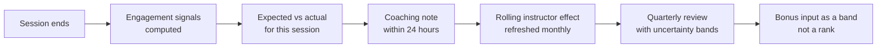
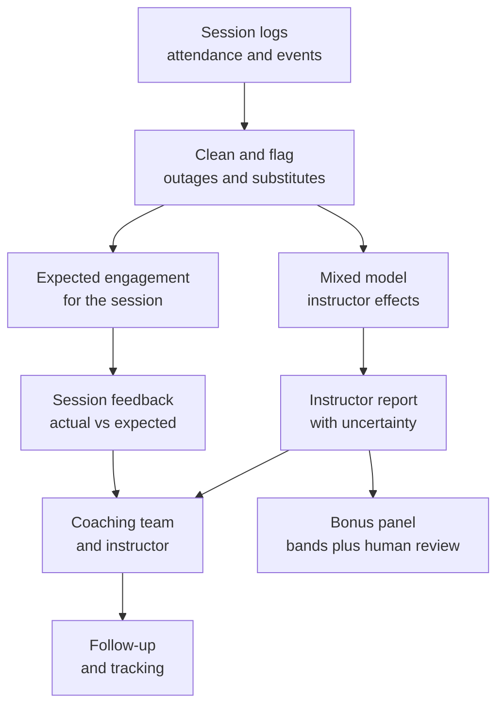

# Case Study 57: Live-Class Engagement and Fair Instructor Quality Scoring

**Domain:** EdTech | **Problem Type:** Regression and scoring with fairness concerns (hierarchical models) | **Difficulty:** Intermediate

---

## 1. Business Context

### Company background

- **ClassCrest** (fictional) runs **live cohort courses** for working professionals and senior-school students: data skills, coding, CAT and JEE foundation. Classes are 90 minutes, taught live on the company's own video platform.
- About **450 instructors** teach about **9,900 live sessions a month** (about 22 sessions each), to about **3 lakh active learners**. A typical session has 400 to 900 joined learners.
- Instructors are paid a fixed salary (about ₹1.5 lakh a month on average) plus a **performance bonus pool of about 15%** of fixed pay.
- Today the bonus and the "star instructor" badge depend on the **average student rating** (1 to 5 stars) collected after class.

### The pain, with numbers

| Item | Value |
| --- | --- |
| Instructors | 450 |
| Fixed pay bill (450 x ₹1.5 lakh x 12) | about ₹81 Cr a year |
| Bonus pool (15% of fixed pay) | about ₹12 Cr a year |
| Sessions per month | about 9,900 |
| Rating response rate | about 9% of attendees (mostly the very happy or very angry) |
| Instructor attrition | about 22% a year (about 99 exits) |
| Cost to replace and ramp up one instructor | about ₹4 lakh |
| Share of bonus pool decided by raw average rating | about 60% (₹7.3 Cr) |
| Learner renewal rate to the next course | about 41% on average, with wide gaps across batches |
| Renewal-eligible learners a year | about 2.4 lakh, and each renewal is worth about ₹18,000 |

- Instructors complain the ratings are **unfair**: "I got the 7 am slot and the hardest topic, so of course the class was empty by minute 40".
- Leadership suspects the opposite problem too: some instructors with cheerful, entertaining styles get high ratings, but their learners do worse in the next test.
- Target: a **fair, explainable engagement and quality score** that helps **coach** instructors and informs (but does not alone decide) bonuses.
- Value (see Section 6): about **₹3.6 Cr** of bonus money moves to the right people, about **₹2.2 Cr** a year more renewals from coaching, and about **₹0.4 Cr** from fewer unfair exits.

### Stakeholders and what each wants

| Stakeholder | What they want | What they fear |
| --- | --- | --- |
| Head of Academics | A fair view of teaching quality and where to coach | A score that rewards entertainers over teachers |
| Instructors | Fair treatment, with their hard slots and topics accounted for | Being ranked and fired by a black box, or losing bonus to noise |
| Instructor-success and coaching team | Specific, usable feedback per class | A single number that explains nothing |
| Head of Product | Better live-class features, and engagement signals that mean something | Metrics that people game, such as forced polls |
| HR and Finance | A defensible bonus method, lower attrition | Disputes, and legal or morale issues if scores look unfair |
| Learners | Good teaching in the slots they can attend | Instructors teaching to the poll instead of to the learner |

---

## 2. Translating Business to ML

### The business question vs the ML question

| Business question | ML question |
| --- | --- |
| "Who are our best and weakest instructors?" | "Estimate each instructor's **own contribution** to learner engagement and learning, after removing the effect of topic difficulty, time slot, learner mix and class size, and report it with an uncertainty range" |
| "Which class went well?" | "Predict the engagement we would **expect** for this session given its context, and compare the actual result with that expectation" |
| "Who needs coaching?" | "Find instructors whose adjusted score is reliably low, and show which parts (pace, interaction, clarity) drive it" |

> **Mentor note:** The model is the easy part. This case is about **what you are allowed to conclude**. Instructors are not randomly assigned to slots, topics and batches, so raw averages mix the instructor's skill with their luck. Think of it like comparing two bowlers where one only bowls on a green pitch at night. You need **adjustment, humility about small samples, and a design that does not become a weapon**.

### Target definitions

- **Primary session target (regression):** `engaged_minutes_share` = for learners who joined, the average share of the scheduled 90 minutes they were present and active. Continuous, 0 to 1. It is the area under the **attendance drop-off curve**.
- **Secondary engagement signals:** poll participation rate, chat messages per 100 attendees, share of questions raised, minute-30 retention.
- **Learning anchor:** `next_quiz_gain` = quiz score within 48 hours after class minus the learner's earlier average, so we do not reward entertainment alone.
- **Instructor quality score:** the estimated **instructor effect** (a random intercept) from a hierarchical model, with its confidence interval.

### Edge cases

| Edge case | Recommended treatment | Reason |
| --- | --- | --- |
| Platform outage or bad network in the session | Flag using platform logs and **exclude or down-weight** the session | The instructor did not cause the drop |
| Guest lecture or substitute instructor | Credit the person who taught, tag as a substitute, and use these sessions as a causal check | Substitutes give same-batch comparisons |
| Instructor with fewer than 30 sessions (new joiner) | Show "not enough data", report shrunken estimate with a wide interval, no ranking | Small samples are mostly noise |
| Recorded or hybrid session | Model separately, or drop from live scoring | Different behaviour |
| Mandatory-attendance batches (company-sponsored learners) | Add a batch-type control | Attendance is partly forced |
| Doubt-clearing or revision classes | Compare only with the same class type | Engagement patterns differ |
| Instructor teaches multiple subjects | Allow a subject-level effect, with shrinkage to the instructor's overall effect | One person may be strong in Python, weaker in statistics |

### Unit of prediction

- One **session** for the expected-engagement model.
- One **instructor** (over a rolling window) for the quality score.

### Prediction timing



- Session feedback is **near real time** and meant for coaching.
- The instructor-level score is refreshed **monthly** and used **quarterly**, because a stable estimate needs at least 30 to 40 sessions.

### What success looks like

| Lens | Success |
| --- | --- |
| Business | Bonus allocation tracks adjusted quality. About ₹2.2 Cr a year of extra renewals from coaching. Regretted instructor exits fall by about 10 a year |
| Model | Expected-engagement model explains at least 45% of session variance (R-squared). Instructor estimates have reliability of at least 0.7 at 40 sessions |
| Fairness | Correlation between instructor score and slot difficulty falls from about 0.35 (raw) to below 0.05 (adjusted). No group gap (language, gender, new vs old) left unexplained |
| People | At least 70% of instructors say the feedback is "fair and useful" in a survey. Coaching take-up above 60% |

---

## 3. Data Understanding

### Data sources and key features

| Feature group | Source | Why it matters |
| --- | --- | --- |
| Attendance logs (join time, leave time, reconnects) | Live platform | Gives the drop-off curve and joined-learner counts |
| Interaction events (poll answers, chat messages, hand raises, reactions) | Live platform | Direct engagement signals |
| Session context (topic, difficulty, chapter number, session number in course, duration, class size) | Course catalogue | Main confounders |
| Time context (hour, weekday, week to exam, festival or holiday week) | Calendar | Strong effect on attendance |
| Learner mix (grade or experience level, working professionals vs students, prior attendance rate, city tier, language) | Learner profiles | Who is in the room changes the numbers |
| Technical quality (network drops, video lag, outage flags) | Platform telemetry | Removes non-instructor causes |
| Post-class outcomes (quiz scores, assignment submission, renewal) | LMS | Anchors engagement to learning |
| Ratings and comments | Post-class survey | Small, biased, but useful text feedback |
| Instructor attributes (tenure, subject, language, mode) | HR system | Context only. Not to be used as a quality signal |

### Data volume, granularity and refresh

- **Volume:** about 9,900 sessions a month, so about 1.2 lakh sessions a year. Each has a per-minute attendance curve (90 points) and a few thousand interaction events.
- **Instructor level:** 450 instructors, each with about 22 sessions a month, so about 264 a year. A quarter gives about 66 sessions, enough for a stable estimate for most. About 15% of instructors have fewer than 30 sessions in any quarter.
- **Granularity:** session-level for modelling, learner-session level for learner-mix features.
- **Refresh:** nightly for session metrics, monthly for instructor effects.

### Common data issues

| Issue | How it shows up here |
| --- | --- |
| **Confounding by slot and topic** | Evening weekday classes retain 18 points better than 7 am classes, and the hardest topics lose attendees faster |
| **Confounding by batch and learner mix** | Sponsored corporate batches attend less voluntarily, while serious exam batches attend more |
| Non-random assignment | Senior instructors get the best slots and the most visible batches |
| Small samples per instructor | New instructors and those who teach niche topics have few sessions |
| Biased ratings | Only about 9% respond, mostly extremes. Easy topics get better ratings |
| Gamed signals | Polls shown at fixed times to boost participation, or reading out hints just before the end to keep people |
| Measurement differences | Attendance on mobile with background audio looks like presence but not attention |
| Privacy | Learner interaction logs and voice or video of instructors fall under consent and DPDP Act purposes |

> **Mentor note: Where juniors usually go wrong here.**
>
> - They rank instructors by raw average engagement and hand out bonuses. The ranking mostly reflects slot, topic and batch.
> - They show a leaderboard with ranks 1 to 450 when the confidence intervals overlap for most of them.
> - They add instructor tenure and seniority as predictors, and then call the residual "quality". That removes real signal and builds in the old assignment bias.
> - They forget that **the score will change instructor behaviour**.

---

## 4. Approach and Decision Points

### Baseline first

- **Baseline 1 (current):** average student rating. Low response, biased, strongly tied to topic ease.
- **Baseline 2:** raw average of `engaged_minutes_share` per instructor.
- **Baseline 3:** raw average, standardised **within** time slot and topic (simple "compare with peers in the same context").
- **Why it matters:** Baseline 3 is cheap and already removes much of the unfairness. The hierarchical model must clearly improve on it, and it also gives you uncertainty.

### Candidate models

| Model | Pros | Cons | Verdict |
| --- | --- | --- | --- |
| Peer-standardised averages | Simple, easy to explain | Cannot handle many confounders at once, no uncertainty | Baseline and sanity check |
| Ordinary regression with instructor dummies | Easy | Unstable for instructors with few sessions | Not recommended |
| **Mixed-effects (hierarchical) model**: fixed effects for context, random effect for instructor | Adjusts for confounders and shrinks small samples toward the average | Needs care in interpretation | **Production model** |
| Gradient boosting for expected engagement, then instructor residual averaged with shrinkage | Captures non-linear context effects | Two-step process, residuals may absorb instructor effects | Good for the **session-level expectation** |
| Bayesian hierarchical model with partial pooling by subject | Gives full credible intervals, handles multiple subjects | More effort | Strong option if the team has the skill |
| Causal methods (matching, difference in differences) | More credible for fairness claims | Need overlap and design | Use on **substitute-teacher and rotation** data |

### Decision scenarios

| What if... | Recommended action | Reasoning |
| --- | --- | --- |
| **An instructor has only 12 sessions this quarter and a great score** | Report the **shrunken** estimate with a wide interval and label "not enough data". Do not rank or reward on it | Few sessions make extreme scores common by pure luck |
| **The best instructor takes the 7 am slot and the hard topic, and the raw score is low** | Adjust for slot and topic, and show "expected vs actual" per session. Recognise slots that are structurally hard | A fair score compares like with like |
| **Instructors start using attendance-boosting tricks (for example a poll every 5 minutes) once the score is public** | Cap the weight of any single signal, track poll quality (relevance, correct-answer rate), and audit sudden jumps in poll rate. Add the learning anchor (quiz gain) | Goodhart's law: when a measure becomes a target it stops measuring |
| **A substitute taught the same batch for 6 sessions while the regular instructor was ill** | Use these as a **natural experiment**: compare the same batch with different instructors, and use the gap to check that the adjusted effect matches | Within-batch comparison removes batch and learner mix |
| **Raw scores correlate with instructor gender or accent group** | Audit adjusted scores by group, check that confounders (slot, subject, batch type) explain the gap, and review the comment text for bias. Do not add the protected attribute to "fix" the score | The goal is to find bias in the measure, not to hide it |
| **An outage hits one day and attendance falls everywhere** | Add day and platform-health controls, flag affected sessions, and exclude them from instructor effects | The instructor did not cause it |
| **High engagement but a low next-day quiz gain** | Split the score into **engagement** and **learning** components and show both. Let academic leads review mismatches | An entertaining class that teaches little should not top the list |
| **Leadership wants to fire the bottom 5%** | Use the score only to trigger **a coaching plan** and a classroom observation. Require two quarters of consistently low adjusted scores plus human review before any action | Small error rates mean the "bottom 5%" would include unlucky good teachers |

---

## 5. Feature Engineering

### Top 10 features to build

| # | Feature | Business logic |
| --- | --- | --- |
| 1 | Attendance drop-off curve summary: minute-30 retention, minute-60 retention, area under the curve | The core engagement signal, and shows where learners leave |
| 2 | Topic difficulty index (historical average retention for this topic across **all** instructors) | Controls for hard topics |
| 3 | Time slot (hour, weekday, week to exam, holiday flag) | Large effect on who attends |
| 4 | Learner mix (share of working professionals, prior attendance rate, grade level, language) | A room of committed learners behaves differently |
| 5 | Class size and share of late joiners | Large classes have lower interaction rates |
| 6 | Session number in the course (early vs late) | Attendance falls as courses progress |
| 7 | Poll participation rate and poll correct-answer rate | Interaction, plus a basic comprehension check |
| 8 | Chat messages per 100 attendees, and share of questions answered live | Two-way interaction |
| 9 | Technical quality index (drops, lag, outage flag) | Removes non-instructor factors |
| 10 | Post-class quiz gain and assignment submission within 48 hours | Ties engagement to learning |

### Features to avoid (leakage risks)

| Feature | Problem |
| --- | --- |
| Instructor ID as a feature in the **expected-engagement** model | Absorbs the instructor effect, so residuals say nothing |
| Instructor seniority or past ratings as a "context" feature | Pre-judges quality and inherits assignment bias |
| Student rating of the same session as a model input to predict engagement | Outcome of the same session, and a result of the same experience |
| Renewal outcome used to score the instructor of one session | Delayed, driven by price, career and many other factors |
| Protected attributes (gender, age, religion) as score inputs | Unfair and likely illegal in effect. Use them only in audits |
| Features measured after the class ends, such as replay views | Not available for the live feedback |

A simple mixed-effects fit on session data (conceptual):

```python
import statsmodels.formula.api as smf

# Fixed effects for context, random intercept per instructor (partial pooling)
m = smf.mixedlm(
    "engaged_share ~ topic_difficulty + C(slot) + C(batch_type) + class_size"
    " + learner_prior_attendance + session_no + tech_quality",
    data=sessions, groups=sessions["instructor_id"]
).fit()

# BLUP-style instructor effect and its uncertainty (shrunk toward 0 for few sessions)
effects = m.random_effects            # one value per instructor
```

---

## 6. Evaluation Strategy

### Metrics

| Metric | Role | Why |
| --- | --- | --- |
| **R-squared and MAE of the expected-engagement model** on held-out sessions | Model quality | Good context adjustment is the foundation |
| **Reliability of instructor effects** (split-half correlation of odd vs even sessions) | Primary scoring metric | Tells whether the score is stable signal or noise |
| **Intra-class correlation** (share of variance due to instructors after adjustment) | Sanity check | About 5 to 10% is typical. If it is 40%, confounding is probably leaking in |
| **Correlation of score with slot and topic difficulty** (before vs after) | Fairness metric | Should drop to near zero |
| Rank stability quarter to quarter | Trust metric | A good score should be fairly steady for experienced instructors |
| Agreement with substitute-teacher comparisons | Causal-ish check | Does the adjusted ranking match within-batch comparisons |
| Group gaps (language, gender, tenure) before and after adjustment | Fairness audit | Reveals bias in measures |
| Coaching outcomes: change in adjusted score after coaching, renewals of coached batches | Business outcome | Shows the system helps |

### Metrics that look good but are misleading here

- **Raw average rating:** biased towards easy topics and extreme responders.
- **R-squared of a model that includes instructor ID:** it fits well but proves nothing.
- **Rank order of instructors:** most intervals overlap, so the exact order is noise.
- **Correlation between engagement and renewals at the session level:** confounded by learner motivation.

### Validation strategy

| Step | Design | Why |
| --- | --- | --- |
| Time-based split | Fit on months 1 to 9 and test on months 10 to 12 | Matches deployment |
| Split-half reliability | Randomly split each instructor's sessions into two halves and correlate effects | Direct measure of signal vs noise |
| Placebo test | Shuffle instructor labels within slot and topic, and check that effects collapse to zero | Verifies the model is not inventing effects |
| Substitute-teacher check | Compare adjusted effects with the difference seen when a substitute taught the same batch | Best available causal check |
| Subgroup audit | Report by language, gender, slot, subject and tenure, with intervals | Finds unfair patterns |
| Qualitative check | Academic leads watch 30 sessions (10 high, 10 mid, 10 low) and compare with scores | Human validation of the measure |

### From model metric to business value

- **Bonus fairness:** the raw-rating-driven part of the bonus is about ₹7.3 Cr. Replaying last year with adjusted scores, about **half of that money (₹3.6 Cr)** would move to different instructors. This is a **fairness gain**, not a saving, but it protects morale and retention.
- **Coaching:** the raw bottom quartile has about 112 instructors, who teach about 25% of the 2.4 lakh renewal-eligible learners (about 60,000). A coaching-driven renewal gain of 2 points gives 60,000 x 2% = 1,200 renewals x ₹18,000 = about **₹2.2 Cr a year**.
- **Retention of instructors:** if fairer scores prevent about 10 regretted exits a year at ₹4 lakh each, that is about **₹0.4 Cr**.
- **Cost:** data work, instructor-success coaches and dashboards, about ₹0.5 Cr a year.
- Net quantifiable value is about **₹2.1 Cr a year**, plus a better-run bonus system.

---

## 7. Deployment and Monitoring

### Batch vs real time

- **Nightly batch** for session-level expected vs actual engagement and the coaching note.
- **Monthly batch** to refit the hierarchical model and refresh instructor effects.
- **No real-time scoring of instructors during a class.** Live nudges, if any, go to the instructor as private hints (for example "poll to check understanding").



### What to monitor

| Type | What to track | Alert trigger |
| --- | --- | --- |
| Model health | R-squared and MAE of the expected-engagement model, by slot and topic | MAE rises by 15% |
| Reliability | Split-half reliability of instructor effects | Below 0.6 |
| Fairness | Correlation of scores with slot, subject, language, gender and tenure | Gap above agreed band, or reappearing difficulty correlation |
| Goodhart watch | Sudden jumps in poll rate, chat rate or minute-60 retention for a single instructor, and gap between engagement and quiz gain | A jump above 2 standard deviations, or a widening gap |
| Coverage | Share of instructors with enough sessions for a reported score | Below 80% |
| Coaching | Take-up, change in adjusted score after coaching | Take-up below 50% |
| Instructor sentiment | Pulse survey on fairness and usefulness | Below 70% positive |
| Privacy | Access to recordings and logs, retention periods | Any breach |

### Retraining

- **Monthly:** refit the mixed model, refresh topic difficulty indices and instructor effects.
- **Quarterly:** review the confounder list, recheck fairness and substitute-teacher validation.
- **Triggered:** a new product feature (for example a new poll tool) that changes interaction rates, a change in the slot structure, or a new learner segment.

### A/B test or champion-challenger design

- You cannot randomise instructors to slots easily, but you **can randomise the feedback**:
  - **Control:** instructors get the current star rating report.
  - **Treatment:** instructors get adjusted, session-level coaching feedback.
- Randomise by **instructor cluster** within subject (so that peers in the same team are in the same arm and there is no spillover).
- Run for two quarters. Read adjusted score change, renewals of coached batches, and instructor sentiment. Treat bonus changes as a separate decision, not part of the test.
- Where possible, use **rotation** (instructors swapping slots for a few weeks) as a design to check fairness claims.

---

## 8. Stakeholder Communication

### Explain it to a non-technical leader

> "Today we judge instructors on a rating that only 9% of learners fill in, and it mostly reflects the topic and the time slot. The new score asks a fairer question: given the topic, time, class size and who was in the room, did this instructor's learners stay and take part more or less than we would expect?
> We show every score with a range, and we do not rank instructors whose data is too thin. It is mainly for coaching, with specific feedback per class, and it feeds the bonus as a band after a human review.
> Done well, about ₹3.6 Cr of bonus goes to the right people and coaching adds about ₹2 Cr of renewals a year."

### Questions leadership will ask

| Question | Suggested answer |
| --- | --- |
| "Can we just fire the bottom 5%?" | "No. With 30 to 60 sessions each, some of that group are simply unlucky. We use the score to start coaching and observation, and only act after repeated low scores and a human review" |
| "Will instructors game the score?" | "Some will try. That is why we cap any one signal, add a learning measure (quiz gain), watch for sudden jumps, and keep the exact formula for bonuses as a band, not a race" |
| "How do we know the adjustment is fair?" | "We test it against cases where a substitute taught the same batch, shuffle labels to check for false effects, and audit gaps by language, gender and tenure" |
| "Why not just use student ratings?" | "They are too few, too extreme and biased to easy topics. We still read the comments, because they are rich, but not for ranking" |
| "Is this legal and consistent with privacy rules?" | "We use only data collected for teaching quality with notice, we limit who can see recordings, and we follow the DPDP Act for personal data. HR reviews how scores are used in pay and appraisals" |

---

## 9. Common Pitfalls and Lessons

| Mistake | Why it happens | How to avoid it |
| --- | --- | --- |
| Ranking by raw averages | Easy to compute and explain | Adjust for slot, topic, batch and learner mix, and show intervals |
| Treating small samples as truth | Every instructor wants a number | Shrink estimates, show "not enough data", and require a minimum session count |
| Tying bonuses tightly to one metric | It feels objective | Use bands, several signals and human review. Expect gaming |
| Putting instructor ID or tenure in the context model | More features seem better | Keep instructor out of the context model, and use random effects for them |
| Ignoring the learning outcome | Engagement is easy to measure | Pair with next-quiz gain and academic review |
| Using the score as a punishment tool | Management wants quick action | Design for coaching first, and publish the rules in advance |
| Skipping fairness audits | The average looks fine | Audit by language, gender, slot and tenure, and check the comments |
| Not checking for causal credibility | Observational data feels convincing | Use substitute-teacher and rotation data, and placebo tests |

---

## 10. Mentor's Focus Checklist

- ✅ **Where to spend 80% of the effort:**
  - Understanding and measuring confounders: slot, topic, batch, learner mix and outages.
  - A hierarchical model with shrinkage, and honest uncertainty on every score.
  - Validation: split-half reliability, placebo tests and substitute-teacher comparisons.
  - Designing how the score is **used**: coaching first, bands for bonuses, human review, and anti-gaming checks.
- ❌ **What not to over-engineer:**
  - Fancy deep models on per-minute video or audio. The context adjustment matters far more.
  - Precise instructor rankings. The data cannot support them.
  - Real-time instructor scoring during class.
- 💡 **Key takeaway:** **A fair score is an adjusted estimate with an error bar, used to help people improve.** If the number becomes a target, people will game it, so measure several things and keep humans in the decision.
