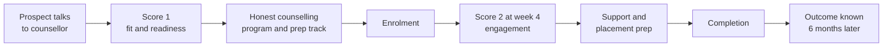
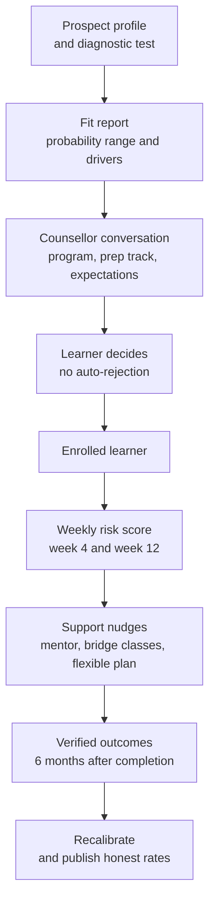

# Case Study 58: Placement Outcome Prediction and Course-Fit Counselling

**Domain:** EdTech | **Problem Type:** Classification plus counselling decision support | **Difficulty:** Intermediate

---

## 1. Business Context

### Company background

- **CareerPatha** (fictional) sells **career programs** to graduates and early-career professionals: data analytics, full-stack development, digital marketing and cloud engineering. Programs run 6 to 9 months, with live classes, projects and a **placement assistance** team (resume help, mock interviews, hiring-partner drives).
- The average fee is about **₹1.2 lakh**, often paid on EMI through lending partners. About **24,000 learners enrol each year**.
- A premium **"Placement-Assured"** variant (about 6,000 learners a year at about ₹1.5 lakh) refunds the fee if the learner is not placed within 9 months of completing, **subject to eligibility conditions** such as attendance and interview participation.
- Counsellors recommend a program to each prospect and decide whether they are "a good fit". Today this is judgement plus a basic eligibility form.

### The pain, with numbers

| Item | Value |
| --- | --- |
| Enrolments a year | about 24,000 |
| Learners who complete the program (61%) | about 14,640 |
| Learners who register for placement support and meet its conditions | about 7,100 |
| Of these, verified placed within 6 months | about 5,822 (82%), the figure used in advertising |
| Verified placed as a share of **all enrolled** | about 24.3% (5,822 / 24,000) |
| Placement-Assured learners | about 6,000 a year |
| Refund claims paid (about 11% of assured learners) | about 660 x ₹1.5 lakh, so about **₹9.9 Cr a year** |
| Dropout before the first project | about 21% of enrolled |
| Learners who responded to the placement survey | about 58%, and responders were placed far more often |

- The "82% placed" claim is calculated on a narrow group. Regulators and consumer groups in India have been paying attention to misleading placement and "guaranteed job" claims, and the platform has had complaints about it.
- Counsellors sell to nearly everyone, because incentives reward enrolments. Some learners were clearly poor fits, for example someone with no coding exposure joining a full-stack track with 5 hours a week to spare.
- Target: **predict who is likely to complete and get placed, use it to counsel honestly** (right program, right prep, right expectations), and **fix the outcome claims** so they are honest and defensible.
- Value (see Section 6): about **₹1.8 Cr** lower refund payouts, about **₹2.2 Cr** from fewer early dropouts, plus lower regulatory and reputation risk.

### Stakeholders and what each wants

| Stakeholder | What they want | What they fear |
| --- | --- | --- |
| Head of Admissions and counsellors | Higher enrolments, and clear guidance for tough conversations | A model that blocks sales or tells them to reject paying customers |
| Head of Placements | Realistic expectations, better-prepared learners | Being blamed when poor-fit learners do not get jobs |
| Academic Head | Learners who can finish the program | Dropouts and unhappy alumni |
| Finance | Lower refund liability and an accurate forecast | Surprises in refunds |
| Legal and Compliance | Honest advertising and a fair, explainable process | Complaints about misleading claims, or discrimination in admissions |
| Learners and parents | An honest view of their chances | Being sold a dream, or turned away by an algorithm |

---

## 2. Translating Business to ML

### The business question vs the ML question

| Business question | ML question |
| --- | --- |
| "Will this learner get a job after our program?" | "Estimate the probability that a learner with this profile completes the program and is placed in a relevant role within 6 months of completion, and show what could improve it" |
| "Which program fits this person?" | "For each prospect and each eligible program, estimate completion and placement chances, and recommend the program or a **prep track** with the best realistic outcome" |
| "What can we honestly promise?" | "Report outcomes for **all enrolled** learners, with calibrated ranges, and correct for who responds to surveys" |

> **Mentor note:** This case is as much about **what the model must not do**. Do not use predictions to deny admission, hide a program, or push someone into a cheaper track without telling them. A score is used to **inform a conversation**. The most important technical issues are the long delay before outcomes are known, and the fact that you only see outcomes for people who stayed and replied. If you ignore that, your model learns from the lucky survivors.

### Target definition

- **Primary target:** `placed_6m = 1` if the learner is **verified placed** (offer letter, company email, or employer confirmation) in a role relevant to the program within 6 months of completing. Learners who drop out count as 0 for **enrolled-based** outcomes.
- **Two-stage view:** `completed = 1` (finished the program) and `placed_6m | completed`. The product is `P(complete) x P(placed | complete)`.
- **Why both:** completion and placement have different drivers (time, motivation vs skill and market).
- **Window:** 6 months. Outcomes after 6 months are tracked separately.

### Edge cases

| Edge case | Recommended treatment | Reason |
| --- | --- | --- |
| Learner placed in an unrelated role (for example a delivery job) | Do not count as placed in the main target, track as "employed, not relevant" | Honest claims need a clear definition |
| Learner is already employed and wants a promotion or switch | Use a different target, such as salary change or role change | Placement is not the right goal |
| Learner does not respond to follow-ups | Use a defined verification process, treat as **unknown** and not placed or placed, and model the response | Silent learners are not random |
| Learner pauses and returns later | Measure from completion date, and flag pauses | Windows shift |
| Self-found job with no help from the placement team | Count as placed if relevant and verified | The outcome is real, but track the share |
| Learner joins a Placement-Assured plan and gets a job after the 9-month deadline | Keep as placed after the window, but note the refund status | Contract and outcome definitions differ |
| Very small cohorts (a new program) | No program-specific claim yet | Not enough data |

### Unit of prediction

- One **learner-program pair** at the **pre-enrolment** stage (for counselling), and again at **week 4 and week 12** (for support and honest updates).

### Prediction timing



- **Score 1** uses information known before enrolment.
- **Score 2 and 3** (week 4 and week 12) add engagement and trigger **support**, not exit.
- The outcome label is known **9 to 15 months after enrolment**, which is the main delay.

### What success looks like

| Lens | Success |
| --- | --- |
| Business | Refund claims fall by 2 points of assured learners (from 11% to 9%). Early dropout falls by 3 points (from 21% to 18%) |
| Model | AUC about 0.74 for placement among enrolled, calibration error under 3 points per decile, and clear separation across the top and bottom quintiles |
| Ethics and compliance | No rejection or hidden steering based on predicted outcome. Honest outcome reporting on **all enrolled**, with definitions published |
| Counselling | At least 70% of counsellors use the fit report in conversations, and learners with low predicted odds are offered prep options, not refusals |

---

## 3. Data Understanding

### Data sources and key features

| Feature group | Source | Why it matters |
| --- | --- | --- |
| Background (degree, college tier, graduation year, gap years, prior work experience) | Application form | Strongest predictors of placement, but mostly **fixed** |
| Skills at entry (pre-test score, coding or maths exposure, tools known) | Diagnostic test at counselling | **Changeable** with prep. Key for counselling |
| Goal and constraints (target role, expected salary, hours per week, willingness to relocate, English fluency) | Counsellor notes and form | Fit with the program and with the job market |
| Engagement (attendance, assignments, project quality, mock interview scores) | LMS and placement team | Strong mid-program predictors, and **actionable** |
| Program and cohort (program, batch, mentor, start month) | Catalogue | Market and cohort effects |
| Market context (openings by role and city, hiring partner demand, season) | Job-market data, partners | Outcomes depend on demand, not only on learner |
| Financial (EMI plan, income band, other loans) | Lending partner | Affects completion and stress |
| Outcomes (completion, offers, employers, salary band, verification status) | Placement team, surveys, employer checks | Targets |

### Data volume, granularity and refresh

- **Volume:** 24,000 enrolments a year. With 3 years of history, the last 15 months are not yet **matured**, which leaves about 42,000 learners with usable outcomes, of whom about 10,000 are placed (24%).
- **Granularity:** one row per learner-program, with snapshots at pre-enrolment, week 4, week 12 and at completion.
- **Refresh:** engagement features daily, outcomes updated through the year as placements are verified.

### Common data issues

| Issue | How it shows up here |
| --- | --- |
| **Long label delay** | Outcomes appear 9 to 15 months after enrolment, and market conditions change meanwhile |
| **Survivorship bias** | Metrics computed on completers or on placement-registered learners hide the 39% who never finished |
| **Reporting (selection) bias** | Placed learners respond to surveys and post on LinkedIn far more than unplaced ones. Unplaced learners go silent |
| Verification gaps | Offer letters are missing, and some learners are placed but not reported |
| Market drift | A hiring slowdown in IT services cuts placements for every learner, regardless of profile |
| Heterogeneous programs | Each program has its own employers and skills |
| Proxy features | College tier, city and gender act as stand-ins for income and opportunity |
| Counsellor bias in data | Counsellors enrolled "promising" people, so the enrolled base is not the same as the applicant base |

> **Mentor note: Where juniors usually go wrong here.**
>
> - They compute "placement rate" among those who answered the survey and call it the outcome. The number may be 80% when the real figure is 40%.
> - They train only on completers, so the model cannot tell you who will drop out, which is the biggest loss.
> - They include features the learner **cannot change** (age, college tier, gender) and then use the score to steer or deny. That is unfair and harmful.
> - They treat a model trained in a hot hiring market as a permanent truth.

---

## 4. Approach and Decision Points

### Baseline first

- **Baseline 1:** historical placement rate per program (a lookup table). Same number for everyone.
- **Baseline 2:** a simple rule: "completers with a pre-test above 60 and above 80% attendance are likely placed".
- **Baseline 3:** logistic regression using a handful of features: pre-test, graduation year, program, hours per week.
- **Why it matters:** program-level rates and a few readiness features capture most of the available signal. The model needs to add value in **ranking within a program** and in **showing what to change**.

### Candidate models

| Model | Pros | Cons | Verdict |
| --- | --- | --- | --- |
| Program-level rates | Transparent, no personal data | Same for everyone | Baseline and the honest public number |
| **Logistic regression** with calibrated outputs | Explainable, stable, easy to calibrate | Misses interactions | **Strong first model** |
| **Gradient boosting** (LightGBM) with monotonic constraints on some features | Accurate, handles missing values | Needs calibration and monitoring | **Production model** |
| Two-stage model (completion, then placement given completion) | Matches the real process and enables support at the right point | Two models to maintain | **Recommended structure** |
| Survival model (time to placement) | Uses partial information for recent cohorts | More complex | Useful to handle **censoring** for recent cohorts |
| Causal or uplift models for prep tracks | Estimate whether bridge courses help | Need randomised data | Phase 2 (see Case 3) |
| Deep learning on text of resumes or counsellor notes | May use more signal | Opaque, higher bias risk, needs more data | Not now |

### Decision scenarios

| What if... | Recommended action | Reasoning |
| --- | --- | --- |
| **The model says a prospect has only a 15% chance of placement** | Use it in the conversation: share the range honestly, explain what would improve it (a bridge course, more weekly hours), offer alternatives including a different program, and let the learner choose. **Never auto-reject** | The score informs a decision. It does not make it, and chances can change with preparation |
| **Placed learners answer the survey at 80% and unplaced at 35%** | Treat non-response as informative. Fit a **response model** and re-weight (inverse probability weighting), and run phone follow-ups on a random sample of 300 non-responders to measure the true rate | Without correction the average placement rate is inflated |
| **Marketing wants to advertise "82% placed"** | Publish the definition, the denominator and the full funnel (enrolled, completed, placement-registered, placed), and say how many were verified. Prefer ranges and "placed within 6 months of completing" | Honest claims protect learners and reduce regulatory risk. Advertising rules cover misleading claims in general |
| **A feature such as college tier gives a large boost in AUC** | Keep it out of **steering and counselling outputs**, and test whether it is a proxy for opportunity. Use changeable readiness features for advice. Use the fixed feature only for calibration or auditing if at all | A fixed feature cannot be improved by the learner, and using it to steer is unfair |
| **The IT hiring market drops and placements fall 12 points in a quarter** | Add market features (openings by role, partner demand) and shorten the training window. Update communicated ranges and warn the placement team early | The model must not blame the learner for a market shock |
| **A learner with a low score still wants to enrol** | Allow it with clear written expectations, a recommended prep track, and a mid-program checkpoint. For Placement-Assured plans, make eligibility terms plain | Respect for choice with informed consent. Denial based on a score is a serious risk |
| **A new program has only 150 completers** | Publish no program-specific outcome claims. Borrow from similar programs for internal planning with wide intervals | Too little data to say anything honestly |
| **Counsellors with sales targets get the scores** | Keep counsellor incentives independent of whether a learner is enrolled **despite** a low score. Add a quality measure such as 6-month completion and refunds | A tool for honest guidance can become a tool for selective selling |

---

## 5. Feature Engineering

### Top 10 features to build

| # | Feature | Business logic |
| --- | --- | --- |
| 1 | Entry diagnostic score and sub-scores (logic, coding or maths, communication) | Direct readiness signal, and **changeable** with bridge courses |
| 2 | Weekly hours the learner can commit, and work or study load | Completion is mostly a time question |
| 3 | Graduation year, gap years, and years of relevant experience | Employers screen on these |
| 4 | Program and target role fit (match between background and program) | Course-fit counselling input |
| 5 | Week 4 and week 12 attendance and assignment completion | Strong, actionable mid-program signals |
| 6 | Project quality score and mock interview scores | Closest to hiring decisions |
| 7 | Market demand index (openings per learner in the target role and city) | Controls for the market, and informs expectations |
| 8 | Willingness to relocate and city tier | Affects the number of openings reachable |
| 9 | Financial stress indicators (EMI burden, late payments) | Completion risk, and a prompt for flexible plans |
| 10 | English and communication readiness (assessed in a mock interview) | A frequent barrier, and **changeable** |

### Features to avoid (leakage risks and fairness risks)

| Feature | Problem |
| --- | --- |
| Placement team activity (number of interview referrals, resume rounds) | Happens after enrolment, and follows the learners the team already believes in |
| Offer letters, employer names, salary | The outcome itself |
| Survey response status as a predictor of placement | Response is caused by the outcome (placed people reply) |
| Gender, religion, caste, disability, or surname-based proxies | Unfair and may breach equality norms. Keep only for fairness **audits** |
| Age as a steering input | Fixed, and can lead to age discrimination |
| Post-completion bonus or refund status | Future information |
| Counsellor ID | Encodes who enrolled whom, and old selling styles |

A simple calibration check for communicated probabilities:

```python
from sklearn.calibration import calibration_curve

# Compare predicted probabilities with actual placement, on matured cohorts, IPW-weighted
frac_pos, mean_pred = calibration_curve(
    y_true, p_pred, n_bins=10, strategy="quantile"
)
# Weighted version: use sample weights = 1 / P(outcome observed | features)
```

---

## 6. Evaluation Strategy

### Metrics

| Metric | Role | Why |
| --- | --- | --- |
| **Calibration** (predicted vs actual by decile, with IPW for non-response) | Primary model metric | The numbers will be told to learners, so a "40%" must mean about 40 in 100 |
| **Brier score and log loss** | Probability quality | Rewards honest probabilities |
| AUC and PR-AUC | Ranking quality | Shows how well it separates higher from lower odds |
| Completion and placement rates by quintile of predicted risk | Business metric | Shows the spread and checks monotonic behaviour |
| **Fairness audit** (calibration and error rates by gender, college tier, city tier, language) | Primary ethics metric | Finds uneven accuracy and proxy effects |
| Support take-up and effect (week 4 and week 12 outreach) | Operational | Whether the model leads to help |
| Refund claim rate and early dropout by cohort | Business | Final outcome |
| Share of enrolled learners with a verified outcome | Data quality | Tells how much of the truth we know |

### Metrics that look good but are misleading here

- **Placement rate among survey responders:** biased upward.
- **Placement rate among placement-registered learners:** ignores dropouts and non-registrants.
- **AUC on completers only:** hides the biggest loss, which is the 39% who do not complete.
- **High accuracy on a hot-market year:** does not carry over to a slow market.

### Validation strategy

| Step | Design | Why |
| --- | --- | --- |
| Time-based split | Train on cohorts from years 1 and 2, test on a later cohort whose outcomes have **fully matured** (6 months after completion plus verification time) | Matches deployment, avoids immature labels |
| Market-shift check | Test separately on a hot-market cohort and a slow-market cohort | Checks robustness |
| Response-bias correction | Fit a response model, apply weights, and compare with the phone-verified random sample of non-responders | Measures the true rate and the size of the bias |
| Subgroup report | Calibration and AUC by program, gender, college tier and city tier | Finds unequal quality |
| Counsellor study | Compare conversations with and without the fit report, for a random half of counsellors | Does it improve honesty and outcomes |
| Online test | Randomise by prospect (or counsellor group) to offer the fit report and prep-track recommendation vs usual practice | Measures effect on dropout, refunds and satisfaction |

### From model metric to business value

- **Refunds:** 6,000 assured learners x 11% = 660 claims x ₹1.5 lakh = ₹9.9 Cr. If better counselling, prep tracks and support cut claims to 9%, that is 540 claims, saving 120 x ₹1.5 lakh = about **₹1.8 Cr a year**.
- **Dropouts:** 24,000 enrolled. A fall in early dropout from 21% to 18% keeps 720 more learners enrolled. At about ₹30,000 of fees still to be collected from each (EMI instalments), that is 720 x ₹30,000 = about **₹2.2 Cr a year**.
- **Cost:** modelling, counsellor tools, verification calls and surveys, about **₹0.6 Cr a year**.
- **Net value:** about **₹3.4 Cr a year**, plus lower risk of regulatory action, refunds, and negative reviews. Some prospects may choose not to enrol after an honest conversation. Estimate that loss (for example 1% fewer enrolments, about 240 x ₹1.2 lakh = ₹2.9 Cr of billings) and report it openly. The leadership choice is between short-term sales and long-term trust.

---

## 7. Deployment and Monitoring

### Batch vs real time

- **Near real time** for the **pre-enrolment fit report**, which a counsellor opens during a call. A few seconds is enough.
- **Weekly batch** for week 4 and week 12 scores, support outreach, and placement-team lists.
- **Quarterly batch** for outcome reporting and calibration, with updated survey weights.



### Communicating probabilities

- Say **"Among learners with a similar profile, about 4 in 10 were placed within 6 months. The range is 3 to 5 in 10."** Do not give single-point certainty.
- Show what is **changeable**: "Improving your diagnostic score by 15 points and committing 10 hours a week moves this to about 5 in 10."
- Tell the learner how the number was calculated, and that it is not a guarantee.

### What to monitor

| Type | What to track | Alert trigger |
| --- | --- | --- |
| Calibration | Predicted vs actual by decile, IPW-weighted, by program | Gap above 4 points |
| Market drift | Openings per learner, partner hiring, placement rate by month | Placement rate down by 10 points or more |
| Response bias | Response rate by placement status, results of the non-responder phone sample | Gap widens |
| Fairness | Calibration and error rates by gender, college tier, city tier, language | Gap above agreed band |
| Use of the model | Share of counsellors using the report, share of low-score prospects enrolled, reasons recorded | Any pattern of denial or discouragement |
| Outcomes | Completion, placement, refunds by cohort | Outside agreed bands |
| Claims | Every public number traced to a definition and a data source | Any unmatched claim |
| Privacy | Access to learner data, consent records, retention | Any breach |

### Retraining

- **Quarterly:** retrain with newly matured cohorts and refresh the market features.
- **Monthly:** update response weights and calibration maps.
- **Triggered:** a new program, a sharp hiring change, a new placement partner mix, or a policy change in advertising.

### A/B test or champion-challenger design

- **Control:** current counselling practice. **Treatment:** counsellors receive the fit report and a prep-track recommendation, and learners at risk receive early support.
- Randomise by **counsellor group** (to avoid contamination in conversations), balancing by program and region.
- Primary readouts: 90-day dropout, completion, refund claims and satisfaction. Placement is read later (9 to 15 months).
- Add a guardrail: **no change in the share of prospects refused or discouraged without explanation**.
- Keep a permanent 5% holdout to track long-run calibration.

---

## 8. Stakeholder Communication

### Explain it to a non-technical leader

> "We cannot promise any learner a job, and we should not say '82% placed' without showing who is in that number. The model looks at a learner's readiness, time and the job market and gives an honest range: for people like you, about 4 in 10 got relevant jobs within 6 months.
> Counsellors use it to recommend the right program and the right preparation, not to turn anyone away. Learners at risk get help early, and that cuts dropouts and refund payouts by about ₹4 Cr a year.
> We will also publish our outcomes on all enrolled learners, with clear definitions. It may look less impressive, but it is defensible and builds trust."

### Questions leadership will ask

| Question | Suggested answer |
| --- | --- |
| "Can we use it to reject weak applicants and protect our placement numbers?" | "We strongly advise against it. It is unfair to learners, it could breach equality norms, and the score is uncertain. Use it to guide, prepare and set expectations. Admission rules, if any, should be simple, published and about readiness, not about a model's score" |
| "Our competitors advertise 90% plus. Do we lose out?" | "Competitors may face regulatory scrutiny. Our numbers will carry definitions, and we can lead with outcomes that survive an audit. Complaints and refunds are the cost of inflated claims" |
| "How can you be sure about outcomes when learners do not reply?" | "We do not assume. We re-weight for non-response and phone a random sample of non-responders to measure the gap" |
| "Will counsellors sell less?" | "Probably some enrolments will drop (we estimate about 1%), but fewer will quit or claim refunds. We track both and report net value" |
| "What does DPDP mean for this?" | "We collect only what we need with clear consent, explain how profiles are used, keep data only as long as needed and allow correction. We avoid automated decisions that deny services without human review" |

---

## 9. Common Pitfalls and Lessons

| Mistake | Why it happens | How to avoid it |
| --- | --- | --- |
| Reporting placement among responders or registrants only | It gives the best-looking number | Use all enrolled as the base, report the funnel, correct for non-response |
| Training only on completers | The data is cleaner | Model completion and placement-given-completion |
| Using fixed attributes to steer or deny | They predict well | Use changeable readiness features for advice, and audit fixed ones only |
| Treating the score as a verdict | Probabilities feel like answers | Communicate ranges, show what can change, and keep human choice |
| Ignoring the market | The model fits last year's data | Add market features, shorten windows, and warn early |
| Uncalibrated probabilities | AUC looks fine | Calibrate and check by decile and subgroup |
| Skipping verification | Self-reports are easy | Verify offers, and sample non-responders |
| Counsellor incentives that reward selling regardless | Sales targets | Add quality-of-sale metrics (completion, refunds) to incentives |

---

## 10. Mentor's Focus Checklist

- ✅ **Where to spend 80% of the effort:**
  - Outcome definitions, verification and the response-bias correction.
  - Separating **fixed** from **changeable** features, and building advice around the changeable ones.
  - Calibration and the way probabilities are spoken to learners.
  - Fairness audits, and a clear policy that scores are never used to deny admission.
  - Honest public numbers with definitions on the full funnel.
- ❌ **What not to over-engineer:**
  - Deep models on resumes or counsellor notes. They add bias risk for little gain.
  - Per-employer or per-role predictions on small samples.
  - A precise placement date forecast.
- 💡 **Key takeaway:** **Predict to help, not to exclude.** The hardest parts are honest labels (survivors and responders skew the data) and communication. A calibrated, humble range shared with the learner is worth more than a clever model used to steer them.
