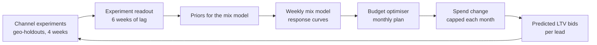
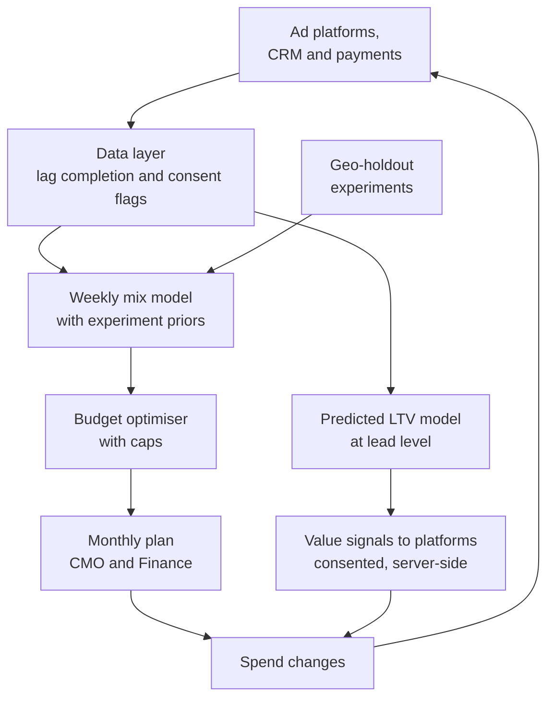

# Case Study 59: Marketing Budget Allocation, Incrementality and CAC-to-LTV Attribution

**Domain:** EdTech | **Problem Type:** Marketing mix modelling plus incrementality testing plus predicted-LTV bidding | **Difficulty:** Advanced

---

## 1. Business Context

### Company background

- **VidyaVista** (fictional) sells paid courses in India: cohort-based upskilling, exam prep and test-series bundles. The average first purchase is about **₹48,000**, and over 24 months a learner brings in about **₹68,000** (renewals, add-on courses, test series).
- It spends about **₹18 Cr a month** on performance and brand marketing across five channels: **Meta** (Instagram and Facebook), **Google** (search and display), **YouTube**, **influencers** and **partnerships** (college tie-ups, employer and community partners).
- The sales cycle is long. A learner sees an ad, joins a free webinar, gets calls and WhatsApp messages, compares fees and EMI, and buys a median of **21 days** later. About 30% of buyers take more than 45 days.
- Channel owners get their budget based on **last-click CAC** (customer acquisition cost): spend divided by the enrolments the last ad click was credited with.

### The pain, with numbers

| Channel | Monthly spend | Last-click enrolments | Last-click CAC |
| --- | --- | --- | --- |
| Google (search and display) | ₹4.5 Cr | 3,600 | ₹12,500 |
| Meta | ₹7.0 Cr | 2,800 | ₹25,000 |
| YouTube | ₹2.5 Cr | 800 | ₹31,250 |
| Influencers | ₹2.5 Cr | 1,000 | ₹25,000 |
| Partnerships | ₹1.5 Cr | 800 | ₹18,750 |
| **Total** | **₹18.0 Cr** | **9,000** | **₹20,000** |

- Last-click makes **Google look like the hero** (CAC ₹12,500) and YouTube look weak (₹31,250). But much of Google's credit goes to **branded search**: people who already know VidyaVista and would have found it anyway.
- About **28% of conversions have no tracked click** (iOS privacy prompts, consent refusals, app switching, WhatsApp sharing), so they are credited to "direct" or "organic" by default.
- Marketing history is short. The company has **20 months** of reliable channel-level data, which is only about 87 weeks.
- The Finance team asks: "Which rupee is actually creating enrolments, and what is each enrolment worth to us over two years?"
- Value (see Section 6): moving about **₹3 Cr a month** (about 17% of budget) from low-incrementality spend to high-incrementality spend adds about **315 incremental enrolments a month**, worth about **₹21 Cr a year** in 24-month contribution, with the same total spend.

### Stakeholders and what each wants

| Stakeholder | What they want | What they fear |
| --- | --- | --- |
| CMO | A defensible split of budget across channels | Cutting a channel and watching enrolments collapse |
| Channel heads (performance, brand, influencer, partnerships) | Budgets that reflect the true value of their channel | Losing budget because of a flawed attribution rule |
| Finance | Spend that pays back within 18 to 24 months, accurate forecasts | Paying for conversions that would have happened anyway |
| Sales and counselling | Quality leads, not just volume | Cheap leads that do not buy |
| Data and analytics | Clean experiments and models | Pressure to give one number when the truth is a range |
| Legal and Privacy | Consent and lawful use of learner data in ad platforms | Complaints, or ad accounts blocked for policy breaches |

---

## 2. Translating Business to ML

### The business question vs the ML question

| Business question | ML question |
| --- | --- |
| "Where should the next rupee go?" | "Estimate for each channel the **incremental** enrolments and **incremental** LTV per rupee, including how returns diminish as spend grows, and choose the split that maximises expected lifetime contribution under a budget" |
| "Is Google as good as it looks?" | "Measure the share of Google-credited enrolments that would not have happened without the spend (incrementality), using experiments" |
| "What can we pay to win this lead?" | "Predict the 24-month contribution of a new lead early (for example after 7 days), and turn it into a bid or value signal to the ad platform" |

> **Mentor note:** Three tools answer three different questions, and a good marketing science team uses all three. **Attribution** tells you what happened on the paths you can see. **Experiments** (geo-holdouts) tell you what **caused** what, for one channel at one spend level. **Mix models** stitch it together for budget planning. The experiments are the anchor. The model is only trustworthy when it agrees with them.

### Target definitions

- **Incremental enrolments (channel level):** enrolments with the channel on minus enrolments in a matched control with the channel off or reduced, measured by geo-holdout.
- **Response curve (MMM):** weekly enrolments as a function of channel spend, with lagged effect (adstock) and diminishing returns (saturation).
- **Predicted LTV (lead level):** expected **24-month contribution margin** of a lead, `P(enrol) x E[contribution | enrol]`, using information available in the first 7 days.
- **Primary business target:** maximise **lifetime contribution minus spend**, so that incremental CAC is below incremental LTV by a safe margin.

### Edge cases

| Edge case | Recommended treatment | Reason |
| --- | --- | --- |
| Brand search clicks from people who typed the company name | Split brand and non-brand search. Test brand separately | Brand clicks are mostly harvesting existing demand |
| Enrolments arriving after the reporting window | Use the lag curve to complete recent weeks (nowcast), flag them as provisional | Otherwise last month always looks worse |
| Influencer coupon codes shared on Telegram or WhatsApp groups | Use unique links per creator plus lift testing, and track coupon leakage | Code redemption overstates influencer impact |
| Partnership leads (college tie-ups) that come with fees paid by someone else | Track them separately, with their own LTV | Different economics |
| Free or heavily discounted enrolment | Count as enrolment, but value at actual contribution | Rupee value matters, not just counts |
| Refunds within 7 days | Subtract from LTV | Contribution should be net |
| Branding or YouTube awareness effects that last months | Allow long adstock, and use long-window tests where possible | Short windows miss the effect |

### Unit of prediction

- **Channel-week** (or **geo-channel-week**) for the mix model and the optimiser.
- **Geo** (a cluster of cities) for experiments.
- **Lead** for predicted-LTV bidding.

### Prediction timing



- Experiments run **continuously**, a few at a time, one channel per quarter.
- The mix model refits **weekly**, the budget plan changes **monthly**, and the predicted-LTV signal runs at the **lead level in near real time**.
- The final truth about LTV is known **18 to 24 months** later, so early proxies (7-day and 30-day behaviour, 3-month revenue) are essential.

### What success looks like

| Lens | Success |
| --- | --- |
| Business | Same ₹18 Cr budget produces about 315 more incremental enrolments a month, worth about ₹21 Cr a year of 24-month contribution. Blended incremental CAC falls from about ₹36,000 to about ₹34,000 |
| Model | Mix model out-of-time error (MAPE) below 8% on weekly enrolments, and channel ROI estimates inside the experiment intervals |
| Experiments | At least 4 channel experiments a year, each with a clear pre-registered readout |
| Operations | Budget moves within a cap of 15% per channel per month, and no channel cut to zero without a test |

---

## 3. Data Understanding

### Data sources and key features

| Feature group | Source | Why it matters |
| --- | --- | --- |
| Spend, impressions, clicks by channel, campaign and geo, by day | Ad platforms, influencer invoices, partnership contracts | The inputs for response curves |
| Leads, webinar attendance, calls, enrolments with timestamps and geo | CRM and payments | The outcomes and the long funnel |
| Click IDs, UTM tags, referral codes, self-reported "how did you hear about us" | Web and app analytics, forms | Partial attribution paths |
| Platform-reported conversions and modelled conversions | Meta, Google and YouTube dashboards | Cross-check, but self-reported and inflated |
| Organic and brand demand (branded search volume, direct traffic, app installs) | Search console, analytics | Control for baseline demand |
| Calendar and market (board exam dates, JEE and NEET result weeks, festivals, pricing sales, competitor promos) | Internal calendar, public dates | Strong seasonality in education demand |
| Price and offer (discounts, EMI offers, scholarship tests) | Pricing team | Large effect on conversion |
| LTV drivers (renewals, add-ons, refunds, support tickets, course completion) | LMS and payments | Value side of CAC to LTV |
| Consent and privacy flags | Consent management | Decides what can be sent to ad platforms |

### Data volume, granularity and refresh

- **Mix model data:** 87 weeks x 5 channels at national level is a tiny dataset. A **geo-level panel** (about 20 geo clusters x 87 weeks = about 1,740 rows) gives much more variation.
- **Lead level:** about 2.4 lakh to 3 lakh leads a month. With 12 months of matured leads and 24-month LTV known for only the oldest cohorts, only about 6 to 8 months of leads have **complete** value.
- **Refresh:** spend and leads daily, enrolments with lag, LTV updated monthly as revenue arrives.

### Common data issues

| Issue | How it shows up here |
| --- | --- |
| **Last-click bias** | Search and retargeting get credit for demand created by YouTube, influencers and word of mouth |
| **Long, delayed conversions** | The last 3 to 6 weeks of data are incomplete, and the mix model reads them as "performance dropped" |
| **Privacy-driven attribution loss** | iOS opt-outs, cookie limits, and consent rules remove 25 to 30% of paths. Platforms fill the gap with modelled numbers |
| **Short, noisy history** | 87 weeks, with one big seasonality cycle and few changes in spend. Many parameters, little information |
| Correlated spends | Channels all go up in exam season, so the model cannot tell which one worked |
| Platform double counting | Meta and Google both claim the same conversion. The sum of platform conversions exceeds actual enrolments by 30 to 50% |
| Coupon and code leakage | Influencer codes spread beyond the creator's audience |
| Right-censored LTV | Recent cohorts have not had 24 months to pay |

> **Mentor note: Where juniors usually go wrong here.**
>
> - They trust platform dashboards. Each platform tries to claim credit for every conversion it touched.
> - They fit a mix model with many parameters on 87 weeks and believe the output. Spend moves together with seasonality, so the model finds patterns that are not there.
> - They treat the last 6 weeks of data as complete and conclude a campaign failed.
> - They optimise CAC alone. A cheap lead who never renews can have worse economics than an expensive lead who buys two courses.

---

## 4. Approach and Decision Points

### Baseline first

- **Baseline 1 (current):** last-click CAC by channel.
- **Baseline 2:** **multi-touch rules** (linear, position-based) on tracked paths. A little fairer, but still only on observed paths.
- **Baseline 3:** platform-reported conversions, adjusted by a **fixed incrementality factor** from one past test.
- **Why it matters:** these are cheap and widely used. The new setup must show where they mislead (for example Google brand search), and by how many rupees.

### Candidate methods

| Method | Pros | Cons | Verdict |
| --- | --- | --- | --- |
| Last-click and multi-touch rules | Easy, uses user-level paths | Biased to the bottom of the funnel, and breaks as tracking is lost | Baseline, and operational reporting |
| **Geo-holdout experiments** | Causal, privacy-safe, believable to Finance | Costly to run, one channel at a time, a single spend level | **Gold standard anchor** |
| **Bayesian MMM** (adstock and saturation, with priors) | Works without user tracking, shows diminishing returns | Weak with short history, sensitive to assumptions | **Core planning model, calibrated by experiments** |
| Geo-level hierarchical MMM | Uses variation across geos, more data | Needs clean geo spend | Strong upgrade if geo data exists |
| Budget optimiser (constrained, on response curves) | Turns curves into a plan | Garbage in, garbage out. Extrapolates beyond observed spend | Use with caps and tests |
| **Predicted-LTV model** (gradient boosting or survival-style) | Moves bids from cheap leads to valuable leads | Delayed labels, feedback with the ad platform | **Production for value-based bidding** |
| Deep attribution models on paths | Learn complex sequences | Need user-level data that no longer exists | Not recommended |

### Decision scenarios

| What if... | Recommended action | Reasoning |
| --- | --- | --- |
| **Google looks best on last-click, but a geo-holdout shows only 35% of its conversions are incremental** | Separate brand from non-brand, cut or test-pause brand keywords in treatment geos, defend only the brand terms competitors bid on, and move the freed money elsewhere | Brand search harvests existing demand. The real iCAC is about ₹35,700, not ₹12,500 |
| **Influencers show great code-based CAC, but codes circulate on Telegram** | Use unique tracking links and short-lived codes, run a time-based lift test (creator posts vs matched quiet weeks), and judge on lift not codes | Code redemption counts people who never saw the creator |
| **The mix model gives YouTube an ROI of 4x, but 87 weeks of data show a very wide interval** | Put an informative **prior** from the YouTube geo-test, limit the adstock range, and report a credible interval. Do not move budget on the point estimate alone | With little data, the prior (the experiment) does most of the work |
| **JEE results week spikes enrolments just when a YouTube campaign launched** | Add seasonality and calendar terms, control for branded search and organic demand, and compare with last year's results week | Otherwise the campaign gets credit for an exam-driven spike |
| **A geo test needs the result after 4 weeks, but buyers take a median of 21 days and 30% take over 45** | Run the test for 4 weeks, then keep measuring for 6 more weeks of lag, and use an early proxy (paid or qualified within 14 days) for a preliminary read. Pre-register both reads | A short read understates impact and an over-long one slows decisions |
| **The optimiser says move 40% of Meta budget to YouTube** | Cap moves at 15% per channel per month, stay within the observed spend range, and verify with a follow-up test | The curves are only reliable where you have data, and big moves hit saturation or untested territory |
| **Value-based bidding sends low predicted LTV for learners from small towns, and the platform stops showing ads to them** | Set a floor, keep an exploration budget, check geographic and income reach, and review for unfair exclusion | The model must not shut out whole groups because of early value signals |
| **iOS and consent rules cut tracked paths by a quarter** | Send consented, hashed **server-side events** to ad platforms, use MMM and experiments as the primary view, and track the share of unattributed conversions as a KPI | Attribution loss is permanent. Plan around it, within the privacy law |

---

## 5. Feature Engineering

### Top 10 features to build

| # | Feature | Business logic |
| --- | --- | --- |
| 1 | Weekly spend by channel (and geo), with **adstock** transformation | Ads work with a lag. YouTube and influencers have long tails |
| 2 | **Saturation** transform (Hill or log curve) of spend | Each extra rupee brings fewer enrolments |
| 3 | Seasonality terms (exam calendar, results weeks, festivals, new-year) | Education demand moves with the academic calendar |
| 4 | Branded search volume and direct traffic (as controls) | Baseline demand that is not caused by paid media |
| 5 | Price, discount depth and EMI offer indicators | Conversion depends heavily on offers |
| 6 | Competitor activity proxies (share of search, promo calendar) | Market-wide shocks |
| 7 | Lead-stage signals in first 7 days (webinar attended, counsellor connect, pricing page views) | Early indicators of LTV and conversion |
| 8 | Lead profile (course interest, current role, city tier, device, source) | Value differs by who the lead is |
| 9 | Early revenue and engagement of recent cohorts (first 30 days of course usage, first renewal signals) | Short-horizon proxy for 24-month LTV |
| 10 | Conversion lag curve by channel (share of conversions arriving by day 7, 14, 30, 45) | Completes recent weeks, and sets test windows |

### Features to avoid (leakage risks)

| Feature | Problem |
| --- | --- |
| Platform-reported conversions as MMM targets or inputs | Self-reported, overlapping, and modelled by the same platform |
| Post-enrolment behaviour (renewal, add-on purchases) in a model that predicts **lead-time** LTV | Not available at bid time |
| Counsellor-assigned lead grade after calls | Happens after contact and reflects sales effort |
| Spend allocated **because** of expected demand (for example more spend before results week) without controls | The model credits spend for demand that triggered it |
| Future cohort information in LTV models (revenue observed after the lead date) | Look-ahead leakage |
| Features from users who declined consent | Not lawful to use, and usually missing anyway |

Adstock and saturation transform for the mix model (simplified):

```python
import numpy as np

def adstock(x, decay):
    # Carry over a share of last week's effect (decay between 0 and 1)
    out = np.zeros_like(x, dtype=float)
    for t in range(len(x)):
        out[t] = x[t] + (decay * out[t - 1] if t > 0 else 0.0)
    return out

def hill(x, half_sat, shape):
    # Diminishing returns: effect saturates as spend grows
    return x**shape / (x**shape + half_sat**shape)

# weekly_enrolments ~ base + seasonality + sum_c beta_c * hill(adstock(spend_c), K_c, S_c)
# Priors on beta_c are centred on geo-holdout results
```

---

## 6. Evaluation Strategy

### Metrics

| Metric | Role | Why |
| --- | --- | --- |
| **Incremental CAC (iCAC) and incremental ROAS** by channel | Primary business metric | Money per extra enrolment that would not have happened otherwise |
| **LTV-to-iCAC ratio** and payback months | Primary economic metric | Connects spend to 24-month contribution |
| Experiment lift with confidence interval (geo-holdout) | Anchor | Causal estimate of channel impact |
| **MMM out-of-time MAPE** and coverage of credible intervals | Model quality | Does it predict unseen weeks |
| **Agreement between MMM channel ROI and experiments** | Calibration check | The model should agree with the tests |
| Predicted-LTV calibration (predicted vs realised by decile), Gini or Spearman rank | LTV model quality | Rank and level both matter |
| Share of unattributed conversions, and platform-vs-actual conversion gap | Data health | Tracks privacy loss and double counting |
| Budget plan regret (expected vs realised incremental enrolments in follow-up tests) | Decision quality | Did moving money work |

### Metrics that look good but are misleading here

- **Last-click CAC and platform ROAS:** biased towards bottom-funnel channels and inflated by double counting.
- **R-squared of the mix model:** high even when channel effects are wrong, because seasonality explains most weekly movement.
- **Lead volume and cost per lead:** cheap leads may never enrol, or never renew.
- **Short-window experiment results:** understate channels with long lags.

### Validation strategy

| Step | Design | Why |
| --- | --- | --- |
| Geo-holdout design | About 20 geo clusters, matched on past enrolments and seasonality. Hold out 20% of geos (or cut spend 50%) for 4 weeks. Pre-register the metric, the read dates and the decision rule | A clean causal read |
| Power check | Simulate the test with past data. Make sure a 10% lift can be detected | Avoids tests that cannot answer |
| MMM time-block cross-validation | Fit on weeks 1 to 60, predict weeks 61 to 75, and roll forward | Honest out-of-time accuracy |
| Prior sensitivity | Refit with loose, medium and tight priors, and compare channel ROI and budget advice | Shows how much assumptions drive the answer |
| Experiment calibration | Check that MMM ROI for tested channels falls within the test interval, and adjust priors if not | Ties the model to the truth |
| LTV validation | Time-split (older cohorts for training, newer for validation) with 6-month and 12-month actuals, and extrapolate with survival curves for 24 months | Handles delayed labels |
| Post-change test | After each budget move, track enrolments against the forecast, with a holdout geo kept at old levels | Verifies the plan worked |

### From model metric to business value

- **Incrementality results** (monthly): Google 35% incremental, Meta 65%, YouTube 85%, influencers 60%, partnerships 80%.
  - Incremental enrolments: Google 1,260, Meta 1,820, YouTube 680, influencers 600, partnerships 640. **Total 5,000** out of 9,000 credited. The other 4,000 would have enrolled anyway.
  - iCAC: Google ₹35,714, Meta ₹38,462, YouTube ₹36,765, influencers ₹41,667, partnerships ₹23,438. Blended iCAC = ₹18 Cr / 5,000 = **₹36,000**.
- **Predicted 24-month contribution LTV** by channel (revenue x 55% margin): partnerships ₹46,000, YouTube ₹39,000, Google ₹36,000, Meta ₹34,000, influencers ₹30,000. The incremental-weighted average is about ₹36,200, so the blended LTV-to-iCAC ratio is just above 1.0. This is why allocation matters.
- **Reallocation** of ₹3 Cr a month, within response-curve limits (marginal iCAC is higher than average iCAC, because returns diminish):
  - Cut ₹1.5 Cr of Google brand at a marginal iCAC of ₹75,000: lose 200 enrolments (LTV ₹36,000, so ₹72 lakh).
  - Cut ₹1.0 Cr of influencers at ₹62,500: lose 160 (LTV ₹30,000, so ₹48 lakh).
  - Cut ₹0.5 Cr of Meta retargeting at ₹50,000: lose 100 (LTV ₹34,000, so ₹34 lakh).
  - Add ₹1.2 Cr to partnerships at ₹32,000: gain 375 (LTV ₹46,000, so ₹1.73 Cr).
  - Add ₹1.8 Cr to YouTube at ₹45,000: gain 400 (LTV ₹39,000, so ₹1.56 Cr).
- **Net:** 775 gained minus 460 lost = **+315 incremental enrolments a month**. Lifetime contribution moves from ₹1.54 Cr lost to ₹3.29 Cr gained, so about **₹1.75 Cr a month**, or about **₹21 Cr a year** of 24-month contribution at the same spend. Cash arrives over 24 months, so the first-year P&L effect is smaller.
- **Cost of an experiment:** cutting Meta in 20% of geos for 4 weeks saves 20% x ₹7 Cr = ₹1.4 Cr of spend and loses about 20% x 1,820 = 364 incremental enrolments (about ₹1.24 Cr of LTV). The test is almost **free**, and the knowledge is worth far more.

---

## 7. Deployment and Monitoring

### Batch vs real time

- **Weekly batch** for the mix model refit, response curves and the budget recommendation.
- **Monthly planning cycle** where Marketing and Finance approve the new split.
- **Near real time** for lead-level predicted LTV (within a few minutes of the lead's first 7-day signals) to feed value-based bidding, and daily for conversion uploads.



### What to monitor

| Type | What to track | Alert trigger |
| --- | --- | --- |
| Model accuracy | Weekly MAPE of out-of-time forecasts, interval coverage | MAPE above 10% for 3 weeks |
| Experiment agreement | MMM ROI vs latest geo-test per channel | MMM outside the test interval |
| Data health | Share of unattributed conversions, platform-claimed vs actual enrolments, lag curve shape | Unattributed above 35%, or lag shifts by 20% |
| Saturation | Marginal iCAC by channel vs average iCAC | Marginal iCAC above LTV |
| LTV model | Calibration by decile on matured cohorts, rank stability | Gap above 10% |
| Value-based bidding | Reach by city tier and income proxy, share of exploratory traffic | Reach to a segment falls by 20% |
| Business | Blended iCAC, LTV-to-iCAC, payback months, refund rate, quality of enrolments | Below target bands |
| Privacy and consent | Share of events with valid consent, data sharing with platforms, retention | Any event sent without consent |

### Retraining

- **Weekly:** refit the mix model with new data, and complete lag-affected weeks.
- **Monthly:** retrain the predicted-LTV model on newly matured cohorts.
- **Quarterly:** run a new channel experiment, refresh priors, and review the optimiser caps.
- **Triggered:** a major platform change (tracking, algorithm, policy), a pricing change, or a new product line.

### A/B test or champion-challenger design

- **Champion:** last-click budget rule. **Challenger:** incrementality-informed plan from the mix model and optimiser.
- Randomise at **geo level**: apply the new plan in treatment geos and keep the old plan in control geos, matched on history. Use synthetic control or difference-in-differences to read results.
- Run at least 8 weeks plus the lag window. Primary readout is incremental enrolments and contribution per rupee, with the 14-day proxy as an early read.
- For predicted-LTV bidding, randomise **campaigns or lead batches**: value-based vs standard conversion events. Compare 90-day revenue and 12-month LTV proxy.
- Keep a **5% budget** for exploration and tests that are not optimised, to refresh the response curves.

---

## 8. Stakeholder Communication

### Explain it to a non-technical leader

> "Right now we give credit to the last ad someone clicked. That rewards Google, which often catches people who already decided to buy, and it undervalues YouTube and partnerships, which create interest earlier.
> We ran geo-holdout tests, which means switching a channel down in a few cities and watching what really changes. They show that only 5,000 of the 9,000 monthly enrolments we credit to ads are truly caused by ads.
> Using that, we move about ₹3 Cr a month, with no extra spend, from low-impact to high-impact channels. This is worth about ₹21 Cr a year of two-year contribution, and we go step by step, testing as we go."

### Questions leadership will ask

| Question | Suggested answer |
| --- | --- |
| "Why can't the platforms just tell us what works?" | "Each platform claims credit for conversions it touched, so their numbers add up to far more than our real enrolments. They are useful for daily optimisation, not for deciding the split between channels" |
| "Will we lose enrolments if we cut Google?" | "We cut only the brand portion that tests show is mostly harvesting. We do it in steps, with holdout geos kept as a control, and stop if enrolments fall more than expected" |
| "Why does the model give a range, not one number?" | "We have only 87 weeks of history. The honest answer is a range, and we narrow it with experiments. A single number would hide the risk" |
| "Can we bid more for learners who are worth more?" | "Yes. We predict two-year value from early signals and send it to the platforms, within consent rules, with a floor so we do not stop reaching smaller cities. We check it against actual revenue as it matures" |
| "What does privacy law change?" | "We use only data with consent, send hashed events through approved server-side routes, and explain it in our notices, in line with the DPDP Act. This is also why experiments and mix models matter more now, since user-level tracking keeps shrinking" |

---

## 9. Common Pitfalls and Lessons

| Mistake | Why it happens | How to avoid it |
| --- | --- | --- |
| Allocating on last-click CAC | It is in every dashboard | Use incrementality tests and a mix model, and keep last-click only as an operating report |
| Trusting platform-reported conversions | They look precise | Reconcile against CRM and payments, and expect double counting |
| Over-fitting an MMM on 87 weeks | Too many parameters, too little variation | Use priors from experiments, pool across geos, restrict adstock and saturation ranges |
| Reading incomplete recent weeks | Conversions lag by 3 to 6 weeks | Complete with the lag curve, and label provisional data |
| Letting seasonality masquerade as media effect | Spend rises with exam season | Add calendar terms and demand controls, and compare year on year |
| Optimising CAC instead of LTV | CAC is quick to measure | Use predicted LTV from early signals, and validate on matured cohorts |
| Extrapolating response curves | The optimiser looks smart | Cap moves, stay in observed ranges, and test each big shift |
| Ignoring consent and privacy | Data is available technically | Send only consented, minimised data and document the purpose |
| Running tests that cannot detect an effect | No power calculation | Simulate before launch, and pre-register the readout |

---

## 10. Mentor's Focus Checklist

- ✅ **Where to spend 80% of the effort:**
  - Geo-holdout experiments with proper design, power checks and a lag-aware readout.
  - A Bayesian MMM with experiment-based priors, seasonality controls and honest intervals.
  - Lag completion, and the 18 to 24 month LTV problem (early proxies, survival curves).
  - A capped, staged budget optimiser with follow-up tests.
  - Consent-first data flows into ad platforms.
- ❌ **What not to over-engineer:**
  - Complex multi-touch deep learning on paths that no longer exist.
  - Fine-grained campaign-level MMM on 87 weeks.
  - Perfect LTV at the first click. A decent early score with floors is enough.
- 💡 **Key takeaway:** **Experiments are the anchor, the model is the map.** Last-click tells you where the credit lands, not where the money works. Move budget slowly, test every big shift, and judge channels by incremental lifetime contribution per rupee.
