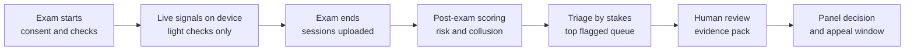
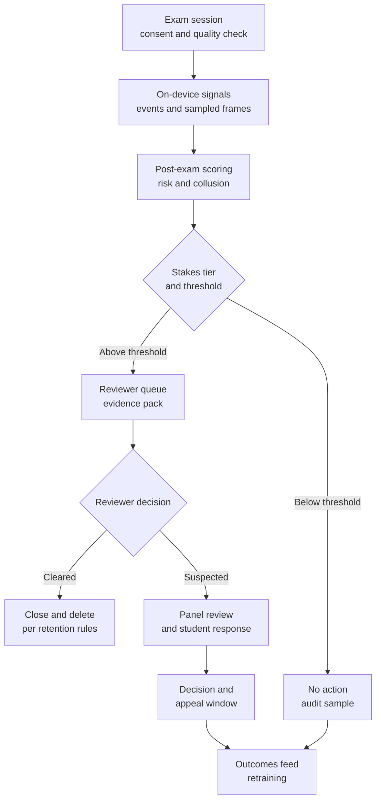

# Case Study 60: Online Exam Proctoring and Cheating Detection

**Domain:** EdTech | **Problem Type:** Anomaly detection plus multimodal flags (webcam, screen events, answer patterns) | **Difficulty:** Advanced

---

## 1. Business Context

### Company background

- **ExamSetu** (fictional) runs online tests for a large learner base: free **mock tests** for exam practice, **certification and end-of-module exams** for paid programs, and **high-stakes tests** such as scholarship tests, admission-linked tests and employer hiring assessments.
- Learners take tests on phones, laptops and shared family devices, from homes, hostels and cyber cafes, on connections that range from fibre to patchy 4G.
- Proctoring today means a **rule-based system**: a webcam check, tab-switch counts and a "multiple faces" alert. A team of **13 human reviewers** looks at flagged sessions.
- Many test takers are **school students under 18**, especially for scholarship tests. That matters for consent and for how much monitoring is acceptable.

### The pain, with numbers

| Item | Value |
| --- | --- |
| Test attempts per month | about 40 lakh, of which about 38 lakh are low-stakes mocks (not proctored by webcam) |
| Medium-stakes attempts (certification, module exams) | about 1.5 lakh a month |
| High-stakes attempts (scholarship, admission, hiring) | about 50,000 a month |
| Proctored sessions (medium plus high) | about 2.0 lakh a month |
| Estimated true violations (from deep audits of random samples) | about 3% in high-stakes (1,500) and 0.8% in medium-stakes (1,200), so about 2,700 a month |
| Sessions flagged by current rules | about 28,000 a month (14%) |
| Of rule flags, true violations (recall about 55%) | about 1,485, so precision about 5.3% |
| Reviewer capacity (13 reviewers x 80 sessions a day x 25 days) | about 26,000 a month, including appeals |
| Auto-voids under current rule (3 or more flags in high-stakes) | about 550 a month |
| Auto-voids overturned on appeal | about 62%, so about 340 honest students a month wrongly penalised |
| Cost per review (about 5 minutes) | about ₹20 |

- The current process produces **too many false alarms** and, worse, **punishes honest students automatically**. Social media posts about "wrongly disqualified" students hurt trust and brand.
- At the same time, genuine cheating (shared answer keys, impersonation, remote helpers) costs **scholarship money** and **employer trust** in the certificate.
- Target: **catch more real violations with the same reviewers**, send **no one to a penalty without human review**, and make the process fair, private and appealable.
- Value (see Section 6): about **₹1.5 Cr** a year of scholarship leakage avoided, about **₹0.8 Cr** a year of wrongful-void costs avoided, against about **₹1.1 Cr** of cost, and a large gain in trust that is hard to price.

### Stakeholders and what each wants

| Stakeholder | What they want | What they fear |
| --- | --- | --- |
| Head of Assessment Integrity | Credible results for scholarships and certificates | Public cheating scandals |
| Learners and parents | A fair test with no false accusation | Being disqualified by a camera or a glitch, and having no way to appeal |
| Reviewers | A manageable queue with good evidence | Burnout from thousands of weak alerts |
| Product and Operations | Low friction, fewer abandoned tests, works on cheap phones | A heavy proctoring app that fails on low-end devices |
| Legal, Privacy and Compliance | Lawful consent, limited retention, fair treatment of minors | Complaints about video data under the DPDP Act, and discrimination claims |
| Employer and institutional partners | Certificates they can trust | Hiring people who cheated |

---

## 2. Translating Business to ML

### The business question vs the ML question

| Business question | ML question |
| --- | --- |
| "Who is cheating?" | "Rank proctored sessions by the chance that a trained reviewer would find a genuine violation, and give the reviewer an **evidence pack** (timestamps, short clips, event list). Never output a verdict" |
| "Are these students colluding?" | "Find groups of test takers whose answer patterns, timing and device or network traces are more similar than expected by chance, given item difficulty and their shared preparation" |
| "How strict should we be?" | "Set the review threshold **per exam stakes**, within reviewer capacity, so that high-stakes exams get more scrutiny and low-stakes get little or none" |

> **Mentor note:** In proctoring, the model's job is **triage, not judgement**. A false alarm costs a reviewer 5 minutes. A false accusation can cost a student a scholarship, a place or an exam attempt, and a family's trust. So every design choice (labels, thresholds, UI, policy) should be tested against one question: **"What happens to an honest student who gets flagged?"** If the answer is "nothing, unless a human sees real evidence", you are on the right path.

### Target definitions

- **Label:** `confirmed_violation = 1` if a **review panel** (a second, senior reviewer who sees the evidence) confirms a rule breach, such as impersonation, helper present, unauthorised device or collusion. Labels come from reviews, and from the outcome of appeals.
- **Scores:**
  - `risk_score` per session (anomaly and supervised blend).
  - `collusion_score` per pair or group of test takers.
- **Why not auto-labels from rule triggers:** the rules are the old system, and a model trained on them would only learn the old false alarms.
- **Label bias warning:** only flagged sessions get reviewed, so confirmed cases come from where the old rules looked. Keep a **random audit sample** of unflagged sessions.

### Edge cases

| Edge case | Recommended treatment | Reason |
| --- | --- | --- |
| Student looks away often to think or because of a disability or tic | Do not flag gaze alone. Require other evidence, and allow reasonable accommodation to be set up before the exam | Gaze models mistake normal behaviour for cheating, and penalise disabled students |
| Family member walks through the frame in a small home | Treat "second face" as a low-confidence signal, and ask the student to confirm in-session | Shared rooms are common, and not cheating |
| Connection drops for 40 seconds | Treat gaps as **missing data**, not "face absent". Allow a reconnection grace period | Low bandwidth should not look like misconduct |
| Phone call or notification on a mobile device triggers a tab-switch event | Whitelist system events, and weigh app-switches by duration and context | Android and iOS fire many harmless events |
| Two students from the same coaching class have similar answers | Compare against the expected agreement for that class, not the general population | Shared teaching and notes create shared mistakes |
| Student refuses webcam consent | Offer an alternative (a test centre, or a lower-monitoring mode for low-stakes tests), and never hold the refusal against them | Consent must be a real choice. Treat the weaker evidence accordingly |
| Under-18 test taker | Require verifiable parental consent, minimise data, and get legal review before using behavioural monitoring | Children's data gets stricter treatment under the DPDP Act |

### Unit of prediction

- One **exam session** (a student, an exam, a time window) for the risk score.
- One **pair or cluster** of sessions in the same exam for collusion.

### Prediction timing



- **During the exam:** only gentle, on-device nudges (for example "your face is not visible, please adjust"). No penalties are triggered in real time.
- **After the exam:** full scoring, clustering across the whole cohort (collusion needs everyone's answers), and review.
- Labels (panel decisions and appeals) arrive within **1 to 3 weeks**, and appeals can take longer.

### What success looks like

| Lens | Success |
| --- | --- |
| Business | Confirmed catches rise from about 1,485 to about 2,160 a month with the same reviewer team. Scholarship leakage falls by about ₹1.5 Cr a year |
| Model | Recall at review capacity: about 88% in high-stakes and about 70% in medium-stakes. Overall precision of reviewed flags about 9% (against about 5% today) |
| Fairness and harm | **Zero automatic penalties.** Wrongful final penalty rate below 1 in 10,000 proctored sessions. Appeal overturn rate below 5% |
| Equity | Flag rates across skin tone, gender, language, device type and disability accommodation within 1.25x of each other after accounting for audited base rates |
| Experience | Exam abandonment due to proctoring below 1.5%, and works on 2 GB RAM phones |

---

## 3. Data Understanding

### Data sources and key features

| Feature group | Source | Why it matters |
| --- | --- | --- |
| Webcam signals (face present, number of faces, head pose, gaze direction, lighting quality) | On-device lightweight model, sampled frames | Evidence of absence, a helper, or impersonation |
| Audio signals (speech detected, second voice) | Microphone, on-device voice activity detection (no raw audio stored by default) | A helper reading answers |
| Screen and system events (tab or app switch, window blur, copy-paste, extra monitor, screen share or remote-desktop tool) | Exam app or browser | Use of outside resources |
| Answer behaviour (time per question, answer changes, accuracy vs difficulty, sudden improvement, idle patterns) | Exam logs | Reveals help and pre-knowledge of questions |
| Answer-pattern similarity across test takers (shared wrong answers, identical sequences, near-identical timing) | Exam logs for the whole cohort | Collusion and answer-key sharing |
| Device and network (IP, subnet, device fingerprint, geolocation at city level, VPN use) | Session logs | Many accounts on one device, one room, or a known cheating hub |
| Identity (ID check, face match at start and during the exam, past sessions) | KYC and past exams | Impersonation |
| Context (exam stakes, student age band, accommodations, device class, bandwidth) | Registration and device | Needed to set fair thresholds and avoid false alarms |
| Review outcomes (confirmed, cleared, appeal result) | Reviewer tool | Labels |

### Data volume, granularity and refresh

- **Volume:** about 2.0 lakh proctored sessions a month, with about 1 to 2 frames per 10 seconds sampled on device. A 60-minute exam gives about 360 to 720 frames, which are processed on device and stored only as flagged clips and event logs.
- **Storage and retention:** only short clips around flagged events and the event log are stored, and deleted within a fixed window (for example 30 days) unless an investigation or appeal is open.
- **Collusion data:** answer matrices for each exam (for example 50,000 students x 100 questions for a scholarship test).
- **Labels:** about 24,000 reviews a month, with panel decisions on about 2,500 of them. A random audit adds only about 1,000 sessions a month, so about 45 confirmed positives a quarter. Pool audits across quarters.

### Common data issues

| Issue | How it shows up here |
| --- | --- |
| **Selection bias in labels** | Only flagged sessions are reviewed. The model learns what the old rules flagged, not what they missed |
| **Low-bandwidth and low-end devices** | Dropped frames look like "face absent". Lightweight models on cheap phones are less accurate |
| **Face and gaze model bias** | Higher failure on darker skin tones in low light, on head coverings, glasses, and on some face shapes |
| Environment variation | Small shared rooms, dim light, noise, power cuts |
| **Base-rate problem** | With about 1.35% real violations, even a good model has low precision at high recall |
| Adversarial adaptation | Cheaters adapt (second phone, remote desktop, hidden earphones), so patterns drift |
| Label noise | Reviewers disagree on borderline clips, and rule-based past labels are poor |
| Privacy-sensitive data | Face video, audio and home surroundings are sensitive personal data |

> **Mentor note: Where juniors usually go wrong here.**
>
> - They train a classifier on rule-based flags and report 95% accuracy, because 98.65% of sessions are honest. Accuracy is useless here.
> - They treat "face not found" or "looked away" as cheating. These signals are the **most biased** and the most common false alarms.
> - They judge answer similarity without accounting for item difficulty and shared coaching. Two honest students who studied the same notes will share many wrong answers.
> - They forget the **people** side: reviewer fatigue, appeal process, and consent. A technically strong model with a harsh process is a failure.

---

## 4. Approach and Decision Points

### Baseline first

- **Baseline 1 (current):** weighted rule score (face absent, multiple faces, tab switches), with auto-void at 3 flags in high-stakes exams.
- **Baseline 2:** rules for **evidence-rich** signals only (a second person present for more than 30 seconds, a remote-desktop tool running, identical IP across many accounts), and drop weak signals.
- **Baseline 3:** a classical answer-similarity check (for example, an index for shared wrong answers) alone for collusion.
- **Why it matters:** better rules, with no auto-penalty, already remove much of the harm. The model must show a **gain in recall and precision beyond that**.

### Candidate models

| Component | Option | Pros | Cons | Verdict |
| --- | --- | --- | --- | --- |
| Webcam signals | On-device lightweight face and pose detection | Private (video stays on device), low bandwidth | Less accurate on cheap phones | **Production**, with quality gates |
| Per-session risk | Supervised gradient boosting on aggregated multimodal features, with reviewer labels | Accurate, explainable, handles missing values | Label bias | **Core model** |
| Per-session risk | Unsupervised anomaly detection (isolation forest, autoencoder) | Finds new patterns, needs no labels | Many false alarms, hard to explain | Use as a **second channel** to surface unknown patterns |
| Collusion | Statistical similarity test, adjusted for item difficulty and class | Principled, defensible in an appeal | Needs the whole cohort | **Core** |
| Collusion | Graph clustering on similarity, device and network links | Finds rings, not just pairs | Needs care with false clusters | **Production** |
| Fusion | Calibrated score blend with stakes-specific thresholds | Simple to govern | Needs calibration data | **Production** |
| End-to-end deep video model | Learns directly from video | May catch subtle cues | Biased, opaque, heavy, privacy-intensive | Not recommended |

### Decision scenarios

| What if... | Recommended action | Reasoning |
| --- | --- | --- |
| **The same threshold is used for a mock test and a ₹25,000 scholarship test** | Set **thresholds by stakes**: no webcam review for mocks, a moderate review share (about 7%) for certification exams, and a higher share (about 25%) for scholarship and hiring tests. Use stronger evidence rules before any penalty at all levels | The harm of missing a cheat and the harm of a false alarm differ sharply with stakes |
| **"Face not found" flags are 2 to 3 times more common in darker-skinned students in low light** | Add a **pre-exam lighting and camera check**, normalise brightness, drop "face not found" as a standalone signal, require corroboration, and report flag rates by group every month | This is a measurement bias, not behaviour. Fix the input and do not penalise it |
| **Two students share 94 of 100 answers, including 14 identical wrong ones** | Compute the expected number of shared wrong answers given item difficulty, ability and **class membership**, then test how unlikely 14 is. Add timing similarity and shared-device checks before escalating | Shared coaching creates shared mistakes, and a rare, specific pattern plus a second signal is real evidence |
| **A 4G student's camera frames drop for 2 minutes mid-exam** | Mark the gap as missing, use connection-quality signals as a covariate, allow reconnection, and do not count it as absent | Low-bandwidth users must not be punished for their network |
| **Reviewer headcount drops from 13 to 10 for a week (capacity about 20,000)** | Keep the high-stakes review share, raise the medium-stakes threshold, extend the review SLA for low-risk flags, and bring in temporary reviewers. **Never auto-penalise unreviewed sessions** | Capacity is a hard constraint, and quality of review must not fall silently |
| **A student appeals a void, saying a younger sibling sat nearby** | Use a separate reviewer and an evidence pack, allow the student to explain, give a decision within 5 working days, and feed every overturn into the model as a hard negative | Appeals are both justice and the best source of labels |
| **Cheaters shift to a second phone and remote screen tools** | Add signals for remote-desktop and screen-sharing processes, answer-speed-vs-difficulty anomalies and device sharing, and redesign the exam (question pools, randomised order) | A pure detection race is a losing one. Make cheating harder by design |
| **A student refuses webcam on privacy grounds** | Offer a test centre or a documented alternative, with answer-pattern checks only, and keep the evidence standard consistent. Do not lower the student's score or flag them for refusing | Consent must be real, and the DPDP Act expects purpose limits and a choice |

---

## 5. Feature Engineering

### Top 10 features to build

| # | Feature | Business logic |
| --- | --- | --- |
| 1 | Second-person presence (duration and confidence) from the face detector, after a quality check | Strong evidence of a helper, if sustained |
| 2 | Identity match drift (face match at start vs mid-exam and end) | Impersonation or a change of test taker |
| 3 | Remote-desktop, screen-share and virtual-machine indicators | Direct evidence of outside control |
| 4 | App or tab switch events, weighted by duration, timing near hard questions, and device type | Use of outside resources, with fewer false alarms |
| 5 | Answer-time anomaly (very fast correct answers on hard items, or long idle then a burst of correct answers) | Pre-knowledge or live help |
| 6 | Score jump vs the student's history, adjusted for difficulty | A sudden unexplained improvement |
| 7 | Pairwise shared-wrong-answer excess (observed vs expected given item difficulty and class) | Collusion evidence that withstands challenge |
| 8 | Timing similarity between pairs (same question order, near-identical times) | Live collusion or screen sharing |
| 9 | Device, IP and subnet cluster features (many accounts in one room or one device) | Cheating hubs and proxy test-taking |
| 10 | Environment quality (light level, connection quality, device class) | Used to **down-weight** unreliable signals, not to flag |

### Features to avoid (leakage risks and fairness risks)

| Feature | Problem |
| --- | --- |
| Rule-based auto-void flag as an input or label | Copies the old false alarms and hides bias |
| Reviewer ID or review time | Reflects who looked, not what happened |
| Final score or rank alone | Strong students would be flagged for performing well |
| Skin tone, gender, religion, head-covering or disability status as model inputs | Unfair. Use only in audits to check for bias |
| Raw gaze-away percentage as a standalone feature | Heavily biased and unreliable |
| City or pin code as a risk driver | A proxy for caste, income and access, and it penalises regions |
| Appeal outcomes of the same session used when scoring that session | Future information |

A simplified collusion statistic, which compares shared wrong answers with what is expected by chance:

```python
import numpy as np

def shared_wrong_excess(a, b, wrong_prob_a, wrong_prob_b, correct_key):
    # a, b: answers (option labels). wrong_prob_*: P(student answers wrongly) per item
    both_wrong_same = ((a != correct_key) & (b != correct_key) & (a == b)).sum()
    # Expected shared wrong answers if the two students were independent
    # (assume wrong answers split across 3 distractors on average)
    expected = (wrong_prob_a * wrong_prob_b / 3.0).sum()
    var = (wrong_prob_a * wrong_prob_b / 3.0 * (1 - wrong_prob_a * wrong_prob_b / 3.0)).sum()
    z = (both_wrong_same - expected) / np.sqrt(var + 1e-9)
    return z   # compare with an adjusted threshold (many pairs are tested)
```

---

## 6. Evaluation Strategy

### Metrics

| Metric | Role | Why |
| --- | --- | --- |
| **Recall at review capacity**, by stakes tier | Primary model metric | The real question is how many true violations we catch with the reviewers we have |
| **Precision of reviewed flags** and **precision at k** | Primary workload metric | Tells reviewers whether their time is well spent |
| **Wrongful final penalty rate** and **appeal overturn rate** | Primary harm metric | The cost that matters most to students |
| PR-AUC (not ROC-AUC) | Ranking quality | Violations are rare, so PR-AUC is more informative |
| Collusion pair precision after panel review | Collusion quality | Pairs with a high score should hold up on review |
| **Fairness metrics**: flag rate, false-flag rate and review overturn rate by skin tone (proxy audits), gender, language, device class, accommodation status | Primary ethics metric | Finds biased signals |
| Exam abandonment, completion rate on low-end devices | Experience | Proctoring should not break the exam |
| Reviewer throughput and agreement between reviewers (kappa) | Operations | Label quality and workload |

### Metrics that look good but are misleading here

- **Accuracy:** about 98.65% for flagging nobody.
- **Recall against rule-based labels:** measures agreement with the old system.
- **ROC-AUC:** inflated by a huge number of easy honest sessions.
- **Raw flag counts:** more flags can mean more false alarms, not more cheating.
- **Appeal rate alone:** low appeals may mean students do not know how to appeal.

### Validation strategy

| Step | Design | Why |
| --- | --- | --- |
| Time-based split | Train on months 1 to 8, validate on months 9 and 10, test on months 11 and 12 | Cheating patterns change |
| Exam-based split | Hold out whole exams (not random sessions) | Collusion and cohort effects leak across sessions in the same exam |
| Random audit sample | Deep-review a random set of unflagged sessions each month, pooled across quarters | Estimates what the model misses and removes label bias |
| Planted-cheat tests | Hire testers to cheat in known ways (helper, second phone, remote desktop) and see what is caught | Measures recall for known tactics |
| Group audits | Compare flag rates and overturn rates by group and device, with a stratified audit sample | Detects biased signals |
| Reviewer agreement | Double-review 5% of sessions and measure kappa | Label quality ceiling |
| Online trial | Randomise exams (or sessions) between old rules and the new triage, with the same review capacity and no auto-penalties in either arm | Honest comparison on catches, overturns and student experience |

### From model metric to business value

- **Review plan:** high-stakes 50,000 sessions, review top 25% = 12,500. Medium-stakes 1.5 lakh, review top 7.5% = 11,250. Total flagged reviews = **23,750**, within the 26,000 capacity (the rest is about 1,000 audit reviews and about 1,250 appeals).
- **Catches:**
  - High-stakes: 3% of 50,000 = 1,500 true. Recall 88% gives **1,320** (precision 1,320 / 12,500 = 10.6%).
  - Medium-stakes: 0.8% of 1.5 lakh = 1,200 true. Recall 70% gives **840** (precision 840 / 11,250 = 7.5%).
  - Total **2,160** of 2,700 (80% recall), precision 2,160 / 23,750 = **9.1%**. Today: 1,485 caught (55% recall), 5.3% precision.
- **Scholarship leakage:** high-stakes catches rise from about 825 (55% of 1,500) to 1,320, so **495 more** a month. If about 10% of them would have won a scholarship of about ₹25,000, that is 49.5 x ₹25,000 = about ₹12.4 lakh a month, or about **₹1.5 Cr a year**.
- **Wrongful voids avoided:** about 340 a month x about ₹2,000 of refunds, retakes and support = about ₹6.8 lakh a month, or about **₹0.8 Cr a year**.
- **Cost:** device models, cluster compute, extra consent and privacy work, appeals tooling and audits, about **₹1.1 Cr a year**. Reviewer cost is about ₹5.2 lakh a month (26,000 x ₹20) and is unchanged.
- **Net quantifiable value** is about **₹1.2 Cr a year**, and the larger gain is trust: fewer public disputes, and certificates employers accept.
- A caution: **9% precision means about 9 of 10 reviewed students are cleared**. That is fine only if a flag costs the student nothing. Do not notify or restrict a student unless a reviewer finds real evidence.

---

## 7. Deployment and Monitoring

### Batch vs real time

- **On device, real time:** light checks (face visible, lighting, connection) and gentle nudges. No penalties.
- **Post-exam batch:** multimodal scoring, collusion statistics and clustering over the whole cohort. This runs within hours of exam end.
- **Review workflow:** daily queues by stakes tier, with a service level for each tier (for example scholarship and hiring flags within 3 days, because results are waiting).
- **Weekly batch:** fairness reports, calibration checks and reviewer agreement.



### Privacy, consent and evidence standards

- **Notice and consent** before any webcam or microphone use, in simple language and the learner's language, with a stated purpose (exam integrity only).
- **Minimise:** process video on the device where possible, store only short clips around flagged events, and keep no raw audio by default.
- **Retention:** delete clips after a fixed period unless an appeal or investigation is open. Log every access by reviewers.
- **Minors:** obtain verifiable parental consent and get legal advice on what monitoring is allowed for children under the DPDP Act.
- **Choice:** provide an alternative for people who cannot or will not use a webcam.
- **Evidence, not verdict:** the model output is a ranking and an evidence pack. A person decides, and the student can respond and appeal.

### What to monitor

| Type | What to track | Alert trigger |
| --- | --- | --- |
| Review quality | Precision of reviewed flags, overturn rate, reviewer kappa | Precision below 7%, or overturn above 5% |
| Harm | Wrongful final penalties found on appeal, time to resolve appeals | Any rise, or appeals older than 5 working days |
| Fairness | Flag and false-flag rates by group and device class | Ratio above 1.25 against reference |
| Capacity | Queue length, review hours, backlog by stakes tier | Backlog above 2 days for high-stakes |
| Drift | Share of sessions with each signal, new cheating tools, score distribution by exam | PSI above 0.2 or a new device pattern |
| Low-bandwidth impact | Missing-frame rate, abandonment by bandwidth and device | Abandonment above 1.5% |
| Collusion | Cluster sizes, pair precision after review | Sudden growth of clusters in one exam |
| Privacy | Consent rates, retention compliance, access logs, deletion requests | Any retention beyond policy or unlogged access |

### Retraining

- **Monthly:** retrain the risk model with new review outcomes and appeals, and recalibrate.
- **Per exam:** recompute collusion baselines using the item difficulty and class structure of that exam.
- **Triggered:** a new cheating tactic, a device or OS change, a new exam type, or a fairness alert.

### A/B test or champion-challenger design

- **Champion:** old rules (without auto-void in either arm during the test). **Challenger:** multimodal triage with stakes-based thresholds.
- Randomise by **exam batch or session**, with equal reviewer capacity in both arms. Do not randomise penalties. Both arms are reviewed by humans.
- Primary readouts: confirmed violations per 1,000 reviews, overturn rate, student-reported fairness and abandonment. Run for at least two exam cycles.
- Use the **planted-cheat tests** as an unbiased recall check in both arms.
- Keep a permanent random audit sample and a permanent fairness dashboard.

---

## 8. Stakeholder Communication

### Explain it to a non-technical leader

> "The system does not decide who cheated. It helps our reviewers look at the 10 to 25% of sessions most worth a look, and it puts the evidence in front of them: a clip, a time, what happened. Nobody is penalised until a person has reviewed it and the student has had a chance to respond.
> With the same 13 reviewers we expect to catch about 2,160 real violations a month instead of about 1,485, and we stop wrongly voiding about 340 honest students a month. High-stakes tests get more scrutiny, and mock tests get none.
> We process video on the student's device, keep only short clips, delete them on schedule and follow the DPDP Act. It is better to miss some cheating than to wrongly accuse a student."

### Questions leadership will ask

| Question | Suggested answer |
| --- | --- |
| "Why not auto-fail anyone above a high score?" | "Because about 9 in 10 flagged sessions are honest students. An automatic penalty would hurt hundreds of them each month. The flag is for a reviewer, not a verdict" |
| "Can we catch all cheating?" | "No. Catching 80% with fair process is realistic. Beyond that, redesign the exam (question pools, randomised order, shorter windows) instead of adding surveillance" |
| "Is the AI biased against some students?" | "Face and gaze models can be, especially in low light and for some skin tones and head coverings. We drop the weakest signals, require corroboration, and publish flag rates by group every month" |
| "What about students on poor connections?" | "Missing frames are treated as missing data, not as absence. Our checks run on-device and work on low-end phones, and students can reconnect without penalty" |
| "Are we compliant on privacy?" | "We collect only what we need with clear consent, keep it for a short fixed period, restrict access, and take extra care with under-18 students, in line with the DPDP Act. Legal reviews each change in what we capture" |

---

## 9. Common Pitfalls and Lessons

| Mistake | Why it happens | How to avoid it |
| --- | --- | --- |
| Treating the model output as a verdict | The score looks decisive | Always include human review, evidence packs, a response right and an appeal |
| Training on rule-based flags | Labels are easy to get | Use panel-confirmed labels and a random audit sample |
| Reporting accuracy or ROC-AUC | Honest sessions dominate | Use recall at review capacity, precision at k and PR-AUC |
| Ignoring bias in face and gaze models | Vendors report average accuracy | Audit by group, drop weak biased signals, add lighting checks |
| Misreading shared mistakes as collusion | Students share coaching and notes | Compare with expected agreement given difficulty and class, add timing and device evidence |
| Single threshold for all exams | Simpler to manage | Set thresholds by stakes and by review capacity |
| Forgetting low-bandwidth users | Developers test on fast devices | Test on 2 GB phones and 4G, treat gaps as missing, and allow reconnection |
| Storing video indefinitely | Storage is cheap and "might be useful" | Minimise, set retention, log access, honour deletion rights |
| No appeal process | Seen as extra cost | Build a clear, timed appeal, and use overturns for learning |

---

## 10. Mentor's Focus Checklist

- ✅ **Where to spend 80% of the effort:**
  - The **human-in-the-loop process**: evidence packs, panel review, student response and appeals.
  - Honest labels: panel-confirmed outcomes plus a random audit and planted-cheat tests.
  - Stakes-based thresholds tied to real review capacity.
  - Collusion statistics that adjust for item difficulty and class.
  - Fairness audits, low-bandwidth robustness, and privacy by design (consent, minimisation, retention).
- ❌ **What not to over-engineer:**
  - End-to-end deep video models that are opaque, biased and privacy-heavy.
  - Real-time automatic penalties.
  - Chasing 100% recall. Redesign the exam to make cheating harder instead.
- 💡 **Key takeaway:** **Proctoring signals are evidence, not a verdict.** Optimise for catching more real cheating with the reviewers you have, but design everything around the honest student who gets flagged by mistake, since that student is the one with the most to lose.
