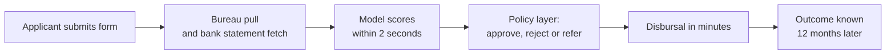
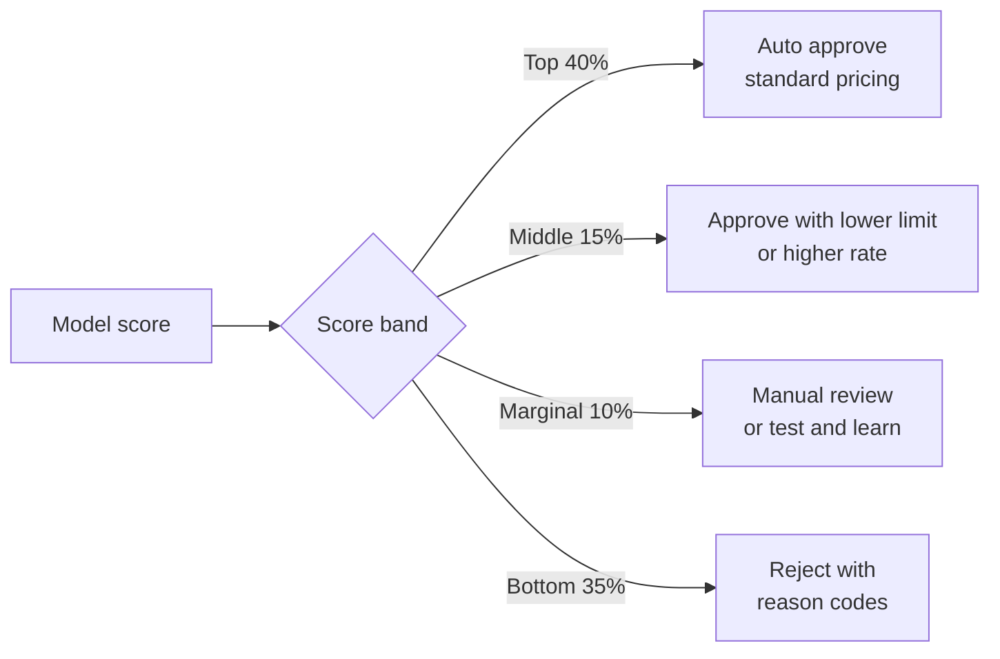

# Case Study 1: Unsecured Personal Loan Default Scoring

**Domain:** Finance (NBFC lending) | **Problem Type:** Binary classification (probability of default) | **Difficulty:** Intermediate

---

## 1. Business Context

### Company background

- **QuickRupee Finance** (fictional) is a mid-size NBFC (Non-Banking Financial Company, a lender regulated by RBI but without a banking licence).
- Product: instant unsecured personal loans of ₹50,000 to ₹5,00,000, tenure 6 to 36 months, interest 16% to 28% a year.
- Channel: mobile app plus partnerships with 6 salary-advance and shopping apps.
- Scale: about 1.2 lakh loan applications a month, about 45% approved, so about 54,000 loans disbursed a month.
- Annual disbursal: about ₹1,500 Cr.

### The pain, with numbers

| Item | Value |
| --- | --- |
| Annual disbursal | ₹1,500 Cr |
| Bad rate (loans reaching 90+ DPD within 12 months) | 7.5% |
| Defaulted exposure per year of disbursals | about ₹112 Cr |
| Loss given default (LGD, share of defaulted money never recovered) | about 65% |
| **Annual credit loss** | **about ₹73 Cr** |
| Current approval rule | CIBIL score 700 or above AND monthly income ₹25,000 or above |

- The rule is simple, but it rejects many good customers (new-to-credit people) and approves some bad ones with a clean bureau.
- The CEO has a target: cut credit loss by ₹10 Cr or more without reducing the approval rate.

### Stakeholders and what each wants

| Stakeholder | What they want | What they fear |
| --- | --- | --- |
| Chief Risk Officer (CRO) | Lower bad rate, a model that regulators and auditors accept | A black box that fails an RBI inspection |
| Chief Business Officer | More approvals, faster disbursal, less drop-off | Tighter rules killing growth |
| Compliance head | Explainable decisions, fair treatment, audit trail | Unexplainable rejections, customer complaints |
| Collections head | Fewer accounts in 90+ DPD buckets | Getting a bad book |
| Data science lead (you) | A model that is stable and gets deployed | Months of work stuck in model-risk review |
| Customer | Quick yes or no, clear reasons if rejected | Opaque rejections |

---

## 2. Translating Business to ML

### The business question vs the ML question

| Business question | ML question |
| --- | --- |
| "Whom should we lend to, and how much?" | "What is the probability that this applicant reaches 90+ days past due within 12 months of disbursal?" |
| "Can we keep volume and cut losses?" | "Can the model rank-order applicants better than the bureau score alone, at a fixed approval rate?" |

> **Mentor note:** The model gives a probability, not a decision. The decision (approve, reject, set the amount and the interest rate) is a policy layer built on top. Always keep the two separate. Risk teams change cut-offs often and do not want to retrain a model each time.

### Target variable definition

- **Primary target:** `bad_12m = 1` if the loan reaches 90+ DPD (Days Past Due) at any point within 12 months of disbursal, else 0.
- **Why 90 DPD:** RBI classifies a loan as an NPA (Non-Performing Asset) at 90 days overdue, so the whole industry and the regulator speak this language.
- **Why 12 months:** most defaults in short-tenure personal loans show up by month 12. Shorter windows are less accurate, and longer windows delay learning too much.

### Edge cases (decide these BEFORE you build anything)

| Edge case | Recommended treatment | Reason |
| --- | --- | --- |
| Loan prepaid fully in month 4 | Good (0), but keep a flag | Customer clearly paid. Dropping these biases toward bad |
| Loan not yet 12 months old | Exclude from final training. Use only for early-warning analysis | Unmatured labels look falsely good |
| First payment default (FPD) in month 1 | Separate fraud-or-intent label, report it separately | Different behaviour and different fix (this is often fraud, not credit risk) |
| Settled or written off with a haircut | Bad (1) | The customer did not repay as agreed |
| Restructured or moratorium accounts | Bad (1) if it was credit-driven, excluded if a documented system-wide event | Policy decision, get CRO sign-off |
| Customer 60 DPD at month 12 but never 90 | Good (0) in the main label, tracked in a secondary label | Stay consistent with the RBI definition |

### Unit of prediction

- One row per **loan application that was approved and disbursed** (the unit is the application, not the customer).
- Repeat customers: they get a separate row per application, but split train and test by customer so the same person never appears in both.

### Prediction timing



- Prediction is made at application time, using only data available at that moment.
- It is used within seconds, so latency is not a problem here (it is a problem in Case 2).
- The label arrives 12 months later. This **label delay** is the main difficulty of this case.

### What success looks like

| Lens | Success |
| --- | --- |
| Business | Bad rate drops from 7.5% to about 6.0% at the same 45% approval rate. This saves about ₹13 to 14 Cr a year |
| Model | Gini of 0.48 or more and KS of 0.36 or more on out-of-time data, with rank ordering that holds in every decile |
| Regulator | Every rejection has clear reason codes, and the model is documented and validated |

---

## 3. Data Understanding

### Data sources and key features

| Feature group | Source | Why it matters |
| --- | --- | --- |
| Bureau score and tradelines | CIBIL, Experian, CRIF | Best single predictor of repayment behaviour |
| Enquiries in last 3 and 6 months | Bureau | Many recent loan enquiries mean credit hunger |
| Existing EMI burden (obligations) | Bureau | Capacity to pay on top of the new EMI |
| Monthly income and its stability | Bank statements via Account Aggregator (RBI-regulated consent-based data sharing) | Verified income is better than stated income |
| Salary credit regularity | Bank statements | Fixed salary on a fixed date means lower risk |
| Average balance and bounce count | Bank statements | Cash buffer and cheque or ECS bounces show stress |
| Employer category (government, large corp, startup, self-employed) | Application form | Job stability |
| Age, city tier, vintage at current address | Application form | Weak but useful stability proxies |
| Loan amount to income ratio, EMI to income ratio | Derived | How big the ask is relative to income |
| Device and app signals (phone age, app-install count) | App SDK | Use with care, see compliance below |
| Channel and partner source | Internal | Different partners bring different quality |

### Data volume, granularity and refresh

- **Training population:** 8.6 lakh disbursed loans from Jan 2021 to Dec 2023 (labels matured). Bad rate 7.5%, so about 64,500 bad loans, which is plenty.
- **Reject population:** about 6 lakh applications that were rejected, with no repayment outcome at all.
- **Granularity:** one row per loan application.
- **Refresh:** monthly vintage cohorts. The bureau data is pulled fresh at every application (point-in-time).

### Common data issues

| Issue | How it shows up here |
| --- | --- |
| Label delay | A loan disbursed in March is only labelled in the next March |
| Selection bias (reject inference) | You have outcomes only for approved people, so the model never learns about the rejected |
| Leakage | Any bureau field pulled after disbursal (for example, "current DPD") leaks the answer |
| Missing values | New-to-credit customers have no bureau score. Missing means something here |
| Policy drift | The approval rule changed twice in 3 years, so the training population shifted |
| Seasonality | Festive season and Q4 salary or bonus cycles change repayment behaviour |
| Cold start | New partner channels have no history |

> **Mentor note: Where juniors usually go wrong here.**
>
> - They train on all rows, including loans that are 4 months old, and the model learns "recent loans are good".
> - They join the bureau data as of today, not as of the application date. This is silent leakage and the Gini looks fantastic until production.
> - They ignore that approved customers are a filtered population and report a score that will not hold on the real applicant flow.

---

## 4. Approach and Decision Points

### Baseline first

- **Baseline 1:** the current rule (CIBIL 700 or above AND income ₹25,000 or above). Bad rate 7.5% at 45% approval.
- **Baseline 2:** rank by CIBIL score alone. Gini is about 0.38 and KS about 0.28.
- **Why it matters:** if your model cannot beat the bureau score by a clear margin, the extra complexity is not worth it. It also gives the CRO a number to compare against.

### Candidate models

| Model | Pros | Cons | Verdict |
| --- | --- | --- | --- |
| Logistic regression scorecard (WoE binning) | Industry standard, fully explainable, easy to audit, stable | Misses non-linear patterns, needs manual binning | Must-build benchmark |
| Gradient boosting (LightGBM or XGBoost) | Best accuracy, handles missing values, captures interactions | Harder to explain, can overfit time-specific patterns | Best candidate with constraints |
| GBM with monotonic constraints | Keeps logic sensible (higher bureau score never raises risk), accepted by risk teams | Slightly lower accuracy than a free GBM | **Recommended production model** |
| Explainable Boosting Machine (EBM) | Accurate and additive, each feature shape can be viewed | Slower, less common tooling | Good alternative if compliance pushes back |
| Deep neural net | Can use raw transaction sequences | Hard to explain, easy to overfit, expensive to validate | Not worth it here |

### Decision scenarios

| What if... | Recommended action | Reasoning |
| --- | --- | --- |
| **Labels arrive 12 months late** (and the economy or policy changes meanwhile) | Run vintage analysis to find an early proxy, for example 30+ DPD at month 3 (MOB 3), that predicts 90+ DPD at month 12 with a stable ratio. Train the main model on matured loans, and use the proxy only to monitor the newest cohorts | You cannot wait a year to find out the model is broken. A proxy gives early warning, and the main label keeps the model honest |
| **RBI or the model-risk team requires explainability** | Use a monotonic-constrained GBM or scorecard, produce the top 3 to 4 adverse-action reason codes per rejection using SHAP (a method that shows how much each feature pushed the score) or scorecard points, and document everything | RBI expects that customers are told why they were declined and that the lender can defend every automated decision. A reason code that says "high recent enquiries" is defensible. "Neuron 47 fired" is not |
| **Rejected applicants have no outcome** (reject inference) | First, confirm how big the issue is: how different were rejected people on key features? Then try simple methods: parceling, or a small randomised "test and learn" approval of marginal applicants in the 680 to 700 band with a hard loss budget | The model has never seen the people it will now be scoring. A tiny controlled experiment gives true labels and is worth more than any statistical trick |
| **New-to-credit customers have no bureau score** | Build a separate thin-file model on bank statement features (salary regularity, balance, bounce count) and cap the loan size. Never put 0 or -1 in the bureau column of the main model and hope | Missing here is not random. A separate segment with its own cut-off gives the business a safe way to grow |
| **A 4-point jump in Gini in the test set seems too good** | Stop, and audit for leakage line by line, checking every feature's timestamp against the application timestamp | Real gains from better features are usually 1 to 3 Gini points. A big jump is almost always leakage |
| **Business wants to use phone-app-install data** | Check with compliance first. Under RBI digital lending guidelines, access to phone data must be need-based and consent-based. Prefer bank statements and bureau data | A feature that is predictive but not permissible is a liability, not an asset |

---

## 5. Feature Engineering

### Top 10 features to build

| # | Feature | Business logic |
| --- | --- | --- |
| 1 | Bureau score (and score band) | Summary of past repayment behaviour |
| 2 | Number of enquiries in last 90 days | A sudden rush for credit signals distress |
| 3 | Total existing EMI to monthly income (FOIR, Fixed Obligation to Income Ratio) | The most standard capacity measure in Indian lending |
| 4 | New EMI to monthly income | Whether the new loan is affordable |
| 5 | Worst DPD in last 12 months, and count of 30+ DPD events | Any recent delinquency is a strong warning |
| 6 | Salary credit regularity (months with salary in last 6, variation in credit date) | Stable job and stable cash flow |
| 7 | Average monthly balance divided by monthly income | Savings buffer |
| 8 | Cheque or ECS bounce count in last 6 months | Direct evidence of failed payments |
| 9 | Share of unsecured loans among all active tradelines | Over-reliance on unsecured credit |
| 10 | Credit vintage (months since first loan or card) | Longer history means more reliable score |

### Features to avoid (leakage and compliance risks)

| Feature | Problem |
| --- | --- |
| Any bureau field pulled after disbursal | Direct leakage. Always use the application-date snapshot |
| Collections activity, call counts, or "promise to pay" fields | Only exist after the loan goes bad |
| Interest rate offered | It is set by the old risk score, so it is circular |
| Loan amount approved (if set by old rules) | Encodes the old policy, and the model will copy that policy |
| Religion, caste, gender, or proxies like surname or pincode used crudely | Fairness and compliance risk |
| Customer ID or application ID | The model memorises the row |

Quick leakage check in SQL (point-in-time join):

```sql
-- Take the bureau pull that was made on or before the application date, never later
SELECT a.application_id, b.*
FROM applications a
JOIN bureau_pulls b
  ON b.customer_id = a.customer_id
 AND b.pull_date <= a.application_date
QUALIFY ROW_NUMBER() OVER (
          PARTITION BY a.application_id
          ORDER BY b.pull_date DESC) = 1;
```

---

## 6. Evaluation Strategy

### Metrics

| Metric | Role | Why |
| --- | --- | --- |
| **KS (Kolmogorov-Smirnov) statistic** | Primary | Maximum gap between the cumulative good and bad distributions. Industry standard for scorecards, easy to explain |
| **Gini** (equal to 2 x AUC minus 1) | Primary | Overall rank-ordering power |
| Bad rate by score decile | Secondary | The business needs to see a clean staircase: the lowest decile has the lowest bad rate, and so on |
| Bad rate at fixed approval rate | Business metric | Directly comparable with the current rule |
| PSI (Population Stability Index) | Stability | Measures if the score distribution has shifted between train and test |
| Calibration (predicted vs actual default rate) | Secondary | Needed if the probability is used for pricing or provisioning |

### Metrics that look good but are misleading here

- **Accuracy:** with 92.5% good loans, a model that approves everyone is 92.5% accurate and worthless.
- **AUC on a random split:** random splits mix time periods and flatter the model. Use out-of-time.
- **High Gini on the approved population only:** the approved population is already filtered, so the real applicant flow will behave worse.

### Validation strategy

| Step | Design | Why |
| --- | --- | --- |
| Train | Loans disbursed Jan 2021 to Dec 2022 (matured) | Enough history, labels complete |
| Out-of-time (OOT) test | Loans disbursed Jan to Mar 2023 | Mimics real use: the model predicts the future |
| Recent-vintage monitor | Loans from Apr 2023 onward, using 30+ DPD at MOB 3 as proxy | Early warning on the newest cohorts |
| Group split | Same customer never in both train and test | Prevents memorising repeat borrowers |
| Cross-validation inside train | Time-based folds, not random folds | Stable hyperparameters without time leakage |

### From model metric to business value

- At 45% approval, the current rule gives a bad rate of 7.5%.
- At the same 45% approval, the model gives a bad rate of 6.1% (OOT).
- Reduction: 1.4 percentage points on ₹1,500 Cr gives ₹21 Cr less defaulted exposure.
- With LGD at 65%, the saving is about **₹13.7 Cr a year** in credit loss.
- Alternative use: keep the bad rate at 7.5% and raise approval from 45% to about 52%, which means about ₹230 Cr more disbursal. The CRO and CBO pick the point on the trade-off curve.



---

## 7. Deployment and Monitoring

### Batch vs real time

- **Real-time scoring API** at application time (decision in about 2 seconds). Features come from the bureau pull and the bank-statement analysis, both done in the same journey.
- **Batch scoring** monthly for the existing book (behavioural scoring for limit increases and early collections). Same features idea, different model.

### What to monitor

| Type | What to track | Alert trigger |
| --- | --- | --- |
| Data drift | PSI per feature and on the final score | PSI above 0.2 on the score or a top-5 feature |
| Input quality | Share of missing bureau fields, bank-statement parse failures | Missing rate doubles in a week |
| Early performance | 30+ DPD at MOB 3 by monthly cohort vs expected | More than 20% worse than the model predicted |
| Concept drift | Gini on newly matured cohorts | Gini falls by more than 3 points |
| Business KPIs | Approval rate, average ticket size, bad rate, complaint count | Any KPI outside its agreed band |
| Fairness | Approval-rate gap across city tiers, age bands | Gap widens beyond policy limit |

### Retraining

- **Scheduled:** every 6 months, once enough new matured cohorts arrive.
- **Triggered:** PSI above 0.25, a big macro event, or a policy change by RBI.
- **Always:** the full model-risk review, because in regulated lending a retrain is a new model, not a patch.

### Champion-challenger design

- **Champion:** the current rule (or the previous model).
- **Challenger:** the new model.
- Split new applications at random: 90% to the champion, 10% to the challenger. Do not split by day or region.
- Hold for 6 to 9 months for the real bad rate. Use 30+ DPD at MOB 3 as the early read at about 3 to 4 months.
- Set a loss budget up front, for example "stop the experiment if the challenger's 30+ DPD at MOB 3 is 25% worse than the champion's".

---

## 8. Stakeholder Communication

### Explain it to a non-technical leader

> "The model reads about 80 signals from the bureau and the bank statement and gives each applicant a repayment-risk score between 300 and 900, like a more detailed CIBIL score built on our own customers.
> We approve the safest 45% either way, but the model picks better people from that 45%. In testing, 6 of every 100 loans go bad, instead of 7.5.
> Every rejection comes with clear reasons, so we can explain it to the customer and to RBI.
> We will start with 10% of traffic and expand only if the real results match."

### Questions leadership will ask

| Question | Suggested answer |
| --- | --- |
| "Why not just use the CIBIL score?" | "We do use it. It is our strongest feature. But adding salary stability and obligations to it lifts the ability to separate good from bad by about a quarter, so the bad rate falls from 7.5% to about 6%" |
| "Will it hurt growth?" | "At the same approval rate, no. If we want more growth, the model lets us approve about 7 percentage points more at the same bad rate. It is a dial and you decide where to set it" |
| "How do we know it is not biased?" | "We check approval and bad rates across city tiers, age and income bands every month, and we keep protected attributes out of the model" |
| "What if the economy turns?" | "We watch the 3-month early-delinquency signal on every cohort, so we will see trouble in about 90 days, not 12 months. We can tighten cut-offs the same week" |
| "When do we see real savings?" | "Early signals in about 4 months. Confirmed savings after about 12 months, because that is how long a loan takes to show its true behaviour" |

---

## 9. Common Pitfalls and Lessons

| Mistake | Why it happens | How to avoid it |
| --- | --- | --- |
| Training on unmatured loans | Wanting more recent data | Enforce a minimum maturity (MOB 12) when building labels, and write a test for it |
| Point-in-time leakage from bureau joins | Joining on customer ID and taking the latest row | Always join with `pull_date <= application_date`. Review each feature's timestamp |
| Reporting performance on the approved set only | It is the only data with labels | State clearly that this is a biased sample. Plan a small test-and-learn on the marginal band |
| Random train-test split | It is the default in every tutorial | Use out-of-time validation. Random splits overstate Gini by 3 to 6 points |
| Ignoring calibration | Gini looks great, so the team stops | If probabilities feed pricing or provisioning (ECL), check calibration by decile and recalibrate |
| Letting the model copy the old policy | Features like approved amount or interest rate encode the old rules | Drop policy-driven columns, and check that top features are customer attributes |
| Chasing a complex model before the basics | GBMs are fun | Start with the scorecard benchmark. A 1-point Gini lift is rarely worth a model-risk fight |
| Deploying with no reason codes | Explainability seen as a later task | Build reason codes in the first sprint, since the compliance sign-off depends on them |

---

## 10. Mentor's Focus Checklist

- ✅ **Where to spend 80% of the effort:**
  - Defining the label and its edge cases correctly.
  - Point-in-time data joins and leakage audit.
  - Out-of-time validation and the vintage-based early proxy.
  - Reason codes and the compliance story.
- ❌ **What not to over-engineer:**
  - Fancy deep learning or stacking ensembles.
  - SMOTE or other resampling (the bad rate is 7.5%, which is fine).
  - Complicated reject-inference mathematics before trying a small controlled experiment.
- 💡 **Key takeaway:** In lending, **the label is a promise about the future, so most of your work is making sure you never use the future to predict it**. A clean label and a clean timeline beat a clever algorithm every time.
