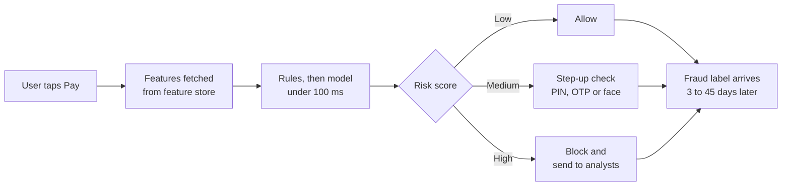
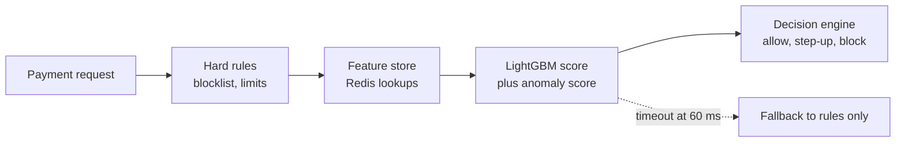

# Case Study 2: Real-Time UPI and Card Fraud Detection

**Domain:** Finance (payments) | **Problem Type:** Highly imbalanced classification plus anomaly detection | **Difficulty:** Advanced

---

## 1. Business Context

### Company background

- **PayNest** (fictional) is a payments app with UPI (Unified Payments Interface, India's instant bank-to-bank payment rail), a prepaid wallet, and a virtual card.
- Scale: about 10 lakh transactions a day, about 3 crore (30 million) a month, 2.8 crore registered users.
- Average ticket: about ₹1,900 across all payments. Fraud tickets are larger, about ₹3,500.
- Fraud types seen: account takeover (ATO), social-engineering scams ("collect request" and screen-sharing scams), mule accounts (accounts used to receive and move stolen money), and stolen-card use.

### The pain, with numbers

| Item | Value |
| --- | --- |
| Transactions per day | 10 lakh |
| Confirmed fraud that still gets through the current rules, by count | 0.04% (about 400 transactions a day) |
| Fraud that slips through today (gross) | about ₹51 Cr a year |
| Net loss after recoveries and chargebacks | about ₹40 Cr a year |
| Current system | 140 hand-written rules |
| Fraud value caught by rules | about 45% |
| Legit transactions wrongly blocked or challenged | 1.1% (about 11,000 a day) |
| Cost of each false alarm (support call, lost transaction, some churn) | about ₹40 |
| **Annual cost of false alarms** | **about ₹16 Cr** |

- Regulatory backdrop: under RBI's customer-protection rules for unauthorised electronic transactions, a customer who reports within 3 working days has zero liability, so the loss falls on the company. RBI's fraud risk management directions also expect early-warning and monitoring systems.

### Stakeholders and what each wants

| Stakeholder | What they want | What they fear |
| --- | --- | --- |
| Head of Risk | Catch more fraud and cut the ₹40 Cr loss | A big fraud ring getting through and making headlines |
| Head of Product and Growth | No friction for good users | Users switching to a rival UPI app after one false block |
| Fraud operations manager | A manageable alert queue (analysts can review about 3,000 cases a day) | Alert floods and unexplained scores |
| Engineering lead | Scoring under 100 ms at the 99th percentile, no outages | A model that slows down payments |
| Compliance and the bank partner | Audit trail and clear reasons for blocks | Unexplainable blocks and missed regulatory reporting |

---

## 2. Translating Business to ML

### The business question vs the ML question

| Business question | ML question |
| --- | --- |
| "Stop the fraud without annoying good customers." | "For each transaction, estimate the probability that it is fraud, fast enough to act before the money moves, and choose one of three actions: allow, step-up authentication, or block." |
| "Catch new fraud tricks we have never seen." | "Add an anomaly score that flags transactions unlike anything seen in that user's history, as a second signal." |

### Target variable definition

- **Primary label:** `is_fraud = 1` if the transaction was later confirmed as fraud through one of: customer complaint with a valid dispute, bank chargeback, confirmed analyst finding, or a link to a confirmed mule account.
- **Everything else:** `is_fraud = 0`, **but only after a label maturity window of 45 days**.

### Edge cases

| Edge case | Recommended treatment | Reason |
| --- | --- | --- |
| Transaction was blocked by the old rules | Keep it out of "clean" negatives. Mark as "blocked, outcome unknown" and use analyst review samples to label a part of it | Blocked transactions never get complaints, so they look falsely clean |
| Customer disputes but it was a friendly fraud (the customer made the payment) | Label separately as `friendly_fraud` and exclude from the main model | Different behaviour and different remedy |
| Customer reports 60 days later | Late positive. Training sets must be refreshed so old rows get corrected | Otherwise recent months have too few positives |
| Test transactions by fraudsters (₹1 and ₹10 probes) | Include as fraud if linked to a confirmed case | Probing is an early signal that is useful for the model |
| Mule account receives money | Label the incoming transaction as fraud and tag the account | Lets you build payee-level features |

### Unit of prediction

- One **transaction** (sender, receiver, amount, time, device, channel).
- Some features aggregate at user, device, and payee level.

### Prediction timing



- Prediction is made **before the money moves**, so the decision is real time.
- Labels arrive between 3 days (customer complaint) and 45 days (chargeback cycle).

### What success looks like

| Lens | Success |
| --- | --- |
| Business | Catch 75% of fraud value (up from 45%) while flagging only 0.5% of transactions (down from 1.1%). Net saving about ₹28 Cr a year |
| Model | PR-AUC of 0.40 or more (against a random baseline of 0.0004), and recall of 75% at 0.5% alert rate |
| Operations | Manual review queue stays under 3,000 cases a day |

---

## 3. Data Understanding

### Data sources and key features

| Feature group | Source | Why it matters |
| --- | --- | --- |
| Transaction basics (amount, time, channel, merchant category) | Payment switch | Core context |
| User history aggregates (30-day average amount, usual hours, usual payees) | Transaction store | A fraud transaction deviates from the user's normal behaviour |
| Velocity counters (count and amount in last 1 min, 10 min, 1 hr, 24 hr) | Real-time stream | Fraudsters move money fast |
| Device data (device ID, new device flag, rooted or emulator flag, number of accounts per device) | App SDK | Account takeover and fraud rings share devices |
| Payee data (age of payee, number of distinct senders in last 24 hr) | Payment graph | Mule accounts collect from many senders quickly |
| Account events (password reset, SIM change, new app install, failed PIN attempts) | Auth service | Takeover signals shortly before the transaction |
| Session behaviour (screen-sharing app running, call active during payment) | App SDK | Classic scam pattern, where the victim is on a call with a fraudster |
| Network and location (IP, city, impossible travel) | Gateway | Geographic anomalies |
| Labels | Disputes, chargebacks, analyst decisions | Ground truth, but delayed and incomplete |

### Data volume, granularity and refresh

- **Volume:** about 3 crore transactions a month, so 18 crore in 6 months. At 0.04%, that is about 72,000 fraud rows. The positives are few, even though the total is big.
- **Granularity:** one row per transaction. Aggregates are refreshed in real time (stream) with a batch backfill.
- **Refresh:** features are updated in milliseconds. The model is retrained every 2 to 4 weeks.

### Common data issues

| Issue | How it shows up here |
| --- | --- |
| Extreme imbalance | 1 fraud in 2,500 transactions |
| Label delay and incompleteness | Last 45 days of data have too few fraud labels, so they look safer than they are |
| Selection bias | Blocked transactions have no outcome, and the model can only learn from what the old rules allowed |
| Adversarial drift | Fraudsters read the rules (through trial and error) and change tactics every few weeks |
| Training-serving skew | A feature computed in batch with a 1-hour lag but served live with a 1-second lag |
| High cardinality | Millions of devices, payees, and merchants |
| Leakage | Analyst case status, dispute flag, or "reversed" status leaking into features |

> **Mentor note: Where juniors usually go wrong here.**
>
> - They treat the last 30 days as clean data. Those days are full of fraud that has not been reported yet.
> - They oversample the fraud class (SMOTE) before splitting, so synthetic copies of the same fraud leak into the test set.
> - They compute features in a notebook with all history available, but production only has what the stream knows at that millisecond.

---

## 4. Approach and Decision Points

### Baseline first

- **Baseline:** the current 140 rules. Catches 45% of fraud value at a 1.1% alert rate.
- **Simple model baseline:** logistic regression on 15 hand-picked features.
- **Why it matters:** rules are the fallback if the model service goes down, and they are the benchmark. The model must beat them on both recall and false alarms, otherwise nobody will switch.

### Candidate models

| Model | Pros | Cons | Verdict |
| --- | --- | --- | --- |
| Rules engine | Instant, transparent, no training, easy to patch for a new attack | Brittle, grows messy, fraudsters learn the thresholds | Keep as a hard guardrail layer |
| Logistic regression | Fast, simple, stable | Weak on interactions | Good baseline |
| Gradient boosting (LightGBM, XGBoost) | Best accuracy on tabular data, handles missing values, scores in about 1 to 5 ms | Needs careful feature serving | **Primary model** |
| Isolation Forest or autoencoder (anomaly detection) | Needs no labels, can spot novel patterns | Many false alarms alone, hard to tune | Secondary signal feeding the main model |
| Graph features or graph neural network | Finds fraud rings and mule networks | Heavy to build, slow to serve | Use graph features computed in batch. GNN only after the basics work |
| Deep sequence models (LSTM, transformer on the user's transaction history) | Capture behaviour over time | Latency and cost, hard to explain | Not worth it for now |

### Decision scenarios

| What if... | Recommended action | Reasoning |
| --- | --- | --- |
| **Fraud is 0.04% of data** (extreme imbalance) | Do not resample the test set. Train with class weights or light downsampling of negatives (keep every fraud row, sample 1 in 20 negatives, then correct the probabilities back). Evaluate with PR-AUC and recall at a fixed alert rate. Never use accuracy | Downsampling saves compute with little loss. Accuracy of 99.96% is achieved by flagging nothing. Precision-recall curves show the real trade-off |
| **Scoring must finish in under 100 ms at p99** | Precompute heavy features (30-day aggregates) in a feature store such as Redis. Compute only light features live. Use a small LightGBM (about 300 trees). Set a hard timeout: if the model does not answer in 60 ms, fall back to the rules | A slow fraud check hurts every honest payment. A fallback means the model can never take the payment system down |
| **Fraudsters change tactics every 2 to 3 weeks** | Retrain every 2 weeks on a rolling window, use a rules layer for emergency patches within hours, and monitor feature drift daily | A model alone is too slow to react. Rules are the fast lane and the model is the slow, smart lane |
| **Labels arrive 3 to 45 days late and blocked transactions have no label** | Train only on data older than 45 days. Use analyst review of a random 1% sample of blocked and allowed traffic to get unbiased labels. Add a "label freshness" step to the pipeline | Without a random sample, the model only learns about fraud that the old system could already see, and never improves |
| **Operations can review only 3,000 cases a day** | Turn the score into three zones: allow, step-up (OTP or biometrics, which costs the user a few seconds), and block plus review. Set the cut-offs from the queue capacity and cost, not by a default of 0.5 | The score threshold is a business decision shaped by capacity and cost. Step-up is a cheap middle path for uncertain cases |
| **Ops says "why was this blocked?"** | Show the top 3 SHAP reasons (for example "new device", "5 payments in 2 min", "payee is 1 day old") on the analyst screen | Analysts trust and use a model they can reason about, and the explanation speeds up their review |
| **A brand new fraud pattern appears, with no labels** | Rely on the anomaly score and on the rules layer. Have analysts label the first 50 to 100 cases fast, then retrain with a temporary higher weight on them | Supervised models cannot detect what they have never seen. Anomaly scores and humans bridge the gap |

---

## 5. Feature Engineering

### Top 10 features to build

| # | Feature | Business logic |
| --- | --- | --- |
| 1 | Transaction count and amount in last 1 min, 10 min, 1 hr (velocity) | Fraudsters drain accounts fast |
| 2 | Amount divided by the user's 30-day average amount | A ₹40,000 payment from someone who normally pays ₹500 is unusual |
| 3 | New device flag, and device age in days | Account takeover usually begins on a new device |
| 4 | Number of distinct accounts seen on this device in 7 days | One device with many accounts points to a fraud farm |
| 5 | Payee age in days and first-time-payee flag | Fraudsters use freshly opened mule accounts |
| 6 | Number of distinct senders to this payee in last 24 hr | A mule account collects from many victims at once |
| 7 | Time since last password reset, SIM change or app reinstall | Takeover signals right before the payment |
| 8 | Screen-sharing or remote-access app active, call in progress | Social-engineering scam signature |
| 9 | Hour-of-day deviation from the user's usual pattern | A 3 am payment from a 9-to-6 user |
| 10 | Impossible travel (distance divided by time since the last transaction) | Two cities within minutes means a stolen credential |

### Features to avoid (leakage risks)

| Feature | Problem |
| --- | --- |
| Dispute flag, chargeback status, analyst case outcome | They exist only because of the fraud, and are direct leakage |
| "Transaction reversed" or "blocked" status | Outcome of the old system. The model learns to copy it |
| Aggregates computed with a window that includes future events | Look-ahead leakage in backfills |
| Account closure or freeze flags set after fraud was found | Post-event information |
| Features available in batch only (daily jobs) but used as if real time | Training-serving skew |

Point-in-time aggregate for training (never look past the transaction time):

```python
# Count of the user's transactions in the 10 minutes BEFORE each transaction
df = df.sort_values(["user_id", "txn_time"])
df["cnt_10m"] = (
    df.groupby("user_id")
      .rolling("10min", on="txn_time", closed="left")["txn_id"]
      .count()
      .reset_index(level=0, drop=True)
)
```

---

## 6. Evaluation Strategy

### Metrics

| Metric | Role | Why |
| --- | --- | --- |
| **PR-AUC** (area under the precision-recall curve) | Primary model metric | ROC-AUC looks great (0.98) even for weak models on rare events. PR-AUC shows real quality |
| **Recall at a fixed alert rate** (for example fraud value caught at 0.5% flagged) | Primary business metric | Matches how operations actually works |
| **Value-weighted recall** (rupees of fraud caught divided by rupees of fraud) | Business | A ₹50,000 fraud matters more than a ₹50 one |
| Precision in the review queue | Secondary | Analyst time is limited |
| False positive rate on good users | Secondary | Direct customer friction |
| Latency p50, p95, p99 | Engineering | The model must be fast to be usable |

### Metrics that look good but are misleading here

- **Accuracy:** 99.96% by predicting "not fraud" every time.
- **ROC-AUC:** 0.97 or 0.98 is common even for mediocre models because of the huge number of negatives.
- **Overall recall on count:** hides the fact that the model misses all the big-ticket frauds.

### Validation strategy

| Step | Design | Why |
| --- | --- | --- |
| Time-based split | Train on months 1 to 4, validate on month 5, test on month 6 | Mimics deployment. Fraud patterns change, so random splits flatter the model |
| Label embargo | Drop the most recent 45 days from training and testing, or use a maturity-adjusted estimate | Immature labels bias results |
| Group awareness | Keep all transactions of one fraud ring in the same split | Prevents leakage of ring-specific patterns |
| Backtest by week | Evaluate recall at fixed alert rate for each week of the test month | Shows how stable the model is as patterns shift |
| Shadow mode | Run the model silently on live traffic for 2 to 4 weeks | Real production data without any risk |

### From model metric to business value

- Gross fraud passing through today: ₹51 Cr a year. The model catches an additional 50% of that: **₹25 Cr** less gross fraud. After a 20% recovery on the rest, net saving is about **₹20 Cr**.
- False alarms fall from 1.1% to 0.5% of transactions: about 6,000 fewer a day, at ₹40 each, which is about ₹8.8 Cr a year. We round to **₹8 Cr**.
- **Total benefit: about ₹28 Cr a year**, minus the cost of extra step-up friction and engineering.

---

## 7. Deployment and Monitoring

### Batch vs real time

- **Real time, always.** Money moves in seconds, so scoring must happen inline.
- **Batch side jobs:** nightly graph features (ring detection), daily user-profile aggregates, weekly model retraining.



### What to monitor

| Type | What to track | Alert trigger |
| --- | --- | --- |
| Data drift | Feature distributions (PSI) hourly or daily, especially device and velocity features | PSI above 0.2 |
| Score drift | Share of transactions in each risk zone | Alert rate moves more than 30% from the norm |
| Concept drift | Weekly recall at fixed alert rate on matured labels | Drop of more than 5 points |
| Latency | p99 scoring time, timeouts, fallback rate | p99 above 80 ms, or fallback above 0.5% |
| Business KPIs | Fraud loss in basis points of volume, false-decline rate, step-up completion rate, queue size | Any breach of agreed bands |
| Data pipeline | Feature null rates, stream lag | Lag above 5 seconds |

### Retraining

- **Scheduled:** every 2 weeks, on a rolling 6-month window.
- **Triggered:** a new attack wave found by analysts, PSI breach, or recall drop.
- **Hot patch:** a new rule can go live within hours when a new attack is spotted, while the model catches up.

### A/B test or champion-challenger design

- **Shadow first:** the challenger scores all traffic but takes no action. Compare against analyst labels.
- **Then a live split:** 5% of users, randomised by user ID (never by transaction), so the same user gets consistent treatment.
- **Guardrails:** stop if the false-decline rate rises by more than 0.1 point, or if fraud loss per transaction rises.
- **Holdout:** keep 1% of traffic always on the old rules for ongoing comparison and for unbiased labels.

---

## 8. Stakeholder Communication

### Explain it to a non-technical leader

> "Every payment gets a risk score in under a tenth of a second. The score is based on how this payment differs from the user's normal behaviour, how new the device and the payee are, and how fast money is moving.
> Low-risk payments go through untouched, medium-risk ones get a quick extra check, and high-risk ones are held for our analysts.
> This catches about 3 out of 4 fraud rupees, up from under 1 in 2, and bothers half as many good customers.
> If the model ever slows down, the old rules take over automatically."

### Questions leadership will ask

| Question | Suggested answer |
| --- | --- |
| "Why can't we reach 100% fraud caught?" | "Fraudsters adapt and some frauds look exactly like normal behaviour. Each extra point of recall costs far more false alarms. We pick the point where the saved fraud rupees equal the friction cost" |
| "What happens when fraudsters change tactics?" | "We have 3 lines of defence: rules patched within hours, anomaly scores for unseen patterns, and a model retrained every 2 weeks" |
| "How many genuine users will we annoy?" | "About 0.5% of transactions get a check, half of today's rate. Most are asked for an OTP, not blocked" |
| "Can the model be fooled by someone who knows how it works?" | "The score uses many signals, including ones fraudsters cannot easily fake, like device history and payee age. We do not publish the logic, and we keep changing it" |
| "Is it safe to launch?" | "We run it in shadow mode for 2 to 4 weeks first, then on 5% of users with automatic stop conditions, and always with the rules as a safety net" |

---

## 9. Common Pitfalls and Lessons

| Mistake | Why it happens | How to avoid it |
| --- | --- | --- |
| Reporting accuracy or ROC-AUC | They are the default metrics | Report PR-AUC and recall at fixed alert rate. Always state the alert rate |
| SMOTE before the train-test split | It looks like a quick fix for imbalance | Split first, then rebalance only the training set, and prefer class weights or downsampling |
| Training on the latest 30 days as "clean" | Unreported fraud sits in the data as negatives | Use a 45-day maturity embargo, or adjust for expected late labels |
| Training only on what the old system allowed | Blocked transactions have no labels | Keep a small random-allow holdout and label a random sample |
| Different feature logic in training and serving | Data scientists and engineers write the code twice | Use one feature store and one definition for both. Test for parity |
| One global threshold | Easy to set | Use a cost-based threshold, and different zones for different channels and amounts |
| No fallback when the model service is slow | Treating the model as the whole system | Add timeouts, a rules fallback, and circuit breakers |
| Forgetting adversarial adaptation | Assuming data is stationary | Short retraining cycles, drift alerts, and a fast rules lane |
| Ignoring the cost of friction | Looking only at fraud caught | Put the false-alarm cost in the same rupee unit as fraud loss |

---

## 10. Mentor's Focus Checklist

- ✅ **Where to spend 80% of the effort:**
  - Clean labels: maturity window, unbiased labelled sample, and handling blocked transactions.
  - Real-time feature pipeline with no training-serving skew.
  - Threshold and action design (allow, step-up, block) tied to cost and queue capacity.
  - Monitoring and a fast rules lane for new attacks.
- ❌ **What not to over-engineer:**
  - Deep sequence models or GNNs before a well-built LightGBM with good features.
  - Perfect probability calibration. Rank order and thresholds matter more here.
  - Sophisticated oversampling methods.
- 💡 **Key takeaway:** In fraud, **the model is only half the system**. The other half is labels, features served in real time, thresholds tied to rupees, and a fast way to react when the enemy changes tactics.
