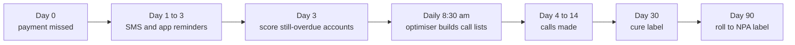
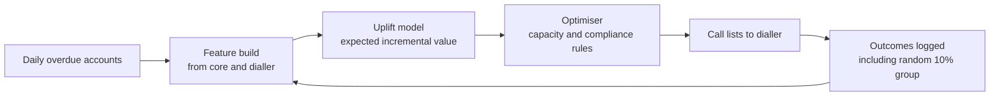

# Case Study 3: Collections Prioritisation (Who to Call First)

**Domain:** Finance (bank collections) | **Problem Type:** Ranking / uplift modelling plus capacity optimisation | **Difficulty:** Advanced

---

## 1. Business Context

### Company background

- **Nirman Bank** (fictional) is a private bank with credit cards and personal loans.
- The collections team handles accounts that miss a payment. "Early-stage" means 1 to 30 days past due (DPD, Days Past Due).
- Every month, about **1 lakh accounts** enter early-stage collections, with an average overdue amount of about ₹22,000 and an average total exposure of about ₹60,000.
- The team has **70 telecallers** (in-house plus a partner agency). Each makes about 80 call attempts a day.

### The pain, with numbers

| Item | Value |
| --- | --- |
| Accounts entering early-stage collections each month | 1 lakh |
| Call capacity per month (70 agents x 80 attempts x 22 days) | about 1.23 lakh attempts |
| Attempts needed to work one account properly | about 3 |
| **Accounts that can be worked by phone each month** | **about 41,000 (41%)** |
| The other 59% | SMS, WhatsApp and IVR reminders only |
| Roll rate to 90+ DPD (NPA) today | 5.0% of accounts, about 5,000 a month |
| Average exposure of a rolled account | about ₹60,000 |
| Loss given default after later recoveries | about 40% |
| **Annual credit loss from these accounts** | **about ₹144 Cr** |
| Current call-list rule | Sort by overdue amount, highest first |

- Hiring more agents is not allowed this year. The ask: **same agents, fewer accounts rolling to NPA**.
- Regulatory backdrop: RBI's Fair Practices Code and recovery-agent rules limit calls to 8 am to 7 pm and ban harassment. More calls to the same person is not a free lunch.

### Stakeholders and what each wants

| Stakeholder | What they want | What they fear |
| --- | --- | --- |
| Head of Collections | Lower roll rate with the same headcount | Targets missed, agents demotivated by "random" lists |
| Chief Risk Officer | Lower NPA formation and provisions | Model hides risk or ignores big accounts |
| Customer experience head | Fewer complaints and no harassing calls | Complaints reaching RBI's Ombudsman |
| Collection agents and team leaders | Lists they believe in, with accounts that actually pay | Being given hopeless accounts |
| Finance head | Cost per rupee recovered goes down | Cost of dialler and messaging channels rising |

---

## 2. Translating Business to ML

### The business question vs the ML question

| Business question | ML question |
| --- | --- |
| "Who should we call first?" | "For each overdue account, how many extra rupees do we expect to recover **because** we call, compared with not calling? Rank by that incremental value, and fill the call capacity from the top." |

> **Mentor note:** This is the key idea of the whole case. "Who is most likely to default?" and "Who should we call?" are different questions. Calling someone who will pay anyway wastes a call. Calling someone who will never pay wastes a call. The money is in the middle, among people whose behaviour a call can actually change. That is **uplift modelling**: modelling the effect of an action, not the outcome itself.

### The four kinds of customers

| Segment | Without a call | With a call | Value of calling |
| --- | --- | --- | --- |
| Sure things (forgot, will pay anyway) | Pay | Pay | Almost zero |
| Persuadables (stretched, need a nudge or a plan) | Do not pay | Pay | **High** |
| Lost causes (cannot pay) | Do not pay | Do not pay | Zero, needs restructuring or legal route |
| Sleeping dogs (annoyed by calls, may complain or switch off) | Pay | Do not pay | Negative |

### Target variable definition

- **Outcome:** `cured_30d = 1` if the account is back to 0 DPD (all overdue paid) within 30 days of entering collections. Also track `recovered_amount_30d` in rupees.
- **Treatment:** `called = 1` if the account got an intensive call campaign (3 or more connected or attempted calls within 10 days), else 0 (digital reminders only).
- **Uplift (the real target):** the difference in cure probability or recovered rupees between `called = 1` and `called = 0`, for the same type of customer.
- **Secondary outcome:** `rolled_90 = 1` if the account reaches 90+ DPD. It arrives about 2 months later.

### Edge cases

| Edge case | Recommended treatment | Reason |
| --- | --- | --- |
| Customer pays before any call is due (day 1 to 2) | Score at day 3, so these are already gone. Do not include accounts cured before scoring | You can only act on accounts still overdue at scoring time |
| Partial payment, account still overdue | Count as not cured, but record the amount in `recovered_amount_30d` | Partial payments matter for rupee value |
| Customer promised to pay (PTP) and then did not | Feature for the next cycle, never for the current score | A same-cycle PTP is a result of the call (post-treatment) |
| Customer disputes the bill or is deceased or has a legal case | Remove from the call list by rule | Not a modelling question |
| Account called by field agents too | Mark separately, and exclude from the call-vs-no-call comparison | Mixed treatments muddy the effect |

### Unit of prediction

- One **account per delinquency episode** (an account that goes overdue twice has two rows).

### Prediction timing

- The model scores at day 3 and refreshes daily.
- The call list is rebuilt each morning based on capacity and latest status.

### What success looks like

| Lens | Success |
| --- | --- |
| Business | Roll rate falls from 5.0% to 4.25% with the same 41% call coverage. Saves about ₹21 to 22 Cr a year |
| Model | Qini coefficient (explained in section 6) clearly above the random line and above the current rule. Top 40% by uplift captures at least 75% of the total incremental cures |
| Customer | Complaints per 1,000 accounts fall, because sleeping dogs are not called |

---

## 3. Data Understanding

### Data sources and key features

| Feature group | Source | Why it matters |
| --- | --- | --- |
| Account basics (product, tenure, limit, outstanding, overdue amount, DPD) | Core banking | Size and stage of delinquency |
| Payment history (min-due paid on time, count of past delinquencies, past cures) | Core banking | Past behaviour predicts future behaviour |
| Past collections response (promises to pay kept, answered calls, outcome of past calls) | Dialler and CRM (from earlier cycles only) | Direct evidence of who responds to calls |
| Contactability (answer rate, best hour to call, number of valid phone numbers) | Dialler | A person who never answers cannot be persuaded by a call |
| Bureau data (delinquency on other loans, new loans taken recently) | Bureau refresh | Overall financial stress |
| Digital engagement (app opens, bill views, UPI payments) | App analytics | Reachable digitally, so maybe no call needed |
| Salary credit date and balance pattern | Bank account data (own customers) | Timing of ability to pay |
| Demographics (age, city tier, language) | KYC | Language match with the agent helps |

### Data volume, granularity and refresh

- **Volume:** about 12 lakh delinquency episodes a year. Using 18 months of matured data, about 18 lakh rows.
- **Treatment mix in history:** about 40% called, 60% not called. But assignment was **not random**: agents called the highest overdue amounts first.
- **Randomised hold-out:** the bank ran a 2-month test last year where **10% of accounts (about 20,000 episodes)** were randomly kept on digital-only reminders, approved by the risk team. This is the most valuable dataset in the project.
- **Refresh:** daily, since the call lists are rebuilt every morning.

### Common data issues

| Issue | How it shows up here |
| --- | --- |
| Treatment bias (confounding) | Called accounts differ from non-called ones (they are larger), so a plain comparison is wrong |
| Post-treatment leakage | Call outcome, promise to pay, or payments made after day 3 are results of the call |
| Label delay | Cure is known at day 30, roll to NPA at day 90 |
| Contactability | A "not cured" result may just mean the phone number was wrong |
| Capacity effects | Accounts not called were not called because the capacity ran out, which correlates with the day of month and the list rule |
| Small randomised sample | Only 20,000 randomised rows, which limits the model's complexity |

> **Mentor note: Where juniors usually go wrong here.**
>
> - They build a "who will pay?" classifier and rank by it. That puts sure things at the top and wastes calls.
> - They compare cure rates of called vs not called accounts and think the gap is the effect of calling. It is mostly the difference in who was chosen.
> - They use call-outcome fields in the feature set. These do not exist at scoring time.

---

## 4. Approach and Decision Points

### Baseline first

- **Baseline 1 (current):** sort by overdue amount, call the top 41%. Roll rate 5.0%.
- **Baseline 2:** rank by predicted roll-to-NPA risk, a normal classifier. Often better than amount alone, but still mixes lost causes with persuadables.
- **Baseline 3:** random selection of 41%. Useful to know how much value a ranking can add at all.
- **Why it matters:** the first question in this project is "how far is the current list from random?". If it is already close to the best, the project is not worth running.

### Candidate models

| Model | Pros | Cons | Verdict |
| --- | --- | --- | --- |
| Risk classifier (P of roll to NPA) | Simple, well understood | Ranks by risk, not by how much a call helps | Baseline only, and also a useful feature |
| Propensity-to-pay classifier | Easy to explain | Puts sure things first | Do not use alone |
| Two-model uplift (T-learner): one model for called, one for not called, subtract | Simple, uses any algorithm | Noisy when treatment groups are imbalanced | Good starting point |
| Single model with treatment interaction (S-learner) | One model, stable | May ignore the treatment signal | Quick check |
| Uplift trees or causal forests | Built to find the segments that respond | Needs more data, harder to tune | Best for the final model if randomised data is enough |
| Reinforcement learning or contextual bandit | Learns continuously, balances explore and exploit | Complex to run safely | Start with bandit-style 5 to 10% exploration, not a full RL system |

### Decision scenarios

| What if... | Recommended action | Reasoning |
| --- | --- | --- |
| **Past calls were not random** (agents called big accounts) | Train the uplift model **only on the randomised hold-out**, or on observational data with inverse-propensity weights and validate on the hold-out. Better: run a larger randomised test (say 10% of accounts for 3 months) with a loss budget | Without randomisation you cannot separate the effect of the call from the reason the account was chosen |
| **The business wants the model to simply "predict who will default"** | Show the four-segment table with real numbers from the hold-out, and explain that calling a sure thing has no value | Reframing the question is the single most valuable thing you do. A model that answers the wrong question can be perfect and still useless |
| **Capacity is fixed at 41,000 accounts** | After scoring, run a simple optimiser: maximise total expected incremental rupees (uplift x overdue amount minus cost of calls) subject to agent-hours. A greedy sort by value per call-attempt is nearly optimal here | Prioritisation is a ranking problem plus a budget constraint. The ML gives the values, optimisation fills the capacity |
| **Once we follow the model, historical data becomes biased again** | Keep a permanent 5 to 10% random exploration group (called at random, and not called at random). Refresh the uplift model on it each quarter | Feedback loop: the model decides who is treated, so future data only shows treated top-ranked accounts. Exploration keeps the data honest |
| **RBI limits call timing and harassment** | Add hard business rules: maximum calls per account per week, only 8 am to 7 pm, no calls to sleeping-dog segment, and a complaint-triggered suppression | Regulatory and reputational limits are constraints, not features |
| **Digital channels (WhatsApp, IVR) are cheap and calls are expensive** | Extend the idea: for each account choose the **next best action** (WhatsApp, IVR, call, field visit, restructuring offer) by uplift per rupee of cost | The same logic works for any costly treatment. Start with call vs no call, then add channels |
| **Agents differ a lot** (some are far better than others) | Add agent-skill matching only after the basic model works. First prove the account-level uplift | Do not add complexity before the base effect is proven |

---

## 5. Feature Engineering

### Top 10 features to build

| # | Feature | Business logic |
| --- | --- | --- |
| 1 | Overdue amount and overdue amount divided by monthly income (or limit) | Size of the payment hurdle |
| 2 | Days past due at scoring time | Earlier DPD usually means more recoverable |
| 3 | Number of past delinquency episodes and share that cured | Habitual late payers who always cure may be sure things |
| 4 | Promise-to-pay kept ratio in past cycles | Shows who responds to human contact |
| 5 | Call answer rate in the last 90 days and best-hour bucket | Contactability, and a person who answers is a person you can persuade |
| 6 | Days since last contact attempt (contact fatigue) | Too many calls can reduce response and raise complaints |
| 7 | Digital engagement (app opens and bill views in last 30 days) | Reachable by cheap channels |
| 8 | Salary credit day and current account balance trend | A call after payday lands better |
| 9 | Delinquency on other loans (bureau) in the last 3 months | Broad financial stress, which suggests a lost cause or a restructuring candidate |
| 10 | Product type, tenure and utilisation | Card users with high utilisation behave differently from personal loan users |

### Features to avoid (leakage risks)

| Feature | Problem |
| --- | --- |
| Outcome of any call made in the current cycle, promise to pay in the current cycle | Result of the treatment, not a pre-treatment feature |
| Payments received after the scoring day | Direct leakage of the label |
| Field-visit or legal-notice flags created after day 3 | Post-treatment, and set by the old strategy |
| Agent ID or team assigned | Encodes the old call rule and mixes agent effect |
| Rank or priority number from the old list | Encodes the old policy |

---

## 6. Evaluation Strategy

### Metrics

| Metric | Role | Why |
| --- | --- | --- |
| **Qini curve and Qini coefficient** (or AUUC, Area Under the Uplift Curve) | Primary model metric | Shows how many extra cures you gain as you call more accounts in model order, against random order. It is the uplift version of ROC |
| **Incremental recovered rupees per 1,000 calls** | Primary business metric | Directly compares strategies at the same cost |
| Uplift in the top decile and top 40%, measured on the randomised hold-out | Secondary | Simple table that business can read |
| Roll rate to 90+ DPD at the same coverage | Business outcome | Final goal, available after 90 days |
| Complaint rate per 1,000 accounts | Guardrail | Protects customers and the bank's reputation |
| Contact rate and cost per rupee recovered | Operational | Efficiency |

### Metrics that look good but are misleading here

- **AUC of a "will the customer pay?" model:** can be 0.85 and still tell you nothing about who should be called.
- **Overall cure rate of called accounts:** high because agents call the accounts most likely to pay.
- **Recovery rate (recovered divided by overdue):** includes the money that would have come in anyway.
- **Agent productivity (calls per hour):** can rise while real recoveries fall.

### Validation strategy

| Step | Design | Why |
| --- | --- | --- |
| Offline uplift check | Randomised hold-out split in time: train on the first 6 weeks, evaluate Qini on the last 2 weeks | Honest estimate of the effect on unseen customers |
| Cross-fitting | Train on one half of randomised data, score the other half, then swap | Gets stable Qini estimates with only 20,000 rows |
| Group split | Same customer never in both train and test | Repeat delinquents otherwise leak |
| Online A/B test | Randomise **accounts** (not agents, not days) into old list vs new list, same capacity in each arm | Direct measure of roll rate and recovery under real operations |
| Duration | At least 90 days for roll-to-NPA, with day-30 cure as the early read | Matches the label delay |

### From model metric to business value

- Randomised test result: a call lifts the 30-day cure rate from 58% to 71%, an average uplift of 13 points.
- By segment: persuadables about +22 points, sure things about +2, lost causes about +3, sleeping dogs about -4.
- Old list (sorted by amount): the 41,000 called accounts have an average uplift of about 9 points.
- New list (sorted by uplift value): the 41,000 called accounts have an average uplift of about 18 points.
- Extra cures from the new list over the old list: 41,000 x (18 - 9) points = about 3,700 extra cures a month. Roughly 20% of these would otherwise have rolled to NPA, about 750 accounts a month, which brings roll rate from 5.0% to 4.25%.
- Annual impact: 0.75 points x 12 lakh accounts = 9,000 fewer rolled accounts x ₹60,000 x 40% LGD = **about ₹21.6 Cr a year**, with the same agents.

---

## 7. Deployment and Monitoring

### Batch vs real time

- **Daily batch.** Scores and call lists are rebuilt every morning at about 6 am and loaded to the dialler by 8:30 am.
- Real-time is not needed. A decision made once a day is enough, because calls cannot happen faster than agents can dial.
- **Intraday refresh** (optional): remove accounts that paid in the morning, so agents never call a customer who has just paid.

### What to monitor

| Type | What to track | Alert trigger |
| --- | --- | --- |
| Data drift | Feature distributions, answer rates, share of overdue accounts by product | PSI above 0.2 |
| Treatment mix | Share of accounts called by segment, and exploration group size | Exploration group below 5% |
| Model effect | Uplift in the random hold-out group by decile, each month | Top-decile uplift drops by more than a third |
| Business KPIs | Roll rate, cure rate at day 30, recovery per call, cost per rupee | Outside agreed band |
| Guardrails | Complaints, calls per account per week, calls outside permitted hours | Any breach |
| Operations | Agent acceptance, list override rate | Overrides above 15% (agents do not trust the list) |

### Retraining

- **Scheduled:** quarterly, using the latest exploration data.
- **Triggered:** policy change (for example new payment options like UPI AutoPay), a new product, or a macro shock such as a rise in interest rates.

### A/B test or champion-challenger design

- Randomise at **account level at the start of the cycle**: 50% on the old list, 50% on the new list, same call capacity.
- Primary readout: cure rate at day 30 and roll rate at day 90.
- Run the test for 2 full billing cycles to cover payday effects.
- Always keep the 10% random exploration group across both arms, so that the model keeps learning.

---

## 8. Stakeholder Communication

### Explain it to a non-technical leader

> "Today we call the biggest overdue accounts first. But many big accounts pay on their own, and others cannot pay whatever we say.
> We tested this: we left a random 10% uncalled and measured what a call really changes.
> The new model finds the customers where a call makes the biggest difference, and fills our 41,000 call slots with them.
> Same team, same hours, about 15% fewer accounts sliding into NPA, and fewer irritated customers."

### Questions leadership will ask

| Question | Suggested answer |
| --- | --- |
| "Are we ignoring our biggest overdue accounts?" | "No. The model multiplies the chance a call helps by the amount at stake. A large account with a real chance of response still ranks high. A large account that will pay anyway, or cannot pay, does not need a collector. It may need a settlement or restructuring offer" |
| "Why leave 10% uncalled at random? That is revenue at risk." | "It is a small, risk-approved sample with low-balance accounts, and it is the only way to measure the true effect of a call. It costs a little and protects every decision after it" |
| "Will agents trust the list?" | "We show the top reasons per account, for example 'answers calls after 6 pm, kept the last promise'. We will start with a pilot team and use their feedback" |
| "Is this compliant with RBI conduct rules?" | "Compliance rules sit on top of the model. They cap contact frequency and calling hours and suppress customers who complained" |
| "What if it does not work?" | "We run it as a 50-50 test for two cycles. If roll rate is not better, we switch back at no cost" |

---

## 9. Common Pitfalls and Lessons

| Mistake | Why it happens | How to avoid it |
| --- | --- | --- |
| Ranking by default probability instead of uplift | "Who will default?" is the familiar question | Always ask "what changes if we act?" and sketch the four segments |
| Naive called vs not-called comparison | Easy to do, the data is already there | Use a randomised hold-out, or weighting with a validation against it |
| Post-treatment features in the model | Dialler data is full of call results | Cut every feature at the scoring timestamp, and review each one with the collections team |
| No randomised group | Feels risky to leave anyone uncalled | Run a small, approved test. It is the cheapest insurance in the project |
| Ignoring capacity and rules | Treating the model output as the final list | Add an optimiser with business and RBI constraints |
| Optimising calls but not customer harm | Only recovery is measured | Track complaints, and suppress sleeping dogs |
| Feedback loop | Model decides who is treated, so later data is biased | Keep permanent random exploration, and retrain on it |
| Agents ignore the list | They were not involved | Pilot with team leaders, show reasons, track override rate |

---

## 10. Mentor's Focus Checklist

- ✅ **Where to spend 80% of the effort:**
  - Framing: uplift, not risk. Show the four segments to every stakeholder.
  - Getting clean randomised data, and designing the exploration group.
  - Cutting features at the scoring timestamp (no post-treatment leakage).
  - Optimiser and business rules, then a proper A/B test.
- ❌ **What not to over-engineer:**
  - Full reinforcement learning on day one.
  - Agent-level matching before the account-level effect is proven.
  - Deep models on 20,000 randomised rows. Simple two-model or tree-based uplift is enough.
- 💡 **Key takeaway:** **Do not predict what will happen. Predict what will change because of what you do.** Whenever a business has a limited resource (calls, offers, discounts, mentors), the right target is the incremental effect of that resource.
