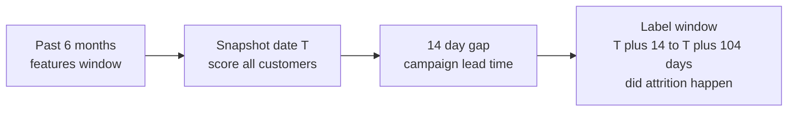
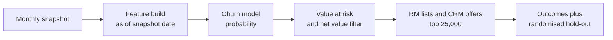

# Case Study 4: Savings-Account Attrition in Retail Banking

**Domain:** Finance (retail banking) | **Problem Type:** Classification with time-to-event (survival) thinking | **Difficulty:** Intermediate

---

## 1. Business Context

### Company background

- **Aarambh Bank** (fictional) is a private retail bank with about 1.2 crore customers and about 85 lakh active savings accounts.
- The valuable segment is **salaried and mass-affluent customers**: about 18 lakh customers with an average balance of about ₹1.1 lakh. They hold about ₹19,800 Cr of deposits and also buy credit cards, loans, insurance and mutual funds.
- Competition: neobanks, large private banks with higher salary-account perks, and fintech apps offering higher savings rates.

### The pain, with numbers

| Item | Value |
| --- | --- |
| Customers in the valuable segment | 18 lakh |
| Yearly attrition in this segment (customers who stop using the bank as their main account) | about 14%, so **about 2.5 lakh customers a year** |
| Share of attrition that is a formal account closure | only about 12% |
| Share that is "silent": salary moved, balance drained, usage stops | about 88% |
| Average yearly revenue per customer (interest margin, fees, cross-sell) | about ₹7,000 |
| Value of a retained customer over 3 years (discounted) | about ₹18,000 |
| Retention budget | about ₹12 Cr a year, about ₹400 per treated customer (RM call plus cashback or fee waiver), so about **3 lakh customers** can be treated |
| Current rule | "Balance dropped by 50% in 2 months" list, sent to relationship managers |

- The rule list is long, late (the customer is usually already gone), and only about 18% of the listed customers actually leave.

### Stakeholders and what each wants

| Stakeholder | What they want | What they fear |
| --- | --- | --- |
| Head of Retail Banking | Keep deposits and salary accounts, protect CASA ratio (share of low-cost current and savings deposits) | Quarter-end deposit shortfall |
| Head of Customer Retention | A short, accurate list each month, with a reason per customer | Wasting offers on people who will stay anyway |
| Relationship managers (RMs) | A list they can act on in a 10-minute call | Being given vague or stale lists |
| Marketing and CRM | Right offer for the right customer, spend inside budget | Cashback burned on loyal customers |
| Compliance and Data Privacy | Use of customer data within consent and purpose rules (India's DPDP Act, 2023) | Using data for a purpose the customer never agreed to |

---

## 2. Translating Business to ML

### The business question vs the ML question

| Business question | ML question |
| --- | --- |
| "Which valuable customers are about to leave, so we can act in time?" | "For each customer at the start of each month, what is the probability of losing the primary relationship in the window from 2 weeks to 3.5 months ahead? Rank customers by expected rupee value at risk." |

> **Mentor note:** In banking, nobody says "I am leaving" and closes the account. They move their salary, then their EMIs, then they stop logging in. The hardest job in this case is not modelling. It is **deciding what "churn" means** in a way that matches lost money.

### Target variable definition

An attrition event is any of the following (pick the one that applies to the customer type):

| Customer type | Attrition event |
| --- | --- |
| Salaried | No salary credit for 2 consecutive months (salary moved), after having it regularly for 6 months |
| Non-salaried | 90-day average balance below 30% of the prior 6-month average AND debit transaction count below 30% of the prior level |
| Any | Account closure request |

- **Why not just account closure:** only 12% of the value loss is a formal closure. A closure-only label would miss the 88% that matters.
- **Sensitivity check:** build the label with 2 or 3 different thresholds (for example 20%, 30%, 40%) and confirm that the top-ranked customers do not change much. Show this to the business.

### Edge cases

| Edge case | Recommended treatment | Reason |
| --- | --- | --- |
| Customer changes jobs, salary stops for 2 months, then returns | The 2-month rule flags it. Keep it, but add a "salary gap then returns" analysis. Consider 3 months for salaried customers | Genuine ambiguity. Choose with the business and document it |
| Large one-time payment (house down payment) drops the balance | Add a rule: ignore balance drops when the debit goes to a known property, tax, or own-investment merchant, if the transaction pattern stays normal | Not attrition |
| Customer dies, or moves abroad (NRI conversion) | Remove from the population | Not a retention case |
| Customer already churned before the campaign could happen | Excluded by the 14-day gap in the label window (see below) | Nothing left to save |
| New customers (less than 6 months) | Separate "early life" model or rules | Not enough history for baselines |

### Unit of prediction

- One **customer per monthly snapshot** (customer-month). This is the standard setup for churn problems.

### Prediction timing: observation window, gap, label window



- **Features** use data up to the snapshot date T, and nothing after.
- **Gap of 14 days:** the team needs time to call and make an offer. Customers who leave within 14 days are not saveable and are excluded.
- **Label window:** attrition between day 14 and day 104 (about 3 months).

### What success looks like

| Lens | Success |
| --- | --- |
| Business | Retention list of about 25,000 customers a month with a 30% hit rate (30% truly attrite within 3 months), up from 18%. Net retention value of about ₹20 Cr a year, against ₹7 Cr for the old rule |
| Model | Top 1.4% of customers by score has at least 8x the base attrition rate (30% vs 3.7%). PR-AUC at least 0.25 |
| Operations | RMs can contact the whole list in the month |

---

## 3. Data Understanding

### Data sources and key features

| Feature group | Source | Why it matters |
| --- | --- | --- |
| Salary credit pattern (amount, date, employer name, gaps) | Core banking | Salary is the anchor of the relationship |
| Balance and transaction trends (3-month vs 6-month ratios) | Core banking | Early drain signals |
| Outflows to the customer's own accounts at other banks | UPI and NEFT beneficiary data | Strong sign that money is moving elsewhere |
| App and net-banking logins, last login date | Digital analytics | Disengagement comes before departure |
| Product holding (cards, loans, FDs, SIPs, insurance) | Product systems | More products mean stickier customers |
| Service interactions (complaints, unresolved tickets, call-centre contacts, failed transactions) | CRM and ticketing | Bad experience is a classic reason |
| Fees and charges (minimum balance penalties, ATM or card declines) | Core banking | Irritants |
| Customer attributes (age, city tier, tenure, branch) | KYC | Stable context |
| Market context (savings and FD rate gap vs competitors, salary-account promotions) | Market data | Triggers for switching |

### Data volume, granularity and refresh

- **Customers:** 18 lakh in scope. With 24 monthly snapshots, about 4.3 crore customer-month rows. Because each customer repeats every month, sample or use 6 to 8 snapshots.
- **Base rate:** about 3.7% attrite within each 90-day window, so about 66,000 positives per snapshot. Positives are plentiful, imbalance is moderate.
- **Refresh:** scored once a month. Some signals (salary credit) are daily, but monthly action is enough for RM calls.

### Common data issues

| Issue | How it shows up here |
| --- | --- |
| No clean churn label | Silent attrition needs a rule-based definition |
| Censoring | A customer who joined 4 months ago has not had time to churn, and the data ends at the last snapshot. Unobserved is not the same as "will not churn" |
| Look-ahead leakage | Using "no transactions in the last 30 days" computed after the snapshot |
| Seasonality | Bonus months (March and April), festive spends, and salary-cycle differences |
| Treatment contamination | Customers who got retention offers in the past behave differently |
| Concept change | A competitor's salary-account offer causes a wave that the history has not seen |
| Consent limits | Some data (for example third-party app data) cannot be used for marketing |

> **Mentor note: Where juniors usually go wrong here.**
>
> - They define churn as "account closed" and get a clean label that covers only 12% of the loss.
> - They compute features from the full month, including days after the snapshot, so the model sees the churn it is trying to predict.
> - They pick a random split, which puts the same customer's adjacent months in train and test.

---

## 4. Approach and Decision Points

### Baseline first

- **Baseline 1 (current):** "balance dropped 50% in 2 months". About 18% hit rate.
- **Baseline 2:** a recency-style score using only days since last salary credit and days since last login. Takes 1 hour to build and is often better than the rule.
- **Why it matters:** many churn models only beat a poor rule. A good simple baseline shows how much the ML really adds.

### Candidate models

| Model | Pros | Cons | Verdict |
| --- | --- | --- | --- |
| Logistic regression | Simple, explainable, quick | Misses non-linear patterns | Good baseline |
| Gradient boosting (LightGBM, XGBoost) | Best accuracy on tabular features, handles missing values | Needs trend features built manually | **Primary model** |
| Survival models (Cox proportional hazards, discrete-time hazard) | Handle censoring, give "probability of leaving by month 3, 6, 12" | More effort, assumptions to check | Use for customer lifetime view and for new customers |
| Sequence models (LSTM, transformer on monthly activity) | Learn patterns from raw sequences | Hard to explain, heavy to maintain | Not worth it in the first version |
| Segment-specific models (salaried vs non-salaried) | Different drivers, better accuracy | More models to maintain | Worth it, 2 segments only |

### Decision scenarios

| What if... | Recommended action | Reasoning |
| --- | --- | --- |
| **There is no clear definition of churn** | Run a 1-week workshop with business, test 3 definitions, compare how many customers each flags and how much deposit value is at stake, and choose the one linked to money (salary move or 70% drop in activity) | The wrong definition gives a perfect model of the wrong thing. This is the single most important decision |
| **New customers and recent joiners have short history (censoring)** | For fixed-horizon classification, include only customers with at least 6 months of history. Use a survival model or discrete-time hazard for the rest. Do not treat "not yet churned" as "will not churn" | Treating censored customers as non-churners makes recent cohorts look falsely loyal |
| **The signal arrives too late** (by the time the balance drops, the customer has gone) | Focus on **leading indicators**: salary-date shifts, outflows to own accounts at other banks, login decline, unresolved complaints. Check each feature's lead time over the event | A churn model that fires after the event is just a historic report |
| **Retention budget covers only 3 lakh offers** | Score by expected value: P(attrition) x value at risk x expected save rate minus cost of the offer. Treat only customers with positive net value | A 90% churn probability on a customer worth ₹500 a year is not worth an RM call |
| **A senior asks "why is this customer on the list?"** | Give 3 reasons per customer from SHAP values, grouped into business language ("salary stopped 6 weeks ago", "two unresolved complaints", "login count fell 70%") | RMs act on reasons. A bare score does not change the conversation |
| **Salary-account customers and non-salaried customers behave differently** | Train two models, or one model with strong segment features and check performance per segment | A single average model is good for nobody |
| **Retention offers might be wasted on loyal customers** | Do not assume. Run a randomised hold-out within the high-risk list (see Case 3 for the uplift idea) and measure the true save rate | A 20% save rate is an assumption until measured |

---

## 5. Feature Engineering

### Top 10 features to build

| # | Feature | Business logic |
| --- | --- | --- |
| 1 | Days since last salary credit, and ratio of salary credited in last 3 months to previous 3 months | Direct sign the primary account is changing |
| 2 | Average balance in last 3 months divided by average balance in previous 6 months | Drain trend |
| 3 | Debit transaction count in last 60 days divided by previous 180 days | Usage is dropping |
| 4 | Outflow to own accounts at other banks in last 60 days | Money is being parked elsewhere |
| 5 | Days since last app or net-banking login, and 90-day login trend | Disengagement |
| 6 | Number of active products and number of products closed in last 90 days | Depth of relationship, and early unwinding |
| 7 | Unresolved complaint count and days to resolve in last 90 days | Bad service experience |
| 8 | Failed or declined transactions and fee events in last 90 days | Friction and irritation |
| 9 | Employer change flag (salary source changed) | Life event, a natural time to switch bank |
| 10 | Tenure, age band, and branch or city tier | Stable context and segment |

### Features to avoid (leakage risks)

| Feature | Problem |
| --- | --- |
| Any activity after the snapshot date T | Look-ahead leakage |
| "Dormant account" or "inactive" status flags | They are defined using the same behaviour you want to predict, and are often set after the event |
| Account closure request fields or status | Direct label leakage |
| Past retention offers as a feature, without care | Reflects the old targeting rule. Use only as a control variable and never as a driver |
| Branch-level attrition rate computed with future months | Look-ahead leakage in aggregate form |

Point-in-time training rows (one customer-month):

```sql
-- Features come only from data up to snapshot_date; label from the window after a 14-day gap
SELECT
  c.customer_id,
  c.snapshot_date,
  f.avg_bal_3m / NULLIF(f.avg_bal_prev_6m, 0) AS bal_trend,
  f.days_since_salary,
  l.attrited_in_window AS label
FROM customer_snapshots c
JOIN features_asof f
  ON f.customer_id = c.customer_id AND f.asof_date = c.snapshot_date
JOIN labels l
  ON l.customer_id = c.customer_id
 AND l.window_start = DATEADD(day, 14, c.snapshot_date)
 AND l.window_end   = DATEADD(day, 104, c.snapshot_date);
```

---

## 6. Evaluation Strategy

### Metrics

| Metric | Role | Why |
| --- | --- | --- |
| **PR-AUC and precision at the budget size** (for example precision in the top 25,000 per month) | Primary | The budget decides the list size, so measure quality at that size |
| **Lift and cumulative gains chart** (how many times better than random in the top 1%, 5%, 10%) | Primary, business-friendly | Easy to show to non-technical leaders |
| Value-weighted capture (share of deposit rupees at risk found in the list) | Secondary | A rich customer leaving matters more than a poor one |
| Calibration | Secondary | Needed for expected-value calculations |
| Retention save rate and net value (from a randomised hold-out) | Business | The real return on the campaign |

### Metrics that look good but are misleading here

- **Accuracy:** 96% by saying nobody will leave.
- **ROC-AUC:** can be 0.90 while precision in the top 1% is poor, because of the many easy negatives.
- **Hit rate on customers who already show a 70% balance drop:** this is easy and late. The value is in finding the ones still saveable.

### Validation strategy

| Step | Design | Why |
| --- | --- | --- |
| Time-based split | Train on snapshots from months 1 to 15, validate on months 16 to 18, test on months 19 to 21 | Mimics real use |
| Gap between train and test | At least 104 days between the last training label window and the first test snapshot | Avoid overlapping label windows |
| Customer-level separation | Customers in test should not appear in train rows at later dates, or use all-time customer group split | The same behaviour repeated across months leaks |
| Backtest by month | Report precision at top 25,000 for each test month | Shows stability, including bonus-season months |
| Segment view | Show lift for salaried vs non-salaried, and for each city tier | Hidden weak spots |

### From model metric to business value

- Per year: 3 lakh offers (25,000 a month x 12), at about ₹400 each = ₹12 Cr cost.
- Model list: 30% hit rate gives about 90,000 true attriters reached. If 20% are saved, that is 18,000 customers x ₹18,000 = about **₹32 Cr**. Net of cost: **about ₹20 Cr**.
- Old rule: 18% hit rate gives 54,000 reached, 10,800 saved, ₹19 Cr, net **₹7 Cr**.
- Random targeting: 3.7% hit rate gives about 11,000 reached, 2,200 saved, about ₹4 Cr, and **loses ₹8 Cr**. This is why targeting matters.
- Net gain over the old rule: about **₹13 Cr a year**. The 20% save rate must be confirmed by a test.

---

## 7. Deployment and Monitoring

### Batch vs real time

- **Monthly batch scoring** on the first working day, with a **mid-month refresh** for customers with a major trigger (salary missed, large transfer out, a serious complaint).
- Real time is not needed. RM calls and campaigns are not instant.
- Output: a ranked list with the top 3 reasons, the expected value at risk, and the suggested offer.



### What to monitor

| Type | What to track | Alert trigger |
| --- | --- | --- |
| Data drift | PSI for key features (salary ratio, balance trend, logins) | PSI above 0.2 |
| Model performance | Precision at top 25,000, 3 months later on matured labels | Drops by more than 5 points |
| Calibration | Predicted vs actual attrition by decile | Gap above 20% relative |
| Campaign effect | Save rate for treated vs randomised hold-out | Save rate below break-even |
| Business KPIs | Salary accounts retained, CASA ratio, deposit outflow, NPS | Outside agreed band |
| Fairness and consent | Offers by age, gender, city tier. Data used inside consent purpose | Unexplained gaps |

### Retraining

- **Scheduled:** every quarter, adding newly matured windows.
- **Triggered:** a competitor's salary-account campaign, a major change in the savings-rate environment, or a core-banking change that alters salary tagging.

### A/B test or champion-challenger design

- Inside the high-risk list each month, randomise **10% into a control group** that gets no special offer, and give the rest the normal retention flow.
- Compare 90-day attrition: treated vs control gives the true save rate and the true net value.
- For model comparison: send half of RM lists from the old rule and half from the new model, and compare hit rate and saves.

---

## 8. Stakeholder Communication

### Explain it to a non-technical leader

> "The model watches the early signs that a customer is moving away: salary not arriving, money going to another bank, fewer logins, unresolved complaints.
> Each month it gives our relationship managers a short list of 25,000 valuable customers who are likely to leave in the next 3 months, with the reasons.
> About 3 in 10 of the listed customers would really leave, compared with about 1 in 5 using today's rule and 1 in 27 at random.
> We keep a small control group untouched so we can measure how many customers the campaign really saves."

### Questions leadership will ask

| Question | Suggested answer |
| --- | --- |
| "How do you define a churned customer?" | "Someone who stops using us as their main bank, meaning salary moved or activity fell sharply. Closed accounts are only 12% of the loss, so a closure-only definition would miss most of it" |
| "Why not offer everyone a benefit?" | "At ₹400 each, 18 lakh customers cost ₹72 Cr. Targeting 3 lakh cost ₹12 Cr and covers about a third of the real leavers" |
| "How do we know the offers work?" | "We hold out 10% of the high-risk list. The difference in retention between treated and held-out customers is the true effect" |
| "Why did a loyal customer get a call?" | "The model flagged specific changes, such as a salary gap and two unresolved complaints. The RM call is a service call first, and an offer second" |
| "Can the model use customers' social media or phone data?" | "No. We use only banking data within the consent and purpose the customer gave, as required by the data protection law" |

---

## 9. Common Pitfalls and Lessons

| Mistake | Why it happens | How to avoid it |
| --- | --- | --- |
| Defining churn as account closure | It is the only clean flag in the database | Define churn by lost value (salary moved, activity drop), and test several thresholds |
| Features that include days after the snapshot | Monthly aggregates are computed over the whole month | Build features as-of the snapshot date, and unit-test with a "future leak" check |
| Random train-test split on customer-month rows | Default settings | Time-based split with a gap, and customer-level separation |
| Predicting too late | The easiest features (dormant flag, zero balance) are lagging | Check lead time of each feature, and prefer leading signals |
| Ranking by probability only | Simple to do | Rank by expected net value: probability x value at risk x save rate minus cost |
| Treating censored customers as loyal | Missing the concept of observation time | Require minimum history, or use survival methods |
| Assuming the save rate | A campaign is already running | Measure with a randomised control group. Use it to set the budget |
| One model for all segments | Less work | At least split salaried vs non-salaried, and check segment performance |

---

## 10. Mentor's Focus Checklist

- ✅ **Where to spend 80% of the effort:**
  - Defining attrition so it matches lost money, and agreeing on it with the business.
  - The time design: observation window, 14-day gap, label window, and leakage-safe features.
  - Leading indicators and their lead time.
  - Expected-value targeting and the randomised hold-out to measure the save rate.
- ❌ **What not to over-engineer:**
  - Deep sequence models for the first version.
  - Perfect survival curves for each customer when a clean 90-day classifier meets the campaign needs.
  - Fancy personalised offers before you know that the retention flow works at all.
- 💡 **Key takeaway:** **A churn model is only as good as its definition of churn and its timing.** A perfectly accurate model that fires after the customer has left, or measures the wrong thing, saves no money.
