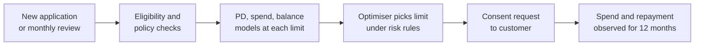
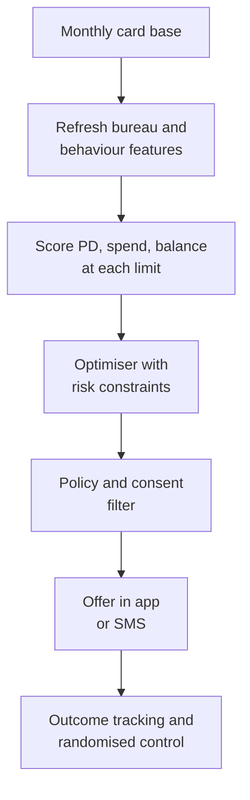

# Case Study 11: Credit Card Initial Limit and Limit-Increase Assignment

**Domain:** Finance (cards) | **Problem Type:** Regression plus constrained optimisation (expected profit under risk limits) | **Difficulty:** Advanced

---

## 1. Business Context

### Company background

- **NovaCard Bank** (fictional) is a private bank with a mass-affluent credit card business. It sells cards through its app, branches, and co-brand partners (an e-commerce platform and an airline).
- Scale: about 20 lakh active cards, about 6 lakh new cards issued each year.
- Average sanctioned limit is about ₹90,000. Total sanctioned exposure is therefore about ₹18,000 Cr (20 lakh x ₹90,000).
- Average utilisation (balance as a share of limit) is about 30%, so receivables are about ₹5,400 Cr.
- Revenue comes from three places: interchange (a fee the merchant's bank pays on every swipe, about 1.2% of spend), interest on revolving balances (customers who do not pay in full), and fees.
- Today the limit is set from a **grid**: income band x bureau score band gives a limit. A yearly rule gives a 25% increase to anyone with 6 months of on-time payments and a bureau score above a cut-off.

### The pain, with numbers

| Item | Value |
| --- | --- |
| Active cards | 20 lakh |
| Average limit and average utilisation | ₹90,000 and 30% |
| Cards using under 10% of their limit for 6 months | 35% (7 lakh cards) |
| Credit loss rate on average receivables | 3.2%, about ₹173 Cr a year (₹5,400 Cr x 3.2%) |
| Delinquency of top-decile utilisation (above 80%) vs the book | about 4 times higher |
| Increase programme today | about 2 lakh accounts get an increase a year |
| Net profit from the increase programme today | about ₹150 per increased account, about ₹3 Cr a year |
| Customers who complain they were "given too little limit" at the first card | about 9% of surveyed new customers |

- Idle limit is not free. The bank holds capital against sanctioned limits, and it can still lose money if a customer draws the whole limit just before defaulting.
- The same limit rule gives a ₹1.5 lakh limit to a salaried engineer who spends ₹20,000 a month and to a trader who will draw all of it. One of them is profitable and the other is not.
- RBI expects banks to follow board-approved policy for limit setting, to take the customer's explicit consent before raising a limit, and to look at the customer's total unsecured exposure. We design for all three.

### Stakeholders and what each wants

| Stakeholder | What they want | What they fear |
| --- | --- | --- |
| Head of Cards | More spend and more revolving balance from good customers | Competitors giving higher limits and winning the best customers |
| Chief Risk Officer | Loss rate held under 3.5% and no big concentration in one segment | A model that hands out big limits just before a downturn |
| Product and Customer Experience | Limit offers that feel fair and timely | Customers annoyed by offers they cannot use, or by a cut with no reason |
| Finance and Treasury | Capital used well, profit per rupee of limit | Large sanctioned exposure that earns nothing |
| Compliance | Consent captured, policy followed, clear audit trail | Unsolicited limit raises, a missing reason for a limit cut |

---

## 2. Translating Business to ML

### The business question vs the ML question

| Business question | ML question |
| --- | --- |
| "What limit should we give this customer?" | "For each candidate limit L on a grid, predict the customer's expected spend, revolving balance and probability of default (PD) if we set that limit. Then choose the L with the highest expected profit that satisfies risk rules" |
| "Who should get an increase, and how much?" | "Estimate the extra profit and extra loss from moving a customer from limit L0 to L1. Offer the increase only where the net is positive after the risk cost" |
| "How do we know a higher limit causes more spend?" | "Estimate the effect of the limit on spend using randomised limit tests, not only history" |

> **Mentor note: A limit is a decision, not a score.** A credit score ranks customers. A limit is a number we choose, and the customer reacts to it. A higher limit changes how much they spend, how much they borrow, and how likely they are to default. So we need a model of the **response to the decision**, plus an optimiser. A PD model alone cannot do this.

### Target variable definition

We build three linked models for each candidate limit.

- **Risk model:** `default_12m = 1` if the card reaches 90 days past due (DPD) or is written off within 12 months after the decision date.
- **Spend model:** average monthly spend in the next 6 months, in ₹.
- **Balance model:** average revolving balance (unpaid balance carried after the due date) in the next 6 months, in ₹.
- **Exposure at default (EAD):** the balance at the time of default as a share of the limit, which is usually higher than average utilisation because distressed customers draw hard before they stop paying.

### Edge cases

| Edge case | Recommended treatment | Reason |
| --- | --- | --- |
| Customer is a "transactor" (pays in full every month) | Separate segment. Value is interchange only, with almost no interest income | Treating them like revolvers overstates profit |
| Customer is already at 95% utilisation | Do not read it as "needs a higher limit". Check payment pattern, cash advances, minimum-due-only payments | It can be hunger for credit or early distress |
| Limit was raised in the past 6 months | Use the post-increase behaviour only after a 3-month settling period | Spend spikes right after an increase and then falls |
| Co-brand cards with partner-funded offers | Strip out spend driven by one-off partner cashback when learning the limit-spend link | Promo spend will not repeat at the same limit |
| Temporary festival limit uplift | Model as its own product with an expiry | Festive spend is seasonal and the limit returns to normal |
| Customer's income is self-declared and unverified | Use a lower cap and rely more on bank-statement and bureau signals | Unverified income is the weakest input |

### Unit of prediction

- One **card account at one decision date** (new application, or monthly review for existing cards).
- Each account gets scored at several candidate limits, for example 0.8x, 1.0x, 1.25x, 1.5x, 2.0x of the current limit.

### Prediction timing



- New applications: decision in seconds, at the time of approval.
- Existing cards: a monthly batch review of the whole book.
- Outcome windows are long: 6 months for spend and balance, 12 months for default.

### What success looks like

| Lens | Success |
| --- | --- |
| Business | Net profit from limit decisions up by about ₹10 Cr a year, with the loss rate staying under 3.5% |
| Model | PD model with AUC of 0.78 or better, well calibrated. Spend model with weighted error under 25% at account level and under 5% at segment level |
| Test and learn | A randomised limit test that shows the real effect of +25% limit on spend, balance and delinquency |

---

## 3. Data Understanding

### Data sources and key features

| Feature group | Source | Why it matters |
| --- | --- | --- |
| Application data (verified income, employer type, city tier, age) | Application form and income checks | Capacity to repay and a basis for policy caps |
| Bureau data (score, total unsecured exposure, number of cards, recent enquiries) | Credit bureau pull with consent | Shows how much credit the customer already has elsewhere |
| Card behaviour (monthly spend, utilisation, share of EMI conversion, cash advances) | Card processor | Core signal of use and stress |
| Payment behaviour (full payment vs minimum due, days to pay, bounced payments) | Billing system | Separates transactors, revolvers and stressed customers |
| Spend mix (travel, online shopping, fuel, jewellery, quasi-cash) | Merchant category codes | Mix hints at lifestyle and risk |
| Salary and account data (salary credit, average balance) | Bank's own savings account data, with consent | A stable salary raises the safe limit |
| Past limit changes and outcomes | Limit history | The raw material for learning the response to a limit |
| Randomised limit tests | Test and learn programme | The only unbiased view of what a limit does |

### Data volume, granularity and refresh

- **Volume:** about 20 lakh active cards x 36 months of history is about 7.2 crore account-months. Defaults are about 1.5% of accounts a year, so there are tens of thousands of default events.
- **Granularity:** one row per account per month, with spend, balance and payment details.
- **Refresh:** card data daily, bureau data monthly for the review base, models retrained every quarter.

### Common data issues

| Issue | How it shows up here |
| --- | --- |
| Limits are not random | Better customers got higher limits, so "high limit means high spend" is mostly selection, not effect |
| Censored spend | Spend is capped at the limit, so a customer at 100% utilisation might have spent more |
| Long outcome windows | 12-month default for decisions made last quarter is not known yet |
| Limit changes bundled with other offers | An increase sent with a cashback offer mixes two effects |
| Survivor bias | Customers who closed the card after a low limit are missing from later months |
| Bureau exposure is stale | Total unsecured debt at other lenders can change a lot in 30 days |

> **Mentor note: Where juniors usually go wrong here.**
>
> - They regress spend on limit with historical data and conclude "each extra ₹1 of limit gives ₹0.4 of spend". Most of that is the bank having given high limits to people who already spent a lot.
> - They predict PD and use it as the limit. A low PD customer can still draw ₹3 lakh and default, so the loss depends on limit x PD x LGD, not PD alone.
> - They forget that utilisation hits a ceiling. A customer at 100% might want a higher limit, or might simply be stretched.

---

## 4. Approach and Decision Points

### Baseline first

- **Baseline:** the current grid plus the yearly 25% rule. Profit from increases is about ₹150 per account.
- **Simple model baseline:** a PD score cut-off plus limit equal to a fixed multiple of verified monthly income, capped by policy.
- **Why it matters:** the bank's risk committee already trusts the grid. The new system must show higher profit at the same or lower loss rate, and must be explainable against the grid.

### Candidate models

| Model | Pros | Cons | Verdict |
| --- | --- | --- | --- |
| Rule grid (income band x score band) | Simple, auditable | Ignores behaviour, same limit for very different customers | Keep as a policy ceiling |
| Logistic regression or scorecard for PD | Stable, explainable, regulators know it | Misses interactions | Baseline for PD |
| Gradient boosting for PD, spend, balance | Best tabular accuracy, handles missing values | Needs calibration and monotonic checks | **Primary models** |
| Monotone-constrained boosting | Forces risk to rise with limit and with utilisation | Slightly lower accuracy | Use for the limit response so curves make sense |
| Causal methods (T-learner, double ML) on test data | Estimate the effect of the limit on spend and risk | Need randomised or well-controlled data | Use once the limit tests have run for 6 months |
| Constrained optimiser (linear or integer programme) | Handles portfolio-wide risk budgets | Needs inputs that are well calibrated | **Decision layer** |
| Reinforcement learning | Learns policy over time | Hard to govern and audit | Not now |

### Decision scenarios

| What if... | Recommended action | Reasoning |
| --- | --- | --- |
| **The optimiser wants to give 2x limits to a high-spend segment** | Add per-customer caps (limit not above a set multiple of verified income, and total unsecured exposure including other lenders under a cap), a segment concentration cap, and a total expected-loss budget. Re-run and see the profit drop | Without constraints the optimiser chases the highest nominal profit and ignores the tail. The constraints are the bank's risk appetite written as numbers |
| **Utilisation is 95% and the customer pays only the minimum due for 3 months** | Do not offer an increase. Treat it as a risk flag and route to a "financial wellness" nudge such as an EMI conversion offer | Maximum draw plus minimum payments is a classic sign of stress. A higher limit raises exposure just before default |
| **Spend history says higher limits give more spend, but the bank gave higher limits to good customers** | Run a randomised test. Among eligible customers, randomly assign 0%, +15% and +30% increases for 6 months. Keep a 5% control that sees no offer | Only randomisation separates "limit causes spend" from "good customers get limits". See Case 7 for the same idea with prices |
| **The bureau shows 4 new cards opened elsewhere in 60 days** | Freeze increases and consider a limit cap. Refresh the bureau before any offer | Credit shopping before default is common, and total unsecured exposure matters under RBI norms |
| **Diwali spend pushes many customers to 80% utilisation in October** | Do not read that as lasting demand. Use a seasonally adjusted utilisation (compare with the same month last year) and offer a temporary festive limit that expires in January | Seasonal spikes are not a permanent need, and a permanent raise would stay long after the spike |
| **A customer declines the increase offer** | Log the decline as a separate outcome. Do not re-offer for 6 months and do not treat as "no response" | Consent is required, and repeated offers feel pushy. Declines also tell you who values limit |
| **A downturn starts and PD rises across the book** | The optimiser's risk budget automatically cuts approvals. Add a stress multiplier (for example PD x 1.3) and see how the limits change | A book-level risk dial lets the bank tighten without retraining |

---

## 5. Feature Engineering

### Top 10 features to build

| # | Feature | Business logic |
| --- | --- | --- |
| 1 | Average utilisation over 3 and 6 months, and its trend | Rising utilisation without rising income signals stress |
| 2 | Share of months with full payment (transactor ratio) | Splits interchange-only customers from revolvers |
| 3 | Minimum-due-only payments in the last 3 months | Strong early distress marker |
| 4 | Total unsecured limit and balance across all lenders (bureau) | The customer's real leverage, beyond our card |
| 5 | Verified monthly income and salary stability | Sets the safe ceiling for the limit |
| 6 | Spend divided by current limit (spend intensity) | High values at modest utilisation show strong card use |
| 7 | Share of spend on quasi-cash, jewellery and cash advances | Risky mix that goes with default |
| 8 | Months since last limit change and the response to it | Tells how this customer reacted before |
| 9 | Peak-month utilisation vs average (peak ratio) | Customers who max out in one month and then drop are seasonal, not stressed |
| 10 | New enquiries and new cards in the last 90 days at other lenders | Credit hunger signal |

### Features to avoid (leakage risks)

| Feature | Problem |
| --- | --- |
| Future utilisation or balance after the decision date | Direct look-ahead leakage |
| Collections flags set after the decision | Post-event information |
| Current limit when predicting the response to a new limit, without treating it as the "treatment" | It mixes the baseline with the decision and breaks the causal reading |
| Account closure status | Known only after the outcome |
| Offer acceptance flag when scoring the offer | Outcome of the decision itself |

Choose the best limit on a grid under a risk cap (simplified for one customer):

```python
import numpy as np

grid = np.array([0.8, 1.0, 1.25, 1.5, 2.0]) * cur_limit

spend = spend_model.predict(make_rows(x, grid))      # monthly spend at each limit
bal = bal_model.predict(make_rows(x, grid))          # revolving balance
pd_ = pd_model.predict_proba(make_rows(x, grid))[:, 1]
ead = ead_share_model.predict(make_rows(x, grid)) * grid

revenue = 12 * spend * 0.012 + bal * 0.17            # interchange + net interest margin
exp_loss = pd_ * ead * 0.85                          # LGD of 85 percent
profit = revenue - exp_loss

ok = (grid <= 6 * income_monthly) & (total_unsecured + grid - cur_limit <= cap)
best = grid[ok][np.argmax(profit[ok])]
```

---

## 6. Evaluation Strategy

### Metrics

| Metric | Role | Why |
| --- | --- | --- |
| **AUC and KS** of the PD model | Primary risk metric | Ranking quality for risk, familiar to the risk committee |
| **Calibration** (predicted PD vs observed, by decile) | Primary risk metric | The optimiser multiplies PD by exposure, so a biased PD becomes a biased loss |
| **Weighted MAPE** of spend and balance at segment level | Spend model metric | Account-level spend is noisy, so judge at group level |
| **Profit per account** in the randomised test | Primary business metric | The real, unbiased result |
| **Incremental spend and delinquency vs control** | Business | Shows causal effect and the risk cost |
| **Loss rate of increased accounts vs control** | Risk guardrail | Stops a profitable-looking policy that adds tail risk |

### Metrics that look good but are misleading here

- **Offline correlation between limit and spend:** mostly selection, as above.
- **Average profit per account:** hides that a few big defaults wipe out many small gains. Look at the loss tail.
- **Offer acceptance rate:** acceptance is not profit. Customers who accept might be the ones heading for trouble.
- **AUC alone:** a PD model can rank well and still be badly calibrated.

### Validation strategy

| Step | Design | Why |
| --- | --- | --- |
| Out-of-time test | Train on decisions up to month 24, test on months 25 to 30, using outcomes that have fully matured | Mimics deployment |
| Calibration check by segment | PD predicted vs observed by income band, vintage and limit band | The optimiser leans hardest on mis-calibrated segments |
| Policy evaluation on logged data | Inverse propensity weighting on past limit changes, used only as a sanity check | Gives a rough policy value before any live test |
| Randomised limit test | 5% of eligible base split into 0%, +15%, +30% for 6 months, within safe caps | Measures the true response and trains the causal model |
| Stress test | Rerun the optimiser with PD x 1.3 and a 10% income shock | Shows how the book behaves in a downturn |

### From model metric to business value

- The programme reviews about 5 lakh eligible cards a year. The model approves an increase for about 2.5 lakh.
- Worked example for one account moving from ₹1.0 lakh to ₹1.5 lakh:
  - Extra spend: ₹40,000 a year x 1.2% interchange = ₹480.
  - Extra revolving balance: ₹6,000 average x 17% net margin = ₹1,020.
  - Extra revenue: ₹1,500.
  - Expected loss before: PD 2.0% x EAD ₹70,000 x LGD 85% = ₹1,190. After: PD 2.4% x EAD ₹1,05,000 x 85% = ₹2,142. Extra expected loss: ₹952.
  - **Net gain: ₹548 per account.**
- 2.5 lakh accounts x ₹548 = **₹13.7 Cr** a year, against about ₹3 Cr today. Uplift of about **₹10.7 Cr**, which we plan as about ₹10 Cr after a haircut for test-and-learn uncertainty.
- Capital cost for the extra sanctioned limit is deducted by Finance before the final business case.

---

## 7. Deployment and Monitoring

### Batch vs real time

- **New applications:** real time, since the limit is part of the approval screen.
- **Existing cards:** monthly batch review, with the offer pushed by app notification or SMS, plus consent capture.
- **Quarterly:** a policy review where the risk committee reviews the constraint values.



### What to monitor

| Type | What to track | Alert trigger |
| --- | --- | --- |
| Data drift | Distribution of utilisation, bureau exposure, income (PSI) | PSI above 0.2 |
| Calibration | Predicted vs observed PD by limit band | Observed above predicted by 20% for two months |
| Portfolio risk | Loss rate and 30+ DPD of increased accounts vs control | Gap above the agreed limit |
| Concentration | Share of new exposure in a segment, city or partner | Above the cap set by risk |
| Offer funnel | Offers sent, accepted, activated, used | Acceptance falls under half of plan |
| Complaints and consent | Complaints about unsolicited increases, missing consent records | Any consent gap |
| Test integrity | Control group share, balance between arms | Drift in group sizes |

### Retraining

- **Scheduled:** quarterly for PD, spend and balance models. Calibration refresh monthly.
- **Triggered:** macro shock, a new partner launch, or a calibration breach.
- **Constraint review:** risk committee reviews caps and the loss budget each quarter.

### A/B test or champion-challenger design

- **Champion:** the grid plus the yearly rule. **Challenger:** the optimiser.
- **Split:** random by customer ID, 80% champion and 20% challenger at first, with a permanent 5% control that gets no increase.
- **Duration:** 6 months for spend and balance, 12 months for default. Use early indicators (30 DPD, minimum-due payments) as stop signals.
- **Guardrails:** stop the challenger if 30+ DPD in the increased group is more than 1 percentage point above the control, or if complaints rise.
- **Test-and-learn:** keep a standing experiment budget so the response curves keep being refreshed.

---

## 8. Stakeholder Communication

### Explain it to a non-technical leader

> "Today every customer in the same income and score band gets the same limit. We now estimate, for each customer, how much more they would spend and borrow at a higher limit, and how much more risk we would carry. We raise the limit only where the extra profit is greater than the extra expected loss, and always within the risk limits you set.
> We prove the effect with a randomised test, not with history alone.
> We expect about ₹10 Cr more profit a year at the same loss rate."

### Questions leadership will ask

| Question | Suggested answer |
| --- | --- |
| "Why not just give everyone a higher limit, since limits drive spend?" | "A higher limit also raises loss if the customer defaults. For some customers the extra loss is bigger than the extra revenue. The model finds who is worth it" |
| "How do we know the model's spend numbers are real?" | "We run a randomised test with a control group. That gives us the true effect, without selection bias" |
| "What stops it from taking too much risk?" | "The risk committee sets caps on loss, concentration and total exposure per customer. The optimiser must stay inside them" |
| "What does RBI expect here?" | "Policy-approved limit setting, explicit customer consent for increases, and attention to total unsecured exposure. We build all three in, and keep a record of every decision" |
| "What if the economy turns?" | "We raise the stress multiplier and the optimiser tightens limits automatically. No new model is needed" |

---

## 9. Common Pitfalls and Lessons

| Mistake | Why it happens | How to avoid it |
| --- | --- | --- |
| Using the PD score as the limit | A score is easy to build and looks like the answer | Model the response to the limit and optimise expected profit under constraints |
| Learning "limit drives spend" from history | Observational data looks convincing | Use randomised tests and causal methods |
| Treating high utilisation as demand | Utilisation seems like a good sign | Check payment pattern, cash advances and bureau stress before offering |
| Ignoring exposure at other lenders | Only own data is easy to use | Use the bureau for total unsecured exposure, and refresh before each offer |
| Optimising without risk constraints | The maths gives a clean answer | Write the risk appetite as hard constraints and review them every quarter |
| Poor PD calibration | Teams focus on AUC | Check calibration by segment, because loss equals PD x exposure x LGD |
| Learning from festive months only | Recent data feels fresh | Use seasonally adjusted features and a full-year window |
| Sending offers without consent | Treating an increase as a harmless benefit | Make consent part of the flow, and log it |

---

## 10. Mentor's Focus Checklist

- ✅ **Where to spend 80% of the effort:**
  - Randomised limit tests that give unbiased response curves.
  - PD calibration and EAD (draw-down before default) behaviour.
  - The constraint set: per-customer caps, concentration, loss budget, consent.
  - Separating stressed customers from hungry customers.
- ❌ **What not to over-engineer:**
  - Deep reinforcement learning for limits.
  - A perfect spend model at account level. Segment level is enough.
  - Very fine limit grids. Five to seven candidate limits are plenty.
- 💡 **Key takeaway:** A limit is a decision whose effects you have to estimate, not a score you read off. **Predict the response, optimise inside risk rules, and keep a randomised test running so the model keeps learning.**
