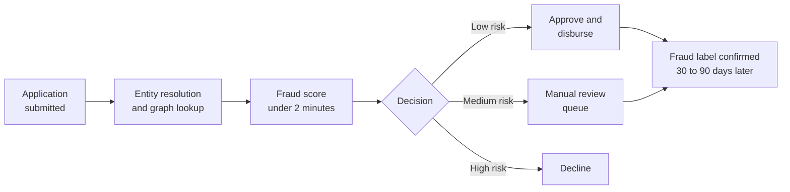
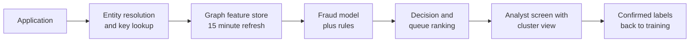

# Case Study 12: Application Fraud and Synthetic-Identity Detection for a Digital Lender

**Domain:** Finance (digital lending) | **Problem Type:** Classification plus graph features and entity resolution | **Difficulty:** Advanced

---

## 1. Business Context

### Company background

- **ZipLoan** (fictional) is an app-based lender (an NBFC, a non-bank finance company) giving instant personal loans of ₹20,000 to ₹2 lakh.
- Scale: about 4 lakh loan applications a month. About 38% are approved and disbursed, so about 1.52 lakh loans a month. Average loan is about ₹60,000.
- Applications come from the app, from partner platforms, and from DSAs (direct sales agents, who bring in customers for a commission).
- KYC (know your customer) is done with PAN, Aadhaar-based e-KYC or offline verification, a selfie, and a bank account check.
- Credit risk is handled by a separate underwriting model (see Case 1). This case is about **who the applicant really is**, not whether a real person will repay.

### The pain, with numbers

| Item | Value |
| --- | --- |
| Applications a month | 4 lakh |
| Estimated fraud attempts a month | about 1,950 (about 0.5% of applications) |
| Fraud currently caught by rules before disbursal | about 30% (about 586 a month) |
| Fraud loans that slip through | about 1,368 a month (0.9% of the 1.52 lakh disbursed) |
| Average loss per fraud loan (about 90% of ₹60,000, after small recoveries) | about ₹54,000 |
| Monthly loss | about ₹7.4 Cr |
| **Annual loss that slips through** | **about ₹89 Cr** (1,368 x ₹54,000 x 12) |
| Share of fraud loans in organised clusters (5 or more linked applications) | about 12% |
| Manual review capacity | 20 analysts x 30 cases = 600 cases a day, about 4.5% of 13,300 daily applications |
| Cost per manual review | about ₹120 |

- Fraud types seen:
  - **Third-party fraud:** a stolen real identity, where the real person never took the loan.
  - **Synthetic identity:** a made-up person built from a real PAN or Aadhaar number mixed with a fake name, date of birth, phone and address.
  - **First-party fraud:** the applicant is real but never intended to repay (a "loan bust-out").
- RBI's digital lending guidelines expect the lender to remain responsible for KYC, to disburse only to the borrower's own bank account, and to protect data. The DPDP Act 2023 adds duties on how personal data (including device and contact data) can be collected and used.

### Stakeholders and what each wants

| Stakeholder | What they want | What they fear |
| --- | --- | --- |
| Chief Risk Officer | Cut the ₹89 Cr loss | A fraud ring taking ₹5 Cr in a weekend |
| Head of Growth | No friction for real applicants, fast approvals in under 2 minutes | Good customers rejected or sent for slow reviews |
| Fraud operations manager | A queue of 600 cases a day with the right cases at the top | Queue floods from a ring wave, analysts lacking context |
| Compliance and legal | Clear reasons, no wrongly branded customers, data used lawfully | Shared-device flags unfairly hitting families or agents |
| Collections head | Fewer "unreachable" accounts that cannot be recovered | Spending field effort on people who do not exist |

---

## 2. Translating Business to ML

### The business question vs the ML question

| Business question | ML question |
| --- | --- |
| "Stop fake and stolen identities before the money goes out." | "For each application, estimate the probability that it is fraud (third-party, synthetic or first-party), using the applicant's own data and the network of applicants it connects to, and decide within 2 minutes: approve, send to manual review, or decline" |
| "Find rings, not just single bad applications." | "Link applications through shared phones, devices, addresses, bank accounts and emails, build cluster-level features, and flag whole clusters" |
| "Know which type of fraud it is." | "Use separate labels, so that decline reasons, recovery plans and model features can differ by fraud type" |

### Target variable definition

- **Primary label:** `is_fraud = 1` if a disbursed loan was later confirmed as one of:
  - third-party: the real person disowns the loan (complaint, police report, or failed re-verification),
  - synthetic: the identity does not resolve to a real person after field or document checks,
  - first-party bust-out: a real person, first EMI missed, unreachable or all contacts invalid, plus analyst confirmation.
- **Secondary labels:** `fraud_type` with values third-party, synthetic, first-party, and `suspected` (analyst belief, not confirmed).
- **Everything else:** `is_fraud = 0`, but only after a **maturity window of 90 days** after disbursal.

### Edge cases

| Edge case | Recommended treatment | Reason |
| --- | --- | --- |
| Loan defaults at the first EMI, but the customer answers the phone and explains a job loss | Label as credit default, not fraud | Different cause, different remedy and different model |
| Applicant rejected by rules, so there is no outcome | Mark as "declined, outcome unknown". Use analyst review of a sample to label some | Declined applications never produce a repayment record |
| Applicant disowns the loan, but investigation finds a family member applied with consent | Label as first-party or credit, not third-party | The customer's statement is not final proof |
| DSA agent submits 40 applications from the same phone | Tag the device as a "channel hub" and do not treat all 40 as one ring | Legitimate hubs exist and must be separated from rings |
| Application with a valid PAN but a mismatched date of birth | Keep as a strong feature but not a label | Could be a typing error or a synthetic identity |
| Known mule bank account used for disbursal | Label the loan as fraud and add the account to a blocklist | Gives clean positives and a reusable network key |

### Unit of prediction

- One **application** (primary decision).
- A second, linked unit is the **cluster** of applications that share identifiers. Cluster-level scores help the analyst and inform application-level features.

### Prediction timing



- The decision happens **before disbursal**.
- Graph features are refreshed every 15 minutes. A ring wave can build up inside one hour, so a nightly graph would be too slow.
- Fraud confirmation takes 30 days for third-party complaints and up to 90 days for synthetic and first-party cases.

### What success looks like

| Lens | Success |
| --- | --- |
| Business | Catch 60% of fraud attempts before disbursal (up from 30%). Net saving about ₹31 Cr a year |
| Model | Recall of 60% at a review plus decline rate of about 5% of applications. PR-AUC above 0.25 against a base rate of 0.5% |
| Operations | Queue under 600 cases a day, at least 25% of reviewed cases confirmed as fraud |

---

## 3. Data Understanding

### Data sources and key features

| Feature group | Source | Why it matters |
| --- | --- | --- |
| Identity data (PAN, name, date of birth, e-KYC response, PAN-name match score) | KYC providers | Synthetic identities often fail small consistency checks |
| Contact data (phone, email, address, phone age, SIM change flag) | Application and telecom data partner | Fresh phones and throwaway emails are common in fraud |
| Device and session data (device ID, emulator or rooted flag, IP, app install age, copy-paste in form fields) | App SDK | Fraudsters re-use devices and paste data from sheets |
| Bank account (account holder name match, account age, penny-drop result) | Bank verification API | Disbursal to a mule account is a key signal |
| Network graph (shared phones, devices, addresses, bank accounts, referrers) | Entity store | Rings reveal themselves through shared attributes |
| Bureau thin-file indicators (age of credit file, number of accounts) | Credit bureau | Synthetic identities have a very thin or brand-new file |
| Application behaviour (time to fill form, edits to income, number of attempts after decline) | App SDK | Bots and coached applicants behave differently |
| Labels | Complaints, field checks, analyst decisions, EMI-1 outcomes | Ground truth, but slow and partial |

### Data volume, granularity and refresh

- **Volume:** about 4 lakh applications a month, so about 48 lakh in 12 months. Confirmed fraud loans are about 16,000 in 12 months (1,368 x 12), plus several thousand rule-caught attempts with only partial labels.
- **Granularity:** one row per application, with a link table of (application, identifier) pairs for the graph.
- **Refresh:** application features in real time, graph features every 15 minutes, labels updated daily as cases close. Model retrained monthly.

### Common data issues

| Issue | How it shows up here |
| --- | --- |
| Low base rate | About 1 in 200 applications is fraud |
| Slow-maturing labels | A bust-out loan looks perfect for 30 to 60 days. The last 90 days of data have too few fraud labels |
| Noisy identifiers | "Rahul Kumar", "Rahul Kr." and "RAHUL KUMAR S/O Ram" are the same person, while two different Rahul Kumars share a city |
| Super-nodes | A cybercafe address, a DSA's phone, or a common router IP connects thousands of unrelated applications |
| Label confusion | A defaulted loan could be fraud, hardship, or a collections gap |
| Consent and privacy limits | Contact and device data can only be used within the consent given and the DPDP Act purpose |
| Adversarial adaptation | Rings change phones and devices after a few declines |

> **Mentor note: Where juniors usually go wrong here.**
>
> - They link every pair of applications that share any attribute. A shared mobile tower IP or a famous cybercafe address then joins strangers into one giant cluster that is meaningless.
> - They put a ring's members into both training and test sets, and the model "learns" the ring's phone numbers instead of learning fraud patterns.
> - They collapse all fraud into one label. A third-party identity theft needs a different rule and a different fix than a first-party bust-out.

---

## 4. Approach and Decision Points

### Baseline first

- **Baseline:** current rules (PAN mismatch, blocklisted phone, age under 21, known emulator). They stop about 30% of attempts.
- **Simple model baseline:** logistic regression on application-level features only, with no graph.
- **Why it matters:** the graph must prove it adds lift beyond application-level features. If it does not, the extra infrastructure is not justified.

### Candidate models

| Model | Pros | Cons | Verdict |
| --- | --- | --- | --- |
| Rules and blocklists | Instant, auditable, easy to patch | Fraudsters learn them | Keep as a first layer |
| Logistic regression | Stable, explainable | Misses interactions | Baseline |
| Gradient boosting on application features | Strong, fast | Blind to rings | Part of the main model |
| Gradient boosting with graph features (cluster size, degree, fraud neighbours) | Sees rings through simple aggregates, easy to serve | Needs careful time-aware computation | **Primary model** |
| Entity resolution (rules plus fuzzy matching, then a pairwise match model) | Creates a clean person and household key | Needs labelled pairs, tuning thresholds | Prerequisite for graph features |
| Graph neural network | Learns from the full network | Heavy to build and explain | Later, once graph aggregates are stable |
| Anomaly detection | Catches new patterns | Many false alarms | Secondary signal |

### Decision scenarios

| What if... | Recommended action | Reasoning |
| --- | --- | --- |
| **A cluster of 30 applications shares a single device, and 25 are already approved** | Freeze disbursal for the unpaid ones, route the cluster to a senior analyst, and add the device to a watchlist. Score the cluster, not only each application | Rings work in bursts. Acting at cluster level stops the loss before it grows |
| **A family of 4 shares one phone, one address and one Wi-Fi, and all apply in the same week** | Do not auto-decline. Use features such as same surname, matching KYC address, and distinct bank accounts to mark it as a probable household. Send to review only if other signals fire | Households are common in India. Treating shared attributes alone as fraud hurts real customers |
| **A DSA agent applies for 40 customers from one device** | Keep a "channel hub" list. Compute features within the hub (identity mismatch, repeat photos, repeated bank accounts) rather than across the hub | A hub is legitimate by design. Fraud inside a hub looks different from the hub itself |
| **Entity resolution merges "Mohammed Khan" in Hyderabad with another in Lucknow because the phone is the same** | Use a match score with several fields, and require at least two strong fields (PAN, bank account, or phone plus date of birth). Cap cluster size and flag super-nodes for manual rules | A loose match creates false rings. A tight match misses real ones. Tune on labelled pairs and review samples |
| **First-party fraud shows up only after 3 or 4 EMIs** | Train a second model on an "early bust-out" proxy label (first EMI missed, phone switched off, contacts invalid) with a lower weight. Keep the confirmed label as the final truth | Waiting 120 days makes the model always stale. Proxy labels give faster feedback, at some noise cost |
| **A ring wave arrives and the review queue jumps from 600 to 2,000 cases a day** | Rank the queue by expected loss (score x loan amount), batch cases from one cluster to one analyst, and auto-hold a whole cluster when two or more members are confirmed fraud | Analysts cannot clear a 3x queue. Cluster-level handling clears the queue much faster than case-by-case review |
| **Rejected fraudsters re-apply with small changes in name or phone** | Keep fuzzy keys (device, bank account, face embedding if consented) and link re-applications. Add "number of attempts after decline" as a feature | Fraudsters probe the system. Linking attempts reveals the pattern |

---

## 5. Feature Engineering

### Top 10 features to build

| # | Feature | Business logic |
| --- | --- | --- |
| 1 | Number of applications on the same device in the last 7 days (excluding listed hubs) | One device and many people suggests a fraud farm |
| 2 | Number of distinct PANs linked to the same phone or bank account | A phone tied to many identities is a red flag |
| 3 | Size of the connected cluster and the number of confirmed fraud neighbours (time-safe) | Guilt by association, with care about leakage |
| 4 | Age of phone number, email and bank account in days | New contact points are typical for synthetic identities |
| 5 | Name match score between PAN, bank account holder and application | Mismatches show stolen documents or mule accounts |
| 6 | Credit file age and number of tradelines | A fully grown credit file with a 20-day-old phone is odd |
| 7 | Address reuse count, after normalising the text | The same address with many identities is a ring signal |
| 8 | Form-filling behaviour (time taken, paste events, edits to income) | Coached or bot-driven applications look different |
| 9 | Attempts after decline from the same device or face | Probing behaviour |
| 10 | Age of the app install and time from install to application | Fraud applications often arrive minutes after install |

### Features to avoid (leakage risks)

| Feature | Problem |
| --- | --- |
| Fraud status of neighbours known only after the application date | Look-ahead leakage in the graph. Neighbour labels must be those known at the decision time |
| Analyst case outcome or "disowned" flag | Direct label leakage |
| Collections contact status | Post-event information |
| Cluster size computed on today's full graph | Includes applications that came later |
| Blocklist added after the fraud was found | Contains the outcome |

Time-safe cluster size for each application (simplified):

```python
import networkx as nx
import pandas as pd

def cluster_features(apps, links):
    """apps: id, ts. links: app_id, key. Count linked earlier applications only."""
    feats = {}
    for t, batch in apps.groupby(apps.ts.dt.floor("15min")):
        past = links[links.ts <= t]               # only edges known at time t
        g = nx.Graph()
        g.add_edges_from(zip(past.app_id, past.key))
        comp = {n: i for i, c in enumerate(nx.connected_components(g)) for n in c}
        sizes = pd.Series(comp).value_counts()
        for a in batch.id:
            feats[a] = sizes.get(comp.get(a), 1)
    return feats
```

---

## 6. Evaluation Strategy

### Metrics

| Metric | Role | Why |
| --- | --- | --- |
| **PR-AUC** | Primary model metric | Base rate is 0.5%, so ROC-AUC looks high for weak models |
| **Recall at a fixed review rate** (for example 5% of applications) | Primary business metric | Matches the analyst capacity |
| **Value-weighted recall** (rupees of fraud caught divided by rupees of fraud) | Business | A ₹2 lakh fraud matters more than a ₹20,000 one |
| **Queue precision** (share of reviewed cases confirmed as fraud) | Operations | Keeps analysts effective |
| **Cluster-level recall** (share of rings with at least one member caught early) | Graph metric | Measures if the graph finds rings |
| **False decline rate** among good applicants | Customer experience | Direct growth cost |

### Metrics that look good but are misleading here

- **Accuracy:** 99.5% by approving everyone.
- **ROC-AUC:** can be 0.95 with poor business value.
- **Application-level recall alone:** one ring of 30 applications can hide behind a good-looking recall if the model catches the first few and misses the rest. Check how early in the ring the first catch happens.
- **Fraud rate among declined applications:** declines have no ground truth, so this is circular.

### Validation strategy

| Step | Design | Why |
| --- | --- | --- |
| Time-based split | Train on months 1 to 8, validate on 9 to 10, test on 11 to 12 | Mirrors production and fraud drift |
| Label embargo | Exclude the last 90 days from evaluation, or use maturity-adjusted counts | Slow labels bias results |
| **Group split by cluster** | All applications of one ring (and one entity) stay in the same split | Prevents ring-specific leakage |
| Graph built point-in-time | Rebuild features as they would have been at each decision time | Avoids look-ahead leakage in graph features |
| Review-sample labelling | Analysts label a random 1% of approved and declined traffic | Gives unbiased labels for the declined group |
| Shadow mode | Run the new score silently for 4 weeks | Compare with analyst outcomes before action |

### From model metric to business value

- Fraud attempts: about 1,950 a month. Today 30% caught (586), so 1,368 slip through.
- The model raises the catch rate to 60%. Additional frauds stopped: 586 a month. At ₹54,000 each, that is about ₹3.16 Cr a month, or **₹38 Cr a year**.
- Review cost: 600 cases a day x 30 days x ₹120 = ₹21.6 lakh a month, about **₹2.6 Cr a year**.
- Good applicants wrongly declined or lost: about 900 a month x ₹3,500 margin = ₹31.5 lakh a month, about **₹3.8 Cr a year**.
- **Net benefit: ₹38 Cr − ₹2.6 Cr − ₹3.8 Cr, about ₹31 Cr a year.** Loss after the model: about 782 slip-throughs a month, about ₹51 Cr a year.

---

## 7. Deployment and Monitoring

### Batch vs real time

- **Real time:** application scoring and graph lookup in under 2 minutes, because the customer is waiting.
- **Near real time:** graph and cluster features refreshed every 15 minutes.
- **Batch:** daily retraining data refresh, weekly entity-resolution quality checks, monthly model retraining.



### What to monitor

| Type | What to track | Alert trigger |
| --- | --- | --- |
| Data drift | Feature PSI, share of new devices and phones | PSI above 0.2 |
| Graph health | Cluster size distribution, number of super-nodes, entity-match rate | A cluster above the agreed size, or a sudden jump in links |
| Queue | Daily cases, queue precision, age of the oldest case | Queue above 800 or precision below 15% |
| Concept drift | Weekly recall on matured labels | Drop of more than 5 points |
| Fairness and customer impact | Decline and review rates by channel, region, and shared-household groups | Any group above the agreed band |
| Ring response | Time from ring's first application to first decline | More than 24 hours |
| Data and consent | Missing consent fields, stale feeds | Any breach |

### Retraining

- **Scheduled:** monthly on a rolling 12-month window with matured labels.
- **Triggered:** a ring wave, new fraud type, or drop in recall.
- **Blocklists and rules:** updated daily, since they react faster than the model.

### A/B test or champion-challenger design

- **Shadow first:** the challenger scores all applications silently for 4 weeks, and analysts review a sample of its top-ranked cases.
- **Then a live split:** 10% of applications, randomised by applicant identity key (so repeat attempts see the same treatment).
- **Guardrails:** stop if approval rate of good customers drops by more than 1 point or queue precision falls under 15%.
- **Holdout:** keep 2% on the old process and a 1% random-review sample for unbiased labels.

---

## 8. Stakeholder Communication

### Explain it to a non-technical leader

> "Fraudsters do not apply once. They reuse phones, devices, addresses and bank accounts across many applications, and we can see these links. The new system connects those dots in real time, and scores each application with the context of everyone it is linked to.
> Clear cases go through quickly, suspicious ones go to an analyst with the linked group shown on one screen, and obvious fakes are declined.
> We expect to stop about twice as much fraud, worth about ₹31 Cr a year after review costs, while keeping the genuine customer experience intact."

### Questions leadership will ask

| Question | Suggested answer |
| --- | --- |
| "Will families sharing a phone be treated as fraud?" | "No. Shared attributes alone only raise a score. We look at whether names, addresses and bank accounts match as a household. A person can always be reviewed by an analyst" |
| "Why not wait to see who defaults, then block?" | "Fraud loans are lost almost entirely. The only cheap moment to stop them is before disbursal" |
| "Can fraudsters get around it?" | "They will try, by changing phones and devices. Because we use many linked signals and refresh every 15 minutes, a ring is caught after its first few applications" |
| "Is it legal to use device and contact data?" | "Only within what the customer consented to and the purpose stated, under the DPDP Act and RBI's digital lending rules. We keep an audit trail and a clear retention period" |
| "How do we know it works if declined people never show their outcome?" | "We label a random sample of both approved and declined applications and run a holdout group" |

---

## 9. Common Pitfalls and Lessons

| Mistake | Why it happens | How to avoid it |
| --- | --- | --- |
| Linking on any shared attribute | It is quick and gives many links | Use strong and weak keys, cap cluster size, list known hubs |
| Putting ring members in both train and test | Random splits are the default | Split by cluster, and check for leakage of identifiers |
| One fraud label for all types | Simpler pipeline | Keep third-party, synthetic and first-party separate |
| Using neighbour fraud labels that were not known at decision time | Backfilled graphs include the future | Build the graph point in time |
| Treating declines as clean negatives | No outcome is recorded | Use random review samples and mark declines as unknown |
| Ignoring the review queue | Focus on the model score | Rank by expected loss, group by cluster, and set capacity-based cut-offs |
| Skipping entity resolution quality checks | It looks like plumbing | Measure match precision and recall on labelled pairs every month |
| Flagging households and agents as fraud | Shared devices look suspicious | Add household and channel-hub logic, and track fairness metrics |

---

## 10. Mentor's Focus Checklist

- ✅ **Where to spend 80% of the effort:**
  - Entity resolution that is accurate and handles super-nodes.
  - Point-in-time graph features and cluster-aware splits.
  - Clean, typed labels (third-party, synthetic, first-party) and an unbiased review sample.
  - Queue design: ranking by expected loss and handling clusters together.
- ❌ **What not to over-engineer:**
  - Graph neural networks before simple graph aggregates work.
  - Perfect labels. A fast proxy for bust-out is more useful than waiting 120 days.
  - Very fine fraud sub-types that the operations team cannot act on.
- 💡 **Key takeaway:** Fraud is rarely one application. **Connect the identifiers, split data by cluster, keep the labels honest, and design the review queue like a product.**
