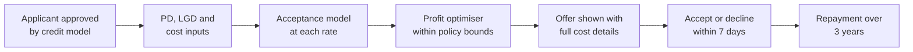
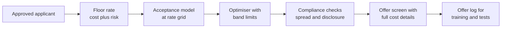

# Case Study 13: Risk-Based Interest Rate Pricing for Personal Loans

**Domain:** Finance (consumer lending) | **Problem Type:** Regression plus price-elasticity optimisation | **Difficulty:** Advanced

---

## 1. Business Context

### Company background

- **RupeeWise Finance** (fictional) is an NBFC (non-bank finance company) giving unsecured personal loans of ₹50,000 to ₹5 lakh, through its app and a few aggregator marketplaces.
- Scale: about 40,000 approved offers a month. About 25% of offers are accepted, so about 10,000 loans a month. Average loan is about ₹1.5 lakh over 36 months.
- Disbursals are about ₹150 Cr a month, about ₹1,800 Cr a year.
- Pricing today: **4 rate bands** by credit-score band: 15.5%, 18%, 21% and 24% a year. The bands were set 3 years ago and reviewed once.
- The approval model (see Case 1) gives a probability of default (PD). Pricing starts after approval: given an approved applicant, what rate do we quote?

### The pain, with numbers

| Item | Value |
| --- | --- |
| Approved offers a month | 40,000 |
| Acceptance rate | about 25% (10,000 loans) |
| Cost of funds (what RupeeWise pays for money) | about 9.5% a year |
| Operating and acquisition cost | about 3.0% of outstanding a year |
| Average lifetime profit per offer (blended) | about ₹1,500 |
| Annual profit on loans originated | about ₹72 Cr (₹1,500 x 40,000 x 12) |
| Applicants who compare 3 or more lenders before accepting | about 60% |
| Share of accepted borrowers in the top-risk band who are 90+ days late within 12 months | about 11% against about 5% in the whole book |

- Within one band, two customers can have a very different PD, and very different sensitivity to rate. A salaried borrower with good history shops around for the lowest rate. A borrower rejected elsewhere takes whatever is offered.
- High-rate bands attract the people who have fewer choices. That is **adverse selection**, and it is why "just raise the rate" does not always raise profit.
- RBI's fair practices guidance expects NBFCs to have a board-approved interest rate policy, to explain how rates are set, to tell the borrower the full cost (a key fact statement with the annualised rate and all charges), and not to hide charges. Rates may differ by risk, but they must be explainable and not discriminatory.

### Stakeholders and what each wants

| Stakeholder | What they want | What they fear |
| --- | --- | --- |
| Chief Business Officer | Higher disbursal and market share | Losing deals to rivals that quote 1 point lower |
| Chief Risk Officer | Rate that covers expected loss with a safety margin | A rate cut that brings in worse borrowers |
| CFO and Treasury | Net interest margin above the board target, stable | Margin squeezed when cost of funds rises |
| Compliance | Transparent, consistent, explainable pricing | A regulator or customer asking "why was I charged more than my colleague?" |
| Product and Marketing | A simple offer screen and a fair story for customers | Complex pricing that confuses customers or invites complaints |

---

## 2. Translating Business to ML

### The business question vs the ML question

| Business question | ML question |
| --- | --- |
| "What rate should we quote this applicant?" | "For each approved applicant, estimate the probability of acceptance at each candidate rate, and the expected profit if accepted. Choose the rate with the highest expected profit per offer, within policy bounds" |
| "Why do high rates bring bad loans?" | "Estimate how the risk of the accepted pool changes with the rate (adverse selection), so that the profit model does not assume a flat risk" |
| "Can we go cheaper for customers we really want?" | "Find customers with high acceptance sensitivity and low risk, where a small cut gives a large jump in acceptance" |

### Target variable definition

Pricing needs three connected pieces.

- **Risk:** lifetime or 12-month PD and loss given default (LGD). Taken from the credit model (Case 1 and Case 25 style), then adjusted for adverse selection.
- **Acceptance:** `accepted = 1` if the applicant took the loan within 7 days of seeing the offer. The model predicts acceptance as a function of the quoted rate.
- **Profit per offer:** acceptance probability x lifetime profit if accepted, where lifetime profit is interest income minus cost of funds, opex and expected credit loss.

### Edge cases

| Edge case | Recommended treatment | Reason |
| --- | --- | --- |
| Applicant saw an offer but never opened the screen | Exclude from acceptance training | No chance to react to price |
| Applicant came through a marketplace that shows only the rate rank | Model separately, with marketplace position as a feature | The decision depends on rank among lenders, not the absolute rate |
| Loan prepaid within 3 months | Use actual life in profit calculation | Short loans earn less than the full-term estimate |
| Offer shown at one rate, then renegotiated by a call agent | Log the final rate and the original quote | Otherwise, the price signal is lost |
| Loan amount reduced by the customer after the offer | Treat the new amount as a separate outcome | Price and amount are chosen together |
| Customer with an existing RupeeWise loan | Separate cohort with lower acquisition cost | Repeat customers are less rate-sensitive and cheaper to serve |

### Unit of prediction

- One **approved offer** (applicant, amount, tenor, candidate rate).
- The model scores each offer at each rate on a grid, for example 14% to 26% in steps of 0.5 point.

### Prediction timing



- The rate is chosen in real time, right after approval, in under a second.
- Acceptance is known within 7 days, but profit takes 12 to 36 months to show up.

### What success looks like

| Lens | Success |
| --- | --- |
| Business | Profit per offer up by about 8%, about ₹5.8 Cr a year, with the book's loss rate unchanged |
| Model | Acceptance model with a well-calibrated curve of acceptance against rate. Adverse-selection effect estimated within a sensible range |
| Compliance | Every quoted rate can be explained by cost of funds, risk premium, and a bounded commercial margin |

---

## 3. Data Understanding

### Data sources and key features

| Feature group | Source | Why it matters |
| --- | --- | --- |
| Credit risk output (PD, bureau score, income, existing EMIs) | Credit model | Drives the cost side of the price |
| Offer details (amount, tenor, rate, processing fee, EMI) | Offer log | The "treatment" in the acceptance model |
| Applicant context (channel, device, time of day, city tier) | App events | Shapes how price-sensitive a customer is |
| Competition signals (marketplace rank, number of lenders shown, bureau enquiries in the last 30 days) | Marketplace and bureau | Indicates how much the customer is shopping around |
| Relationship (existing customer, past repayment) | Core system | Existing customers accept more easily |
| Funding data (cost of funds by month, funding line limits) | Treasury | Base rate changes need to flow into price |
| Repayment outcomes | Collections and servicing | Needed for PD and for adverse selection |
| Price experiments | Randomised rate tests | The cleanest data on price sensitivity |

### Data volume, granularity and refresh

- **Volume:** about 40,000 offers a month, so about 4.8 lakh in 12 months. Accepted loans are about 1.2 lakh. Defaults are visible only after 6 to 12 months, so a smaller mature set (about 6,000 bad loans) is available for the risk side.
- **Granularity:** one row per offer. Price variation is small today, because only 4 rates are used.
- **Refresh:** acceptance model retrained every month. Cost of funds updated whenever Treasury revises it.

### Common data issues

| Issue | How it shows up here |
| --- | --- |
| Little price variation | With 4 fixed bands, the data cannot show what happens between 18% and 21% |
| Performance only for accepted loans | No repayment data exists for people who declined the offer |
| Offer-acceptance bias | Applicants who accept are not a random sample of those who were offered |
| Confounded price | Higher rates went to riskier scores, so "higher rate, lower acceptance" is mixed with other effects |
| Competitor prices unseen | We do not know the rate the customer got elsewhere |
| Fees and EMIs muddle the comparison | Customers react to the EMI and the total cost, not just the rate |

> **Mentor note: Where juniors usually go wrong here.**
>
> - They fit acceptance on historical rates and read the slope as elasticity. Because high rates went to risky customers who have fewer options, the slope is biased.
> - They train the risk model on accepted loans only, then apply it to everyone. Customers who accept at high rates are not a typical sample.
> - They search for the rate that maximises revenue, not profit. A rate that fills the book with risky borrowers destroys value later.

---

## 4. Approach and Decision Points

### Baseline first

- **Baseline:** the current 4 bands. Profit per offer is about ₹1,500.
- **Cost-plus baseline:** rate = cost of funds + opex + expected loss + a fixed margin of 2.5 points. Explainable, but ignores how customers respond.
- **Why it matters:** the cost-plus formula is the compliance anchor. The optimiser is only allowed to move around it, within a set band.

### Candidate models

| Model | Pros | Cons | Verdict |
| --- | --- | --- | --- |
| Fixed bands by score | Simple, transparent | Ignores acceptance and individual risk | Keep as a fallback |
| Cost-plus pricing | Clear logic, easy to audit | No view of demand | Floor for the price |
| Logistic regression of acceptance with rate as a feature | Smooth, easy to read | May miss interactions with income and channel | Baseline acceptance model |
| Gradient boosting with monotone constraint on rate | Better fit, acceptance must fall as rate rises | Needs careful calibration | **Primary acceptance model** |
| Causal methods on randomised price tests (double ML, uplift-style) | Remove confounding | Need experiment data | Use as the experiment data grows |
| Expected-profit optimiser on a rate grid | Picks the best rate per offer, with constraints | Depends on good inputs | **Decision layer** |
| Dynamic or bandit pricing | Learns online | Governance and fairness risk | Later, within narrow bounds |

### Decision scenarios

| What if... | Recommended action | Reasoning |
| --- | --- | --- |
| **The model says raise the rate by 3 points to improve margin** | Check the adverse-selection curve. Compute profit with the risk of the accepted pool rising with rate, not flat. Raise only if profit still rises | In the worked example below, ignoring adverse selection points to 21%, but the true best rate is about 18% |
| **A customer's offer is accepted 6 times out of 10 at 19%, but only 3 out of 10 at 21%** | Treat as rate-sensitive. Quote closer to the floor, and use EMI and tenor options instead of a bigger cut | Sensitive customers are where a small rate cut gives a large gain in volume |
| **Treasury raises the cost of funds by 0.5 point** | Pass through the change to the floor and re-run the optimiser. Do not raise all rates by exactly 0.5 | Some segments can bear it and some will walk. The optimiser decides, and the change is explained in a policy note |
| **Marketplace partners show the lowest rate first and our rank affects clicks** | Add rank as a feature, and run a small price test on that channel | Position matters as much as price in a comparison list |
| **The experiment says a 1 point cut increases acceptance by only 1.5 points in one segment** | Do not cut in that segment, and raise the floor margin a little | Low sensitivity means the customer is not shopping on price |
| **Two customers with the same PD get quotes that differ by 3 points** | Check that the difference is explained by cost, risk or channel cost, not by a protected attribute (religion, gender, caste, or proxies like some pin codes). Cap the spread within a band | Rates must be explainable and not discriminatory. Large unexplained gaps are a complaint and a compliance risk |
| **Acceptance falls by 20% in one month, and no price change was made** | Check competitor moves, marketplace position, and app funnel issues before touching price | A drop can come from the funnel or the market, and a rate cut would be a costly mistake |

---

## 5. Feature Engineering

### Top 10 features to build

| # | Feature | Business logic |
| --- | --- | --- |
| 1 | Quoted rate, rate gap to the floor, and the EMI | Customers react to the monthly EMI and the gap, not the annual rate alone |
| 2 | PD and expected loss from the credit model | Sets the risk premium |
| 3 | Bureau enquiries in the last 30 days | A sign the customer is shopping around |
| 4 | Marketplace rank and number of lenders shown | Competitive position of our offer |
| 5 | Existing customer flag and past repayment | Existing customers accept at higher rates |
| 6 | Loan amount to monthly income | Affordability affects both acceptance and risk |
| 7 | Time from app install to offer, and number of sessions | Intent and urgency |
| 8 | Income type and employer category | Salaried customers compare more. Self-employed borrowers often accept faster |
| 9 | Processing fee and total cost of credit | The all-in cost is what a careful customer sees |
| 10 | Channel and campaign source | Acquisition cost and customer intent differ by channel |

### Features to avoid (leakage risks)

| Feature | Problem |
| --- | --- |
| Whether the loan was disbursed or the customer was called back | Outcome of the decision |
| Post-offer negotiation discount | Not known when the first quote is made |
| Repayment data for the same loan | Future information |
| Protected attributes (religion, caste, gender) and close proxies | Unfair and not allowed in a fair pricing policy |
| Competitor's final rate, if only known after acceptance | Post-event |

Pick the best rate on a grid with a policy floor and ceiling:

```python
import numpy as np

rates = np.arange(0.14, 0.2601, 0.005)
accept = accept_model.predict_proba(make_rows(x, rates))[:, 1]
pd_acc = risk_adj_model.predict(make_rows(x, rates))      # risk of the accepted pool, rises with rate

el = pd_acc * lgd / avg_life_years                         # annual expected loss
margin = rates - cost_of_funds - opex - el
lifetime = margin * avg_balance * avg_life_years           # rupees per accepted loan
profit_per_offer = accept * lifetime

lo = max(floor_rate(x), rates.min())
ok = (rates >= lo) & (rates <= ceiling_rate)
best_rate = rates[ok][np.argmax(profit_per_offer[ok])]
```

---

## 6. Evaluation Strategy

### Metrics

| Metric | Role | Why |
| --- | --- | --- |
| **Acceptance calibration by rate band** (predicted vs actual) | Primary model metric | A mis-calibrated curve gives a wrong optimum |
| **AUC of the acceptance model** | Supporting | Shows ranking power, but not the slope |
| **Estimated price elasticity vs experiment** | Primary causal check | Confirms the slope with randomised data |
| **Profit per offer** (tested) | Primary business metric | The goal of the project |
| **Risk of the accepted pool by rate** | Risk guardrail | Detects adverse selection |
| **Net interest margin and loss rate of the new cohort** | Business | Final proof after 12 months |

### Metrics that look good but are misleading here

- **Acceptance rate:** it rises when you cut price, but profit may fall.
- **Average rate:** a higher average rate can hide a worse pool.
- **Revenue per offer:** ignores credit loss and cost of funds.
- **AUC of acceptance:** a model can rank well with a wrong slope for price.

### Validation strategy

| Step | Design | Why |
| --- | --- | --- |
| Out-of-time split | Train on months 1 to 9, test on months 10 to 12 | Rates, competitors and costs of funds move |
| Randomised price test | Within an approved band of ±1 point around the model rate, randomly assign rates for 5% of offers | Gives clean price sensitivity, and shows adverse selection |
| Holdout on the old bands | 10% of traffic keeps the old bands | Provides a clean comparison on profit |
| Segment checks | Elasticity and calibration by channel, income type, score band | Averages hide big differences |
| Fairness review | Compare spreads in rates across groups for similar PD | Shows if proxies are creeping in |
| Cohort tracking | Follow new-pricing loans for 12 months for early delinquency | Shows if the pool quality changed |

### From model metric to business value

Worked example for a mid-risk applicant. Cost of funds 9.5% plus opex 3.0% is 12.5%. Lifetime profit per loan is margin x average balance (₹84,000) x average life (2.5 years), which is margin x ₹2,10,000. At 19%, the annual expected loss is 3.3% (lifetime PD 11.8% x LGD 70% is 8.3% over 2.5 years).

| Rate | Acceptance | Annual margin with adverse selection | Profit per offer with adverse selection | Margin if risk were flat at 3.3% | Profit per offer if risk were flat |
| --- | --- | --- | --- | --- | --- |
| 17% | 34% | 2.4% | ₹1,714 | 1.2% | ₹857 |
| 18% | 30% | 2.8% | ₹1,764 | 2.2% | ₹1,386 |
| 19% | 26% | 3.2% | ₹1,747 | 3.2% | ₹1,747 |
| 20% | 22% | 3.6% | ₹1,663 | 4.2% | ₹1,940 |
| 21% | 18% | 4.0% | ₹1,512 | 5.2% | ₹1,966 |
| 22% | 14% | 4.4% | ₹1,294 | 6.2% | ₹1,823 |

- A model that ignores adverse selection would choose **21%** (₹1,966 on paper). In reality, 21% earns ₹1,512 once the riskier accepted pool is counted. The best rate is **about 18%** (₹1,764), and the curve is flat from 17% to 19%.
- Moving from 21% to 18% for this segment is worth about ₹250 per offer, a gain of about 17%.
- Across the book, moving from 4 bands to individual pricing lifts profit per offer from about ₹1,500 to about ₹1,620, which is +8%. On 40,000 offers a month, that is ₹120 x 40,000 x 12, about **₹5.8 Cr a year**.
- The gain is modest and real. It comes more from avoiding bad price moves than from big hikes.

---

## 7. Deployment and Monitoring

### Batch vs real time

- **Real time:** rate selection in under a second after approval.
- **Batch:** monthly refresh of the acceptance and risk-adjustment models, daily update of cost of funds, weekly price-test analysis.



### What to monitor

| Type | What to track | Alert trigger |
| --- | --- | --- |
| Acceptance calibration | Predicted vs actual acceptance by rate band | Gap above 3 points |
| Elasticity drift | Slope of acceptance against rate in test traffic | Moves by more than 25% |
| Pool risk | Early delinquency of new cohorts by rate band | Above the agreed ceiling |
| Margin | Net interest margin per cohort | Falls under the board target |
| Spread and fairness | Rate spread for similar PD across groups | Spread above the policy limit |
| Funnel | Offer view rate, accept rate, drop at the EMI screen | Sudden fall without a price change |
| Disclosure | Offers missing key fact statement fields | Any miss |

### Retraining

- **Scheduled:** monthly for acceptance, quarterly for risk adjustment.
- **Triggered:** change in cost of funds, a competitor price move, or a marketplace rule change.
- **Policy review:** the board's pricing committee reviews the allowed band and spread twice a year.

### A/B test or champion-challenger design

- **Champion:** the 4 bands. **Challenger:** the optimiser.
- **Split:** random by applicant ID, 80% champion and 20% challenger. Inside the challenger, a 5% price-test arm randomises the rate within ±1 point.
- **Measurement:** acceptance in 7 days, profit per offer after 12 months, early delinquency after 3 to 6 months.
- **Guardrails:** stop if early delinquency of the challenger is more than 1 point above the champion, or if rate spread breaches policy.

---

## 8. Stakeholder Communication

### Explain it to a non-technical leader

> "Today the rate depends on a score band. We now work out, for each approved customer, what it costs us to lend, how likely they are to say yes at each rate, and how risky the customers who say yes at that rate turn out to be.
> We pick the rate that earns the most profit, not the most interest, and we never go outside the board's rate band.
> The gain is about 8%, around ₹5.8 Cr a year. The bigger value is that we avoid a rate hike that would fill the book with riskier borrowers."

### Questions leadership will ask

| Question | Suggested answer |
| --- | --- |
| "Why not just charge the highest rate customers will accept?" | "The people who accept high rates are often those with fewer options, and they default more. Profit peaks at a lower rate than revenue does" |
| "Can two similar customers get different rates?" | "Yes, if their cost, risk or channel differ, and each difference can be explained. We cap the spread and check that no protected attribute drives it" |
| "What if a rival cuts price?" | "We watch acceptance by rate band and marketplace rank, and re-run the optimiser. We cut only where customers are price-sensitive" |
| "What does RBI expect on rates?" | "A board-approved interest rate policy, a clear explanation of how rates are set, and full disclosure of the annualised rate and all charges to the borrower before acceptance" |
| "How sure are you about price sensitivity?" | "From the small randomised price tests. History alone would mislead us" |

---

## 9. Common Pitfalls and Lessons

| Mistake | Why it happens | How to avoid it |
| --- | --- | --- |
| Reading elasticity from historical price and acceptance | Easy to fit | Use randomised price tests inside safe bands |
| Ignoring adverse selection | Risk is assumed to be flat in the profit formula | Model risk of the accepted pool as a function of rate |
| Training risk only on accepted loans | Only they have repayment data | Use reject and decline inference carefully, and track decliners in the funnel |
| Maximising revenue or acceptance | They are easy to measure | Optimise lifetime profit per offer after loss and funding cost |
| Letting the optimiser roam freely | The maths finds a corner | Use a floor (cost plus risk), a ceiling, and a spread cap |
| Hidden protected attributes through proxies | Features like pin code can stand in for them | Audit rate spreads across groups and drop or constrain proxies |
| Changing price when the funnel broke | Acceptance fell and price is the obvious lever | Check funnel, marketplace rank and competitors first |
| Weak disclosure | Pricing logic is treated as backend | Show the annualised rate, the fees and the EMI clearly on the offer screen |

---

## 10. Mentor's Focus Checklist

- ✅ **Where to spend 80% of the effort:**
  - Clean price variation through safe randomised tests.
  - Modelling the risk of the accepted pool as the rate changes.
  - A profit formula with the correct cost of funds, opex and expected loss.
  - Policy guardrails and explainability for compliance.
- ❌ **What not to over-engineer:**
  - Real-time competitor price scraping.
  - Online learning pricing that nobody can audit.
  - Very fine rate steps. Half-point steps are enough.
- 💡 **Key takeaway:** Price is a message that changes who says yes. **Optimise profit, not acceptance, and measure how the quality of the accepted pool moves with the rate.**
