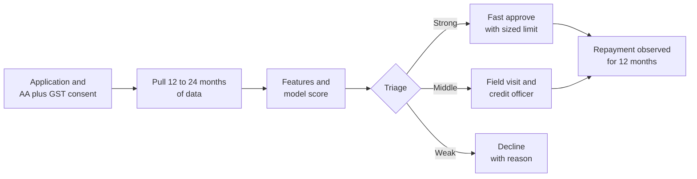
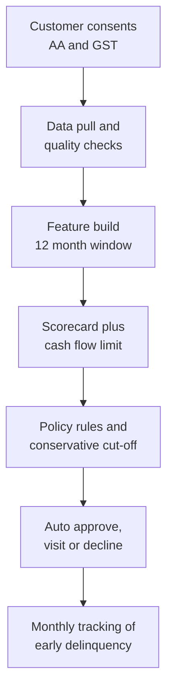

# Case Study 14: MSME Working-Capital Lending Using GST Returns, Bank Statements and Invoices

**Domain:** Finance (small business lending) | **Problem Type:** Classification plus limit sizing, small data | **Difficulty:** Intermediate

---

## 1. Business Context

### Company background

- **Vyapar Capital** (fictional) is an NBFC (non-bank finance company) that gives working-capital loans to MSMEs (micro, small and medium enterprises): kirana wholesalers, garment traders, small manufacturers, agri-input dealers, and sweet and snack makers.
- Ticket size: ₹2 lakh to ₹15 lakh, average sanction about ₹6 lakh, tenor 12 months, repaid in monthly instalments or as a revolving line.
- Scale: about 5,000 applications a year, about 52% approved, so about 2,600 loans a year. The total history is **6,500 loans over 30 months**.
- Only about 38% of applicants have a usable bureau file for the business. Many owners have a personal bureau score but no business credit history.
- Underwriting today: a credit officer visits the shop, checks documents, looks at 6 months of bank statements by eye, and uses a thumb rule: limit equals about 10% of annual turnover. A file takes about 6 days and costs about ₹3,500 in field and processing effort.

### The pain, with numbers

| Item | Value |
| --- | --- |
| Applications a year | about 5,000 |
| Approval rate | 52% (about 2,600 loans) |
| Bad rate (90+ days late within 12 months) | 7.2%, about 187 loans a year |
| Average exposure at default | about ₹4.2 lakh |
| Loss given default (after collateral and recoveries) | about 60% |
| **Annual credit loss** | **about ₹4.7 Cr** (187 x ₹4.2 lakh x 60%) |
| Cost of field visit per file | about ₹3,500, about ₹1.75 Cr a year on 5,000 files |
| Turnaround time | 6 days, and many applicants walk away to faster lenders |
| Applicants with thin or no bureau history who are rejected only because of that | about 15% of rejects |

- The business owner's bureau score tells little about the business. Cash flow does: GST returns show the sales, bank statements show the money moving, and e-invoices show who buys.
- **Account Aggregator (AA)** is the RBI-regulated, consent-based framework through which a customer shares bank statements and other financial data directly from their bank with the lender, in a standard digital format. It replaces PDF uploads that can be edited.
- Under the GST system, sales returns (GSTR-1 and GSTR-3B) and e-invoices create a digital record of turnover that can be shared with consent through a GST data provider.
- The DPDP Act 2023 requires clear consent, a stated purpose and limited retention for this data.

### Stakeholders and what each wants

| Stakeholder | What they want | What they fear |
| --- | --- | --- |
| Head of MSME Lending | Faster approvals and growth into thin-file customers | Growing the book and then seeing a spike in defaults |
| Chief Risk Officer | A conservative model, loss rate under 6% | A small-sample model that looks good on paper and fails in practice |
| Credit officers | Fewer low-value visits, a clear reason for each decision | Being replaced, or blamed when a model is wrong |
| Operations | Same-day decision for clean files | Customers who drop out during document upload |
| Compliance | Valid consent, data minimisation, auditable decisions | AA data used outside the consented purpose |

---

## 2. Translating Business to ML

### The business question vs the ML question

| Business question | ML question |
| --- | --- |
| "Should we lend to this business?" | "Using GST, bank and invoice data, estimate the probability that this business reaches 90+ days late within 12 months of a loan" |
| "How much should we lend?" | "Estimate the business's safe free cash flow in a weak month, and size the limit so that instalments are covered with a safety margin" |
| "Which files need a field visit?" | "Triage into three groups: auto-approve, field visit, decline. Use the model to skip the visit where the data is strong" |

### Target variable definition

- **Primary label:** `bad_12m = 1` if the loan reaches 90 days past due (DPD) or is written off within 12 months of disbursal.
- **Early-warning proxy:** `bad_6m = 1` if 60+ DPD within 6 months. Used as a secondary label because the most recent loans are still immature.
- **Limit sizing target:** the 20th percentile of monthly net operating cash flow over the last 12 months (a weak-month cash flow), predicted from GST and bank data.

### Edge cases

| Edge case | Recommended treatment | Reason |
| --- | --- | --- |
| Business files GST quarterly (composition scheme) | Convert to a monthly-equivalent and add a "filing frequency" feature | Do not compare monthly and quarterly filers as if they were the same |
| Owner uses a personal account for business flows | Ask for AA consent on all accounts, and flag low business-account coverage | Part of the cash flow would be invisible |
| Very high sales on GST but low bank credits | Flag as "turnover mismatch" and send to a field visit | May be inflated invoices, cash sales, or credits going elsewhere |
| Loan restructured because of a flood or a lockdown | Label by the original schedule and add a "restructured" flag | Do not hide a real stress event |
| Customer repaid early and was renewed | Count each loan, but split by repeat vs new customers | Repeat customers behave very differently |
| Applicant declined, no outcome | Keep for analysis only, and do not call them "good" | Missing outcomes, not good outcomes |

### Unit of prediction

- One **loan application** from one business (GSTIN or PAN), with a decision date.
- Features are built from the 12 months before the decision date.

### Prediction timing



- The decision is made once at application time, within minutes for clean files.
- Outcomes take 12 months. Early-warning signals at 3 and 6 months help with monitoring (see Case 15).

### What success looks like

| Lens | Success |
| --- | --- |
| Business | Same approval rate with the bad rate down from 7.2% to about 5%, and 40% of files skipping the field visit. About ₹2.8 Cr a year of benefit |
| Model | AUC around 0.72 with a confidence interval, stable across time folds. Limit rule that covers at least 90% of instalments in weak months |
| Operations | Turnaround of 1 day for auto-approve files, 4 days for visits |

---

## 3. Data Understanding

### Data sources and key features

| Feature group | Source | Why it matters |
| --- | --- | --- |
| GST returns (monthly turnover, filing regularity, late filings, nil returns) | GST data provider with consent | A formal record of sales and compliance |
| E-invoices and e-way bills (buyer count, repeat buyers, largest buyer share) | GST network data with consent | Customer concentration and demand stability |
| Bank statements (inflows, outflows, minimum balance, cheque bounces, EMI debits) | Account Aggregator | The true cash movement |
| UPI and POS inflows share | Bank statement narration | Cash-light businesses are more visible and lower risk |
| Bureau data (owner and business, if present) | Credit bureau | Helps where available, but is missing for many |
| Business profile (age, sector, city, premises owned or rented) | Application and KYC | Context and policy |
| Visit report (stock, footfall, premises) | Credit officer | Soft signal. Use carefully, as it is subjective |
| Loan performance | Servicing system | The label |

### Data volume, granularity and refresh

- **Volume:** 6,500 loans over 30 months. Only the first 18 months (about 3,900 loans) have a full 12 months of outcome. With a bad rate of 7.2%, that gives **about 280 bad loans**. This is the true "effective sample size".
- **Granularity:** one row per loan. The raw data per loan is monthly GST turnover, bank transactions (hundreds per month) and invoice lines.
- **Refresh:** features computed at application time. Model reviewed every quarter, as the sample grows by about 650 loans.

### Common data issues

| Issue | How it shows up here |
| --- | --- |
| Small sample | About 280 bads is too few for a free-form deep model or 50 features |
| Seasonality | A sweet maker's sales double in the Diwali quarter, and an agri-input dealer peaks at kharif and rabi sowing |
| Alternative data gaps | AA gives 6 to 12 months of history for new consents, while GST has 24 months |
| Gaming of data | Round-tripping money between accounts to inflate credits before applying |
| Mixed accounts | Personal and business flows share the same account |
| Feature instability | A feature that works in one 6-month window fails in the next |
| Immature recent loans | The latest loans have no 12-month outcome yet |

> **Mentor note: Where juniors usually go wrong here.**
>
> - They throw 80 features at 280 bad loans and pick the best AUC on a random split. The model memorises and then fails live.
> - They compare a business's cash flow in the festival quarter against the average of a weak quarter and call the business "growing".
> - They set the approval cut-off on the test set itself and report the result as if it were out-of-sample.

---

## 4. Approach and Decision Points

### Baseline first

- **Baseline:** current process. Credit officer judgement plus the 10% of turnover rule. Bad rate 7.2%.
- **Simple model baseline:** a handful of ratios and a scorecard (logistic regression with binned features), for example: average monthly bank credits, bounce count, GST filing regularity, minimum balance ratio, business age.
- **Why it matters:** with small data, a simple, stable model usually beats a complex one. A scorecard is easy to explain to the credit committee and to regulators.

### Candidate models

| Model | Pros | Cons | Verdict |
| --- | --- | --- | --- |
| Credit officer judgement | Uses context the data misses | Slow, expensive, varies by officer | Keep for the middle group |
| Rule-based filters (bounces, nil returns) | Clear and safe | Crude | Hard stops |
| Regularised logistic regression, binned features | Stable on small data, explainable | Misses interactions | **Primary model** |
| Shallow gradient boosting with monotone constraints | Captures some interactions, still controlled | Can overfit on 280 bads | Challenger |
| Deep learning on raw transactions | Could use full detail | Needs far more data, hard to explain | Not suitable |
| Quantile regression for weak-month cash flow | Gives a conservative cash-flow estimate | Needs reliable data history | **Limit sizing** |
| Bayesian or shrinkage methods | Honest uncertainty for small segments | More work to explain | Useful for segment-level estimates |

### Decision scenarios

| What if... | Recommended action | Reasoning |
| --- | --- | --- |
| **Only 280 bad loans exist, and you have 60 candidate features** | Pre-select 10 to 12 features on business logic and stability. Use regularisation, and check coefficient signs. Repeat the selection inside each cross-validation fold | With few events, each feature costs reliability. A rough rule is at least 10 to 20 bad loans per feature |
| **A feature has strong AUC in 2023 data but weak in 2024** | Drop it or constrain it. Keep features with the same sign and similar strength across time folds, and a PSI under 0.1 | Unstable features break in production. Stability matters more than a small AUC gain |
| **A garment trader applies in March after a strong festive and wedding season** | Compare with the same months last year, use a 12-month trailing figure, and use the weakest 3 months for limit sizing | Seasonal peaks overstate repayment capacity if used as the base |
| **GST turnover is ₹1.2 Cr, but bank credits for the same year are only ₹60 lakh** | Flag as a mismatch. Ask for all bank accounts through AA, and send to a field visit. Do not auto-approve | A big gap suggests cash sales, a second account, or inflated invoices |
| **AA consent gives only 5 months of bank data for a new account** | Use GST for the long history and treat bank features as incomplete. Cap the limit at a lower multiple and add a "short history" flag | Short history is a risk by itself. Be conservative until the data matures |
| **The model score on the cut-off suggests approving 60% of files, but the validation set has 1,300 loans** | Put the cut-off on a lower-confidence estimate (for example the upper end of the PD confidence interval). Start with a 52% approval rate, and move up in steps after live results | A cut-off chosen on a small set is noisy. A conservative start protects the book |
| **A new customer shows a sudden jump in inflows in the last 30 days** | Add a "recent spike" feature that compares the last month with the prior 6 months, and check if the inflows come from the same few sources | A sudden spike before applying is a classic window-dressing signal |

---

## 5. Feature Engineering

### Top 10 features to build

| # | Feature | Business logic |
| --- | --- | --- |
| 1 | Trailing 12-month GST turnover and its coefficient of variation | Scale and stability of sales |
| 2 | Ratio of bank credits to GST turnover | Consistency between declared sales and cash movement |
| 3 | Minimum month-end balance divided by the proposed monthly instalment | Cushion for repayment in the weakest period |
| 4 | Number of cheque or EMI bounces in 6 months | Direct stress signal |
| 5 | GST filing regularity (share of months filed on time) | Compliance and discipline |
| 6 | Weak-month cash flow (20th percentile of monthly net flow) | Conservative base for limit sizing |
| 7 | Share of top 3 buyers in invoices | Concentration risk. Losing one buyer can sink the business |
| 8 | Share of UPI and POS credits in inflows | Traceable, lower-risk cash flow |
| 9 | Seasonality index (peak month divided by average month) | Warns about strong peaks and sets the repayment profile |
| 10 | Business age and prior loan history with us | Survival and past behaviour |

### Features to avoid (leakage risks)

| Feature | Problem |
| --- | --- |
| Bank balances after the loan disbursal | The loan money itself is in the account |
| Statement months that include the disbursal date | Contains the loan inflow |
| Credit officer's final decision or notes written after the visit | Post-decision information |
| Collections or restructuring flags | Outcome leakage |
| GST data filed after the decision date | Not known at application time |

Limit sizing from weak-month cash flow (conservative):

```python
import numpy as np

# monthly net operating cash flow for the last 12 months (inflows minus operating outflows)
weak = np.percentile(monthly_net_cf, 20)

# instalment must be covered with a safety margin, even in a weak month
max_emi = 0.5 * weak                        # DSCR-style buffer: EMI is half of weak-month cash flow
tenor = 12
rate_m = 0.20 / 12
limit_cf = max_emi * (1 - (1 + rate_m) ** -tenor) / rate_m

limit_turnover = 0.10 * annual_gst_turnover   # current thumb rule
limit = min(limit_cf, limit_turnover, policy_cap)
```

---

## 6. Evaluation Strategy

### Metrics

| Metric | Role | Why |
| --- | --- | --- |
| **AUC with a bootstrap confidence interval** | Primary model metric | With 280 bads, a single AUC is not trustworthy. The interval shows the uncertainty |
| **KS and bad rate by score band** | Credit-committee metric | Shows rank ordering in a form they know |
| **Bad rate in the approved group at a fixed approval rate** | Primary business metric | Direct link to loss |
| **Coverage of weak-month instalments by the sized limit** | Limit metric | Checks that the limit rule works under stress |
| **Share of files skipping the field visit** | Operations | Cost saving |
| **Feature stability (sign and PSI across folds)** | Robustness | Needed for small data |

### Metrics that look good but are misleading here

- **AUC on a random split:** time leakage and near-duplicate businesses (the same owner, repeat loans) inflate it.
- **Accuracy:** with 7.2% bad, 92.8% is achieved by predicting "good" for all.
- **Approval rate alone:** an easy way to look good, with the risk showing up a year later.
- **Single-fold results:** one lucky fold can show an AUC of 0.78 when the true figure is 0.70.

### Validation strategy

| Step | Design | Why |
| --- | --- | --- |
| Out-of-time split | Train on the first 12 months of mature loans, test on the next 6 months | Mimics deployment |
| Rolling-origin cross-validation | 3 or 4 expanding windows with time order kept | Shows stability across time |
| Group by borrower | Keep all loans of one owner or GSTIN in the same fold | Avoids repeat-borrower leakage |
| Bootstrap | 1,000 resamples for AUC, KS and bad rate at cut-off | Honest confidence intervals |
| Early-label proxy | Check results using 60+ DPD at 6 months for the newest loans | Uses more recent data |
| Shadow mode | Score new applications silently for 3 months and compare with officers | Real data without risk |

### From model metric to business value

- **Credit loss:** bad rate falls from 7.2% to 5.0% at the same approval rate. That is 2.2 points on 2,600 loans, about 57 fewer bad loans. At ₹4.2 lakh x 60% = ₹2.52 lakh each, about **₹1.4 Cr a year**.
- **Visit saving:** 40% of 5,000 files skip the visit. 2,000 x ₹3,500 = **₹0.7 Cr a year**.
- **Growth:** approval rate moves from 52% to 58% on 5,000 files (300 more loans), at a net lifetime margin of about ₹22,000 per loan (after loss), about **₹0.66 Cr a year**.
- **Total: about ₹2.8 Cr a year** (1.4 + 0.7 + 0.66). The book is small, so the money is modest. The strategic value is in serving thin-file customers safely and quickly.

---

## 7. Deployment and Monitoring

### Batch vs real time

- **Near real time at application:** pull AA and GST data, compute features, score, size the limit. Target is minutes.
- **Batch:** monthly monitoring of the portfolio, quarterly retraining and stability checks.



### What to monitor

| Type | What to track | Alert trigger |
| --- | --- | --- |
| Data quality | AA fetch success rate, months of history, missing GST months | Below 90% usable files |
| Feature drift | PSI on the 10 features | PSI above 0.1 |
| Score drift | Distribution of scores and approval rate | Approval rate moves by more than 5 points |
| Early delinquency | 30+ DPD at month 3 and 60+ DPD at month 6, by score band | Above expected by 20% |
| Seasonal view | Delinquency by month of origination | A pattern linked to a season |
| Limit quality | Utilisation and weak-month coverage | Coverage below 90% |
| Consent and data use | Consent validity, retention, purpose | Any breach |

### Retraining

- **Scheduled:** quarterly review with new matured loans. Refit only if stability and calibration hold.
- **Triggered:** change in GST rules, a sector shock, or data provider change.
- **Rule of thumb:** with so few bad loans, change the model slowly and keep the feature list short.

### A/B test or champion-challenger design

- **Shadow first** for 3 months. Compare the model's triage against officer decisions on every file.
- **Then a split:** 30% of files, randomised, use the model triage. The rest follow the old process.
- **Conservative ramp:** start with auto-approve only for the top 20% of scores and raise it in steps if early delinquency holds.
- **Guardrails:** stop if 60+ DPD at 6 months in the model group is more than 1.5 points above the control.
- **Learn from the middle group:** the field-visit group provides a rich label set for improving the model.

---

## 8. Stakeholder Communication

### Explain it to a non-technical leader

> "Instead of relying on a visit and a thumb rule, we read the business's own numbers: sales from GST, money movement from the bank, and customers from invoices, all shared with the owner's consent.
> We keep the model simple because we have only about 280 bad loans to learn from, and we size the limit on what the business earns in its weakest months.
> Clean files get a same-day answer, doubtful ones still get a visit, and we start cautiously and widen as results prove out."

### Questions leadership will ask

| Question | Suggested answer |
| --- | --- |
| "Can a model trained on 280 bad loans be trusted?" | "On its own, no. That is why we use a simple model, confidence intervals, a time-based test and a cautious cut-off. We expand only after live results" |
| "What if the owner games the bank statement?" | "We cross-check GST against bank credits, look at the concentration of sources, and flag last-minute spikes. Suspicious files go to a visit" |
| "How do you handle seasonal businesses?" | "We compare against the same period last year and size limits on the weakest months, not on the festival peak" |
| "Is the data use legal?" | "We use RBI's Account Aggregator framework and GST data with the owner's consent, for the stated lending purpose, and keep it only as long as needed" |
| "Will credit officers lose their jobs?" | "No. The model removes visits on strong files, and officers spend their time on the middle group where judgement matters most" |

---

## 9. Common Pitfalls and Lessons

| Mistake | Why it happens | How to avoid it |
| --- | --- | --- |
| Too many features for too few bad loans | Alternative data offers hundreds of columns | Limit to 10 to 12 features chosen on logic and stability |
| Random cross-validation | It is the default | Use time-ordered folds and group by borrower |
| Reading seasonal peaks as growth | Short windows look attractive | Use 12-month trailing figures and same-month-last-year comparisons |
| Trusting GST turnover on its own | It looks official | Reconcile with bank credits and invoice counterparties |
| Cut-off tuned on the test set | Small samples tempt over-tuning | Choose the cut-off on a separate fold and add a safety margin |
| Ignoring data coverage | A missing account looks like low activity | Track "months of history" and "accounts covered" as features and flags |
| Sizing the limit on average cash flow | Average is easy to compute | Size on the weak-month cash flow with a coverage buffer |
| Chasing complexity | Boosting looks modern | Compare with a scorecard, and pick the simpler model unless the gain is clear and stable |

---

## 10. Mentor's Focus Checklist

- ✅ **Where to spend 80% of the effort:**
  - Clean, consented data from AA and GST, with quality checks and coverage flags.
  - A short list of stable features, built with seasonality in mind.
  - Honest validation: time folds, group splits, confidence intervals.
  - Conservative cut-offs and limit sizing from weak-month cash flow.
- ❌ **What not to over-engineer:**
  - Deep models on raw transactions.
  - Fine-tuning hyperparameters on 280 bad loans.
  - Perfect probability calibration at segment level. Rank order and a conservative cut-off matter most.
- 💡 **Key takeaway:** With small data, **be humble and stable**. Choose few features, test over time, size limits on the weak month, and let live results earn you a wider approval band.
