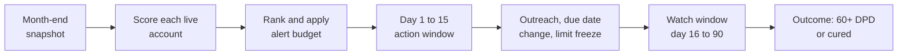
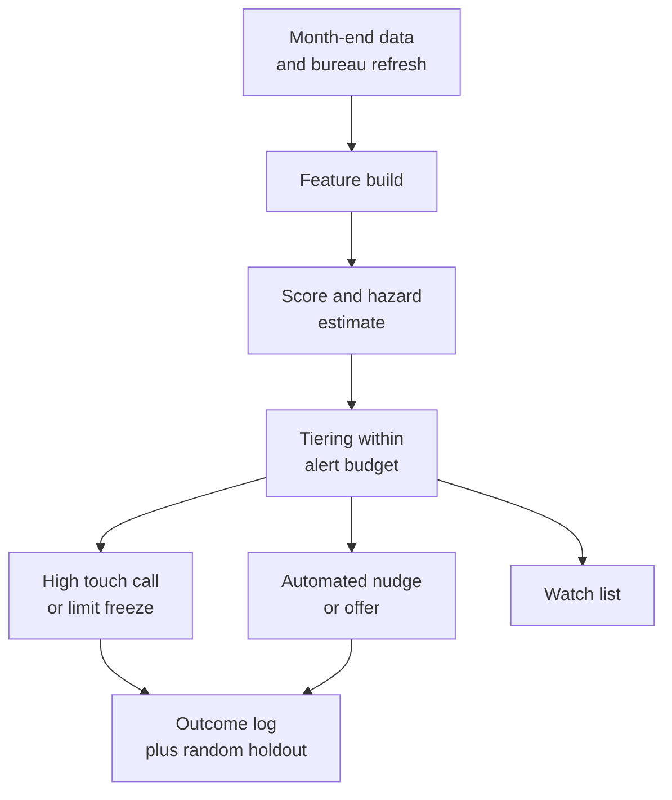

# Case Study 15: Early-Warning Signals on the Existing Loan Book

**Domain:** Finance (portfolio monitoring) | **Problem Type:** Classification and time-to-event (hazard) modelling | **Difficulty:** Intermediate

---

## 1. Business Context

### Company background

- **Bharat Finserv** (fictional) is a retail lender with about 12 lakh live accounts: 9 lakh instalment loans (personal and two-wheeler loans) and 3 lakh revolving credit lines.
- Average outstanding per account is about ₹75,000, so the book is about ₹9,000 Cr (12 lakh x ₹75,000).
- Collections today starts at 1 day past due (DPD), which means the customer has already missed a payment. The team works through dialler calls, SMS, field visits and legal notices (see Case 3 for the collections side).
- This case is about the stage **before** delinquency: spotting accounts that are likely to deteriorate while they are still paying, so that the bank can act early.
- RBI's fraud and risk management directions, and the usual asset-classification norms, expect lenders to have early-warning and monitoring systems. An account that moves to 90 DPD becomes a non-performing asset (NPA), which hurts provisioning and profit.

### The pain, with numbers

| Item | Value |
| --- | --- |
| Live accounts | 12 lakh |
| Annual flow into 90+ DPD (NPA) | 3.5% of accounts, about 42,000 accounts |
| Average outstanding at default | about ₹70,000 |
| Loss given default | about 65% |
| **Annual credit loss from this flow** | **about ₹191 Cr** (42,000 x ₹70,000 x 65%) |
| Accounts that will reach 60+ DPD in the next 90 days (at any month-end) | about 0.9%, about 10,800 |
| Human outreach capacity (relationship calls) | about 15,000 accounts a month |
| Automated nudges (WhatsApp, SMS, app message) | up to 60,000 accounts a month, about ₹1.5 each |
| Cost of a relationship call | about ₹90 per contact attempt |
| First action today | At 1 DPD, when the customer is already in the collections funnel |

- Many customers show stress months before the first missed payment: the salary credit stops arriving, balances shrink, they pay on the last day each month, they take loans elsewhere, and they stop opening the app.
- The aim is to find these accounts early and offer help: a due-date change, a small top-up cure, an EMI restructure, or a **limit freeze** on a credit line to stop further draw-down.

### Stakeholders and what each wants

| Stakeholder | What they want | What they fear |
| --- | --- | --- |
| Chief Risk Officer | Fewer accounts rolling into NPA, early visibility of segment stress | A deteriorating segment spotted too late, a sudden spike in provisions |
| Head of Collections | A short, high-quality list with enough lead time | A list of 1 lakh accounts and no capacity to call them |
| Head of Customer Experience | Help offered with empathy, no penalty for good customers | Customers feeling spied on or wrongly treated as defaulters |
| Business heads (personal loans, two-wheelers) | Keep customers and cross-sell | Freezing limits of good customers and losing their business |
| Compliance | Fair treatment, no misuse of data, clear action policy | Data used beyond consent, or unfair limit cuts without notice |

---

## 2. Translating Business to ML

### The business question vs the ML question

| Business question | ML question |
| --- | --- |
| "Who is going to get into trouble, while we can still help?" | "At each month-end, for each live account that is not yet delinquent, estimate the probability that it will reach 60+ DPD within the next 90 days, but not within the next 15 days" |
| "When will it happen?" | "Estimate the monthly hazard (chance of first serious delinquency in each future month) so that the urgency of each account can be ranked" |
| "Is this a bad week or a real decline?" | "Separate temporary stress (one-off) from persistent deterioration using trends over 3 to 6 months" |

### Target variable definition

- **Primary label:** `ews_bad = 1` if the account reaches 60+ DPD between day 16 and day 90 after the scoring date.
- **Excluded from the label window:** days 1 to 15, because the team cannot act that fast. An account that falls into delinquency within 15 days is not a useful alert.
- **Population:** only accounts that are at 0 DPD (or at most 7 DPD) on the scoring date and not already in collections.
- **Time-to-event view:** a discrete-time hazard model on an account-month table, where each row is one account in one month and the event is first reaching 60+ DPD.

### Edge cases

| Edge case | Recommended treatment | Reason |
| --- | --- | --- |
| Account is already 30 DPD at the scoring date | Remove from the EWS population. It belongs to collections | EWS is for accounts still performing |
| Account closes or prepays during the window | Treat as censored (not bad) from that date | The account left the risk pool |
| Salary arrives late each month, but EMI is paid | Keep and add a "salary delay" feature | Temporary timing, not necessarily stress |
| Customer was already restructured | Separate segment with its own model or threshold | Behaviour differs and the base rate is higher |
| Missed EMI due to a bank holiday or a mandate failure | Mark as a "technical miss" if paid within 3 days | Do not treat a payment-system issue as stress |
| Moratorium or regulatory relief period | Exclude or flag the period | The DPD clock is paused, so labels are distorted |

### Unit of prediction

- One **account at one month-end** (account-month).
- The model scores the full live book once a month, and a lighter weekly refresh for accounts above a risk threshold.

### Prediction timing



- **Prediction horizon:** 90 days. **Minimum action lead time:** 15 days. The window of interest is day 16 to 90.
- Labels for a given month-end are complete only 90 days after the score, so the training data lags by 3 months.

### What success looks like

| Lens | Success |
| --- | --- |
| Business | Prevent about 4,100 accounts a year from reaching NPA. Net benefit about ₹16 Cr a year after outreach and limit-freeze costs |
| Model | At the top 1.25% of the book (15,000 accounts), capture about 30% of accounts that will reach 60+ DPD, with precision of about 22%. At the top 6.25% (75,000 accounts), capture about 60% |
| Operations | Alert list fits the capacity. The same account is not alerted repeatedly without a new reason |

---

## 3. Data Understanding

### Data sources and key features

| Feature group | Source | Why it matters |
| --- | --- | --- |
| Repayment behaviour (days from due date to payment, partial payments, mandate bounces) | Servicing system | The earliest sign of strain is paying later each month |
| Balance and cash-flow data (salary credit, average balance, end-of-month balance) | Bank data with consent, or the lender's own account data | Income shocks and shrinking buffers show up here |
| Credit line behaviour (utilisation, cash draws, minimum-due payments) | Card and line processor | Heavy draw-down is a classic warning sign |
| Bureau refresh (new loans, new enquiries, score change) | Monthly bureau pull with consent | Loan stacking and rising leverage elsewhere |
| Engagement (app logins, SMS read, responses to reminders) | App and messaging platform | Withdrawal from the relationship goes with stress |
| Customer service contacts (complaints, requests to change due date, statement requests) | CRM | Customers sometimes ask for help before they miss a payment |
| Account profile (product, tenor, vintage, income, geography, employer) | Core system | Segment and base risk |
| Macro and local signals (sector layoffs, rainfall for agri areas, fuel price, local lockdown) | External data | Common shocks that move many accounts at once |
| Outcomes | DPD history | Labels |

### Data volume, granularity and refresh

- **Volume:** 12 lakh accounts x 36 months of history is about 4.3 crore account-months.
- Positives are about 0.9% per window, which gives about 39 lakh "bad-window" rows. These rows overlap heavily, because one account that goes bad appears in about 3 monthly windows. The number of distinct bad accounts over 3 years is only about 1.26 lakh (42,000 a year x 3).
- **Granularity:** account-month, with daily payment and balance data rolled up.
- **Refresh:** monthly scoring of the whole book, weekly refresh for the top 5%, bureau data monthly.

### Common data issues

| Issue | How it shows up here |
| --- | --- |
| Overlapping windows | The same account appears in many rows with the same outcome, so naive splits leak |
| Temporary vs persistent stress | A late salary in one month looks like trouble but fixes itself |
| Intervention contamination | Past EWS-like actions (calls, freezes) changed outcomes, so history is shaped by earlier actions |
| Macro shocks | A sudden job-market or sector event moves everyone at once, and the model's base rate breaks |
| Missing bank data | Only a share of customers consent to share salary data |
| Label delay | The last 90 days have no complete labels |
| Product differences | Instalment loans and revolving lines have very different warning signs |

> **Mentor note: Where juniors usually go wrong here.**
>
> - They choose the horizon from what the model predicts best (30 days) and ignore that the team needs at least 15 days to act and much longer for restructures. A great 30-day model with no time to act is useless.
> - They split rows randomly, so the same account sits in train and test with overlapping windows. The AUC looks excellent and falls apart live.
> - They build alerts from a fixed threshold. When a macro shock hits, the list triples and the team stops reading it.

---

## 4. Approach and Decision Points

### Baseline first

- **Baseline:** simple rules, for example "paid 5 or more days late in 2 of the last 3 months" or "utilisation above 90% for 2 months". These already catch some risk.
- **Simple model baseline:** logistic regression on 15 behaviour features, scored monthly.
- **Why it matters:** the model must beat the rule list at the same alert volume, and it must be shown to give more lead time. If the rules are nearly as good, start with rules and add the model for ranking.

### Choosing the horizon and lead time

| Horizon | Precision at top 1.25% (indicative) | Usable lead time | Fit with action |
| --- | --- | --- | --- |
| 30 days | about 35% | 0 to 15 days after the minimum lead | Too short for restructures, only reminders work |
| 60 days | about 28% | 15 to 45 days | Fine for outreach and due-date changes |
| **90 days** | **about 22%** | **15 to 75 days** | **Best balance of signal and time to act** |
| 180 days | about 12% | 15 to 165 days | Too noisy, wasted outreach on accounts that were never going to default |

### Candidate models

| Model | Pros | Cons | Verdict |
| --- | --- | --- | --- |
| Rule list | Simple, quick, transparent | Static, poor ranking | Keep as a safety net |
| Logistic regression | Stable, easy to explain | Weak on interactions | Baseline |
| Gradient boosting classifier (90-day label) | Strong ranking on behaviour data | Needs care with overlapping windows | **Primary model** |
| Discrete-time hazard model (logistic on account-month rows with time terms) | Gives timing and handles censoring | More setup | **Complement for urgency** |
| Survival models (Cox, random survival forest) | Natural for time-to-event | Harder to deploy and explain | Optional |
| Sequence models (LSTM on payment history) | Capture patterns over time | Heavy, hard to audit | Not now |
| Anomaly detection on behaviour change | Works with few labels | Many false alarms | Secondary signal for new segments |

### Decision scenarios

| What if... | Recommended action | Reasoning |
| --- | --- | --- |
| **The team can call only 15,000 accounts a month, but the model flags 40,000 above the usual threshold** | Rank by score x outstanding amount and cut at the budget. Send the next 60,000 to low-cost automated nudges. Use a tiered action ladder, not one list | Alert budget is set by capacity and cost, not by a probability threshold. Tiers match action cost to risk |
| **A salaried customer's salary arrives 8 days late in one month, then on time again** | Use a persistence rule: require 2 of the last 3 months to show the signal, or a falling 3-month trend, before raising a high-risk alert. Keep one-off cases on a watch list | Temporary stress cures by itself. Alerting on a single month wastes outreach and annoys good customers |
| **A credit-line customer is at 98% utilisation, with all payments on time** | Do not freeze at once. Check cash draws, minimum-due payments, and bureau changes. If stress signals are present, freeze further draw-down and offer an EMI conversion | A freeze on a healthy customer harms the relationship. A freeze on a stressed one limits the loss |
| **A sector shock (for example mass layoffs in one city) triples the alert list** | Keep the budget fixed by rank, and recalibrate the score level. Add the shock as a segment feature. Move the freed capacity to the most affected segment with a tailored action | The ranking still works, but the level of risk has moved. A fixed budget avoids an unusable list |
| **The same 3,000 accounts are flagged every month** | Add suppression: after an outreach, do not re-alert for 60 days unless the score rises sharply. Record the response | Repeated alerts without new information waste capacity. Without suppression, the list fills with the same names |
| **Accounts that received a past outreach look better in the data** | Keep a random holdout of 10% of flagged accounts with no action, and use the result to measure real impact (see Case 3 for uplift thinking) | Outreach changes outcomes. Without a holdout, the model cannot tell which actions work |
| **The model's 90-day precision is 22%, but a restructure takes 60 days to arrange** | Move high-risk accounts to the action ladder in the first 15 days, and prefer actions that complete fast (due-date change, partial payment plan) | The model horizon and the action time have to fit together |

---

## 5. Feature Engineering

### Top 10 features to build

| # | Feature | Business logic |
| --- | --- | --- |
| 1 | Average days between due date and payment over 3 months, and its trend | Customers drift later before they miss |
| 2 | Number of partial or minimum-only payments in 3 months | A clear sign of a cash squeeze |
| 3 | Salary credit gap: days since last salary credit vs the usual day | A missing salary is the earliest income shock signal |
| 4 | End-of-month balance relative to the EMI, and its 3-month slope | Buffer shrinking over time |
| 5 | Credit-line utilisation and cash draws, 3-month change | Rising draws point to stress |
| 6 | New loans or enquiries at other lenders in the last 60 days (bureau) | Loan stacking, increasing leverage |
| 7 | Mandate or auto-debit bounce count | Direct payment failure signal |
| 8 | App and message engagement change versus the previous 3 months | Withdrawal from the relationship |
| 9 | Requests to change due date, or inbound calls about payment trouble | Customers sometimes ask for help early |
| 10 | Segment shock indicator (share of the same employer or city already late) | Common-cause stress moves many accounts together |

### Features to avoid (leakage risks)

| Feature | Problem |
| --- | --- |
| DPD or collections status after the scoring date | Direct look-ahead leakage |
| Collections contact flags created because the account turned bad | Outcome driven |
| Restructure or settlement flags created after the window starts | Post-event information |
| Bureau data refreshed after the scoring date | Not known at scoring time |
| Features built from the same days the label covers | Overlap with the outcome window |

Build account-month rows with a lead-time-aware label (simplified):

```python
import pandas as pd

# df: one row per account per month-end, with dpd_max_next_days columns precomputed
LEAD, HORIZON = 15, 90

def make_label(df):
    # first day in the future window when DPD reaches 60 or more
    df["ews_bad"] = (
        (df["first_day_dpd60"] > LEAD) & (df["first_day_dpd60"] <= HORIZON)
    ).astype(int)
    # drop accounts already delinquent at scoring or failing inside the lead time
    keep = (df["dpd_now"] <= 7) & ~(df["first_day_dpd60"] <= LEAD)
    return df[keep]
```

---

## 6. Evaluation Strategy

### Metrics

| Metric | Role | Why |
| --- | --- | --- |
| **Recall at the alert budget** (for example top 1.25% of the book) | Primary business metric | Matches the capacity of the outreach team |
| **Precision at the alert budget** | Primary operations metric | Share of alerts that are real problems |
| **PR-AUC** | Primary model metric | The base rate is 0.9%, so ROC-AUC looks high even for modest models |
| **Lead time distribution** (days between the alert and the first 60+ DPD) | Business | An alert with no time to act has no value |
| **Cure rate of alerted accounts vs holdout** | Impact metric | Proves that action changes outcomes |
| **Calibration by segment** | Supporting | Needed for provisioning views and for macro-shock recalibration |

### Metrics that look good but are misleading here

- **Accuracy:** 99.1% by flagging nobody.
- **ROC-AUC:** 0.85 or more is common even when the top of the list is poor.
- **Recall at any horizon:** a 30-day model with high recall gives no time to act.
- **Number of accounts alerted:** bigger lists make recall look good but are not workable.

### Validation strategy

| Step | Design | Why |
| --- | --- | --- |
| Out-of-time split | Train on months 1 to 24, validate on months 25 to 30, test on months 31 to 33 | Mimics deployment |
| Label embargo | Drop the last 90 days, because labels are incomplete | Avoids false negatives |
| Group by account | All months of one account go in the same fold | Avoids overlapping-window leakage |
| Backtest by month | Recall and precision at budget for each month of the test period | Shows stability and the effect of seasons |
| Stress backtest | Test on a past shock period (for example a lockdown or a sector crisis) | Checks that ranking holds when levels move |
| Holdout for impact | Random 10% of flagged accounts get no action | Measures real benefit |

### From model metric to business value

- Annual flow into NPA: 42,000 accounts. Model captures **30%** at the top 15,000 monthly: 12,600 accounts a year in the high-touch tier. Another 30% (12,600) fall in the nudge tier of 60,000, so recall reaches 60% at 75,000 alerts.
- High-touch tier: outreach prevents 25% of those from reaching NPA. 12,600 x 25% = 3,150 accounts. Each saves ₹70,000 x 65% = ₹45,500. Benefit: about **₹14.3 Cr**.
- Nudge tier: prevents 8%. 12,600 x 8% = 1,008 accounts x ₹45,500 = about **₹4.6 Cr**.
- Costs: calls 15,000 x ₹90 x 12 = ₹1.62 Cr. Nudges 60,000 x ₹1.5 x 12 = ₹10.8 lakh (about ₹0.11 Cr). Lost margin on freezes (about 6,000 lines x ₹1,500) = ₹0.9 Cr. Total about **₹2.6 Cr**.
- **Net benefit: ₹14.3 Cr + ₹4.6 Cr − ₹2.6 Cr, about ₹16 Cr a year**, roughly 8% of the ₹191 Cr loss from this flow. The gain is limited by how many alerted customers can actually be helped.

---

## 7. Deployment and Monitoring

### Batch vs real time

- **Batch, monthly:** score the full book after the month-end snapshot. Alert lists reach the teams by day 3.
- **Weekly mini-batch:** refresh the top 5% risk accounts with new payment and balance data.
- **Real-time triggers:** only for events like a mandate bounce or a sharp balance drop, which add a flag to the next list.



### What to monitor

| Type | What to track | Alert trigger |
| --- | --- | --- |
| Data drift | PSI of payment-delay, balance and utilisation features | PSI above 0.2 |
| Score drift | Share of accounts above each tier cut-off | Moves by more than 30% of the norm |
| Rank performance | Recall and precision at budget on matured labels, by month | Recall falls by 5 points |
| Calibration and level | Predicted vs observed rate by segment | Gap above 20% (recalibrate) |
| Lead time | Median days from alert to 60+ DPD | Falls under 30 days |
| Action impact | Cure rate vs holdout | No lift for two months |
| Customer experience | Complaints after a freeze or outreach | Rising trend |
| Macro and segment shocks | Share of accounts late by employer, city or sector | Above the set band |

### Retraining

- **Scheduled:** every quarter on a rolling 24 to 30 month window, with the 90-day embargo.
- **Triggered:** macro shock, new product, or large drift.
- **Fast recalibration:** adjust the score-to-probability map monthly (a simple intercept shift per segment), without retraining the whole model.

### A/B test or champion-challenger design

- **Champion:** the current rules from 1 DPD. **Challenger:** the EWS tiers.
- **Split:** randomise at account level into action and holdout groups within each risk tier. Holdout is 10% in the top tier and 20% in the nudge tier.
- **Measure:** 60+ DPD rate and cure rate at 90 days, cost per saved account, complaint rate.
- **Guardrails:** stop a limit-freeze action if complaints or attrition of the frozen group rise by more than 1 point against the holdout.
- **Learning loop:** use the holdout results to retrain an uplift model (Case 3) and move accounts to the action that helps them most.

---

## 8. Stakeholder Communication

### Explain it to a non-technical leader

> "Customers usually show trouble months before they miss a payment: they pay later, keep less in their account, draw more on the credit line, and open more loans elsewhere. Each month we rank every live account by the chance of a serious delay in the next 3 months, leaving at least 2 weeks to act.
> Our team calls the top 15,000, and the next 60,000 get a friendly message or an offer.
> This should save about ₹16 Cr a year, and the holdout group will show us exactly which actions work."

### Questions leadership will ask

| Question | Suggested answer |
| --- | --- |
| "Why 90 days and not 30?" | "30 days gives too little time to help anyone, and 180 days is too noisy. 90 days keeps enough signal and leaves time for a due-date change or restructure" |
| "Why not alert everyone who looks risky?" | "We can call 15,000 people a month. The list is ranked and capped. A longer list would just be ignored" |
| "Will good customers be treated as defaulters?" | "Only about 1 in 5 alerted accounts will go bad, so we use gentle, helpful actions first. We freeze limits only where several stress signals appear together" |
| "What if a recession or layoffs hit?" | "The ranking still works. We recalibrate the level monthly, keep the budget fixed and focus on the affected segment. Provisioning teams get a segment-level view" |
| "Is it fair and compliant?" | "We use only data the customer consented to, give notice for any limit action and track complaints. The EWS supports, and does not replace, the regulator's asset-classification rules" |

---

## 9. Common Pitfalls and Lessons

| Mistake | Why it happens | How to avoid it |
| --- | --- | --- |
| Choosing the horizon by model accuracy | Shorter horizons look better | Choose by how much time the team needs to act, then check precision |
| Random row splits | Account-months look independent | Split by account and by time, with an embargo |
| Alerting on one bad month | A single signal is easy to compute | Require persistence or a trend before high-risk alerts |
| Fixed score thresholds | They are simple to set | Use rank-based alert budgets, and tiers by action cost |
| No holdout | Teams want to act on every alert | Keep a random untreated group to measure impact |
| Repeated alerts on the same accounts | The score changes little month to month | Use suppression rules and track outreach history |
| Ignoring macro shocks | The model looks stable on past data | Add segment shock features, monitor level drift and recalibrate monthly |
| Treating freezes as costless | Risk team sees only the loss avoided | Count lost margin, complaints and attrition in the benefit |

---

## 10. Mentor's Focus Checklist

- ✅ **Where to spend 80% of the effort:**
  - Horizon and lead-time design that fits what the team can actually do.
  - Alert budgets and tiered actions, with suppression.
  - Features that separate persistent deterioration from temporary stress.
  - A random holdout to prove the actions work, and fast recalibration for shocks.
- ❌ **What not to over-engineer:**
  - Deep sequence models before a well-built boosted model with trend features.
  - Perfect survival-curve fits. A monthly hazard model gives enough on timing.
  - Complex real-time pipelines. Monthly scoring with a weekly top-up is enough.
- 💡 **Key takeaway:** An early warning is only worth what you can do with it. **Pick the horizon from the action lead time, cap the list by capacity, tell a bad week from a real decline, and prove impact with a holdout.**
