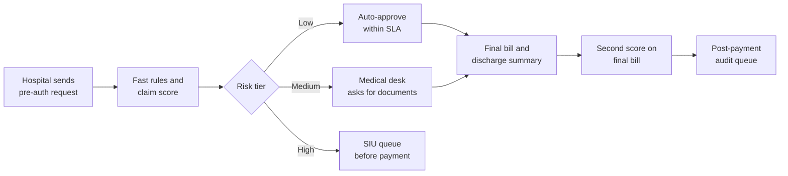
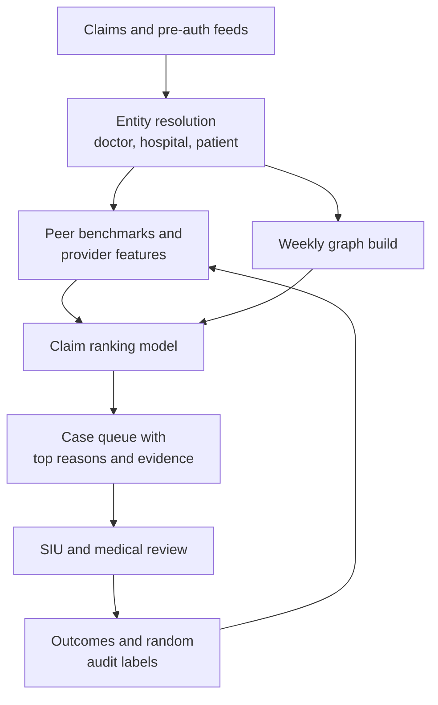

# Case Study 16: Health Insurance Claim Fraud, Waste and Abuse

**Domain:** Finance (health insurance) | **Problem Type:** Anomaly detection plus supervised ranking of claims for investigation | **Difficulty:** Advanced

---

## 1. Business Context

### Company background

- **ArogyaShield General Insurance** (fictional) is a standalone health insurer selling retail family-floater and group corporate policies.
- Scale: about 60 lakh lives covered, about 15 lakh claims a year, about ₹7,200 Cr of claims paid a year (average paid claim about ₹48,000).
- About 70% of claims are **cashless**. In cashless, the hospital asks for **pre-authorisation** (pre-auth, the insurer's approval of the treatment plan and estimate before admission) and the insurer pays the hospital directly. The rest are reimbursement claims, where the customer pays first and submits bills later.
- A network of about 9,500 empanelled (contracted) hospitals. Claims are processed in part by a **TPA** (third-party administrator, an outsourced claims-handling firm).
- Fraud, waste and abuse (FWA) here means three different things:
  - **Fraud:** deliberate lies, such as a fake admission or forged bills.
  - **Waste:** unnecessary tests, extra days in hospital, or ICU use when a ward would do.
  - **Abuse:** billing practices that are legal on paper but inflate cost, such as unbundling a package into separate line items.

### The pain, with numbers

| Item | Value |
| --- | --- |
| Claims per year | 15 lakh |
| Claims paid per year | about ₹7,200 Cr |
| Estimated FWA leakage (industry style audit sample) | about 7% of paid claims, about ₹504 Cr a year |
| Leakage stopped today (rules, TPA desk review, SIU) | about ₹90 Cr a year |
| Deep investigations the Special Investigation Unit (SIU) can complete | about 1,500 a month, 18,000 a year |
| Share of those investigations that confirm FWA today | about 22%, so about 3,960 confirmed cases |
| Average recovery or avoided payout per confirmed case | about ₹1.4 lakh |
| Current rule set | 85 hand-written rules plus manual referrals from claim processors |

- Most rule hits are on single claims (for example "claim above ₹3 lakh for a day-care procedure"). Organised billing patterns at hospital or doctor level are invisible to them.
- Regulatory backdrop: IRDAI (Insurance Regulatory and Development Authority of India) expects insurers to have a board-approved anti-fraud framework and a fraud monitoring function. It also pushes insurers to settle cashless pre-auth quickly, so heavy-handed delays on honest patients are a regulatory and reputation risk. The DPDP Act 2023 applies because the data is health data.

### Stakeholders and what each wants

| Stakeholder | What they want | What they fear |
| --- | --- | --- |
| Chief Claims Officer | Lower claim cost without slower settlement | Genuine patients stuck at the hospital desk waiting for approval |
| Head of SIU (investigations) | A ranked list where the top cases are worth a field visit | Being flooded with weak cases, or being blamed for missing a big ring |
| Hospital network manager | Fair treatment of contracted hospitals, evidence before any penalty | Hospitals leaving the network because of unexplained flags |
| Medical review team (doctors) | Clinical context such as expected length of stay for a diagnosis | A model that flags legitimate complex cases |
| Compliance and legal | Documented process, defensible decisions, IRDAI reporting | Acting on a flag without evidence and facing a legal challenge |
| CFO | Lower loss ratio from better claims control | Spending on investigators with no measurable saving |

---

## 2. Translating Business to ML

### The business question vs the ML question

| Business question | ML question |
| --- | --- |
| "Find the claims and hospitals that are costing us money they should not." | "Score each claim and each provider on how unusual its billing is against a true peer group, then rank claims by expected recoverable rupees for investigators." |
| "Use our limited investigators where they matter most." | "Rank the open claims and providers by expected recovery per hour of investigation, subject to a fixed monthly capacity." |
| "Catch new schemes we have not seen." | "Use unsupervised anomaly scores at provider and network level to surface patterns with no labels yet." |

### Target variable definition

- **Primary label for the ranking model:** `confirmed_fwa = 1` if the SIU closed the case with a finding of fraud, waste or abuse and a rupee value (recovery, rejection, or denied payout).
- **Value label:** `recoverable_amount` in rupees for confirmed cases. The ranking target is expected rupees, which is `P(confirmed) x expected amount`.
- **Negatives:** cases investigated and closed as clean. Claims that were never investigated are **unlabelled**, not negative.

### Edge cases

| Edge case | Recommended treatment | Reason |
| --- | --- | --- |
| Claim never investigated | Unlabelled. Do not treat as clean | Most claims never get a look, so "no finding" means "not looked at" |
| Investigated but closed for lack of evidence | Label as "inconclusive" and exclude from strict negatives | It may be fraud that could not be proven |
| Medically valid claim billed at a high but legal tariff | Not FWA. Tag as "high cost, compliant" | Prevents the model from learning "expensive means bad" |
| Hospital settles by returning money before the case closes | Count as confirmed with the amount returned | The behaviour is the signal |
| Claim partly rejected at pre-auth by the TPA | Use final paid amount versus requested amount | Tells us how much padding was found |
| Policyholder complaint about a hospital overcharging | Treat as a lead, not a label | Complaints are noisy and may reflect a dispute |

### Unit of prediction

- Three linked levels, because the pattern lives at different levels:
  - **Claim** (one pre-auth or reimbursement request).
  - **Provider** (a hospital or a treating doctor, rolled up over 90 days).
  - **Network** (clusters of hospitals, agents, doctors and policyholders that share links).
- The ranking model scores claims. Provider and network scores are **features** into it and also separate review lists.

### Prediction timing



- **Pre-auth scoring** happens within minutes and must not delay genuine treatment.
- **Final bill scoring** happens at discharge, with much richer data (itemised bill, length of stay).
- **Provider and network scoring** runs in batch every week.
- Investigation outcomes arrive 2 to 12 weeks later.

### What success looks like

| Lens | Success |
| --- | --- |
| Business | Raise the SIU hit rate from 22% to 40% at the same capacity of 1,500 cases a month. Extra confirmed cases per year about 3,240, worth about ₹45 Cr |
| Model | Precision at the top 1,500 cases a month of 40% or more, measured on a random audit sample as well as on past SIU files |
| Operations | Pre-auth turnaround for low-tier claims unchanged. Over 95% decided within the existing time limit |
| Provider relations | No provider flagged for penalty without a human-reviewed evidence pack |

---

## 3. Data Understanding

### Data sources and key features

| Feature group | Source | Why it matters |
| --- | --- | --- |
| Claim basics (diagnosis code, procedure code, admission and discharge dates, amount requested) | Claims system | Core context for what was billed |
| Itemised bill (room rent, medicines, consumables, investigations, doctor fees) | Hospital bill upload | Shows where the amount is padded |
| Peer-group benchmarks (same procedure, same city tier, same hospital category) | Derived from history | Cost only means "high" relative to similar treatment |
| Provider history (claim count, average amount, share of ICU stays, rejection history) | Claims and network data | Repeat patterns by hospital or doctor |
| Policy data (policy age, sum insured, waiting period end date, portability) | Policy system | Claims just after a waiting period ends are a known risk |
| Patient history (previous admissions, diagnosis consistency, age and gender versus procedure) | Claims and medical history | Detects odd or repeated admissions |
| Network links (shared doctor, shared agent, shared phone or bank account) | Graph built from master data | Organised schemes show up as clusters |
| Pre-auth behaviour (number of enhancements asked, time of day, weekend admission) | Pre-auth log | Estimate creep during treatment is a signal |
| Investigation outcomes | SIU case files | The only supervised labels, and a biased sample |

### Data volume, granularity and refresh

- **Volume:** 15 lakh claims a year, so about 45 lakh over 3 years. SIU-labelled cases are only about 18,000 a year, so about 54,000 over 3 years, with about 12,000 confirmed. That is **1 labelled confirmed case for about 375 claims**.
- **Granularity:** claim level, with line items inside it (about 25 lines per bill). Provider level roll-ups per 90 days.
- **Refresh:** claim score at pre-auth and at discharge. Provider and graph features refreshed weekly. Retrain every quarter.

### Common data issues

| Issue | How it shows up here |
| --- | --- |
| Biased labels | Investigators only open cases that rules or intuition flagged, so the labelled set is not a random sample of claims |
| Free text and codes | Diagnosis is often free text or inconsistent ICD (International Classification of Diseases) codes, and procedure names vary by hospital |
| Package pricing | Many procedures are billed as a package, so line-item comparisons only make sense inside the package |
| Duplicate provider identities | One hospital under several names or registrations, which hides its true volume |
| Missing documents | Discharge summaries arrive late or as scanned images |
| Small peer groups | Rare procedures in small towns have too few comparable claims |

> **Mentor note: Where juniors usually go wrong here.**
>
> - They compare a claim to the national average, instead of to the same procedure in the same city tier and hospital category.
> - They treat "never investigated" as "clean", so the model learns what the SIU already looks at.
> - They build a claim-level model only. The strongest signals in FWA sit in the provider and the network, not in one bill.

---

## 4. Approach and Decision Points

### Baseline first

- **Baseline:** the 85 rules plus processor referrals. 22% hit rate on 1,500 cases a month.
- **Simple benchmark:** rank claims by the ratio of billed amount to the median amount for the same procedure and city tier. This z-score style ranking is easy to explain and is often a strong baseline.
- **Why it matters:** the claims doctors already trust this peer comparison. A fancy model must clearly beat it.

### Candidate models

| Model | Pros | Cons | Verdict |
| --- | --- | --- | --- |
| Peer-group z-scores and robust ratios | Transparent, needs no labels, doctors understand it | Weak for subtle patterns and rare procedures | Baseline and feature source |
| Isolation Forest or robust covariance at provider level | Finds odd providers with no labels | Needs careful feature scaling, noisy alone | Provider screening |
| Graph clustering and community detection | Surfaces rings of doctors, agents and hospitals | Needs clean entity resolution, heavy to build | Weekly batch, produces features |
| Gradient boosting classifier (LightGBM) | Strong on tabular features, handles missing values | Learns SIU habits if labels are biased | **Primary ranker** |
| Two-part model (probability times amount) | Ranks by expected rupees, not just probability | Needs good amount estimates | Use for final ranking |
| Text and language models on discharge summaries | Can read clinical notes | Costly, privacy risk, hard to validate | Later, only after the basics work |

### Decision scenarios

| What if... | Recommended action | Reasoning |
| --- | --- | --- |
| **Peer groups are tiny** (for example a rare surgery in a tier-3 town) | Build peer groups hierarchically. Start at procedure, city tier and hospital category. If fewer than 30 claims, widen to the procedure at state level. Use shrinkage (pull small-group medians toward the wider group) | A small group gives unstable benchmarks and flags honest small hospitals. Shrinkage keeps the comparison fair |
| **The SIU only investigates what rules flagged, so labels are biased** | Keep a random audit sample of 2% of claims, about 30,000 a year, reviewed by medical auditors. Use it to measure true precision and to train with inverse-probability weights | Without random labels the model can only copy past rule logic and you cannot estimate the true leakage |
| **A hospital shows high average cost but treats very sick patients** | Add case-mix adjustment (diagnosis severity, age, comorbidity count) before comparing. Show the adjusted and unadjusted values side by side | Teaching hospitals with complex cases get flagged unfairly otherwise, and the network manager will lose trust |
| **One doctor appears in 40 claims a day across five hospitals** | Treat as a network anomaly. Check entity resolution first (same doctor under several IDs), then route to the SIU as a provider-level case, not as 40 separate claims | One investigation of the doctor is far cheaper than 40 claim reviews, and the saving is larger |
| **Investigator capacity falls from 1,500 to 1,100 cases a month** | Re-rank by expected rupees per investigator hour and shrink the queue. Move the lowest-value cases to a lighter desk review by a claims processor | Threshold follows capacity. The queue is a business constraint, not a model setting |
| **Hospitals begin to learn the signals and split bills into smaller pre-auths** | Add features at admission level, merging enhancement requests and repeat pre-auths for the same patient. Track the number of pre-auth revisions | The adversary adapts. Aggregating to the admission level removes the benefit of splitting |
| **A provider is flagged and complains that the model is unfair** | Give an evidence pack: peer comparison chart, top 3 reasons, list of sample claims. The model score alone is never grounds for penalty | Legal defensibility. The score opens an inquiry and humans make the decision |
| **A cashless pre-auth must be decided in 30 minutes** | Use only pre-auth features at this stage. Route high-risk cases to a parallel medical query instead of rejecting, and keep a clock on the query | Protects genuine patients at the hospital desk and respects IRDAI turnaround expectations |

---

## 5. Feature Engineering

### Top 10 features to build

| # | Feature | Business logic |
| --- | --- | --- |
| 1 | Billed amount divided by peer-group median (same procedure, city tier, hospital category) | The core signal for padded bills |
| 2 | Length of stay minus expected length of stay for the diagnosis | Extra days in hospital are a classic abuse |
| 3 | Share of the bill from consumables, medicines and investigations, compared with the peer share | Padding often sits in the high-margin line items |
| 4 | Provider share of ICU admissions over the last 90 days, compared with peers | Excess ICU use is expensive and common |
| 5 | Number of claims per doctor per day, and number of hospitals per doctor | A doctor cannot be in five places |
| 6 | Days from policy start or waiting period end to the claim | Claims just after the waiting period suggest planned or opportunistic claims |
| 7 | Pre-auth enhancements count and the ratio of final to initial estimate | Estimate creep during treatment |
| 8 | Shared identifiers across claims (phone number, bank account, address, agent) | Links organised schemes |
| 9 | Provider repeat rate of the same procedure code (concentration of one diagnosis) | Unusual concentration, for example many hernia surgeries, may signal upcoding |
| 10 | Gap between admission time and treatment start time, weekend and night admission flags | Admissions timed for paperwork convenience rather than clinical need |

### Features to avoid (leakage risks)

| Feature | Problem |
| --- | --- |
| Query raised or documents requested flag | It is created by the claim processor's suspicion, so the model copies human judgement |
| SIU case opened or investigator assigned | Exists only because someone already flagged the case |
| Final paid amount versus requested amount (when scoring at pre-auth) | Known only after review, so it leaks the answer |
| Hospital penalty or delisting flag set after investigation | Post-event information |
| Provider-level aggregates that include the claim being scored and its future claims | Look-ahead leakage in backfills |
| Hospital name as a categorical feature | The model memorises the hospitals investigators already know |

Peer-group ratio with shrinkage for small groups:

```python
# Robust peer ratio: compare a claim to its peer median, shrink small groups
grp = ["procedure_code", "city_tier", "hospital_category"]
stats = (claims_hist.groupby(grp)["billed_amt"]
         .agg(med="median", n="count").reset_index())
wide = (claims_hist.groupby(["procedure_code", "state"])["billed_amt"]
        .median().rename("wide_med").reset_index())
df = claims.merge(stats, on=grp, how="left").merge(
    wide, on=["procedure_code", "state"], how="left")
k = 30  # pseudo-count: a group with 30 claims gets 50% weight on itself
w = df["n"].fillna(0) / (df["n"].fillna(0) + k)
df["peer_med"] = w * df["med"].fillna(df["wide_med"]) + (1 - w) * df["wide_med"]
df["peer_ratio"] = df["billed_amt"] / df["peer_med"]
```

---

## 6. Evaluation Strategy

### Metrics

| Metric | Role | Why |
| --- | --- | --- |
| **Precision at top K** (K = monthly SIU capacity, 1,500) | Primary model metric | Matches how the SIU actually works, with a fixed queue size |
| **Expected rupees recovered at top K** | Primary business metric | A ₹5 lakh case matters more than a ₹5,000 one |
| Lift over random audit sample | Model quality | Shows value beyond what rules would find |
| Recall of confirmed rupees at 5% review rate | Coverage | Tells how much of the loss the queue reaches |
| Share of flagged providers confirmed after review | Provider-level quality | Measures the network and provider scores separately |
| Turnaround time for low-tier claims | Guardrail | Genuine patients must not wait |

### Metrics that look good but are misleading here

- **AUC on SIU-labelled data:** it measures how well we copy the SIU's selection, not how well we find hidden fraud.
- **Hit rate measured only on cases the SIU chose to open:** the SIU already picked easy ones. Measure on the random audit sample too.
- **Count of flags raised:** a model that flags more is not better. Capacity is fixed.

### Validation strategy

| Step | Design | Why |
| --- | --- | --- |
| Time-based split | Train on months 1 to 24, test on months 25 to 30 | Billing tactics change over time |
| Group split by provider cluster | All claims of a hospital group stay on one side | Stops the model memorising providers |
| Random audit sample as the test set | Evaluate on the 2% medically audited random sample | The only unbiased measure of precision and recall |
| Label maturity | Exclude cases opened in the last 90 days from evaluation | Investigations are still open |
| Shadow mode | Run for 2 months with SIU reviewing model-ranked cases in parallel to the current queue | Real comparison on live data |

### From model metric to business value

- Capacity is 1,500 deep cases a month, so 18,000 a year.
- Today 22% hit rate gives 3,960 confirmed cases. At 40%, 7,200 confirmed cases. Extra cases: 3,240.
- At about ₹1.4 lakh per confirmed case, extra value is 3,240 x ₹1.4 lakh = about **₹45 Cr a year**.
- Lighter desk review of the next 6,000 cases a month moves another small amount, but we ignore it in the headline number to stay conservative.
- Cost: model build, platform and two extra data scientists, about ₹4 Cr a year. Net about ₹41 Cr, which is about 0.6% of claims paid.

---

## 7. Deployment and Monitoring

### Batch vs real time

- **Near real time** for pre-auth scoring, because hospitals wait at the desk.
- **Batch** for provider, network and final-bill scoring, run daily and weekly.



### What to monitor

| Type | What to track | Alert trigger |
| --- | --- | --- |
| Data drift | Peer-group medians, share of claims with missing diagnosis codes | Median shift above 10% in a major procedure |
| Score drift | Share of claims in each risk tier | Tier-high share moves more than 30% |
| Precision | Top-K precision on closed cases and on the audit sample | Drop of more than 5 points |
| Provider fairness | Share of flags by hospital category and city tier | One segment over-flagged by 2x |
| Turnaround | Pre-auth decision time for low-tier claims | Median rises more than 10% |
| Investigation load | Queue size, average age of open cases | Backlog above 6 weeks |

### Retraining

- **Scheduled:** every quarter, with new SIU outcomes and the latest audit sample.
- **Triggered:** a new tariff schedule, a large hospital chain joining the network, or a precision drop.
- **Peer tables:** refreshed monthly, since tariffs and prices change.

### A/B test or champion-challenger design

- **Shadow first:** the model ranks, the SIU keeps working its current queue, and we compare hit rates afterwards.
- **Then a split by investigator:** half the team works the model ranking, half the current queue, rotated every month so skill is balanced.
- **Guardrails:** pre-auth delay for low-tier claims must not worsen, and no provider is penalised on model evidence alone.
- **Holdout:** always keep 2% of claims for random medical audit, which also feeds labels back into training.

---

## 8. Stakeholder Communication

### Explain it to a non-technical leader

> "We compare every hospital bill with similar treatments in similar cities, and we look at which hospitals, doctors and agents keep appearing together in unusual claims.
> Our investigators can open about 1,500 cases a month. The model puts the cases most likely to have recoverable money at the top, so far more of those 1,500 turn out to be real.
> We expect about 3,200 more confirmed cases a year, worth about ₹45 Cr. Genuine patients are not delayed, and no hospital is penalised on a score alone."

### Questions leadership will ask

| Question | Suggested answer |
| --- | --- |
| "Why not just reject high claims?" | "Many high claims are genuine and complex. Rejecting them would hurt patients and trigger complaints to the regulator. The model sends them for questions, not rejection" |
| "Can we penalise a hospital based on the score?" | "No. The score opens an inquiry. A penalty needs an evidence pack and human sign-off" |
| "How do we know it works if we only check flagged claims?" | "We audit a random 2% of claims independently. That is the fair test and it also tells us the true size of the leakage" |
| "Will hospitals leave our network?" | "Every flag comes with peer comparisons and case-mix adjustment. We also report flag rates by hospital category, so no group is unfairly targeted" |
| "What if we hire more investigators?" | "The same ranking works at any capacity. We would simply move the cut-off down, and expect a lower hit rate for the extra cases" |

---

## 9. Common Pitfalls and Lessons

| Mistake | Why it happens | How to avoid it |
| --- | --- | --- |
| Treating uninvestigated claims as clean | Labels only exist where someone looked | Keep a random audit sample and use inverse-probability weights |
| Comparing against national averages | It is the easiest benchmark | Use procedure, city tier and hospital category peers, with shrinkage |
| Only modelling at claim level | The dataset is one row per claim | Roll up to provider and network level and feed the scores back as features |
| Ignoring case mix | Complex hospitals look expensive | Adjust for diagnosis severity and age before flagging |
| Using hospital names as features | The model sees them often among positives | Drop identifiers and use behaviour features instead |
| Optimising precision with no capacity view | Offline metrics ignore the queue | Evaluate precision at the real K and expected rupees per investigator hour |
| Delaying genuine cashless approvals | Risk tiers set too tight | Use parallel queries and track turnaround as a guardrail |
| Acting on a score without evidence | Pressure to show savings | Insist on evidence packs and human sign-off for any provider action |
| Forgetting that fraudsters adapt | Assuming stable billing | Aggregate at admission level, watch for bill splitting, refresh peer tables monthly |

---

## 10. Mentor's Focus Checklist

- ✅ **Where to spend 80% of the effort:**
  - A random audit sample that gives unbiased labels and the true leakage.
  - Peer groups that are fair: procedure, city tier, hospital category, case mix, shrinkage.
  - Provider and network features, and clean entity resolution of doctors and hospitals.
  - Ranking by expected rupees per investigator hour, built around real capacity.
- ❌ **What not to over-engineer:**
  - Deep language models on discharge summaries before the billing features work.
  - A graph neural network. Community detection and shared-identifier counts go a long way.
  - Perfect probability calibration. Rank order within the queue matters most.
- 💡 **Key takeaway:** In claim fraud, **the cleverness is in the comparison group and the labels**. A bill is only unusual relative to similar treatment, and a label from an investigation only tells you what investigators chose to open.
