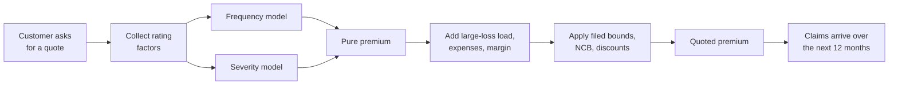
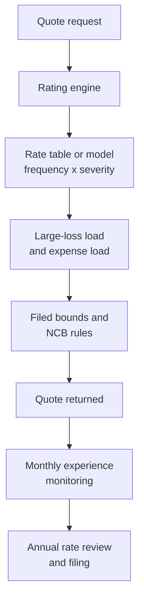

# Case Study 17: Motor Insurance Premium Pricing with Claim Frequency and Severity

**Domain:** Finance (general insurance) | **Problem Type:** Regression (Poisson and Gamma models, Tweedie GLM versus gradient boosting) | **Difficulty:** Advanced

---

## 1. Business Context

### Company background

- **RoadSure General Insurance** (fictional) sells private car insurance through agents, a few bancassurance partners and its own website.
- Scale: about 25 lakh private cars insured at any time, gross written premium (total premium billed) of about ₹3,000 Cr a year on the **own-damage (OD)** cover.
- Two covers in a private car policy:
  - **Third-party (TP):** liability for injury or damage to others. The premium for TP is set by the regulator (IRDAI) as a tariff, so the insurer cannot price it freely.
  - **Own damage (OD):** repairs to the policyholder's own car. The insurer sets this price within the rating filing it has made to IRDAI.
- This case is about pricing the **OD cover**.
- Terms used in this case:
  - **Exposure:** how long a car was actually insured, measured in policy-years. A car insured for 3 months has an exposure of 0.25.
  - **Claim frequency:** claims per policy-year.
  - **Claim severity:** average rupee cost per claim.
  - **Pure premium:** expected claim cost per policy-year, frequency times severity.
  - **Loss ratio:** claims paid divided by premium earned.
  - **NCB (no-claim bonus):** discount for years without a claim.
  - **IDV (insured declared value):** the car's insured market value.

### The pain, with numbers

| Item | Value |
| --- | --- |
| Insured cars | 25 lakh |
| Average OD premium | about ₹12,000 a year |
| Premium earned (OD) | about ₹3,000 Cr |
| Claim frequency | about 18 claims per 100 policy-years |
| Average severity | about ₹46,000 |
| Pure premium | 0.18 x ₹46,000 = about ₹8,280 per policy-year |
| Claims cost | 25 lakh x ₹8,280 = about ₹2,070 Cr |
| Loss ratio | about 69% |
| Commission and expenses | about 28% of premium |
| Combined ratio | about 97%, leaving a thin underwriting margin of about 3% |

- Current rating uses a **rating table**: base rate by vehicle make, age and city zone, times a few multiplicative factors (vehicle age, NCB, IDV band). It was last refit three years ago.
- Problem: good drivers in expensive zones are overcharged and leave on price comparison sites, while poor risks in cheap zones stay. This is **adverse selection** (the customers who stay are the ones for whom you under-charge).

### Stakeholders and what each wants

| Stakeholder | What they want | What they fear |
| --- | --- | --- |
| Chief Underwriting Officer | A loss ratio below 65% with growth intact | Losing good customers to price-sharp rivals |
| Appointed Actuary | Rating factors that are stable, filed and defensible | A black-box score that cannot be filed with IRDAI |
| Head of Distribution | Competitive quotes on aggregator sites | Premium jumps that agents cannot explain to customers |
| Head of Claims | Pricing that reflects repair costs and fraud trends | Premium models ignoring parts inflation |
| Compliance | Only approved rating factors, no unfair discrimination | Regulatory objection to unexplained factors |
| CFO | Predictable combined ratio | Margin falling under 95% by price wars |

---

## 2. Translating Business to ML

### The business question vs the ML question

| Business question | ML question |
| --- | --- |
| "Charge each car the right price for its risk." | "Predict expected claim cost per policy-year for each car, as frequency times severity, using only filed and explainable rating factors." |
| "Know which segments are under-priced." | "Compare predicted pure premium to the current premium by decile and by segment, and show the loss ratio gap." |
| "Use telematics to reward safe drivers." | "Test whether driving-behaviour features improve the frequency model after controlling for standard factors." |

### Target variable definition

- **Frequency model:** claim count per policy record, with `exposure` (in years) as an offset. Poisson distribution, log link.
- **Severity model:** average cost per claim, only on policies with at least one claim. Gamma distribution, log link, weighted by claim count.
- **Pure premium (combined):** frequency prediction times severity prediction. Alternative: a single **Tweedie** model (a distribution that mixes zeros and positive continuous values) on cost per exposure.
- **Large losses:** capped at a fixed amount (₹2.5 lakh) in the base models. The excess is spread across all policies as a **large-loss load**.

### Edge cases

| Edge case | Recommended treatment | Reason |
| --- | --- | --- |
| Policy cancelled after 2 months | Keep with exposure of 0.17 | Dropping it biases frequency upward |
| Mid-term endorsement changing IDV or vehicle | Split the record into two exposure periods | Each period has its own risk factors |
| Total loss or theft claim of ₹9 lakh | Cap at ₹2.5 lakh for modelling and load the excess separately | A few giant claims destabilise the severity model |
| Claim reported but not yet settled | Use the insurer's case reserve (estimate) as a provisional cost, and develop it later | Recent months look better than they are otherwise |
| Zero-cost claims (closed without payment) | Count in frequency only if the policy deems them claims, and keep a separate flag | Definition must match how the filing counts claims |
| Declared use as private but running as taxi | Flag as misdeclaration, exclude from clean modelling data | Distorts private-car frequency |

### Unit of prediction

- One **policy-period record** (policy ID, vehicle, an interval of continuous cover, exposure in years).
- Predictions are for the **next policy year** at quote or renewal time.

### Prediction timing



- Pricing is **quote time**: a few hundred milliseconds for web and aggregator quotes.
- Claim outcomes need 12 months of exposure and then 6 to 18 months to develop fully for larger claims.

### What success looks like

| Lens | Success |
| --- | --- |
| Business | Loss ratio falls from 69% to about 66.8% at the same total premium, worth about ₹66 Cr a year, with new-business volume held |
| Model | Poisson deviance (a goodness-of-fit score for count models) down at least 4% versus the current rate table. Top-to-bottom decile pure premium ratio of about 4.5 |
| Regulatory | Every rating factor is explainable, filed and monotone where logic requires (for example, more NCB years never raises risk) |
| Stability | Premium change at renewal within plus or minus 15% for 90% of customers |

---

## 3. Data Understanding

### Data sources and key features

| Feature group | Source | Why it matters |
| --- | --- | --- |
| Policy and exposure (start and end date, exposure in years, channel) | Policy admin system | Offsets and structure of the data |
| Vehicle (make, model, variant, age, fuel, cubic capacity, IDV) | Vehicle master and registration | Repair cost, theft risk, speed |
| Driver and owner (age band, years of licence, NCB level, claim history) | Proposal form, previous insurer data | Strongest known risk factors |
| Location (RTO code, pin code, city zone, flood and traffic density) | Registration and external data | Repair cost, traffic, theft and weather risk |
| Policy choices (voluntary deductible, add-ons such as zero depreciation, engine protect) | Quote | Add-ons raise claim cost and signal behaviour |
| Telematics (hard braking per 100 km, night driving share, speed over limit, kilometres per month) | Plug-in device or app, for opted-in customers | Direct driving behaviour, available for a small share of customers |
| Claims | Claims system | Counts, paid amounts, reserves, settlement dates |
| External repair cost indices | Garage network data, parts price tracker | Severity inflation over time |

### Data volume, granularity and refresh

- **Volume:** 25 lakh policy-years a year. Using 4 years of history, about 1 crore policy-years and about 18 lakh claims at 18 per 100.
- **Granularity:** one row per policy per exposure period, with claim records linked by policy ID and date of loss.
- **Telematics:** about 1.5 lakh opted-in customers (6%), each with 6 to 12 months of trips.
- **Refresh:** rate review once or twice a year (regulatory filing needed for structural change). Monitoring monthly.

### Common data issues

| Issue | How it shows up here |
| --- | --- |
| Heavy-tailed severity | A few claims above ₹5 lakh drive the average cost |
| Claim development | Last 12 months have open claims whose cost is still growing |
| Cost inflation | Spare parts and labour inflation raise severity 6 to 8% a year, so old claims must be trended |
| Correlated factors | Vehicle age, IDV and make are strongly related, making coefficients unstable |
| Selection by add-ons | Zero-depreciation customers claim more small claims, mixing behaviour with risk |
| Telematics bias | Opted-in drivers are usually safer than average, so results do not transfer to everyone |
| Missing history | New-to-insurer customers have no claim history, and NCB is self-declared |

> **Mentor note: Where juniors usually go wrong here.**
>
> - They fit one regression on total claim cost per policy and forget exposure, so a 3-month policy looks like a safe policy.
> - They let a handful of huge claims dominate the severity model, then wonder why coefficients change every year.
> - They report the best RMSE and not the loss ratio by decile, which is what the business actually feels.

---

## 4. Approach and Decision Points

### Baseline first

- **Baseline:** the current multiplicative rating table, with its loss ratio of 69% and a clear spread by segment.
- **Statistical baseline:** a **GLM** (generalised linear model, a regression with a chosen distribution and link). Poisson for frequency, Gamma for severity, log link, with factors binned into bands.
- **Why it matters:** the actuary understands GLMs and regulators accept them. Any new model must beat the GLM on lift, then justify any loss in explainability.

### Candidate models

| Model | Pros | Cons | Verdict |
| --- | --- | --- | --- |
| Current rating table | Simple, filed, agents understand it | Blunt, old, misses interactions | Benchmark |
| Poisson GLM (frequency) and Gamma GLM (severity) | Transparent, multiplicative factors, easy to file | Needs manual banding and interactions | **Primary filed model** |
| Tweedie GLM on pure premium | One model, handles zeros and positives | Power parameter must be tuned, less insight than the split | Cross-check |
| Gradient boosting with Poisson and Gamma objectives (LightGBM, XGBoost) | Finds interactions and non-linear effects automatically | Harder to file, factors not directly readable | Use to find structure and to price within a surrogate GLM |
| GBM with monotone constraints | Keeps logic such as NCB direction | Slight loss in accuracy | Good compromise where allowed |
| Neural network | Handles telematics sequences | Heavy, hard to explain | Not for rating, maybe for telematics feature creation |

### Decision scenarios

| What if... | Recommended action | Reasoning |
| --- | --- | --- |
| **A 3-month policy and a 12-month policy sit in the same data** | Model claim counts with `log(exposure)` as an offset, and weight severity by number of claims. Never divide the count by exposure and then treat it as a plain target without weights | The offset makes the model estimate a rate per year. Without it short policies pull frequency down |
| **A few claims above ₹5 lakh swing the severity average** | Cap claims at ₹2.5 lakh (about the 99.5th percentile), model the capped severity, and add a flat large-loss load. Roughly 9% of claim cost lies above the cap, so the load is about 9% of pure premium | Capping stabilises coefficients. A flat load treats big losses as rare, unpredictable events, which is what they mostly are |
| **GBM beats the GLM by 5% on lift, but IRDAI-filed factors must be explainable** | Use the GBM to discover interactions and bands, then rebuild a GLM with those bands and a few interaction terms. Check the GLM recovers most of the lift. Use partial dependence and SHAP to document the factors | The regulator needs factors that can be written in a rating table. A surrogate GLM keeps most gain with full transparency |
| **Telematics data exists for only 6% of customers** | Build a separate telematics adjustment on top of the base model, fitted on opted-in customers, with capped discounts of up to 15%. Test using a holdout of opted-in customers | The data cannot represent all drivers. A bounded add-on avoids extrapolating to people who never opted in |
| **Claims frequency is falling because of fewer accidents, but severity is rising from parts inflation** | Trend severity separately using a repair cost index, and trend frequency on its own. Do not model them as a single number | The frequency x severity split exposes opposing trends that a Tweedie model hides |
| **Zero-depreciation add-on buyers have very high frequency of small claims** | Keep the add-on as a rating factor for frequency and model small-claim and large-claim frequency separately if volumes allow | Add-on holders claim for minor dents. The factor is real and should be charged for explicitly |
| **Competitors cut price by 10% in one city zone** | Do not chase blindly. Check the model's expected loss ratio for that zone, and only cut where the predicted loss ratio leaves room. Track the quote conversion rate by decile | A price cut is justified only where margin exists. Cutting everywhere buys volume with losses |
| **New cars launched last quarter have no claims history** | Use vehicle attributes (segment, engine size, IDV, repair cost index) and shrink toward the segment average, with credibility weight rising as exposure builds | New models are rated by similar cars until enough own experience builds up |

---

## 5. Feature Engineering

### Top 10 features to build

| # | Feature | Business logic |
| --- | --- | --- |
| 1 | Vehicle age in years, banded (0 to 1, 2 to 3, 4 to 6, 7 or more) | Newer cars have higher repair cost and lower risk of old-car breakdowns |
| 2 | Driver age band and years since licence issue | Young and inexperienced drivers have the highest frequency |
| 3 | NCB level in years | Past claim-free behaviour predicts future behaviour, with a monotone relation |
| 4 | Repair cost index of the make, model and variant | The key driver of severity, especially luxury cars |
| 5 | IDV band divided by city average IDV | Higher value cars cost more per claim |
| 6 | City zone claim cost index (RTO level, with shrinkage for small areas) | Traffic density, flooding and parts availability |
| 7 | Add-on indicators (zero depreciation, engine protect, consumables) | Changes both frequency and severity |
| 8 | Voluntary deductible chosen | Higher deductible removes small claims |
| 9 | Previous insurer claim in last 3 years (yes or no, count) | Direct history, and the most used signal for new-to-us customers |
| 10 | Telematics score: hard-brake events per 100 km, night driving share, over-speeding minutes | Real behaviour for opted-in customers |

### Features to avoid (leakage risks and regulatory risks)

| Feature | Problem |
| --- | --- |
| Number of claims in the policy year being predicted, or days to first claim | Direct leakage of the outcome |
| Claim reserve or paid amount of the current period | Contains the target |
| Cancellation reason or mid-term endorsement after a claim | Post-event information |
| Gender, religion or caste proxies such as surname or community-dominated pin codes | Unfair discrimination risk, and not in an approved rating basis |
| Customer's price sensitivity (quote shopping count) in the risk model | Belongs to a separate demand model, not the loss cost model |
| Agent code | Proxy for distribution quality, which can be misused as a risk factor |

Frequency with an exposure offset and a severity model with capped losses:

```python
import numpy as np
import lightgbm as lgb

CAP = 250_000  # cap severity at the 99.5th percentile
freq = lgb.LGBMRegressor(objective="poisson", n_estimators=400, learning_rate=0.05)
freq.fit(X_train, y_count, init_score=np.log(exposure_train))  # offset via init_score

sev_mask = y_count > 0
sev = lgb.LGBMRegressor(objective="gamma", n_estimators=300, learning_rate=0.05)
sev.fit(X_train[sev_mask], np.minimum(avg_cost[sev_mask], CAP),
        sample_weight=y_count[sev_mask])

# Pure premium per policy-year (large-loss load added after)
pure_premium = np.exp(freq.predict(X_test, raw_score=True)) * sev.predict(X_test)
```

---

## 6. Evaluation Strategy

### Metrics

| Metric | Role | Why |
| --- | --- | --- |
| **Poisson deviance (frequency) and Gamma deviance (severity)** | Primary model metrics | Right loss for counts and for positive skewed amounts, unlike plain RMSE |
| **Lift chart by decile** (policies sorted by predicted pure premium, actual claim cost per decile) | Primary business view | Shows if the model separates good and bad risks and whether predicted and actual match |
| **Gini coefficient on the Lorenz curve of cost** | Ranking power | One number for how well the model sorts risk |
| Loss ratio by decile and by segment | Business | The real financial effect on the portfolio |
| Actual versus expected ratio by factor level | Calibration | Detects bias for each rating variable |
| Premium change distribution at renewal | Customer guardrail | Large jumps cause churn and complaints |

### Metrics that look good but are misleading here

- **R-squared or RMSE on claim cost per policy:** over 80% of policies have zero claims, so these metrics are driven by a few big claims and rank models almost randomly.
- **Accuracy of "will claim or not":** frequency is only 18%, so predicting "no claim" for everyone gives 82% accuracy but no pricing value.
- **Overall loss ratio on a random split:** it hides time effects. A model fitted on old data looks fine in-sample but under-prices after inflation.

### Validation strategy

| Step | Design | Why |
| --- | --- | --- |
| Out-of-time split | Train on policy years 1 to 3, validate on year 4 | Matches reality, and handles inflation and driving pattern shifts |
| Claim development adjustment | Apply development factors to open claims in the latest year | Recent claims are still growing |
| Cross-validation by policyholder | Keep all periods of one customer in the same fold | A customer renewing yearly appears several times, which would leak |
| Decile lift on holdout | Compare predicted and actual pure premium by decile | The actuary will want this chart before approving |
| Pricing simulation | Re-price the holdout portfolio with the new rate, apply expected lapses, compute the loss ratio | Shows the effect of the new price on margin and volume |

### From model metric to business value

- Premium earned about ₹3,000 Cr. Claims cost about ₹2,070 Cr, which is a loss ratio of 69%.
- Better risk segmentation lets us raise price for under-priced segments and cut price for over-priced ones at the same total premium. The simulation shows claims cost falling by about 2.2% of premium through better retention of good risks and re-pricing of poor risks, so the loss ratio moves from 69.0% to 66.8%.
- Value: 2.2% of ₹3,000 Cr = **₹66 Cr a year**.
- Decile check: bottom decile predicted pure premium about ₹3,900, top decile about ₹17,500, a ratio of about 4.5. The current table only reaches a ratio of about 2.6, so it under-prices the top decile heavily.
- Costs: modelling team, platform, filing and agent training, about ₹3 Cr a year. The large-loss load of about 9% of pure premium, about ₹745 per policy, is separate and not a saving.

---

## 7. Deployment and Monitoring

### Batch vs real time

- **Real time** at quote: the rating engine calls the frequency and severity models and returns a price in under 300 ms.
- **Batch:** monthly experience monitoring, annual rate review, and renewal pricing runs.
- Because of the filing requirement, the production model is often a **rating table exported from the GLM**, with the GBM used offline to guide changes.



### What to monitor

| Type | What to track | Alert trigger |
| --- | --- | --- |
| Portfolio mix | Share of business by vehicle age, city zone, channel | Any segment share moves more than 20% |
| Loss ratio | Monthly loss ratio by decile and by channel, on developed claims | Top decile above 85%, or portfolio above 68% |
| Actual versus expected | Claims actual divided by model expected by factor | Ratio outside 0.9 to 1.1 for a large segment |
| Severity trend | Average cost per claim against repair cost index | Trend above 10% a year |
| Conversion | Quote-to-bind rate by predicted risk decile | Good-risk deciles losing more than 5% conversion |
| Renewal shock | Distribution of premium change at renewal | More than 10% of customers above plus 20% |
| Telematics | Opt-in rate, scores drift, claims for the opted-in group | Opt-in selection bias widens |

### Retraining

- **Scheduled:** full refit once a year, aligned with the rate filing. Mid-year recalibration of the base rate only.
- **Triggered:** a spike in parts inflation, a new vehicle segment, or a policy wording change.
- **Governance:** actuary sign-off, documentation of each factor, and a dated record of model versions.

### A/B test or champion-challenger design

- **Offline first:** re-price the last year's quotes and renewals with the new model and compare expected loss ratio by decile.
- **Live test:** price 10% of new business with the challenger rates, randomised by quote ID, within the filed range.
- **Guardrails:** conversion rate, average premium, and expected loss ratio by decile. Stop if conversion in good-risk deciles drops more than 3 points.
- **Long horizon:** the real answer on losses takes 12 months or more, so track expected loss ratio early and actual later.

---

## 8. Stakeholder Communication

### Explain it to a non-technical leader

> "For each car we estimate two things: how often it is likely to claim and how much a typical claim costs. Multiplying them gives the fair price for the risk. Some cars are cheaper than we charge today, some are dearer.
> By matching price to risk, we keep good drivers who were leaving and charge more where we were losing money. We expect the loss ratio to improve by about two points, worth about ₹66 Cr a year.
> Every factor in the price can be explained to a customer and to the regulator."

### Questions leadership will ask

| Question | Suggested answer |
| --- | --- |
| "Why not use the best machine learning model for price?" | "Price must be filed and explained. We use the complex model to find patterns, then express them as clear rating factors. We lose very little accuracy" |
| "Why are very large claims capped?" | "A few huge claims are mostly bad luck and would distort every customer's price. We charge a small flat load for them instead" |
| "Will good customers get cheaper quotes?" | "Yes in most segments. About 6 in 10 customers should see equal or lower prices, and poor-risk segments will see increases, capped at 15% per year" |
| "Can telematics help us?" | "For the 6% who opt in, yes. Safe drivers get discounts up to 15%. But opted-in drivers are safer than average, so we cannot assume the same effect for everyone" |
| "When will we see the improvement?" | "Early signs in quote conversion in 3 months. The true loss ratio needs about 12 months of exposure and claim development" |

---

## 9. Common Pitfalls and Lessons

| Mistake | Why it happens | How to avoid it |
| --- | --- | --- |
| Ignoring exposure | Treating each row as one year | Use `log(exposure)` as offset and weight severity by claim count |
| One model for total cost with squared loss | Simple to build | Split frequency and severity, or use Tweedie, with proper deviance |
| Letting giant claims shape the model | Big claims dominate averages | Cap at a high percentile and load the excess separately |
| Ignoring claim development and inflation | Recent data looks cleaner | Develop open claims, trend severity with a repair cost index |
| Choosing the model by RMSE | Familiar metric | Use deviance, Gini and decile lift with loss ratio |
| Using protected or proxy variables | Strong predictive power | Stick to filed, justifiable factors and review proxies with compliance |
| Extrapolating telematics results to everyone | Opt-in customers are safer | Use a capped adjustment and a holdout of opted-in customers |
| Pricing in isolation from demand | Loss model is not the whole business | Add conversion and renewal elasticity checks before changing rates |
| Wild premium swings at renewal | Model output taken at face value | Cap renewal change and glide big increases over two years |

---

## 10. Mentor's Focus Checklist

- ✅ **Where to spend 80% of the effort:**
  - Correct data: exposure, claim development, severity trending and large-loss capping.
  - Frequency and severity as separate models, with proper loss functions.
  - Decile lift and loss ratio by segment, on an out-of-time holdout.
  - Making the final rating factors explainable and fileable, using the GBM as a guide.
- ❌ **What not to over-engineer:**
  - A neural network for rating when a well-banded GLM captures most of the lift.
  - Squeezing the last 0.5% of deviance and losing the explanation.
  - Telematics for all customers before there is enough opted-in data.
- 💡 **Key takeaway:** In insurance pricing, **the model predicts cost, but the filed rating factors set the price**. The best model is the one that sorts risk well and that you can explain to an actuary, a regulator and an agent.
