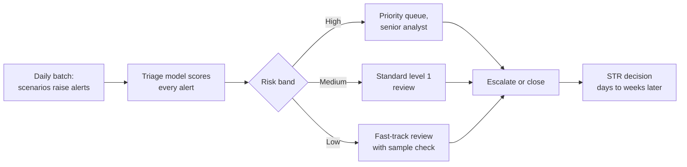
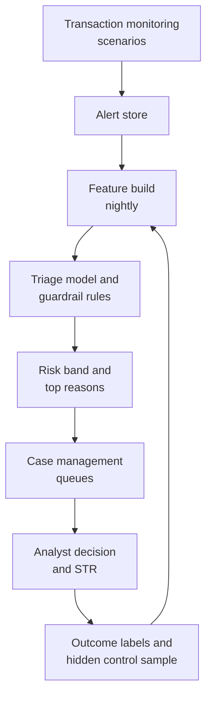

# Case Study 18: Anti-Money-Laundering Transaction Monitoring and False-Positive Alert Reduction

**Domain:** Finance (banking compliance) | **Problem Type:** Classification and alert prioritisation (second-line triage on top of rules) | **Difficulty:** Advanced

---

## 1. Business Context

### Company background

- **Bharat Mercantile Bank** (fictional) is a mid-sized private bank with about 1.2 crore active accounts, about 1,100 branches, retail, SME and current-account customers.
- **AML** means anti-money-laundering: stopping criminals from moving illegal money through the banking system. Banks run **transaction monitoring**, software that raises an **alert** when activity matches a suspicious pattern, called a **scenario** (for example "many cash deposits just under ₹10 lakh in a week").
- Alerts go to analysts. If an analyst believes the activity is suspicious, the bank files a **suspicious transaction report (STR, called SAR in many countries)** with **FIU-IND** (Financial Intelligence Unit - India). The RBI supervises how well the bank's monitoring works.
- The bank has about 70 scenarios built from typologies (known laundering patterns): structuring, rapid movement of funds through an account, dormant accounts waking up, round-tripping, cash intensive business mismatch, and so on.

### The pain, with numbers

| Item | Value |
| --- | --- |
| Alerts per month | about 90,000 |
| Alerts closed as "no suspicion" at level 1 | about 96% (a false positive rate above 95%) |
| Alerts escalated to level 2 investigation | about 4%, so about 3,600 a month |
| STRs filed | about 540 a month (0.6% of alerts) |
| Level 1 analyst throughput | about 16 alerts a day, about 30 minutes each |
| Level 1 analysts needed | about 256 |
| Loaded cost per analyst | about ₹9 lakh a year |
| **Annual cost of level 1 alert handling** | **about ₹23 Cr** |
| Cost per alert | about ₹213 |

- Alerts have been rising 15% a year as customer volumes and scenarios grow. Hiring more analysts is not a sustainable answer.
- Backlogs have crossed 30 days at peak. Late reviews are themselves a regulatory finding.
- **Regulatory backdrop:** RBI and FIU-IND expect banks to monitor all customer activity against risk-based scenarios, to file STRs promptly when suspicion arises, and to keep records. The bank cannot switch scenarios off just because they produce noise, and any change to monitoring needs governance, documentation and testing. Model use also falls under the bank's model risk management policy.

### Stakeholders and what each wants

| Stakeholder | What they want | What they fear |
| --- | --- | --- |
| Chief Compliance Officer (CCO) | Same or better detection with a sustainable workload | An RBI inspection finding that the bank "switched off" coverage |
| Head of Financial Crime Operations | Fewer low-value alerts, shorter backlog | Analysts leaving from boredom and fatigue |
| Money Laundering Reporting Officer (principal officer for FIU-IND) | Timely, high-quality STRs and a defensible audit trail | Personal accountability for a missed report |
| Model Risk Management (MRM) | Independent validation, documented limits and monitoring | An unvalidated model influencing a regulatory process |
| Head of Retail Banking | Fewer customer calls about frozen or reviewed accounts | Customers leaving after unnecessary queries |
| CFO | Lower operating cost, less hiring | Fines and remediation costs that are larger than the savings |

---

## 2. Translating Business to ML

### The business question vs the ML question

| Business question | ML question |
| --- | --- |
| "Cut the false alerts without missing real laundering." | "Given an alert raised by the existing rules, estimate the chance it ends in an escalation or STR, and use that to order or auto-close the queue, while keeping recall of STR-worthy alerts above 99%." |
| "Prove we are not weakening coverage." | "Estimate what the model would have missed on a sample of alerts it would have closed, using below-the-line testing." |
| "Find laundering the rules do not catch." | "Use a separate unsupervised or network model on non-alerted activity, and treat it as a separate project after triage is stable." |

### The design idea

- The model is a **second-line triage layer** on top of the existing rules. The scenarios keep running and keep generating alerts. The model ranks those alerts and can send the lowest-risk ones to a lighter review path.
- This keeps regulatory coverage unchanged, because every alert is still created and recorded, while analyst effort moves to the riskier alerts.

### Target variable definition

- **Primary label:** `str_filed = 1` if the alert (or the case it was merged into) led to an STR.
- **Secondary label:** `escalated = 1` if the alert went to level 2, whether or not an STR followed. This gives about 4% positives, which is a much richer signal for training.
- **Everything else:** closed as no suspicion at level 1 or level 2.

### Edge cases

| Edge case | Recommended treatment | Reason |
| --- | --- | --- |
| Several alerts on the same customer, merged into one case | Label all alerts in the case with the case outcome, and keep a case-level view | Otherwise the same STR is counted many times |
| STR filed months later, after law enforcement query | Late positive. Refresh labels for older alerts | Recent alerts look cleaner than they are |
| Alert closed at level 1 by an analyst who was rushing | Noisy negative. Use a quality-assurance sample to measure analyst error | Analyst inconsistency is a real source of label noise |
| Alert on a customer already under an STR | Keep as a separate "known customer" segment | Often filed as continuing activity, and behaves differently |
| Alert triggered by a one-off event such as property sale proceeds | Label by outcome as usual, and add documented-explanation features | Common legitimate trigger, a big source of false alerts |
| Negative news hit on the customer name | Keep as a feature, not a label | Adverse media is a risk signal, not an outcome |

### Unit of prediction

- One **alert** (scenario ID, customer, date range, list of triggering transactions).
- A second view at **customer-month** level helps for features such as the number of alerts across scenarios.

### Prediction timing



- Scoring runs as part of the nightly batch, a few hours after the alerts are generated.
- Outcomes take 3 to 8 weeks for level 2, and STR decisions sometimes longer.

### What success looks like

| Lens | Success |
| --- | --- |
| Business | Move 40% of alerts (about 36,000 a month) to the fast-track path at about one-fifth the effort, freeing about ₹9 Cr a year of analyst time, and shorten the backlog under 10 days |
| Model | At least 99% of eventual STRs fall in the Medium and High bands (so at most 1% of STRs sit in the Low band) |
| Governance | Independent validation passed, below-the-line testing run every quarter, documented override by compliance |
| Operations | Level 1 median handling time on High-band alerts drops because analysts see better context |

---

## 3. Data Understanding

### Data sources and key features

| Feature group | Source | Why it matters |
| --- | --- | --- |
| Alert attributes (scenario ID, trigger amount, number of transactions, date range) | Monitoring system | Core context and the scenario's own reliability |
| Customer profile (occupation, income band, account age, business type, KYC risk rating) | Core banking and KYC | Expected activity for this type of customer |
| Customer history (average monthly credits and debits, past alert count, past STR count) | Core banking | Whether this alert is out of character |
| Transaction behaviour (cash share, round-amount share, counterparty count, share of money passed on within 48 hours) | Transaction store | Classic laundering patterns |
| Counterparty and geography (high-risk jurisdiction exposure, new counterparties, shared beneficiaries) | Payments and screening | Network and country risk |
| Product and channel (UPI, NEFT, RTGS, cash at branch, cheque, trade) | Core and payments | Different channels carry different risk |
| Prior review outcomes (past analyst decisions and notes on this customer) | Case management | Strong sign of repeat behaviour |
| Screening hits (sanctions and politically exposed person lists, adverse media) | Screening tools | External risk flags |
| Labels | Case management (escalated, STR filed) | Outcomes, rare and noisy |

### Data volume, granularity and refresh

- **Volume:** 90,000 alerts a month, about 1.08 million a year. With 24 months of history, about 2.2 million alerts, about 87,000 escalations (4%) and about 13,000 STRs (0.6%).
- **Granularity:** one row per alert, linked to the transactions in the alert and to the customer.
- **Refresh:** features built nightly. The model is retrained every 6 months, or after a major scenario change.

### Common data issues

| Issue | How it shows up here |
| --- | --- |
| Rare labels | Only 0.6% of alerts end in an STR, which is a very thin target |
| Biased labels | Only alerts that fired were reviewed, so we know nothing about laundering that no scenario flagged |
| Analyst inconsistency | Two analysts close the same type of alert differently |
| Scenario changes | New thresholds change alert volume and mix, breaking history |
| Duplicate alerts | The same behaviour fires several scenarios at once |
| Poor KYC data | Stale occupation and income data make "expected activity" wrong |
| Free-text notes | Valuable but written in many styles and sometimes containing the decision itself |

> **Mentor note: Where juniors usually go wrong here.**
>
> - They train on "STR filed" alone and get a model with almost nothing to learn from. Use escalation as a richer label and treat STR as the final check.
> - They forget that the model only sees what the rules alerted on. A great score here says nothing about money laundering that went unseen.
> - They switch off low-scoring alerts in production, which is exactly what the regulator does not want.

---

## 4. Approach and Decision Points

### Baseline first

- **Baseline:** today's process. Alerts are handled in order of arrival or by scenario priority, with a 96% false positive rate.
- **Simple benchmark:** a scorecard using scenario ID, customer risk rating, and past alert history. Many banks already run a risk-based rule such as "customers with no prior alerts and low risk rating are low priority".
- **Why it matters:** this simple rule sets the bar, and it is easy to explain to the regulator.

### Candidate models

| Model | Pros | Cons | Verdict |
| --- | --- | --- | --- |
| Scenario-level tuning (changing thresholds) | Simple, directly reduces volume | Changes coverage, needs governance, slow | Do through formal tuning, separate from the model |
| Logistic regression scorecard | Transparent, easy for MRM and regulators | Limited on interactions | **Benchmark and challenger** |
| Gradient boosting (LightGBM, XGBoost) | Best accuracy on tabular data | Needs explanation tools and monitoring | **Primary model** |
| Two-label model (escalation and STR) | Uses richer escalation label, keeps STR focus | More complex | Use escalation as main target and STR as check |
| Network and graph features | Finds shared beneficiaries, mule-like flows | Heavy, entity resolution needed | Add as features, batch computed |
| Unsupervised anomaly model on non-alerted activity | May find gaps in scenarios | No labels, many false alarms | Separate project, not the triage model |
| Large language model to summarise alert narratives | Saves analyst reading time | Hallucination risk, data privacy | Pilot as analyst assist only, never as a decision-maker |

### Decision scenarios

| What if... | Recommended action | Reasoning |
| --- | --- | --- |
| **The regulator expects coverage, so rules cannot be turned off** | Keep every scenario running and every alert logged. Use the model only to set the review path (fast-track for the lowest band with sample check, standard, priority) | Coverage is unchanged and fully documented. Only the effort per alert moves |
| **STR labels are only 0.6% and strongly depend on analyst judgement** | Train on escalation (4%) with STR as a high-weight positive. Check agreement between the two. Run quality assurance on a 5% sample of level 1 closures to find analyst noise | A richer label gives a stable model. Analyst noise sets the ceiling on what any model can learn |
| **Below-the-line testing** (checking what the model would have missed) | Each quarter, take a random sample of 2,000 alerts from the Low band, send them to full level 2 review, and measure the escalation and STR rate. Also sample just below the cut-off and just above | Proves that the closed band is really low risk. This is the evidence the regulator and MRM want |
| **A scenario is changed and alert volume jumps 30%** | Freeze the model for that scenario until 4 weeks of data exist, route its alerts to the standard path, then recalibrate | The score distribution for a new threshold is unknown. Safe default beats clever guess |
| **A customer is in a high-risk segment (cash-intensive business, politically exposed person)** | Apply hard guardrails: never allow Low-band fast-track for listed segments, regardless of score | Policy overrides model. Some segments are always reviewed fully |
| **The model gives a low score to alerts about a new typology (for example mule accounts on UPI)** | Add a "new typology" override list managed by compliance, and track the share of alerts overridden | The model only knows past patterns. Compliance experts add new knowledge faster than retraining |
| **Analysts begin to trust the Low band and skim all alerts** | Keep a random 5% of Low-band alerts routed to the standard path as a hidden control, and report analyst miss rate on them | Automation bias is real. Hidden controls keep humans alert and give ongoing measurement |
| **MRM asks for an explanation for every closure** | Store top 5 reasons with each score (SHAP values or scorecard points) and the model version in the case file | Auditability is a condition of use in a regulated process |

---

## 5. Feature Engineering

### Top 10 features to build

| # | Feature | Business logic |
| --- | --- | --- |
| 1 | Scenario ID and historical escalation rate of that scenario, for similar customers | Some scenarios are noisier than others |
| 2 | Trigger amount divided by customer's 12-month average monthly turnover | A large deviation from normal behaviour is more suspicious |
| 3 | Number of prior alerts, prior escalations and prior STRs on this customer in 24 months | Repeat behaviour is the strongest signal |
| 4 | Share of credits passed out within 48 hours (pass-through ratio) | Money that comes in and leaves quickly is a classic layering sign |
| 5 | Share of cash and share of round-number amounts | Cash and round amounts rise in structuring |
| 6 | Number of new counterparties in the alert window | Sudden new beneficiaries are unusual |
| 7 | Income and occupation mismatch score (turnover versus declared income) | The core "source of funds" question |
| 8 | Number of distinct scenarios fired on the customer in the last 30 days | Many scenarios on one customer point to real risk |
| 9 | Exposure to high-risk jurisdictions and sanctions-screening near-matches | Direct regulatory risk factors |
| 10 | Documented explanation exists (for example a sale deed or business invoice on file) | Legitimate explanations cut false alerts |

### Features to avoid (leakage risks)

| Feature | Problem |
| --- | --- |
| Analyst notes written during the review | They contain the decision, so this leaks the answer |
| Case status, escalation reason or STR reference number | Created by the outcome |
| Account freeze, exit or closure flags after the alert | Post-event information |
| Features computed with transactions after the alert date | Look-ahead leakage |
| Analyst ID or team | Reflects analyst habits, so the model copies people and not risk |
| Customer segments that policy treats as always reviewed, used as a shortcut | The model should not learn to rely on segments that a guardrail already handles |

Choosing a Low-band cut-off that keeps recall of STRs above 99% on validation:

```python
import numpy as np

# scores: model score per alert, y_str: 1 if the alert led to an STR
order = np.argsort(scores)               # lowest risk first
cum_str = np.cumsum(y_str[order])
total_str = y_str.sum()

# Largest share of alerts we can fast-track while missing at most 1% of STRs
max_missed = int(0.01 * total_str)
k = np.searchsorted(cum_str, max_missed, side="right")
low_band_share = k / len(scores)
cutoff = scores[order][k - 1]
print(f"Fast-track share {low_band_share:.1%}, cutoff {cutoff:.4f}")
```

---

## 6. Evaluation Strategy

### Metrics

| Metric | Role | Why |
| --- | --- | --- |
| **Recall of STRs in the Medium and High bands** | Primary safety metric | Must stay at or above 99%. This is the line the regulator cares about |
| **Share of alerts in the Low band** | Primary business metric | The workload we can move to fast-track at that recall |
| Precision in the High band (escalation rate) | Quality | Shows that top-ranked alerts are really richer |
| PR-AUC on escalation | Model quality | Right metric for rare positives, unlike accuracy |
| Escalation and STR rate in below-the-line sample | Control | Direct proof about the Low band |
| Calibration by scenario | Governance | The score must mean the same across scenarios |
| Backlog age and handling time | Operations | The benefit analysts and the regulator actually see |

### Metrics that look good but are misleading here

- **Accuracy:** 96% is reached by saying "not suspicious" for every alert.
- **AUC:** can look high (0.9 or more) while recall at the safe cut-off is poor.
- **Reduction in alert count alone:** reducing alerts by changing thresholds can look like success but loses coverage. Reduction through triage must be measured at fixed STR recall.

### Validation strategy

| Step | Design | Why |
| --- | --- | --- |
| Time-based split | Train on months 1 to 16, validate on months 17 to 20, test on months 21 to 24 | Customer behaviour and scenarios change |
| Label maturity | Drop alerts from the last 90 days, whose STR decisions are not final | Immature outcomes bias recall |
| Grouped by customer | Keep all alerts of one customer in the same split | Repeat alerts on one customer would leak |
| Scenario-wise results | Report recall and Low-band share per scenario | A strong average can hide a weak scenario |
| Below-the-line test | Review a random sample of 2,000 Low-band alerts fully | Evidence that the closed band is safe |
| Independent validation | MRM re-performs, challenges and signs off | Required for a model in a regulatory process |

### From model metric to business value

- 90,000 alerts a month. Moving 40% to fast-track gives 36,000 alerts a month.
- Fast-track takes about one-fifth the effort of a standard review, so it saves about 80% of the ₹213 cost: 36,000 x 12 x ₹213 x 0.8 is about **₹7.4 Cr a year** in direct effort.
- With the backlog shrinking, the bank also avoids a planned hiring of about 40 analysts for the 15% annual alert growth, about 40 x ₹9 lakh = ₹3.6 Cr. We count about **₹1.6 Cr** of it as a conservative share, giving about ₹9 Cr in total.
- At 99% recall, about 5 STRs a month, out of about 540, sit in the Low band. This is why the below-the-line test, the hidden 5% control and the quarterly review matter: each missed STR is a regulatory risk and not just a number.
- Cost: build, validation, and monitoring, about ₹2 Cr a year.

---

## 7. Deployment and Monitoring

### Batch vs real time

- **Batch.** Alerts are generated daily, and scoring runs overnight. No need for real time.
- The model sits **beside** the monitoring system, not inside the scenarios.



### What to monitor

| Type | What to track | Alert trigger |
| --- | --- | --- |
| Data drift | Feature distributions (PSI) for pass-through ratio, cash share, trigger amount | PSI above 0.2 |
| Score drift | Share of alerts in each band, by scenario | Low-band share changes more than 10 points |
| Safety | STR rate in Low band, from hidden control and below-the-line sample | Any STR in a sample, or rate above 0.3% |
| Recall | Recall of STRs in Medium and High bands, on matured labels | Below 99% |
| Analyst quality | QA sample error rate, override rate | Error rate above 3% |
| Scenario changes | Threshold or logic changes, new typologies | Any change triggers a review |
| Operations | Backlog age, handling time per band | Backlog above 15 days |

### Retraining

- **Scheduled:** every 6 months, after validation by model risk.
- **Triggered:** a major scenario change, a PSI breach, or a safety alert from the control sample.
- **Governance:** any new version needs validation, documented approval, and compliance sign-off before it changes any queue.

### A/B test or champion-challenger design

- **Shadow first:** run the model for 3 months with no change to queues. Compare its bands against actual outcomes.
- **Then a pilot:** apply fast-track to 2 scenarios with high volume and low yield, randomised by alert within scenario with 10% held in the standard path.
- **Guardrails:** zero tolerance for an STR found in the fast-track sample without a documented review. Stop and review the model if that happens.
- **Roll out:** scenario by scenario, never all at once. Keep a permanent 5% hidden control.

---

## 8. Stakeholder Communication

### Explain it to a non-technical leader

> "Our rules still raise every alert, as the regulator expects. What changes is how we spend analyst time. The model reads each alert and says how likely it is to be a real concern, based on the customer's history and behaviour.
> The lowest-risk 40% go through a quick review with random checks, so our analysts spend their time on the riskier cases. We keep catching at least 99% of the cases that end up as reports to FIU-IND, and we test that every quarter.
> This saves about ₹9 Cr a year and clears the backlog."

### Questions leadership will ask

| Question | Suggested answer |
| --- | --- |
| "Are we turning off monitoring?" | "No. Every scenario still runs and every alert is logged and reviewed. The model only decides how much effort each alert gets" |
| "What if we miss a real case?" | "At 99% recall we expect about 5 of 540 monthly reports to sit in the quick-review band, where they still get a human look. We test this each quarter and keep a hidden control sample" |
| "Why not just raise scenario thresholds?" | "That removes alerts at the source and changes coverage, so it needs a formal tuning and approval cycle. The triage model is complementary and reversible" |
| "Will the regulator accept this?" | "It is a documented, validated, monitored model with clear evidence. We will present the testing results and keep compliance in control of overrides" |
| "Can we replace analysts with the model?" | "No. The model prioritises. Analysts decide, and humans file STRs" |

---

## 9. Common Pitfalls and Lessons

| Mistake | Why it happens | How to avoid it |
| --- | --- | --- |
| Reporting accuracy or overall AUC | Easy defaults | Report recall at fixed STR recall and share of alerts moved |
| Training only on STR labels | They are the "real" outcome | Use escalation as the main label and STR as a check |
| Switching off low-scoring alerts | Looks like the obvious saving | Keep every alert, change only the review path |
| Skipping below-the-line testing | It costs analyst time | Make a quarterly random Low-band sample a standing control |
| Ignoring analyst noise | Labels are assumed to be truth | Run QA samples and measure disagreement |
| Training on data from old scenario versions | History is all in one table | Version scenarios and retrain after major changes |
| Leaking analyst notes or case status | They are available in the case table | Build features strictly from pre-review data |
| Forgetting guardrails for high-risk segments | The model looks good on average | Hard policy rules sit above the model |
| Weak model governance | Treated as a normal analytics project | Involve model risk, compliance and audit from day one |

---

## 10. Mentor's Focus Checklist

- ✅ **Where to spend 80% of the effort:**
  - Defining labels well: escalation as the main target, STR as the safety check, and handling label noise.
  - Below-the-line testing and a hidden control sample, which are the proof the regulator wants.
  - Guardrails and overrides owned by compliance, and full governance with model risk.
  - Scenario-wise results, so no weak scenario hides behind a good average.
- ❌ **What not to over-engineer:**
  - Deep learning or graph neural networks before a good gradient boosting model with good features.
  - Chasing 100% recall. It is impossible, and the cost is higher than the benefit.
  - Using a language model to make decisions. Use it, at most, to summarise alert narratives for analysts.
- 💡 **Key takeaway:** In AML, **you do not remove alerts, you reorder effort**. The value of the model is only as good as the evidence, through below-the-line tests and governance, that the quiet part of the queue is really quiet.
