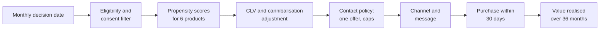
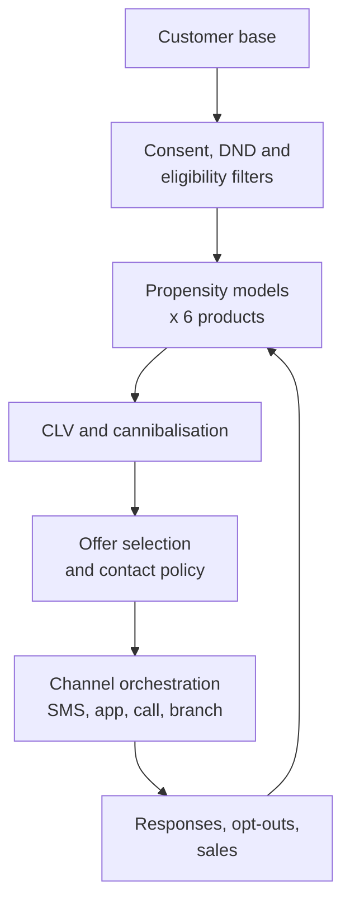

# Case Study 19: Next-Best-Product Cross-Sell and Customer Lifetime Value for a Retail Bank

**Domain:** Finance (retail banking) | **Problem Type:** Multi-class propensity plus regression (customer lifetime value) | **Difficulty:** Intermediate

---

## 1. Business Context

### Company background

- **Kaveri Bank** (fictional) is a retail bank with about 85 lakh customers, most of whom hold a savings account with the bank.
- Beyond savings, the bank sells six product families: credit cards, personal loans, fixed deposits (FDs), mutual fund SIPs (systematic investment plans), term life insurance, and home loan top-ups.
- Insurance and mutual funds are sold as a distributor, so the bank earns commission. Cards and loans earn interest, fees and interchange.
- Today the campaign team runs one **product campaign at a time** (for example "Credit card month") and blasts SMS, app notifications and calls to a large list. The same customer may get three offers in one week.
- Terms used in this case:
  - **Propensity:** the probability that a customer will buy a product if offered.
  - **CLV (customer lifetime value):** the total profit expected from a customer or a product relationship over a chosen horizon, discounted to today's rupees.
  - **Next-best-product (NBP):** for each customer, pick the one offer that is best to make now, or no offer at all.
  - **Contact policy:** rules on how often and through which channel a customer may be contacted.
  - **Cannibalisation:** when a new sale takes away money from another product of the same bank.

### The pain, with numbers

| Item | Value |
| --- | --- |
| Customers | 85 lakh |
| Customers with valid marketing consent and not on the DND list (reachable) | about 52 lakh (about 61%) |
| Contacts per month in campaigns | about 10 lakh |
| Conversion within 30 days of contact (blanket targeting) | about 0.8%, so about 8,000 sales a month |
| Opt-out and complaint rate per campaign wave | about 0.6% |
| Average contact cost (SMS, app, and calls blended) | about ₹6 per contact |
| Average discounted 3-year value per cross-sell, across the product mix | about ₹4,500 |
| Share of sales that are really cannibalised (money moved from another product) | about 20% |

- The monthly contact cost is about 10 lakh x ₹6 = ₹60 lakh, or about ₹7.2 Cr a year. We will spend the same, so the goal is better use of each contact, not more contacts.
- Regulatory and consent context: the **DPDP Act 2023** requires valid consent for personal data processing, and marketing contact needs a purpose that the customer has agreed to. For calls and SMS, **TRAI** rules on unsolicited commercial communication, including the DND (do not disturb) registry, apply. The bank also must follow product-suitability rules for investment and insurance products.

### Stakeholders and what each wants

| Stakeholder | What they want | What they fear |
| --- | --- | --- |
| Head of Retail Liabilities and Cards | More card and SIP sales | Their product being pushed behind another product's campaign |
| Head of Retail Credit | Loans sold only to customers who can repay | Cross-sell loans that go bad |
| Head of Marketing and CRM | Higher conversion, fewer wasted contacts | Customer fatigue and rising opt-outs |
| Chief Compliance Officer | Consent respected, DND honoured, fair selling | Complaints about spam and mis-selling to unsuitable customers |
| Chief Financial Officer | Profit per rupee spent, not just sales counts | Selling low-margin products that cannibalise high-margin ones |
| Branch network head | Branch staff leads that are warm and relevant | Customers annoyed at branch about repeated offers |

---

## 2. Translating Business to ML

### The business question vs the ML question

| Business question | ML question |
| --- | --- |
| "Which product should we offer this customer next?" | "For each eligible and reachable customer, estimate the probability of purchase for each of six products in the next 30 days if contacted." |
| "Which offers are worth making, not just likely to be accepted?" | "Estimate the customer's incremental discounted profit over 3 years for each product, then combine with propensity to get expected value per contact." |
| "How often can we contact someone?" | "Choose at most one offer per customer per month, or none, subject to contact caps, consent and eligibility." |

### Target variable definition

- **Propensity model:** `bought_product_k within 30 days after contact`, for each product k. Customers who were contacted for product k form the training set for k. This can be built as six binary models, or one multi-class model with an extra "no purchase" class.
- **CLV model:** regression target is **net discounted profit over 36 months** after purchase, for each product. For new products, we use a proxy from similar earlier customers, since 36 months have not elapsed.
- **Expected value per offer:** `P(buy) x CLV given buy x (1 - cannibalisation share)`.

### Edge cases

| Edge case | Recommended treatment | Reason |
| --- | --- | --- |
| Customer was never contacted but bought on their own | Not in the campaign training set. Use only as an organic baseline | Without a contact, the propensity to respond is unknown |
| Customer bought after the 30-day window | Label as not bought, and test windows of 15, 30 and 45 days | Late buyers might have bought anyway |
| Customer is not eligible (credit score too low, age limit, existing card) | Remove before scoring, not after | The model must not rank offers that cannot be sold |
| Customer on DND or with no consent | Never score for outbound contact. Keep for in-app display only if the consent covers it | Respects TRAI and the DPDP Act |
| Customer bought and returned or closed within 60 days | Count as not a real conversion and track early churn | Quality of sale matters more than the signature |
| Customer already has the product in another bank | Unknown, treat as missing, and use bureau signals where permitted | Competitor holdings change propensity |

### Unit of prediction

- One **customer and product pair at a decision date** (for example, the first of each month).
- The decision engine picks the best of six pairs, or no offer.

### Prediction timing



- The decision is **monthly batch**, with an optional real-time layer for in-app banners.
- Purchases show up within 30 days. CLV needs up to 36 months, so early value uses a first-year proxy.

### What success looks like

| Lens | Success |
| --- | --- |
| Business | Conversion from 0.8% to about 1.9% at the same 10 lakh contacts, giving about 19,000 sales a month. About 11,000 extra sales a month, worth about ₹47 Cr a year after cannibalisation |
| Model | Top-decile lift of at least 3x for each product, and calibrated probabilities (predicted and actual conversion match within 10% by decile) |
| Customer | Opt-out rate does not rise above 0.6% per wave, ideally falls |
| Compliance | Zero contacts to non-consented or DND customers, and zero offers to ineligible customers |

---

## 3. Data Understanding

### Data sources and key features

| Feature group | Source | Why it matters |
| --- | --- | --- |
| Product holdings (what the customer already has, tenure of each) | Core banking | Defines eligibility and natural next steps |
| Account behaviour (average balance, salary credit, month-end balance, cash-flow stability) | Core banking | Shows affordability and surplus |
| Spend patterns (card and UPI spend by category, EMI payments, travel and dining) | Cards and UPI data | Reveals needs such as a travel card or a loan for a purchase |
| Life-stage signals (age, salary changes, new mortgage EMI, school-fee payments, insurance premium debits to other firms) | Derived | Triggers for term insurance, home loan top-up, SIP |
| Credit information (bureau score, existing loans, utilisation) | Credit bureau, with consent | Eligibility and affordability for credit products |
| Digital engagement (app logins, pages viewed, calculators used) | App analytics | Intent signals for a product |
| Contact history (offers sent, channel, response, opt-outs, complaints) | CRM | Fatigue and responsiveness |
| Consent and DND status | Consent store and DND scrub | Legal permission to contact |
| Outcomes | Sales and onboarding systems | Labels and CLV inputs |

### Data volume, granularity and refresh

- **Volume:** 52 lakh reachable customers. About 10 lakh contacts a month. Over 18 months of campaign history, about 1.8 crore contact records, with about 1.4 lakh purchases at 0.8%.
- **Granularity:** one row per customer, product and campaign contact. Customer-month snapshots for holdings and behaviour.
- **Refresh:** features monthly, digital engagement weekly. Propensity retrained quarterly. CLV models retrained twice a year.

### Common data issues

| Issue | How it shows up here |
| --- | --- |
| Past targeting bias | Earlier campaigns targeted rich or salaried customers, so the data lacks responses from others |
| Few positives per product | About 1.4 lakh purchases across 6 products, some products with fewer than 15,000 |
| Unbalanced contact history | Customers contacted often are those who respond, which confuses response with fatigue |
| Consent gaps | Consent records are old, partial or missing for some customers |
| CLV uncertainty | Only 18 months of campaign history, but we need a 36-month value |
| Overlapping offers | A customer may respond to the second offer because of the first |

> **Mentor note: Where juniors usually go wrong here.**
>
> - They rank customers by propensity and stop. A customer very likely to buy a low-margin product is a worse target than a less likely buyer of a profitable one.
> - They forget eligibility and consent, and show "great lift" on customers the bank cannot legally or commercially contact.
> - They measure success by sales count, and ignore that part of the sales are just money moving between products.

---

## 4. Approach and Decision Points

### Baseline first

- **Baseline:** the current blanket campaign by product, with 0.8% conversion.
- **Simple benchmarks:**
  - A rule such as "salary account holders with no card get the card offer".
  - A single logistic regression per product on 20 features.
- **Why it matters:** the business already has rule-based segments. The model must show that it beats them in rupees, not just in lift.

### Candidate models

| Model | Pros | Cons | Verdict |
| --- | --- | --- | --- |
| Business rules and segments | Simple, trusted | Misses subtle patterns | Baseline and eligibility layer |
| Logistic regression per product | Fast, explainable | Limited interactions | Strong baseline |
| Gradient boosting per product (LightGBM) | Strong accuracy, handles mixed data | Six models to maintain, small data for some products | **Primary propensity model** |
| Multi-class or multi-label single model | One model, shares learning across products | Harder to tune per product | Useful where positives are few |
| Regression for CLV (GBM on 12-month profit, extended with a shape curve) | Direct rupee view | Early data only, uncertain | **Value model** |
| Uplift model (see Case 3) | Estimates the effect of contact, not just purchase | Needs randomised data | Later, once a holdout exists |
| Reinforcement learning or bandits for offer selection | Learns from feedback | Complex to set up and govern | Not for now |

### Decision scenarios

| What if... | Recommended action | Reasoning |
| --- | --- | --- |
| **A customer has the highest propensity for a FD, but the credit card has 6 times the value** | Rank on expected value, `P(buy) x CLV`, not on propensity. Keep a floor on propensity so that rarely accepted offers are not made | The bank earns from value, not from sales counts. The floor avoids unrealistic offers that annoy people |
| **Marketing wants to contact the best customers every week** | Set a contact policy: at most 2 contacts a month per customer, with a cooling period of 14 days after any offer and of 60 days after an opt-out signal or ignoring 3 offers in a row | Fatigue has a cost that shows up as opt-outs and complaints. A policy turns it into a clear rule |
| **A SIP offer is made to a customer who has just bought a term plan** | Model cannibalisation by estimating the drop in other product balances after purchase (for example, FD balance reduction after an SIP). Use net value in the ranking | Money into an SIP may come out of an FD, so the gross value overstates the benefit |
| **Customer is eligible for a personal loan but is on DND** | Do not call or SMS. Offer only in-app or via the branch, if consent covers that channel, and log the reason | Regulation sets hard limits, and consent beats lift |
| **CLV horizon: should we use 3 years or 5 years?** | Use 3 years with a discount rate of about 11% a year as the base, and show 5 years as a sensitivity. Cards often look better at 5 years, FDs at 1 year | A longer horizon adds uncertainty, and a short horizon penalises long-life products. Show both and pick one for the decision |
| **A new product with no history launches next month** | Use a cold-start rule: score with a similar product's model, or run a small randomised pilot of 20,000 customers to collect data first | Without data, the model has nothing to learn from. A pilot buys the labels |
| **Branch staff complain that customers say "you already called me"** | Join all channels in one contact log and apply the policy across SMS, app, calls, and branch leads | Fatigue is cross-channel. One channel's cap alone does not protect the customer |
| **Propensity is high but the credit team says the customer is risky for a loan** | Apply credit eligibility and risk-adjusted CLV (expected profit minus expected credit loss) before ranking | A loan sold to a risky customer turns into a loss, so sales volume is misleading |

---

## 5. Feature Engineering

### Top 10 features to build

| # | Feature | Business logic |
| --- | --- | --- |
| 1 | Product holdings flags and months since each product started | Defines natural next steps (card after salary account) |
| 2 | Average monthly balance and month-end surplus over 6 months | Capacity to invest or borrow |
| 3 | Salary credit stability (months with salary in the last 6, change in salary) | Affordability and life-stage change |
| 4 | Card and UPI spend by category, 3-month trend | Travel spend suggests a travel card, big purchase suggests a loan |
| 5 | EMIs paid to other lenders (from account debits) and bureau utilisation | Competitor holdings and credit appetite |
| 6 | Insurance premium and SIP debits to other firms | Existing holdings elsewhere, which can reduce or raise need |
| 7 | App engagement in the last 30 days (calculator use, product page views) | Strong intent signal |
| 8 | Past offer response rate by product and channel | Individual responsiveness |
| 9 | Contacts in the last 30 and 90 days, days since the last contact | Fatigue and cooling |
| 10 | Life-stage flags (age band, marital and dependents proxies where lawful, new mortgage EMI, school fee payments) | Triggers for protection and savings products |

### Features to avoid (leakage risks)

| Feature | Problem |
| --- | --- |
| Account opening for the product in the label window (such as KYC for the card) | The purchase itself in disguise |
| Campaign ID or the offer made | The model learns past targeting, not response |
| Balances or transactions after the contact date | Look-ahead leakage |
| Sensitive attributes such as religion, caste or health status inferred from transactions | Legal and ethical risk, and not needed |
| Customer outcome variables from the 36-month window used as features for CLV | Leakage of the target |
| Whether the customer is on the DND list as a "predictor" | It is a rule, not a signal, so exclude contact-barred customers before modelling |

Expected value ranking with eligibility, consent and contact caps:

```python
import pandas as pd

# One row per customer-product, with p_buy, clv_if_buy, cannibal_share
df["ev"] = df["p_buy"] * df["clv_if_buy"] * (1 - df["cannibal_share"])
df = df[(df["eligible"]) & (df["consent_ok"]) & (df["not_dnd"])]
df = df[df["contacts_30d"] < 2]            # contact policy cap
df = df[df["p_buy"] >= 0.01]               # floor: avoid hopeless offers

# Best single offer per customer, then keep the top 10 lakh by value per contact
best = df.sort_values("ev", ascending=False).drop_duplicates("customer_id")
campaign = best[best["ev"] > 6].nlargest(1_000_000, "ev")  # ₹6 contact cost
```

---

## 6. Evaluation Strategy

### Metrics

| Metric | Role | Why |
| --- | --- | --- |
| **Lift and gains by decile** (per product) | Primary model metric | Shows how much better than random the top deciles convert |
| **PR-AUC** per product | Model quality | Buyers are rare, so ROC-AUC flatters |
| **Calibration** (predicted versus actual conversion by decile) | Required | Probabilities enter an expected value formula, so they must be right |
| **Expected value per contact** (realised profit per contact) | Primary business metric | Combines propensity and value |
| CLV error (MAPE or rank correlation) | CLV model | How well the value model orders customers |
| Opt-out and complaint rate | Guardrail | Fatigue and trust cost |
| Net incremental sales after cannibalisation | Business | The true gain |

### Metrics that look good but are misleading here

- **Overall conversion rate:** may rise only because the model chooses people who would have bought anyway.
- **Accuracy:** with 1% buyers, "no purchase" scores 99%.
- **Gross sales count:** hides cannibalisation and low-value products.

### Validation strategy

| Step | Design | Why |
| --- | --- | --- |
| Time-based split | Train on campaign months 1 to 12, validate on 13 to 15, test on 16 to 18 | Offers and seasons change |
| Customer-level split | A customer's rows stay in one split | Repeated contacts of the same customer would leak |
| Randomised holdout | Keep 5% of eligible customers with no contact, and 5% with random product choice | Needed to separate "would have bought anyway" from response to the offer |
| CLV backtest | Predict 12-month profit for customers who bought 18 months ago and compare to actuals | Checks the value model on real outcomes |
| Pilot | Run 3 months on 20% of the contacts, with the rest on the old method | Real world comparison before scaling |

### From model metric to business value

- The same **10 lakh** contacts a month. Old conversion 0.8%, so 8,000 sales. New conversion 1.9%, so 19,000 sales. Extra sales: 11,000 a month, or 132,000 a year.
- Average discounted value per sale about ₹4,500, so gross extra value is 132,000 x ₹4,500 = **₹59.4 Cr**.
- Cannibalisation of 20% takes away about ₹11.9 Cr, leaving **₹47.5 Cr a year**.
- Contact cost stays the same at about ₹7.2 Cr, so there is no extra spend. Build and run cost is about ₹2 Cr a year, so net benefit is about ₹45 Cr.
- Part of the gain is also from fewer wasted contacts to people who dislike offers, which shows up as a lower opt-out rate. We do not put a rupee figure on it.

---

## 7. Deployment and Monitoring

### Batch vs real time

- **Monthly batch** for outbound campaigns (SMS, email, calls).
- **Near real time** for in-app banners and branch lead screens, using the latest monthly scores and daily updates for intent signals.



### What to monitor

| Type | What to track | Alert trigger |
| --- | --- | --- |
| Data drift | Feature distributions (PSI) for spend, balance and engagement | PSI above 0.2 |
| Calibration | Predicted versus actual conversion by decile and product | Gap above 15% |
| Conversion | Conversion by product and decile against pilot results | Falls more than 20% from the baseline |
| Fatigue | Opt-out rate, complaint rate, unsubscribe by number of contacts | Opt-out above 0.7% per wave |
| Compliance | Contacts to non-consented or DND customers, offers to ineligible customers | Any case at all |
| Value | Realised profit per contact, 12-month proxy of CLV | Below 80% of forecast |
| Cannibalisation | Balance movement from existing products after a sale | Share above 30% |

### Retraining

- **Scheduled:** propensity quarterly, CLV twice a year.
- **Triggered:** a new product, a pricing change (for example a changed FD rate), or compliance rules changing.
- **Consent refresh:** consent status is checked on every run, not cached.

### A/B test or champion-challenger design

- **Control groups:** a 5% no-contact holdout to measure organic purchase, and 5% on the old campaign method.
- **Randomise by customer** so that each customer sees one policy.
- **Primary readout:** incremental profit per 1,000 contacts, after cannibalisation, and the opt-out rate.
- **Guardrails:** stop if opt-outs exceed 0.8% or complaints double.
- **Duration:** 3 months for sales, and track 12-month value in the background.

---

## 8. Stakeholder Communication

### Explain it to a non-technical leader

> "Instead of sending every offer to everyone, we pick one best offer for each customer, or none. 'Best' means likely to be accepted and also profitable for the bank, after subtracting money that simply moves between our own products.
> We only contact customers who have given consent and are not on the DND list, and we never contact anyone more than twice a month.
> With the same 10 lakh contacts a month, we expect sales to rise from about 8,000 to about 19,000, worth about ₹47 Cr a year."

### Questions leadership will ask

| Question | Suggested answer |
| --- | --- |
| "Why not just offer the product with the highest chance of acceptance?" | "Because chance of acceptance is not the same as profit. A card is accepted less often than an FD, but is worth much more. We rank by expected profit" |
| "How do we know the customer would not have bought anyway?" | "We keep a 5% group with no contact. The difference between that group and contacted customers is the true effect" |
| "Will customers get annoyed?" | "The contact policy limits contacts, and we watch opt-outs and complaints each wave. Fewer, better offers should reduce annoyance" |
| "Are we compliant on consent and DND?" | "Consent and DND filters are applied before scoring on every run, and the monitoring alerts on any breach" |
| "Why a 3-year horizon?" | "It is long enough to value cards and loans, and short enough to trust. We show 5-year results as a check" |

---

## 9. Common Pitfalls and Lessons

| Mistake | Why it happens | How to avoid it |
| --- | --- | --- |
| Ranking by propensity only | Propensity models are easy to build | Rank by expected value after margin and cannibalisation |
| Ignoring eligibility | Scoring everyone is simpler | Apply eligibility and consent filters before modelling and scoring |
| No contact policy | Each campaign owner optimises alone | One central contact log and cross-channel caps |
| Uncalibrated probabilities | Focus on AUC and lift | Check calibration and recalibrate (isotonic or Platt) before the value maths |
| Confusing response with incrementality | Only contacted customers are observed | Keep a no-contact holdout and random-offer groups |
| CLV horizon chosen casually | Looks like a technical detail | Fix horizon and discount rate with finance, and test sensitivity |
| Training on biased past targeting | Old campaigns were sent to the best customers | Add exploration (random 5%) so future data covers all customers |
| Selling credit without risk adjustment | Sales targets drive behaviour | Use risk-adjusted CLV and credit eligibility |
| Counting gross sales as the win | It is the easiest number | Report net incremental profit after cannibalisation |

---

## 10. Mentor's Focus Checklist

- ✅ **Where to spend 80% of the effort:**
  - Eligibility, consent and contact policy, built first, since they decide who can be contacted at all.
  - Expected value ranking: calibrated propensity times net CLV, after cannibalisation.
  - A randomised holdout so that incremental gain can be measured honestly.
  - Clear CLV definition with horizon and discount rate agreed with Finance.
- ❌ **What not to over-engineer:**
  - Deep learning or reinforcement learning for offer selection at this stage.
  - A perfect 5-year CLV model when only 18 months of data exist.
  - Separate models for every micro-segment.
- 💡 **Key takeaway:** In cross-sell, **the best offer is not the one most likely to be accepted, but the one that earns the most after fatigue, eligibility and cannibalisation**. Good rules around the model matter as much as the model.
