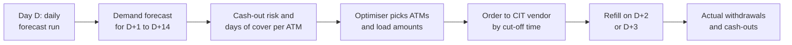
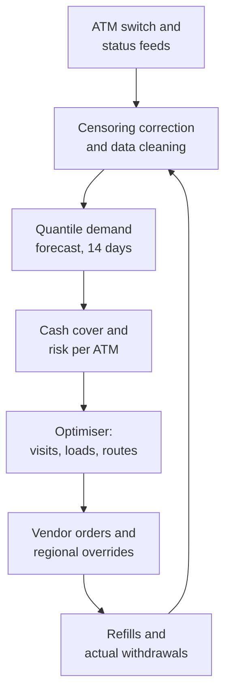

# Case Study 20: ATM Cash Demand Forecasting and Replenishment Optimisation

**Domain:** Finance (banking operations) | **Problem Type:** Time-series forecasting plus optimisation (cash-in-transit routing and cost of idle cash) | **Difficulty:** Intermediate

---

## 1. Business Context

### Company background

- **Sagar Bank** (fictional) is a regional private bank with about 8,000 ATMs across metros, towns and highways in six states.
- Cash in ATMs is loaded by **CIT vendors** (cash-in-transit companies, armoured vehicle firms that carry cash from the bank's currency chest to the ATMs). Each visit to an ATM costs the bank a fee.
- Each ATM has cassettes (cash trays) with a capacity of about ₹40 lakh when full, mostly in ₹500 notes with some ₹100 and ₹200.
- Terms used in this case:
  - **Stock-out (cash-out):** the ATM has no cash left and customers are turned away.
  - **Idle cash:** cash sitting in an ATM that is not withdrawn. The bank is funding this cash and could earn interest on it elsewhere, so it has a cost.
  - **Replenishment:** a CIT visit to load cash.
  - **Lead time:** the days between ordering a refill and the vehicle actually loading the ATM.
  - **Censored demand:** when an ATM runs dry, the recorded withdrawals show what was available, not what people wanted.

### The pain, with numbers

| Item | Value |
| --- | --- |
| ATMs | 8,000 |
| Average daily withdrawals per ATM | about ₹3.2 lakh, so about ₹256 Cr a day across the network |
| Average cash held in ATMs (loaded cash) | about ₹14 lakh per ATM, so about ₹1,120 Cr in total |
| Cost of funds (what the bank could earn, or pays, on that cash) | about 6.5% a year |
| **Annual cost of idle cash** | 1,120 Cr x 6.5% = about **₹72.8 Cr** |
| Replenishment visits | about 30 a year per ATM, so about 2.4 lakh visits |
| Cost per visit (CIT vendor fee) | about ₹1,800 |
| **Annual cost of CIT visits** | 2.4 lakh x ₹1,800 = about **₹43.2 Cr** |
| Share of ATM-days with a stock-out | about 2.4%, so about 70,000 ATM-days a year |
| Cost per stock-out ATM-day (lost interchange fee, complaints, branch footfall, churn risk) | about ₹2,500 |
| **Annual cost of stock-outs** | 70,080 x ₹2,500 = about **₹17.5 Cr** |

- Today the refill plan is a **fixed schedule** by ATM class (for example every 10 days for high-volume ATMs) plus emergency refills when an ATM hits a low-cash alert.
- Emergency refills cost about 2 times a normal visit, so avoidable alerts add to the cost.
- Regulatory and market context: RBI has pushed banks to reduce ATM cash-outs and has asked for monitoring of ATMs that stay out of cash for long periods, so availability is a service-quality matter and not only a cost matter. Demand in India is lumpy, driven by salary days, festivals, market days, and weddings. UPI has reduced cash demand in cities, but cash remains strong in smaller towns and on highways.

### Stakeholders and what each wants

| Stakeholder | What they want | What they fear |
| --- | --- | --- |
| Head of Operations and Cash Management | Lower idle cash and fewer emergency visits | Cash-out headlines during festivals |
| Treasury | Less money tied up in ATMs, predictable daily cash need from the currency chest | Last-minute big cash requests |
| Head of Retail Banking | High ATM availability, especially at branch ATMs | Customer complaints and social media posts about empty ATMs |
| CIT vendor manager | Efficient routes, within vendor capacity and cut-off times | Vendor SLAs broken by tight plans, penalties |
| Regional heads | Fairness across regions, and control over exceptions | Plans that ignore local events they know about |
| CFO | Lower cost of cash and logistics | Savings that cause cash-outs and fines |

---

## 2. Translating Business to ML

### The business question vs the ML question

| Business question | ML question |
| --- | --- |
| "Put the right amount of cash in each ATM at the right time." | "Forecast the daily cash demand of each ATM, with an uncertainty range, for the next 14 days, correcting for days when the ATM ran dry." |
| "Decide when to visit and how much to load." | "Given the forecast, the lead time, cassette capacity, vendor cut-offs and costs, choose a visit date and load amount for each ATM to minimise total expected cost." |
| "Do not run out during festivals." | "Use an upper quantile of demand on high-risk days, so that the cost of a stock-out is weighed against the cost of idle cash." |

### Target variable definition

- **Forecast target:** `true_demand_t` for each ATM and day, in rupees. This is not the same as withdrawals when the ATM ran out of cash.
- **Observed data:** `withdrawals_t`, which is the same as demand when the ATM had cash for the whole day, and a lower number (censored) otherwise.
- **Forecast output:** several quantiles, such as the median (P50), P80 and P95, of cumulative demand over the next replenishment cycle.

### Edge cases

| Edge case | Recommended treatment | Reason |
| --- | --- | --- |
| ATM ran out of cash at 3 pm | Treat the day as censored. Estimate true demand from the hourly profile and similar days, and do not treat withdrawals as demand | Otherwise the model learns that demand was low and under-supplies the next time |
| ATM was out of service (hardware, network) | Mark as missing, do not count as zero demand | Zero because of downtime is not zero demand |
| Demand shifted to a nearby ATM because this one was empty | Add neighbour-ATM spillover as a feature and as a diagnostic | The demand moved, it did not disappear |
| ATM relocated or a new ATM opened | Use the cold-start approach: a cluster average until 8 weeks of history | No history of its own (see Case 5 for the cold-start approach) |
| Cash loaded was less than planned (vendor shortage) | Record loaded amount separately from planned amount | Needed to explain cash-outs and to avoid blaming the model |
| Denomination mix (₹500 runs out, ₹100 remains) | Forecast by denomination for the busiest ATMs, total for the rest | Customers cannot withdraw ₹500 notes when only ₹100 are left |

### Unit of prediction

- One **ATM and day** for the forecast, with demand summed over the planning window for the replenishment decision.
- The optimiser works at **route and day** level for each CIT vendor.

### Prediction timing



- The order must go to the vendor **2 to 3 days before** the refill, so the forecast must look at least 3 to 5 days ahead for the order, and cover the days until the next planned refill (up to 14 days).
- Actuals are known the next morning, so the model can be scored daily.

### What success looks like

| Lens | Success |
| --- | --- |
| Business | Idle cash down 12%, stock-out ATM-days halved from 2.4% to 1.2%, CIT visits down 8%. Total saving about ₹21 Cr a year |
| Model | Weekly forecast error (WAPE, weighted absolute percentage error) under 18% at ATM level, and under 5% at region level. P95 coverage between 93% and 97% |
| Operations | Emergency refills down by 40%, with no vendor SLA breach |
| Service | Stock-outs at high-footfall and branch ATMs fall below 0.5% of ATM-days |

---

## 3. Data Understanding

### Data sources and key features

| Feature group | Source | Why it matters |
| --- | --- | --- |
| ATM transaction log (withdrawal amount and count by hour, failed transactions, cash-out events) | ATM switch and journal | History, and the signal for censoring |
| ATM status (cassette balance, cash-out flag, out-of-service hours) | ATM monitoring | Tells when the ATM was empty or down |
| Calendar (day of week, day of month, salary days, month end, public holidays, festival dates, long weekends) | Calendar table | Major drivers of Indian cash demand |
| Location attributes (metro, semi-urban, rural, highway, mall, hospital, market, branch, offsite) | ATM master | Behaviour differs sharply by location type |
| Local events (weekly market day, local fair, wedding season, harvest payments, election dates) | Regional teams and public sources | Spikes that the calendar alone misses |
| Neighbourhood (nearby ATMs of other banks, distance to the nearest own ATM) | ATM master, geo data | Spillover when a neighbour is empty |
| Replenishment history (dates, amounts loaded, vendor, emergency or normal) | CIT vendor reports | Lead times and loaded amounts |
| Digital payment adoption (UPI share in the pin code) | Internal and external data | Trend in cash demand |
| Weather and disruptions (heavy rain, bandh, curfew, cash shortage reports) | External | Short-term shocks |

### Data volume, granularity and refresh

- **Volume:** 8,000 ATMs x 365 days = about 29 lakh ATM-days a year. With 3 years of history, about 87 lakh ATM-day rows. Hourly data is about 24 times larger, about 21 crore rows.
- **Granularity:** daily for the forecast, hourly for the cash-out and censoring analysis.
- **Refresh:** the forecast runs daily. Models are retrained monthly. Location clusters are reviewed quarterly.

### Common data issues

| Issue | How it shows up here |
| --- | --- |
| Censored demand | About 2.4% of days show withdrawals capped by empty cassettes, and these are the high-demand days |
| Outages | Missing data or zero days from downtime, which look like low demand |
| Cash-out time unknown | Some ATMs report the cash-out flag late |
| Structural breaks | A new ATM nearby, a branch closure, a demonetisation-type event, or a UPI push changes demand level |
| Festival drift | Festival dates move each year (lunar calendar) |
| Loaded amount errors | Mismatch between planned and actual loaded amounts |
| Hierarchy | 8,000 ATMs, region totals and treasury totals need to add up |

> **Mentor note: Where juniors usually go wrong here.**
>
> - They train on raw withdrawals, so the model learns that busy ATMs have lower demand on days when they ran dry, and the next forecast is too low and runs out again.
> - They minimise a symmetric error like RMSE. A cash-out and idle cash do not cost the same, so the right loss is asymmetric.
> - They forecast well but ignore the lead time, the vendor cut-off and the cassette limit, so the plan cannot be executed.

---

## 4. Approach and Decision Points

### Baseline first

- **Baseline:** the current fixed schedule with emergency refills.
- **Simple forecast baselines:**
  - Same weekday last week, scaled by a recent level.
  - Seasonal naive by day of week and day of month.
  - Average of the same ATM's last 4 same weekdays.
- **Why it matters:** simple baselines are hard to beat on regular ATMs. The model must earn its place on festival days and irregular ATMs.

### Candidate models

| Model | Pros | Cons | Verdict |
| --- | --- | --- | --- |
| Seasonal naive and exponential smoothing (ETS) | Simple, quick, strong on stable ATMs | Weak on festivals and events | Baseline and fallback |
| ARIMA or SARIMAX per ATM | Classical, interpretable | 8,000 models to maintain, weak with many events | Only for a few high-value ATMs |
| Gradient boosting (LightGBM) across all ATMs with calendar and cluster features | Learns from all ATMs together, handles events and new ATMs | Needs good lag features, point forecasts need quantile versions | **Primary model**, with quantile objectives |
| Hierarchical or clustered forecasting | Keeps ATM, cluster and region forecasts consistent | Extra complexity | Use reconciliation for treasury totals |
| Deep learning (LSTM, temporal fusion transformer, DeepAR) | Learns patterns across series, gives quantiles | Costly, hard to tune, little gain on this data | Only after the gradient boosting model is in production |
| Optimisation (mixed-integer programming or heuristics) | Handles lead time, vendor capacity, routing | Needs clear cost inputs | **Second stage**, after forecasts |

### Decision scenarios

| What if... | Recommended action | Reasoning |
| --- | --- | --- |
| **An ATM ran dry at 2 pm on 5 of the last 30 days** | Mark those days as censored. Estimate true demand using the hourly pattern of similar non-dry days (scale the hours before the cash-out to a full day), or use a censored (Tobit-type) loss. Add a flag for censored days in training | Raw data understates demand, so the model keeps under-supplying the same busy ATM |
| **Cost of a stock-out is ₹2,500 and the cost of holding extra ₹1 lakh for 10 days is about ₹180** | Use the newsvendor idea (a classic rule for choosing a stock level when running short and holding extra have different costs). Target the quantile `Cu / (Cu + Co)` of demand, where Cu is the cost of a shortage and Co is the cost of excess. For the ATM-level cost of about ₹180 per ₹1 lakh over the cycle, a typical high-volume ATM needs about the 90th to 95th percentile | Under asymmetric costs, the median is the wrong target. The quantile comes from the cost ratio, not from a default |
| **Diwali and Eid weeks, with demand 40% above normal for 4 to 5 days** | Add festival-window features (days to festival, days since), use last year's festival effect by location type, and raise the safety quantile for high-risk windows. Preload a few days earlier at highway and market ATMs | Festival dates shift, and the effect differs by location. Preloading is cheaper than emergency visits during a peak |
| **Salary day (1st and 7th) and month-end spikes at office-area ATMs** | Include day-of-month and "days since salary credit" features, and model cluster effects (IT park, mall, residential) separately | The day-of-month cycle is the strongest regular pattern, and it differs by location type |
| **The CIT vendor can serve only 1,100 ATMs per day and needs 48 hours notice** | Make this a constraint in the optimiser, rank ATMs by urgency, and spread non-urgent refills over days with spare capacity | A perfect plan that exceeds vendor capacity fails in execution |
| **A nearby competitor ATM runs out of cash and your ATM sees a surge** | Add neighbour-ATM cash-out signals (where data is available) and a regional alert, and let the regional team add a manual uplift | Spillover is real but unpredictable, so human overrides must be easy |
| **Treasury wants a single network cash number for the currency chest** | Reconcile ATM forecasts so that they sum to cluster and region forecasts, and report region-level accuracy separately | Treasury plans at the aggregate level, where forecasts are much more accurate |
| **An ATM needs ₹36 lakh over the cycle but the cassette holds ₹40 lakh** | Cap loading at cassette capacity less a buffer for the mix of denominations, and shorten the visit interval if needed | Physical limits override the forecast, and the optimiser must know them |

---

## 5. Feature Engineering

### Top 10 features to build

| # | Feature | Business logic |
| --- | --- | --- |
| 1 | Withdrawals on the same weekday in the last 4 and 8 weeks (corrected for censoring) | Strong weekly rhythm in cash use |
| 2 | Day of month, days since salary day, days to month end | Salary credits drive withdrawals |
| 3 | Festival window flags and days to and from major festivals, by region | Shifting dates with large effects |
| 4 | Location type and cluster (metro office, residential, market, highway, rural, branch) | Different demand levels and patterns |
| 5 | Rolling 7 and 28 day average demand and its trend | Level and recent drift |
| 6 | Share of the day's demand in the morning and evening hours (profile) | Needed for the censoring correction |
| 7 | Number of cash-out days in the last 30 days | Marks ATMs with hidden demand |
| 8 | Weekly market day and local event flags | Rural and small town spikes |
| 9 | Distance to the nearest own and competitor ATM, plus their cash-out status | Spillover and competition |
| 10 | UPI penetration of the pin code and the 6-month trend in cash demand | Gradual decline in demand |

### Features to avoid (leakage risks)

| Feature | Problem |
| --- | --- |
| Withdrawals of day D used to forecast day D | Direct leakage of the target |
| Loaded amount or cash balance after the day being predicted | Known only afterwards |
| Rolling averages that include future days when built with centred windows | Look-ahead leakage |
| Emergency refill flag for the target period | It is triggered by the demand surge |
| Cash-out flag of the target day used as a feature | It is part of the outcome |
| ATM ID as a high-cardinality categorical with only a few days of history | Memorises noise, hurts new ATMs |

Quantile forecast for a safety stock level that follows the cost ratio:

```python
import lightgbm as lgb

# Cost ratio: shortage costs Cu, extra cash over the cycle costs Co
Cu, Co = 2500.0, 180.0
tau = Cu / (Cu + Co)            # about 0.93, the target quantile

model = lgb.LGBMRegressor(objective="quantile", alpha=tau,
                          n_estimators=500, learning_rate=0.05)
# y_true uses demand corrected for censored (cash-out) days
model.fit(X_train, y_true_train, sample_weight=w_train)

cycle_demand_q = model.predict(X_next_cycle)   # cash to load per ATM
load_amount = cycle_demand_q.clip(max=cassette_cap * 0.95)
```

---

## 6. Evaluation Strategy

### Metrics

| Metric | Role | Why |
| --- | --- | --- |
| **WAPE** (sum of absolute errors divided by sum of actual demand) | Primary accuracy metric | Handles ATMs of very different sizes, and is easy to explain |
| **Pinball loss** (the quantile loss) at P50, P90, P95 | Primary model metric | Right loss for asymmetric costs and quantile forecasts |
| **Coverage** (share of days actual demand is below the P95 forecast) | Calibration | Must be near 95%, otherwise the safety level is wrong |
| **Total expected cost** (idle cash cost + visit cost + stock-out cost) in rupees | Primary business metric | Combines the three costs |
| Stock-out ATM-days and days of cover | Service | What customers feel |
| Emergency refills | Operations | Forecast misses show up here |
| Bias (mean error) by cluster | Diagnostic | A consistent under-forecast signals censoring problems |

### Metrics that look good but are misleading here

- **RMSE or MAE on all ATMs pooled:** dominated by a few big ATMs and hides errors at small ones.
- **MAPE:** explodes on low-volume days and for small ATMs.
- **Accuracy on non-censored days only:** looks excellent, but skips the hardest days, the ones where the ATM ran dry.

### Validation strategy

| Step | Design | Why |
| --- | --- | --- |
| Rolling-origin backtest | Train on months 1 to 24, test on the next 28 days, and roll the origin forward by 28 days, 10 times | Mimics monthly retraining and shows stability |
| Festival-specific test | Hold out the Diwali and Eid windows of the last year as a separate test | Checks the hardest days |
| Cluster-wise and size-wise results | Report WAPE and coverage by location type and by volume band | Averages hide weak clusters |
| Cost simulation | Replay the last 6 months, apply the new load plan, and compute total cost against the actual plan | Converts accuracy into rupees |
| Censoring check | Compare forecasts with the corrected demand on cash-out days | Shows if the censoring fix works |
| Pilot | Run in 2 regions of about 1,000 ATMs for 8 weeks against the old plan | Real world test with vendor constraints |

### From model metric to business value

- **Idle cash:** 12% lower on ₹1,120 Cr is about ₹134 Cr less cash tied up. At 6.5%: 134.4 x 0.065 = about **₹8.7 Cr** a year.
- **Stock-outs:** from 2.4% to 1.2% of ATM-days, so from about 70,080 to about 35,040 ATM-days. The 35,040 avoided at ₹2,500 each is about **₹8.8 Cr**.
- **Visits:** 8% fewer than 2.4 lakh is about 19,200 visits. At ₹1,800 this is about **₹3.5 Cr**.
- **Total:** 8.7 + 8.8 + 3.5 = about **₹21 Cr a year**.
- Costs: engineering, data, and running the optimiser, about ₹2 Cr a year. Net about ₹19 Cr.
- Note that lower stock-outs usually need more cash or more visits, so the three numbers are linked. The cost simulation checks all three together and not one at a time.

---

## 7. Deployment and Monitoring

### Batch vs real time

- **Daily batch:** forecast and optimiser run each morning, and orders go to the vendor before the cut-off.
- **Intraday alerts:** a light rule or model checks cash balance against the hourly profile and flags ATMs that will run dry that day, so a regional team can request an emergency refill.



### What to monitor

| Type | What to track | Alert trigger |
| --- | --- | --- |
| Forecast accuracy | WAPE by cluster and volume band, weekly | WAPE above 22% in a major cluster |
| Calibration | P95 coverage by cluster | Outside 92% to 98% |
| Service | Stock-out ATM-days, cash-out duration, branch ATM cash-outs | Above 1.5% network-wide, or a branch ATM out for more than 6 hours |
| Cost | Idle cash, visits, emergency refills | Emergency refills rise 20% |
| Data quality | Share of ATMs with missing feeds, late cash-out flags | Above 2% |
| Structural change | ATMs with level shifts (new ATM nearby, closed branch) | Level change above 25% for 2 weeks |
| Vendor | On-time refill rate, capacity used | On-time below 95% |

### Retraining

- **Scheduled:** monthly, with a rolling 24 to 36 month window.
- **Triggered:** a policy change in cash limits, a major festival coming up (refresh festival effects), or a structural break.
- **Overrides:** regional teams can add manual uplifts for local events, and these are logged and measured over time.

### A/B test or champion-challenger design

- **Randomise by ATM** within matched clusters (same location type and volume band), not by day. Half use the new plan, half the old plan.
- **Spillover caution:** nearby ATMs may share demand, so for clusters in the same town, assign the whole town to one arm.
- **Primary readout:** total cost per ATM per month, with stock-out ATM-days and idle cash as secondary metrics.
- **Guardrails:** stop if stock-out ATM-days in the test arm exceed control by more than 0.3 points.
- **Duration:** at least 8 weeks, including one salary cycle and, if possible, a festival.

---

## 8. Stakeholder Communication

### Explain it to a non-technical leader

> "We forecast how much cash each ATM will give out over the next two weeks, and how uncertain that forecast is. Where running out would cost more than carrying extra cash, we load more cash, and where an ATM is calm, we load less and visit less often.
> We also fix a hidden problem: when an ATM runs dry, our data shows lower demand than reality, so we correct for it.
> We expect idle cash to fall by about 12%, empty ATM days to halve, and savings of about ₹21 Cr a year."

### Questions leadership will ask

| Question | Suggested answer |
| --- | --- |
| "Why not keep every ATM full to be safe?" | "That would tie up about ₹1,100 Cr and more, at a cost of about ₹70 Cr a year. We balance the cost of cash sitting idle against the cost of an empty ATM" |
| "What about festivals?" | "We build festival windows into the model, preload earlier at busy locations, and let regional teams add local knowledge. We test on last year's festival weeks first" |
| "How accurate is it?" | "About 18% error for one ATM over a week, and under 5% for a region. That is why plans are built with a safety margin" |
| "Will the vendor cope?" | "The optimiser includes vendor capacity and notice time, and spreads non-urgent visits over quieter days" |
| "What if UPI keeps cutting cash use?" | "We monitor level shifts by location and retrain monthly. Declining ATMs get fewer visits automatically" |

---

## 9. Common Pitfalls and Lessons

| Mistake | Why it happens | How to avoid it |
| --- | --- | --- |
| Training on censored demand | Withdrawals look like demand | Flag and correct cash-out days, or use a censored loss |
| Using a symmetric loss | RMSE is the default | Use quantile loss with the target quantile from the cost ratio |
| Forecasting without lead time | Treating forecast and plan as the same | Forecast from the order date to the next refill, and include vendor cut-offs |
| One model per ATM | It seems natural | One global model with cluster features, plus special handling for top ATMs |
| Ignoring festival dates | Using fixed calendar dates | Use region-specific, movable festival features and last year's effects |
| Forecasting each ATM alone and ignoring the totals | Hierarchy is forgotten | Reconcile ATM, cluster and region forecasts for treasury |
| Overriding the plan with no record | Local knowledge feels obvious | Log manual overrides and measure if they help |
| Judging by pooled error | Large ATMs dominate | Report WAPE by volume band and cluster, and cost in rupees |
| Underestimating spillover | Each ATM is treated as independent | Randomise by town in tests, and model neighbour cash-outs |

---

## 10. Mentor's Focus Checklist

- ✅ **Where to spend 80% of the effort:**
  - Fixing censored demand, since every other step depends on honest demand data.
  - Choosing the right asymmetric loss and safety quantile from real costs of stock-outs and idle cash.
  - Calendar and festival features by location type.
  - Building lead time, vendor capacity and cassette limits into the optimiser, and testing by cost simulation.
- ❌ **What not to over-engineer:**
  - Deep sequence models before a global gradient boosting model with good calendar features.
  - A separate model for every ATM.
  - Hour-level forecasts for the whole network when daily is enough for refill decisions.
- 💡 **Key takeaway:** In cash forecasting, **the point forecast is not the decision**. The decision is a quantile chosen from the cost of an empty ATM against the cost of idle cash, built on demand data corrected for the days the ATM could not serve.
