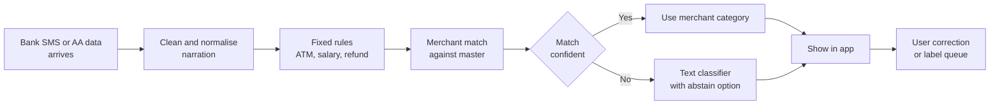
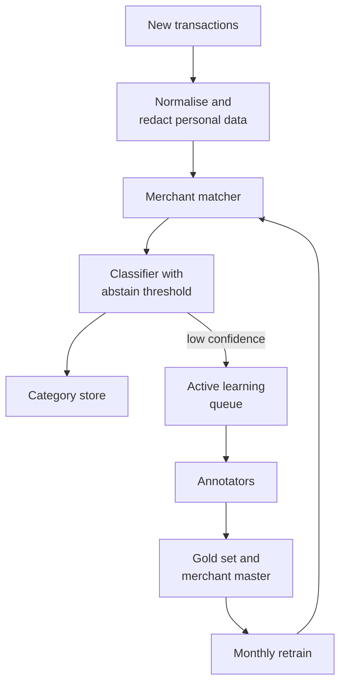

# Case Study 21: Transaction Categorisation and Merchant Matching

**Domain:** Finance (personal finance and lending data) | **Problem Type:** NLP text classification plus entity matching | **Difficulty:** Intermediate

---

## 1. Business Context

### Company background

- **RupeeLens** (fictional) is a money-management app. Users link their bank accounts and cards, and the app shows where their money goes: food, rent, fuel, EMIs, subscriptions and so on.
- Data comes from two routes: SMS parsing on the phone, and the **Account Aggregator (AA)** framework (an RBI-regulated, consent-based way to share bank data between regulated entities).
- Scale: about 50 lakh monthly active users and about 20 crore transactions a month (about 40 per user).
- Channel mix: UPI about 62%, cards about 22%, and NEFT, IMPS, ATM and others about 16%.
- Revenue: a premium plan (about 2 lakh subscribers at ₹599 a year) and a partner lender that uses spending patterns to pre-approve small loans.

### The pain, with numbers

| Item | Value |
| --- | --- |
| Current method | Regex rules plus a hand-built merchant dictionary of 40,000 entries |
| Correctly categorised (top-level category) | 71% |
| Dumped into "Others" | 14% |
| Wrongly categorised | 15% |
| "Wrong category" support tickets | about 6,000 a month at about ₹30 each, about ₹21.6 lakh a year |
| Premium plan churn | about 30% a year, and exit surveys often say "the insights are wrong" |
| Partner lender disbursals using spend features | about ₹600 Cr a year at a 4.0% bad rate |

- A typical bank narration looks like `UPI/412398765432/PAYMENT FOR ORDER/sharmasweets@okbank`. There is no clean merchant name, and the same shop can appear in 50 different spellings.
- Wrong categories are not only a cosmetic problem. A lender reading "gambling and fantasy sports" spend from a salaried user, when the real transaction was a cricket academy fee, can unfairly reject a good borrower.

### Stakeholders and what each wants

| Stakeholder | What they want | What they fear |
| --- | --- | --- |
| Head of Product | Insights users trust, fewer "Others" | Users screenshotting wrong categories on social media |
| Lending partner's risk team | Reliable features such as rent, EMI, cash withdrawal and gambling spend | A noisy "gambling" flag that distorts approvals and creates fairness complaints |
| Data labelling lead | A clear plan for a fixed budget of labels | Paying annotators to label the same easy merchants again and again |
| Engineering lead | Under 20 ms per transaction on CPU, and a taxonomy that does not change every month | A big transformer that needs GPUs for 20 crore rows a month |
| Compliance and privacy | Consent respected, minimal personal data, explainable lender features | Names of individuals leaking into training data (DPDP Act 2023) |

---

## 2. Translating Business to ML

### The business question vs the ML question

| Business question | ML question |
| --- | --- |
| "Show users the right category for every transaction." | "Given a short messy narration plus amount and time, predict a category from a two-level taxonomy (14 top-level, about 90 sub-categories), or abstain when unsure." |
| "Know which shop this is, across all spellings." | "Match each narration to a canonical merchant ID in our merchant master, or say 'new merchant'." |
| "Give the lender trustworthy spend features." | "Reach at least 95% precision on a small set of lender-critical categories, even if recall is lower." |

> **Mentor note:** This is two linked problems. Entity matching (which merchant?) gives you a strong, reusable label. Classification (which category?) handles merchants you have never seen. Do not force one model to do both jobs.

### Target variable definition

- **Primary label:** the category chosen by a trained annotator following the written taxonomy guide, on a sampled transaction.
- **Gold set:** about 8 lakh transactions labelled by humans, with 10% labelled twice to measure agreement (target Cohen's kappa of 0.8 or more).
- **Weak labels:** about 2.5 crore transactions labelled automatically from the merchant dictionary, card MCC (merchant category code, the 4-digit business code on card and UPI merchant payments), and user corrections. These are noisy and are never used for the final test.
- **Hierarchy:** every sub-category rolls up to one top-level category, so a wrong sub-category can still be a right top-level one.

### Edge cases

| Edge case | Recommended treatment | Reason |
| --- | --- | --- |
| UPI payment to a person (P2P), for example "Ramesh Kumar" | Own class "Transfers to people". Do not guess the purpose from the name | The name says nothing about rent, tuition or loan repayment |
| Same payee, same amount, every month | Add a recurrence flag, and allow the sub-category "Rent or recurring payment" | Behaviour is a better clue than text here |
| Payment aggregator handle (for example a gateway wallet) | Treat as "unknown merchant behind aggregator". Use amount, time and MCC | Thousands of different shops share one handle |
| Hypermarket or marketplace that sells everything | Use a top-level "Shopping general" instead of forcing grocery or electronics | The true label is not recoverable from the text |
| Reversal, refund or failed transaction | Separate "Refund" class, linked to the original transaction | Refunds net against spend and must not count as income |
| Cash withdrawal at ATM | Fixed class from the channel code, not the model | The rule is 100% reliable, so do not waste model capacity |

### Unit of prediction

- One **transaction** (narration text, amount, direction, time, channel, MCC if present).
- Entity matching runs one level lower: one narration to one merchant ID.
- Later, user-level aggregates (monthly spend in each category) feed the lender.

### Prediction timing



- Scoring is **near real time** (within a minute of the bank message) for the app screen.
- A **nightly batch** recomputes monthly category totals and the lender features.
- Labels come from annotators (days) and user corrections (hours to weeks).

### What success looks like

| Lens | Success |
| --- | --- |
| Business | "Wrong category" tickets down by 60%, "Others" below 4%, premium churn down 2 points, and lender bad rate improved by about 0.2 point |
| Model | Top-level accuracy of 93% or more and macro-F1 of 0.88 or more on a merchant-disjoint test set |
| Lender features | Precision of 95% or more and recall of 90% or more for EMI, rent, cash withdrawal and gambling classes |

---

## 3. Data Understanding

### Data sources and key features

| Feature group | Source | Why it matters |
| --- | --- | --- |
| Normalised narration text (cleaned of numbers and bank codes) | SMS and AA statements | The main signal |
| Payee handle or VPA (virtual payment address) and its parts | UPI narration | Handles often carry the shop name, for example `sharmasweets@okbank` |
| Merchant master (canonical name, aliases, category, city) | Internal list plus MCC tables | Source of high-quality weak labels |
| Amount, direction (debit or credit), amount bucket | Transaction | A ₹60 debit is likely tea, a ₹60,000 debit is likely rent or a big purchase |
| Time features (hour, day of month, weekday) | Timestamp | Rent on the 1st to 5th, salary on the last working day, lunch at noon |
| Payee popularity (number of distinct app users paying this payee) | Aggregate across users | Popular payees are merchants, rare ones are often individuals |
| Recurrence (same payee and similar amount in last 3 months) | User history | Rent, EMI, subscriptions, tuition |
| Channel and MCC | Card or UPI metadata | Strong when present, often missing on UPI |
| User corrections | In-app edits | Cheap, noisy labels |

### Data volume, granularity and refresh

- **Volume:** about 20 crore transactions a month. About 38% of volume comes from the top 2,000 merchants, 22% from the next 20,000, and **40% from a long tail** (small shops, personal handles, one-off payees). Of that tail, about 15 percentage points are person-to-person transfers.
- **Granularity:** one row per transaction, short text of 5 to 15 tokens (about 40 characters on average).
- **Refresh:** the merchant master is updated weekly. The classifier is retrained monthly. Lender features refresh nightly.

### Common data issues

| Issue | How it shows up here |
| --- | --- |
| Messy short text | `POS 4829XX AMZN PAY IN` and `AMAZON PAY INDIA` are one merchant. Truncated names, bank-specific prefixes and random reference numbers |
| Long tail of merchants | Millions of distinct handles, most seen fewer than 5 times |
| Weak label errors | Dictionary says "Fuel" for a petrol pump that also runs a store and a restaurant |
| Class imbalance | "Fuel" is 4% of volume while "Insurance" is 0.4% and "Gambling and fantasy" is 0.6% |
| Mixed languages | Hindi and regional words in Roman script, for example "kirana", "dudh", "bijli" |
| Taxonomy drift | Product asks to split "Entertainment" into "Streaming" and "Gaming", and old labels no longer fit |
| Personal data | Narrations may contain names, phone numbers and account fragments |

> **Mentor note: Where juniors usually go wrong here.**
>
> - They split the data randomly, so the same merchant sits in both train and test. The model memorises the merchant and reports 97% accuracy, which collapses on new merchants.
> - They evaluate the model on weak labels created by the same dictionary the model was trained on. That is circular.
> - They report one overall accuracy and never look at the small categories that the lender actually uses.

---

## 4. Approach and Decision Points

### Baseline first

- **Baseline 1:** the current rules and dictionary (71% top-level accuracy).
- **Baseline 2:** character n-gram TF-IDF (turning text into counts of 2 to 5 letter pieces, which handles typos well) plus logistic regression.
- **Why it matters:** a linear model on character n-grams often reaches 88 to 90% and runs in microseconds. Any bigger model must justify its cost against this.

### Candidate models

| Model | Pros | Cons | Verdict |
| --- | --- | --- | --- |
| Dictionary and regex rules | Exact, explainable, instant | Misses spelling variants and new merchants | Keep as the first layer for known merchants |
| Char n-gram TF-IDF plus linear model | Fast, robust to typos, tiny | Cannot understand meaning of unseen words | Strong baseline and fallback |
| fastText style embeddings | Fast, handles sub-words, good with short text | Weaker on subtle categories | Good primary model on CPU |
| Fine-tuned small multilingual transformer | Best on messy and mixed-language text | Costly at 20 crore rows a month | Use for low-confidence rows only, or distil into a smaller model |
| Two-stage entity matching (blocking, then pairwise scorer) | Reuses merchant knowledge, auditable | Needs a maintained merchant master | Primary path for the top 22,000 merchants |
| LLM zero-shot labelling | No training data needed, good on rare merchants | Slow, costly, can be inconsistent | Offline only, to propose labels for annotators |

### Decision scenarios

| What if... | Recommended action | Reasoning |
| --- | --- | --- |
| **The same shop appears under 40 spellings** (`sharma sweets`, `SHARMA SWTS`, `sharmasweets@ok`) | Normalise (lowercase, strip digits and bank prefixes), then block on character n-grams and score pairs with edit distance plus embedding similarity. Cluster aliases and have a human approve each cluster once | Matching is cheaper than classification, and one approved cluster fixes thousands of future rows |
| **40% of volume is long-tail merchants never seen in training** | Evaluate with a **merchant-disjoint test split**. For unseen merchants, fall back to the text classifier, and back off to the top-level category if the sub-category is uncertain | Accuracy on seen merchants says nothing about the tail, and hierarchy back-off turns a wrong guess into a right-but-coarser one |
| **The budget is 60,000 human labels a month** | Use active learning: pick rows with low confidence, then rank by how often the narration pattern occurs and how sensitive the category is for lending. Add 10% random rows as an unbiased check | Random labelling wastes money on easy repeats. Pure uncertainty sampling picks odd outliers, so weight by volume |
| **The lender needs "gambling and fantasy" at 95% precision** | Use a per-category threshold tuned on the gold set. Below the threshold, show the user a softer category (for example "Entertainment") and send nothing to the lender | Overall accuracy hides this. A false gambling flag costs a good borrower, so precision matters more than recall for this class |
| **The dictionary says "Fuel" but half the spend at that handle is a convenience store** | Treat dictionary labels as soft labels with a confidence weight. Down-weight multi-category merchants and let amount and time break the tie | Weak labels are cheap but biased. Weighting keeps the volume without the worst noise |
| **Users correct the category in the app** | Use corrections as labels, weighted lower than annotator labels. Ignore a correction if the same user flips it back and forth | Users mostly fix visible big-ticket errors and sometimes pick wrong categories. They are not an unbiased sample |
| **Many UPI payments are to individuals** | Keep one "Transfers to people" class. Add recurrence and amount features to propose sub-types such as rent or household help, and ask the user to confirm once | The name cannot reveal intent, so asking the user once is more honest than a confident guess |
| **Product splits "Entertainment" into two classes next quarter** | Version the taxonomy. Keep the old label in the gold set, and relabel only the affected sub-set using the merchant master | Relabelling everything is expensive, and a hierarchy makes splits cheap when designed well |

---

## 5. Feature Engineering

### Top 10 features to build

| # | Feature | Business logic |
| --- | --- | --- |
| 1 | Character n-grams (2 to 5) of the cleaned narration | Survive typos, truncation and spelling variants |
| 2 | Word tokens including Roman-script Hindi terms | Words like "dudh" and "kirana" point to groceries |
| 3 | Payee handle stem (text before `@`) split into parts | The handle often contains the real shop name |
| 4 | Merchant match score and matched merchant's category | Strongest signal for known merchants |
| 5 | MCC code, when present | Direct business type from the card network |
| 6 | Amount bucket (log scale) | Separates tea from groceries from rent |
| 7 | Day-of-month and hour | Rent and salary have calendar patterns, meals have time patterns |
| 8 | Recurrence: count of the same payee with similar amount in last 3 months | Subscriptions, EMIs, rent, tuition |
| 9 | Payee popularity across users (log of distinct users) | Merchants have many payers, individuals have few |
| 10 | Direction and channel (credit or debit, UPI, card, ATM) | A credit is usually salary, refund or transfer, never fuel |

### Features to avoid (leakage risks)

| Feature | Problem |
| --- | --- |
| Merchant dictionary label used both as a feature and as the weak label | The model learns to copy the dictionary and looks accurate on weak-label tests |
| The user's own category edits on the test rows | Direct leakage of the answer |
| Later-month spending pattern of the user (for example "this user spends mostly on fuel") | Future information, and it bakes in the user's bias |
| Lender decision or loan outcome | Post-event data, and it creates a feedback loop |
| Full names of individuals as raw tokens | Privacy risk, and the model memorises people |

Cleaning step shared by training and serving:

```python
import re

def normalise(narration: str) -> str:
    text = narration.lower()
    text = re.sub(r"\b\d{6,}\b", " ", text)          # long reference numbers
    text = re.sub(r"\b(upi|pos|imps|neft|ref|txn|payment for)\b", " ", text)
    text = re.sub(r"@\w+", lambda m: " " + m.group(0)[1:], text)  # keep handle bank as a token
    text = re.sub(r"[^a-z\s]", " ", text)           # drop punctuation and leftover digits
    return re.sub(r"\s+", " ", text).strip()

# normalise("UPI/412398765432/PAYMENT FOR ORDER/sharmasweets@okbank")
# -> "order sharmasweets okbank"
```

---

## 6. Evaluation Strategy

### Metrics

| Metric | Role | Why |
| --- | --- | --- |
| **Macro-F1 across categories** | Primary model metric | Treats small categories equally, so "Insurance" counts as much as "Food" |
| **Top-level and sub-category accuracy** | Reporting | Easy to explain, and the gap shows the value of hierarchy back-off |
| **Precision and recall for lender-critical classes** | Primary business metric | EMI, rent, cash and gambling features go straight into credit decisions |
| **Value-weighted accuracy** (rupees correctly categorised divided by all rupees) | Business | A wrong label on a ₹50,000 payment hurts more than on a ₹50 one |
| **Coverage at a target precision** (share of rows auto-labelled at 95% precision) | Operations | Shows how much the abstain option costs |
| Match rate and match precision for the merchant master | Entity matching | Measures whether aliases are linked correctly |
| Calibration error of confidence scores | Supporting | Thresholds and active learning depend on trustworthy confidence |

### Metrics that look good but are misleading here

- **Overall accuracy on a random split:** inflated by repeated merchants, often 5 to 8 points too high.
- **Accuracy on weak labels:** measures agreement with the dictionary, not truth.
- **Rare "Others" shrinkage:** pushing "Others" from 14% to 2% by forcing guesses can raise wrong labels. Track errors, not only coverage.

### Validation strategy

| Step | Design | Why |
| --- | --- | --- |
| Merchant-disjoint split | All narrations of a merchant (or alias cluster) stay in one split | Tests the long-tail case honestly |
| Time-based holdout | Train on months 1 to 5, test on month 6 | New merchants and spellings appear over time |
| Stratified gold set | At least 300 gold rows for each small category | Per-category metrics are noisy below that |
| Double-labelled sample | 10% labelled by two annotators | Kappa sets the ceiling. A model cannot beat label noise |
| Error review by lender class | Read 200 errors for each critical class | Finds taxonomy gaps that metrics hide |

### From model metric to business value

- **Support cost:** tickets fall by 60% of 6,000 a month, which is 3,600 fewer at ₹30. That is ₹1.08 lakh a month, about **₹0.13 Cr a year**.
- **Premium retention:** churn falls by 2 points on 2 lakh subscribers, which is 4,000 users at ₹599, about **₹0.24 Cr a year**.
- **Credit quality:** a 0.2 point lower bad rate on ₹600 Cr of disbursals is ₹1.2 Cr, so about **₹1.2 Cr a year** (shared with the lender, and treated as an estimate).
- **Costs:** labelling 60,000 rows a month at ₹3 is ₹1.8 lakh a month, about ₹0.22 Cr a year, plus about ₹0.4 Cr for compute and the team's share.
- **Net:** about ₹1.57 Cr of benefit minus ₹0.62 Cr of cost, roughly **₹1 Cr a year**. This is a modest direct payback, so the case rests on trust, retention and lender partnership.

---

## 7. Deployment and Monitoring

### Batch vs real time

- **Near real time** for the in-app category, because users open the app minutes after a payment.
- **Nightly batch** for monthly category totals and lender features.
- **Weekly batch** for merchant clustering, alias approval and active-learning sample selection.



### What to monitor

| Type | What to track | Alert trigger |
| --- | --- | --- |
| Data drift | Share of narrations with no merchant match, new token rate | Unmatched share rises by more than 3 points |
| Output drift | Share of each category by week | A category moves more than 25% from its 8-week average |
| Quality | Accuracy on a fresh weekly gold sample of 2,000 rows | Macro-F1 below 0.85, or any lender class precision below 93% |
| User signals | Correction rate per category, "wrong category" tickets | Correction rate above 4% of views for a category |
| Latency | p99 scoring time and queue lag | p99 above 20 ms or lag above 5 minutes |
| Lender features | Share of "gambling" and "EMI" flags per user cohort | Flag rate jumps for one bank or one city |

### Retraining

- **Scheduled:** monthly, on a rolling window, with all newly approved gold labels.
- **Triggered:** large bank format change (a bank changes its narration template), or a precision breach on a lender class.
- **Fast lane:** a new merchant alias can be added to the master the same day, without any retraining.

### A/B test or champion-challenger design

- **Offline first:** the challenger must beat the champion on the merchant-disjoint gold set and not lose on any lender-critical class.
- **Then a live split:** 10% of users, randomised by user ID, comparing correction rate, ticket rate and premium engagement.
- **Guardrail:** stop if the correction rate rises, or if any lender feature distribution shifts by more than agreed bands.
- **Lender check:** replay the lender's scorecard on old data with the new categories to confirm the credit model does not degrade.

---

## 8. Stakeholder Communication

### Explain it to a non-technical leader

> "When a bank message says something messy like a code and a handle, our system first checks whether we know the shop. If we do, we use its category. If not, a text model reads the message and guesses, and when it is unsure we say so, or ask a human.
> We spend our labelling budget on the cases the model finds hardest and that matter most to our lending partner.
> The result is fewer wrong categories and a trustworthy set of signals, such as rent and EMIs, for credit decisions."

### Questions leadership will ask

| Question | Suggested answer |
| --- | --- |
| "Why not just use a big LLM for everything?" | "At 20 crore transactions a month it is too slow and costly. We use it offline to suggest labels and keep a small fast model for live scoring" |
| "Can we hit 100% accuracy?" | "No. Even two human labellers disagree on about 1 in 12 rows. We aim for near-human accuracy and abstain on the rest" |
| "Why did you spend labels on unusual merchants?" | "Common merchants are already right. The value is in uncertain patterns that repeat often, so each label fixes thousands of rows" |
| "Is the lender data safe and fair?" | "We use a high confidence bar for lender-facing categories, we redact personal names, and users can see and correct their categories" |
| "How do we know it keeps working?" | "Every week 2,000 fresh rows are labelled and scored. A drop in any lender class triggers an alert and a retrain" |

---

## 9. Common Pitfalls and Lessons

| Mistake | Why it happens | How to avoid it |
| --- | --- | --- |
| Random train-test split | It is the default | Split by merchant cluster and by time |
| Evaluating on weak labels | Gold labels are expensive | Always keep a human-labelled gold set for the final test |
| Reporting only overall accuracy | One number is easy to present | Report macro-F1 and per-class precision for lender-critical classes |
| Forcing a guess on every row | "Others" looks bad on a dashboard | Allow abstain and back-off to the top-level category |
| Labelling randomly | Simple to run | Use active learning with volume and sensitivity weights, plus a random slice |
| Ignoring the merchant master | Teams jump to deep learning | Maintain aliases and use matching for the top 22,000 merchants |
| Treating user corrections as truth | They are free and plentiful | Down-weight them and check agreement with annotators |
| No taxonomy governance | Product requests change the list often | Version the taxonomy and keep a hierarchy that can split cleanly |
| Letting personal names into training text | Raw narrations contain names | Redact names and numbers before storing or training |

---

## 10. Mentor's Focus Checklist

- ✅ **Where to spend 80% of the effort:**
  - A clean taxonomy and a well-audited gold set with measured label agreement.
  - Merchant-disjoint evaluation so the long tail is judged honestly.
  - Merchant master and alias matching, which gives the best accuracy per rupee.
  - Active learning that spends the labelling budget where volume and lender sensitivity are highest.
  - Per-category precision thresholds for features that feed credit decisions.
- ❌ **What not to over-engineer:**
  - A giant transformer for every transaction when a char n-gram model gets close.
  - Perfect sub-category accuracy for rare classes that nobody reads.
  - Complicated weak-supervision frameworks before basic dictionary weighting is tried.
- 💡 **Key takeaway:** In messy short text, **the label strategy matters more than the model**. Measure on merchants you have never seen, spend human labels where they fix the most volume, and hold the categories that feed lending to a higher precision bar than the ones that only decorate a chart.
