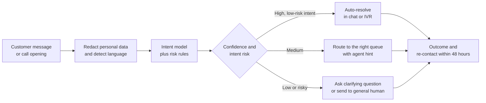
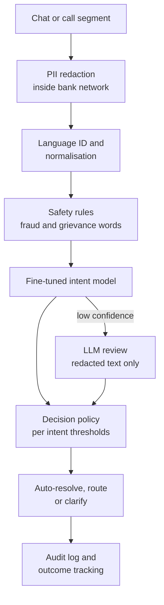

# Case Study 22: Customer-Service Intent Classification and Routing

**Domain:** Finance (retail banking operations) | **Problem Type:** NLP multi-class classification with confidence-based automation | **Difficulty:** Intermediate

---

## 1. Business Context

### Company background

- **Navbharat Bank** (fictional) is a mid-sized private bank with about 1.8 crore customers, a mobile app, net banking, and a contact centre.
- Customers contact the bank through in-app chat and WhatsApp (text), and through phone calls (speech turned into text by ASR, automatic speech recognition).
- Volume: about 45,000 contacts a day, which is about 1.64 crore a year. Chat and WhatsApp are about 28,000 a day, voice about 17,000.
- Language mix: English about 40%, Hinglish (Hindi written in Roman letters mixed with English) about 52%, and regional languages and others about 8%.

### The pain, with numbers

| Item | Value |
| --- | --- |
| Contacts a year | about 1.64 crore (45,000 a day) |
| Cost per human-handled contact | chat about ₹55, voice about ₹130, blended about ₹83 |
| Annual cost of human handling | about ₹136 Cr |
| Current routing | IVR menus plus keyword rules |
| Misrouted contacts today | 18% (about 29.6 lakh a year) |
| Extra cost per misrouted contact (transfer, repeat identity check, longer handling) | about ₹45 |
| **Annual cost of misrouting** | **about ₹13.3 Cr** |
| Contacts that are simple status or information requests | about 35% |
| Agent-tagged "Other" disposition | 22% of tagged contacts |

- Regulatory backdrop: RBI expects banks to run a proper grievance redressal process, so complaints must be recognised and logged and not buried in a general queue. For unauthorised transactions, RBI's customer protection rules reward fast reporting, so a "my card was misused" message must never wait in line (see Case 2).
- Customer data is personal data under the **DPDP Act 2023**, and the bank must limit how it is stored, shared and used for training.

### Stakeholders and what each wants

| Stakeholder | What they want | What they fear |
| --- | --- | --- |
| Head of Customer Service | Lower cost per contact and lower waiting time | A bot that annoys customers and triggers social-media complaints |
| Contact centre operations | Right queue first time, with a suggested intent for the agent | Agents distrusting the tool and overriding it |
| Chief Risk and Compliance Officer | Fraud and grievance cases never auto-closed, full audit trail | Missed complaints and regulatory reporting gaps |
| CISO and privacy officer | No account numbers, card numbers or OTPs in logs or vendor systems | A data leak through a third-party LLM |
| Head of Digital | Higher self-service resolution in the app | A long programme with no early win |
| Customers | Quick answers, and a human when it matters | Being stuck in a loop with no way out |

---

## 2. Translating Business to ML

### The business question vs the ML question

| Business question | ML question |
| --- | --- |
| "Send each customer to the right place the first time." | "Classify each contact (text or transcript) into one of about 62 intents, grouped into 9 families, and return calibrated confidence" |
| "Automate what we safely can." | "For each intent, decide whether confidence is high enough for auto-resolution, for routing with an agent hint, or for a clarifying question" |
| "Never mishandle fraud or complaints." | "Detect high-risk intents and escalation language with very high recall, whatever the model's top intent says" |

> **Mentor note:** The classifier is the easy part. The real product is the **decision policy around the classifier**: what happens at each confidence level for each intent. Most of the money is in that table.

### Target variable definition

- **Primary label:** the intent from a written taxonomy, such as `card_block`, `upi_failed_debit`, `balance_enquiry`, `loan_foreclosure_query`, `report_fraud`, `statement_request`.
- **Gold set:** about 20,000 contacts audited by a QA team (Cohen's kappa 0.78 between auditors).
- **Training labels:** about 1.2 lakh agent-tagged dispositions, which are noisy because agents pick quickly and use "Other" a lot.
- **Intent families (9):** cards, UPI and payments, accounts and balances, loans, fraud and security, KYC and profile, digital access, grievances and complaints, and other.

### Edge cases

| Edge case | Recommended treatment | Reason |
| --- | --- | --- |
| One message with two intents ("block my card and tell me my balance") | Predict a primary intent and a secondary one. Handle the riskier intent first | Real customers bundle requests |
| Customer mentions "ombudsman", "RBI complaint" or "consumer court" | Override to the grievance queue and human agent, regardless of top intent | Regulatory and reputational risk |
| Voice transcript with ASR errors ("block my cord") | Use ASR confidence as a feature and allow clarification | Wrong text creates confident wrong intents |
| Customer asks something the taxonomy has no intent for | Predict `unknown` and send to a human | Forcing a guess creates misrouting |
| Customer is angry but intent is simple (balance) | Keep the intent, but flag sentiment for a human with priority | Tone changes handling, not meaning |
| Third-party contact (a relative calling for an elderly customer) | Flag for identity check before any account detail | Privacy and fraud risk |

### Unit of prediction

- One **customer turn** (the opening message, or a clarifying reply) in chat, and one **call segment** (first 20 to 30 seconds of speech) in voice.
- Features about the customer (open complaints, recent incidents) are attached at contact level.

### Prediction timing



- Scoring happens in **real time**, within about 300 ms for chat and 1 to 2 seconds for voice.
- Outcomes (resolved, re-contacted, transferred) arrive within 48 hours, and QA audit labels arrive weekly.

### What success looks like

| Lens | Success |
| --- | --- |
| Business | Misrouting down from 18% to 8%, and 20% of contacts auto-resolved with at most 3% needing a re-contact. Net benefit of about ₹25 Cr a year |
| Model | Volume-weighted F1 of 0.90 or more on the gold set, and recall of 98% or more on `report_fraud` and grievance intents |
| Operations | Auto-resolved contacts at 97% precision, repeat-contact rate under 6%, no regulatory complaint auto-closed |

---

## 3. Data Understanding

### Data sources and key features

| Feature group | Source | Why it matters |
| --- | --- | --- |
| Message or transcript text (redacted) | Chat logs, ASR output | The main signal |
| Language and script (English, Roman Hindi, Devanagari, mixed) | Language ID model | Chooses the right normalisation and model |
| ASR confidence and speaking rate | Speech engine | Low confidence means more errors in text |
| Entry point (which app screen opened the chat, IVR option pressed) | App and IVR logs | Strong prior. A chat opened from the "Cards" screen is likely a card topic |
| Recent contact history (same customer, last 7 days) | CRM | Repeat contacts about the same issue signal escalation |
| Open incidents (UPI outage, ATM network issue, app release) | Operations status page | Explains spikes such as "payment failed" |
| Customer segment (new, salaried, senior citizen, loan customer) | Core banking | Different intent mix and different handling rules |
| Agent disposition and QA audit label | Contact centre tools | Training label, never an input feature |

### Data volume, granularity and refresh

- **Volume:** about 1.64 crore contacts a year, 1.2 lakh agent-tagged for training and 20,000 gold. The top 12 intents make up about 68% of volume, and the other 50 intents about 32%.
- **Granularity:** one row per contact turn. Voice adds timing and ASR confidence per word.
- **Refresh:** transcripts arrive within minutes. Taxonomy is reviewed quarterly, and the model is retrained monthly.

### Common data issues

| Issue | How it shows up here |
| --- | --- |
| Code-mixing | "mera card block kardo, paisa kat gaya" mixes Hindi and English in one sentence |
| Spelling chaos | "balance", "balence", "bal", "baki kitna hai" all mean the same thing |
| Noisy labels | Agents use "Other" for 22% of contacts, and some choose the first dropdown item |
| ASR errors | Numbers and brand words are often wrong. Spoken digits ("four five six") break regex-based redaction |
| Personal data in text | Account numbers, card numbers, PAN, Aadhaar, phone numbers and OTPs appear in free text |
| Distribution shifts | A UPI outage can double `upi_failed_debit` in two hours |
| Class imbalance | `report_fraud` is about 2% of contacts but the costliest to miss |

> **Mentor note: Where juniors usually go wrong here.**
>
> - They send raw transcripts to an external LLM or labelling vendor before redaction, which creates a privacy incident.
> - They train on agent dispositions as if they were truth, and the model learns agent shortcuts such as "when in doubt, Other".
> - They report one accuracy number, and a model that is 91% accurate can still miss every second fraud report because fraud is small by volume.

---

## 4. Approach and Decision Points

### Baseline first

- **Baseline:** current IVR menus plus keyword rules. Misroutes 18% of contacts.
- **Simple model baseline:** TF-IDF on words and characters with logistic regression, trained on cleaned agent labels.
- **Why it matters:** a simple model often reaches 80 to 85% accuracy on English, and the gain from a fine-tuned transformer must be measured against that, especially on Hinglish.

### Candidate models

| Model | Pros | Cons | Verdict |
| --- | --- | --- | --- |
| Keyword and IVR rules | Transparent, instant | Cannot handle Hinglish and paraphrase | Keep for hard safety rules (fraud words, grievance words) |
| TF-IDF plus logistic regression | Cheap, fast, easy to calibrate | Weak on mixed language and meaning | Baseline and fallback |
| Fine-tuned small multilingual transformer (about 100M parameters, run on the bank's own servers) | Best accuracy per rupee, handles code-mixing, low latency, data stays inside the bank | Needs labelled data and an MLOps pipeline | **Primary model** |
| Hosted LLM with few-shot prompt | Fast to start, handles new intents, good on odd phrasing | Costly at scale, slower, data leaves the bank, harder to calibrate | Use for cold-start intents, label suggestions and low-confidence cases |
| Retrieval-based matching to example utterances | Easy to add a new intent with 20 examples | Needs good embeddings | Useful as a helper for new intents |
| Speech-to-intent end to end model | Avoids ASR errors | Little Hinglish data, heavy to build | Not now |

### Decision scenarios

| What if... | Recommended action | Reasoning |
| --- | --- | --- |
| **Customers write in Hinglish** (`mera card block kardo`, `paise kat gaye`) | Normalise Roman-Hindi spellings, add transliteration variants and code-mixed examples to training, and test on a Hinglish-only slice. Use a multilingual model that has seen Indian languages | English-only models silently drop 10 to 15 accuracy points on Hinglish. A separate slice makes the gap visible |
| **The model is 92% confident, but the intent is "close account"** | Require a confirmation step or send to a retention agent, even at high confidence. Set the auto-resolve threshold per intent, not one number for all | A wrong auto-resolution on balance enquiry costs about ₹10 of irritation. A wrong card block or account closure costs rupees and trust |
| **A UPI outage causes a 3x spike in "payment failed" contacts** | Show the outage banner first, auto-reply with the known status, and loosen routing for that intent for the duration. Monitor the intent mix hourly | The bank knows the cause. Sending each customer to an agent wastes money, and a calibrated model should not be retrained during an incident |
| **A new product launches and has no labelled data** | Add the intent with 20 to 30 seed examples, use the LLM to propose paraphrases and a few hundred silver labels, then audit. Until recall is proven, route to humans with a hint | Cold-start is where an LLM helps most. Auto-resolving an untested intent is risky |
| **Agents tag 22% of contacts as "Other"** | Re-audit a sample, use confident-learning style cleaning (flag labels the model strongly disagrees with), and relabel the top disagreements. Remove "Other" from training or split it into real intents | Training on lazy labels bakes lazy behaviour into the model |
| **The customer says "I will go to the ombudsman"** | A keyword and phrase rule layer moves the contact to the grievance queue with high priority, outside the model | A rare but high-stakes pattern needs a deterministic safety net |
| **A single call contains fraud and a balance enquiry** | Predict a ranked list of intents. Route by the highest-risk one, and let the agent handle the other | Order of handling affects customer safety, not just efficiency |
| **LLM or small model for the main path** | Use the small fine-tuned model on all traffic. Send only contacts with confidence below 0.6 (about 15% of volume) and new-intent candidates to the LLM, after redaction | The LLM costs about ₹0.6 a contact (about ₹1 Cr a year on all traffic) against about ₹0.002 for the small model, and adds delay. A hybrid keeps cost, latency and privacy under control |

---

## 5. Feature Engineering

### Top 10 features to build

| # | Feature | Business logic |
| --- | --- | --- |
| 1 | Cleaned text with redaction tokens (for example `[ACCT]`, `[CARD]`) | The main intent signal, without private details |
| 2 | Language and script flag | Routes to the right normaliser and lets you monitor accuracy by language |
| 3 | Roman-Hindi to normalised-token mapping | "kat gaya", "kaata gaya" and "deducted" become one concept |
| 4 | ASR confidence (mean and minimum) | Low confidence needs a clarifying question |
| 5 | Entry point (screen or IVR option) | Strong prior from context, and it is available before any text |
| 6 | Contacts by this customer in last 7 days, and the last intent | Repeat issues imply escalation or an unresolved fault |
| 7 | Open incident flag for the product (UPI, ATM, app) | Explains abnormal volume and expected intent |
| 8 | Escalation phrase flags (ombudsman, legal, police, consumer court) | Triggers the rule-based override |
| 9 | Message length and number of question marks | Very short messages ("help") need a clarifying question |
| 10 | Customer segment (senior citizen, new customer, loan customer) | Different handling rules and different intent mix |

### Features to avoid (leakage risks)

| Feature | Problem |
| --- | --- |
| Final agent disposition, resolution code or ticket category | Created after the contact, and it is the label itself |
| Queue the contact eventually landed in, or number of transfers | Outcome of the old routing, so the model learns to copy it |
| CSAT score or call duration | Known only at the end of the contact |
| Agent notes written after the call | Post-event text that restates the intent |
| Raw account, card, PAN or Aadhaar numbers | Privacy risk, and the model should never see them |

Choose a per-intent threshold that meets a precision target on validation data:

```python
import numpy as np

def pick_thresholds(probs, y_true, classes, precision_target):
    """probs: (n, k) predicted probabilities. precision_target: dict intent -> target."""
    thresholds = {}
    pred = probs.argmax(axis=1)
    conf = probs.max(axis=1)
    for k, intent in enumerate(classes):
        mask = pred == k
        best = 1.0                                # default: never automate
        for t in np.arange(0.5, 1.0, 0.01):
            sel = mask & (conf >= t)
            if sel.sum() < 200:                   # too few rows to trust
                break
            precision = (y_true[sel] == k).mean()
            if precision >= precision_target[intent]:
                best = t
                break
        thresholds[intent] = round(float(best), 2)
    return thresholds
```

---

## 6. Evaluation Strategy

### Metrics

| Metric | Role | Why |
| --- | --- | --- |
| **Volume-weighted F1 and top-12 intent F1** | Primary model metric | Matches where the contacts and the money are |
| **Recall on `report_fraud` and grievance intents** | Safety metric | Missing one is far costlier than a false alarm |
| **Precision of auto-resolved contacts** | Primary business metric | Wrong automation creates repeat contacts and complaints |
| **Automation rate at 97% precision** | Business | How much volume we can safely take over |
| **Misroute rate and cost-weighted misroute rate** | Business | Each confusion pair has a different cost |
| Expected calibration error (ECE) | Supporting | Thresholds only work if 0.9 really means 90% |
| Repeat-contact rate within 48 hours | Outcome | The best signal that the answer was not right |
| Accuracy by language slice | Fairness and quality | Catches Hinglish and voice gaps |

### Metrics that look good but are misleading here

- **Macro-F1 alone:** treats a rare intent equal to a frequent one, so it hides what matters for volume and cost.
- **Overall accuracy:** high on balance and statement requests, but silent on the few intents that carry risk.
- **Agent-label accuracy:** measures agreement with noisy tags, not truth. Always report against the audited gold set as well.

### Validation strategy

| Step | Design | Why |
| --- | --- | --- |
| Time-based split | Train on months 1 to 8, validate on month 9, test on months 10 to 11 | Intent mix shifts with incidents and seasons |
| Gold set for the final test | 20,000 QA-audited contacts, stratified by language and channel | Removes agent label noise |
| Slice reports | Language, channel (chat or voice), customer segment, intent family | Shows where the model is weak |
| Cost matrix for confusions | Assign a rupee cost to each intent-to-wrong-queue pair | Turns a confusion matrix into money |
| Shadow mode | The model suggests an intent to agents for 4 weeks without automation, and agents accept or reject | Measures real acceptance before any customer sees automation |
| Human review of auto-resolved contacts | 500 random auto-resolved contacts audited weekly | Catches silent errors that never come back as complaints |

### From model metric to business value

- **Misrouting:** from 18% to 8% on 1.64 crore contacts is 10% less, which is 16.4 lakh fewer misroutes at ₹45, about **₹7.4 Cr a year**.
- **Automation:** 20% of contacts is 32.85 lakh. Saving ₹83 minus about ₹6 of automation cost is ₹77 each, about **₹25.3 Cr a year**.
- **Cost of wrong automation:** 3% of 32.85 lakh is about 98,550 contacts, at about ₹150 for the re-contact and goodwill, about **₹1.5 Cr a year**.
- **Platform and people cost:** about ₹6 Cr a year (servers, labelling, monitoring and the team).
- **Net benefit:** 7.4 + 25.3 − 1.5 − 6 = about **₹25 Cr a year**.

---

## 7. Deployment and Monitoring

### Batch vs real time

- **Real time** for chat and voice routing. The customer is waiting.
- **Batch** for weekly relabelling, QA sampling, cluster discovery of unknown intents, and monthly retraining.



### What to monitor

| Type | What to track | Alert trigger |
| --- | --- | --- |
| Input drift | Language mix, text length, share of unseen tokens | New-token share up by 5 points |
| Intent mix drift | Hourly share of each intent | Any intent above 2x its usual hourly share (incident check) |
| Quality | Weekly accuracy on 500 audited auto-resolved contacts and a fresh gold sample | Auto-resolve precision below 96% |
| Calibration | ECE by intent family | ECE above 0.05 |
| Safety | Fraud and grievance recall on audited samples, escalation-word contacts not escalated | Any miss on escalation phrases |
| Customer outcomes | Repeat contact in 48 hours, abandon rate, chat-to-human request rate | Repeat contact above 6% |
| Privacy | PII leak scans on logs and vendor payloads | Any raw account or card number found |

### Retraining

- **Scheduled:** monthly, with newly audited and corrected labels.
- **Triggered:** a new product launch, a taxonomy change, or an intent whose precision falls below target.
- **Not triggered by incidents:** during an outage the mix changes but the language does not. Adjust the policy, not the model.

### A/B test or champion-challenger design

- **Shadow mode first:** the model suggests an intent to agents, and acceptance rate and override reasons are tracked.
- **Then a live split:** randomise by customer ID, not by contact, so one customer does not see two different experiences.
- **Ramp by intent:** turn auto-resolution on for the 3 safest intents first (balance, statement, branch timing), then extend after 4 weeks of clean audits.
- **Guardrails:** stop if the 48-hour repeat-contact rate rises by 1 point, or if any complaint-class contact is auto-closed.
- **Holdout:** keep 2% of traffic on the old routing to measure real savings.

---

## 8. Stakeholder Communication

### Explain it to a non-technical leader

> "The system reads the first message or the first few seconds of a call, works out what the customer wants, and decides what to do next. For easy, low-risk requests like a balance or a statement, it answers at once. For harder ones, it sends the customer to the right team with a note for the agent. For fraud or complaints, it always goes to a person quickly.
> We set how sure the system must be separately for each type of request, based on what a mistake would cost.
> We expect to halve misrouting and take about one contact in five off the agents, with personal data removed before the text is stored or analysed."

### Questions leadership will ask

| Question | Suggested answer |
| --- | --- |
| "Why not just use a ChatGPT-style assistant for everything?" | "It can cost about ₹1 Cr a year on all traffic, adds delay, and sends text outside the bank. We use our own small model for most traffic and the large model only for hard cases, after redaction" |
| "What if the bot gets a fraud report wrong?" | "Fraud and complaint words go through a safety rule outside the model, and we measure recall on those intents every week. Fraud is never auto-closed" |
| "Does it work for Hinglish and regional languages?" | "Hinglish yes, we test it as a separate slice. Regional languages are not covered yet, and they go to humans with a language tag" |
| "How do we know customers are not being trapped?" | "Any customer can type 'agent' at any time, and we track repeat contact and chat-to-human requests as guardrails" |
| "Where does customer data go?" | "Account numbers, card numbers and OTPs are masked first, inside our network, and only masked text is stored or sent anywhere" |

---

## 9. Common Pitfalls and Lessons

| Mistake | Why it happens | How to avoid it |
| --- | --- | --- |
| One global confidence threshold | It is simple | Set thresholds per intent from the cost of a wrong action |
| Training on agent tags without cleaning | They are plentiful | Audit a sample, clean noisy labels, and remove or split "Other" |
| Testing only on English | The team writes English test cases | Slice by language, script and channel, and include voice transcripts |
| Redaction by regex only | Digits are easy to match in text | Handle spoken digits in ASR, names and addresses, and scan logs for leaks |
| Measuring accuracy and ignoring volume | One number is easy to quote | Report volume-weighted F1 and cost-weighted misroutes |
| Letting the model decide on fraud and complaints | It looks cleaner to have one system | Put a deterministic safety layer and recall targets on risky intents |
| Retraining during an incident | The mix suddenly looks different | Change the policy temporarily, and retrain only on stable data |
| Auto-resolving without a way out | Maximising automation rate | Always offer a human option and track repeat contacts |
| Sending raw text to an external vendor | Prototype pressure | Redact first and review vendor terms under DPDP before any call |

---

## 10. Mentor's Focus Checklist

- ✅ **Where to spend 80% of the effort:**
  - Taxonomy design: 62 intents that are distinct, actionable and tied to a queue or a flow.
  - A clean, audited gold set, with Hinglish and voice well represented.
  - The decision policy: per-intent thresholds, risk overrides and clarifying questions.
  - PII redaction that works on both text and spoken digits.
  - Monitoring of repeat contacts and weekly audits of auto-resolved cases.
- ❌ **What not to over-engineer:**
  - Chasing the last 2 points of accuracy on the 50 rare intents.
  - An end to end speech model before text routing is stable.
  - A large LLM on every contact when a small model plus a fallback does the job.
- 💡 **Key takeaway:** In support automation, **the threshold is the product**. The model gives a probability, but the bank's value comes from deciding, intent by intent, when a machine may act on its own and when a person must take over.
