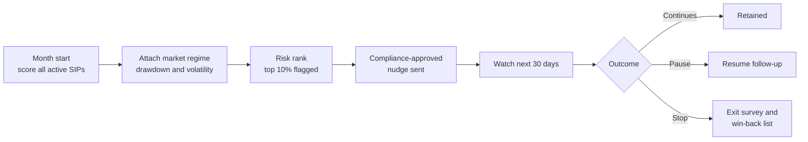
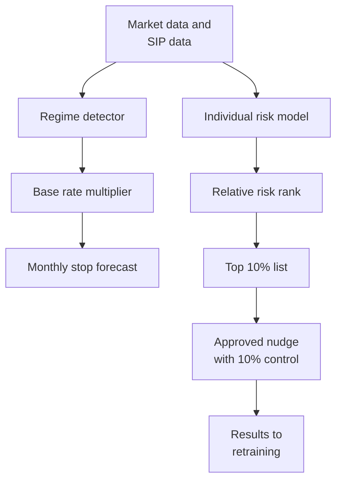

# Case Study 23: SIP Stoppage and Investor Churn

**Domain:** Finance (wealth and mutual funds) | **Problem Type:** Classification with market-regime dependence | **Difficulty:** Intermediate

---

## 1. Business Context

### Company background

- **WealthWave** (fictional) is a mutual-fund distributor app. Users start a **SIP** (systematic investment plan, a fixed amount invested every month into a mutual fund, usually through a bank auto-debit mandate).
- Scale: about 12 lakh investors and about 20 lakh active SIPs, with an average SIP of ₹3,200 a month.
- Monthly SIP inflow: 20 lakh × ₹3,200 = about ₹640 Cr. Assets under management (AUM) held through the app: about ₹12,000 Cr, which is about ₹60,000 per SIP.
- Revenue: the app earns a **trail commission** (a small yearly percentage of AUM paid by the fund house on regular plans) of about 0.6%, so about ₹72 Cr a year.
- A SIP can be paused (many fund houses allow a pause of a few instalments), stopped by the investor, or ended by the fund house after repeated failed debits.

### The pain, with numbers

| Item | Value |
| --- | --- |
| Active SIPs | about 20 lakh |
| Voluntary stop rate in calm months | about 1.2% of active SIPs a month |
| Voluntary stop rate in a month with a market fall of more than 10% from the peak | about 3.6% a month |
| Average stop rate over a year | about 1.8% a month (about 36,000 SIPs a month) |
| Voluntary stops a year | 20 lakh × 1.8% × 12 = about 4.3 lakh |
| Instalments failing for bank reasons (bounce) | about 4% of debits. These are not voluntary stops |
| Value of keeping one SIP for 24 more months | about ₹1,200 (0.6% trail on about ₹1 lakh average AUM, for 2 years) |
| Current retention effort | One generic "Don't stop your SIP" push to everyone who opens the cancel screen |

- Behaviour is not steady. In the last 5.5 years of data there were only 3 to 4 distinct market phases: a sharp crash and recovery, a long sideways grind, a smaller correction, and a strong rally. Stops rise in falls, and a second smaller bump appears after large gains (profit booking).
- Regulatory backdrop: **SEBI** and the fund industry body AMFI require fair, clear, non-misleading communication. No promised returns, no predictions that markets "will recover", and risk disclaimers must be present.

### Stakeholders and what each wants

| Stakeholder | What they want | What they fear |
| --- | --- | --- |
| Head of Retention and Growth | Fewer SIP stops, steady AUM | Spending nudge budget on investors who would have stayed anyway |
| Chief Compliance Officer | Every message approved, no promises, no pressure | A SEBI observation about misleading or manipulative communication |
| Investor education team | Calm, factual guidance that helps investors stay on their plan | Being pushed to write fear-based copy |
| Head of Data Science | A model that survives the next crash, not just the last one | A model that works in training months and fails in a new regime |
| Investors | Control over their own money and a simple way to pause | Being nagged, or feeling that the app hides the stop button |

---

## 2. Translating Business to ML

### The business question vs the ML question

| Business question | ML question |
| --- | --- |
| "Who is about to stop their SIP?" | "For each active SIP at the start of a month, estimate the probability of a voluntary stop in the next 30 days" |
| "How many SIPs will we lose if the market falls 15%?" | "Estimate the monthly stop rate for the whole book under a market scenario" |
| "Who should get a nudge and when?" | "Rank SIPs by risk, then use a randomised test to learn who actually changes behaviour after a nudge" |

> **Mentor note:** Split the problem in two. The first part is **who is relatively riskier** (stable, learnable). The second part is **how many will stop this month** (depends on the market regime). Mixing them makes the model look smart in calm months and wrong in a crash.

### Target variable definition

- **Primary label:** `voluntary_stop_30d = 1` if the investor cancels the SIP mandate or instructs a stop within 30 days of the scoring date (before the next debit).
- **Secondary label:** `pause_30d = 1` if the investor pauses at least one instalment but does not stop.
- **Everything else:** continues, ended by failed debits (involuntary), or matured (a SIP with a fixed end date).

### Edge cases

| Edge case | Recommended treatment | Reason |
| --- | --- | --- |
| SIP ended after 3 failed debits (low balance) | Label as `involuntary_end`. Exclude from the voluntary-stop model and handle with a separate reminder flow | Different cause, different fix (retry or balance alert) |
| Pause then resume | Count as a pause, not a stop. Track resume rate separately | Roughly 70% of pauses resume, so treating them as stops wastes nudges |
| Pause then no resume for 3 months | Convert to a soft stop after the pause window | Many "pauses" are slow-motion exits |
| SIP stopped because the investor switched to a different fund in the same app | Label as `switch`, not churn | Revenue is retained |
| SIP matured at the planned end date | Exclude | No decision happened |
| Investor stops one of five SIPs | Score at SIP level, and add investor-level features | Behaviour often differs by SIP, and investor churn is the sum |

### Unit of prediction

- One **SIP** at the start of each month (the SIP-month row), with investor-level and market-level features attached.
- Investor-level churn (all SIPs stopped and no new SIP) is a roll-up reported to leadership.

### Prediction timing



- Scoring is **monthly batch**, with a weekly refresh during sharp market moves.
- Labels mature after 30 days, so the latest month of scored data have incomplete outcomes.

### What success looks like

| Lens | Success |
| --- | --- |
| Business | Retain about 1,620 SIPs a month that would otherwise stop (about 19,440 a year), worth about ₹2.3 Cr a year |
| Model | In the top 10% of risk, capture at least 45% of the stoppers (lift of 4.5x), with calibration error under 10% relative in each regime |
| Compliance | 100% of messages from approved templates, no complaints about the tone of nudges |

---

## 3. Data Understanding

### Data sources and key features

| Feature group | Source | Why it matters |
| --- | --- | --- |
| SIP basics (amount, start date, fund category, equity or debt, step-up) | Order book | Equity SIPs feel market falls most |
| Tenure (months since the SIP started) | Order book | New investors stop first |
| SIP experience (current value against invested amount, XIRR) | Valuation service | Investors with red numbers stop more |
| Market regime (index drawdown from peak, days since peak, volatility index, 3-month return) | Market data | Drives the base stop rate |
| App behaviour (logins, portfolio views on red days, visits to the cancel or pause screen) | App analytics | Attention is a leading signal |
| Payment health (failed debits, bank change, mandate age) | Mandate system | Separates payment problems from intent |
| Investor profile (age band, city tier, income band, other products) | KYC and CRM | Different tolerance for loss |
| Past behaviour (earlier pauses, past redemptions, stopped SIPs) | History | Past behaviour predicts future behaviour |
| Nudge history and responses | Messaging platform | Needed to avoid over-messaging and to measure effect |

### Data volume, granularity and refresh

- **Volume:** about 20 lakh active SIPs and about 66 months of history. A SIP-month table is about 8 crore rows, with about 1.8% positives on average.
- **Granularity:** one row per SIP per month. Market features are the same for every SIP in a month, so they behave like a "month ID" with only about 66 distinct values.
- **Refresh:** NAV (net asset value, the daily unit price) updates daily. Features refresh daily during stress and monthly in calm periods. The model is retrained quarterly.

### Common data issues

| Issue | How it shows up here |
| --- | --- |
| Few regimes | 66 months but only 3 to 4 distinct market phases, so market effects are learned from very few independent episodes |
| Non-stationary base rate | The stop rate moves from 1.2% to 3.6% with the market, so a model trained in calm months is miscalibrated in a crash |
| Mixed outcomes | Failed debits, pauses and stops all look like "no instalment" in raw data |
| Survivorship | Investors who stopped earlier have no future rows, so older SIPs in the data look better than they were |
| Label delay | The last 30 days of scored SIPs are not yet resolved |
| Confounded nudges | Past generic nudges went only to people who visited the cancel screen, so their effect is hard to separate |
| Sparse signals for new investors | A 2-month-old SIP has little history to learn from |

> **Mentor note: Where juniors usually go wrong here.**
>
> - They do a random train-test split across months, so the test set sits inside the same market regimes as training. They then promise the same accuracy in a regime the model has never seen.
> - They add the stop screen visit as a feature, get a great AUC, and discover that the customer has already decided and there is no time to nudge.
> - They merge pauses and stops into one label, and end up nudging people who were going to resume.

---

## 4. Approach and Decision Points

### Baseline first

- **Baseline:** a table of historical stop rates by tenure band and regime (calm or drawdown), applied to each SIP.
- **Simple model baseline:** logistic regression with tenure, SIP return, drawdown and a few interactions.
- **Why it matters:** this baseline already captures much of the lift, because tenure and "SIP is in the red" explain a lot. Anything fancier must beat it by regime.

### Candidate models

| Model | Pros | Cons | Verdict |
| --- | --- | --- | --- |
| Segment base-rate table (tenure and regime) | Transparent, easy to explain to compliance | No individual ranking | Baseline and sanity check |
| Logistic regression with interactions | Stable, easy to calibrate | Limited non-linear behaviour | Good second baseline |
| Gradient boosting with monotone constraints | Strong ranking, handles missing values, respects "deeper loss never lowers risk" | Needs careful validation across regimes | **Primary ranking model** |
| Discrete-time hazard model (time to stop) | Uses tenure naturally, handles censoring | More set-up work | Useful for forecasting book-level stops |
| Two-stage model (individual relative risk times market multiplier) | Separates who from how many | Two models to maintain | **Recommended structure** |
| Deep sequence model on app events | Captures fine behaviour | Overkill with 3 to 4 regimes | Not now |

### Decision scenarios

| What if... | Recommended action | Reasoning |
| --- | --- | --- |
| **The market falls 12% next month and the model has seen only one such fall** | Keep the individual ranking model, but rescale the base rate using a regime multiplier (for example 3x from past drawdowns). Flag by capacity (top 10%), not by a fixed probability cut-off | Rank order is stable across regimes, but absolute probabilities are not. Capacity-based flagging avoids flooding the campaign |
| **Investors with under 6 months tenure have almost no stops in past crashes** | Train a separate "new investor" segment with a pooled prior from older segments, and use simple monotone features. Report calibration on this segment separately | Little data per regime. A pooled prior prevents the model from inventing patterns |
| **Pause requests spike in a fall** | Model pause and stop as separate outcomes. Nudge differently: a pause is an invitation to offer a smaller SIP, a stop is a last chance for a calm conversation | Pauses resume about 70% of the time. Treating them as stops wastes effort and can push people towards stopping |
| **The best-performing test message says "markets always recover"** | Do not use it. Use factual copy such as "Your SIP is down 6% since January. You can change the amount, pause, or continue. Mutual fund investments are subject to market risks" and let compliance approve each template | SEBI-compliant communication cannot promise or predict returns. Test only approved variants |
| **Sending the nudge on the day of the crash makes more people stop** | Test three timings (day the SIP first turns red, 3 days before the next debit, and the day after a rebound). Do not message on the worst day | Timing changes attention. A "do not stop" alert during panic can prompt the very action it warns against |
| **Failed debits look like stops in the data** | Detect them using mandate failure codes, and route them to a "top up balance or retry" reminder, outside this model | A bank-balance problem needs a payment reminder, not a market-education nudge |
| **An investor genuinely lost their job and cannot afford the SIP** | Offer step-down or pause as a legitimate outcome. Count "retained at lower amount" as a partial success | Suitability matters. Forcing continuation against need is bad conduct and bad for trust |
| **Validation score is great but based on random months** | Use leave-one-regime-out validation: train without the crash, test on the crash, and rotate. Also test on the most recent regime as a pure out-of-time test | It is the only honest way to see how a model behaves when markets change |

---

## 5. Feature Engineering

### Top 10 features to build

| # | Feature | Business logic |
| --- | --- | --- |
| 1 | Months since SIP start, in bands (0 to 6, 7 to 12, 13 to 24, 25 plus) | First-dip investors are the most fragile |
| 2 | SIP return since start (current value divided by invested, minus 1) | Investors stop when the app shows red numbers |
| 3 | Index drawdown from peak, and days since peak | The market-regime signal |
| 4 | Volatility index level and its 20-day change | Fear in the market shows up before stops do |
| 5 | Number of portfolio views in the last 14 days while the SIP was negative | Anxious checking is a leading signal |
| 6 | SIP amount relative to income band (or salary credit if consented) | A large share of income is hard to sustain |
| 7 | Past pauses and past stopped SIPs | Habit predicts repeat behaviour |
| 8 | Failed debit count in last 6 months and mandate age | Separates financial stress from market fear |
| 9 | Step-up history and total number of live SIPs | Committed investors with several SIPs are stickier |
| 10 | Days since last nudge and nudge count in last 90 days | Avoids over-messaging and captures fatigue |

### Features to avoid (leakage risks)

| Feature | Problem |
| --- | --- |
| Cancel request, mandate cancellation flag, or fund house stop status | These are the outcome. They exist only after the decision |
| Visit to the cancel screen in the last 24 hours | Almost the label, and leaves no time to act. Use older visits only (3 to 14 days) |
| Redemption after the stop date | Post-event |
| Future NAV or future index return | Look-ahead leakage, which is easy to make with a join on month |
| Fund-house status fields updated after cancellation | Backfilled values show the outcome |

Regime-aware validation, leaving one market phase out at a time:

```python
import pandas as pd
from sklearn.metrics import average_precision_score

# df has one row per SIP-month, with a 'regime' label such as 'crash', 'grind', 'rally', 'correction'
results = []
for held_out in df["regime"].unique():
    train = df[df["regime"] != held_out]
    test = df[df["regime"] == held_out]
    model.fit(train[features], train["voluntary_stop_30d"])
    p = model.predict_proba(test[features])[:, 1]
    results.append({
        "held_out": held_out,
        "pr_auc": average_precision_score(test["voluntary_stop_30d"], p),
        "predicted_rate": p.mean(),                         # calibration check
        "observed_rate": test["voluntary_stop_30d"].mean(),
    })
print(pd.DataFrame(results))
```

---

## 6. Evaluation Strategy

### Metrics

| Metric | Role | Why |
| --- | --- | --- |
| **PR-AUC within each month** | Primary model metric | Measures ranking inside a month, without mixing months with different base rates |
| **Lift and capture rate at top 10%** | Primary business metric | Matches the nudge capacity |
| **Calibration by regime** (predicted vs observed stop rate) | Primary for forecasting | The book-level forecast must be right in calm and stressed months |
| **Brier score by tenure band** | Supporting | Checks new-investor reliability |
| **Uplift and Qini curve from the randomised nudge test** | Decision metric | Shows who changes behaviour. See Case 3 for the uplift method |
| Retention at 90 days, pause resume rate | Outcome | The real goal |
| Complaint and unsubscribe rate | Guardrail | Over-messaging and tone damage trust |

### Metrics that look good but are misleading here

- **Pooled ROC-AUC across all months:** it mixes between-month differences (crash months have more stops) with within-month ranking, which flatters the model.
- **Accuracy:** about 98.2% by predicting "no stop" for everybody.
- **Overall calibration:** can look fine on average while being 2x wrong in crash months and 30% too high in calm ones.

### Validation strategy

| Step | Design | Why |
| --- | --- | --- |
| Out-of-time test | Train up to month 54, validate on months 55 to 60, test on months 61 to 64 after a 1-month label gap | Respects time and label delay |
| Leave-one-regime-out | Hold out each market phase in turn | Shows how the model performs in an unseen phase |
| Segment reports | Tenure band, equity vs debt, city tier, SIP size | Behaviour differs, and averages hide weak spots |
| Calibration check per regime | Predicted vs observed stop rate for crash, grind and rally | Needed for planning inflows |
| Randomised nudge test | Keep 10% of flagged SIPs as a no-nudge control | Measures true causal effect, not just correlation |
| Stress backtest | Apply the regime multiplier to a past crash and compare the predicted stop volume | Confirms the two-stage structure |

### From model metric to business value

- **Stoppers a month:** 20 lakh × 1.8% = 36,000.
- **Flagged and captured:** top 10% is 2 lakh SIPs. Capturing 45% of stoppers means 16,200 stoppers inside the flagged group, a precision of 8.1% against a base of 1.8%.
- **Saved by a nudge:** if the approved nudge and step-down offer save 10% of those, that is 1,620 SIPs a month, or 19,440 a year.
- **Value:** 19,440 × ₹1,200 = about **₹2.33 Cr a year**.
- **Cost:** 2 lakh messages a month × ₹0.6 × 12 = about ₹14.4 lakh, so **₹0.14 Cr a year**.
- **Net:** about **₹2.2 Cr a year**, with upside in a bad market because the same nudge saves more SIPs when the base rate triples.

---

## 7. Deployment and Monitoring

### Batch vs real time

- **Monthly batch** scoring, with a **weekly refresh** when the market falls more than 5% in a month.
- **Event trigger** (real time): when an investor opens the pause or cancel screen, show the compliance-approved options at that moment. The model is not needed for this step.



### What to monitor

| Type | What to track | Alert trigger |
| --- | --- | --- |
| Market regime | Index drawdown and volatility index levels | Drawdown above 8% moves the system to weekly scoring |
| Calibration | Predicted vs observed monthly stop rate | Relative error above 20% for two consecutive weeks |
| Ranking quality | Capture rate at top 10% on matured labels | Below 40% |
| Data drift | PSI on SIP return, tenure mix, app activity | PSI above 0.2 |
| Nudge effects | Retention uplift versus control, pause and stop mix | Uplift not above zero for 2 months |
| Guardrails | Complaints, unsubscribes, nudges per investor per quarter | Any breach of agreed caps (for example 3 nudges a quarter) |
| Compliance | Share of messages from approved templates | Anything below 100% |

### Retraining

- **Scheduled:** quarterly, adding the latest months and re-running leave-one-regime-out checks.
- **Triggered:** a new market phase (for example a fall of more than 15% that has not been seen before), or calibration drift.
- **Rule:** after a new regime ends, label it, add it to the regime list, and re-estimate the multiplier.

### A/B test or champion-challenger design

- **Randomise at investor level** (not SIP level), because one investor can hold several SIPs and could see conflicting messages.
- **Arms:** control (no nudge), educational nudge, and nudge plus step-down offer. All copy must pass compliance.
- **Hold-out:** 10% of flagged investors stay as a permanent control. Use a larger control during the first crash, because the effect is highest and most uncertain then.
- **Guardrails:** stop an arm if complaints rise or if more investors choose stop after a nudge than in the control.

---

## 8. Stakeholder Communication

### Explain it to a non-technical leader

> "SIP stops depend on two things: who the investor is, and what the market is doing. Our model scores each SIP each month for how likely the investor is to stop, mostly based on how long they have invested, how their SIP looks right now, and how worried they seem. In a falling market, the number of stops jumps, so we scale our forecast with the market.
> We send calm, factual messages approved by compliance to the riskiest 10%, and we always offer a pause or a smaller SIP, never a promise.
> We keep a group of similar investors who get no message, so we know how much of the saving is real."

### Questions leadership will ask

| Question | Suggested answer |
| --- | --- |
| "Will it still work when the market crashes?" | "The ranking of who is riskier holds up, and we adjust the expected number of stops with the market. We tested by leaving out each past crash in turn" |
| "Can we tell customers the market will recover?" | "No. SEBI-aligned communication cannot promise or predict returns. We use facts, options and the standard risk disclaimer" |
| "Why offer a pause or a smaller SIP, when we want the SIP to continue?" | "A paused or smaller SIP keeps the relationship and most of the revenue, and it is the right answer for investors under real stress" |
| "How do we know the nudges are working?" | "A random 10% of flagged investors get nothing. The gap between the two groups is the real effect" |
| "Why not message everyone?" | "It costs more, it annoys loyal investors, and it can remind calm investors that they could stop" |

---

## 9. Common Pitfalls and Lessons

| Mistake | Why it happens | How to avoid it |
| --- | --- | --- |
| Random split across months | It is the default and looks clean | Use out-of-time and leave-one-regime-out validation |
| Pooled AUC reported as quality | It mixes market effects with ranking | Report PR-AUC and lift within each month |
| Predicting a stop with the cancel-screen visit | It gives a high score | Use only signals available early enough to act, and check the lead time |
| Merging pause and stop | Both mean "no instalment" in the table | Model separately and design different actions |
| Over-fitting to market features | Only 3 to 4 regimes in the data | Use few, monotone market features and a simple multiplier |
| Treating failed debits as churn | The raw data cannot tell them apart | Use mandate failure codes and a separate reminder flow |
| Using non-approved copy because it "converts better" | Pressure to hit retention numbers | Test only compliance-approved variants and document approvals |
| Measuring success by how many were flagged and then stayed | Many would have stayed anyway | Use a randomised control to measure uplift |
| Messaging too often | A single approach for all flagged investors | Cap nudges per investor and watch unsubscribes |

---

## 10. Mentor's Focus Checklist

- ✅ **Where to spend 80% of the effort:**
  - Regime-aware validation: out-of-time tests and leave-one-regime-out.
  - Clean outcome definitions: voluntary stop, pause, failed debit, switch.
  - The two-stage structure: relative risk from the model, base rate from the market.
  - Compliant, well-timed nudges with a randomised control.
  - Calibration checks in calm and stressed months.
- ❌ **What not to over-engineer:**
  - Complex deep models on a book with only a few market regimes.
  - Many market indicators, when two or three are enough.
  - Retaining every investor, since some should be allowed to reduce or stop.
- 💡 **Key takeaway:** When behaviour depends on the market, **the question is not only "who will leave" but "who will leave in which kind of market"**. Separate individual risk from the regime effect, validate by market phase, and keep every message honest and approved.
