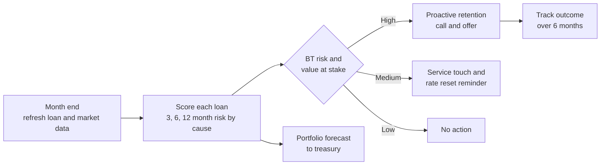
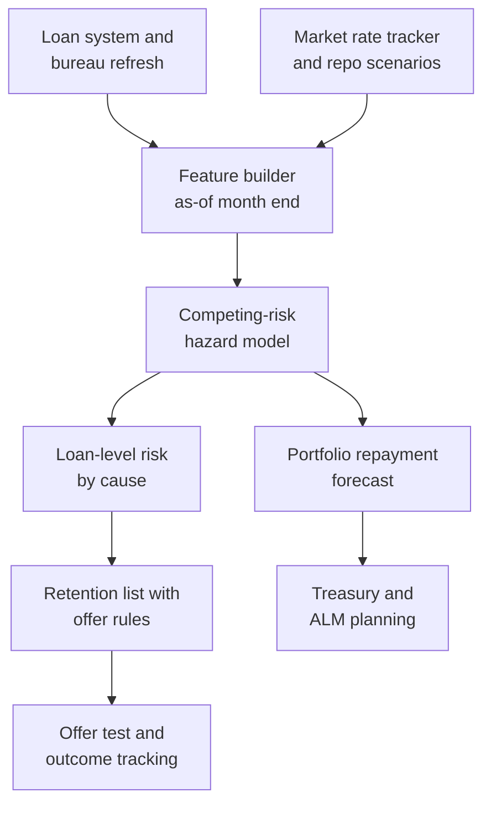

# Case Study 24: Home Loan Prepayment and Foreclosure Prediction

**Domain:** Finance (housing and personal lending, NBFC) | **Problem Type:** Survival analysis with competing risks (prepay vs default vs normal close) | **Difficulty:** Advanced

---

## 1. Business Context

### Company background

- **GrihaFin Capital** (fictional) is a housing-focused NBFC (non-banking financial company) with a floating-rate home loan book of about ₹14,000 Cr across about 1.1 lakh live loans (average outstanding about ₹12.7 lakh).
- Home loans are linked to an external benchmark such as the RBI repo rate. When the repo rate changes, the borrower's rate resets after a lag. Older "legacy" loans may be priced off an older internal benchmark and reset more slowly.
- A smaller personal loan book also exists, but this case focuses on home loans.
- Funding comes from bank loans, bonds and securitisation. These are planned months ahead, so repayment timing matters for treasury as well as for profit.

### The pain, with numbers

| Item | Value |
| --- | --- |
| Live home loans | about 1.1 lakh |
| Full prepayment (foreclosure) a year | about 11% of loans, about 12,100 loans |
| Of which balance transfer (BT) to another lender | about 40%, about 4,840 loans |
| Of which self-funded (bonus, savings, property sale) | about 60%, about 7,260 loans |
| Defaults (NPA, non-performing asset) a year | about 1.2%, about 1,320 loans |
| Normal maturity closures a year | about 3%, about 3,300 loans |
| Partial prepayments (loan continues) | about 18% of loans a year |
| Upfront cost to acquire a loan (DSA commission, legal, valuation, processing) | about ₹30,000 |
| Net margin after funding cost, operating cost and credit cost | about 1.4% a year, about ₹15,000 a year on an average loan |
| Value of keeping one loan for 3 more years | about ₹45,000 |

- **Why prepayment hurts profit:** the ₹30,000 acquisition cost is paid on day one and earned back over about 2 years of margin. A loan that closes in year 2 never pays back its cost. A loan that leaves at year 6 takes with it the best years of margin.
- **Balance transfer risk when rates fall:** when market rates drop, competitors offer lower rates, and customers on older, higher rates have a strong reason to move. Their loans are the ones with the most margin left, so we lose profitable customers first.
- **Regulatory backdrop:** RBI has barred prepayment and foreclosure charges on floating-rate loans to individual borrowers for non-business purposes. Fixed-rate or business loans may still carry charges as per contract. So fees no longer cushion the loss, and retention must work through service and pricing.

### Stakeholders and what each wants

| Stakeholder | What they want | What they fear |
| --- | --- | --- |
| Head of Retention | A list of at-risk borrowers early enough to act | Offering discounts to people who would have stayed |
| Treasurer (ALM, asset-liability management) | A reliable forecast of repayments for 3, 6 and 12 months | Surprise inflows that leave cash idle, or sudden outflows that break funding plans |
| CFO | Protected net interest margin | Retention discounts that cost more than the loans are worth |
| Chief Risk Officer | Correct view of defaults, not mixed up with prepayments | Prepayment hiding the true default rate on a vintage |
| Branch and customer service | Clear rules for when to offer a rate cut | Customers who ask for foreclosure letters and get no counter-offer |
| Customers | Fair pricing and freedom to repay early | Being penalised for asking, or sold a discount only when they threaten to leave |

---

## 2. Translating Business to ML

### The business question vs the ML question

| Business question | ML question |
| --- | --- |
| "Who will leave us, and why?" | "For each loan, estimate the cumulative probability of each exit type (self-funded prepay, balance transfer, default, normal close) over the next 3, 6 and 12 months" |
| "How much cash will come back next quarter?" | "Aggregate loan-level exit probabilities and expected balances into a portfolio repayment forecast" |
| "Who should get a retention offer?" | "Rank loans by balance-transfer risk and by value at stake, then choose the offer with the best net benefit" |

> **Mentor note:** Prepayment, default and normal close are **competing risks**. Only one can happen to a loan, and each one removes the chance of the others. If you treat default and prepayment as simple "leavers" in one model, you hide very different customers and very different actions.

### Target variable definition

- **Event types (one per loan, whichever comes first):**
  - `prepay_self` (full closure from own funds)
  - `prepay_bt` (full closure funded by another lender)
  - `default` (becomes NPA, 90 plus days past due)
  - `mature` (planned closure at term end)
- **Time scale:** months since disbursal.
- **Censoring:** a loan still live at the data cut-off is **right-censored**. We only know it survived at least that long.
- **Partial prepayment** is not an exit. It is a separate recurring event and also a feature.

### Edge cases

| Edge case | Recommended treatment | Reason |
| --- | --- | --- |
| Loan closed by settlement after default | Count as `default` | The cause is credit failure, even if cash came in |
| Property sold and loan closed | Count as `prepay_self`, flag as a "sale" sub-type | Different driver from savings and not fightable with a rate cut |
| Balance transfer detected only through the closure letter and the receiving lender's name | Use closure reason plus payoff account to label `prepay_bt` | Self-reported reasons are unreliable |
| Loans bought through a portfolio acquisition and first seen at month 14 | Use **delayed entry** (left truncation), starting risk at month 14 | Earlier months are invisible, and the loans were already survivors |
| Loan restructured | Treat as a new spell, with history carried over and a flag | Behaviour changes after restructuring |

### Unit of prediction

- One **loan-month** (a loan observed in a given month). This is the "person-period" layout used for discrete-time survival models.
- Portfolio forecasts add up loan-month probabilities weighted by outstanding balance.

### Prediction timing



- Scoring is **monthly**, with an extra event-driven refresh when the repo rate moves or when a customer asks for a foreclosure statement.
- Outcomes (closure) arrive within weeks of the event. Default labels take 90 plus days.

### What success looks like

| Lens | Success |
| --- | --- |
| Business | Net gain of about ₹1.4 to 1.7 Cr a year from retention offers, and a repayment forecast that is within 1 point of actual 12-month prepayment rate |
| Model | Time-dependent AUC of 0.78 or more for balance transfer at 6 months, and cumulative incidence by cause within 10% relative of observed |
| Treasury | Next-quarter repayment forecast within 8% of actual |

---

## 3. Data Understanding

### Data sources and key features

| Feature group | Source | Why it matters |
| --- | --- | --- |
| Loan terms (original amount, tenor, rate type, current rate, EMI, LTV at origination) | Loan management system | Core context |
| Loan age and balance (months since disbursal, outstanding as percent of original) | LMS | Hazard changes with age, and with balance, since big balances give big savings |
| Rate gap (borrower's current rate minus best market rate for a similar profile) | Own pricing grid plus competitor rate tracking | Main balance-transfer driver, and it changes every month |
| Repo rate moves and lagged pass-through status | Market data and LMS | Tells whether the customer has seen a rate reset |
| Payment behaviour (days past due history, partial prepayment history, EMI auto-debit) | LMS | Good payers can refinance, weak payers cannot |
| Credit bureau refresh (score, new enquiries from other lenders, new loans) | Bureau pull (with consent) | A rise in enquiries often precedes a BT |
| Customer profile (age, income band, salaried or self-employed, location) | CRM | Different savings behaviour |
| Interaction signals (foreclosure statement request, call centre rate queries, app visits to loan screen) | CRM, app | Strong but very late signals |

### Data volume, granularity and refresh

- **Volume:** about 2.1 lakh loans disbursed in the last 5 years, of which 1.1 lakh are still live. With an average of about 34 months of observation per loan, that is about **71 lakh loan-month rows**.
- **Events:** about 48,000 prepayment events (about 0.7% of rows), about 4,500 defaults and about 9,000 maturities, so some causes are rare.
- **Granularity:** one row per loan per month. Market features are shared across loans in the same month.
- **Refresh:** monthly for loan and market features, quarterly for bureau data. The model is retrained every 6 months.

### Common data issues

| Issue | How it shows up here |
| --- | --- |
| Right censoring | 1.1 lakh loans have not yet ended, and recent vintages have little history |
| Competing exits | A loan that defaults can no longer prepay, so the simple "prepaid or not" view is biased |
| Few rate cycles | One easing cycle and one hiking cycle, so rate-gap effects are learned from few episodes |
| Left truncation | Acquired loans enter at month 14 and earlier months are missing |
| Time-varying features | Rate gap and bureau data change monthly, so a single snapshot per loan is wrong |
| Fee regime change | Historical loans had foreclosure charges (fixed-rate or older rules), which damped prepayment, and now they do not |
| Selection by earlier offers | Past retention offers went to customers who called, so offer data is confounded |

> **Mentor note: Where juniors usually go wrong here.**
>
> - They use "prepaid yes or no within 12 months" and drop live loans, so the model never learns about survivors and overstates prepayment.
> - They use a snapshot of the rate gap at the time of closure, which includes the effect of the lender's own last-minute offer.
> - They merge BT and self-funded closures. One is a pricing problem you can fight, and the other is good news you should respond to with a top-up or cross-sell, not a discount.

---

## 4. Approach and Decision Points

### Baseline first

- **Baseline:** a table of average annual prepayment rate (a CPR, conditional prepayment rate, the share of balance prepaid in a year) by loan age and rate-gap bucket, from last 3 years.
- **Simple model baseline:** a Kaplan-Meier curve of survival by vintage, then a cause-specific Cox model with 8 features.
- **Why it matters:** treasury already uses an age-based CPR table. The new model must beat it on the portfolio forecast, not only on individual ranking.

### Candidate models

| Model | Pros | Cons | Verdict |
| --- | --- | --- | --- |
| Kaplan-Meier curves (treating other exits as censored) | Simple and familiar | Overstates probability of an exit when other causes compete | Only for exploration |
| Cause-specific Cox hazard model | Standard, handles censoring and time-varying features | Needs proportional hazards and careful set-up | Good statistical baseline |
| Fine-Gray subdistribution model | Directly models cumulative incidence of each cause | Harder to interpret, less used in tools | Use as a check on cumulative incidence |
| Discrete-time hazard with gradient boosting (multinomial over loan-months) | Natural for time-varying data, strong accuracy, handles interactions | Needs a person-period table and good calibration | **Primary model** |
| Random survival forest | Flexible, few assumptions | Heavier, slower, harder to explain | Challenger |
| Deep survival models | Capture complex patterns | Not worth it with few events per cause | Not now |

### Decision scenarios

| What if... | Recommended action | Reasoning |
| --- | --- | --- |
| **40% of exits are balance transfers and 60% are self-funded** | Model four outcomes separately (self-funded, BT, default, mature). Send BT risk to the retention team, and self-funded risk to a "top-up or cross-sell" journey | The correct action differs, and discount offers to self-funded people are wasted |
| **Live loans outnumber closed ones, and recent vintages are young** | Include censored loans in the likelihood (survival models do this). Never drop live loans or define "prepaid within 12 months" on loans younger than 12 months | Dropping them removes survivors and biases hazard upwards |
| **The repo rate is expected to fall by 50 bps in 2 quarters** | Build scenarios for the rate gap and market rates (for example, competitor rates fall 40 bps, our pass-through takes 3 months), then re-score the book. Report the extra BT exposure by gap bucket | A forecast needs the future value of time-varying features, so scenarios are part of the model |
| **Floating-rate loans reset automatically, legacy loans do not** | Segment by benchmark type, and include "months since last reset" and "pass-through complete" flags | The same market move creates a big gap for legacy loans and almost none for reset ones |
| **The new RBI rule removes foreclosure charges** | Treat the rule date as a structural break. Add a "fee applies" flag, train mostly on the no-fee period, and shrink the weight of older data for loans that used to pay a fee | Old data understates prepayment for the same rate gap |
| **A customer requests a foreclosure statement** | Treat it as a **trigger** for a same-day retention call, and keep it out of the features used for early ranking | It is a late signal (days before closure) and a human action. Using it as a feature inflates AUC without giving time to act |
| **A retention offer costs ₹16,500 per accepted loan but only about 37% of flagged loans would have left** | Choose the offer using expected net value: probability of leaving × value saved × take-up, minus offer cost × all takers. Run a small randomised test, and use a cheaper non-price offer for low scores | A broad discount transfers margin to customers who would have stayed |
| **Defaults rise in one vintage and prepayment falls** | Check the cumulative incidence for both. The default hazard can steal loans from the prepayment pool | Separate causes show real behaviour, and a single exit rate hides it |

---

## 5. Feature Engineering

### Top 10 features to build

| # | Feature | Business logic |
| --- | --- | --- |
| 1 | Rate gap in basis points (own rate minus best market offer for the profile) | The primary driver of balance transfers |
| 2 | Change in the rate gap over the last 3 months | A widening gap triggers a search |
| 3 | Months since last rate reset, and pass-through completed flag | Shows whether the customer has already got the benefit of a rate cut |
| 4 | Loan age in months, and outstanding balance as percent of original | Hazard changes with age, and savings are larger at higher balance |
| 5 | Absolute rupee saving from a transfer (balance × gap × remaining tenure) | Rupee saving matters more than basis points, since a small gap on a large loan is attractive |
| 6 | Count of credit enquiries by other lenders in last 90 days | Customers shop before they move |
| 7 | Partial prepayment count and amount in last 12 months | Savers become full prepayers |
| 8 | Months to maturity | Short remaining tenure means little saving from a move and more chance of self-funded closure |
| 9 | Bureau score change over last 12 months | A rising score makes refinancing easier |
| 10 | App and call centre activity on the loan screen and rate queries | Early interest in leaving |

### Features to avoid (leakage risks)

| Feature | Problem |
| --- | --- |
| Foreclosure statement request in the last 7 days | Directly before closure, and not early enough to act |
| NOC (no-objection certificate) or document release status | Created because the loan is closing |
| Closure reason code and receiving lender name | Outcome information |
| Retention offer given and accepted | Created by an earlier model or by a branch decision, and it blocks the event it predicts |
| Rate gap computed with the rate we offered at the time of closure | Contaminated by our own reaction |
| Future market rates in the training data | Look-ahead leakage. Use only the market rate known at the month end |

Expand loans into loan-month rows with competing events and censoring:

```python
import pandas as pd

def to_person_period(loans: pd.DataFrame) -> pd.DataFrame:
    """loans: one row per loan with disbursal_month, last_obs_month, event_type
    event_type in {'prepay_self', 'prepay_bt', 'default', 'mature', 'censored'}"""
    rows = []
    for r in loans.itertuples():
        for m in range(r.entry_month, r.last_obs_month + 1):   # entry_month handles delayed entry
            is_last = (m == r.last_obs_month)
            rows.append({
                "loan_id": r.loan_id,
                "age_m": m,
                "event": r.event_type if is_last else "none",   # 'censored' on the final row if still live
            })
    return pd.DataFrame(rows)

# Join time-varying features (rate gap, bureau score) AS OF the start of each month,
# then fit a multinomial classifier on 'event' with 'none' as the base class.
```

---

## 6. Evaluation Strategy

### Metrics

| Metric | Role | Why |
| --- | --- | --- |
| **Calibration of cumulative incidence by cause** (predicted vs observed at 6 and 12 months) | Primary model metric | Treasury and pricing use probabilities, not ranks |
| **Time-dependent AUC for balance transfer at 6 months** | Ranking metric | Measures whether the model ranks at-risk loans well at a fixed horizon |
| **IPCW Brier score** (adjusted for censoring) | Supporting | Combines calibration and ranking and handles censoring properly |
| **Net value at the chosen list size** | Primary business metric | Expected saving minus offer cost |
| **Portfolio repayment forecast error** | Treasury | Compares forecast against actual cash inflow |

### Metrics that look good but are misleading here

- **Plain AUC on "closed within 12 months":** ignores censoring and mixes causes.
- **Accuracy:** about 90% by predicting "stays" for everybody.
- **One overall prepayment rate:** can look right while BT is under-predicted and self-funded is over-predicted.

### Validation strategy

| Step | Design | Why |
| --- | --- | --- |
| Out-of-time split | Train on loans and months up to month 48, test on months 49 to 60 | Rate cycles change, so random splits flatter the model |
| Group by loan | All rows of one loan stay in one fold | Rows of the same loan are not independent |
| Rate-regime backtest | Test separately on the easing months and the flat months | Shows behaviour when the rate gap is large |
| Calibration plots by cause | Decile plots at 6 and 12 months | Checks that predicted exits match observed ones |
| Offer experiment | Randomise offers within the flagged group, with a no-offer control | The only way to measure true retention effect |

### From model metric to business value

Retention economics (annual, on the flagged group):

- Value of keeping a loan for 3 more years: about ₹45,000. Cost of a 0.5% rate cut on an average ₹11 lakh outstanding over 3 years: about 11,00,000 × 0.5% × 3 = **₹16,500**.
- **Option A, broad list:** 8,000 loans flagged, of which 3,000 would really leave (precision 37.5%).
  - Offer accepted by 45% of true leavers: 1,350 saved, benefit 1,350 × ₹45,000 = ₹6.08 Cr.
  - Offer cost for those 1,350: ₹2.23 Cr. Offer taken by 30% of the 5,000 non-leavers: 1,500 × ₹16,500 = ₹2.48 Cr.
  - **Net: 6.08 − 2.23 − 2.48 = about ₹1.4 Cr a year.**
- **Option B, tight list:** top 3,000 loans with 60% precision (1,800 leavers, 1,200 non-leavers).
  - Saved: 45% of 1,800 = 810, benefit 810 × ₹45,000 = ₹3.65 Cr.
  - Offer cost: 810 × ₹16,500 = ₹1.34 Cr, plus 30% of 1,200 = 360 × ₹16,500 = ₹0.59 Cr.
  - **Net: 3.65 − 1.34 − 0.59 = about ₹1.7 Cr a year.**
- **Lesson:** the benefit is thin because the offer is expensive, so precision matters more than recall. Cheaper non-price offers (processing fee waiver, free top-up, a service call) should be tried first for medium-risk loans.
- **Second job of the model:** treasury. An error of 1 point in the 12-month prepayment rate on a ₹14,000 Cr book is about ₹140 Cr of repayments that arrive earlier or later than planned.

---

## 7. Deployment and Monitoring

### Batch vs real time

- **Monthly batch** scoring of all loans, with portfolio forecasts for treasury.
- **Event-driven refresh** when the repo rate changes, a competitor cuts its rate, or the customer calls with a rate query.
- **No real-time model needed.** Time-sensitive actions use rules, such as the foreclosure request trigger.



### What to monitor

| Type | What to track | Alert trigger |
| --- | --- | --- |
| Market inputs | Rate gap distribution, share of loans with gap above 50 bps | Share of high-gap loans doubles in a quarter |
| Calibration | Predicted vs observed cumulative incidence by cause (6 and 12 months) | Relative error above 15% for BT or self-funded |
| Ranking | Time-dependent AUC for BT on matured outcomes | Below 0.72 |
| Forecast | Portfolio repayment forecast vs actual, monthly | Error above 8% on a quarterly basis |
| Data drift | PSI on loan age mix and rate gap | PSI above 0.2 |
| Offer economics | Take-up rate, cost per saved loan, share of offers to would-stay customers | Cost per saved loan above ₹45,000 |

### Retraining

- **Scheduled:** every 6 months, with outcomes up to 3 months ago.
- **Triggered:** a policy change (such as the foreclosure charge rule), a market move of more than 75 bps in 3 months, or a calibration breach.
- **Scenario refresh:** update the rate scenarios every quarter, jointly with treasury.

### A/B test or champion-challenger design

- **Randomise at loan level inside the flagged group:** offer vs no offer, and two offer sizes (0.25% and 0.5% cut).
- **Duration:** 6 months, since outcomes are slow. Measure closure by cause and net margin.
- **Guardrails:** stop an arm if the cost per saved loan exceeds the value of the loan, or if complaints about unequal pricing rise (a customer who threatens to leave should not get a better rate than a loyal one without a clear policy).
- **Challenger model:** run in shadow for one full rate cycle phase before use in decisions.

---

## 8. Stakeholder Communication

### Explain it to a non-technical leader

> "Every month we estimate, for each loan, the chance that the customer will repay early with their own money, move to another lender, default, or simply finish on schedule. These are different outcomes that need different responses.
> When market rates fall, our older, higher-rate customers become targets for competitors. The model tells us which ones are most likely to move and how much margin is at stake.
> We make a targeted offer only where the expected saving is greater than the cost, and we use the same numbers to give treasury a better forecast of repayments."

### Questions leadership will ask

| Question | Suggested answer |
| --- | --- |
| "Why not just cut rates for everyone at risk?" | "A 0.5% cut costs about ₹16,500 a loan over 3 years. If only 4 in 10 flagged customers would really leave, we give away more margin than we save. We target and test" |
| "Can we charge a foreclosure fee to hold customers?" | "Not on floating-rate loans to individuals for non-business purposes, because of the RBI rule. Retention has to come from service and fair pricing" |
| "Why is default in this model?" | "A loan that defaults cannot prepay. Ignoring it would overstate prepayment and hide the real credit picture for each vintage" |
| "What happens if the repo rate falls 50 bps?" | "We run scenarios. Legacy loans with a large rate gap show the biggest rise in transfer risk, and we can size it by city and vintage before it happens" |
| "How reliable is the forecast for treasury?" | "We track quarterly error. Our target is within 8%, and we compare it against the old age-based table every month" |

---

## 9. Common Pitfalls and Lessons

| Mistake | Why it happens | How to avoid it |
| --- | --- | --- |
| Dropping live loans or ignoring censoring | It is easy to build a yes or no label | Use survival methods that keep censored loans in the likelihood |
| Treating default and prepayment as one event | "Closed" is a single status in the data | Model competing causes and report cumulative incidence |
| Using the closure-time rate gap | The latest value is easiest to join | Take features as of the start of each month, before the event |
| Merging balance transfer and self-funded exits | Closure reason is missing or unreliable | Infer BT from payoff details and separate the actions |
| Ignoring the policy break on foreclosure charges | The new rule is not in the data | Flag the regime and weight recent data more |
| Using the foreclosure request as a feature | Great AUC, no lead time | Use it only as a trigger rule |
| Giving offers by default | Retention wants to look active | Use expected net value and a randomised control |
| Judging the model only on ranking | Data science habit | Check calibration and portfolio forecast, since treasury uses the numbers |

---

## 10. Mentor's Focus Checklist

- ✅ **Where to spend 80% of the effort:**
  - Correct event definitions: causes, censoring, delayed entry.
  - Time-varying features built strictly as of the start of each month, especially the rate gap.
  - Calibration of cumulative incidence by cause, and the portfolio forecast.
  - Offer economics: expected net value and a randomised test.
  - Handling the foreclosure-charge rule change as a regime break.
- ❌ **What not to over-engineer:**
  - Deep survival networks with only a few thousand events per cause.
  - Very fine rate-gap buckets from one rate cycle.
  - Predicting the exact month of closure, when 3, 6 and 12 month probabilities are what the business uses.
- 💡 **Key takeaway:** In lending, **an early exit is not one event but several**, and the cure for each is different. Model the causes separately, respect censoring, and spend retention money only where the saving beats the cost.
