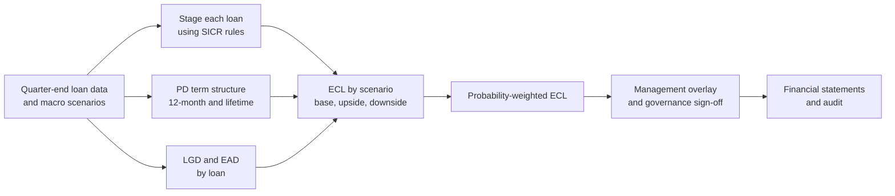
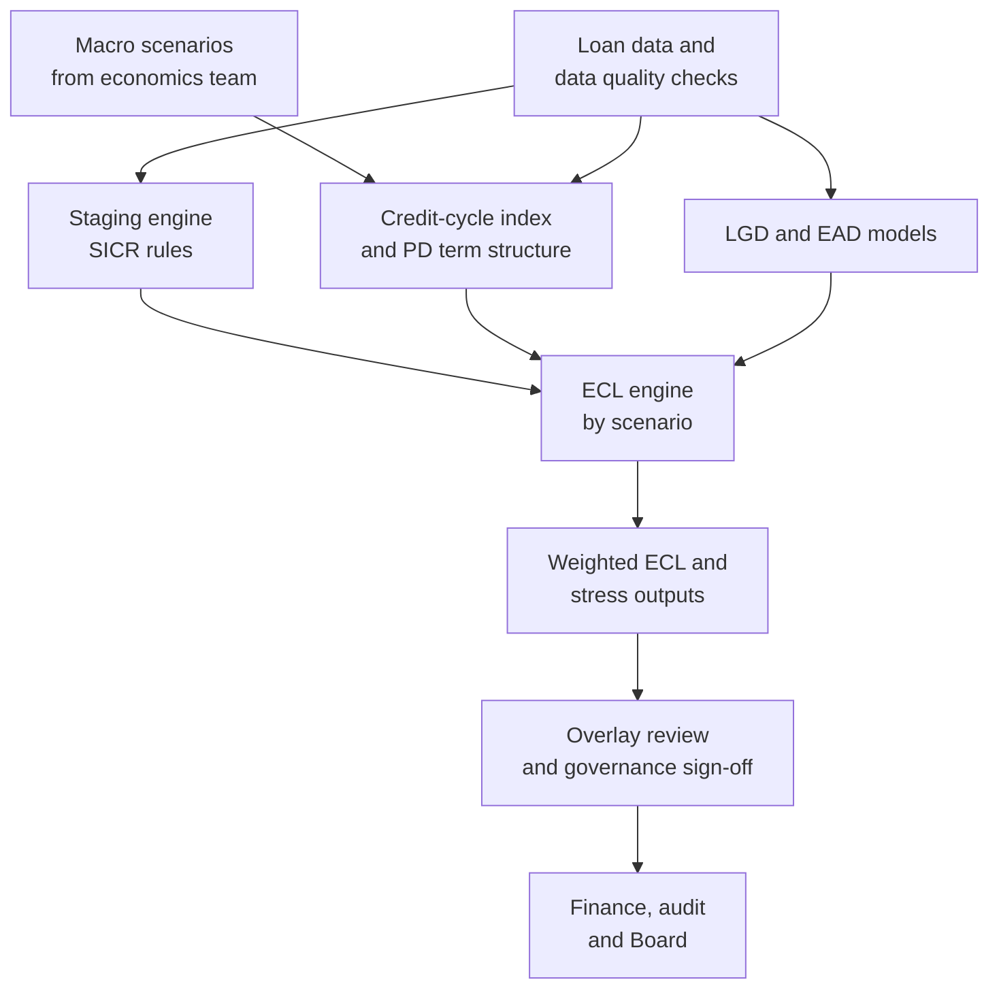

# Case Study 25: Expected Credit Loss Modelling and Macro Stress Testing

**Domain:** Finance (risk, provisioning and accounting) | **Problem Type:** Multi-model risk modelling (PD term structure, LGD regression, EAD) plus scenario forecasting | **Difficulty:** Advanced

---

## 1. Business Context

### Company background

- **Kaveri Capital** (fictional) is a large NBFC (non-banking financial company) with a loan book of about ₹25,000 Cr across home loans, loans against property (LAP), personal loans and MSME loans.
- It reports under **Ind AS** (Indian Accounting Standards, India's version of IFRS). **Ind AS 109** requires provisions for **expected credit loss (ECL)**, which means a forward-looking, probability-weighted estimate of losses, and not only a charge after a loan goes bad.
- ECL has three building blocks:
  - **PD** (probability of default): how likely the borrower is to default over a period.
  - **LGD** (loss given default): the share of the exposure lost if default happens, after recoveries.
  - **EAD** (exposure at default): how much is owed at the time of default.
- Basic formula: ECL = PD × LGD × EAD, discounted and summed over the loan's life as needed.
- The model results go into quarterly financial statements, so the audit committee, statutory auditors and RBI inspectors all look at them.

### The pain, with numbers

| Item | Value |
| --- | --- |
| Loan book | about ₹25,000 Cr |
| Current approach | Roll-rate (past-due bucket) tables and a flat percentage by product, last rebuilt 3 years ago |
| Staging by balance (base view) | Stage 1 ₹21,500 Cr, Stage 2 ₹2,250 Cr, Stage 3 ₹1,250 Cr |
| ECL today | about ₹805 Cr (3.2% of the book) |
| Auditor finding | Macro-economic adjustment is a manual factor with no data behind it |
| Management overlay in last 4 quarters | ₹40 to 90 Cr, with thin documentation |
| Cost of a 20% over-estimate of PD in Stage 1 | about ₹34 Cr of extra provision (20% of ₹172 Cr) |
| P&L volatility from staging | Moving ₹100 Cr from Stage 1 to Stage 2 raises provision from about ₹0.8 Cr to ₹7 Cr (about ₹6.2 Cr more) |

- **Staging** decides how far ahead you look:
  - **Stage 1:** performing loans with no big rise in credit risk. Provision uses **12-month ECL**.
  - **Stage 2:** loans with a **significant increase in credit risk (SICR)**, usually 30 or more days past due as a backstop, a sharp rise in PD since origination, or a watchlist flag. Provision uses **lifetime ECL**.
  - **Stage 3:** credit-impaired loans (typically 90 or more days past due). Lifetime ECL, dominated by LGD.
- Regulatory backdrop: NBFCs on Ind AS also compare ECL against RBI's prudential provisioning norms, and hold the shortfall, if any, in a reserve. RBI expects a board-approved ECL policy and good model governance. This case speaks about it generally and does not rely on specific clause numbers.

### Stakeholders and what each wants

| Stakeholder | What they want | What they fear |
| --- | --- | --- |
| CFO | A provision that is defensible, stable and not too conservative | Large quarter-to-quarter swings in profit from staging jumps |
| Chief Risk Officer | Accurate risk view, a credible stress test | A model that looks fine but fails in a downturn |
| Statutory auditors | Documented method, tested data, reproducible numbers | Unsupported overlays and manual overrides |
| Model validation team (independent second line) | Full documentation, challenger models, back-tests | Being asked to sign off a model they cannot reproduce |
| Audit committee and Board | Clear scenarios with probabilities and an explained overlay | Surprises at result time |
| RBI inspectors | Governance, consistency, and links to the regulatory floor | A model that nobody understands or owns |

---

## 2. Translating Business to ML

### The business question vs the ML question

| Business question | ML question |
| --- | --- |
| "How much should we provision?" | "For each loan, estimate the 12-month and lifetime PD, expected LGD and exposure path, then compute discounted ECL by stage" |
| "What if the economy weakens?" | "Link default rates to macro variables (growth, unemployment, interest rates) and project PD, LGD and migration under base, upside and downside scenarios" |
| "Is the model trustworthy?" | "Show that predicted PDs match observed default rates by segment (calibration), that staging is stable, and that the models are validated and governed" |

> **Mentor note:** This case is not about the best AUC. A provisioning model is a **measurement instrument**. A PD that ranks perfectly but is 30% too high still produces the wrong number in the financial statements. Calibration beats discrimination here.

### Target variable definition

- **PD model:** `default_in_month_t = 1` when a loan reaches 90 or more days past due (or is restructured, written off or settled for loss). Modelled as a **hazard** over loan age, so cumulative lifetime PD can be built from monthly values.
- **LGD model:** `LGD = 1 − (discounted recoveries ÷ EAD)`, using actual recoveries on defaulted loans, discounted at the loan's effective interest rate (EIR), measured over a workout period of about 36 months.
- **EAD model:** outstanding balance plus drawn share of undrawn limits at the time of default, using the repayment schedule, prepayment and (for MSME overdrafts) a **credit conversion factor (CCF)**, the share of the unused limit that gets drawn before default.

### Edge cases

| Edge case | Recommended treatment | Reason |
| --- | --- | --- |
| Loans under COVID moratorium or regulatory forbearance | Mark the period and treat arrears and default counts carefully. Do not treat the frozen period as "good" | Defaults were suppressed by policy, so raw history understates risk |
| Defaulted loan that cured (came back to regular payment) | Model **cure rate** separately, and include in LGD as a zero-loss path | Many Stage 3 loans do not end in loss |
| Loans with partial recoveries still in progress (workout incomplete) | Use a recovery curve to estimate the rest, and do not drop them | Dropping open cases removes the long, bad recoveries, a classic bias |
| Collateral value falls after default | Use a forced-sale haircut and a time-to-sale delay in LGD | The collateral value on paper is not the cash received |

### Unit of prediction

- **PD:** one loan-month (to build term structures).
- **LGD:** one defaulted loan (workout level), applied to every loan of a similar type.
- **EAD:** one loan with its repayment schedule, month by month.
- **ECL:** loan level, then summed by stage, product and scenario.

### Prediction timing



- The ECL run is a **batch process at each quarter end**, with a monthly estimate for management.
- Forecast horizon is the **remaining life** of each loan (up to 20 years for home loans), with explicit macro forecasts for about 3 years and a reversion to long-run averages afterwards.
- Default outcomes arrive with a lag of 90 days, and recoveries over about 3 years.

### What success looks like

| Lens | Success |
| --- | --- |
| Business | Provision that tracks actual credit losses within about 15% over a full year, with fewer unexplained overlays, and a stress test that the Board can use |
| Model | PD calibration within 10% relative error by segment, LGD back-test within 5 percentage points, and a Gini above 0.70 as a secondary check |
| Governance | Independent validation complete, back-tests documented, overlays quantified and time-limited, and numbers reproducible within one working day |

---

## 3. Data Understanding

### Data sources and key features

| Feature group | Source | Why it matters |
| --- | --- | --- |
| Loan terms (product, tenor, rate, LTV, vintage) | Loan management system | Core drivers and segmentation |
| Repayment behaviour (days past due history, bounces, roll rates) | Collections and LMS | Strongest short-term PD signal |
| Bureau and application scores (at origination and refreshed) | Bureau and scorecard | Origination PD and PD drift |
| Borrower profile (income type, employer type, geography) | KYC and CRM | Segment effects, geographic concentration |
| Collateral data (value, valuation date, legal status) | Valuation and legal | LGD for secured loans |
| Workout and recovery history (cash received by date, legal costs, sale proceeds) | Collections and legal | Needed to estimate LGD |
| Macro series (GDP growth, unemployment, inflation, repo rate, fuel price, house price index) | Public data and economists | Links default rates to the economy |

### Data volume, granularity and refresh

- **PD data:** about 9 lakh loans over 7 years, about **2 crore loan-month rows**, with about 38,000 default events.
- **LGD data:** only about 3,100 **resolved defaults** with complete recoveries, split across products, so each LGD segment has a few hundred cases.
- **Macro data:** **28 quarters** of history. That is very short, and it includes one extreme shock (COVID) that distorts relationships.
- **Refresh:** loan data monthly, macro scenarios quarterly. PD and LGD models are recalibrated yearly, with a back-test every quarter.

### Common data issues

| Issue | How it shows up here |
| --- | --- |
| Short macro history | 28 data points to link 3 or 4 macro variables, so risk of spurious fits |
| One extreme shock | COVID and forbearance dominate the "downturn" and mislead the regression |
| Few defaults in some segments | Low-default portfolios like prime home loans have wide confidence intervals |
| Incomplete workouts | Recent defaults have not finished recovering, so LGD looks better than it will be |
| Definition changes | Default definition changed from 120 to 90 days in some products, breaking time series |
| Data quality at the loan level | Missing DPD history after system migration, wrong collateral values |

> **Mentor note: Where juniors usually go wrong here.**
>
> - They fit a regression of default rate on 6 macro variables using 28 quarters, get an R-squared of 0.95, and call it a macro-linked model. It is almost certainly over-fitted.
> - They build PD models from Basel-style **through-the-cycle** logic (stable, average across good and bad years) and feed them straight into Ind AS 109, which needs **point-in-time** (reflecting today's conditions and the forecast).
> - They drop unresolved defaults from the LGD sample, because "recovery data is incomplete", and so understate losses.

---

## 4. Approach and Decision Points

### Baseline first

- **Baseline:** the current roll-rate and flat-percentage method, evaluated on the same back-test windows.
- **Simple model baseline:** segment-level PD from a discrete-time logistic hazard on a handful of variables, LGD as segment averages, EAD from the contractual schedule.
- **Why it matters:** a transparent baseline gives the audit committee something to compare against. Every complication must show a real gain in back-test accuracy.

### Candidate models

| Component | Option | Pros | Cons | Verdict |
| --- | --- | --- | --- | --- |
| PD | Discrete-time logistic hazard with loan age and risk grade | Gives a term structure naturally, easy to explain | Needs careful treatment of time effects | **Primary** |
| PD | Markov transition matrices (days-past-due buckets) | Standard in industry, intuitive for staging | Many parameters for long horizons | Use for Stage 2 and migration |
| PD | Gradient boosting for the grade score, then calibrate | Better rank ordering | Must be calibrated to default rates, hard to explain | Use for scoring, then map to calibrated PD |
| Macro link | Z-factor or "credit cycle index" regressed on 1 to 3 macro variables | Few parameters, handles short history | Needs judgement on lags and signs | **Primary** |
| Macro link | Direct regression on many variables | Seems precise | Over-fits 28 quarters | Avoid |
| LGD | Segment averages by collateral type and LTV | Simple | Misses LTV and time-to-sale effects | Baseline |
| LGD | Two-stage model (probability of cure, then loss if not cured) or beta regression | Handles the shape of LGD (bunched at 0 and 1) | Small samples | **Primary** |
| EAD | Contractual amortisation with prepayment (see Case 24) and CCF for overdraft limits | Direct and auditable | Needs a prepayment assumption | **Primary** |

### Decision scenarios

| What if... | Recommended action | Reasoning |
| --- | --- | --- |
| **Only 28 quarters of macro history and 3 to 4 candidate variables** | Build a single **credit-cycle index** from segment default rates, then regress it on one or two macro variables with sign constraints (for example, default risk should not fall when unemployment rises). Use ridge or a small number of lags, and report the standard errors | Few parameters limit over-fitting, and signs tied to economic logic keep the model defensible to auditors |
| **COVID quarters dominate the downturn relationship** | Mark them with a dummy or exclude and treat as a separate shock, and test the model with and without. Use judgement to cap the sensitivity | The moratorium suppressed defaults and then created a spike. Raw data gives a misleading slope |
| **The model must meet Ind AS 109 (point-in-time) but the bank has a through-the-cycle scorecard** | Keep the TTC grade as a rank-ordering input, then convert it to a PIT PD by adding the current credit-cycle index. Document the conversion and test it on out-of-time data | A TTC PD ignores today's conditions. A PIT PD moves with the cycle, which is what Ind AS 109 wants |
| **A loan moves from 25 to 35 days past due** | Apply a documented SICR test: backstop at 30 DPD, plus a relative PD increase threshold (for example, lifetime PD at least 2x origination PD and a minimum absolute rise). Rebut the 30 DPD presumption only with evidence | The "cliff" from Stage 1 to Stage 2 is large. A consistent, tested rule prevents arbitrary staging |
| **The downside scenario gives ₹1,146 Cr and the base gives ₹805 Cr** | Weight the scenarios (for example 50% base, 20% upside, 30% downside). The weighted ECL is about ₹888 Cr, higher than the base case alone | ECL is non-linear: losses rise faster in a bad scenario than they fall in a good one, so a single base case understates the expected value |
| **A textile MSME cluster is hit by an export slowdown but the macro model cannot see it** | Use a **management overlay** for that cluster (for example ₹60 Cr), based on a quantified sector view, with an owner, an approval path, a review date and a release rule | Models lag real events. An overlay is legitimate if it is documented, quantified and temporary, and not a back door for smoothing profits |
| **LGD data covers only 3,100 resolved defaults and recent defaults are unresolved** | Use a recovery curve (share recovered by months since default) to project the unfinished cases, and report LGD by segment with confidence bands | Dropping unresolved cases biases LGD down |
| **PD model has Gini 0.80 but over-predicts defaults by 25% in Stage 1** | Recalibrate with a scaling factor or by re-estimating the intercept by segment, then back-test again. Do not celebrate the Gini | An over-predicting PD directly inflates provisions and misstates profit |

---

## 5. Feature Engineering

### Top 10 features to build

| # | Feature | Business logic |
| --- | --- | --- |
| 1 | Days past due now, and maximum DPD in the last 12 months | Strongest short-term default predictor |
| 2 | Loan age in months and months to maturity | Default hazard is not flat across the loan's life |
| 3 | Origination risk grade and current behavioural grade | Allows the staging test (grade deterioration) |
| 4 | Origination PD and current PD ratio | The SICR measure for Stage 2 |
| 5 | LTV now (current balance divided by current collateral value) | Main LGD driver for secured loans |
| 6 | Collateral type and property city tier | Recovery speed and haircut differ |
| 7 | Credit bureau score change since origination | Early deterioration signal |
| 8 | Share of income paid as EMI (FOIR, fixed obligations to income ratio) | Stress capacity of the borrower |
| 9 | Segment credit-cycle index (from macro model) | Moves the PD for the economy |
| 10 | Geography and sector concentration flags | Captures regional or sector shocks the macro model misses |

### Features to avoid (leakage risks)

| Feature | Problem |
| --- | --- |
| Post-default information (legal notice date, recovery agency assigned, write-off flag) in the PD model | Created because the loan defaulted |
| Collateral value updated after default | Hindsight, and it hides the true forced-sale haircut |
| Future macro data realised after the scoring date, used in training for forecasts | Look-ahead. Use forecasts available at that date, not actuals |
| Final recovery amounts for loans still in workout | Not known yet, and biases LGD |
| Default flags using different definitions across vintages | Breaks the target definition across time |
| Management overlays or manual rating changes used as inputs | Mixes judgement with model output and breaks reproducibility |

Lifetime ECL for one loan, given monthly marginal PDs and the stage:

```python
import numpy as np

def loan_ecl(marginal_pd, lgd, ead, eir_annual, stage):
    """marginal_pd, ead: arrays by month (length = remaining months).
    marginal_pd[t] = probability of defaulting in month t given survival until then,
    already multiplied by survival so it is the unconditional probability for month t."""
    months = np.arange(1, len(marginal_pd) + 1)
    discount = (1 + eir_annual / 12) ** (-months)          # discount at effective interest rate
    horizon = 12 if stage == 1 else len(marginal_pd)         # 12-month vs lifetime
    horizon = min(horizon, len(marginal_pd))
    loss = marginal_pd[:horizon] * lgd * ead[:horizon] * discount[:horizon]
    return float(loss.sum())

# Run once per scenario, then weight: ecl = sum(weight[s] * ecl_s for s in scenarios)
```

---

## 6. Evaluation Strategy

### Metrics

| Metric | Role | Why |
| --- | --- | --- |
| **Calibration: predicted vs observed default rate by grade and segment** | Primary model metric | The provision depends on the level of PD, not only the ranking |
| **Binomial or Hosmer-Lemeshow style test** by grade | Governance | Auditors and validators expect a formal test |
| **Back-test of 12-month ECL vs actual credit loss** | Primary business metric | The direct test of provisioning accuracy |
| **LGD error by segment** (predicted vs realised discounted loss) | Primary for LGD | Small samples need confidence bands |
| Gini or AUC | Secondary | Confirms ranking power, but is not the target |
| Stage migration stability (share of loans changing stage each quarter) | Staging | Too much movement creates P&L noise |
| Sensitivity of ECL to macro paths | Stress test | Shows how much provision moves per macro change |

### Metrics that look good but are misleading here

- **AUC or Gini alone:** a model can rank well and be off by 30% in level.
- **In-sample R-squared of the macro regression:** with 28 points, it measures over-fitting.
- **Average LGD on closed cases only:** recent bad cases are missing, so LGD looks lower than it is.
- **One scenario's ECL:** hides non-linearity, as the weighted ECL is higher than the base case.

### Validation strategy

| Step | Design | Why |
| --- | --- | --- |
| Out-of-time back-test | Train through quarter 20, test on quarters 21 to 28 | Tests forecast accuracy on unseen periods |
| Vintage and segment calibration | Compare predicted and observed default rates by origination vintage and product | Finds drift hidden in the portfolio average |
| Macro model checks | Rolling-window re-estimation, sign checks, leave-one-quarter-out stability, comparison with a naive "no macro" model | Shows whether macro variables add anything beyond noise |
| Independent validation | Second-line team re-implements key steps, tests assumptions, and reviews documentation | Required by governance, and catches silent errors |
| Challenger models | A simpler model and a machine-learning model compared against the champion | Evidence that the chosen model is not arbitrary |
| Reverse stress test | Find the macro path that would raise ECL by ₹500 Cr | Tests how fragile the book is |

### From model metric to business value

- **Scenario ECL (₹ Cr):**
  - Base: Stage 1 21,500 × 0.80% = 172, Stage 2 2,250 × 7% = 157.5, Stage 3 1,250 × 38% = 475, total **₹805 Cr**.
  - Upside: Stage 1 21,800 × 0.65% = 141.7, Stage 2 1,950 × 6% = 117, Stage 3 1,250 × 36% = 450, total **₹709 Cr**.
  - Downside: Stage 1 20,500 × 1.2% = 246, Stage 2 3,000 × 10% = 300, Stage 3 1,500 × 40% = 600, total **₹1,146 Cr**.
- **Probability-weighted ECL** (50% base, 20% upside, 30% downside): 0.5 × 805 + 0.2 × 709 + 0.3 × 1,146 = 402.5 + 141.8 + 343.8 = about **₹888 Cr**.
- **Management overlay:** ₹60 Cr for the textile MSME cluster. Total provision about **₹948 Cr** (3.8% of the book).
- **Value of calibration:** removing a 20% over-estimate in Stage 1 PD frees about ₹34 Cr of provision, a direct improvement to profit before tax with no change in true risk.
- **Value of the stress test:** the downside is ₹258 Cr above the weighted figure (1,146 − 888), so the Board can decide on capital and pricing buffers before a downturn.

---

## 7. Deployment and Monitoring

### Batch vs real time

- **Batch, quarterly** for the official ECL, with a **monthly management run**.
- **Scenario runs on demand** for stress testing, planning and Board requests.
- **No real-time scoring.** The model is part of a controlled reporting process, with change control and sign-offs.



### What to monitor

| Type | What to track | Alert trigger |
| --- | --- | --- |
| PD calibration | Predicted vs observed default rate by grade, quarterly | Relative error above 15% for two quarters |
| LGD realisation | Realised LGD vs model for closed cases | Gap above 5 percentage points |
| Staging | Stage migration rates, share of Stage 2 by product | Stage 2 share moves by more than 1 point in a quarter without a macro reason |
| Data quality | Missing DPD history, collateral value gaps, reconciliation to the general ledger | Any unreconciled difference above tolerance |
| Macro model | Residuals, coefficient stability, forecast errors on the credit-cycle index | Coefficient sign flips or large residual |
| Overlays | Size, age, owner, and reason for each overlay | Any overlay older than 4 quarters without review |

### Retraining

- **Scheduled:** annual recalibration of PD and LGD, with a full redevelopment every 3 years.
- **Triggered:** a change in the default definition, a big portfolio acquisition, a policy shift, or a calibration breach.
- **Governance:** every change goes through documentation, validation, a model risk committee and approval by the Board's risk or audit committee, with a version log.

### A/B test or champion-challenger design

- **No live A/B test.** The output is an accounting estimate, so the control is a **parallel run**.
- **Parallel run:** run the new models alongside the old approach for 2 quarters, and explain every material difference by product and stage.
- **Challenger models:** keep at least one simpler challenger and one machine-learning challenger, and compare calibration, stability and explainability each year.
- **Back-test gate:** the new model goes live only if validation clears and the parallel run difference is explained and approved.

---

## 8. Stakeholder Communication

### Explain it to a non-technical leader

> "Accounting rules ask us to set aside money for loans that may go bad, before they go bad. For each loan we estimate how likely it is to default, how much we would lose if it did, and how much will be owed at that time. Healthy loans are provided for over the next 12 months, and weaker loans over their whole life.
> We then ask what happens if the economy does better or worse than expected, weight those views by how likely they are, and add a small, documented adjustment where we know the models are behind events.
> The aim is a provision that is neither too low, which would hide risk, nor too high, which would waste profit."

### Questions leadership will ask

| Question | Suggested answer |
| --- | --- |
| "Why is the weighted ECL higher than the base case?" | "Losses rise faster in a bad economy than they fall in a good one. Weighting the three scenarios gives ₹888 Cr against ₹805 Cr in the base case alone" |
| "Why can't we smooth the provision from quarter to quarter?" | "The standard asks for an estimate that reflects current conditions. We can reduce noise with stable staging rules, but not by hiding changes" |
| "How much can we trust a model built on 28 quarters of macro data?" | "Not blindly. We use a simple link with sign checks, compare against a no-macro model, and add overlays for what the model cannot see, with a clear owner and review date" |
| "What is the overlay and who approves it?" | "A documented, quantified adjustment, for example ₹60 Cr for one MSME cluster, approved by the risk and finance heads and reviewed by the audit committee every quarter" |
| "What would an independent expert challenge?" | "Our macro link, the SICR thresholds, the unresolved defaults in LGD, and whether our PD is point-in-time. All four are documented and back-tested" |

---

## 9. Common Pitfalls and Lessons

| Mistake | Why it happens | How to avoid it |
| --- | --- | --- |
| Chasing Gini and ignoring calibration | Data science habit | Use predicted vs observed rates by grade as the primary test |
| Over-fitting macro regressions | Few quarters, many variables | Use a credit-cycle index, 1 to 2 macro variables, and sign constraints |
| Using through-the-cycle PD for Ind AS 109 | Reusing a Basel-style model | Convert to point-in-time using the cycle index, and document it |
| Dropping unresolved defaults from LGD | Their recoveries are incomplete | Project them with recovery curves and show confidence bands |
| Arbitrary SICR rules | No agreed definition | Write, test and approve a rule with a 30 DPD backstop and a relative PD test |
| Single-scenario ECL | Simpler to explain | Use at least 3 weighted scenarios and show the non-linearity |
| Overlays as a permanent fudge | They are easy to add | Quantify, assign an owner and release rule, and report overlay age |
| Ignoring COVID-era distortions | The data looks usable | Flag the period and test models with and without it |

---

## 10. Mentor's Focus Checklist

- ✅ **Where to spend 80% of the effort:**
  - Calibration of PD by segment and a clean, stable default definition.
  - A parsimonious macro link (credit-cycle index with 1 to 2 variables) and honest uncertainty.
  - Staging rules (SICR) that are tested, stable and documented.
  - LGD built from complete workout data, including unresolved cases.
  - Validation, back-testing, overlay governance and reproducibility.
- ❌ **What not to over-engineer:**
  - Deep learning for PD when a hazard model with a good grade is accurate and explainable.
  - Many macro variables from 28 quarters of history.
  - Chasing the last point of Gini when calibration is off.
- 💡 **Key takeaway:** In provisioning, **a model is only as good as its calibration, its governance and its story**. Get the level right, keep the macro link simple, show how the answer changes under stress, and document every judgement.
