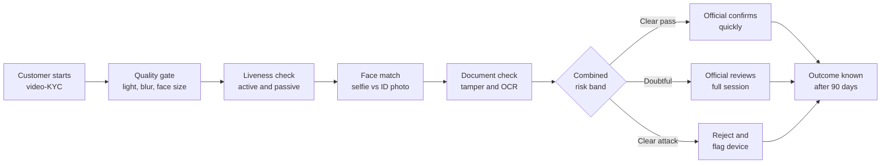
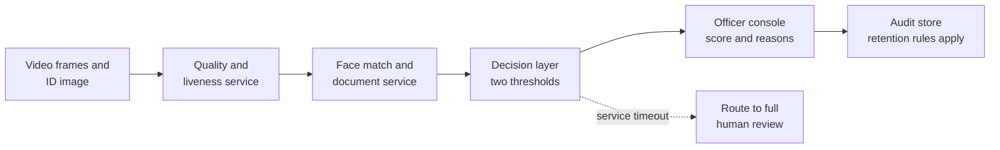

# Case Study 26: Video-KYC Face Match, Liveness and Document-Fraud Detection

**Domain:** Finance (digital onboarding) | **Problem Type:** Computer vision classification and verification | **Difficulty:** Advanced

---

## 1. Business Context

### Company background

- **Lumen Finserv** (fictional) is a digital NBFC (non-bank lender) with a savings-linked wallet, a small-ticket personal loan and a credit line. It onboards every customer through a phone app.
- KYC (Know Your Customer, the identity check every regulated lender must do) is done by a **video-KYC** session: the customer shows an ID, takes a selfie, and speaks to an official on a live video call. A model supports the official; it does not replace them.
- Scale: about 10,000 video-KYC sessions a day, so about **36.5 lakh a year**.
- Customers are mostly first-time digital users from tier-2 and tier-3 towns. A large share use phones under ₹10,000 with weak cameras and patchy 4G.
- Today a vendor's face-match score with one fixed cut-off is used, with no liveness model of our own and no document-tampering check beyond basic OCR.

### The pain, with numbers

| Item | Value |
| --- | --- |
| Sessions per year | 36.5 lakh |
| Attack sessions (photo of a photo, screen replay, mask, deepfake, forged or borrowed ID) | about 0.5%, so about 18,250 a year |
| Genuine sessions | about 36.31 lakh |
| Genuine users wrongly rejected at the face step (current FRR, false rejection rate) | 8%, so about 2.9 lakh |
| Of those, share who give up instead of retrying | 40%, so about 1.16 lakh customers lost |
| Margin lost per customer who never onboards | about ₹900 |
| **Annual cost of lost genuine customers** | **about ₹10.5 Cr** |
| Handling cost of each failed session (retry, support call) | about ₹60, so about ₹1.7 Cr a year |
| Attacks that currently get through (FAR, false acceptance rate, on attack sessions) | 15%, so about 2,740 accounts |
| Average loss per fraudulent account (mule use, loan default, chargeback) | about ₹25,000 |
| **Annual cost of accepted attacks** | **about ₹6.8 Cr** |

- Regulatory backdrop: RBI's KYC directions allow a video-based customer identification process only with a live official, a recorded and auditable session, and secure storage. A model may score and assist, but the final accept or reject for doubtful cases must have **human oversight**. The DPDP Act 2023 adds consent, purpose limitation and retention duties for face data, which is biometric and sensitive in practice.

### Stakeholders and what each wants

| Stakeholder | What they want | What they fear |
| --- | --- | --- |
| Head of Risk and Fraud | Fewer mule and synthetic accounts | An accepted deepfake ring and a regulator query |
| Head of Growth | Higher onboarding completion | Genuine users bounced at the selfie step |
| Compliance and the Principal Officer | Human oversight, audit trail, RBI-compliant storage | A fully automated reject that cannot be explained |
| Video-KYC ops manager | A manageable review queue (about 120 officers, each handling about 70 sessions a day) | Alert floods and unexplained scores |
| Data protection officer | Minimum face-data retention, consent records | Selfies reused to train models without consent |
| Engineering lead | Scoring under 1.5 seconds on a mobile network | Heavy on-device models that crash cheap phones |

---

## 2. Translating Business to ML

### The business question vs the ML question

| Business question | ML question |
| --- | --- |
| "Onboard real people fast, keep impostors out." | "Given a live selfie, an ID photo and a video clip, estimate three things: does the face match the ID (verification), is the face live and not a replay (liveness), and is the document genuine (tamper check)? Combine them into allow, route to human, or reject" |
| "Do not discriminate against anyone's face." | "Keep the error rates (FAR and FRR) within an agreed band for every skin-tone, age, gender and phone-quality cohort, not just on average" |

### Target variable definition

- **Three labels, three small models:**
  - `face_match = 1` if the selfie and the ID photo are the same person (label from the officer's decision plus later account confirmation).
  - `is_attack = 1` if the session was a spoof (printed photo, screen replay, mask, deepfake or injected video) confirmed by officer review, later fraud case, or a red-team test.
  - `doc_forged = 1` if the ID was edited, a photocopy, or belongs to another person.
- **Final decision label** for the combined system: the officer's final accept or reject, **corrected** by what happened in the next 90 days (mule flag, fraud report, KYC re-verification failure).

### Edge cases

| Edge case | Recommended treatment | Reason |
| --- | --- | --- |
| Genuine customer whose ID photo is 12 years old | Keep as a positive match. Tag `id_photo_age` | Face ageing is the biggest hidden cause of false rejection |
| Identical twins or close relatives | Route to human review, do not auto-accept | Face match alone cannot separate them |
| Customer wearing a mask, spectacles or a head covering for faith reasons | Do not treat as an attack. Ask for a retake, then route to human | Rejecting by appearance is unfair and may breach fair-treatment duties |
| Officer accepted a session that later turned out to be fraud | Relabel as `is_attack = 1` once confirmed | Human labels are noisy and must be corrected by outcomes |
| Red-team attack clips made by our own team | Keep in a separate evaluation set, never mixed into training | Otherwise the test is memorised |
| Session dropped midway because the network failed | Exclude from FAR and FRR, count in a separate technical-failure rate | It is not a model decision |

### Unit of prediction

- One **video-KYC session** (one customer, one attempt). Retries are linked by customer ID.
- Features come from frames, from the ID image, and from device and network metadata.

### Prediction timing



- Scoring runs **during the session**, within about 1.5 seconds per step, so the customer can retake a bad frame at once.
- True labels (was this account later used for fraud) arrive between 7 and 90 days later.

### What success looks like

| Lens | Success |
| --- | --- |
| Business | Cut genuine rejections (FRR) from 8% to 3% and accepted attacks (FAR on attack sessions) from 15% to 4%. Net benefit about ₹10 Cr a year |
| Model | Liveness detection error of 2% or lower at a fixed 3% FRR on the red-team set. Face-match FRR of 2% at 0.1% FAR on impostor pairs. Document tamper recall of 85% or more at 1% false alarms |
| Fairness | FRR in the worst cohort no more than 1.5 times the FRR of the best cohort. No cohort above 5% |
| Operations | Human review queue under 25% of sessions, and no regulatory finding on oversight |

---

## 3. Data Understanding

### Data sources and key features

| Feature group | Source | Why it matters |
| --- | --- | --- |
| Selfie and video frames (aligned face crops) | App camera SDK | The raw input for face match and liveness |
| ID document image (front, back, hologram area) | App camera and officer capture | Source of the reference face and tamper signals |
| Embedding similarity (cosine score between face vectors) | Face-recognition model | Core match signal |
| Liveness cues (blink and head-turn response, texture, moire patterns, depth from motion) | Liveness model | Detects prints and screen replays |
| Image quality (blur, brightness, face size in pixels, compression level) | Quality model | Explains genuine failures, decides retake |
| Document cues (font and spacing consistency, edited regions, photo-edge artefacts, OCR vs QR data mismatch) | Document model | Catches forged or edited IDs |
| Device and session metadata (phone model, camera driver, virtual camera flag, rooted flag, IP, sessions per device) | App SDK | Injection attacks use virtual cameras. One device with many identities is a ring |
| Officer decision and notes | Video-KYC console | Human label and reasons |
| Outcome labels (mule flag, fraud report, re-KYC failure) | Fraud and servicing systems | Ground truth, delayed |

### Data volume, granularity and refresh

- **Volume:** about 36.5 lakh sessions a year. With about 18,250 attacks, positives are about 0.5%. Confirmed forged documents are rarer, about 4,000 a year.
- **Public and vendor data:** large face datasets exist for training the base face-matching network, but they carry demographic skew and licence limits. We use a vendor pretrained backbone and fine-tune only the small heads on our own data.
- **Granularity:** one row per session, plus per-frame crops (about 30 frames a session). Embeddings are stored, raw video is kept only for the legally required period.
- **Refresh:** models are fine-tuned quarterly. Attack libraries are updated monthly with new red-team clips.

### Common data issues

| Issue | How it shows up here |
| --- | --- |
| Too few attacks | 0.5% attacks, and new types (deepfake, injected video) have hardly any examples |
| Demographic imbalance | Few samples of darker skin tones and older faces, so error rates are high exactly there |
| Image quality gap | Sub-₹10,000 phones give noisy, compressed, low-light video. Lab data looks nothing like it |
| Noisy human labels | Officers are tired by session 60 of the day and accept doubtful faces |
| Label delay | Fraud shows up 30 to 90 days after onboarding |
| Selection bias | Only sessions accepted by the old system ever got an outcome label |
| No skin-tone or religion column | We must estimate cohorts for audit carefully (see the scenarios below) |

> **Mentor note: Where juniors usually go wrong here.**
>
> - They report one overall accuracy on a clean public dataset and never test on cheap-phone video.
> - They tune one threshold on the whole population and never look at who gets rejected.
> - They mix red-team clips into training and then celebrate a 99% attack detection rate.
> - They keep every selfie forever "for model training", which breaks the DPDP purpose and retention duties.

---

## 4. Approach and Decision Points

### Baseline first

- **Baseline:** the vendor's face-match score with one fixed cut-off (current FRR 8%, attack acceptance 15%).
- **Simple second baseline:** the same score plus a hand-set image-quality gate (reject if blur or brightness is bad and ask for a retake).
- **Why it matters:** half of "face mismatch" rejections are really bad-image rejections. A quality gate alone often recovers a few points of FRR at zero model risk.

### Candidate models

| Model | Pros | Cons | Verdict |
| --- | --- | --- | --- |
| Vendor face-match API with global threshold | Quick, accurate on clean photos | Black box, one threshold, weak on low-light and ageing | Keep as one input |
| Fine-tuned face embedding network with metric learning (ArcFace-style loss) | Better on our population and phones | Needs diverse labelled pairs, GPU training | **Primary for face match** |
| Passive liveness CNN on frames (texture and moire) | No user action, cheap | Weak against high-quality screen replay and deepfakes | Primary, with active checks |
| Active liveness (random head-turn or spoken digits) | Hard to replay in advance | Extra friction, accessibility issues | Use for risky sessions only |
| Document tamper model (CNN on image patches plus OCR vs QR cross-check) | Catches edits | Needs forged examples, which are scarce | Use with synthetic tampering for augmentation |
| Gradient boosting on top of scores and metadata | Combines signals, handles missing values, explainable | Needs well-calibrated inputs | **Final decision layer** |
| Deepfake detector (frequency artefacts, temporal cues) | Needed for injected video | Arms race, short shelf life | Add as a monitored, frequently refreshed module |

### Decision scenarios

| What if... | Recommended action | Reasoning |
| --- | --- | --- |
| **The face-match threshold must be chosen, and loosening it cuts rejections but lets impostors in** | Plot FAR against FRR (the DET curve) per cohort. Pick the threshold by cost: ₹ lost per rejected genuine user against ₹ lost per accepted impostor, and use **two thresholds**. Below the low one, reject. Above the high one, pass to the official quickly. In between, full human review | One threshold forces an all-or-nothing choice. A middle band spends human time only where the model is unsure |
| **FRR for darker skin tones is 9% while the average is 4%** | Audit per cohort with cohort labels from a consented sample (skin tone scale rated by two reviewers). Add targeted data, fine-tune with balanced sampling, and set cohort-aware quality gates. Do not set a lower bar for accepting a cohort without compliance sign-off | Average accuracy hides who is paying for the errors. Fixing data and image handling is safer than moving thresholds by group |
| **A fraud ring uses a virtual camera to inject a pre-recorded or deepfake video** | Add device-side checks (virtual camera and emulator flags), random challenge-response during the call, and sensor-based cues such as screen glare absence and frame-timing jitter. Treat any session with a virtual-camera flag as high risk | A replayed video will not respond to a challenge it has never seen. Attack detection must include the capture path, not only the pixels |
| **Customer on a ₹7,000 phone in low light fails three times** | Offer a guided retake (move to light, hold phone steady), lower the frame-rate demand, and route to human review after two failures instead of a third automatic reject | Repeated automatic rejection drives abandonment. A human can see what the model cannot |
| **The RBI-style rule needs a human in the loop, but ops can review only 25% of sessions** | Auto-pass nothing. The model decides **who gets deep review and who gets a quick confirmation**. The official still sees the call. Log the model score, the reasons and the officer decision | The model reduces effort per session and focuses attention. It does not remove the officer, which keeps the process compliant |
| **A new deepfake tool appears and our liveness score drops on it** | Run a monthly red-team with the newest tools, keep a held-out attack set per tool, retrain the liveness head, and tighten the risk band for sessions with matching artefacts in the meantime | Attackers move faster than a quarterly cycle. Keep the evaluation set honest and fresh |
| **Compliance asks to retain all selfies for three years to retrain** | Retain what the regulation requires for the KYC record, keep embeddings rather than raw video for model work, get explicit consent for any training use, and delete on schedule | Data minimisation under the DPDP Act reduces breach impact and legal risk |

---

## 5. Feature Engineering

### Top 10 features to build

| # | Feature | Business logic |
| --- | --- | --- |
| 1 | Cosine similarity between the selfie and ID-photo embeddings | The core match score |
| 2 | Similarity between several video frames and the ID photo (minimum, median and spread) | A real face is stable across frames. A spliced video is not |
| 3 | Face size in pixels and sharpness (variance of Laplacian) | Poor quality explains many false rejects and needs a retake, not a reject |
| 4 | Brightness and glare score on the face region | Low light and glare are the top phone-quality problems |
| 5 | Passive liveness score and challenge-response result | Detects prints, replays and masks |
| 6 | Moire and screen-edge detector score | Photos of screens show moire patterns and bezels |
| 7 | Virtual-camera, emulator and rooted flags | Injection attacks arrive through the software camera path |
| 8 | Number of different identities seen on this device or IP in 30 days | One device onboarding many names is a ring |
| 9 | OCR text vs QR or barcode data mismatch on the ID | Edited IDs often have a name or date that does not match the encoded data |
| 10 | Estimated age gap between ID photo and selfie | Large gaps need a looser match band plus human review |

### Features to avoid (leakage and fairness risks)

| Feature | Problem |
| --- | --- |
| Officer decision or notes fed into the model | Direct leakage. The model just copies the officer |
| Account status after onboarding (frozen, flagged) | Post-event information |
| Estimated skin tone, gender or religion as a model input | Using protected traits to set the bar is unfair and legally risky. Use them only to **audit** |
| Phone price band as a hard reject reason | It is a proxy for income and can make poor users pay more friction |
| Pincode or district | A proxy for community. Not needed for identity |
| Same customer's multiple attempts split across train and test | Identity leakage. Scores look better than they are |

A small snippet to compute error rates per cohort at a chosen threshold, which is the check that matters most here:

```python
import pandas as pd

def cohort_errors(df, threshold, cohort_col):
    """df has: score, is_genuine (1 genuine pair or live user, 0 impostor or attack)."""
    d = df.assign(pred_accept=(df["score"] >= threshold).astype(int))
    out = []
    for cohort, g in d.groupby(cohort_col):
        genuine = g[g["is_genuine"] == 1]
        attack = g[g["is_genuine"] == 0]
        out.append({
            cohort_col: cohort,
            "n_genuine": len(genuine),
            "FRR": 1 - genuine["pred_accept"].mean(),
            "n_attack": len(attack),
            "FAR": attack["pred_accept"].mean() if len(attack) else None,
        })
    return pd.DataFrame(out)
```

---

## 6. Evaluation Strategy

### Metrics

| Metric | Role | Why |
| --- | --- | --- |
| **FRR at fixed FAR** (for example FRR at 0.1% FAR on impostor pairs) | Primary model metric | Mirrors how the threshold is actually chosen |
| **APCER and BPCER** (attack presentation and bona fide presentation classification error rates, the standard liveness metrics) | Primary for liveness | Separates missed attacks from rejected genuine users |
| **Per-cohort FRR and FAR** (skin tone, age band, gender, phone tier, lighting) | Fairness and business | The worst cohort matters, not the average |
| Document tamper recall at 1% false alarms | Secondary | Forgeries are rare, so alarms must be cheap |
| Share sent to human review | Operational | Capacity limit of 25% |
| Retry rate and completion rate | Business | Direct onboarding impact |
| Time to decision and p95 latency | Engineering | Delays cause drop-offs |

### Metrics that look good but are misleading here

- **Overall accuracy:** 99.5% by accepting everybody, since 99.5% of sessions are genuine.
- **ROC-AUC of the face-match score on a clean benchmark:** 0.999 is common, yet the operating region (FAR at 0.1%) can still be poor on dark, blurry video.
- **Attack detection on the same attack types used for training:** it says nothing about unseen attacks.
- **Average FRR over all users:** can hide a 12% FRR for a 5% cohort.

### Validation strategy

| Step | Design | Why |
| --- | --- | --- |
| Identity-grouped split | All sessions of one customer and all of one device in the same fold | Prevents the model memorising people |
| Time-based split | Train on months 1 to 9, test on months 10 to 12 | Phones, apps and attacks change |
| Attack-type holdout | Hold out a whole attack family (for example deepfake injection) as a test | Measures generalisation to new attacks |
| Cohort slices with confidence intervals | Report FRR per cohort with 95% intervals and a minimum of 1,000 genuine sessions per cohort | Small cohorts give shaky error rates |
| Red-team set | 1,500 fresh attack clips, built monthly by an independent team, never used for training | An honest attack benchmark |
| Shadow mode | Model scores live sessions for 4 weeks while officers decide as usual | Real-phone, real-network behaviour at zero risk |

### From model metric to business value

- Genuine sessions: 36.31 lakh. FRR falls from 8% to 3%. Wrongly rejected users fall from about 2.9 lakh to about 1.09 lakh. Customers lost (40% give up) fall from 1.16 lakh to 0.44 lakh, so **72,600 more customers** at ₹900 is about **₹6.5 Cr**.
- Retry handling: about 1.8 lakh fewer failed sessions at ₹60 is about **₹1.1 Cr**.
- Attacks: 18,250 a year. Accepted share falls from 15% (about 2,740) to 4% (about 730). That is about 2,010 fewer fraudulent accounts at ₹25,000, about **₹5.0 Cr**.
- Gross benefit: about ₹12.6 Cr. Less extra review, GPU cost and red-team about ₹2.5 Cr gives a **net benefit of about ₹10 Cr a year**.

---

## 7. Deployment and Monitoring

### Batch vs real time

- **Real time inside the session** for quality, liveness, match and document checks.
- **Batch jobs:** nightly device-ring detection, weekly cohort fairness report, monthly red-team evaluation, outcome-label backfill at 30, 60 and 90 days.



### What to monitor

| Type | What to track | Alert trigger |
| --- | --- | --- |
| Input quality drift | Share of sessions with low light, low resolution, new phone models | A phone model with more than 2% of traffic that was absent in training |
| Score drift | Distribution of match and liveness scores, per cohort | Shift of 0.05 in the median score, or PSI above 0.2 |
| Fairness | Weekly FRR by skin-tone, age, gender and phone tier on the audited sample | Worst cohort above 5%, or ratio to best cohort above 1.5 |
| Attack detection | Recall on the monthly red-team set, by attack family | Drop of more than 5 points for any family |
| Officer behaviour | Override rate, acceptance rate by hour of shift | Acceptance rate rising late in the shift, which signals fatigue |
| Outcome quality | Mule and fraud rate within 90 days among accepted accounts | Above the agreed risk appetite in basis points |
| Privacy and retention | Count of raw videos past the retention date, access logs | Any record above retention, or unusual access |

### Retraining

- **Scheduled:** fine-tune heads quarterly, refresh the quality and tamper models twice a year.
- **Triggered:** a new attack family, a new popular phone model, or a fairness breach.
- **Governance:** every model version has a model card (data, cohort results, known limits) approved by Risk and Compliance before release.

### A/B test or champion-challenger design

- **Shadow first** for 4 weeks. Compare model recommendations with officer decisions and later outcomes.
- **Live split** at 10% of sessions, randomised by customer ID. The officer still decides every case.
- **Guardrails:** stop if completion rate falls by more than 1 point, if any cohort FRR rises above 5%, or if confirmed fraud among accepted accounts rises.
- **Holdout:** keep 2% of sessions on full manual review with no model input, to measure true FAR and FRR without bias.

---

## 8. Stakeholder Communication

### Explain it to a non-technical leader

> "The model looks at three things during the video call: is this face the one on the ID, is it a live person and not a replay, and has the ID been tampered with.
> Clear cases go to the officer for a quick confirmation. Doubtful cases get a full review. Nothing is auto-approved without an officer, as the rules require.
> Rejections of genuine users should fall from 8 in 100 to about 3 in 100, and impostors who slip through should fall from about 15 in 100 attempts to about 4. We check the error rates for every skin tone, age group and phone type, and we do not launch if any group is treated much worse."

### Questions leadership will ask

| Question | Suggested answer |
| --- | --- |
| "Why not set the threshold very strict and stop all fraud?" | "A strict threshold rejects thousands of genuine people. Each rejected user who gives up costs ₹900. We set the threshold where the cost of fraud and the cost of lost customers balance, and use human review for the middle band" |
| "Is the system biased against some faces?" | "We measure error rates for every group on a consented, rated sample. Our launch rule is that the worst group is within 1.5 times the best and under 5%. We publish the numbers to Compliance each month" |
| "Can deepfakes fool it?" | "Some can. We add random challenges, check the camera path and red-team every month. No model is perfect, which is why an officer sees every session" |
| "Do we need to store all this face data?" | "No. We keep what the KYC record legally needs and delete the rest on schedule. Model training uses embeddings with consent" |
| "What if the model service is down?" | "Sessions go to full human review. Onboarding slows down but is never unsafe" |

---

## 9. Common Pitfalls and Lessons

| Mistake | Why it happens | How to avoid it |
| --- | --- | --- |
| Reporting overall accuracy | It is the default metric and genuine users are 99.5% of data | Report FRR at fixed FAR, APCER and BPCER, and per-cohort numbers |
| One threshold for all cohorts and phones | It is simple to set | Choose thresholds by cost, use two thresholds, and monitor each cohort |
| Testing only on clean benchmark images | Public datasets are easy to get | Build a test set from real low-end phone video in poor light |
| Mixing attack types between train and test | Random splits are the default | Hold out whole attack families and whole customers |
| Trusting officer labels blindly | Humans look authoritative | Correct labels with 90-day outcomes and measure officer fatigue |
| Using protected traits as inputs | Looks like an accuracy boost | Use them only for audit, never for scoring |
| Ignoring the capture path | Focus is on pixels | Check virtual cameras, emulators and frame timing |
| Keeping all video and selfies indefinitely | Storage is cheap and data feels valuable | Apply retention schedules and keep embeddings, not raw video, for modelling |
| Treating the model as the whole control | Excitement about automation | Keep the officer in the loop and document the oversight design |

---

## 10. Mentor's Focus Checklist

- ✅ **Where to spend 80% of the effort:**
  - A real test set: cheap phones, bad light, older ID photos, and fresh red-team attacks.
  - Per-cohort error rates and the two-threshold design with a human middle band.
  - Capture-path defences (virtual camera, challenge-response) alongside pixel models.
  - Privacy, retention and audit trail built in from day one.
- ❌ **What not to over-engineer:**
  - A custom face-recognition backbone when a vendor model fine-tuned lightly performs well.
  - Chasing 99.9% on a public benchmark.
  - Full automation of the accept decision. Oversight is a feature, not a flaw.
- 💡 **Key takeaway:** In video-KYC **the threshold is a rupee and fairness decision, not a model setting**. Measure FAR and FRR for every cohort on real phones, keep a human in the loop, and treat privacy as part of the design.
