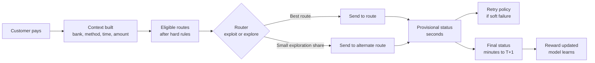
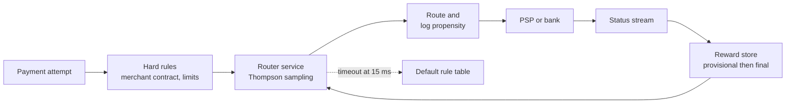

# Case Study 27: Payment Success-Rate Optimisation and Smart Routing

**Domain:** Finance (payment gateway) | **Problem Type:** Contextual bandit and online learning, plus classification | **Difficulty:** Advanced

---

## 1. Business Context

### Company background

- **FlowPe** (fictional) is a payment gateway (an intermediary that lets online merchants accept payments). It serves about 18,000 merchants across e-commerce, travel, utilities and EdTech.
- Scale: about **40 lakh payment attempts a day** (about 14.6 crore a year). Mix: UPI 55%, cards 30%, net banking 10%, wallets 5%.
- Each attempt can be sent through one of several **routes**: a payment service provider (PSP) or acquiring bank, and for cards a choice of network tokens or acquirers. FlowPe has 6 PSPs or acquirers for cards and net banking and 4 UPI rails or PSP apps.
- Routing today is a **static rule table**, reviewed monthly: "HDFC cards go to acquirer A, everything else to B, fall back to C".
- Average ticket: about ₹1,400. FlowPe earns about ₹9 net per successful payment after paying the acquirer or PSP cost.

### The pain, with numbers

| Item | Value |
| --- | --- |
| Attempts per day | 40 lakh |
| Overall success rate (SR) today | 91.5% |
| Failed attempts per day | about 3.4 lakh |
| Failures that are customer-driven (wrong PIN, insufficient balance, user drop) | about 60% of failures. Not fixable by routing |
| Failures that are route-driven (bank or PSP down, timeouts, soft declines, issuer risk rules) | about 40% of failures, about 1.36 lakh a day |
| Merchant complaint | "Our SR dips every evening and during salary days" |
| Estimated SR gain from smart routing and smart retries | about 1.2 points, to 92.7% |
| Extra successes | 1.2% of 40 lakh = 48,000 a day, about 1.75 crore a year |
| **Annual net revenue gain** | **1.75 crore x ₹9 = about ₹15.8 Cr** |

- Regulatory and market backdrop: UPI and cards run on NPCI and card-network rules. RBI payment-aggregator guidelines require clear settlement and escrow handling, and merchants and customers must not be double charged. Routing changes must never break the rule that **a customer is charged at most once**.

### Stakeholders and what each wants

| Stakeholder | What they want | What they fear |
| --- | --- | --- |
| Head of Payments | Higher SR without raising cost per transaction | A routing experiment that causes a bank to throttle us |
| Merchant success lead | SR commitments to large merchants (for example 95% on utilities) | Losing a large merchant after one bad day |
| Finance and reconciliation head | Correct final status for every transaction | Double debits, stuck pending payments |
| Bank and PSP relations | Fair volume share, no surprise spikes | A bank penalising sudden volume shifts |
| Engineering lead | Routing decision in under 15 ms, safe fallbacks | A learning system that behaves unpredictably during a sale |
| Compliance | Audit of why each route was chosen | Unexplainable routing for disputed payments |

---

## 2. Translating Business to ML

### The business question vs the ML question

| Business question | ML question |
| --- | --- |
| "Send each payment where it is most likely to succeed." | "For each attempt with context (bank, method, amount, time, merchant, device), choose a route that maximises expected net value: probability of success times margin, minus cost of the route" |
| "Should a failed payment be retried, and where?" | "Given the failure code, decide whether to retry, on which route, and whether to ask the user to act" |
| "How do we learn which route is best without gambling merchants' money?" | "Use a contextual bandit with a capped exploration budget and safe defaults" |

### Target variable definition

- **Reward for a routed attempt:** `success = 1` if the **final** status is success, meaning a confirmed debit with no reversal, plus a rupee version: `value = success x net_margin - route_cost`.
- **Final status** is known only after the bank callback, and for some payments only after reconciliation (T+1 or later).
- **Secondary classification models:** `P(success | route, context)` per route, `P(retry succeeds | failure_code, context)`, and a bank-health classifier for "this route is degrading right now".

### Edge cases

| Edge case | Recommended treatment | Reason |
| --- | --- | --- |
| Payment still "pending" after 2 minutes | Keep as unresolved. Use a provisional reward with a correction when the final status lands | Treating pending as failure teaches the router to avoid slow but good banks |
| User abandons on the bank page (never submits) | Exclude from route reward. Log as user drop | Not a route fault |
| Payment succeeded on first route, and a retry was also triggered by a timeout | Must be blocked by idempotency keys. Count as an incident if it happens | A double charge is worse than a failure |
| Success reversed later (auto-refund or bank reversal) | Update the reward to failure | Final status matters, not first response |
| Route used a fallback because the primary timed out | Log as a forced action with known probability 1 | Needed for correct offline evaluation |
| Merchant asked for a specific PSP by contract | Hard constraint. Router chooses only among allowed routes | Business rules cannot be learned away |

### Unit of prediction

- One **payment attempt** (customer, merchant, method, issuer bank, amount, time).
- Routing decision is per attempt. Learning statistics are kept per **context cell** (for example issuer bank, method, hour band, amount band).

### Prediction timing



- Decision is **real time** (under 15 ms) before the request leaves FlowPe.
- Reward arrives in stages: provisional in seconds, final in minutes for most UPI and cards, and up to T+1 for pending and reversed cases.

### What success looks like

| Lens | Success |
| --- | --- |
| Business | Lift SR from 91.5% to 92.7% or better with no increase in cost per successful payment. About ₹15.8 Cr a year gross. After exploration and engineering costs about ₹13 Cr net |
| Model | Calibrated `P(success)` per route (error under 1 point in each major cell). Offline policy value at least 0.8 points above the current rules |
| Safety | No merchant-level SR drop of more than 0.5 points on any day. Zero duplicate-charge incidents |

---

## 3. Data Understanding

### Data sources and key features

| Feature group | Source | Why it matters |
| --- | --- | --- |
| Attempt context (amount, method, issuer bank or UPI handle, card network, merchant category) | Gateway logs | Success differs sharply by bank and method |
| Time features (hour, day of week, salary day, festival sale flag) | Calendar plus clock | Banks degrade at peaks, such as 1st of month evenings |
| Route chosen and route response (response code, latency, timeout) | PSP and acquirer logs | Reward and failure reason |
| Rolling route health (SR over last 5, 15 and 60 minutes per route and bank) | Real-time stream | Detects live outages before the monthly rule review |
| Failure codes (insufficient funds, issuer declined, timeout, technical error) | Bank responses | Separates fixable from unfixable failures |
| Customer and device (new or repeat, saved instrument, app or web) | Merchant SDK | Repeat users on saved cards succeed more |
| Cost data (PSP fee per method, per-attempt fee) | Commercial contracts | Needed for value-based routing |
| Final status and reconciliation | Settlement files | True reward, with delay |

### Data volume, granularity and refresh

- **Volume:** 40 lakh attempts a day, about 12 crore a month. Context cells (about 60 issuer banks x 4 methods x 6 time bands x 4 amount bands) number about 5,800. The long tail of cells has few attempts each, so sharing strength across cells matters.
- **Granularity:** one row per attempt, with child rows for each retry.
- **Refresh:** health features every minute. Bandit posteriors update every 5 minutes. The supervised success model retrains weekly.

### Common data issues

| Issue | How it shows up here |
| --- | --- |
| Delayed and corrected rewards | About 1.5% of attempts are pending beyond 5 minutes, and 0.3% are reversed later |
| Logged-policy bias | Past data shows routes only where the old rules sent traffic. Alternate routes have no data for many banks |
| Non-stationarity | Bank downtime is bursty. A route's SR can drop from 95% to 60% in 10 minutes and recover |
| Confounding | Large merchants with high-risk customers happen to use one PSP, so that PSP looks worse |
| Sparse cells | Small banks and rare methods have too few attempts for stable estimates |
| Label ambiguity | The same bank code can mean "declined by risk" or "temporarily unavailable" |

> **Mentor note: Where juniors usually go wrong here.**
>
> - They train a classifier on historical routes and always pick the highest predicted probability. That loops back into the old data and never tests alternatives.
> - They treat "pending" as "failed" and punish slow banks that actually succeed.
> - They forget that each retry is a new attempt with a new cost, and that retrying a hard decline irritates the issuer.

---

## 4. Approach and Decision Points

### Baseline first

- **Baseline:** the static rule table (SR 91.5%).
- **Simple improvement:** a rule table refreshed daily from observed SR by bank and route, with automatic failover when a route SR drops below a floor (for example 80% over 10 minutes).
- **Why it matters:** much of the gain comes from fast failover and fresher rules. A bandit must beat this, not the monthly table.

### Candidate models

| Model | Pros | Cons | Verdict |
| --- | --- | --- | --- |
| Static or daily-refreshed rules | Transparent, safe | Slow to react, no learning | Keep as fallback and benchmark |
| Supervised classifier per route (LightGBM for P(success)) with greedy choice | Uses rich context | Biased by logged data. No exploration | Use as a prior and for explanation |
| Epsilon-greedy bandit | Simple | Explores randomly even in bad routes, wastes money | Not preferred |
| Thompson sampling per context cell (Beta posterior) | Explores where uncertain, cheap, handles sparse cells with shared priors | Needs good context grouping | **Primary approach** |
| Contextual bandit (LinUCB or a neural bandit with features) | Generalises across cells | More complex, harder to audit | Phase 2 |
| Reinforcement learning with long-horizon state | Handles retries and sequences | Heavy, risky to train live | Not now |
| Change-point detection on route health | Catches outages in minutes | Needs tuning | Add as a safety layer |

### Decision scenarios

| What if... | Recommended action | Reasoning |
| --- | --- | --- |
| **Exploration costs real rupees** (a bad route fails customers) | Set an **exploration budget** of 2% of traffic, never more than 5% on any merchant, and never explore for merchants with strict SR commitments. Compute expected exploration loss in advance: 80,000 attempts a day, 5 points worse on average, 4,000 failures at ₹9 is about ₹36,000 a day, about ₹1.3 Cr a year | Learning must have a price tag and a cap. Finance can approve a budget, not a vague "we will experiment" |
| **A bank goes down every day from 11:30 pm to 12:15 am for maintenance** | Add hour-of-day and bank to the context and use a **seasonal prior** for that cell. Pre-emptively shift traffic away at 11:25 pm, and test recovery with a small probe share | Predictable downtime should not need to be re-discovered each night by losing payments |
| **A bank's route is failing with "timeout" and the customer is waiting** | Retry only if the failure code is a technical soft failure and the idempotency check says the first debit did not go through. Choose the retry route by `P(retry success)`. Cap at 2 retries and never retry hard declines | Retries lift SR but risk double debit and issuer irritation. Failure code decides everything |
| **Status stays pending for several minutes** | Update the bandit with a **provisional reward** (for example a weighted guess from the per-route pending-to-success rate) and correct it when the final status arrives. Never treat pending as a failure | Waiting for final truth slows learning. Ignoring pending biases against slow banks |
| **Route A has 0.3 points higher SR but costs ₹2 more per success** | Optimise **expected net value**, not SR. Compare `P(success) x margin - cost` per route, and show Finance the trade-off | A higher SR is not better if the route destroys margin. Some merchants will want an SR-first mode |
| **Offline data shows the new policy is 1.5 points better, but it was trained on data from the old policy** | Use **inverse propensity scoring** and **doubly robust** estimators on logs that recorded the choice probability. Only trust the estimate in cells where the old policy tried the alternative at least occasionally. Then confirm with a live A/B on 5% of traffic | Without logged propensities, offline estimates are unreliable. Offline is a filter, not proof |
| **A festival sale quadruples volume and the bandit shifts everything to one route** | Add **volume caps per route** (for example no route above 45% share without bank agreement) and **rate-limit changes** in traffic share to 10% per hour | Banks throttle sudden spikes. Smooth shifts keep relationships and capacity safe |

---

## 5. Feature Engineering

### Top 10 features to build

| # | Feature | Business logic |
| --- | --- | --- |
| 1 | Route SR in the last 5, 15 and 60 minutes, per issuer bank and method | Captures live health and outages |
| 2 | Route response latency (p50, p95) in last 15 minutes | Rising latency usually comes before failure |
| 3 | Hour-of-day and day-of-month interaction per bank | Salary days and maintenance windows follow patterns |
| 4 | Issuer bank and card BIN (first digits of the card number) group | Bank risk rules and downtime are bank-specific |
| 5 | Amount band relative to bank limits (for example UPI per-transaction limit) | Failures spike near limits |
| 6 | Failure code family of the previous attempt in the same session | Tells if a retry is sensible |
| 7 | Repeat customer and saved-instrument flag | Known instruments succeed more |
| 8 | Merchant category and merchant risk class | Issuers decline some categories more often |
| 9 | Route cost per attempt and per success | Needed for value-based choice |
| 10 | Share of pending attempts per route in the last 30 minutes | Early warning of a slow callback problem |

### Features to avoid (leakage risks)

| Feature | Problem |
| --- | --- |
| Final status, reversal flag or reconciliation status | Known only after the decision. Direct leakage |
| Route chosen and its response code in the context | The decision itself is the action, and the response is the outcome |
| Same-session attempts that happen after the current one | Look-ahead leakage |
| Merchant ID as a unique key with very few attempts | The model memorises merchants and does not generalise |
| Customer personal identifiers | Privacy risk and no benefit for routing |

A small Thompson sampling sketch per context cell, with decay so that old data fades:

```python
import numpy as np

class CellPosterior:
    """Beta posterior for success rate of one route in one context cell."""
    def __init__(self, alpha0=20.0, beta0=2.0, decay=0.995):
        self.a, self.b, self.decay = alpha0, beta0, decay

    def update(self, success, weight=1.0):
        # decay old evidence so the router can notice outages
        self.a = self.a * self.decay + weight * success
        self.b = self.b * self.decay + weight * (1 - success)

    def sample_value(self, margin, cost, rng):
        p = rng.beta(self.a, self.b)
        return p * margin - cost

def choose_route(cells, margin, costs, explore_ok, rng):
    values = {r: cells[r].sample_value(margin, costs[r], rng) for r in cells}
    # if exploration is not allowed for this merchant, use the posterior mean instead
    if not explore_ok:
        values = {r: (cells[r].a / (cells[r].a + cells[r].b)) * margin - costs[r]
                  for r in cells}
    return max(values, key=values.get)
```

---

## 6. Evaluation Strategy

### Metrics

| Metric | Role | Why |
| --- | --- | --- |
| **Final-status success rate**, overall and per merchant, bank and method | Primary business metric | Directly tied to revenue |
| **Net value per attempt** (P(success) x margin minus route cost) | Primary optimisation metric | Balances SR and cost |
| **Regret** (value of the best route in hindsight minus value of the chosen route) | Bandit quality | Measures learning cost |
| Calibration of P(success) per route | Model quality | Value maths needs honest probabilities |
| Exploration share and exploration loss in ₹ | Budget control | Keeps learning inside the approved cap |
| Retry success rate and duplicate-charge incidents | Safety | Retries must help and never double charge |
| Decision latency p99 | Engineering | The router must not slow payments |

### Metrics that look good but are misleading here

- **Provisional SR:** can look 1 point higher than final SR because of later reversals.
- **Overall SR alone:** the mix of methods and banks changes by day, so SR can rise without any routing gain. Compare like for like by context cell.
- **AUC of the success classifier:** a high AUC mostly reflects the customer-driven failures that routing cannot change.
- **Offline replay on logs without propensities:** it treats the old policy's choices as if they were random.

### Validation strategy

| Step | Design | Why |
| --- | --- | --- |
| Time-based backtest | Train on weeks 1 to 8, test on weeks 9 to 12, and keep festival weeks as a separate test | Traffic shifts at peaks |
| Off-policy evaluation | IPS and doubly robust estimates using logged propensities from the 2% exploration traffic | Safe estimate of a new policy before exposure |
| Simulator | Replay bank-outage scenarios (30-minute outage, slow degradation, flapping) against the router | Tests reaction time without risking money |
| Randomised live test | 5% of traffic by merchant-stratified random split, 14 days, with final-status outcomes only | The only unbiased proof |
| Per-merchant guardrails | Daily SR per merchant vs control, with a 0.5-point tolerance | Protects large merchants |
| Delay-aware reporting | Report results only after T+1 final status settles | Avoids pending-status bias |

### From model metric to business value

- Attempts: 40 lakh a day x 365 = about 14.6 crore a year.
- SR lift of 1.2 points: about 1.75 crore extra successful payments a year. At ₹9 net each, about **₹15.8 Cr**.
- Exploration cost: 2% of traffic at 5 points worse is about 4,000 extra failures a day, about 14.6 lakh a year, which at ₹9 is about **₹1.3 Cr**.
- Extra engineering, monitoring and bank-relationship cost: about ₹1.5 Cr a year.
- Net benefit: about **₹13 Cr a year**.

---

## 7. Deployment and Monitoring

### Batch vs real time

- **Real time:** routing decision per attempt, retry decision, live health features, posterior updates every few minutes.
- **Batch:** weekly retrain of the supervised success model and priors, daily reconciliation of final status and reward correction, monthly review of route costs and contracts.



### What to monitor

| Type | What to track | Alert trigger |
| --- | --- | --- |
| Route health | SR and latency per route and bank, 5-minute windows | SR drop of more than 10 points vs the last hour, or latency p95 doubles |
| Policy behaviour | Traffic share per route, exploration share | Any route above its cap, or exploration above 2.5% |
| Business KPIs | Final-status SR per merchant, net value per attempt | Merchant SR down more than 0.5 points vs control |
| Safety | Duplicate charge incidents, retry rate, double-pending cases | Any duplicate charge, or retry rate up by 30% |
| Reward quality | Share of pending beyond 5 minutes, reversal rate | Pending above 3% |
| Model quality | Calibration of P(success) per major cell | Error above 2 points in any top-20 cell |
| Latency | Router decision p99, fallback rate | p99 above 12 ms, or fallback above 0.5% |

### Retraining

- **Online:** posteriors update every 5 minutes with decay.
- **Scheduled:** supervised success model and cell priors weekly.
- **Triggered:** new route onboarded (start with a high-uncertainty prior and a small cap), new bank rule, or a failed health check.
- **Kill switch:** a single flag that reverts every merchant to the rule table in seconds.

### A/B test or champion-challenger design

- **Shadow first:** the router logs what it would have chosen, with no traffic impact, for 2 weeks.
- **Live split:** 5% of traffic, randomised by merchant-stratified hash of the attempt (the same customer in one session stays on one policy). Ramp to 20%, then 50%, then 100% only after each stage passes guardrails.
- **Guardrails:** stop if SR falls by more than 0.3 points for any large merchant, or any duplicate charge is found.
- **Holdout:** keep 2% of attempts on the old rule table at all times for a clean comparison and for unbiased exploration data.

---

## 8. Stakeholder Communication

### Explain it to a non-technical leader

> "For every payment, we choose the route most likely to succeed at the lowest sensible cost, using live health signals from each bank and PSP.
> Most of the time we send traffic to the best-known route. For a small, capped 2% share we try alternatives, so we notice when a route improves or breaks.
> We expect about 1.2 more successful payments for every 100 attempts, worth about ₹13 Cr a year after costs. A kill switch returns us to the old rules in seconds."

### Questions leadership will ask

| Question | Suggested answer |
| --- | --- |
| "Why spend money on experiments with customers' payments?" | "A fixed rule table cannot see a route improving or silently degrading. The 2% exploration costs about ₹1.3 Cr a year and is capped. The expected gain is about ten times that" |
| "Can a customer be charged twice?" | "No. Every attempt carries an idempotency key, and we only retry after confirming the first debit did not happen. Any duplicate is a stop-the-line incident" |
| "What if one big bank goes down during a sale?" | "Health monitors detect it in minutes, and traffic shifts away within the caps agreed with banks. Known maintenance windows are handled in advance" |
| "Will banks object to traffic moving around?" | "We cap per-route share, rate-limit changes, and share the volume plan with bank relations" |
| "How will we know it works?" | "A randomised live test measured on final-status success rate by merchant, read only after settlement" |

---

## 9. Common Pitfalls and Lessons

| Mistake | Why it happens | How to avoid it |
| --- | --- | --- |
| Always picking the top predicted route | Classifier feels sufficient | Keep a small, capped, logged exploration share |
| Counting pending as failure or success | Final status is slow to arrive | Use provisional rewards and correct them at final status |
| Optimising SR when margin differs by route | SR is easy to report | Optimise expected net value and offer an SR-first mode when asked |
| Not logging the probability of each action | Logs were built for debugging only | Log the route, probability, and context for every decision |
| Retrying hard declines | "Retries lift SR" | Retry only on soft failure codes, cap at 2, check idempotency |
| Mixing customer-driven failures into route evaluation | All failures look alike | Separate failure codes before measuring route quality |
| Sudden traffic shifts | Learner is greedy | Cap route share and rate-limit changes |
| Ignoring non-stationarity | Posteriors treated as permanent | Decay old evidence and add outage detection |
| Launching without a kill switch | Confidence in the model | Build the revert path first |

---

## 10. Mentor's Focus Checklist

- ✅ **Where to spend 80% of the effort:**
  - Correct reward definition: final status, pending handling, reversals.
  - Logging propensities so offline policy evaluation is possible.
  - Safety design: exploration budget, route caps, idempotent retries, kill switch.
  - Live health monitoring and per-merchant guardrails.
- ❌ **What not to over-engineer:**
  - Deep reinforcement learning or large neural bandits before Thompson sampling per cell works.
  - Perfect prediction of customer-driven failures, which routing cannot fix.
  - Hundreds of context features when issuer bank, method, time and amount do most of the work.
- 💡 **Key takeaway:** In payment routing, **every experiment is paid for in real rupees and real customers**. Decide the exploration budget first, log every decision with its probability, and measure success only on final status.
