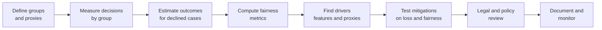
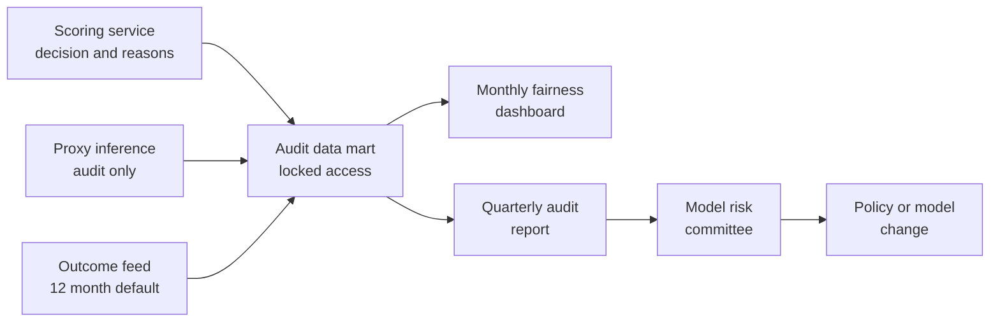

# Case Study 28: Fairness and Bias Audit of an Existing Credit-Approval Model

**Domain:** Finance (consumer lending, model risk) | **Problem Type:** Model audit and fairness analysis (classification) | **Difficulty:** Intermediate

---

## 1. Business Context

### Company background

- **Sahaj Credit** (fictional) is an NBFC (non-bank lender) giving unsecured personal loans of ₹30,000 to ₹3,00,000 through its app and 400 partner branches.
- Scale: about **12 lakh applications a year**. The current approval model (a gradient-boosted scorecard in production for 2 years) approves about 57%.
- The model was built to predict default. Nobody checked how its decisions differ across groups of people, because the application form does not collect caste, religion or community, and gender is recorded only from KYC documents.
- Trigger for this audit: a journalist's query and an internal observation that women applicants seem to be approved less often. The Board's risk committee asked for an independent audit within 8 weeks.

### The pain, with numbers

| Item | Value |
| --- | --- |
| Applications a year | 12 lakh |
| Women applicants (from KYC gender) | 30%, so 3.6 lakh |
| Men applicants | 70%, so 8.4 lakh |
| Approval rate, men | 61%, so about 5.12 lakh approvals |
| Approval rate, women | 49%, so about 1.76 lakh approvals |
| Overall approval rate | about 57% |
| Estimated share of applicants who would repay (good payers) | about 93% for both groups in the bureau-matched sample |
| Approval rate among good payers (true positive rate, TPR), men | 78% |
| Approval rate among good payers, women | 69% |
| Possible revenue left on the table | about ₹7 Cr a year net (see Section 6) |
| Regulatory and reputation risk | Unquantified, but a finding of unfair practice can mean supervisory action, and public trust falls fast |

- Regulatory backdrop: RBI's fair-practices expectations for lenders say credit decisions must be non-discriminatory, transparent and explainable, with grievance redressal. Model-risk guidance expects documentation, validation and governance for models that drive decisions. The DPDP Act 2023 limits how personal data may be used beyond the stated purpose. There is no single "fairness formula" in law, so the audit must be reasoned and documented.

### Stakeholders and what each wants

| Stakeholder | What they want | What they fear |
| --- | --- | --- |
| Board risk committee | A clear, independent answer on whether the model treats groups fairly | Being surprised by a regulator or a news story |
| Chief Risk Officer | Keep the default rate under 4.5% of disbursed value | A fairness fix that raises losses |
| Head of Credit Policy | A policy they can defend line by line | Having to explain a statistical metric to a regulator |
| Compliance and Legal | Whether group-specific thresholds are even permissible | A fix that is itself discriminatory |
| Data science lead | Clean method, reproducible results | Being blamed for a model that followed the objective it was given |
| Head of Growth | More good customers approved | Slow, complicated approval journeys |

---

## 2. Translating Business to ML

### The business question vs the ML question

| Business question | ML question |
| --- | --- |
| "Is our model unfair to women or to any community?" | "Estimate approval rate, error rates and calibration for each group, and test whether differences are explained by genuine risk differences or by proxies" |
| "Which inputs are causing it?" | "Attribute the gap to features (for example pincode, device, surname-linked patterns) and test counterfactual changes" |
| "How do we fix it without breaking risk control?" | "Compare mitigation options on loss, approval, fairness metrics and legal permissibility" |

### Target variable definition

This case has two layers.

- **Audit outcomes (what we measure):** the model's approve or decline decision, the predicted PD (probability of default) and the observed default within 12 months on booked loans.
- **Ground truth for "good payer":** `would_repay = 1` is observed only for approved loans. For declined applicants we use (a) bureau repayment behaviour on other loans in the following 12 months, (b) a small **randomised approval pilot** (see Case 30 for reject inference), and (c) consented follow-up surveys. We treat each source with caution and report ranges, not single numbers.
- **Group labels:** gender from KYC. For other groups (community, religion, region) we have **no label** and will not collect one for decisioning. For the audit only, we use **proxy inference**: surname-and-geography models, census-based pincode shares, and a consented survey of about 8,000 customers. Results are reported as ranges with the proxy error stated.

### Edge cases

| Edge case | Recommended treatment | Reason |
| --- | --- | --- |
| Gender missing or "other" in KYC | Keep as its own group. Report separately, flag small sample | Small groups still deserve attention |
| Surname gives a poor community guess | Use probabilistic membership weights, never hard labels, and test with the survey sample | Hard labels create false findings |
| Declined applicants have no repayment outcome | Use bureau follow-up and the randomised pilot. Do not assume all declines were correct | The model cannot audit itself on data it created |
| Co-applicant loans (husband and wife) | Analyse by primary applicant and by household income | Gender effects mix with household credit history |
| Applicant reapplies after decline and gets approved | Keep first decision as the audited event | Later decisions are influenced by changes in file |
| Policy overrides by branch officers | Audit model decisions and final decisions separately | Humans may add or remove bias |

### Unit of prediction

- One **application decision**. The audit unit is the **group** (men, women, or an estimated community or region cohort) within a time window.

### Prediction timing



- The audit is **retrospective** on the last 24 months of decisions, repeated **quarterly** after that.
- Outcomes mature over 12 months, so the audit uses cohorts at least 12 months old for default and recent cohorts for approval rates only.

### What success looks like

| Lens | Success |
| --- | --- |
| Business | Gap in good-payer approval between men and women cut from 9 points to 3 points or lower with the default rate no worse than 4.5% |
| Audit quality | Every metric has a confidence interval, a stated proxy error, and a documented limitation |
| Governance | A model-risk document with scope, data, metrics, findings, decisions, owners and review dates, approved by Risk and Compliance |
| Customer | A reason code for every decline that does not rely on a suspect proxy |

---

## 3. Data Understanding

### Data sources and key features

| Feature group | Source | Why it matters |
| --- | --- | --- |
| Application data (income, age, employment type, loan amount, tenure) | Application form | Legitimate credit drivers |
| Bureau data (score, active loans, enquiries, delinquencies) | Credit bureau | Strongest legitimate risk signal, but thin for women with no credit history in their name |
| Device and app data (phone price band, OS, app install list, time of application) | App SDK | Possible proxy for income, gender or community |
| Geography (pincode, district, urban or rural flag) | Application | Proxy for community and income. Also real risk signal such as local employment |
| Name data (surname) | KYC | Not used in the model, but can reveal community. Used only for audit proxies |
| Model outputs (score, decision, reason codes) | Scoring service | What we audit |
| Outcomes (12-month default, delinquency) | Loan system | Ground truth for approved loans |
| Survey sample (consented) | Customer research | Ground truth for group labels and income |
| Branch override logs | Branch system | Human decisions that change outcomes |

### Data volume, granularity and refresh

- **Volume:** 24 months, about 24 lakh decisions, about 13.7 lakh booked loans. Women: about 7.2 lakh applications.
- **Survey sample:** about 8,000 consented customers, enough for coarse group estimates but too small for small communities.
- **Granularity:** one row per application with model score, decision, reason codes, and later outcome for approved loans.
- **Refresh:** audit quarterly. Fairness dashboard monthly.

### Common data issues

| Issue | How it shows up here |
| --- | --- |
| No group label | Community and religion are not collected, and should not be |
| Selection bias | Defaults are seen only for approved loans, so groups that were harder to approve have less evidence |
| Proxy error | Surname-based inference is wrong for 15% to 25% of people, and wrong more in some regions |
| Small groups | Some communities have fewer than 500 applications, so rates are noisy |
| Thin-file women | No bureau history because loans were in a husband's or father's name |
| Confounding | Women are more often in informal or part-time work, so income gap and gender gap are tangled |
| Drift | Product mix changed during the period (more small-ticket loans for women through a partner) |

> **Mentor note: Where juniors usually go wrong here.**
>
> - They say "we do not use gender, so the model is fair." Proxies such as pincode, device price and employer type can encode gender and community.
> - They compute fairness on approved loans only and conclude that all is fine, because the declined people are invisible.
> - They assume one fairness metric is "the" metric. They are different value choices and cannot all hold together.

---

## 4. Approach and Decision Points

### Baseline first

- **Baseline:** simple group tables. For each group, report applications, approval rate, average score, mean predicted PD, observed default on approved loans, and the number of reason codes by type.
- **Why it matters:** half of the useful findings come from the plain tables. For example, a pincode reason code firing twice as often for one group is visible without any fairness library.

### Candidate analyses and mitigations

| Method | Pros | Cons | Verdict |
| --- | --- | --- | --- |
| Group-level metric tables with confidence intervals | Simple, readable by Board | Does not explain causes | Start here |
| Feature ablation (drop or permute one feature at a time) | Shows which features move the gap | Correlated features hide each other | Core diagnostic |
| Counterfactual tests (change pincode or device only and rescore) | Shows model sensitivity | Not a real person's alternate life | Use for proxies |
| Disparate impact ratio (approval rate of group A divided by group B) | Easy headline, familiar from the four-fifths rule | Ignores real risk differences | Report, do not use alone |
| Equal opportunity (equal approval among good payers) | Focuses on missed good customers | Needs outcomes for the declined | Primary fairness view |
| Calibration by group (predicted PD vs observed default per group) | Shows if the score means the same thing for everyone | Needs enough data per group | Primary risk-fairness view |
| Fairness-constrained retraining (add a penalty or a constraint during training) | Controls the gap inside the training | Needs agreed definition and monitoring | Candidate fix |
| Group-specific thresholds | Direct gap control | Can be unlawful or unacceptable if it treats people differently by a protected trait | Only with Legal sign-off, usually avoided |
| Remove or limit suspect features, add stronger legitimate ones | Easy to explain | Costs some accuracy | Preferred first fix |

### Decision scenarios

| What if... | Recommended action | Reasoning |
| --- | --- | --- |
| **The model never sees gender or caste but the approval gap is still 12 points** | Test proxies: run feature ablation, check pincode, phone price, employer type and app-install features against gender and survey community. Compute how much of the gap disappears when each is removed | "Fairness through unawareness" fails when features carry the same information. The audit must find carriers of the signal |
| **Equal approval rates and calibration cannot both hold** | State the conflict openly. Pick a **primary** metric with Risk, Legal and the Board (for credit, usually calibration plus equal opportunity), report the rest, and record why. When base rates differ across groups, the metrics cannot all be satisfied | A known mathematical result: when group default rates differ, one cannot have parity, calibration and equal error rates together. Hiding the trade-off is worse than naming it |
| **There is no group label for community** | Use three evidence types and report ranges: probabilistic surname-and-geography inference, pincode-level census shares, and a consented survey. Do not store inferred community in any decision table. Keep it in a locked audit environment and delete it after the study | Inferring sensitive attributes is itself a privacy and DPDP risk. Use it only for audit, with minimum retention |
| **Women show 69% approval among good payers versus 78% for men, but predicted PD for women is 5.0% and observed is 4.1%** | The score **over-predicts** risk for women, meaning the model is too harsh. Recalibrate, review features that are weaker for thin-file women, add alternative data like rent or utility payments, and re-measure | Miscalibration by group is direct evidence the score means different things. Fix the feature set, not the output by group |
| **Legal says group-specific thresholds could be discriminatory** | Use mitigations that do not set thresholds by protected group: drop or cap proxy features, add stronger legitimate features, train with a fairness constraint, or adjust policy rules that apply to everyone (for example income-proof alternatives) | Different rules by protected trait are risky even with good intent. Neutral rules that reduce a gap are easier to defend |
| **Removing pincode cuts the gap by 5 points but costs 0.8 points of AUC** | Quantify in rupees: extra defaults versus extra good customers. Consider keeping a **local risk** feature built from legitimate data (local default experience by branch catchment, with smoothing) rather than raw pincode | Some geography carries real risk. The question is whether we can capture the risk without the community proxy |
| **Branch officers override model declines more often for men** | Audit overrides as their own decision layer: override rate, reason, outcome by group. Add a required override reason and review monthly | Human discretion can offset or add bias. The audit must include it |

---

## 5. Feature Engineering

### Top 10 features (or checks) to build for the audit

| # | Feature or check | Business logic |
| --- | --- | --- |
| 1 | Approval rate by group, with 95% confidence interval | Headline measurement |
| 2 | Disparate impact ratio (women divided by men) | A familiar screening number. Below 0.8 raises concern |
| 3 | Approval rate among good payers (equal opportunity) | Shows how many deserving applicants are missed |
| 4 | Predicted PD against observed default by decile, per group | Tests calibration |
| 5 | Share of reason codes by type per group | Reveals which features drive declines for whom |
| 6 | Pincode default-rate encoding versus group share in pincode | Shows pincode acting as a community proxy |
| 7 | Phone price band and OS share by group | Shows device as an income or gender proxy |
| 8 | Bureau thin-file flag by group | Explains a part of the gap legitimately and highlights the credit-invisible |
| 9 | Income-proof type (salary slip, bank statement, none) by group | Documentation burden differs for informal workers |
| 10 | Override rate and direction by branch and group | Human-layer bias |

### Features to avoid (leakage and fairness risks)

| Feature | Problem |
| --- | --- |
| Gender, religion, caste, or inferred versions as model inputs | Protected traits. Use only for audit, never for scoring |
| Surname or name-derived features | Strong community proxy |
| Raw pincode as a categorical code | Encodes community and income segregation. Replace with smoothed, legitimate local risk indicators |
| Phone model, price band, app-install list | Proxies for income, gender and community, with weak causal link to repayment |
| Marital status or number of dependants | Can proxy gender and lead to unfair penalties |
| Post-decision outcome used to label groups | Selection bias and leakage |

A small calibration-by-group check, central to the audit:

```python
import pandas as pd

def calibration_by_group(df, group_col, n_bins=10):
    """df has: pred_pd, defaulted (booked loans only), group."""
    df = df.assign(bin=pd.qcut(df["pred_pd"], n_bins, duplicates="drop"))
    table = (df.groupby([group_col, "bin"], observed=True)
               .agg(n=("defaulted", "size"),
                    mean_pred=("pred_pd", "mean"),
                    observed=("defaulted", "mean"))
               .reset_index())
    table["gap"] = table["mean_pred"] - table["observed"]
    return table
```

---

## 6. Evaluation Strategy

### Metrics

| Metric | Role | Why |
| --- | --- | --- |
| **Approval-rate parity** (difference and ratio between groups) | Screening metric | Easy to explain. Does not tell whether the gap is justified |
| **Equal opportunity** (TPR among good payers, by group) | Primary fairness metric | Asks whether deserving people are approved at equal rates |
| **Calibration by group** (predicted vs observed PD) | Primary risk-fairness metric | A score should mean the same risk for everyone |
| False positive rate by group (approved bad payers) | Secondary | Equalised odds needs both TPR and FPR to match |
| AUC and KS by group | Model quality | A model that ranks worse for one group is unfair in practice |
| Reason-code distribution by group | Transparency | Detects proxies firing unequally |
| Default rate and approval volume after mitigation | Business | The price of the fix |

### Metrics that look good but are misleading here

- **Overall AUC of 0.78:** can hide an AUC of 0.71 for thin-file women.
- **Disparate impact ratio alone:** a ratio of 0.8 can be fair if risk really differs, and a ratio of 0.95 can hide bias if the declined were creditworthy.
- **Observed default on approved loans only:** survivor bias. Declined applicants are invisible.
- **Fairness "passed" on one metric:** passing parity while failing calibration is not a pass.

### Validation strategy

| Step | Design | Why |
| --- | --- | --- |
| Time-based audit windows | Audit each quarter of the last 8 quarters and compare | Shows whether the gap is stable, growing or falling |
| Confidence intervals by bootstrap | 1,000 resamples within each group, report 95% intervals | Small groups need honest uncertainty |
| Proxy-error sensitivity | Re-run with proxy accuracy set to 70%, 80%, 90% | Shows how much findings depend on the group inference |
| Reject inference sample | 15,000 randomised approvals of otherwise declined applicants over 6 months (small ticket) | Gives real outcomes for the declined |
| Counterfactual rescoring | Change one proxy (for example pincode) and rescore | Tests sensitivity without new data |
| Independent review | Validation team outside the model-build team repeats the key tables | Model-risk good practice |

### From model metric to business value

- **Equal opportunity gap:** among women, good payers are about 93% of 3.6 lakh = **3,34,800**. At TPR 69%, 2,31,012 are approved. At TPR 78%, 2,61,144 would be approved. **Additional good customers: about 30,100.**
- **Revenue:** at about ₹3,200 net lifetime margin per good loan, about **₹9.6 Cr**.
- **Added risk:** bad payers among women are about 25,200. If their approval (FPR) rises from 18% to 24%, 1,512 more bad loans at about ₹18,000 loss each is about **₹2.7 Cr**.
- **Net benefit:** about **₹6.9 Cr a year**, an upper bound because some of the missed good payers will not accept offers, and the TPR estimate for declined applicants has uncertainty.
- **Risk side:** the cost of an adverse finding (supervisory action, reputation, customer trust) is not in this number and is the main reason to act.

---

## 7. Deployment and Monitoring

### Batch vs real time

- **Batch:** the audit is a quarterly study plus a monthly dashboard. It is not in the scoring path.
- **Real time (light):** decline reason codes shown at decision time. A feature-level guardrail (no excluded proxy enters the scoring service).



### What to monitor

| Type | What to track | Alert trigger |
| --- | --- | --- |
| Approval parity | Approval rate and ratio by gender and by proxy region cohort | Ratio below 0.85, or a drop of 3 points in a quarter |
| Equal opportunity | TPR for good payers on the bureau-matched sample | Gap above 4 points |
| Calibration | Predicted minus observed PD per group | Gap above 1 point in any group with 2,000 or more loans |
| Reason codes | Share of declines by reason type per group | A reason code share differs by more than 1.5 times |
| Data drift | Distribution of pincode, device and income features | PSI above 0.2 |
| Overrides | Override rate and direction by group and branch | A branch with an override rate gap above 10 points |
| Governance | Open audit actions, time to close | Any finding open beyond its due date |

### Retraining

- **Scheduled:** re-run the audit each quarter and after every model change.
- **Triggered:** a new feature, new partner channel, or a change in product mix.
- **Release gate:** no new model goes live without a fairness section in the model card, signed off by Risk and Compliance.

### A/B test or champion-challenger design

- **Champion:** the current model. **Challenger:** a version with suspect proxies removed, plus a fairness-constrained version.
- **Shadow first:** score all applications for 6 weeks and compare approvals, calibration and reason codes by group.
- **Live trial:** 10% of applications, randomised by application ID, with a cap on extra exposure (for example total extra expected loss under ₹30 lakh for the trial).
- **Guardrails:** stop if default in the trial arm rises more than 0.3 points, or if any group's approval falls more than 3 points.
- **Documentation:** record the hypothesis, metric choices and sign-offs before the test starts.

---

## 8. Stakeholder Communication

### Explain it to a non-technical leader

> "We checked whether our credit model treats groups of applicants differently. Women who would have repaid are approved about 69% of the time, against 78% for men. The model never sees gender, but it uses signals such as pincode and phone type that can stand in for it.
> We propose to remove or limit the worst signals, add better ones such as rent and utility payment history, and re-test. We expect this to bring in about 30,000 more good customers a year without raising defaults noticeably.
> Fairness has several definitions that cannot all be met at once, so we have recorded which ones we chose, and why, for the Board and the regulator."

### Questions leadership will ask

| Question | Suggested answer |
| --- | --- |
| "We do not use gender. Isn't that enough?" | "No. Other inputs can carry the same information. We tested this by removing and swapping each input and measuring the change" |
| "Can we just set a lower cut-off for women?" | "That is a different rule by protected group and needs Legal approval. We prefer neutral fixes, such as better features and removing proxies, that reduce the gap for everyone affected" |
| "Will it raise our losses?" | "We estimate a small rise in bad loans, about ₹2.7 Cr, against about ₹9.6 Cr of new margin. We will test on a capped trial first" |
| "How can we audit community when we do not collect it?" | "We use careful proxies and a consented survey for audit only, keep the data locked, and delete it after the study. Results come with a stated error range" |
| "Which fairness metric do we follow?" | "Calibration and equal opportunity are primary, parity is a screening check. The documented reason is that they relate to repayment and to missed good customers" |
| "Is this a one-off?" | "No. It becomes a quarterly audit and a gate for every new model" |

---

## 9. Common Pitfalls and Lessons

| Mistake | Why it happens | How to avoid it |
| --- | --- | --- |
| Assuming no protected feature means no bias | Easy to believe and easy to tell the Board | Test proxies with ablation, counterfactuals and group tables |
| Auditing only approved loans | Outcomes exist only there | Use bureau follow-up, randomised approvals and report limits |
| Choosing the metric that makes the model look best | Pressure to pass the audit | Fix primary metrics with Risk and Legal before looking at results |
| Using hard inferred labels for community | Simpler code | Use probabilistic weights and show sensitivity to proxy error |
| Ignoring small groups | Averages look fine | Report intervals, merge cautiously, and flag low-sample groups |
| Treating the gap as only a model issue | Focus on the algorithm | Audit policy rules, documentation requirements and branch overrides too |
| Fixing the output with group thresholds without Legal | It is the quickest lever | Prefer neutral mitigations and get Legal sign-off for any other option |
| No documentation trail | Audit seen as a one-off | Write the audit as a model-risk document with scope, data, metrics, decisions and owners |
| Storing inferred community in production tables | Convenient for analysis | Keep it in a locked environment with minimum retention |

---

## 10. Mentor's Focus Checklist

- ✅ **Where to spend 80% of the effort:**
  - Getting honest outcome estimates for the declined (bureau follow-up, randomised approvals).
  - Proxy discovery with ablation and counterfactual tests.
  - Agreeing primary fairness metrics with Risk, Legal and Compliance before seeing results.
  - Writing a clear model-risk document that someone else could re-run.
- ❌ **What not to over-engineer:**
  - Fancy fairness-constrained algorithms before the plain group tables and feature review are done.
  - Hunting for perfect group labels. State the proxy error and move on.
  - Trying to satisfy every fairness metric at once. It is mathematically not possible.
- 💡 **Key takeaway:** A fairness audit is **a measurement and documentation exercise first and a modelling exercise second**. Name your groups, state your error, choose your metrics with reasons, and show the rupee price of each fix.
